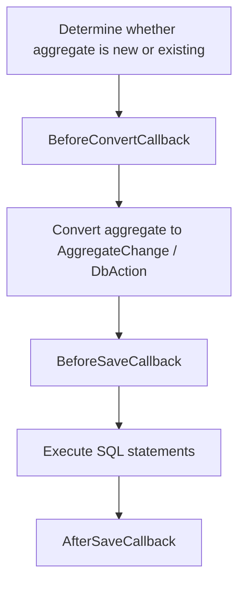
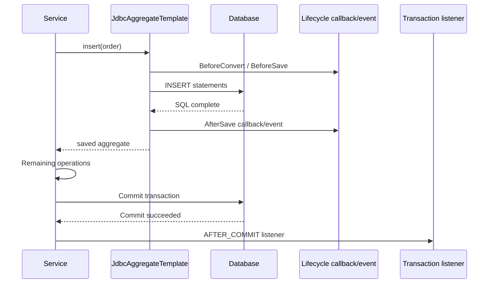

# Managing Transactions, Callbacks, and Events When Calling the Template

In **Spring Data Relational JDBC**, `JdbcAggregateTemplate` is the API for interacting directly with aggregates in the database. It provides operations such as `insert`, `update`, `save`, `delete`, and read methods. Calling the template lets the application control exactly when each operation executes without going through a repository interface.

These operations typically coordinate with three Spring mechanisms:

- **Transactions** define commit or rollback boundaries for one or more database operations.
- **Entity callbacks** provide synchronous hooks to modify or process an aggregate at steps in the save, load, and delete lifecycles.
- **Lifecycle events** notify listeners that an aggregate has passed a specific stage, such as before saving or after converting read data.

Distinguish Spring Data JDBC lifecycle events from application domain events. Lifecycle events reflect persistence activity; domain events describe meaningful business occurrences, such as an order having been paid. When using `JdbcAggregateTemplate` directly, you must intentionally design how domain events are published and when they are handled.

## 1. JdbcAggregateTemplate in a Spring Application

`JdbcAggregateTemplate` is Spring Data JDBC's aggregate-level API. Spring Data JDBC repositories also use the template internally to implement most persistence functionality.

Spring Boot/Spring Data JDBC can configure the template as a Spring bean. Inject this bean into a service or custom repository when direct operations are needed:

```java
import org.springframework.data.jdbc.core.JdbcAggregateTemplate;
import org.springframework.stereotype.Service;

@Service
public class PurchaseOrderService {

    private final JdbcAggregateTemplate template;

    public PurchaseOrderService(JdbcAggregateTemplate template) {
        this.template = template;
    }
}
```

Do not instantiate it manually via constructor inside each service. The Spring-configured bean is wired with the application's mapping context, converters, data access strategy, entity callbacks, and application event publisher.

### 1.1. Main Persistence Operations

`JdbcAggregateTemplate` provides several groups of operations:

| Method | Purpose |
|---|---|
| `insert(aggregate)` | Insert a new aggregate |
| `update(aggregate)` | Update an existing aggregate |
| `save(aggregate)` | Save an aggregate, choosing insert or update by new/existing state |
| `upsert(aggregate)` | Insert or update using database native upsert when dialect supports it |
| `delete(aggregate)` | Delete an aggregate by root |
| `deleteById(id, type)` | Delete an aggregate by ID and root type |
| `findById(id, type)` | Load an aggregate by ID |
| `findAll(type)` | Load aggregates of the given type |
| `count(type)` | Count aggregates |

`insert` and `update` assume state matching the method name. `save` performs new/existing state detection similar to repository `save`. `upsert` requires an assigned ID and dialect capability; current documentation notes that upsert does not yet support optimistic locking.

Example:

```java
PurchaseOrder inserted = template.insert(newOrder);
PurchaseOrder updated = template.update(existingOrder);
PurchaseOrder saved = template.save(order);
```

A single aggregate save operation can span multiple SQL statements for the root and its owned entities. The template understands aggregate mapping and executes the required statements according to that structure.

### 1.2. When to Use the Template Instead of a Repository?

Use a repository when the use case fits CRUD/query method contracts and you want to keep the persistence layer behind a repository abstraction.

Use `JdbcAggregateTemplate` when:

- A service needs to invoke `insert`/`update`/`save`/`delete` directly.
- A custom repository fragment wants to reuse existing aggregate mapping.
- You want a general-purpose persistence operation without adding another repository method.
- You need the `Query` and `Criteria` query API.
- You want to combine multiple template operations within a service-managed transaction.

The template does not replace all custom SQL needs. If you need a complex JOIN projection, `JdbcTemplate` or `NamedParameterJdbcTemplate` may still be a better fit.

## 2. Transactions as the Boundary for Template Operations

Persisting an aggregate can execute multiple SQL statements—for instance, a root row and multiple order item rows. If one statement succeeds and a subsequent one fails, the database can be left in a partial state unless all statements run inside the same transaction.

Therefore, place transaction boundaries at the service/application layer whenever multiple persistence statements must succeed or roll back together.

### 2.1. Using @Transactional on Services

```java
import org.springframework.data.jdbc.core.JdbcAggregateTemplate;
import org.springframework.stereotype.Service;
import org.springframework.transaction.annotation.Transactional;

@Service
public class PurchaseOrderService {

    private final JdbcAggregateTemplate template;

    public PurchaseOrderService(JdbcAggregateTemplate template) {
        this.template = template;
    }

    @Transactional
    public PurchaseOrder place(PurchaseOrder order) {
        return template.insert(order);
    }

    @Transactional
    public PurchaseOrder revise(PurchaseOrder order) {
        return template.update(order);
    }
}
```

`@Transactional` creates or joins a transaction according to propagation settings. When the service method completes normally, the transaction commits. When an error matching the rollback policy occurs, the transaction rolls back.

Placing transactions on the service also lets you group multiple template operations into one business unit of work:

```java
@Transactional
public PurchaseOrder placeOrder(
        PurchaseOrder order,
        CustomerAccount account) {

    PurchaseOrder savedOrder = template.insert(order);
    template.update(account);

    return savedOrder;
}
```

If the second operation fails and the exception triggers a rollback, the order insert also rolls back. Atomicity holds only when all operations participate in the same transaction manager and managed data source.

### 2.2. Sharing the Same DataSource and Transaction Manager

Spring JDBC binds connections to the transaction manager. For template and JDBC operations to share a transaction:

- They must use the same `DataSource` managed by the transaction manager.
- Use an appropriate transaction manager, typically `JdbcTransactionManager` or `DataSourceTransactionManager`.
- Calls must execute within an active transaction context.

If a service uses the template with one `DataSource` while custom JDBC code uses another `DataSource` and another transaction manager, you cannot assume both will commit or roll back together as a single transaction.

In a standard Spring Boot Spring Data JDBC setup, beans are auto-configured. If you configure multiple `DataSource`s manually, specify the corresponding transaction manager on the service:

```java
@Transactional("ordersTransactionManager")
public void processOrder() {
    // Operations use the DataSource bound to this transaction manager.
}
```

The qualifier name in the example is an application-configured bean name, not a mandatory default.

### 2.3. Grouping Operations with TransactionTemplate

If you need programmatic transaction control instead of annotations, use `TransactionTemplate`:

```java
import org.springframework.stereotype.Service;
import org.springframework.transaction.support.TransactionTemplate;

@Service
public class OrderBatchService {

    private final JdbcAggregateTemplate aggregateTemplate;
    private final TransactionTemplate transactionTemplate;

    public OrderBatchService(
            JdbcAggregateTemplate aggregateTemplate,
            TransactionTemplate transactionTemplate) {
        this.aggregateTemplate = aggregateTemplate;
        this.transactionTemplate = transactionTemplate;
    }

    public PurchaseOrder createOrder(PurchaseOrder order) {
        return transactionTemplate.execute(status -> {
            PurchaseOrder saved = aggregateTemplate.insert(order);

            // Additional database operations can run
            // inside the same transaction here.

            return saved;
        });
    }
}
```

`TransactionTemplate.execute` accepts a callback, manages starting and completing the transaction, and returns the callback's result. It is helpful when transaction boundaries depend on conditional branching in code or inside components where `@Transactional` is inconvenient.

### 2.4. Rollback Rules

Spring declarative transaction defaults:

- `RuntimeException` and `Error` trigger transaction rollback.
- Checked exceptions do not trigger rollback by default.
- You can specify `rollbackFor` if a checked exception must also roll back.

Example:

```java
@Transactional(rollbackFor = IOException.class)
public void importOrders() throws IOException {
    template.insert(order);
    readExternalFile();
}
```

If `readExternalFile` throws `IOException`, the transaction rolls back as configured on the annotation.

Do not catch and swallow exceptions when business rules require rollback. If an exception is swallowed and the method returns normally, the transaction interceptor may treat the call as successful and commit. If you need to catch an error to translate it, rethrow an appropriate exception or mark the transaction rollback-only.

### 2.5. Note on @Transactional Proxies

In default proxy mode, calls to transactional methods must pass through the Spring proxy. Calling another transactional method via `this.someMethod()` inside the same bean bypasses the proxy, so the target method's annotation may not take effect as expected.

Place transaction boundaries on service methods called from other beans or use programmatic transaction management. Do not assume placing `@Transactional` on any method automatically wraps internal self-invocations in a transaction.

### 2.6. readOnly as a Hint for Read Operations

```java
@Transactional(readOnly = true)
public PurchaseOrder findOrder(long id) {
    return template.findById(id, PurchaseOrder.class);
}
```

`readOnly = true` passes a hint to the transaction manager and JDBC driver that may enable optimizations. It is not a strict enforcement check preventing code from running INSERT/UPDATE; actual behavior depends on the database and driver.

## 3. Callback Lifecycle When Saving an Aggregate

Spring Data JDBC provides the Entity Callback API to hook into persistence steps. Callbacks are invoked synchronously at defined hook points and can return either the original aggregate or a modified instance.

When saving an aggregate, the general sequence is:



Corresponding lifecycle events are also published at these stages. Events are covered in the next section.

### 3.1. BeforeConvertCallback

`BeforeConvertCallback<T>` runs before the aggregate is converted into a database change plan. It is the right hook for normalizing aggregate fields or assigning IDs programmatically.

Example:

```java
import org.springframework.data.relational.core.mapping.event.BeforeConvertCallback;
import org.springframework.stereotype.Component;

@Component
public class NormalizeOrderNumber
        implements BeforeConvertCallback<PurchaseOrder> {

    @Override
    public PurchaseOrder onBeforeConvert(PurchaseOrder aggregate) {
        String normalized = aggregate.orderNumber().trim();
        return aggregate.withOrderNumber(normalized);
    }
}
```

This example assumes `PurchaseOrder` has a `withOrderNumber` method returning a new record. For mutable objects, the callback can mutate the object and return the same instance.

If you need to generate an ID programmatically, `BeforeConvertCallback` is the appropriate callback. Spring Data determines whether the aggregate is new or existing before calling the callback and converts the aggregate afterward. Thus, an ID assigned here can be used when generating subsequent SQL actions.

### 3.2. BeforeSaveCallback

`BeforeSaveCallback<T>` runs after the aggregate has been converted into a `MutableAggregateChange`, but before SQL statements are executed.

Its signature looks like:

```java
T onBeforeSave(
    T aggregate,
    MutableAggregateChange<T> aggregateChange
);
```

The callback can return a modified aggregate and adjust the contents of `MutableAggregateChange`. However, deciding insert vs. update and how IDs are handled has already occurred in the prior step. **Do not use `BeforeSaveCallback` to generate IDs for new aggregates**; use `BeforeConvertCallback`.

This callback is suited for inspecting or adjusting the generated write plan. Because it runs after conversion, clearly understand the timing and impact of any mutations on the aggregate change.

### 3.3. AfterSaveCallback

`AfterSaveCallback<T>` runs after the SQL statements saving the aggregate have executed:

```java
@Component
public class OrderAfterSaveCallback
        implements AfterSaveCallback<PurchaseOrder> {

    @Override
    public PurchaseOrder onAfterSave(PurchaseOrder aggregate) {
        // Perform synchronous post-save processing.
        return aggregate;
    }
}
```

The callback can return the current aggregate or a modified instance. However, if the template call runs inside a service-opened transaction, `AfterSaveCallback` still runs **before the transaction has necessarily committed**.

If the transaction rolls back after the callback, the callback has already executed even though database changes never commit. Therefore, do not send emails, make HTTP calls, or emit irreversible messages inside `AfterSaveCallback`. Use callbacks for synchronous persistence-lifecycle logic; side effects that must wait for commit should use a transactional event listener or an outbox.

### 3.4. Callback When Loading an Aggregate

`AfterConvertCallback<T>` runs after the aggregate is instantiated from database results and its properties have been mapped.

```java
import org.springframework.data.relational.core.mapping.event.AfterConvertCallback;
import org.springframework.stereotype.Component;

@Component
public class OrderAfterConvertCallback
        implements AfterConvertCallback<PurchaseOrder> {

    @Override
    public PurchaseOrder onAfterConvert(PurchaseOrder aggregate) {
        // Additional processing after mapping completes.
        return aggregate;
    }
}
```

This is a post-conversion hook, not a place to fire uncontrolled extra queries per aggregate. If the callback queries extra data for each root, it can cause an N+1 query problem and increase latency when reading large lists.

### 3.5. Callbacks Before and After Deletion

Spring Data JDBC also provides:

- `BeforeDeleteCallback<T>`: before the aggregate is deleted.
- `AfterDeleteCallback<T>`: after the aggregate is deleted.

These callbacks receive the aggregate root, fitting logic that needs to inspect which object is being deleted. When deleting by ID, calling code may not hold an aggregate instance; the callback lifecycle is still executed for aggregate operations supported by the template.

### 3.6. Callbacks Apply Only to the Aggregate Root

Spring Data JDBC entity callbacks are invoked for the aggregate root. If you need to process a child entity, access it through its enclosing aggregate root rather than expecting an independent callback for every member.

For example, when an order has multiple line items, the callback receives `PurchaseOrder` and can inspect the aggregate's item list.

## 4. Registering and Ordering Callbacks

In a Spring application, callbacks are typically declared as beans using `@Component` or bean definitions. Spring Data infrastructure detects and invokes matching callbacks when the template executes operations.

When multiple callbacks of the same type exist, you can control execution order using Spring ordering mechanisms such as `@Order` or `Ordered`. Use explicit ordering when a later callback depends on data normalized by an earlier callback.

```java
@Component
@Order(10)
class TrimOrderNumber
        implements BeforeConvertCallback<PurchaseOrder> {

    @Override
    public PurchaseOrder onBeforeConvert(PurchaseOrder order) {
        return order.withOrderNumber(order.orderNumber().trim());
    }
}
```

```java
@Component
@Order(20)
class NormalizeOrderNumberCase
        implements BeforeConvertCallback<PurchaseOrder> {

    @Override
    public PurchaseOrder onBeforeConvert(PurchaseOrder order) {
        return order.withOrderNumber(
            order.orderNumber().toUpperCase(Locale.ROOT)
        );
    }
}
```

In this example, the second callback relies on the trimmed output from the first callback. Where there is no dependency, avoid creating numerous tiny callbacks unnecessarily since they make the persistence flow harder to trace.

## 5. Spring Data JDBC Lifecycle Events

Lifecycle events are notifications published by Spring Data JDBC to `ApplicationListener`s in the application context as an aggregate passes through persistence stages.

Common events:

| Event | When Published |
|---|---|
| `BeforeConvertEvent` | Before the aggregate is converted into a SQL plan |
| `BeforeSaveEvent` | Before executing save SQL statements |
| `AfterSaveEvent` | After save SQL statements have executed |
| `AfterConvertEvent` | After the aggregate is instantiated from a `ResultSet` and properties are mapped |
| `BeforeDeleteEvent` | Before the aggregate root is deleted |
| `AfterDeleteEvent` | After the aggregate root is deleted |

Events and callbacks fire only for aggregate roots. To inspect child entity data, listeners should read members from the aggregate root.

### 5.1. Listening to Events by Aggregate Type

You can extend `AbstractRelationalEventListener<T>` to handle events for a specific domain type:

```java
import org.springframework.data.relational.core.mapping.event.AbstractRelationalEventListener;
import org.springframework.data.relational.core.mapping.event.AfterSaveEvent;
import org.springframework.stereotype.Component;

@Component
public class PurchaseOrderLifecycleListener
        extends AbstractRelationalEventListener<PurchaseOrder> {

    @Override
    protected void onAfterSave(AfterSaveEvent<PurchaseOrder> event) {
        PurchaseOrder order = event.getEntity();

        System.out.println(
            "Purchase order saved: " + order.id()
        );
    }
}
```

This listener receives events after the aggregate has been saved. There is no need to cast the object manually when the listener declares the generic type.

You can override corresponding methods such as `onBeforeSave`, `onAfterSave`, `onAfterConvert`, or delete hooks depending on your Spring Data Relational version.

### 5.2. Using ApplicationListener Directly

```java
@Bean
ApplicationListener<BeforeSaveEvent<Object>> logAggregateSave() {
    return event -> {
        Object aggregate = event.getEntity();
        log.info("Preparing to save aggregate: {}", aggregate);
    };
}
```

This style is useful for shared logging or telemetry. When handling specific aggregate types, `AbstractRelationalEventListener<T>` is usually easier to organize.

### 5.3. Lifecycle Events Are Notifications, Not the Preferred Place to Mutate Entities

Events are primarily designed to announce that a stage has occurred. Entity callbacks are recommended when modifying aggregates, especially with immutable records.

Reasons:

- Callbacks return a new or modified instance.
- Callbacks run synchronously in deterministic lifecycle order.
- Events depend on `ApplicationEventMulticaster`; if an asynchronous executor is configured, execution timing is no longer guaranteed relative to persistence steps.
- Event listeners should not become places that silently mutate domain state.

When you need to normalize data before writing, use a callback. When you need logging or to react to persistence events, use a listener.

### 5.4. Disabling Lifecycle Events on the Template

Lifecycle events can add overhead, particularly when loading many aggregates. `JdbcAggregateTemplate` allows disabling lifecycle event publication:

```java
template.setEntityLifecycleEventsEnabled(false);
```

Events are enabled by default. Disabling events reduces event creation and dispatch overhead when the application does not need them.

This setting controls only lifecycle event publication. It is not a switch that disables the Entity Callback API. Disable it only after confirming the application does not rely on registered lifecycle listeners.

## 6. Distinguishing Lifecycle Events from Domain Events

| Criterion | Lifecycle Event | Domain Event |
|---|---|---|
| Meaning | Framework signals an aggregate is being/was saved, loaded, or deleted | Business signals that a meaningful domain occurrence happened |
| Example | `AfterSaveEvent<PurchaseOrder>` | `OrderPaid`, `OrderPlaced` |
| Emitter | Spring Data JDBC during persistence | Domain/application code |
| Consumers | Logging, metrics, technical auditing, lifecycle integration | Business use cases, notifications, external integrations |
| Relation to DB state | Reflects a persistence step; can occur before commit | Should be emitted once business rules succeed, with side effects tied to transaction commit |
| Purpose | Observe technical lifecycle | Communicate business occurrences |

`AfterSaveEvent` only indicates that the aggregate passed the SQL save step. It does not by itself mean the order was paid. An order might be saved when changing its address, notes, or status; the `OrderPaid` domain event should only be created when the payment business action actually occurs.

## 7. @DomainEvents with Repositories vs. Template Calls

Spring Data Commons provides `@DomainEvents` and `@AfterDomainEventPublication` so an aggregate root can expose domain events for publication.

Conceptual example:

```java
class PurchaseOrder {

    private final List<Object> domainEvents = new ArrayList<>();

    @DomainEvents
    Collection<Object> domainEvents() {
        return List.copyOf(domainEvents);
    }

    @AfterDomainEventPublication
    void clearDomainEvents() {
        domainEvents.clear();
    }
}
```

A `@DomainEvents` method takes no parameters and returns a single event or a collection of events. `@AfterDomainEventPublication` is invoked after those events are published, typically to clear the queued events.

This mechanism is triggered by Spring Data Commons through repository methods such as `save`, `saveAll`, and delete methods taking an aggregate instance. **Do not assume calling `JdbcAggregateTemplate.save` directly will trigger the same repository domain-event publication pipeline.**

When a use case goes through the template, explicitly publish domain events from the application service after the template operation completes inside the transaction.

## 8. Publishing Domain Events After Saving via Template

Suppose paying an order needs to emit `OrderPaid` so a listener sends a notification or updates another system.

### 8.1. Declaring the Domain Event

```java
public record OrderPaid(
    Long orderId,
    Instant occurredAt
) {}
```

### 8.2. Publishing in the Service Within the Same Transaction

```java
import java.time.Instant;
import org.springframework.context.ApplicationEventPublisher;
import org.springframework.data.jdbc.core.JdbcAggregateTemplate;
import org.springframework.stereotype.Service;
import org.springframework.transaction.annotation.Transactional;

@Service
public class PaymentService {

    private final JdbcAggregateTemplate template;
    private final ApplicationEventPublisher publisher;

    public PaymentService(
            JdbcAggregateTemplate template,
            ApplicationEventPublisher publisher) {
        this.template = template;
        this.publisher = publisher;
    }

    @Transactional
    public PurchaseOrder markPaid(long orderId) {
        PurchaseOrder current = template.findById(
            orderId,
            PurchaseOrder.class
        );

        if (current == null) {
            throw new IllegalArgumentException("Order not found");
        }

        PurchaseOrder paid = current.withStatus("PAID");
        PurchaseOrder saved = template.update(paid);

        publisher.publishEvent(
            new OrderPaid(saved.id(), Instant.now())
        );

        return saved;
    }
}
```

The event is published after the aggregate update runs inside the transaction. However, `publishEvent` does not automatically wait for the transaction to commit. A regular listener would run immediately during publication, while the transaction is still uncommitted.

### 8.3. Handling Only After Transaction Commit

Use `@TransactionalEventListener` with phase `AFTER_COMMIT`:

```java
import org.springframework.stereotype.Component;
import org.springframework.transaction.event.TransactionPhase;
import org.springframework.transaction.event.TransactionalEventListener;

@Component
public class OrderPaidNotificationListener {

    @TransactionalEventListener(phase = TransactionPhase.AFTER_COMMIT)
    public void onOrderPaid(OrderPaid event) {
        // Send notification or call another system after commit.
    }
}
```

The listener is invoked only when the transaction commits successfully. If the transaction rolls back, the listener does not run by default. This fits side effects that must not happen if database changes never commit.

If no transaction is active, `@TransactionalEventListener` does not execute by default; you can enable `fallbackExecution` if you genuinely want to handle that case, provided you understand its semantics.

### 8.4. No Rollback of the Original Transaction After Commit

An `AFTER_COMMIT` listener runs after the database transaction has already committed. If sending an email fails, the order update transaction cannot be rolled back simply because email delivery failed.

That is normal for notifications or integrations outside the database. If retries are needed, implement retry/idempotency mechanisms or a durable queue. Never assume an error in an after-commit listener undoes already committed changes.

## 9. Outbox Pattern When Durable Event Delivery Is Required

Transactional event listeners solve "process only after commit" ordering, but an in-memory event is not a durable queue. If the application crashes right after the database commits and before the listener dispatches the message, the message can be lost.

For critical integrations, consider the **Transactional Outbox**:

1. Update the aggregate using the template.
2. Insert an outbox record into the same database and same transaction.
3. Commit both the aggregate and the outbox record together.
4. A worker reads unpublished outbox records and publishes them to the broker.
5. Mark records as published or retry on failure.

Example schema:

```sql
CREATE TABLE outbox_events (
    id UUID PRIMARY KEY,
    aggregate_type VARCHAR(100) NOT NULL,
    aggregate_id VARCHAR(100) NOT NULL,
    event_type VARCHAR(150) NOT NULL,
    payload TEXT NOT NULL,
    occurred_at TIMESTAMP NOT NULL,
    published_at TIMESTAMP NULL
);
```

Writing the aggregate and outbox in the same transaction:

```java
@Transactional
public PurchaseOrder markPaid(long orderId) {
    PurchaseOrder current = requireOrder(orderId);
    PurchaseOrder saved = template.update(current.withStatus("PAID"));

    jdbcTemplate.update(
        """
        INSERT INTO outbox_events (
            id, aggregate_type, aggregate_id,
            event_type, payload, occurred_at
        )
        VALUES (?, ?, ?, ?, ?, ?)
        """,
        UUID.randomUUID(),
        "PurchaseOrder",
        saved.id().toString(),
        "OrderPaid",
        serialize(new OrderPaid(saved.id(), Instant.now())),
        Timestamp.from(Instant.now())
    );

    return saved;
}
```

If the transaction rolls back, both the aggregate update and the outbox insert roll back. If it commits, the worker can continue dispatching the event even if the application restarts.

An outbox does not by itself guarantee exactly-once delivery. The worker may re-send if it publishes an event before marking the record published. Consumers should be idempotent using the event ID or a business key.

## 10. Timing of Callbacks/Events vs. Commit

A critical distinction: `AfterSave` means after executing the save SQL statements, **not necessarily after transaction commit**.

```java
@Transactional
public void placeOrder(PurchaseOrder order) {
    PurchaseOrder saved = template.insert(order);

    // SQL insert has executed, but the transaction may not have committed yet.
    doAnotherDatabaseOperation();
}
```

General sequence:



If an operation after `template.insert` throws an exception that rolls back the transaction:

- The SQL insert can be rolled back.
- `AfterSaveCallback` already ran earlier.
- `AfterSaveEvent` may have already been published earlier.
- `TransactionalEventListener(AFTER_COMMIT)` does not run because no commit succeeded.

Always distinguish "after SQL statement" from "after commit." Use lifecycle callbacks/events to observe persistence steps; use transactional event listeners or an outbox for work that depends on commit.

## 11. Bulk Queries and Operations That Do Not Trigger Aggregate Save Lifecycles

When calling `JdbcAggregateTemplate.insert/update/save/delete`, the framework knows the aggregate root being operated on and can run corresponding lifecycle callbacks and events.

By contrast, bulk SQL declared with `@Query` or query methods modifying multiple rows may not supply concrete aggregate instances to the framework. Spring Data JDBC has no efficient way to determine every affected aggregate in such operations, so save/delete callbacks and events are not invoked for those derived or annotated query methods.

Example:

```java
@Modifying
@Query("UPDATE purchase_orders SET status = 'EXPIRED' WHERE expires_at < :now")
int expireOrders(Instant now);
```

This is a bulk SQL update. Do not expect `BeforeSaveCallback` or `AfterSaveEvent` to fire individually for each affected order.

If domain events are needed per aggregate, design an explicit flow to load and process aggregates, or insert outbox events with SQL in the same transaction. For bulk operations, define clearly which event represents the batch action and who is responsible for publishing it.

## 12. Performance and Common Mistakes with Callbacks/Events

### 12.1. Do Not Run Extra Queries per Aggregate Unconditionally

A callback is invoked once per aggregate root. If a callback runs an extra `SELECT` per root, loading a list of 1,000 aggregates can trigger 1,000 additional queries.

Avoid N+1 logic inside callbacks. When shared data is needed, load it in batch in the service or via a dedicated query.

### 12.2. Do Not Perform Network Requests Inside Save Callbacks

Callbacks execute inline during persistence and typically inside the active transaction. Making HTTP calls or sending emails here prolongs transactions and holds database connections open longer than necessary.

Publish domain events and handle them after commit, or use an outbox when durability is required.

### 12.3. Asynchronous Listeners May Execute Out of Order

Lifecycle events rely on `ApplicationEventMulticaster`. When configured with an async executor, events may run on different threads with no guarantee that completion order matches publication order.

Do not use lifecycle events to drive a sequence of strictly ordered aggregate updates without proper coordination.

### 12.4. Callback Mutating Data in the Wrong Stage

| Requirement | Appropriate Stage |
|---|---|
| Normalize data before conversion | `BeforeConvertCallback` |
| Assign IDs programmatically | `BeforeConvertCallback` |
| Adjust aggregate change plan | `BeforeSaveCallback` |
| Process after save SQL has run | `AfterSaveCallback` |
| Process after reading and mapping | `AfterConvertCallback` |
| Logic before deletion | `BeforeDeleteCallback` |
| Logic after deletion step | `AfterDeleteCallback` |
| Notify after commit | `@TransactionalEventListener(AFTER_COMMIT)` |

### 12.5. Do Not Use AfterSaveEvent to Assert Transaction Commit

`AfterSaveEvent` is published after save SQL executes. While the transaction remains open, it can still roll back later. When a listener must react only to committed data, use `@TransactionalEventListener`.

### 12.6. Do Not Confuse Domain Events with Technical Events

`AfterSaveEvent` does not mean `OrderPaid`. Emit domain events only when the corresponding business rule has occurred. That way consumers never have to guess business intent from a generic persistence change.

## 13. Complete Example: Updating an Aggregate and Publishing an Event After Commit

Aggregate:

```java
import org.springframework.data.annotation.Id;
import org.springframework.data.relational.core.mapping.Table;

@Table("purchase_orders")
public record PurchaseOrder(
    @Id Long id,
    String orderNumber,
    String status
) {
    public PurchaseOrder withStatus(String newStatus) {
        return new PurchaseOrder(id, orderNumber, newStatus);
    }

    public PurchaseOrder withOrderNumber(String newNumber) {
        return new PurchaseOrder(id, newNumber, status);
    }
}
```

Domain event:

```java
import java.time.Instant;

public record OrderPaid(
    Long orderId,
    Instant occurredAt
) {}
```

Service:

```java
import java.time.Instant;
import org.springframework.context.ApplicationEventPublisher;
import org.springframework.data.jdbc.core.JdbcAggregateTemplate;
import org.springframework.stereotype.Service;
import org.springframework.transaction.annotation.Transactional;

@Service
public class PaymentService {

    private final JdbcAggregateTemplate template;
    private final ApplicationEventPublisher publisher;

    public PaymentService(
            JdbcAggregateTemplate template,
            ApplicationEventPublisher publisher) {
        this.template = template;
        this.publisher = publisher;
    }

    @Transactional
    public PurchaseOrder pay(long orderId) {
        PurchaseOrder current = template.findById(
            orderId,
            PurchaseOrder.class
        );

        if (current == null) {
            throw new IllegalArgumentException("Order not found");
        }

        if (!"NEW".equals(current.status())) {
            throw new IllegalStateException("Order is not payable");
        }

        PurchaseOrder paid = current.withStatus("PAID");
        PurchaseOrder saved = template.update(paid);

        publisher.publishEvent(
            new OrderPaid(saved.id(), Instant.now())
        );

        return saved;
    }
}
```

Listener:

```java
import org.springframework.stereotype.Component;
import org.springframework.transaction.event.TransactionPhase;
import org.springframework.transaction.event.TransactionalEventListener;

@Component
public class OrderPaidListener {

    @TransactionalEventListener(phase = TransactionPhase.AFTER_COMMIT)
    public void onOrderPaid(OrderPaid event) {
        // Perform notification or integration after transaction commits.
    }
}
```

Callback normalizing order number:

```java
import org.springframework.data.relational.core.mapping.event.BeforeConvertCallback;
import org.springframework.stereotype.Component;

@Component
public class OrderNumberCallback
        implements BeforeConvertCallback<PurchaseOrder> {

    @Override
    public PurchaseOrder onBeforeConvert(PurchaseOrder order) {
        return order.withOrderNumber(order.orderNumber().trim());
    }
}
```

Processing flow:

1. The service starts a transaction.
2. The template loads the aggregate.
3. The service validates payment eligibility.
4. The template updates the aggregate.
5. `BeforeConvertCallback` normalizes the order number during persistence.
6. SQL executes and corresponding lifecycle callbacks/events run.
7. The service publishes the domain event.
8. The transaction commits.
9. The `AFTER_COMMIT` listener handles the domain event.

If any database step fails and the transaction rolls back, the after-commit listener is not invoked.

## 14. Testing Transactions, Callbacks, and Events

Behavior should be verified across all three layers: database state, callback invocation, and event timing.

### 14.1. Testing Rollback

A test can create an aggregate and deliberately throw a runtime exception after the template saves it:

```java
assertThatThrownBy(() ->
    service.insertThenFail(order)
).isInstanceOf(IllegalStateException.class);

assertThat(template.findById(order.id(), PurchaseOrder.class))
    .isNull();
```

The test must invoke through the Spring transaction proxy and the test database must actually participate in transactions. Calling a transactional method via self-invocation may fail to test true transaction boundaries.

### 14.2. Testing Callback Invocation

You can use a test callback or spy bean to verify `BeforeConvertCallback` is invoked when the template performs insert/save.

Verify both the returned aggregate values and the persisted database data when a callback modifies fields.

### 14.3. Testing That Listeners Run Only After Commit

Use a test listener that records invocation timing. On a committed transaction, the `AFTER_COMMIT` listener runs after commit. On a rolled-back transaction, the listener does not run.

### 14.4. Testing Rollback After AfterSave

A useful test is:

1. Call template `insert` inside a transaction.
2. Verify the after-save callback/event ran.
3. Throw an exception to roll back.
4. Verify the row is no longer in the database.
5. Verify the after-commit transactional listener did not run.

This test demonstrates that `AfterSave` does not mean committed.

### 14.5. Testing Against an Appropriate Database

Callback ordering and transaction semantics can be tested against the application's test database. For dialect-dependent features, use Testcontainers or a database matching the production engine and version to confirm real behavior.

## 15. Practice Exercises

**Exercise 1.** A service needs to insert an order and update a customer account in a single business operation. Where should the transaction be placed?

*Answer:* Place `@Transactional` on the application service wrapping both template operations, sharing the same `DataSource` and transaction manager.

**Exercise 2.** To normalize an order number before Spring Data JDBC builds SQL, which callback should you use?

*Answer:* `BeforeConvertCallback`, because it runs before the aggregate is converted into an `AggregateChange`.

**Exercise 3.** To generate an ID for a new aggregate inside a callback, should you use `BeforeConvertCallback` or `BeforeSaveCallback`?

*Answer:* `BeforeConvertCallback`. The ID decision and how it is sent to the database are determined at the conversion stage; do not use `BeforeSave` to generate IDs.

**Exercise 4.** `AfterSaveCallback` has executed. Can you conclude the transaction has committed?

*Answer:* No. The save SQL has executed, but the service transaction may still be open and could roll back afterward.

**Exercise 5.** To send an email only when a payment transaction commits successfully, which mechanism should you use?

*Answer:* Publish a domain event within the transaction and handle it with `@TransactionalEventListener(phase = AFTER_COMMIT)`. If durability and crash-safe retries are needed, consider an outbox.

**Exercise 6.** Is `@DomainEvents` processed automatically when calling `JdbcAggregateTemplate.save` directly?

*Answer:* Do not rely on that. Spring Data Commons describes publication through repository methods; when calling the template directly, explicitly publish domain events or use another application mechanism.

**Exercise 7.** A lifecycle event listener is configured with an asynchronous executor. Can you rely on event processing order?

*Answer:* No. Dispatching depends on `ApplicationEventMulticaster` and the executor; if business ordering is required, design an explicit coordination mechanism.

**Exercise 8.** Why does a bulk `@Query` update not trigger callbacks for each aggregate?

*Answer:* The framework does not have aggregate instances and cannot efficiently identify every aggregate affected by a bulk SQL statement. If domain events are needed, the application must emit them or write outbox rows via its own workflow.

## 16. Things to Remember

- `JdbcAggregateTemplate` is the direct API to insert, update, save, upsert, delete, and read aggregates; inject the Spring-configured bean.
- Use `@Transactional` or `TransactionTemplate` at the application service to group template operations into one transaction.
- Template and other JDBC operations are atomic together only when they share the same transaction manager and `DataSource`.
- `BeforeConvertCallback` runs before conversion; it is the right place to normalize aggregates or assign IDs programmatically.
- `BeforeSaveCallback` runs after `AggregateChange` has been created; do not use it to generate IDs for new aggregates.
- `AfterSaveCallback` runs after save SQL executes, which can still be before commit.
- `AfterConvertCallback` processes an aggregate after reading and mapping; delete callbacks hook before and after deletion.
- Lifecycle events announce persistence stages; entity callbacks are better suited for modifying aggregates, especially immutable objects.
- Lifecycle callbacks and events are triggered only for aggregate roots; child entities are handled through the root.
- `@DomainEvents` is triggered by Spring Data Commons via repository methods; when calling the template directly, publish domain events explicitly.
- Use `@TransactionalEventListener(AFTER_COMMIT)` for side effects that must occur only after commit.
- For critical messages needing durability, use the Transactional Outbox instead of relying solely on in-memory events.
- Avoid unnecessary long network I/O inside callbacks or transactions; avoid N+1 queries inside callbacks.

### Official References

- [Spring Data Relational — Persisting Entities and Template API](https://docs.spring.io/spring-data/relational/reference/jdbc/entity-persistence.html): how to inject and use `JdbcAggregateTemplate`, `save`/`insert`/`update`/`upsert` operations.
- [Spring Data Relational — Lifecycle Events](https://docs.spring.io/spring-data/relational/reference/jdbc/events.html): event lifecycle, callback ordering, and callback/event limitations.
- [Spring Data Relational — Transactionality](https://docs.spring.io/spring-data/relational/reference/jdbc/transactions.html): default transactions, service facades, and query methods.
- [Spring Data Commons — Publishing Events from Aggregate Roots](https://docs.spring.io/spring-data/commons/reference/repositories/core-domain-events.html): `@DomainEvents` and `@AfterDomainEventPublication`.
- [Spring Framework — Declarative Transaction Management](https://docs.spring.io/spring-framework/reference/data-access/transaction/declarative/annotations.html): `@Transactional` configuration and behavior.
- [Spring Framework — Transaction-bound Events](https://docs.spring.io/spring-framework/reference/data-access/transaction/event.html): `@TransactionalEventListener` and transaction phases.

When implementing, verify the APIs for your exact Spring Data Relational version and application transaction manager configuration. In particular, keep persistence callback/event timing separate from transaction commit timing and domain event processing timing.
