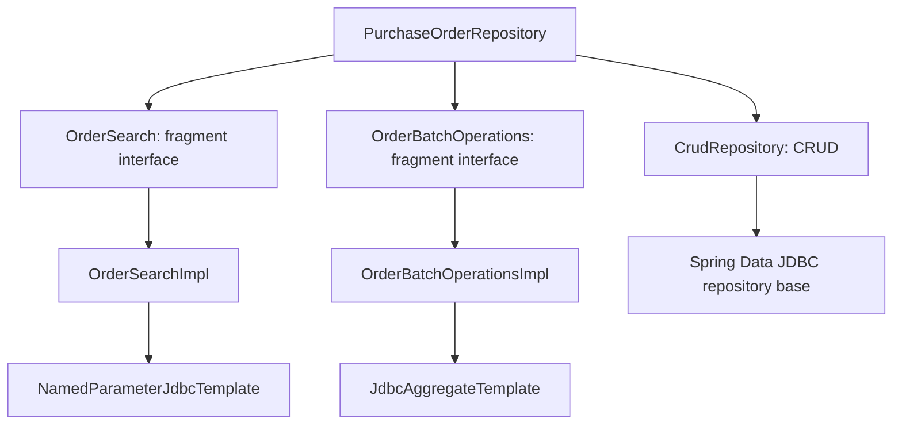

# Designing Repository Fragments and Implementation Classes

In **Spring Data Relational JDBC**, a repository does not have to consist solely of built-in CRUD operations or queries derived from method names. When an application needs complex searches, bulk operations, DTO queries, or specialized persistence logic, the repository can be extended with **repository fragments**.

A fragment consists of two parts:

1. A **fragment interface** declaring the capability that the repository needs to provide.
2. A **fragment implementation** implementing that interface using appropriate Spring components, such as `JdbcAggregateTemplate`, `NamedParameterJdbcTemplate`, or a domain service.

The main repository combines fragments by extending (`extends`) their interfaces. Spring Data weaves the implementations into the repository proxy, so callers still interact with a single unified repository.



Fragment-based design helps split a repository into small capabilities that can be reused and tested independently. This is the modern Spring Data extension model; the legacy pattern of a single `PurchaseOrderRepositoryImpl` class containing all custom methods becomes hard to evolve as a repository grows.

## 1. When Should You Create a Repository Fragment?

Create a fragment when a method requires a capability that does not fit standard CRUD or query derivation:

- Complex SQL queries, JOINs, CTEs, aggregations, or vendor-specific SQL.
- Returning DTOs/projections assembled from multiple tables.
- Bulk operations requiring control over `JdbcAggregateTemplate` or JDBC batching.
- Multi-step query logic that needs to combine multiple JDBC APIs.
- A capability that can be shared across multiple repositories.

There is no need to create a fragment just to wrap a simple derived query like `findByStatus(...)` or a short `@Query`. Using a regular repository method in those cases is easier to read and involves fewer classes.

| Need | Typically Suitable Approach |
|---|---|
| Aggregate CRUD | `CrudRepository` |
| Simple conditions on root properties | Derived query method |
| Fixed, short SQL returning an entity/projection | `@Query` |
| Complex SQL, dynamic filtering/sorting, custom DTO | Repository fragment + JDBC operations |
| Writing aggregates via template | Fragment using `JdbcAggregateTemplate` |
| Changing base behavior across all repositories | Custom repository base class, only when genuinely needed |

## 2. A Repository Fragment Consists of an Interface and an Implementation

Suppose you need to add the ability to search orders by customer, returning a summary DTO. First, create a dedicated interface for that capability:

```java
package com.example.sales;

import java.util.List;

import org.springframework.data.domain.Pageable;

public interface OrderSearch {

    List<OrderSummary> searchByCustomer(Long customerId, Pageable pageable);
}
```

`OrderSearch` only declares the contract. It does not need to extend `Repository`, `CrudRepository`, or `PagingAndSortingRepository`; it is a fragment interface that the main repository will compose.

The DTO for the result:

```java
package com.example.sales;

import java.time.LocalDateTime;

public record OrderSummary(
        Long id,
        String status,
        LocalDateTime createdAt
) {}
```

Next, create an implementation named according to the default convention: **fragment interface name + `Impl`**.

```java
package com.example.sales;

import java.util.ArrayList;
import java.util.List;

import org.springframework.data.domain.Pageable;
import org.springframework.data.domain.Sort;
import org.springframework.jdbc.core.namedparam.MapSqlParameterSource;
import org.springframework.jdbc.core.namedparam.NamedParameterJdbcTemplate;

public class OrderSearchImpl implements OrderSearch {

    private final NamedParameterJdbcTemplate jdbc;

    public OrderSearchImpl(NamedParameterJdbcTemplate jdbc) {
        this.jdbc = jdbc;
    }

    @Override
    public List<OrderSummary> searchByCustomer(Long customerId, Pageable pageable) {
        if (pageable.isUnpaged()) {
            throw new IllegalArgumentException("A paged request is required");
        }

        String orderBy = toOrderBy(pageable.getSort());

        String sql = """
                SELECT o.id, o.status, o.created_at
                FROM purchase_order o
                WHERE o.customer_id = :customerId
                ORDER BY %s
                LIMIT :limit OFFSET :offset
                """.formatted(orderBy);

        MapSqlParameterSource parameters = new MapSqlParameterSource()
                .addValue("customerId", customerId)
                .addValue("limit", pageable.getPageSize())
                .addValue("offset", pageable.getOffset());

        return jdbc.query(sql, parameters, (rs, rowNum) -> new OrderSummary(
                rs.getLong("id"),
                rs.getString("status"),
                rs.getTimestamp("created_at").toLocalDateTime()
        ));
    }

    private String toOrderBy(Sort sort) {
        List<String> clauses = new ArrayList<>();

        for (Sort.Order order : sort) {
            String column = switch (order.getProperty()) {
                case "createdAt" -> "o.created_at";
                case "id" -> "o.id";
                case "status" -> "o.status";
                default -> throw new IllegalArgumentException(
                        "Unsupported sort property: " + order.getProperty());
            };

            clauses.add(column + (order.isAscending() ? " ASC" : " DESC"));
        }

        if (clauses.isEmpty()) {
            clauses.add("o.created_at DESC");
        }

        if (sort.getOrderFor("id") == null) {
            clauses.add("o.id ASC"); // tie-breaker for stable ordering
        }

        return String.join(", ", clauses);
    }
}
```

The SQL example uses PostgreSQL's `LIMIT/OFFSET` syntax. If the target database uses a different pagination syntax, adjust the SQL accordingly or use an appropriate abstraction. `Pageable` provides offset, limit, and sort; with hand-written SQL, the implementation must explicitly apply those details.

Column names in `ORDER BY` cannot be bound as SQL parameter values. Therefore `toOrderBy` uses a **whitelist** of allowed properties and maps them to fixed identifiers. Never concatenate client-supplied sort names directly into SQL.

## 3. Composing the Fragment into the Main Repository

The main repository extends both the CRUD contract and the fragment interface:

```java
package com.example.sales;

import org.springframework.data.repository.CrudRepository;

public interface PurchaseOrderRepository extends
        CrudRepository<PurchaseOrder, Long>,
        OrderSearch {
}
```

Once Spring Data detects `OrderSearchImpl`, the fragment becomes part of the repository proxy. Callers only need to inject `PurchaseOrderRepository`:

```java
@Service
public class OrderQueryService {

    private final PurchaseOrderRepository orders;

    public OrderQueryService(PurchaseOrderRepository orders) {
        this.orders = orders;
    }

    public List<OrderSummary> recentOrders(Long customerId) {
        Pageable pageable = PageRequest.of(
                0,
                20,
                Sort.by(Sort.Order.desc("createdAt"), Sort.Order.asc("id"))
        );

        return orders.searchByCustomer(customerId, pageable);
    }
}
```

There is no need to inject `OrderSearchImpl` separately into the caller. The fragment is exposed through repository composition.

## 4. Naming Rules and Implementation Location

For repository fragments, Spring Data locates implementations based on the interface name and the **implementation postfix**. By default, the postfix is `Impl`.

```text
com.example.sales
├── PurchaseOrderRepository.java
├── OrderSearch.java
├── OrderSearchImpl.java
├── OrderBatchOperations.java
├── OrderBatchOperationsImpl.java
├── PurchaseOrder.java
└── OrderSummary.java
```

Conventions:

- Fragment interface: `OrderSearch`.
- Corresponding implementation: `OrderSearchImpl`.
- Main repository: `PurchaseOrderRepository`.
- The implementation is placed in a package scanned by the repository infrastructure; placing it in the same package as the repository/fragment is the simplest approach.
- The implementation class is a Spring-managed bean discovered by the repository infrastructure via naming convention; constructor injection is used to receive dependencies.

If you change the postfix, for example from `Impl` to `Custom`, the implementation class must be renamed accordingly. With Java repository configuration, you can set the postfix on `@EnableJdbcRepositories`:

```java
@Configuration
@EnableJdbcRepositories(
        basePackages = "com.example.sales",
        repositoryImplementationPostfix = "Custom"
)
public class SalesJdbcConfiguration {
}
```

In that case, `OrderSearch` requires an implementation named `OrderSearchCustom`. Only change the postfix when there is a consistent reason at the repository infrastructure level; do not configure different postfixes arbitrarily across packages.

Do not add `@Component` or `@Repository` out of habit without understanding how the repository implementation scanner discovers beans. If you both register the bean via component scanning and let the repository scanner discover the same implementation, there is a risk of duplicate beans or ambiguity. Under standard conventions, placing the implementation in the right package with the right name is sufficient.

## 5. A Repository Can Combine Multiple Fragments

A repository can combine multiple independent capabilities. For example, add a fragment for batch-inserting aggregates:

```java
package com.example.sales;

import java.util.List;

public interface OrderBatchOperations {

    List<PurchaseOrder> insertNewOrders(Iterable<PurchaseOrder> orders);
}
```

Implementation using `JdbcAggregateTemplate`:

```java
package com.example.sales;

import java.util.List;

import org.springframework.data.jdbc.core.JdbcAggregateTemplate;
import org.springframework.transaction.annotation.Transactional;

public class OrderBatchOperationsImpl implements OrderBatchOperations {

    private final JdbcAggregateTemplate template;

    public OrderBatchOperationsImpl(JdbcAggregateTemplate template) {
        this.template = template;
    }

    @Override
    @Transactional
    public List<PurchaseOrder> insertNewOrders(Iterable<PurchaseOrder> orders) {
        return template.insertAll(orders);
    }
}
```

The repository combines both fragments:

```java
public interface PurchaseOrderRepository extends
        CrudRepository<PurchaseOrder, Long>,
        OrderSearch,
        OrderBatchOperations {
}
```

When calling `purchaseOrderRepository.insertNewOrders(...)`, Spring routes the call to `OrderBatchOperationsImpl`. When calling `searchByCustomer(...)`, the call goes to `OrderSearchImpl`. CRUD methods continue to be handled by the repository base implementation.

### Why Split Fragments by Capability?

| Fragment | Responsibility |
|---|---|
| `OrderSearch` | Custom read queries returning DTOs |
| `OrderBatchOperations` | Batch aggregate write operations |
| `OrderReporting` | Aggregation/reporting queries |
| `OrderArchiveOperations` | Specialized archiving operations |

Each fragment can be reused by multiple repositories if the contract fits. Keeping fragments small makes implementations easier to read, mock/test independently, and prevents a bloated custom repository class.

## 6. Which Spring Data JDBC APIs Can a Fragment Use?

Choose the API based on the fragment's purpose:

| Component | Use When | Notes |
|---|---|---|
| `JdbcAggregateTemplate` | You need to operate on aggregates according to Spring Data JDBC mapping | Respects root, owned entities, callbacks, and version per template lifecycle |
| `NamedParameterJdbcTemplate` | You need custom SQL, named parameter binding, DTO mapping | You are responsible for SQL, mapping, and count/pagination if needed |
| `JdbcTemplate` | Positional parameter SQL or simple JDBC batching | Does not manage aggregate lifecycle automatically |
| `DataAccessStrategy` | You need low-level entity SQL infrastructure customization | Infrastructure API; use only with deep requirements and understanding of internal mapping |
| Other repositories | The use case needs to coordinate multiple aggregates/repositories | Beware of dependency cycles; orchestration usually belongs in an application service |

### Read Fragments with JDBC Templates

`OrderSearchImpl` in the example above uses `NamedParameterJdbcTemplate` because the query returns a DTO and has custom SQL conditions. The advantage is explicit control over JOINs, projections, filters, and SQL. In return, the SQL must stay in sync with schema migrations; renaming columns requires updating the query.

### Aggregate Write Fragments with `JdbcAggregateTemplate`

`OrderBatchOperationsImpl` uses `JdbcAggregateTemplate.insertAll()` to persist the root along with child entities according to the mapping. This is better than manually writing multiple `INSERT` statements across root/child tables and handling generated IDs, FKs, lifecycle, and version yourself.

Do not use `NamedParameterJdbcTemplate` to arbitrarily update aggregate tables if the operation must maintain invariants or synchronize child entities. If direct SQL is intentional, you must handle callbacks/auditing/versioning and in-memory object state yourself.

## 7. Transaction Boundaries in Custom Fragments

A fragment implementation is a Spring component used by the repository proxy. For multi-statement operations, define a clear transaction boundary.

There are two common options:

1. Place `@Transactional` on the fragment implementation method, such as `insertNewOrders(...)`.
2. Place the transaction on an application service wrapping multiple repository/fragment operations if the use case coordinates multiple aggregates or steps.

Example of a service coordinating two capabilities:

```java
@Service
public class OrderImportService {

    private final PurchaseOrderRepository orderRepository;
    private final ImportAuditRepository auditRepository;

    public OrderImportService(
            PurchaseOrderRepository orderRepository,
            ImportAuditRepository auditRepository) {
        this.orderRepository = orderRepository;
        this.auditRepository = auditRepository;
    }

    @Transactional
    public List<PurchaseOrder> importOrders(List<PurchaseOrder> orders) {
        List<PurchaseOrder> inserted = orderRepository.insertNewOrders(orders);
        auditRepository.save(new ImportAudit(inserted.size()));
        return inserted;
    }
}
```

If both repositories use the same `DataSource` and transaction manager, the insert and audit write can commit/rollback together. If they use different resources, standard JDBC `@Transactional` does not automatically create a distributed transaction.

Do not assume every custom query method is automatically transactional just because CRUD repositories carry transaction metadata. For custom fragments, declare transactions where appropriate and verify actual rollback behavior in tests. `@Transactional` still operates through Spring proxies; avoid self-invocation if expecting a new transaction boundary.

## 8. Do Not Arbitrarily Inject the Repository into Its Own Fragment Implementation

A common anti-pattern is:

```java
public class OrderSearchImpl implements OrderSearch {

    private final PurchaseOrderRepository repository;

    public OrderSearchImpl(PurchaseOrderRepository repository) {
        this.repository = repository;
    }
}
```

A fragment implementation is a constituent part of `PurchaseOrderRepository`. Injecting the repository itself into its implementation can create a dependency cycle or cause methods to call back into the fragment itself, leading to confusing recursion.

Instead:

- Use `JdbcAggregateTemplate` when aggregate operations are needed.
- Use `NamedParameterJdbcTemplate`/`JdbcTemplate` for custom SQL.
- Move multi-repository orchestration up to an application service.
- If you genuinely need another capability, inject an independent bean with a clear responsibility rather than the repository hosting that fragment.

## 9. Handling Multiple Fragments and Method Collisions

When a repository combines multiple fragments, avoid having multiple interfaces declare the same method signature while expecting different implementations. If two fragments provide methods with identical names, parameters, and return types, method resolution can depend on composition order and implementation precedence rules.

Better design:

- Name methods to express capability (`searchByCustomer`, `archiveBefore`, `insertNewOrders`).
- Keep each fragment's contract distinct; do not share the same method signature for different meanings.
- If you need to override a CRUD or base method, clearly define the goal and write an integration test proving which implementation is invoked.
- Avoid creating a "God interface" fragment with dozens of unrelated methods.

Fragment implementations can inject regular Spring dependencies via constructor. If an implementation needs dedicated configuration, use `@ConfigurationProperties` or an appropriate configuration bean; do not hard-code connections, URLs, or secrets in the fragment.

## 10. Distinguishing Repository Fragments from Custom Repository Base Classes

These two extension mechanisms solve different problems:

| Extension Approach | Scope | When Appropriate |
|---|---|---|
| Repository fragment | A capability that can be attached to one or more repositories | Custom search, batch operations, reporting |
| Custom repository base class | Fundamental behavior shared across all repositories in a configuration scope | When changing how base methods like `save`/CRUD are implemented for every repository |

If only one repository needs `searchByCustomer`, use a fragment. Only when all repositories in a module need the same common mechanism replacing base behavior should you consider a custom base class and configure the corresponding repository factory.

Do not use a `PurchaseOrderRepositoryImpl` class to override everything simply because it is a familiar legacy pattern. With modern fragment composition, organizing extensions by capability interface (`OrderSearch` → `OrderSearchImpl`) makes dependencies clearer and enables reuse.

## 11. Testing Fragment Implementations

You can test both layers at two levels:

- **Implementation unit tests:** mock `NamedParameterJdbcTemplate` or `JdbcAggregateTemplate` to verify the method calls the right API, binds the right parameters, and handles results properly.
- **Repository composition integration tests:** load the Spring Data JDBC context, inject the main repository, and call fragment methods to verify Spring discovered the right implementation.

Example integration test for a custom query:

```java
@DataJdbcTest
class PurchaseOrderRepositoryFragmentTest {

    @Autowired PurchaseOrderRepository repository;
    @Autowired JdbcTemplate jdbcTemplate;

    @Test
    void customSearchFragmentIsComposedIntoRepository() {
        jdbcTemplate.update("""
                INSERT INTO purchase_order(id, customer_id, status, created_at)
                VALUES (?, ?, ?, ?)
                """,
                101L,
                42L,
                "OPEN",
                Timestamp.valueOf(LocalDateTime.of(2026, 1, 10, 9, 0))
        );

        Pageable pageable = PageRequest.of(
                0,
                10,
                Sort.by(Sort.Order.desc("createdAt"), Sort.Order.asc("id"))
        );

        List<OrderSummary> result = repository.searchByCustomer(42L, pageable);

        assertThat(result).hasSize(1);
        assertThat(result.get(0).id()).isEqualTo(101L);
        assertThat(result.get(0).status()).isEqualTo("OPEN");
    }
}
```

The test requires a `purchase_order` schema with the queried columns, and any required FKs must have corresponding fixtures. The SQL in the example implementation uses `LIMIT/OFFSET`; adjust for your test database. The goal of the test is to prove that the fragment method appears on the repository proxy and the SQL returns the expected DTO.

### Testing Batch Write Fragment Transactions

For `OrderBatchOperationsImpl`, write integration tests to:

1. Call `repository.insertNewOrders(...)` with multiple aggregates that have children.
2. Verify that both root and child rows are persisted.
3. Introduce an aggregate that violates a constraint in the middle of the batch.
4. If the method/service is marked transactional, verify that data for the entire batch is rolled back according to the chosen transaction boundary.
5. Verify `@Version`, generated IDs, and callbacks if the domain uses them.

Do not only mock the template if the goal is to prove FKs, SQL, and rollback work against a real database.

## 12. Common Configuration Errors

| Symptom | Possible Cause | Resolution |
|---|---|---|
| `NoSuchBeanDefinition` or repository lacks fragment method | Fragment interface is not extended by the repository or implementation was not discovered | Check `extends`, `FragmentNameImpl` naming, package, and repository scanning |
| Spring reports custom implementation not found | Class name does not match postfix or class is outside scan scope | Place implementation in the right package or configure base packages/postfix |
| Implementation constructor cannot be instantiated | Missing bean dependency or misconfigured bean | Check `JdbcTemplate`, `JdbcAggregateTemplate`, and constructor injection |
| Repository method is called but a different implementation runs | Duplicate method signature across fragment/base/custom implementation | Rename the capability or clarify composition precedence |
| `@Transactional` does not roll back | Method call bypasses proxy, exception is caught/swallowed, or wrong transaction manager | Check proxy, rollback rules, and shared DataSource |
| SQL fragment fails when switching databases | Vendor-specific SQL or hard-coded column/schema names | Isolate SQL by dialect, migrations, and engine-specific integration tests |
| Sort produces invalid or unsafe SQL | Concatenating identifiers directly from the request | Whitelist properties and map them to fixed column names |
| Custom update leaves entity stale | Direct SQL does not synchronize in-memory objects | Reload aggregate; handle version/auditing manually if using direct DML |
| Dependency cycle between fragment and repository | Fragment injects the repository that hosts it | Use templates/JDBC operations or move orchestration up to a service |

## 13. Workflow for Designing a New Fragment

1. **Identify the capability:** does the method serve a custom query, batch write, or dedicated persistence workflow?
2. **Choose the abstraction:** is a derived query/`@Query` enough, or is a fragment needed?
3. **Create a small interface:** name it after the capability, declaring clear methods and return types.
4. **Create the implementation:** name it `FragmentNameImpl` and constructor-inject required dependencies.
5. **Choose the JDBC API:** `JdbcAggregateTemplate` for aggregate lifecycle; `NamedParameterJdbcTemplate` for custom SQL/DTOs.
6. **Compose into repository:** add the fragment interface to the `extends` list.
7. **Verify discovery:** package, postfix, and `@EnableJdbcRepositories` if custom-configured.
8. **Set transaction boundaries:** fragment method or application service; do not assume direct SQL is automatically transactional.
9. **Test:** unit test the implementation and integration test repository composition/SQL/rollback.
10. **Keep boundaries clear:** do not inject the repository back causing a cycle, and do not lump unrelated capabilities into one class.

### Quick Decision Table

| Question | Approach |
|---|---|
| Only need a simple query by property? | Derived query method |
| Fixed, short SQL needing no custom logic? | `@Query` |
| Need custom SQL, DTOs, or dynamic filtering? | Repository fragment + JDBC template |
| Need to save an aggregate with owned entities? | Fragment using `JdbcAggregateTemplate` |
| Capability shared by multiple repositories? | Reusable fragment interface |
| Want to change base behavior of all repositories? | Consider a custom repository base class |
| Fragment needs a multi-step transaction? | `@Transactional` on the fragment or application service |

**Key takeaway:** a repository fragment is a capability consisting of an interface and an implementation woven into the repository proxy. Name it `FragmentNameImpl` using the default `Impl` postfix, place the implementation in a package scanned by repositories, and inject the appropriate JDBC abstractions. `JdbcAggregateTemplate` preserves aggregate semantics; JDBC templates give control over custom SQL. Transactions, mapping, versioning, auditing, and testing must still be explicitly designed in the implementation.

## Official Documentation

- [Spring Data Relational — Custom Repository Implementations](https://docs.spring.io/spring-data/relational/reference/repositories/custom-implementations.html): repository fragments, composition, and naming conventions.
- [Spring Data Commons — Custom Repository Implementations](https://docs.spring.io/spring-data/commons/reference/repositories/custom-implementations.html): fragment interfaces, implementation discovery, and custom base classes.
- [Spring Data JDBC — `@EnableJdbcRepositories` API](https://docs.spring.io/spring-data/relational/reference/api/java/org/springframework/data/jdbc/repository/config/EnableJdbcRepositories.html): package scanning and implementation postfix.
- [Spring Data JDBC — `JdbcAggregateTemplate` API](https://docs.spring.io/spring-data/relational/reference/api/java/org/springframework/data/jdbc/core/JdbcAggregateTemplate.html): direct aggregate operations.
- [Spring Framework — `NamedParameterJdbcTemplate` API](https://docs.spring.io/spring-framework/docs/current/javadoc-api/org/springframework/jdbc/core/namedparam/NamedParameterJdbcTemplate.html): SQL named parameters and RowMapper.
- [Spring Data JDBC — Transactionality](https://docs.spring.io/spring-data/relational/reference/jdbc/transactions.html): transaction boundaries for repositories and the service layer.
