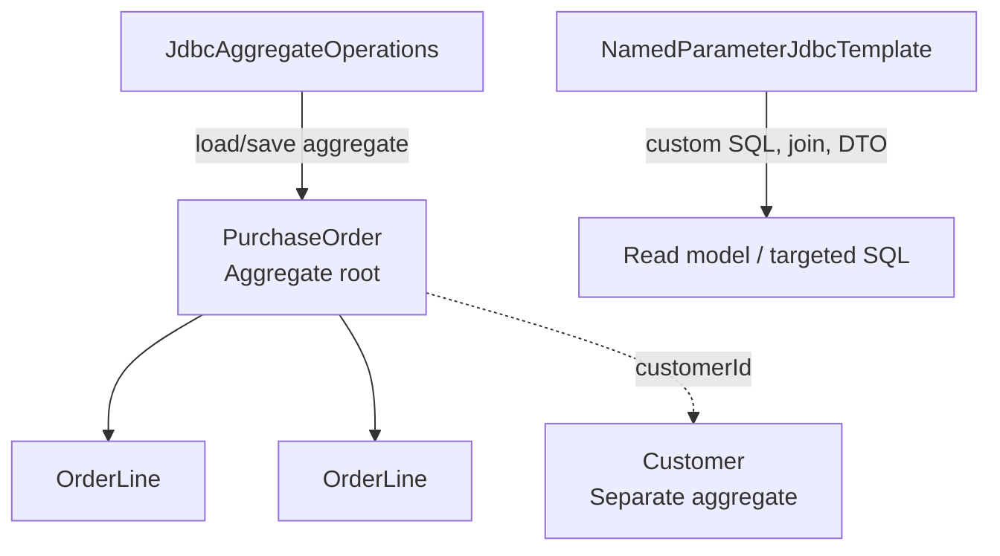
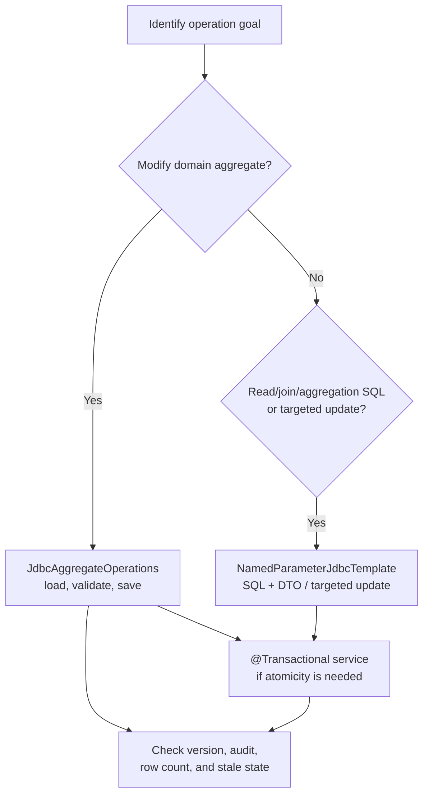

# Combining JdbcAggregateOperations with NamedParameterJdbcTemplate

In Spring Data JDBC, an application may need both domain-modeled aggregate operations and custom SQL statements. Two commonly used tools are `JdbcAggregateOperations` and `NamedParameterJdbcTemplate`.

`JdbcAggregateOperations` operates at the aggregate level: loading and saving aggregate roots along with their owned components according to Spring Data JDBC mappings. `NamedParameterJdbcTemplate` operates at the SQL level: writing explicit statements, binding values by name, and mapping results to DTOs or needed types.

Combining both tools keeps domain operations at aggregate boundaries while leveraging SQL for specialized queries. You must clearly define which tool owns which operation, share transactions when atomicity is needed, and avoid letting direct SQL make in-memory aggregate data stale.

## 1. Role of Each Tool

### JdbcAggregateOperations

`JdbcAggregateOperations` is Spring Data JDBC's abstraction for aggregate operations. In typical configurations, the implementation is provided by `JdbcAggregateTemplate`. You can inject the abstraction so services depend on the contract rather than the implementation class:

```java
import org.springframework.data.jdbc.core.JdbcAggregateOperations;
import org.springframework.stereotype.Service;

@Service
public class OrderService {

    private final JdbcAggregateOperations aggregates;

    public OrderService(JdbcAggregateOperations aggregates) {
        this.aggregates = aggregates;
    }
}
```

Common operations:

```java
PurchaseOrder order =
    aggregates.findById(orderId, PurchaseOrder.class)
        .orElseThrow(() -> new OrderNotFoundException(orderId));

PurchaseOrder saved = aggregates.save(order);

long totalOrders = aggregates.count(PurchaseOrder.class);

boolean exists =
    aggregates.existsById(orderId, PurchaseOrder.class);
```

Exact method names and overloads should be verified against the Spring Data JDBC version your project uses. The general intent of the API is operating on the specified aggregate root type rather than running arbitrary SQL against any table.

When saving an aggregate, Spring Data JDBC applies the aggregate's mapping, manages child objects owned by the root, and runs configured persistence mechanisms. This is the natural choice when changing the domain state of an aggregate.

### NamedParameterJdbcTemplate

`NamedParameterJdbcTemplate` is a Spring JDBC API that lets you write SQL with named parameters such as `:customerId` instead of positional `?` placeholders:

```java
String sql = """
    SELECT id, status
    FROM purchase_order
    WHERE customer_id = :customerId
      AND status = :status
    """;

MapSqlParameterSource params = new MapSqlParameterSource()
    .addValue("customerId", customerId)
    .addValue("status", status);

List<OrderRow> rows =
    namedParameterJdbcTemplate.query(sql, params, rowMapper);
```

This tool fits when you need multi-table joins, only specific columns, aggregate functions or database-specific SQL, targeted updates, or querying a set of IDs/filters with collection parameters.

Named parameters only represent **data values**. Table names, column names, operators, and SQL structure must still remain in the statement or be selected from an application-controlled allowlist.
## 2. PurchaseOrder Example Model

Suppose an application manages orders. `PurchaseOrder` is the aggregate root, `OrderLine` instances are child elements, and the customer is a separate aggregate referenced by ID.



Illustrative aggregate root:

```java
package com.example.orders.domain;

import java.math.BigDecimal;
import java.time.LocalDateTime;
import java.util.List;

import org.springframework.data.annotation.Id;
import org.springframework.data.annotation.Version;
import org.springframework.data.relational.core.mapping.MappedCollection;
import org.springframework.data.relational.core.mapping.Table;

@Table("purchase_order")
public record PurchaseOrder(
    @Id Long id,
    @Version Long version,
    Long customerId,
    String status,
    BigDecimal totalAmount,
    String note,
    LocalDateTime createdAt,
    @MappedCollection(
        idColumn = "order_id",
        keyColumn = "line_no"
    )
    List<OrderLine> lines
) {
    public PurchaseOrder withStatus(String newStatus) {
        return new PurchaseOrder(
            id, version, customerId, newStatus,
            totalAmount, note, createdAt, lines
        );
    }
}
```

Child object:

```java
package com.example.orders.domain;

import java.math.BigDecimal;

public record OrderLine(
    Long productId,
    int quantity,
    BigDecimal unitPrice
) {}
```

In this example, `customerId` is a reference ID. `lines` belongs to the `PurchaseOrder` aggregate lifecycle. This distinction matters when picking tools: persisting order state and order lines should go through aggregate operations; querying orders joined with customer names for display can use SQL and DTOs.

## 3. Using JdbcAggregateOperations for Domain Operations

When business logic needs to read an order, check state, modify domain state, and save, use aggregate operations:

```java
@Service
public class OrderService {

    private final JdbcAggregateOperations aggregates;

    public OrderService(JdbcAggregateOperations aggregates) {
        this.aggregates = aggregates;
    }

    @Transactional
    public PurchaseOrder confirm(long orderId) {
        PurchaseOrder current = aggregates
            .findById(orderId, PurchaseOrder.class)
            .orElseThrow(() -> new OrderNotFoundException(orderId));

        if (!"CREATED".equals(current.status())) {
            throw new InvalidOrderStateException(current.status());
        }

        PurchaseOrder confirmed = current.withStatus("CONFIRMED");
        return aggregates.save(confirmed);
    }
}
```

Here the service loads the aggregate by ID. Order lines are mapped according to Spring Data JDBC configuration, so the object being modified reflects the current aggregate. The service checks invariants and then calls `save`.

You can use `insert` when you want to explicitly insert a new aggregate, or `update` when updating an existing aggregate, depending on the API contract and version. `save` is typically appropriate when the application wants persistence according to the aggregate's new/existing state. Clearly distinguish create vs. update in services to avoid misusing semantics.

Do not construct a partial `PurchaseOrder` with just an ID and a few fields and call `save`. Omitted child collections may be interpreted as the current collection state, wiping out child rows that should be kept. For domain operations, load the full aggregate before modifying it.

## 4. Using NamedParameterJdbcTemplate for Read Models and Join Queries

A list screen may need order ID, status, customer name, and total amount. This data does not necessarily require a full aggregate. Create a DTO/read model:

```java
package com.example.orders.readmodel;

import java.math.BigDecimal;
import java.time.LocalDateTime;

public record OrderListItem(
    Long orderId,
    String status,
    String customerName,
    BigDecimal totalAmount,
    LocalDateTime createdAt
) {}
```

Custom query repository:

```java
@Repository
public class OrderQueryRepository {

    private final NamedParameterJdbcTemplate jdbc;

    public OrderQueryRepository(NamedParameterJdbcTemplate jdbc) {
        this.jdbc = jdbc;
    }

    public List<OrderListItem> findForCustomer(long customerId) {
        String sql = """
            SELECT po.id AS order_id,
                   po.status,
                   c.display_name AS customer_name,
                   po.total_amount,
                   po.created_at
            FROM purchase_order po
            JOIN customer c ON c.id = po.customer_id
            WHERE po.customer_id = :customerId
            ORDER BY po.created_at DESC, po.id DESC
            """;

        var params = new MapSqlParameterSource()
            .addValue("customerId", customerId);

        return jdbc.query(sql, params, (rs, rowNum) ->
            new OrderListItem(
                rs.getLong("order_id"),
                rs.getString("status"),
                rs.getString("customer_name"),
                rs.getBigDecimal("total_amount"),
                rs.getObject("created_at", LocalDateTime.class)
            )
        );
    }
}
```

The query selects only the needed columns and maps them to `OrderListItem`. There is no need to force a `PurchaseOrder` instance out of this join result. The DTO clearly communicates that this is read data for a UI screen, not a complete aggregate to persist back.

Benefits:

- SQL joins and returned columns are explicitly controlled.
- Child collections are not loaded when the screen does not need them.
- Prevents passing a partially populated projection into `aggregates.save(...)`.
- Indexes and execution plans can be tuned specifically for the read query.

If the query result needs full order lines or requires business mutations on the aggregate, load the root via `JdbcAggregateOperations` once the relevant ID has been identified.

## 5. Binding Collections with Named Parameters

A query may filter by multiple statuses:

```java
public List<OrderListItem> findByStatuses(
        long customerId,
        Collection<String> statuses) {

    if (statuses == null || statuses.isEmpty()) {
        return List.of();
    }

    String sql = """
        SELECT id, status, total_amount, created_at
        FROM purchase_order
        WHERE customer_id = :customerId
          AND status IN (:statuses)
        ORDER BY created_at DESC, id DESC
        """;

    var params = new MapSqlParameterSource()
        .addValue("customerId", customerId)
        .addValue("statuses", statuses);

    return jdbc.query(sql, params, (rs, rowNum) ->
        new OrderListItem(
            rs.getLong("id"),
            rs.getString("status"),
            null,
            rs.getBigDecimal("total_amount"),
            rs.getObject("created_at", LocalDateTime.class)
        )
    );
}
```

`NamedParameterJdbcTemplate` expands the collection into appropriate value placeholders. Never concatenate statuses into the SQL string. Explicitly decide the semantics for an empty list: return an empty list as shown above, omit the filter condition, or return a validation error. Do not rely on `IN ()`, as that syntax is not uniformly supported across databases.

In the example, `customerId` and each element of `statuses` are bound values. Identifiers and sort order remain fixed in the SQL.
## 6. Combining Aggregate Writes and Custom SQL in One Service

A business flow may update an aggregate while also writing a separate audit record. For example, confirming an order changes the order status and records who performed the action:

```java
@Service
public class OrderWorkflowService {

    private final JdbcAggregateOperations aggregates;
    private final NamedParameterJdbcTemplate jdbc;

    public OrderWorkflowService(
            JdbcAggregateOperations aggregates,
            NamedParameterJdbcTemplate jdbc) {
        this.aggregates = aggregates;
        this.jdbc = jdbc;
    }

    @Transactional
    public PurchaseOrder confirm(long orderId, long actorId) {
        PurchaseOrder current = aggregates
            .findById(orderId, PurchaseOrder.class)
            .orElseThrow(() -> new OrderNotFoundException(orderId));

        if (!"CREATED".equals(current.status())) {
            throw new InvalidOrderStateException(current.status());
        }

        PurchaseOrder saved =
            aggregates.save(current.withStatus("CONFIRMED"));

        String auditSql = """
            INSERT INTO order_audit
                (order_id, action, actor_id, occurred_at)
            VALUES
                (:orderId, :action, :actorId, CURRENT_TIMESTAMP)
            """;

        var params = new MapSqlParameterSource()
            .addValue("orderId", saved.id())
            .addValue("action", "CONFIRMED")
            .addValue("actorId", actorId);

        jdbc.update(auditSql, params);

        return saved;
    }
}
```

`@Transactional` sets the transaction boundary at the business layer. If either saving the aggregate or inserting the audit row fails, the transaction can roll back both changes.

Conditions for them to genuinely share the same transaction:

- `JdbcAggregateOperations` and `NamedParameterJdbcTemplate` use the same `DataSource`.
- Both participate in the same Spring transaction manager.
- The method is invoked through the Spring transaction proxy and does not disable the transaction.
- All operations run within the same managed transaction/database resource.

In standard single-datasource Spring Boot setups, JDBC beans are typically configured to share the datasource and transaction manager. If the application has multiple datasources, you must specify the right transaction manager and configure adapters to use the corresponding datasource. A single `@Transactional` annotation cannot automatically create a distributed transaction across multiple databases.

## 7. Using Targeted Update SQL When Saving the Whole Aggregate Is Unnecessary

Sometimes an operation only needs to update one column without synchronizing child collections—for instance, updating an order note. Direct SQL can be used:

```java
@Repository
public class OrderDirectUpdateRepository {

    private final NamedParameterJdbcTemplate jdbc;

    public OrderDirectUpdateRepository(
            NamedParameterJdbcTemplate jdbc) {
        this.jdbc = jdbc;
    }

    public int updateNote(
            long orderId,
            String note,
            long expectedVersion) {

        String sql = """
            UPDATE purchase_order
            SET note = :note,
                version = version + 1
            WHERE id = :id
              AND version = :expectedVersion
            """;

        var params = new MapSqlParameterSource()
            .addValue("note", note)
            .addValue("id", orderId)
            .addValue("expectedVersion", expectedVersion);

        return jdbc.update(sql, params);
    }
}
```

The example assumes the table has a `version` column and the aggregate uses `@Version`. The SQL checks the expected version and increments it upon update. If the affected row count is 0, either the record does not exist or the version has changed; the service must handle this according to business rules.

Direct SQL is useful when updating only a few independent columns, performing conditional bulk updates, avoiding loading and saving the entire aggregate, or needing database-specific syntax.

However, this SQL does not pass through the full aggregate save mechanism. It does not synchronize child collections, invoke domain methods, or run lifecycle callbacks/auditing/events integrated with the aggregate save path. The SQL author is responsible for invariants, versioning, auditing, and related side effects.

If updating a field affects aggregate invariants, evaluate whether targeted SQL can preserve those invariants. For example, changing order status might require inspecting order lines, recording history, and checking permissions; in that case, the service should load the aggregate and coordinate the logic via `JdbcAggregateOperations`.

## 8. Avoiding Stale Aggregates When Mixing Two Write Paths

Suppose a service loads an order into `current`, and then another repository uses `NamedParameterJdbcTemplate` to directly update that same row in the database. The `current` object does not automatically reflect the SQL that just ran.

If `aggregates.save(current)` is called afterward, the application can overwrite with old values. If the aggregate has child collections, saving may also synchronize collections based on the stale snapshot. This creates a lost-update risk.

Guidelines:

1. Do not hold an aggregate in memory while updating the same row via SQL on another path without a synchronization plan.
2. If direct SQL updates a root with `@Version`, increment the version in the same statement and check the row count.
3. If domain operations must continue after direct SQL, reload the aggregate after the update.
4. Never re-save an old object just to "sync" state.
5. If custom SQL modifies child tables, ensure no aggregate holding the old collection will be saved afterward.

`@Version` helps detect some concurrent updates when all write paths respect the version. It does not automatically stop a custom SQL statement that ignores version. Every custom update must therefore have an explicit concurrency policy.

## 9. Do Not Use NamedParameterJdbcTemplate to Build Incomplete Aggregates

A custom query might select only:

```sql
SELECT id, status
FROM purchase_order
WHERE customer_id = :customerId;
```

This is valid data for a screen displaying only order ID and status. However, it is insufficient to construct a complete `PurchaseOrder`, because it lacks customer ID, total, note, createdAt, version, and the lines collection.

Do not map the result into an entity and then call:

```java
aggregates.save(partialOrder);
```

Use a DTO instead:

```java
public record OrderStatusRow(
    Long id,
    String status
) {}
```

When a user requests a modification to an order, use the ID in the DTO to load the full aggregate with `aggregates.findById(...)`, validate domain rules, and then save.

| Goal | Suitable Result Type |
| --- | --- |
| Full read for executing business logic | Aggregate root from `JdbcAggregateOperations`. |
| List display, joins, reports | DTO/read model from `NamedParameterJdbcTemplate`. |
| Updating one column conditionally | `UPDATE` with bound parameters, checking row count/version. |
| Saving an aggregate and child collections | `JdbcAggregateOperations`. |
## 10. Two-Step Pattern: Read Query Followed by Aggregate Operations

A common pattern is using lightweight SQL to find matching IDs, then loading each aggregate via aggregate operations when business logic needs to run:

```java
public List<PurchaseOrder> loadOrdersForReview(
        long customerId,
        int limit) {

    String sql = """
        SELECT id
        FROM purchase_order
        WHERE customer_id = :customerId
          AND status = :status
        ORDER BY created_at, id
        LIMIT :limit
        """;

    var params = new MapSqlParameterSource()
        .addValue("customerId", customerId)
        .addValue("status", "CREATED")
        .addValue("limit", limit);

    List<Long> ids = jdbc.query(
        sql,
        params,
        (rs, rowNum) -> rs.getLong("id")
    );

    return ids.stream()
        .map(id -> aggregates.findById(id, PurchaseOrder.class)
            .orElseThrow(() -> new OrderNotFoundException(id)))
        .toList();
}
```

This pattern is useful when filter conditions are complex but only a small subset of results needs to be processed as aggregates. However, it issues extra queries to load each aggregate by ID. If the count is large, consider appropriate batching, limiting IDs, or designing a dedicated query/command.

Between querying IDs and loading aggregates, data may change or be deleted. If you need to guarantee the condition still holds at processing time, re-check state in the service or include the needed predicate in a conditional update. Do not treat the read ID list as a data lock for subsequent steps.

## 11. Using Transactions for Coordinated Operations

A transaction can span:

- Reading an aggregate via `JdbcAggregateOperations`.
- Saving an aggregate via `save`.
- Writing an audit or outbox entry via `NamedParameterJdbcTemplate.update`.
- Running validation queries or updating auxiliary tables.

Example:

```java
@Transactional
public void cancelOrder(long orderId, long actorId) {
    PurchaseOrder order = aggregates
        .findById(orderId, PurchaseOrder.class)
        .orElseThrow(() -> new OrderNotFoundException(orderId));

    if ("SHIPPED".equals(order.status())) {
        throw new InvalidOrderStateException(order.status());
    }

    aggregates.save(order.withStatus("CANCELLED"));

    jdbc.update("""
        INSERT INTO order_audit
            (order_id, action, actor_id, occurred_at)
        VALUES
            (:orderId, :action, :actorId, CURRENT_TIMESTAMP)
        """,
        new MapSqlParameterSource()
            .addValue("orderId", orderId)
            .addValue("action", "CANCELLED")
            .addValue("actorId", actorId)
    );
}
```

If the audit insert fails and the exception rolls back the transaction, the aggregate update also rolls back when both operations share the same transaction manager/resource. If the application catches the exception and continues without marking rollback, the outcome may differ from expectations; let the error propagate or configure an explicit rollback policy.

For calls to systems outside the database, `@Transactional` cannot roll back external side effects. When reliable event publishing is required, consider writing an outbox row in the same transaction and dispatching it via a separate worker.

## 12. Configuring DataSource and Transaction Manager

The two tools coordinate within the same transaction only when they participate in the right transaction manager and datasource.

In a typical single-datasource setup:

- Spring Boot creates the `DataSource`.
- `NamedParameterJdbcTemplate` is configured to use that datasource.
- Spring Data JDBC creates aggregate operations using the same connection configuration.
- `@Transactional` uses the transaction manager managing that datasource.

If you manually configure multiple datasources, verify every bean and specify the matching transaction manager:

```java
@Transactional(transactionManager = "ordersTransactionManager")
public void performOrderWorkflow(...) {
    // Aggregate operations and the JDBC template must both use
    // the datasource managed by ordersTransactionManager.
}
```

Do not rely solely on the fact that both beans inject successfully. Confirm they actually use the same datasource and transaction manager. Across different datasources, a dedicated transaction coordination solution is needed; a local JDBC transaction does not automatically make multiple resources atomic.

## 13. Lifecycle, Auditing, and Domain Event Boundaries

When saving through `JdbcAggregateOperations`, Spring Data JDBC executes aggregate mapping and the lifecycle/auditing/event mechanisms configured for that save path.

When running `NamedParameterJdbcTemplate.update(...)` directly, Spring only executes SQL. It does not automatically:

- Invoke domain methods on the aggregate.
- Synchronize child collections according to `@MappedCollection`.
- Produce an updated aggregate object.
- Run callbacks/auditing attached to the aggregate save lifecycle.
- Publish domain events equivalent to an aggregate operation unless the application explicitly does so.
- Increment `@Version` in custom SQL statements.

If direct SQL is the right choice, the service or adapter must take responsibility for required business side effects. For example, updating an audit table via JDBC is intentional; updating aggregate state via JDBC requires considering invariants, versioning, and events.

## 14. Organizing SQL and Repositories by Responsibility

A maintainable way to organize code is separating the two adapters:

```text
OrderService
  ├── JdbcAggregateOperations
  │     └── Load/save PurchaseOrder aggregate
  └── OrderQueryRepository
        └── NamedParameterJdbcTemplate
              ├── Search/list DTO
              ├── Join/report query
              └── Targeted SQL
```

Example package layout:

```text
orders/
  domain/
    PurchaseOrder.java
    OrderLine.java
  service/
    OrderService.java
    OrderWorkflowService.java
  repository/
    OrderQueryRepository.java
    OrderDirectUpdateRepository.java
```

You do not need a separate class for every tiny SQL statement, but keep statements and row mappers inside purpose-named adapters/repositories. Avoid placing SQL inside controllers or scattering SQL strings across multiple services.

Method names should clearly indicate what they do:

- `findOrderListItems(...)`: returns a read model.
- `findIdsForReview(...)`: returns IDs for loading aggregates next.
- `updateNoteIfVersionMatches(...)`: conditional update.
- `softDelete(...)`: updates soft-delete state.

Clear naming helps callers know whether a method returns an aggregate or DTO and whether it bypasses mapping.
## 15. SQL Injection and Dynamic Queries

Named parameters bind values safely:

```java
String sql = """
    SELECT id, status
    FROM purchase_order
    WHERE customer_id = :customerId
      AND status = :status
    """;
```

Never concatenate request values into SQL:

```java
// Unsafe.
String sql = "SELECT * FROM purchase_order WHERE status = '"
    + requestedStatus + "'";
```

Named parameters cannot substitute table names, column names, operators, or dynamic `ORDER BY` clauses. If an API allows choosing sort order, map an enum/allowlist to code-defined identifiers and bind filter values separately.

Example:

```java
String sortColumn = switch (sortChoice) {
    case NEWEST -> "created_at";
    case AMOUNT -> "total_amount";
};

String sql = """
    SELECT id, status, total_amount
    FROM purchase_order
    WHERE customer_id = :customerId
    ORDER BY %s DESC, id DESC
    """.formatted(sortColumn);
```

Only the `sortColumn` selected from the enum is interpolated into SQL. Never use a client-supplied column name string directly.

## 16. Common Mistakes When Combining Both Tools

| Mistake | Consequence | Resolution |
| --- | --- | --- |
| Using a SQL projection and calling aggregate save | Object missing fields/child rows can overwrite data. | Use DTOs for read models; load full aggregate before saving. |
| Updating root via JDBC then saving old object | Can overwrite newer values or cause lost updates. | Reload aggregate, use versioning, and do not reuse stale snapshots. |
| Direct SQL ignores version | Concurrent writes are not detected by optimistic locking. | Check and increment version in the SQL statement. |
| Using JDBC update for operations with complex invariants | Bypasses domain behavior and integrated lifecycle. | Use aggregate operations/coordinating service. |
| Both tools use different datasources | `@Transactional` does not span both operations as expected. | Configure same datasource/transaction manager or design separate coordination. |
| Forgetting predicates in custom SQL | May accidentally update wrong tenant, status, or deleted records. | Add business predicates and bind all values. |
| Using entity-returning query missing columns | Incomplete aggregate mapping or read errors. | Return DTO/projection for trimmed queries. |
| Not checking row count | Unknown whether the update affected any record. | Check affected rows and translate to business outcome/error. |
| Using SQL bulk update and forgetting audit | Business history does not reflect the change. | Write audit/outbox in the same transaction when required. |

## 17. Testing When Coordinating Aggregate Operations and JDBC Template

Test each responsibility separately and integration-test the combined flow.

### Testing Aggregate Persistence

- Create a new `PurchaseOrder` using aggregate operations.
- Read it back with `findById` and verify child rows are mapped.
- Update status via the service and confirm order lines remain intact.
- Verify optimistic locking if the aggregate uses `@Version`.

### Testing Custom Queries

- Join queries return accurate DTOs and column aliases.
- Named parameters properly bind values containing quotes/Unicode.
- Collection `IN` clauses handle empty, single-element, and multi-element lists.
- Filtering, sorting, and pagination return expected data per SQL.
- Incomplete projections are not returned as though they were full aggregates.

### Testing Combined Transactions

1. Call the service to update the aggregate and then write an audit record via JDBC.
2. Verify both changes commit together on success.
3. Trigger an intentional error during the audit write step.
4. Verify the aggregate change rolls back if both operations share the same transaction manager/resource.
5. Verify custom updates with a stale version return a row count of 0.
6. Re-read the aggregate after direct SQL to confirm the new state.
7. Ensure no code path saves a stale object afterward.

Conceptual transaction test example:

```java
@Test
void auditFailureRollsBackAggregateUpdate() {
    PurchaseOrder before = aggregates
        .findById(orderId, PurchaseOrder.class)
        .orElseThrow();

    assertThatThrownBy(() ->
        workflow.confirm(orderId, actorId)
    ).isInstanceOf(DataAccessException.class);

    PurchaseOrder after = aggregates
        .findById(orderId, PurchaseOrder.class)
        .orElseThrow();

    assertThat(after.status()).isEqualTo(before.status());
    assertThat(auditRepository.existsFor(orderId, "CONFIRMED"))
        .isFalse();
}
```

The test must simulate a reproducible audit failure, run on an appropriate database, and ensure the exception actually rolls back the transaction. If code catches the exception without marking rollback, assertions may not hold.

## 18. Tool Selection Workflow

Before writing a repository operation, identify the goal:

1. Need to load the full aggregate to check or change domain behavior? Use `JdbcAggregateOperations.findById(...)`.
2. Need to save the root along with child collections? Use `save/insert/update` per business semantics.
3. Need joins, aggregations, or only a few columns for a screen? Use `NamedParameterJdbcTemplate` and a DTO/read model.
4. Need to update an independent column? Consider conditional JDBC update, checking row count and version.
5. Need to coordinate multiple statements in one business action? Place `@Transactional` on the service and verify shared datasource/transaction manager.
6. Does direct SQL bypass invariants, callbacks, auditing, or versioning? If so, implement those responsibilities explicitly or move the operation back to aggregate operations.
7. Holding an old aggregate object after direct SQL? Reload before continuing domain operations.

Decision diagram:



## 19. Self-Check Questions

- At what level of operation does `JdbcAggregateOperations` differ from `NamedParameterJdbcTemplate`?
- Why should services inject `JdbcAggregateOperations` instead of depending directly on the implementation when unnecessary?
- When should you load the full aggregate before calling `save`?
- Why should a DTO from a join query not be passed into aggregate save?
- Can named parameters bind table names or column names?
- When should you use `NamedParameterJdbcTemplate` to fetch IDs and then load aggregates individually by ID?
- Why can fetching IDs and loading aggregates one by one generate multiple queries?
- What conditions allow aggregate operations and custom SQL to participate in the same transaction?
- Which lifecycle mechanisms of the aggregate save path can direct SQL bypass?
- Why must `@Version` be checked and incremented in custom updates?
- What happens if you save a stale aggregate object after a JDBC template has updated the same row?
- Which tests prove that two operations commit or roll back together?

Combining `JdbcAggregateOperations` with `NamedParameterJdbcTemplate` works effectively when each tool is used for its proper responsibility: aggregate operations manage aggregate lifecycles; the named JDBC template executes specialized SQL and maps read models. Place transactions on the service when changes must succeed or fail together, check version/row count for direct updates, and never use DTOs or stale objects as aggregate inputs for save operations.
