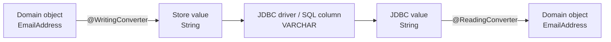

# Distinguishing Simple Types, Domain Types, and Conversion Directions

In **Spring Data Relational JDBC**, a Java property can be mapped directly to a SQL column, expanded across multiple columns, or treated as an entity with its own relationship. To choose the right mapping, distinguish three concepts:

- **Simple type**: a type that Spring Data treats as a single value, such as `String`, `Long`, `UUID`, `BigDecimal`, `Instant`, and many other standard types. Properties of these types are normally stored in a single column.
- **Domain type**: an application-defined type that expresses business meaning, such as `EmailAddress`, `Money`, `CustomerId`, or `Percentage`. A domain type is not automatically treated as a simple type by all Spring Data modules.
- **Converter**: defines how a Java type is converted into a type that the JDBC driver/database can store, and how it is converted back when reading data.

Two converter directions to remember:

| Direction | Annotation | Generic Signature | Meaning |
|---|---|---|---|
| Writing to database | `@WritingConverter` | `Converter<DomainType, StoreType>` | Domain object → simple storage value |
| Reading from database | `@ReadingConverter` | `Converter<StoreType, DomainType>` | JDBC value → domain object |

For example, the domain model uses `EmailAddress`, while the database stores email as `VARCHAR`. When writing, convert `EmailAddress` to `String`; when reading, convert `String` to `EmailAddress`. Conversion direction is named according to the **direction data flows through persistence**, not by method names or arrows in a class diagram.

## 1. How Does Spring Data Understand Simple Types?

Spring Data uses mapping metadata and a list of simple types (`SimpleTypeHolder`) to decide whether a property can be treated as a single value or needs further analysis as an object/entity. Common standard types include:

| Category | Java Examples |
|---|---|
| Primitives and wrappers | `int`, `long`, `boolean`, `Integer`, `Long`, `Boolean` |
| Strings and characters | `String`, `Character` |
| Numbers | `BigDecimal`, `BigInteger`, `Double`, `Float` |
| Date and time | `LocalDate`, `LocalDateTime`, `Instant`, `OffsetDateTime`, `Duration` |
| Identifiers and standard types | `UUID`, `URI`, `URL`, `Locale`, `Currency` |
| Special types | `byte[]`, enums, and certain store/driver-supported types |

The exact list depends on the Spring Data module, dialect, custom conversions, and version in use. A type supported by a JDBC driver does not necessarily mean every database has the same SQL type; for instance, `UUID` may bind directly with PostgreSQL/H2 while being stored as `CHAR(36)`, `BINARY(16)`, or `RAW(16)` on other databases.

When a property is a simple type, Spring Data typically maps that property to **a single value/column**. For example:

```java
@Table("customer")
public class Customer {

    @Id
    private Long id;

    private String name;

    private BigDecimal creditLimit;

    private Instant registeredAt;
}
```

The properties `name`, `creditLimit`, and `registeredAt` are stored as columns in the `customer` table. Spring Data does not need to create separate entities/tables for `String`, `BigDecimal`, or `Instant`.

## 2. Domain Types Are Not Automatically Simple Types

Applications often create wrapper types to represent business concepts instead of passing `String` or `BigDecimal` everywhere:

```java
public record EmailAddress(String value) {

    public EmailAddress {
        if (value == null || value.isBlank() || !value.contains("@")) {
            throw new IllegalArgumentException("Invalid email address");
        }
        value = value.trim().toLowerCase(Locale.ROOT);
    }
}
```

`EmailAddress` clearly conveys the meaning of the value. Domain methods can accept `EmailAddress` instead of an arbitrary string:

```java
public void changeEmail(EmailAddress newEmail) {
    this.email = Objects.requireNonNull(newEmail);
}
```

However, Spring Data JDBC cannot automatically know to extract the `value` field and write it to the `email_address` column. Without an appropriate converter or mapping, the framework may continue analyzing `EmailAddress` as an object type and fail to map it according to the application's single-column intent.

Registering converters between the domain type and a simple store type tells Spring Data how to represent that value in the relational store. With suitable custom conversions, the domain type is treated as a single value in mapping rather than needing a separate table/entity.

### Distinguishing Domain Values from Entities

| Characteristic | Value/Domain Type | Entity/Aggregate |
|---|---|---|
| Meaning | Describes a business value | Has its own identity and lifecycle |
| Examples | `EmailAddress`, `Percentage`, `Money` | `Customer`, `PurchaseOrder`, `Product` |
| Storage | One column via converter, or multiple columns via embedded mapping | Root and child tables/relationships via aggregate mapping |
| Reference | Typically copied by value | Has identity; other aggregates reference by ID |
| Dedicated repository | Typically no | Aggregate roots typically have a repository |

Not every user-defined Java class is an entity. An `EmailAddress` is just a customer value; it does not need `@Id`, a repository, or its own table.

## 3. Two Converter Directions: Reading and Writing

Spring Data applies converters according to the direction data flows through the database:



### Writing Converter

A writing converter has the domain type as its source and the storage type as its target:

```java
@WritingConverter
public class EmailAddressToStringConverter
        implements Converter<EmailAddress, String> {

    @Override
    public String convert(EmailAddress source) {
        return source.value();
    }
}
```

When `Customer` is saved, the converter takes `EmailAddress` and returns a `String` for Spring Data JDBC to bind to the `VARCHAR` column.

### Reading Converter

A reading converter has the JDBC/store type as its source and the domain type as its target:

```java
@ReadingConverter
public class StringToEmailAddressConverter
        implements Converter<String, EmailAddress> {

    @Override
    public EmailAddress convert(String source) {
        return new EmailAddress(source);
    }
}
```

When reading a `customer` row, the driver returns a `String`; Spring Data uses the converter to reconstruct `EmailAddress`.

### Why Are `@ReadingConverter` and `@WritingConverter` Needed?

In this example, both `String` and `EmailAddress` can be considered simple types once the custom conversions are registered. Looking only at the signature `Converter<A, B>`, Spring Data may not know whether the conversion is intended for reading or writing in certain cases involving two simple types.

The annotations specify the direction:

- `@WritingConverter`: domain/source → store/target.
- `@ReadingConverter`: store/source → domain/target.

This prevents Spring from choosing a converter in the wrong direction or failing due to an ambiguous converter. Place the annotation on the converter class itself, not on the entity property.

## 4. Complete Example: `EmailAddress` Stored in a Single `VARCHAR` Column

### Domain Type

```java
package com.example.customer;

import java.util.Locale;

public record EmailAddress(String value) {

    public EmailAddress {
        if (value == null || value.isBlank() || !value.contains("@")) {
            throw new IllegalArgumentException("Invalid email address");
        }
        value = value.trim().toLowerCase(Locale.ROOT);
    }
}
```

### Aggregate Root

```java
package com.example.customer;

import org.springframework.data.annotation.Id;
import org.springframework.data.relational.core.mapping.Column;
import org.springframework.data.relational.core.mapping.Table;

@Table("customer")
public class Customer {

    @Id
    private Long id;

    private String name;

    @Column("email_address")
    private EmailAddress email;

    protected Customer() {}

    public Customer(String name, EmailAddress email) {
        this.name = name;
        this.email = email;
    }

    public Long getId() { return id; }
    public String getName() { return name; }
    public EmailAddress getEmail() { return email; }

    public void changeEmail(EmailAddress email) {
        this.email = email;
    }
}
```

### Writing Converter

```java
package com.example.customer;

import org.springframework.core.convert.converter.Converter;
import org.springframework.data.convert.WritingConverter;

@WritingConverter
public class EmailAddressToStringConverter
        implements Converter<EmailAddress, String> {

    @Override
    public String convert(EmailAddress source) {
        return source.value();
    }
}
```

### Reading Converter

```java
package com.example.customer;

import org.springframework.core.convert.converter.Converter;
import org.springframework.data.convert.ReadingConverter;

@ReadingConverter
public class StringToEmailAddressConverter
        implements Converter<String, EmailAddress> {

    @Override
    public EmailAddress convert(String source) {
        return new EmailAddress(source);
    }
}
```

### Registering the Converters

With configuration based on `AbstractJdbcConfiguration`, register the converters in `userConverters()`:

```java
package com.example.config;

import java.util.List;

import org.springframework.context.annotation.Configuration;
import org.springframework.data.jdbc.repository.config.AbstractJdbcConfiguration;

import com.example.customer.EmailAddressToStringConverter;
import com.example.customer.StringToEmailAddressConverter;

@Configuration
public class JdbcConfiguration extends AbstractJdbcConfiguration {

    @Override
    protected List<?> userConverters() {
        return List.of(
                new EmailAddressToStringConverter(),
                new StringToEmailAddressConverter()
        );
    }
}
```

`AbstractJdbcConfiguration` combines application-provided converters with Spring Data JDBC's default conversions. Therefore, add converters in `userConverters()` instead of replacing the entire `JdbcCustomConversions` in a way that drops default conversions or dialect-supplied conversions.

If a Spring Boot project already has a custom JDBC configuration, add the converters to the existing configuration and ensure only one `JdbcMappingContext`/conversion configuration is used by the repositories.

### Schema and Repository

```sql
CREATE TABLE customer (
    id BIGINT GENERATED BY DEFAULT AS IDENTITY PRIMARY KEY,
    name VARCHAR(150) NOT NULL,
    email_address VARCHAR(320) NOT NULL
);
```

```java
public interface CustomerRepository extends CrudRepository<Customer, Long> {
}
```

Writing and reading:

```java
Customer customer = new Customer(
        "Lan",
        new EmailAddress("Lan@example.com")
);

Customer saved = customerRepository.save(customer);

Customer loaded = customerRepository.findById(saved.getId())
        .orElseThrow();

EmailAddress email = loaded.getEmail();
```

In the database, `email_address` holds the string `lan@example.com`. In the domain model, the property remains typed as `EmailAddress`. Repository callers never have to invoke converters manually.

## 5. Domain Types Can Convert to Different Store Types

The store type must match the database and JDBC driver. For example, a `Percentage` domain type can be stored as `BigDecimal`:

```java
public record DiscountRate(BigDecimal value) {
    public DiscountRate {
        Objects.requireNonNull(value);
        if (value.compareTo(BigDecimal.ZERO) < 0
                || value.compareTo(BigDecimal.ONE) > 0) {
            throw new IllegalArgumentException("Rate must be between 0 and 1");
        }
    }
}
```

Writing converter:

```java
@WritingConverter
public class DiscountRateToBigDecimalConverter
        implements Converter<DiscountRate, BigDecimal> {

    @Override
    public BigDecimal convert(DiscountRate source) {
        return source.value();
    }
}
```

Reading converter:

```java
@ReadingConverter
public class BigDecimalToDiscountRateConverter
        implements Converter<BigDecimal, DiscountRate> {

    @Override
    public DiscountRate convert(BigDecimal source) {
        return new DiscountRate(source);
    }
}
```

The store type is `BigDecimal`, so the SQL column can be `NUMERIC(5,4)`:

```sql
discount_rate NUMERIC(5,4) NOT NULL
```

Choosing precision/scale must match the business value domain and rounding rules. Converters do not automatically enforce currency rules, scale, or rounding; those belong in the domain type or service.

## 6. `JdbcValue` When a JDBC Type Must Be Specified

Normally, a converter returns a simple store type such as `String`, `BigDecimal`, `UUID`, or `byte[]`, and the driver infers the appropriate JDBC type. Some cases require specifying the JDBC type explicitly so the driver binds the right type, such as binary, decimal, or vendor-specific types.

Spring Data JDBC provides `JdbcValue`, which holds a value alongside a `JDBCType`:

```java
import java.sql.JDBCType;

import org.springframework.data.jdbc.core.mapping.JdbcValue;

@WritingConverter
public class EmailAddressToJdbcValueConverter
        implements Converter<EmailAddress, JdbcValue> {

    @Override
    public JdbcValue convert(EmailAddress source) {
        return JdbcValue.of(source.value(), JDBCType.VARCHAR);
    }
}
```

This is **an alternative** to `Converter<EmailAddress, String>` when a JDBC type hint is needed. Do not register two writing converters for the same source type without clear resolution. For plain `VARCHAR`, returning `String` directly is usually simpler.

`JDBCType` is the standard JDBC enum. The chosen value must fit the store type, driver, and schema. `JdbcValue` does not turn an unsupported SQL type into a supported one; it only supplies clearer bind metadata.

## 7. When to Use a Converter vs. `@Embedded`?

A converter is suitable when the domain type is stored as **a single value**. If a value object has multiple components that should be stored in multiple columns, `@Embedded` usually expresses that more cleanly.

For example, `Money` containing an amount and a currency:

```java
public record Money(BigDecimal amount, String currency) {}
```

If you only convert `Money` to `BigDecimal`, the `currency` information is lost. You could encode both into a single string, but querying/indexing by amount or currency becomes harder. If you want two columns, use embedded mapping:

```java
public class Money {
    private BigDecimal amount;
    private String currency;
}

@Embedded(prefix = "total_")
private Money total;
```

The schema might contain:

```sql
total_amount NUMERIC(19, 2),
total_currency VARCHAR(3)
```

| Requirement | Appropriate Mapping |
|---|---|
| `EmailAddress` stored in a single text column | Converter `EmailAddress ↔ String` |
| `DiscountRate` stored in a single numeric column | Converter `DiscountRate ↔ BigDecimal` |
| `Money` needing two amount/currency columns | `@Embedded` |
| A multi-component value object that must be packed into one scalar by system contract | Converter to a single store type, if those semantics are acceptable |
| Referencing `Customer`, another aggregate root | ID or `AggregateReference<Customer, ID>` |
| `OrderLine` owned by `PurchaseOrder` | `@MappedCollection` |

Do not use a converter to turn an entity with its own identity/lifecycle into a scalar just to avoid designing relationships. A converter represents a **value**; it does not replace aggregate boundaries.

## 8. Converters Do Not Rename Properties or Columns

`@Column` and converters solve two different problems:

```java
@Column("email_address")
private EmailAddress email;
```

- `@Column("email_address")` specifies the **SQL column name**.
- `EmailAddressToStringConverter` specifies **what the Java value converts into when writing**.
- `StringToEmailAddressConverter` specifies **what the JDBC value constructs when reading**.

Derived queries still reference the Java property name:

```java
List<Customer> findByEmail(EmailAddress email);
```

Do not write `findByEmailAddress(...)` just because the column name is `email_address`, unless the entity actually has a property named `emailAddress`. Likewise, SQL inside `@Query` uses database column names:

```java
@Query("SELECT * FROM customer WHERE email_address = :email")
List<Customer> findByStoredEmail(@Param("email") String email);
```

Conversion does not replace the naming strategy and does not alter SQL identifiers.

## 9. Converters Are Registered by Type, Not Arbitrarily Per Field

Spring Data custom conversions are registered in the conversion service/mapping infrastructure. They are selected based on source type, target type, and conversion direction. As a result, a converter applies to all properties with the matching type pair within that configuration scope.

For example, if two properties both hold `EmailAddress` and share the same `String` store representation, the same converter applies to both. This is desirable when semantics match.

If the same Java type must be stored in two different formats depending on the property (for example, one place requires a canonical lowercase email while another preserves raw input casing), a global converter may not be expressive enough. Consider:

- Creating two distinct domain types with clear semantics.
- Normalizing data in the domain type so one type always has a single representation.
- Using a different mapping/value object if the two properties truly differ in meaning.
- Writing a custom persistence query when a special requirement belongs to a single operation.

Do not create multiple competing converters for the same source/target pair expecting Spring to magically know which field gets which converter.

## 10. Nulls and Validation in Conversion

Converters generally convert non-null values. Whether a property is `null` is handled according to Spring's mapping and database nullability; do not rely on a converter to replace a `NOT NULL` constraint.

For example:

```java
@Column("email_address")
private EmailAddress email;
```

If the schema declares `email_address NOT NULL`, the application must ensure the property always has a value before saving. A converter does not automatically turn `null` into an empty string or default address unless you intentionally implement that behavior.

Domain validation should happen when creating the domain value:

```java
EmailAddress email = new EmailAddress(input);
```

When reading legacy data, `StringToEmailAddressConverter` also invokes constructor validation. If database data no longer satisfies new domain rules, reading can fail. When changing validation rules, review historical data and plan migrations before deploying.

## 11. Testing Converters and Round-Trip Behavior via Repository

Test at two levels:

1. **Converter unit tests:** verify direction, values, and validation.
2. **Repository integration tests:** verify Spring Data has registered the converters and writes/reads properly via a real JDBC driver/database.

### Unit Test

```java
class EmailAddressConverterTest {

    private final EmailAddressToStringConverter writing =
            new EmailAddressToStringConverter();

    private final StringToEmailAddressConverter reading =
            new StringToEmailAddressConverter();

    @Test
    void convertsDomainValueToStoreValueAndBack() {
        EmailAddress input = new EmailAddress("Lan@example.com");

        String stored = writing.convert(input);
        EmailAddress restored = reading.convert(stored);

        assertThat(stored).isEqualTo("lan@example.com");
        assertThat(restored).isEqualTo(input);
    }
}
```

### Integration Test

```java
@DataJdbcTest
class CustomerRepositoryConversionTest {

    @Autowired CustomerRepository repository;
    @Autowired JdbcTemplate jdbcTemplate;

    @Test
    void writesEmailAsStringAndReadsItAsDomainType() {
        Customer saved = repository.save(
                new Customer("Lan", new EmailAddress("Lan@example.com"))
        );

        String stored = jdbcTemplate.queryForObject(
                "SELECT email_address FROM customer WHERE id = ?",
                String.class,
                saved.getId()
        );

        assertThat(stored).isEqualTo("lan@example.com");

        Customer loaded = repository.findById(saved.getId()).orElseThrow();
        assertThat(loaded.getEmail()).isEqualTo(new EmailAddress("lan@example.com"));
    }
}
```

`@DataJdbcTest` must load the `JdbcConfiguration` containing the converters into the context. Depending on component scan/slice test setup, you may need to import the configuration explicitly. The test schema must include `email_address VARCHAR(320)` and the remaining columns.

H2 tests verify the conversion flow in a test environment, but if production uses PostgreSQL, MySQL, SQL Server, or Oracle, also run integration tests against the actual database/driver. JDBC type binding and driver-returned types can differ.

## 12. Common Errors When Registering Converters

| Symptom | Possible Cause | Resolution |
|---|---|---|
| Spring tries to map domain class as an entity/struct | Missing suitable converter or converter not registered | Register domain ↔ simple store type converter pair |
| `ConverterNotFoundException` | Missing converter for read or write direction | Check both directions and source/target generic types |
| Converter picked in wrong direction | Simple-type converter not marked with direction annotation | Use `@ReadingConverter`/`@WritingConverter` for the right direction |
| Incorrect value written to database | Writing converter returns wrong store type or transforms data wrongly | Check `Converter<Domain, Store>` and column type |
| Parse error when reading data | Reading converter does not handle legacy/null/format data | Check `Converter<Store, Domain>` and actual data |
| JDBC fails to bind type | Store type unsupported by driver or incompatible JDBC type | Choose a simple store type; use `JdbcValue` if a type hint is needed |
| Column does not exist | Mistaken `@Column` or SQL column name | Check schema and mapping column name |
| Converter does not run in repository | Custom conversions configuration is not part of the active mapping context | Check `AbstractJdbcConfiguration.userConverters()` and test context |
| Two properties need different storage formats but share a converter | Conversions are registered per type pair within configuration scope | Use distinct domain types or custom persistence logic |
| Legacy data cannot instantiate domain object | New validation is stricter than historical data | Normalize/migrate data or design a clear reading conversion policy |

## 13. Misconceptions to Avoid

| Misconception | Reality |
|---|---|
| `@WritingConverter` is store → domain | False; writing is domain → store |
| `@ReadingConverter` is domain → store | False; reading is store → domain |
| `@Column` turns a domain type into a simple type | No; `@Column` only specifies the column name |
| Every custom class is automatically stored in one column | No; requires a converter or appropriate mapping |
| Converters replace `@Embedded` for all value objects | No; embedded is appropriate when multiple columns are needed |
| Converters create FK/JOIN relationships | No; converters represent values, not entity relationships |
| Converters are selected by field name | Normally conversions are registered by type pair and direction |
| Converters bypass the JDBC driver | No; the final store type must still be compatible with the driver/database |
| Direct SQL always runs converters | No; hand-written SQL must pass properly typed store values or use appropriate JDBC operations |

## 14. Workflow for Choosing Types and Converters

When adding a new domain property, decide in order:

1. **Identify semantics:** is this an immutable value or an entity with its own identity/lifecycle?
2. **Check simple types:** is the Java type already supported directly by Spring Data/JDBC?
3. **Choose storage structure:** one column, multiple columns (`@Embedded`), or a table/entity relationship?
4. **If one column:** pick a simple store type supported by the driver/database.
5. **Write bidirectional converters:** domain → store with `@WritingConverter`, store → domain with `@ReadingConverter`.
6. **Register conversions:** add to `userConverters()` of `AbstractJdbcConfiguration` or the equivalent configuration mechanism.
7. **Check column mapping:** use `@Column` when the SQL name differs from the Java property.
8. **Test round-trip:** run converter unit tests and repository integration tests.
9. **Verify real database:** confirm JDBC type, nullability, precision/scale, encoding, and historical data.

### Quick Decision Table

| Domain Property | Storage Type | Approach |
|---|---|---|
| `String`, `Long`, `Instant`, `BigDecimal` | Corresponding simple type | Use directly if driver supports it |
| `EmailAddress` | `VARCHAR` | `EmailAddress → String` and `String → EmailAddress` |
| `DiscountRate` | `NUMERIC` | `DiscountRate → BigDecimal` and vice versa |
| `Money(amount, currency)` | Two columns | `@Embedded` |
| `CustomerId(UUID)` | UUID or text per schema | Wrapper ↔ store type converter |
| `Customer` is another aggregate root | ID/FK | `AggregateReference` or scalar ID |
| `OrderLine` owned by root | Child table | `@MappedCollection` |

**Core takeaway:** simple types are stored as single values. Domain types are application-defined types that must be explicitly represented in persistence mapping. When storing a domain value in a single column, use `@WritingConverter` for domain → store and `@ReadingConverter` for store → domain. Choose a converter when the value object maps to one scalar; choose `@Embedded` when multiple columns are needed; keep entity/aggregate references for objects with their own identity and lifecycle.

## Official References

- [Spring Data Relational — Mapping](https://docs.spring.io/spring-data/relational/reference/jdbc/mapping.html): simple types, custom conversions, mapping domain properties and store values.
- [Spring Data Relational — Custom Conversions](https://docs.spring.io/spring-data/relational/reference/jdbc/mapping.html#jdbc.custom-conversions): registering `@ReadingConverter`, `@WritingConverter`, `userConverters()`, and store types.
- [Spring Data JDBC — `AbstractJdbcConfiguration` API](https://docs.spring.io/spring-data/relational/reference/api/java/org/springframework/data/jdbc/repository/config/AbstractJdbcConfiguration.html): JDBC configuration and custom converters.
- [Spring Data Commons — `CustomConversions` API](https://docs.spring.io/spring-data/commons/docs/current/api/org/springframework/data/convert/CustomConversions.html): managing conversions and simple type holders.
- [Spring Data Commons — `ReadingConverter` API](https://docs.spring.io/spring-data/commons/docs/current/api/org/springframework/data/convert/ReadingConverter.html): marking converters for the read direction.
- [Spring Data Commons — `WritingConverter` API](https://docs.spring.io/spring-data/commons/docs/current/api/org/springframework/data/convert/WritingConverter.html): marking converters for the write direction.
- [Spring Data JDBC — `JdbcValue` API](https://docs.spring.io/spring-data/relational/reference/api/java/org/springframework/data/jdbc/core/mapping/JdbcValue.html): associating a JDBC type with a written value.
