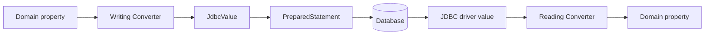

# JdbcValue and Explicit JDBCType Declaration

When Spring Data JDBC writes a property to the database, the framework must convert the Java value into a JDBC parameter and choose a suitable SQL type. Normally, the Java type and property metadata are enough for Spring Data and the JDBC driver to infer the required type. However, there are cases where the driver cannot infer accurately, or the application needs to specify the SQL type explicitly to avoid improper binding.

**`JdbcValue`** addresses that scenario. It is a wrapper holding two pieces of information: the value to write and the SQL type to use when passing that value to a `PreparedStatement`. A custom writing converter can return `JdbcValue` to specify the JDBC type explicitly instead of letting the framework infer it.

This lesson explains the relationship between Java types, SQL types, and `JDBCType`; how to create a `JdbcValue`; how to write and register converters; how to read back value objects; and caveats when dealing with specialized data types or NULL values.

## 1. Why Specify a JDBC Type?

Java and databases have two related but non-identical type systems.

| Java Type | Common SQL Types |
|---|---|
| `String` | `VARCHAR`, `CHAR`, `CLOB` |
| `Integer` | `INTEGER` |
| `Long` | `BIGINT` |
| `BigDecimal` | `DECIMAL` or `NUMERIC` |
| `Boolean` | `BOOLEAN` or numeric/character types depending on database |
| `LocalDate` | `DATE` |
| `LocalDateTime` | `TIMESTAMP` |
| `byte[]` | `VARBINARY` or `BLOB` |
| `UUID` | Depends on database and JDBC driver |

For common types, Spring Data JDBC and the driver can usually infer the right binding. For example, a `String` property mapped to a `VARCHAR` column typically needs no extra declaration.

But automatic inference is not always sufficient:

- The database has specialized columns such as JSON, XML, ARRAY, or vendor-specific types.
- The driver needs to know the exact SQL type when binding the value.
- A Java value object is converted into a specific SQL type.
- The Java type is generic, but the column requires an explicit JDBC type.
- How the driver processes a value depends on the type passed to `PreparedStatement`.

Passing a value without the right type can cause the driver to pick an unintended type, throw a conversion error, or mishandle NULL values.

## 2. What Is JdbcValue?

`JdbcValue` resides in the package:

```java
import org.springframework.data.jdbc.core.mapping.JdbcValue;
```

This class wraps a value together with the SQL type used to pass that value as a bind parameter to a `PreparedStatement`.

Primary API:

```java
public static JdbcValue of(Object value, SQLType jdbcType)
```

Accessors:

```java
Object getValue();
SQLType getJdbcType();
```

`JdbcValue.of(value, jdbcType)` is the factory method used to create the wrapper. Its constructor is not intended to be called directly by applications.

Example:

```java
import java.sql.JDBCType;

JdbcValue value = JdbcValue.of("user@example.com", JDBCType.VARCHAR);
```

In this example:

- The value to write is the string `user@example.com`.
- The specified SQL type is `VARCHAR`.
- Spring Data JDBC can use both pieces of information when binding the parameter.

`JdbcValue` is not a new database column type and does not alter the schema. It is supplementary metadata attached to the value during conversion and binding.

### 2.1. JdbcValue Holds a Value and a SQLType

You can visualize it as:

```text
JdbcValue
  ├── value    = "user@example.com"
  └── jdbcType = JDBCType.VARCHAR
```

The value and SQL type travel together. When the same Java value needs to be written as a specific SQL type, the wrapper lets the converter pass both pieces of information to the JDBC layer.

### 2.2. JdbcValue Is Used on the Write Path

In Spring Data JDBC, `JdbcValue` is primarily used as the return type of custom writing converters. The converter turns a domain property into the wrapper; the mapping infrastructure uses the value and SQL type when preparing JDBC parameters.

It does not replace aggregates, repositories, or `JdbcAggregateTemplate`. Nor does it execute INSERT/UPDATE statements itself. Its role is to describe how a single property is passed down to JDBC.

## 3. Distinguishing SQLType, JDBCType, and java.sql.Types

Java provides three related concepts:

- `SQLType` is an interface describing a SQL type.
- `JDBCType` is the standard JDBC enum implementing `SQLType`.
- `java.sql.Types` is a set of integer constants for JDBC types used in many older JDBC APIs.

`JdbcValue.of` accepts `SQLType`. In most cases, you can pass a `JDBCType` value directly.

```java
import java.sql.JDBCType;
import java.math.BigDecimal;
import java.time.LocalDate;

JdbcValue textValue =
    JdbcValue.of("ABC-001", JDBCType.VARCHAR);

JdbcValue decimalValue =
    JdbcValue.of(new BigDecimal("1250.75"), JDBCType.DECIMAL);

JdbcValue dateValue =
    JdbcValue.of(LocalDate.now(), JDBCType.DATE);
```

`JDBCType` is convenient because it expresses meaningful type names without having to memorize numeric codes from `Types`.

### 3.1. Common JDBCType Values

| JDBCType | Meaning | Typical Java Values Passed |
|---|---|---|
| `VARCHAR` | Variable-length character string | `String` |
| `CHAR` | Fixed-length character string | `String` |
| `INTEGER` | Integer | `Integer` |
| `BIGINT` | Large integer | `Long` |
| `DECIMAL` | Exact decimal number | `BigDecimal` |
| `NUMERIC` | Exact numeric type | `BigDecimal` |
| `BOOLEAN` | True/false value | `Boolean` |
| `DATE` | Date | `LocalDate` or compatible date type |
| `TIMESTAMP` | Date-time without timezone | `LocalDateTime` or compatible type |
| `VARBINARY` | Binary data | `byte[]` |
| `BLOB` | Binary Large Object | `byte[]` or driver-supported type |
| `CLOB` | Character Large Object | `String` or compatible type |
| `ARRAY` | SQL array | Driver-supported array type |
| `SQLXML` | SQL XML | Compatible XML/JDBC type |
| `OTHER` | Other or vendor-specific SQL type | Depends on driver |

Choose the type based on the actual column type in the schema and the capabilities of the database/driver. Do not pick `VARCHAR` simply because the Java value is a `String` if the column actually expects a vendor-specific type.

### 3.2. JDBCType Is Not a Column Name

`JDBCType.VARCHAR` describes the SQL type of the parameter, not which column is being written. The column name is still determined by property mapping, such as `@Column` or the naming strategy.

### 3.3. JDBCType Does Not Replace the Java Type

If the domain property is `Money`, the converter must still produce a JDBC value the driver can handle, such as `BigDecimal`. Choosing `JDBCType.DECIMAL` without converting `Money` into an appropriate numeric value is not enough.

### 3.4. Do Not Pass Types Constants to the Factory

`JDBCType.VARCHAR` is an enum implementing `SQLType`. By contrast, `Types.VARCHAR` is an integer. The `JdbcValue.of` factory takes `SQLType`, so use the `JDBCType` enum rather than passing an int constant from `java.sql.Types`.

## 4. When Should You Use JdbcValue?

Use `JdbcValue` when you need to control the JDBC type of a property during writing.

Common cases:

1. **Value objects:** a dedicated domain type needs to be stored as VARCHAR, DECIMAL, or another SQL type.
2. **Specialized data types:** the database/driver requires a specific SQL type to accept the value.
3. **Inaccurate binding inference:** the Java type alone is insufficient to determine how the driver should bind the parameter.
4. **Compatibility:** ensuring a converter always writes using the SQL type prescribed by the schema.

Do not wrap every property in `JdbcValue`. When standard Java types already map properly, letting Spring Data JDBC handle them automatically is simpler and requires less configuration.

## 5. Example: Writing EmailAddress as VARCHAR

Suppose the domain model uses an `EmailAddress` value object instead of leaving the email property as a raw string.

### 5.1. Value Object

```java
public record EmailAddress(String value) {

    public EmailAddress {
        if (value == null || value.isBlank()) {
            throw new IllegalArgumentException("Email must not be blank");
        }
    }
}
```

Aggregate:

```java
import org.springframework.data.annotation.Id;
import org.springframework.data.relational.core.mapping.Column;
import org.springframework.data.relational.core.mapping.Table;

@Table("customers")
public record Customer(
    @Id Long id,
    String fullName,
    @Column("email_address") EmailAddress email
) {}
```

Schema:

```sql
CREATE TABLE customers (
    id BIGINT GENERATED BY DEFAULT AS IDENTITY PRIMARY KEY,
    full_name VARCHAR(120) NOT NULL,
    email_address VARCHAR(320) NOT NULL
);
```

The Java property is `EmailAddress`, while the database column is `VARCHAR`. A converter is needed to turn the value object into a string value and specify the JDBC type.

### 5.2. Writing Converter Returning JdbcValue

```java
import java.sql.JDBCType;

import org.springframework.core.convert.converter.Converter;
import org.springframework.data.convert.WritingConverter;
import org.springframework.data.jdbc.core.mapping.JdbcValue;

@WritingConverter
public class EmailAddressWriteConverter
        implements Converter<EmailAddress, JdbcValue> {

    @Override
    public JdbcValue convert(EmailAddress source) {
        return JdbcValue.of(source.value(), JDBCType.VARCHAR);
    }
}
```

Key details:

- Source type is `EmailAddress`.
- Target type is `JdbcValue`.
- The value inside the wrapper is `String`.
- The SQL type is `JDBCType.VARCHAR`.
- `@WritingConverter` specifies that this converter is used for the write direction.

Spring Data JDBC uses the converter when turning the `EmailAddress` property into a value to write. The `VARCHAR` information travels along with the string.

### 5.3. Why Return JdbcValue Instead of String?

If the converter only returned `String`:

```java
@WritingConverter
public class EmailAddressWriteConverter
        implements Converter<EmailAddress, String> {

    @Override
    public String convert(EmailAddress source) {
        return source.value();
    }
}
```

Spring Data JDBC knows the value has become a string, while the SQL type continues to be inferred from metadata or mapping rules. When the converter returns `JdbcValue`, the application explicitly states both the value and the desired SQL type.

If the schema/driver already infers `VARCHAR` properly, a converter returning `String` may suffice. Use `JdbcValue` when an explicit JDBC type must be specified.

## 6. Reading Back the Value Object with ReadingConverter

`JdbcValue` primarily assists the write path. When reading from the database, Spring Data JDBC needs a converter in the opposite direction to turn the value returned by the driver into the domain type.

```java
import org.springframework.core.convert.converter.Converter;
import org.springframework.data.convert.ReadingConverter;

@ReadingConverter
public class EmailAddressReadConverter
        implements Converter<String, EmailAddress> {

    @Override
    public EmailAddress convert(String source) {
        return new EmailAddress(source);
    }
}
```

The two converters have distinct responsibilities:

| Converter | Source | Target | Direction |
|---|---|---|---|
| `EmailAddressWriteConverter` | `EmailAddress` | `JdbcValue` | Write |
| `EmailAddressReadConverter` | `String` | `EmailAddress` | Read |

Reading from the database:

```java
Customer customer = customerRepository.findById(10L)
    .orElseThrow();

String email = customer.email().value();
```

Spring Data JDBC reads the `email_address` column into the Java type provided by the JDBC driver, then invokes the reading converter to create `EmailAddress`.

### 6.1. Why Are @ReadingConverter and @WritingConverter Needed?

Spring Conversion Service cannot always infer the intended conversion direction, especially when both source and target are simple types or multiple converters could apply.

Directional annotations:

- `@WritingConverter`: converts from the domain type to the type used for writing.
- `@ReadingConverter`: converts from the type returned by the JDBC/driver into the domain type.

For value objects, declaring the direction explicitly prevents Spring from picking a converter in the wrong direction.

## 7. Registering Converters with AbstractJdbcConfiguration

Converters must be registered so Spring Data JDBC includes them in `JdbcConverter`.

You can extend `AbstractJdbcConfiguration` and override `userConverters`:

```java
import java.util.List;

import org.springframework.context.annotation.Configuration;
import org.springframework.data.jdbc.repository.config.AbstractJdbcConfiguration;

@Configuration
public class JdbcConfiguration extends AbstractJdbcConfiguration {

    @Override
    protected List<?> userConverters() {
        return List.of(
            new EmailAddressWriteConverter(),
            new EmailAddressReadConverter()
        );
    }
}
```

Spring Data JDBC combines application converters with default converters and dialect converters.

In current versions, `userConverters()` is the extension point dedicated to application converters. Do not override `jdbcCustomConversions()` based on older examples without checking your version, as doing so can omit dialect-supplied converters.

### 7.1. When Using Spring Boot

Spring Boot normally auto-configures the DataSource, JDBC operations, mapping context, and repository infrastructure when the appropriate starter is present.

When adding custom converters, integrate the configuration into the existing application context. If declaring a configuration extending `AbstractJdbcConfiguration`, understand how it interacts with auto-configuration and existing beans. Do not create a second DataSource or JdbcConverter just to register converters.

### 7.2. Registering Multiple Converters

Multiple converters can be returned in one list:

```java
@Override
protected List<?> userConverters() {
    return List.of(
        new EmailAddressWriteConverter(),
        new EmailAddressReadConverter(),
        new MoneyWriteConverter(),
        new MoneyReadConverter()
    );
}
```

Group converters by domain type or separate them into dedicated classes to keep conversion directions easy to follow.

## 8. Second Example: Money to DECIMAL

A monetary value object can store its amount in a DECIMAL column. This example stores only the amount; currency is kept in a separate column.

### 8.1. Value Object and Aggregate

```java
import java.math.BigDecimal;

public record Money(BigDecimal amount) {
    public Money {
        if (amount == null) {
            throw new IllegalArgumentException("Amount is required");
        }
    }
}
```

```java
@Table("invoices")
public record Invoice(
    @Id Long id,
    String invoiceNumber,
    @Column("total_amount") Money totalAmount
) {}
```

Schema:

```sql
CREATE TABLE invoices (
    id BIGINT GENERATED BY DEFAULT AS IDENTITY PRIMARY KEY,
    invoice_number VARCHAR(40) NOT NULL,
    total_amount DECIMAL(19, 4) NOT NULL
);
```

### 8.2. Writing Converter

```java
import java.sql.JDBCType;

@WritingConverter
public class MoneyWriteConverter
        implements Converter<Money, JdbcValue> {

    @Override
    public JdbcValue convert(Money source) {
        return JdbcValue.of(source.amount(), JDBCType.DECIMAL);
    }
}
```

The converter turns `Money` into `BigDecimal` and specifies `DECIMAL`. Do not convert money through `double` or `float`, because binary floating-point types cannot represent many decimal values accurately.

### 8.3. Reading Converter

```java
@ReadingConverter
public class MoneyReadConverter
        implements Converter<BigDecimal, Money> {

    @Override
    public Money convert(BigDecimal source) {
        return new Money(source);
    }
}
```

When reading a DECIMAL column, the driver usually returns `BigDecimal`. The reading converter wraps the value into `Money`.

### 8.4. Storing Both Amount and Currency

If the business requires currency, store the currency code separately rather than assuming an amount implies its currency:

```sql
CREATE TABLE invoices (
    id BIGINT GENERATED BY DEFAULT AS IDENTITY PRIMARY KEY,
    invoice_number VARCHAR(40) NOT NULL,
    total_amount DECIMAL(19, 4) NOT NULL,
    currency_code CHAR(3) NOT NULL
);
```

A converter for `Money` may be unsuitable if the value object contains multiple fields that must be written to multiple columns. `JdbcValue` describes a single JDBC value for a property; it does not flatten one object into multiple columns. For multi-column value objects, consider `@Embedded` or an appropriate mapping.

## 9. JdbcValue and Vendor-Specific Data Types

Some databases provide types outside common SQL types. For example:

- PostgreSQL has `JSONB`, `UUID`, and extended types.
- Oracle has proprietary types and object/collection types.
- Some databases support ARRAY, XML, or spatial types.

In these cases, `JDBCType.OTHER` or an appropriate `SQLType` may be part of the solution, but choosing a type code alone is not guaranteed to be enough. The driver may require specialized objects such as `PGobject`, `java.sql.Array`, or proprietary APIs.

Conceptual example for a JSON value:

```java
@WritingConverter
public class JsonDocumentWriteConverter
        implements Converter<JsonDocument, JdbcValue> {

    @Override
    public JdbcValue convert(JsonDocument source) {
        return JdbcValue.of(
            source.jsonText(),
            JDBCType.OTHER
        );
    }
}
```

This snippet only works if the database/driver accepts a JSON string bound as `OTHER`. For PostgreSQL JSONB, the driver may require a specific object/parameter type to distinguish JSONB from VARCHAR. Verify via integration tests using your production driver and database.

**No single JDBCType guarantees all vendor-specific types behave identically.** Read the driver documentation, verify the supported binding mechanism, and write converters strictly against that contract.

## 10. JdbcValue Does Not Replace Custom Reading Converters

The two conversion directions can be visualized as:



When writing:

1. Spring Data JDBC retrieves the property value.
2. The writing converter translates the domain type into `JdbcValue`.
3. `JdbcValue` supplies the value and SQL type.
4. The JDBC infrastructure binds the parameter and executes SQL.

When reading:

1. The JDBC driver returns a value in a Java type supported by the driver.
2. Spring Data JDBC identifies the matching reading converter.
3. The reading converter constructs the domain type.
4. The aggregate is populated with the converted domain property.

A reading converter does not need to return `JdbcValue`. This wrapper is used to carry SQL type information when passing write parameters.

## 11. How Does JdbcValue Differ from SqlParameterValue and MapSqlParameterSource?

All three concepts help control parameter types, but they live at different API layers.

| API | Where Used | Purpose |
|---|---|---|
| `JdbcValue` | Spring Data JDBC custom conversions | Return a property value paired with a SQL type from a writing converter |
| `SqlParameterValue` | Spring JDBC operations | Pass a value with a SQL type when calling JDBC templates |
| `MapSqlParameterSource` | `NamedParameterJdbcTemplate` | Declare named parameters and optionally specify SQL types |

Example using `MapSqlParameterSource` in custom JDBC code:

```java
MapSqlParameterSource parameters = new MapSqlParameterSource()
    .addValue("email", "user@example.com", Types.VARCHAR)
    .addValue("amount", new BigDecimal("1250.75"), Types.DECIMAL)
    .addValue("id", 10L);

namedParameterJdbcTemplate.update(
    """
    UPDATE customers
    SET email_address = :email
    WHERE id = :id
    """,
    parameters
);
```

This code is direct Spring JDBC. It is not how `JdbcValue` is used in Spring Data JDBC custom converters.

When an aggregate property needs an explicit SQL type, use a converter returning `JdbcValue`. When writing statements manually with `JdbcTemplate` or `NamedParameterJdbcTemplate`, use the corresponding Spring JDBC parameter API.

## 12. NULL Values and JDBC Types

SQL NULL is not the same as an empty string or the number 0. When writing NULL, JDBC often needs to know the parameter's SQL type to invoke the right binding call.

`JdbcValue` lets the wrapper carry a nullable value and a `SQLType`. The factory API accepts a null value:

```java
JdbcValue nullText = JdbcValue.of(null, JDBCType.VARCHAR);
```

However, pay attention to the converter execution path. Spring Conversion Service typically handles null separately and does not invoke converters as it would for normal values. Therefore, do not assume a writing converter will always receive a null source and construct a `JdbcValue` as shown above.

When a property is nullable:

- Determine which metadata Spring Data JDBC uses to infer the property's type.
- Check whether the converter is actually invoked in the null case.
- Verify the driver receives the right SQL type when binding NULL.
- Test on the real database/driver.
- Do not replace NULL with an empty string or default value if the business distinguishes the two states.

If you need a typed NULL value in hand-written SQL, Spring JDBC provides explicit type declaration APIs such as `MapSqlParameterSource.addValue(name, null, sqlType)` or `SqlParameterValue`.

## 13. Important Limitations of JdbcValue

`JdbcValue` only solves supplying a value and SQL type when binding a single property. It does not do the following:

- Create or alter columns in the schema.
- Select table or column names.
- Split a multi-property object into multiple columns.
- Replace the entire custom conversion system.
- Guarantee the driver understands a vendor-specific type if the driver expects a dedicated object.
- Govern reading converters for database data.
- Replace transactions, repositories, or aggregate lifecycles.

If a property needs to be flattened across multiple columns, use mappings such as `@Embedded` or design an appropriate converter/mapping. When you just need to convert a value object into a single JDBC value with an explicit type, `JdbcValue` is the direct option.

## 14. Testing Converters and JDBC Types

A converter may pass unit tests yet still fail when the driver binds parameters. Test at two levels.

### 14.1. Converter Unit Test

```java
class EmailAddressWriteConverterTest {

    private final EmailAddressWriteConverter converter =
        new EmailAddressWriteConverter();

    @Test
    void returnsVarcharJdbcValue() {
        JdbcValue result = converter.convert(
            new EmailAddress("user@example.com")
        );

        assertThat(result.getValue()).isEqualTo("user@example.com");
        assertThat(result.getJdbcType()).isEqualTo(JDBCType.VARCHAR);
    }
}
```

The test confirms the converter produces the right value and SQL type.

### 14.2. Integration Test Writing and Reading Aggregates

```java
@DataJdbcTest
class CustomerRepositoryTest {

    @Autowired
    CustomerRepository repository;

    @Test
    void writesAndReadsEmailAddress() {
        Customer customer = new Customer(
            null,
            "An Nguyen",
            new EmailAddress("an@example.com")
        );

        Customer saved = repository.save(customer);

        Customer loaded = repository.findById(saved.id())
            .orElseThrow();

        assertThat(loaded.email())
            .isEqualTo(new EmailAddress("an@example.com"));
    }
}
```

The test requires converter configuration and the matching test schema. If the SQL type is vendor-dependent, use Testcontainers or a database matching the production type and version.

### 14.3. Testing Specialized Data Types

For JSONB, ARRAY, UUID, or vendor-specific types:

- Write a representative value.
- Read the value back.
- Verify the column type and appropriate SQL comparisons.
- Test NULL if the property allows it.
- Verify behavior with the deployed driver.

Do not just verify the Java object after saving; verify that the database actually received the data in the expected type.

## 15. Common Pitfalls

| Symptom | Cause | Resolution |
|---|---|---|
| Driver rejects value | Inferred bind type is inappropriate | Converter returns `JdbcValue` with explicit JDBCType |
| Value object is not written | Writing converter not registered | Register converter in `userConverters()` |
| Converter runs in wrong direction | Missing directional annotation | Use `@WritingConverter` or `@ReadingConverter` |
| Reading back fails to build domain type | Missing reading converter | Register converter from driver-returned type to domain type |
| DECIMAL column gets unexpected type | Wrong conversion or SQL type chosen | Use `BigDecimal` and `JDBCType.DECIMAL` |
| Vendor-specific JSON/UUID fails | `JDBCType.OTHER` is insufficient for driver | Use object/parameter API per driver documentation |
| NULL bound with wrong type | Missing type metadata or converter not called for null | Check mapping path and use explicit SQL type for direct JDBC queries |
| Writing multi-column value object fails | `JdbcValue` only represents a single bind value | Use `@Embedded` or multi-column mapping |
| Dialect default converters lost | Old custom conversions override done improperly | Use `userConverters()` extension point per version |
| Unit tests pass but production fails | Test database uses different driver/dialect | Integration test against a production-compatible database |
| Creating JdbcValue for every property | Unnecessary wrapper usage | Specify explicitly only when an SQL type requirement exists |

## 16. Practice Exercises

**Exercise 1.** What information does `JdbcValue` contain?

*Answer:* The value to write and the `SQLType` used when binding it to a PreparedStatement.

**Exercise 2.** What does `JdbcValue.of("ABC", JDBCType.VARCHAR)` mean?

*Answer:* The string value ABC is passed down to JDBC with SQL type VARCHAR.

**Exercise 3.** An `EmailAddress` value object is stored in a VARCHAR column. What source and target types should the writing converter have?

*Answer:* `Converter<EmailAddress, JdbcValue>`, annotated with `@WritingConverter`.

**Exercise 4.** Does `JdbcValue` replace a reading converter?

*Answer:* No. Reading data requires a converter going from the Java type returned by the JDBC driver to the domain type.

**Exercise 5.** Why can `JDBCType` be passed into `JdbcValue.of`?

*Answer:* `JDBCType` is an enum implementing `SQLType`, matching the parameter type accepted by the factory method.

**Exercise 6.** Should `JdbcValue` be used for every String property?

*Answer:* No. If Spring Data JDBC and the driver already infer VARCHAR properly, an extra converter adds no benefit.

**Exercise 7.** Can `JdbcValue.of(null, JDBCType.VARCHAR)` be used to guarantee the converter receives null?

*Answer:* No. The factory accepts a null value, but the conversion service usually handles null separately. Check the actual binding path and do not assume a writing converter is called with a null source.

**Exercise 8.** You need to store a value object containing amount and currency across two columns. Does `JdbcValue` automatically create two columns?

*Answer:* No. `JdbcValue` represents a single JDBC value. Use a multi-column mapping such as `@Embedded` or design an appropriate persistence mapping.

## 17. Key Takeaways

- `JdbcValue` wraps a value and a `SQLType` to specify the SQL type when binding a JDBC parameter.
- Use `JdbcValue.of(value, JDBCType.X)` to create the wrapper; the factory accepts `SQLType`, so `JDBCType` can be used.
- `JDBCType` is the standard JDBC enum; select a type matching the schema and driver.
- In Spring Data JDBC, custom writing converters can return `JdbcValue` to control the JDBC type instead of relying on framework inference.
- Mark writing converters with `@WritingConverter` and reading converters with `@ReadingConverter` when direction needs disambiguation.
- Register application converters via `AbstractJdbcConfiguration.userConverters()` per your version's API.
- `JdbcValue` does not replace reading converters, create schemas, or map an object across multiple columns.
- For JSON, UUID, ARRAY, and vendor-specific types, consult driver documentation; selecting `JDBCType.OTHER` alone may not be enough.
- For NULLs, do not assume converters are invoked with a null source; verify actual binding behavior.
- Use `JdbcValue` only when explicit SQL type control is required; let default mapping handle ordinary types.

### Official References

- [Spring Data Relational — Custom Conversions and JdbcValue](https://docs.spring.io/spring-data/relational/reference/jdbc/mapping.html): custom converters and how Spring Data JDBC uses JdbcValue when writing properties.
- [JdbcValue API](https://docs.spring.io/spring-data/relational/reference/api/java/org/springframework/data/jdbc/core/mapping/JdbcValue.html): package, `of` factory method, `getValue`, and `getJdbcType`.
- [Spring Data Relational — JDBC Reference](https://docs.spring.io/spring-data/relational/reference/jdbc.html): Spring Data JDBC mapping and configuration.
- [Java JDBCType API](https://docs.oracle.com/en/java/javase/21/docs/api/java.sql/java/sql/JDBCType.html): standard JDBC types implementing SQLType.
- [Spring Framework — Type Conversion](https://docs.spring.io/spring-framework/reference/core/validation/convert.html): Spring's Converter and ConversionService mechanism.

When implementing, cross-check your Spring Data Relational version, schema column types, and JDBC driver documentation. The goal of JdbcValue is to clarify the SQL type at bind time so domain values are written with the exact type the database expects.
