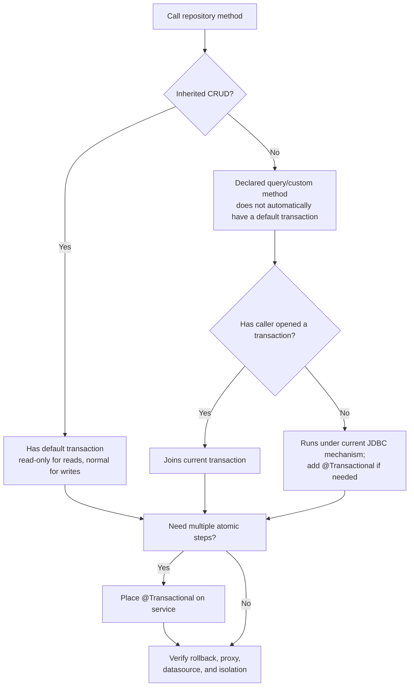

# Default Transactions of CRUD Methods and Declared Query Methods

Spring Data JDBC integrates with Spring's transaction management mechanism. However, not every method in a repository automatically shares the same transaction configuration. CRUD methods inherited from the base repository have a default configuration; query methods declared by the application, such as derived queries or methods annotated with `@Query`, do not automatically receive that transaction configuration.

This difference directly affects how services are designed. A single `save` command may execute within a transaction managed by the repository, whereas a use case involving reading, validating, saving an aggregate, and writing an audit log needs a transaction wrapping the entire workflow. This lesson explains default transactions, how query methods participate in transactions, and how to place transaction boundaries at the service layer.

## 1. Transactions in Spring Data JDBC

A transaction groups one or more database operations into a single unit of work. If the transaction commits, the changes are confirmed. If the transaction rolls back, the changes belonging to the transaction are undone according to the database's capabilities.

For example, an order confirmation business operation may need to:

1. Read the current order.
2. Check that the order is in the `CREATED` status.
3. Update the status to `CONFIRMED`.
4. Insert an audit row recording who performed the action.

If step 3 succeeds but step 4 fails, the application usually does not want the order left in the confirmed state without the corresponding audit record. A use-case-level transaction ensures both changes commit or roll back together.

Spring Data JDBC uses Spring's transaction abstraction. For standard JDBC, the transaction manager manages connections bound to a `DataSource`. Repositories and JDBC components can participate in the current transaction if they use the same datasource and an appropriate transaction manager.

## 2. Default Configuration of Inherited CRUD Methods

CRUD methods inherited from a base repository such as `CrudRepository` have a default transaction configuration:

| Method group | Examples | Default configuration |
| --- | --- | --- |
| Read | `findById`, `findAll`, `count`, `existsById` | Read-only transaction. |
| Write | `save`, `saveAll`, `delete`, `deleteById` | Standard transaction, without `readOnly = true`. |

Repository example:

```java
public interface PurchaseOrderRepository
        extends CrudRepository<PurchaseOrder, Long> {
}
```

Methods `findById`, `findAll`, and `save` are provided by the base repository. You do not need to add `@Transactional` just for these CRUD methods to have default transactions.

For an aggregate `save` operation in Spring Data JDBC, the repository transaction spans saving the root and the child components belonging to the aggregate according to the mapping. If saving a child row fails, the changes made within that same repository operation can roll back together.

### Separate Per-Call Transactions Are Not a Use-Case Transaction

Suppose a service calls two CRUD methods without an outer transaction:

```java
public void registerOrder(PurchaseOrder order) {
    orderRepository.save(order);
    auditRepository.save(createAudit(order));
}
```

Each CRUD method may run in its own transaction. If `orderRepository.save` commits and then `auditRepository.save` fails, the first operation does not automatically roll back because of the second.

To make both calls an atomic unit, place the transaction on the service:

```java
@Transactional
public void registerOrder(PurchaseOrder order) {
    orderRepository.save(order);
    auditRepository.save(createAudit(order));
}
```

With the default `REQUIRED` propagation, the CRUD methods called inside participate in the existing transaction rather than committing independently.

## 3. Declared Query Methods Do Not Automatically Have Default Transactions

A repository can declare derived queries:

```java
public interface PurchaseOrderRepository
        extends CrudRepository<PurchaseOrder, Long> {

    List<PurchaseOrder> findByCustomerId(Long customerId);

    List<PurchaseOrder> findByStatus(String status);
}
```

Both `findByCustomerId` and `findByStatus` are application-declared query methods. They do not automatically inherit a read-only transaction configuration merely because their names start with `find`.

The same applies to query methods annotated with `@Query`:

```java
@Query("""
    SELECT id, customer_id, status, total_amount
    FROM purchase_order
    WHERE customer_id = :customerId
    """)
List<PurchaseOrder> findRecentByCustomer(Long customerId);
```

If the method is called when no transaction is active, a repository query method does not automatically open a transaction under the default CRUD configuration. It can still execute SQL via JDBC; the absence of a declared repository transaction does not mean the SELECT cannot run. However, multiple individual queries will not automatically form a single transactional unit just because they reside in the same service method.

### Query Methods Still Join Caller-Opened Transactions

Example:

```java
@Service
public class OrderSearchService {

    private final PurchaseOrderRepository orders;

    public OrderSearchService(PurchaseOrderRepository orders) {
        this.orders = orders;
    }

    @Transactional(readOnly = true)
    public List<PurchaseOrder> findCustomerOrders(long customerId) {
        return orders.findByCustomerId(customerId);
    }
}
```

Here the transaction is opened by `OrderSearchService`. The query method participates in the current transaction because the default propagation of `@Transactional` is `REQUIRED`.

Therefore, distinguish two points:

- Declared query methods do not create a default transaction on their own.
- Query methods still execute inside a transaction if the caller has already opened an appropriate transaction.

## 4. Declaring Transactions on Query Methods

If you want a query method to always run in a read-only transaction even when called standalone, you can annotate it directly:

```java
public interface PurchaseOrderRepository
        extends CrudRepository<PurchaseOrder, Long> {

    @Transactional(readOnly = true)
    List<PurchaseOrder> findByCustomerId(Long customerId);

    @Transactional(readOnly = true)
    List<PurchaseOrder> findByStatus(String status);
}
```

You can also place transaction configuration at the interface level to apply to repository methods, and override it on methods that need different settings. However, keep annotations where they clarify responsibility and avoid accidentally applying read-only to write methods.

Example of a query method with its own timeout:

```java
@Transactional(readOnly = true, timeout = 5)
List<PurchaseOrder> findByCustomerId(Long customerId);
```

The timeout value is interpreted by the transaction manager and underlying infrastructure; not every JDBC driver/database enforces transaction timeouts in the same way.

### Using a Service Facade for a Group of Queries

If multiple queries serve a single read use case, it is often easier to manage by placing the transaction on the service:

```java
@Service
@Transactional(readOnly = true)
public class OrderReadService {

    private final PurchaseOrderRepository orders;
    private final CustomerRepository customers;

    public OrderReadService(
            PurchaseOrderRepository orders,
            CustomerRepository customers) {
        this.orders = orders;
        this.customers = customers;
    }

    public List<PurchaseOrder> findOrders(long customerId) {
        return orders.findByCustomerId(customerId);
    }

    public Optional<Customer> findCustomer(long customerId) {
        return customers.findById(customerId);
    }
}
```

This sets the transaction boundary per use case instead of repeating annotations on every repository method. Repositories remain focused on querying and persistence.

## 5. Using @Transactional at the Service Layer to Span Business Workflows

The service layer is the right place to define transaction boundaries because the service knows which steps make up a business operation and which steps must succeed together.

Example confirming an order and recording an audit:

```java
@Service
public class OrderWorkflowService {

    private final PurchaseOrderRepository orders;
    private final OrderAuditRepository audits;

    public OrderWorkflowService(
            PurchaseOrderRepository orders,
            OrderAuditRepository audits) {
        this.orders = orders;
        this.audits = audits;
    }

    @Transactional
    public void confirm(long orderId, long actorId) {
        PurchaseOrder order = orders.findById(orderId)
            .orElseThrow(() -> new OrderNotFoundException(orderId));

        if (!"CREATED".equals(order.status())) {
            throw new InvalidOrderStateException(order.status());
        }

        orders.save(order.withStatus("CONFIRMED"));
        audits.save(new OrderAudit(orderId, actorId, "CONFIRMED"));
    }
}
```

Because the service opens a transaction before executing the method body, the repository calls participate in the same transaction if they use the same transaction manager. If writing the audit fails with an exception that triggers rollback, the order status update is rolled back as well.

Without `@Transactional` on the service, the two repository methods could execute in two separate transactions. That is the difference between a single repository method transaction and a multi-step use-case transaction.

## 6. What Does a Read-Only Transaction Mean?

`@Transactional(readOnly = true)` marks the transaction as read-only. The transaction manager can use this information as a hint to the JDBC connection, driver, or database to optimize read operations.

Example:

```java
@Transactional(readOnly = true)
public List<OrderSummary> listRecentOrders(long customerId) {
    return queryRepository.findRecent(customerId);
}
```

Understand the limitations accurately:

- `readOnly = true` is not a database authorization mechanism.
- Not every database/driver rejects write commands in a read-only transaction.
- It does not replace access permissions, validation, or repository design.
- Do not mark a use case that intentionally writes data as read-only.

If a service class is annotated with `@Transactional(readOnly = true)` at the class level, write methods should explicitly declare a write transaction:

```java
@Service
@Transactional(readOnly = true)
public class OrderService {

    private final PurchaseOrderRepository orders;

    public OrderService(PurchaseOrderRepository orders) {
        this.orders = orders;
    }

    public List<PurchaseOrder> findByStatus(String status) {
        return orders.findByStatus(status);
    }

    @Transactional
    public PurchaseOrder create(PurchaseOrder order) {
        return orders.save(order);
    }
}
```

The annotation on the write method overrides the class-level configuration for that method. This structure works well when most of the service performs reads and only a few use cases perform writes.
## 7. Default Transaction Attributes of @Transactional

When using `@Transactional` without specifying attributes, Spring applies the annotation's default values:

| Attribute | Default | Meaning |
| --- | --- | --- |
| `propagation` | `REQUIRED` | Join the current transaction; create a new one if none exists. |
| `isolation` | `DEFAULT` | Use the default isolation level of the database/transaction manager. |
| `readOnly` | `false` | Do not mark the transaction as read-only. |
| `timeout` | Transaction manager default | No custom timeout specified by the annotation. |
| `rollbackFor` | None explicitly declared | Rolls back by default on unchecked exceptions and `Error`. |

These attributes are the defaults of `@Transactional` when the annotation is applied. Inherited CRUD methods for read operations specifically have `readOnly = true` under the default repository configuration.

### Propagation REQUIRED

`REQUIRED` is the default propagation. If the service has already opened a transaction, repository methods called inside join that transaction. If no transaction exists, a method annotated with `@Transactional` can open a new one.

```java
@Transactional
public void placeOrder(PurchaseOrder order) {
    orders.save(order);
    inventory.reserve(order);
}
```

Do not switch to `REQUIRES_NEW` just to "be sure there is a transaction." `REQUIRES_NEW` creates an independent transaction that can commit even if the outer transaction rolls back. Use it only when the business truly wants that independent behavior, such as certain audit logs that must persist even if the main use case fails. Evaluate connection pool usage, commit ordering, and audit consistency.

### Isolation DEFAULT

`Isolation.DEFAULT` uses the database's default isolation level. Specific isolation levels vary across database engines. If a use case requires guarantees against dirty reads, non-repeatable reads, or phantom reads, understand the target database's isolation behavior before raising isolation on a method.

Do not raise isolation levels arbitrarily: transactions may hold locks longer or reduce concurrency. Choose a level aligned with business invariants and test concurrency on the actual engine.
## 8. Rollback Rules on Exceptions

By default, Spring rolls back a transaction when a transactional method exits with an unchecked exception (`RuntimeException`) or `Error`. Checked exceptions do not automatically trigger rollback under the default rules.

Example:

```java
@Transactional
public void confirm(long orderId) throws IOException {
    orders.updateStatus(orderId, "CONFIRMED");
    audit.write(orderId);
}
```

If `IOException` is a checked exception and escapes the method, by default the transaction may commit instead of rolling back. If the business requires rollback in this case as well, declare:

```java
@Transactional(rollbackFor = IOException.class)
public void confirm(long orderId) throws IOException {
    orders.updateStatus(orderId, "CONFIRMED");
    audit.write(orderId);
}
```

You can configure multiple exception types in `rollbackFor` or exclusions via `noRollbackFor`. Specify rules according to business semantics; do not set rollback for every checked exception out of habit if some cases are permitted to commit.

### Catching Exceptions Inside the Method

If a method catches an exception and does not rethrow it:

```java
@Transactional
public void confirm(long orderId) {
    orders.updateStatus(orderId, "CONFIRMED");

    try {
        audit.write(orderId);
    } catch (DataAccessException ex) {
        log.warn("Could not write audit", ex);
        // Method completes normally if not marked for rollback.
    }
}
```

Spring sees the method complete normally, so the transaction may commit. If the error must trigger a rollback, let the exception propagate out or mark the transaction rollback-only via an appropriate mechanism such as `TransactionAspectSupport.currentTransactionStatus().setRollbackOnly()`.

Do not swallow an exception and assume the transaction will roll back automatically. Express the error policy explicitly in the service.

## 9. Transaction Proxies and Self-Invocation

Spring normally applies declarative transactions via proxies. Calls from another bean go through the proxy, allowing the interceptor to start or join a transaction according to the annotation.

Example:

```java
@Service
public class OrderService {

    @Transactional
    public void confirm(long orderId) {
        // Transaction is applied when the method is called through the proxy.
    }
}
```

A common mistake is a method in the same object calling another transactional method directly:

```java
@Service
public class OrderService {

    public void process(long orderId) {
        confirm(orderId); // self-invocation
    }

    @Transactional
    public void confirm(long orderId) {
        // Internal call does not go through the proxy.
    }
}
```

In default proxy mode, calling `this.confirm(...)` bypasses the proxy, so the annotation on `confirm` does not start a new transaction as expected. A cleaner approach is to place the transaction boundary on the public method called from another bean, or extract the transactional use case into a separate bean/service.

Also ensure the object is Spring-managed. Instantiating a service manually with `new OrderService(...)` bypasses proxies and related AOP mechanisms.
## 10. Calling Query Methods from a Service and Ensuring the Same Snapshot

A read use case may require multiple consecutive queries:

```java
@Service
public class OrderReportService {

    private final PurchaseOrderRepository orders;
    private final CustomerRepository customers;

    public OrderReportService(
            PurchaseOrderRepository orders,
            CustomerRepository customers) {
        this.orders = orders;
        this.customers = customers;
    }

    @Transactional(readOnly = true)
    public CustomerOrderReport report(long customerId) {
        Customer customer = customers.findById(customerId)
            .orElseThrow();

        List<PurchaseOrder> recentOrders =
            orders.findByCustomerId(customerId);

        return new CustomerOrderReport(customer, recentOrders);
    }
}
```

Both query methods can participate in the same read-only transaction opened by the service. This lets the transaction manager apply a single transaction boundary for the use case. However, the consistency level across reads still depends on the database's isolation level. Under `READ_COMMITTED`, two SELECTs may observe different commits depending on the database; do not assume read-only automatically means an immutable snapshot.

If a report needs a consistent snapshot, choose an appropriate isolation level or use snapshots/versioning supported by the database. Do not raise isolation without considering lock and concurrency impacts.

## 11. Combining CRUD Methods and Query Methods in the Same Transaction

Suppose a repository has both inherited methods and derived queries:

```java
public interface PurchaseOrderRepository
        extends CrudRepository<PurchaseOrder, Long> {

    List<PurchaseOrder> findByCustomerId(Long customerId);
}
```

The service can combine them:

```java
@Service
public class OrderMaintenanceService {

    private final PurchaseOrderRepository orders;

    public OrderMaintenanceService(PurchaseOrderRepository orders) {
        this.orders = orders;
    }

    @Transactional
    public void cancelCustomerOrders(long customerId) {
        List<PurchaseOrder> openOrders =
            orders.findByCustomerId(customerId);

        for (PurchaseOrder order : openOrders) {
            if ("CREATED".equals(order.status())) {
                orders.save(order.withStatus("CANCELLED"));
            }
        }
    }
}
```

Here, the derived query does not open a transaction itself, but participates in the transaction already opened by the service. The `save` calls also join the current transaction via the default propagation. If one save throws an exception that triggers rollback, previous changes in the same transaction are also rolled back.

If `@Transactional` is removed from the service, each `save` can commit individually. A failure on the fifth order will not automatically undo the first four saves.

For large numbers of records, looping to load and save each aggregate may be inefficient. Evaluate batching, bulk SQL, or batch-oriented design while preserving domain invariants and optimistic locking.

## 12. Configuring the Transaction Manager for Spring Data JDBC

In a Spring Boot application with a single datasource, auto-configuration normally creates the datasource, JDBC templates, and the appropriate transaction manager. When Spring Data JDBC and `NamedParameterJdbcTemplate` use that same datasource, they can participate in the same managed transaction.

If configuring manually, a JDBC transaction manager is needed for the datasource:

```java
@Configuration
@EnableTransactionManagement
public class JdbcTransactionConfig {

    @Bean
    PlatformTransactionManager transactionManager(DataSource dataSource) {
        return new JdbcTransactionManager(dataSource);
    }
}
```

`JdbcTransactionManager` is the transaction manager for JDBC on a `DataSource`. In other versions or setups, `DataSourceTransactionManager` may be used; choose an implementation compatible with your project's Spring Framework version.

If there are multiple datasources, each datasource may need its own transaction manager. In that case, you must explicitly specify which transaction manager repositories and services use, for example via the `transactionManagerRef` attribute of repository configuration or the bean name in `@Transactional(transactionManager = "...")`. A local JDBC transaction manager does not automatically ensure atomicity across two independent datasources.

## 13. Transactions of Custom Repositories and NamedParameterJdbcTemplate

Methods in a custom repository do not automatically receive CRUD transaction behavior just because the class is named as a repository. Example:

```java
@Repository
public class OrderQueryRepository {

    private final NamedParameterJdbcTemplate jdbc;

    public OrderQueryRepository(NamedParameterJdbcTemplate jdbc) {
        this.jdbc = jdbc;
    }

    public List<OrderSummary> findRecent(long customerId) {
        return jdbc.query("""
            SELECT id, status, created_at
            FROM purchase_order
            WHERE customer_id = :customerId
            ORDER BY created_at DESC, id DESC
            """,
            Map.of("customerId", customerId),
            rowMapper
        );
    }
}
```

If this method is called standalone, it does not automatically have a transaction due to class naming conventions or using `NamedParameterJdbcTemplate`. You can:

- Call it from a service method already annotated with `@Transactional(readOnly = true)`.
- Annotate the custom repository method/class with `@Transactional(readOnly = true)`.
- Let a simple query run without an explicit transaction if the business logic does not require a broader transaction.

For custom write methods, place the transaction on the service or annotate the write method so related statements participate together. Using a JDBC template does not bypass the transaction manager managed by Spring.

## 14. Common Misconceptions

| Misconception | Reality |
| --- | --- |
| Every method starting with `find` is automatically read-only transactional. | Only inherited CRUD read methods have that default configuration; declared query methods need their own transaction or must join a caller's transaction. |
| Every repository method has its own transaction and service methods merge them automatically. | Without an outer transaction, CRUD calls may commit individually. For use-case-level atomicity, place the transaction on the service. |
| An unannotated query method cannot join a transaction. | It still joins the current transaction if the caller has opened an appropriate transaction. |
| `readOnly = true` always blocks all write statements. | It is a transaction hint/attribute; enforcement depends on the transaction manager, driver, and database. |
| Calling a transactional method from another method in the same class always opens a transaction. | Self-invocation does not go through the proxy in default proxy mode. |
| Catching an exception still rolls back the transaction automatically. | If the exception is caught and the method returns normally, the transaction may commit unless marked rollback-only. |
| `@Transactional` creates a distributed transaction across all datasources. | A JDBC transaction manager manages resources of its corresponding datasource; multiple datasources require a dedicated design. |
## 15. Testing Transaction Boundaries

Commit/rollback behavior should be tested against a real test database or equivalent integration environment. Merely checking that a method has `@Transactional` does not prove that operations participate in the same transaction.

Scenarios to cover:

- Call two CRUD write methods inside a service transaction and verify both commit together.
- Make the second step fail and verify the change from the first step rolls back.
- Call a declared query method inside a read-only service transaction and verify it reads data within the current transaction.
- Call a standalone query method annotated with `@Transactional(readOnly = true)` and verify the configuration is applied.
- Verify whether checked exceptions roll back or not according to `rollbackFor`.
- Check for self-invocation so you do not rely on annotations not triggered by proxies.
- If using multiple datasources, explicitly verify which transaction manager covers each operation.

Integration test example for rollback:

```java
@Test
void rollsBackOrderWhenAuditWriteFails() {
    PurchaseOrder before = orders.findById(orderId).orElseThrow();

    assertThatThrownBy(() ->
        workflow.confirmWithAuditFailure(orderId, actorId)
    ).isInstanceOf(DataAccessException.class);

    PurchaseOrder after = orders.findById(orderId).orElseThrow();

    assertThat(after.status()).isEqualTo(before.status());
    assertThat(audits.existsFor(orderId, "CONFIRMED")).isFalse();
}
```

The test must cause the audit failure to happen after updating the aggregate, and the exception must escape the transactional method (or the transaction must be marked rollback-only). After the call ends, read the data back in a new transaction to verify the state actually rolled back.

### Testing Query Method Transactions

You can call a `@Transactional(readOnly = true)` service method that runs two repository queries and verify both results. If the use case relies on a consistent snapshot, test concurrency separately on the target database to verify actual isolation level behavior.

Do not mock repositories and conclude that transactions work. Mocks can verify method call flows, but they do not test JDBC connections, commits, rollbacks, or database isolation.

## 16. Workflow for Choosing Where to Place @Transactional

When designing repositories and services, answer in order:

1. Is this an inherited CRUD method or an application-declared query/custom method?
2. Does the method have a default transaction? If it is a query method, does the caller open a transaction?
3. Which steps must commit or roll back together?
4. On which service method should the transaction boundary sit to cover the use case?
5. Are there read-only queries that should be marked `readOnly = true`?
6. Are there write methods inside a read-only class that need to override the configuration?
7. Which exceptions must trigger rollback, including checked exceptions?
8. Does the call go through a Spring proxy, or is it a self-invocation?
9. Do the repositories and JDBC templates share the same datasource and transaction manager?
10. Is the database's default isolation level sufficient for the business logic?

A simple diagram:



## 17. Self-Check Questions

- Why does `findById` inherited from `CrudRepository` have a default read-only transaction?
- Why does `findByStatus` declared by the application not automatically receive that transaction?
- Can a query method without `@Transactional` participate in a service's transaction?
- What happens if a service calls two CRUD write methods without an enclosing transaction?
- Why is a service facade the appropriate place for a transaction boundary?
- How does `REQUIRED` differ from `REQUIRES_NEW`?
- Is `readOnly = true` an absolute write-prevention mechanism?
- Which exception types does Spring roll back on by default? How are checked exceptions handled?
- Why can self-invocation prevent `@Transactional` from being applied?
- When is a separate transaction manager configuration needed?
- Why does a read-only transaction not automatically guarantee a consistent snapshot across multiple queries?
- What integration test proves two repository writes commit or roll back together?

Key takeaway: inherited CRUD methods have default repository transactions; read methods are marked read-only and write methods use standard transactions. Declared query methods do not automatically receive that configuration, though they still join caller-opened transactions. For workflows with multiple operations, place `@Transactional` on the service so the commit/rollback boundary accurately reflects the use case, then verify propagation, rollback rules, proxies, and the actual datasource.
