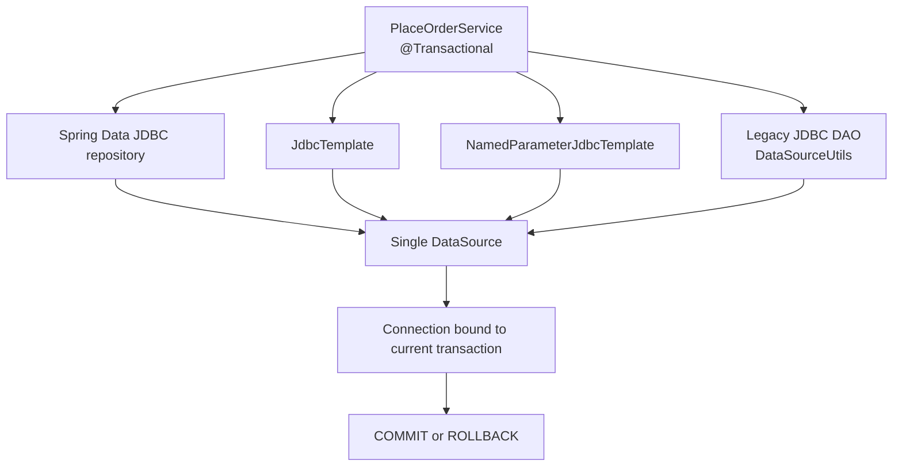
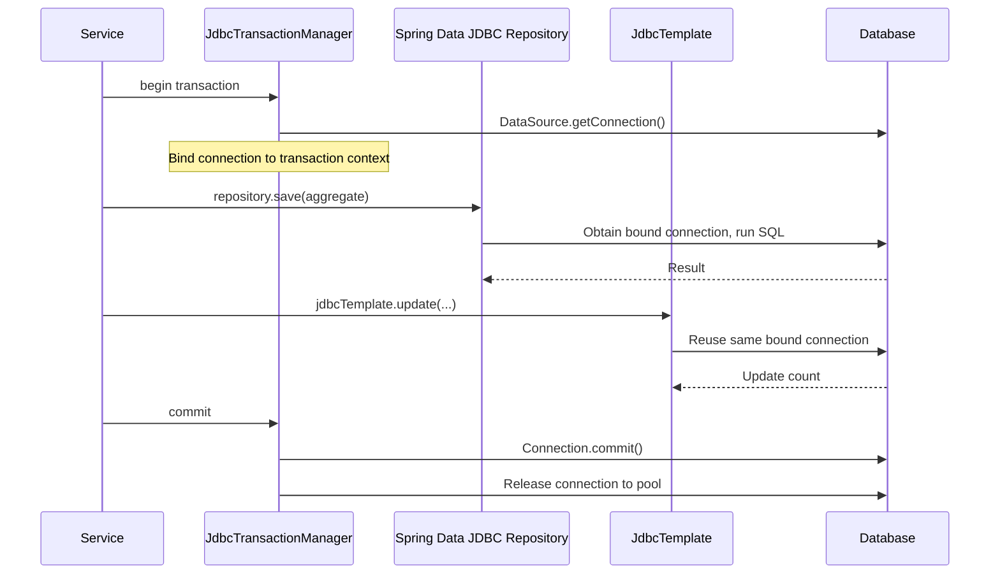

# `JdbcTransactionManager`, `DataSourceTransactionManager`, and Shared Connections

In **Spring Data Relational JDBC**, the transaction manager controls committing or rolling back JDBC operations. For a single `DataSource`, Spring offers two common choices: `DataSourceTransactionManager` and `JdbcTransactionManager`.

These two classes share the same core transaction mechanism: acquiring a JDBC `Connection` from the `DataSource`, binding that connection to the current transaction on the thread, and committing/rolling back and releasing the connection when the transaction finishes. The main difference is that **`JdbcTransactionManager` adds SQL exception translation at commit/rollback time**, allowing database errors that surface late at the end of a transaction to be translated into `DataAccessException` types, similar to how `JdbcTemplate` translates SQL errors.

Whether operations share a transaction depends on using the **same `DataSource` and a transaction-aware connection lookup mechanism**. `JdbcTemplate`, `NamedParameterJdbcTemplate`, and Spring Data JDBC already integrate this mechanism. Custom JDBC code must use `DataSourceUtils` or `TransactionAwareDataSourceProxy`; calling `dataSource.getConnection()` directly typically obtains an independent connection that may fall outside Spring's transaction.

## 1. Role of the Transaction Manager in Spring Data JDBC

A single use case can write data across multiple components:

- `PurchaseOrderRepository` persists an aggregate via Spring Data JDBC.
- `InventoryRepository` updates an inventory aggregate.
- `JdbcTemplate` writes an audit record or runs a custom SQL statement.
- A legacy DAO uses the JDBC API directly.

If these operations must succeed or fail together, the application service opens a transaction at the use-case layer:



When all components use the same JDBC resource and the same transaction manager, the SQL statements participate in the same transaction. If one step throws an exception that causes a rollback, prior changes within the transaction are undone as well.

The transaction manager is neither a connection pool nor a JDBC driver. It manages transaction lifecycles over connections supplied by the `DataSource`. The connection pool is responsible for issuing and recycling physical connections; the driver handles communication with the database.

## 2. What Is `DataSourceTransactionManager`?

`DataSourceTransactionManager` is a `PlatformTransactionManager` implementation for **a single JDBC `DataSource`**. When a transaction starts, the manager obtains a connection from the DataSource and binds it to the current thread's transaction context. Subsequent JDBC operations using Spring's connection lookup retrieve that bound connection.

Import:

```java
import org.springframework.jdbc.datasource.DataSourceTransactionManager;
```

Registering the manager with Java configuration:

```java
@Configuration
@EnableTransactionManagement
public class JdbcTransactionConfiguration {

    @Bean
    public PlatformTransactionManager transactionManager(DataSource dataSource) {
        return new DataSourceTransactionManager(dataSource);
    }
}
```

In a Spring Boot application using a single DataSource, auto-configuration may already create the transaction manager. Only declare the bean manually when customization is needed or when the current configuration lacks an appropriate manager; avoid creating two managers managing the same resource unintentionally.

### Transaction Capabilities

`DataSourceTransactionManager` supports common JDBC transaction features:

- `PROPAGATION_REQUIRED`, `REQUIRES_NEW`, `SUPPORTS`, and other Spring propagation modes.
- Isolation levels according to database/driver capabilities.
- Transaction timeouts; for JDBC statements, timeouts are applied via Spring JDBC or `DataSourceUtils.applyTransactionTimeout(...)`.
- Savepoints and `PROPAGATION_NESTED` if the driver/database supports savepoints.
- Connection commit/rollback when the transaction completes.

The manager works with a single DataSource. If an application has two independent databases, one `DataSourceTransactionManager` instance does not coordinate both into a distributed transaction.

## 3. How Does `JdbcTransactionManager` Differ?

`JdbcTransactionManager` was introduced in Spring Framework **5.3** and extends `DataSourceTransactionManager`:

```java
import org.springframework.jdbc.support.JdbcTransactionManager;
```

```java
@Configuration
@EnableTransactionManagement
public class JdbcTransactionConfiguration {

    @Bean
    public PlatformTransactionManager transactionManager(DataSource dataSource) {
        return new JdbcTransactionManager(dataSource);
    }
}
```

In terms of transaction mechanics, it uses the same foundation as `DataSourceTransactionManager`: managing connections per DataSource, binding connections to the current transaction, and supporting propagation/isolation/timeout/savepoints according to the JDBC resource's capabilities.

The extension is **translating `SQLException` thrown during commit or rollback** using a `SQLExceptionTranslator`. As a result, database errors such as deadlocks or serialization/concurrency failures occurring at commit time can be translated into an appropriate `DataAccessException`, rather than surfacing only as `TransactionSystemException` as with plain `DataSourceTransactionManager`.

This matters because some databases do not report concurrency errors immediately on an `UPDATE` statement. For instance, a transaction at the `SERIALIZABLE` isolation level may execute statements successfully and only detect a serialization conflict at commit. If error translation only happens inside `JdbcTemplate`, commit-time exceptions take a different path. `JdbcTransactionManager` unifies exception translation across both JDBC operations and commit/rollback.

| Criterion | `DataSourceTransactionManager` | `JdbcTransactionManager` |
|---|---|---|
| Inheritance | Base JDBC manager | Subclass of `DataSourceTransactionManager` |
| Connection management | Binds connection per DataSource/thread | Same inherited mechanism |
| Commit/rollback | Yes | Yes |
| Propagation, isolation, timeout, savepoints | Yes, per resource capability | Inherits the same support |
| SQL error translation during `JdbcTemplate` execution | `JdbcTemplate` translates statement errors | `JdbcTemplate` still translates statement errors |
| SQL error translation at commit/rollback | Typically throws `TransactionSystemException` | Uses `SQLExceptionTranslator`, can throw `DataAccessException` |
| Spring Framework | Available for a long time | Available since 5.3 |

For new JDBC applications on Spring Framework 5.3+, `JdbcTransactionManager` is typically the right choice when you want commit/rollback exceptions aligned with the `DataAccessException` hierarchy. `DataSourceTransactionManager` remains valid when preserving legacy exception behavior or specific compatibility requirements.

## 4. Configuring a Single Manager Sharing a DataSource

In a typical Spring Data JDBC application, have the repository infrastructure, `JdbcTemplate`, and transaction manager receive the same `DataSource` bean.

```java
@Configuration
@EnableTransactionManagement
public class PersistenceConfiguration {

    @Bean
    public JdbcTransactionManager transactionManager(DataSource dataSource) {
        return new JdbcTransactionManager(dataSource);
    }

    @Bean
    public JdbcTemplate jdbcTemplate(DataSource dataSource) {
        return new JdbcTemplate(dataSource);
    }
}
```

Spring Data JDBC uses the JDBC infrastructure configured with the application's DataSource. `JdbcTemplate` also receives that exact bean. When the service opens a transaction, both repositories and templates can participate in the same transaction.

There is no need to manually acquire a connection and pass it to every repository. Spring manages the connection via the transaction context, and JDBC abstractions retrieve the matching connection when invoked on the same thread.

### Example Coordinating Repositories and `JdbcTemplate`

```java
@Service
public class PlaceOrderService {

    private final PurchaseOrderRepository orderRepository;
    private final InventoryRepository inventoryRepository;
    private final JdbcTemplate jdbcTemplate;

    public PlaceOrderService(
            PurchaseOrderRepository orderRepository,
            InventoryRepository inventoryRepository,
            JdbcTemplate jdbcTemplate) {
        this.orderRepository = orderRepository;
        this.inventoryRepository = inventoryRepository;
        this.jdbcTemplate = jdbcTemplate;
    }

    @Transactional
    public PurchaseOrder place(PurchaseOrder order, Long productId, int quantity) {
        Inventory inventory = inventoryRepository.findById(productId)
                .orElseThrow();

        inventory.reserve(quantity);
        inventoryRepository.save(inventory);

        PurchaseOrder saved = orderRepository.save(order);

        jdbcTemplate.update(
                "INSERT INTO order_audit(order_id, event_type) VALUES (?, ?)",
                saved.getId(),
                "ORDER_CREATED"
        );

        return saved;
    }
}
```

If `inventoryRepository`, `orderRepository`, and `jdbcTemplate` share the same DataSource/transaction manager, all three write operations join the transaction opened by `place()`. If writing `order_audit` fails and the exception triggers rollback, the inventory update and order insertion roll back too.

This is why transaction boundaries are normally placed on application services: a single use case can coordinate multiple repositories and JDBC APIs while still committing or rolling back as one unit.

## 5. How Is the Connection Shared?

Spring's transaction manager does not pass a connection as a parameter across every method. Instead, the manager binds the connection to the DataSource's resource key in the thread's transaction context.

General flow:



`JdbcTemplate` uses `DataSourceUtils` internally to acquire and release connections. Spring Data JDBC also uses Spring's JDBC infrastructure, so repository operations join the transaction when configured with the same DataSource and manager.

"Sharing a connection" means synchronous operations within the same transaction on the same thread reuse the bound connection. It does not mean a connection is shared concurrently across multiple threads, or that a transaction automatically propagates over HTTP requests, message brokers, or another process.

## 6. `DataSourceUtils`: Acquiring Connections for Handwritten JDBC Code

If you must use the JDBC API directly, do not call `dataSource.getConnection()` when you want to participate in a Spring transaction. Use `DataSourceUtils.getConnection(dataSource)`:

```java
import java.sql.Connection;
import java.sql.PreparedStatement;
import java.sql.SQLException;

import javax.sql.DataSource;

import org.springframework.jdbc.datasource.DataSourceUtils;
import org.springframework.stereotype.Repository;

@Repository
public class LegacyOrderDao {

    private final DataSource dataSource;

    public LegacyOrderDao(DataSource dataSource) {
        this.dataSource = dataSource;
    }

    public int updateStatus(Long orderId, String status) {
        Connection connection = DataSourceUtils.getConnection(dataSource);

        try (PreparedStatement statement = connection.prepareStatement(
                "UPDATE purchase_order SET status = ? WHERE id = ?")) {
            statement.setString(1, status);
            statement.setLong(2, orderId);
            return statement.executeUpdate();
        } catch (SQLException ex) {
            throw new IllegalStateException("Could not update order", ex);
        } finally {
            DataSourceUtils.releaseConnection(connection, dataSource);
        }
    }
}
```

Key points:

- `DataSourceUtils.getConnection(...)` returns the bound connection if a current transaction manages that DataSource.
- `releaseConnection(...)` knows whether the connection is held by a transaction. If it belongs to a transaction, it does not physically close it before the transaction ends.
- Do not call `connection.commit()` or `connection.rollback()` inside this DAO; the transaction manager manages commit/rollback.
- Do not use `try-with-resources` directly on a connection acquired via `DataSourceUtils`, because calling `Connection.close()` may close the connection that the active transaction still needs. Use `releaseConnection` in `finally`.
- `PreparedStatement` should still be closed with try-with-resources.

If no Spring transaction is active, `DataSourceUtils` still works as a normal way to acquire a connection and release it after the operation.

## 7. `TransactionAwareDataSourceProxy` for Legacy Code

A legacy library or DAO might only accept a `DataSource` and call:

```java
try (Connection connection = dataSource.getConnection()) {
    // JDBC code unaware of Spring DataSourceUtils
}
```

When you cannot modify that code to use `DataSourceUtils`, Spring provides `TransactionAwareDataSourceProxy`. This proxy wraps the real DataSource and causes standard `getConnection()` calls to receive the connection bound to the current transaction.

```java
@Bean
public DataSource legacyAwareDataSource(DataSource targetDataSource) {
    return new TransactionAwareDataSourceProxy(targetDataSource);
}
```

Then pass the proxy to the legacy component that relies on `DataSource.getConnection()`.

Important note: **the transaction manager must manage the actual target DataSource**, not the proxy passed to legacy code. `DataSourceTransactionManager` can unwrap `TransactionAwareDataSourceProxy`, but configuring the real target DataSource explicitly avoids resource key confusion.

`TransactionAwareDataSourceProxy` is primarily an adapter for legacy code. For new code, prefer `JdbcTemplate`, `NamedParameterJdbcTemplate`, or `DataSourceUtils` because they manage connections and exceptions through Spring integration.

## 8. Why Can Calling `DataSource.getConnection()` Directly Fall Outside the Transaction?

The following code has a bug when run inside a `@Transactional` method:

```java
@Transactional
public void updateTwoTables() throws SQLException {
    jdbcTemplate.update(
            "UPDATE account SET balance = balance - 100 WHERE id = ?",
            1L
    );

    try (Connection connection = dataSource.getConnection()) {
        try (PreparedStatement ps = connection.prepareStatement(
                "UPDATE ledger SET amount = amount + 100 WHERE account_id = ?")) {
            ps.setLong(1, 1L);
            ps.executeUpdate();
        }
    }
}
```

`JdbcTemplate` joins the Spring transaction. However, calling `dataSource.getConnection()` directly usually obtains a different connection from the pool. That connection may auto-commit under its default setting and will not be rolled back by the transaction manager along with the first operation.

If the second SQL statement fails, the account balance may remain updated in the Spring transaction while the ledger update runs outside the transaction. As a result, the data is no longer atomic.

Fix it in one of two ways:

1. Migrate the JDBC code to `JdbcTemplate`/`NamedParameterJdbcTemplate`.
2. Use `DataSourceUtils.getConnection(...)` and `releaseConnection(...)` as shown in the previous section.

For unmodifiable legacy code, pass a `TransactionAwareDataSourceProxy`.

## 9. How Exact Must "Same DataSource" Be?

For components to share a transaction, they must reference the same DataSource resource managed by the transaction manager. The clearest configuration is injecting the exact same DataSource bean into:

- `JdbcTransactionManager` or `DataSourceTransactionManager`.
- Spring Data JDBC infrastructure.
- `JdbcTemplate` and `NamedParameterJdbcTemplate`.
- DAOs using `DataSourceUtils`.

Do not create a second connection pool using the same JDBC URL and assume it represents the same resource. Two separate pool beans normally hand out independent connections; a transaction manager binding a connection from pool A cannot automatically manage a connection obtained from pool B.

Similarly, two different DataSource wrappers can complicate resource lookup if they are not unwrapped/normalized to the same target. Using the same DataSource bean across configuration is the safest choice. With `TransactionAwareDataSourceProxy`, the manager uses the target DataSource while the legacy DAO uses the proxy.

### Cases That Do Not Share a Transaction

| Configuration | Shares local JDBC transaction? | Reason |
|---|---|---|
| Repository and `JdbcTemplate` on same DataSource | Yes | Same resource and Spring connection lookup |
| `JdbcTemplate` and DAO using `DataSourceUtils` with same DataSource | Yes | Same bound connection |
| Legacy DAO using `TransactionAwareDataSourceProxy` of target DataSource | Possible | Proxy joins target's transaction |
| Two separate pools pointing to same JDBC URL | No | Two distinct DataSources/resources |
| Two DataSources and two separate `DataSourceTransactionManager`s | Not a single transaction | Each manager manages one resource |
| An operation running on another thread via `@Async` | Not automatically | JDBC transactions are bound to the current thread |
| One service making an HTTP call to another service | No | Local JDBC transactions do not cross networks |

## 10. One DataSource or Multiple DataSources?

With one primary database, you typically need only one DataSource and one JDBC transaction manager:

```text
ordersDataSource
    ├── Spring Data JDBC repositories
    ├── JdbcTemplate
    ├── NamedParameterJdbcTemplate
    └── JdbcTransactionManager
```

If the application uses two independent databases, configure two DataSource/transaction manager pairs:

```java
@Bean("ordersTransactionManager")
JdbcTransactionManager ordersTransactionManager(
        @Qualifier("ordersDataSource") DataSource dataSource) {
    return new JdbcTransactionManager(dataSource);
}

@Bean("reportingTransactionManager")
JdbcTransactionManager reportingTransactionManager(
        @Qualifier("reportingDataSource") DataSource dataSource) {
    return new JdbcTransactionManager(dataSource);
}
```

The service selects the manager explicitly:

```java
@Transactional("ordersTransactionManager")
public void placeOrder(...) {
    // operations belonging to ordersDataSource
}
```

If a use case writes to both the orders database and the reporting database, a single `@Transactional` tied to one manager will not make both resources commit/roll back atomically. You can use distributed transactions/XA if infrastructure supports it and requirements truly demand it, or design an outbox/saga to coordinate multiple local transactions.

With Spring Data JDBC, each repository infrastructure must be wired to its proper DataSource and transaction manager. When configuring multiple repository groups via `@EnableJdbcRepositories`, verify `dataSourceRef` and `transactionManagerRef` for each group to avoid repositories using the wrong resource.

## 11. Transaction Managers and Transaction Propagation

`JdbcTransactionManager` inherits the propagation behavior of `DataSourceTransactionManager`. Common modes:

| Propagation | Behavior |
|---|---|
| `REQUIRED` | Joins the existing transaction; creates a new one if none exists |
| `REQUIRES_NEW` | Suspends the current transaction and opens an independent transaction |
| `SUPPORTS` | Joins if a transaction exists; otherwise runs non-transactionally |
| `MANDATORY` | Requires an active current transaction |
| `NOT_SUPPORTED` | Suspends the current transaction and runs non-transactionally |
| `NEVER` | Fails if a transaction is currently active |
| `NESTED` | Uses a savepoint within the current transaction if supported by manager/resource |

Example of two services sharing one manager:

```java
@Service
public class OrderService {

    private final InventoryService inventoryService;

    public OrderService(InventoryService inventoryService) {
        this.inventoryService = inventoryService;
    }

    @Transactional
    public void placeOrder(...) {
        // write order
        inventoryService.reserve(...); // default REQUIRED joins current transaction
    }
}

@Service
public class InventoryService {

    @Transactional
    public void reserve(...) {
        // write inventory inside existing transaction
    }
}
```

With `REQUIRED`, the second service call does not open an independent connection/transaction while the outer transaction is active on the same manager/resource. It joins the current transaction.

`REQUIRES_NEW` can require an additional connection while the outer transaction still holds its bound connection. If the connection pool is too small and many concurrent requests invoke nested `REQUIRES_NEW`, pool exhaustion or connection waiting can occur. Use it only when the inner work truly needs an independent commit.

## 12. `@Transactional` Must Be Invoked Through a Spring Proxy

Transaction annotations are processed by Spring's transaction infrastructure, typically via proxies. Methods called from outside through a Spring bean go through the interceptor to start or join a transaction.

Example where self-invocation fails to trigger the transaction interceptor for the inner method:

```java
public class OrderService {

    public void process() {
        saveOrder(); // direct call this.saveOrder(), bypasses proxy
    }

    @Transactional
    public void saveOrder() {
        // do not expect this internal call to open a transaction on its own
    }
}
```

Place the transaction on the use-case method invoked through a bean proxy, or extract the transactional part into a separate Spring bean. Do not instantiate services manually with `new OrderService(...)` if you want `@Transactional` applied.

JDBC transactions are thread-bound. When using `@Async`, executors, or spawning new threads, the current connection/transaction is not automatically transferred to another thread. Each thread needs its own transaction, and if a workflow must coordinate outcomes, design an appropriate message/outbox or synchronization mechanism.

## 13. Where Does Spring Data JDBC Already Have Default Transactions?

Methods on `CrudRepository` in Spring Data JDBC carry default transaction metadata:

- Read methods are configured with `readOnly = true`.
- Write methods have default `@Transactional`.

However, the application service should still define the transaction boundary when a use case calls multiple repositories or coordinates repositories with `JdbcTemplate`. The outer transaction determines the effective configuration for calls joining it.

Application-declared query methods should be annotated appropriately for transactions. This is especially important in Spring Data JDBC because loading a single aggregate may require multiple queries. Without a shared transaction, queries loading the root and related entities may run on different connections, placing extra load on the pool and potentially observing inconsistent data snapshots.

Example:

```java
@Transactional(readOnly = true)
public interface CustomerRepository extends CrudRepository<Customer, Long> {

    List<Customer> findByStatus(String status);

    @Modifying
    @Transactional
    @Query("DELETE FROM customer WHERE active = false")
    int deleteInactiveCustomers();
}
```

`readOnly = true` is a hint to the transaction manager/driver that can enable optimizations; it is not a security mechanism guaranteeing all write statements are blocked. For modifying queries, override with a write transaction.

## 14. Commit-Time Exceptions: Why `JdbcTransactionManager` Is Useful

A SQL error can surface at two moments:

1. **During statement execution:** for example, a unique constraint violation on `INSERT`.
2. **At commit time:** for example, a serialization failure or deadlock detected by the database when finishing the transaction.

`JdbcTemplate` translates `SQLException` occurring during query/update execution into an appropriate `DataAccessException`. However, if the database throws an error at `Connection.commit()`, the transaction manager receives that exception.

With `DataSourceTransactionManager`, commit/rollback errors are typically wrapped in `TransactionSystemException`. `JdbcTransactionManager` uses `SQLExceptionTranslator` to try translating the error into a corresponding `DataAccessException`; if translation cannot map it, it can still fall back to `TransactionSystemException`.

Implications for retry handling:

- Do not blindly retry every `DataAccessException`; validation/constraint errors normally cannot be fixed by immediate retry.
- Serialization/deadlock/concurrency failures can be retried across the entire transaction if the use case is idempotent and retries are bounded.
- With `JdbcTransactionManager`, code should be prepared to handle `DataAccessException` originating from commit/rollback, not only from `JdbcTemplate.update()`.
- Do not continue using a transaction already marked rollback-only; retries require a fresh transaction.

## 15. Testing to Prove Shared Connections

A simple test should prove that operations via Spring Data JDBC and `JdbcTemplate` roll back together when one step fails.

Service example:

```java
@Service
public class TransferService {

    private final AccountRepository accountRepository;
    private final JdbcTemplate jdbcTemplate;

    public TransferService(
            AccountRepository accountRepository,
            JdbcTemplate jdbcTemplate) {
        this.accountRepository = accountRepository;
        this.jdbcTemplate = jdbcTemplate;
    }

    @Transactional
    public void transfer(Long accountId, BigDecimal amount) {
        Account account = accountRepository.findById(accountId).orElseThrow();
        account.debit(amount);
        accountRepository.save(account);

        jdbcTemplate.update(
                "INSERT INTO transfer_audit(account_id, amount) VALUES (?, ?)",
                accountId,
                amount
        );

        throw new IllegalStateException("Simulated failure");
    }
}
```

An integration test calls the service via the Spring bean and reads data after the method finishes:

```java
@SpringBootTest
class TransferTransactionTest {

    @Autowired TransferService transferService;
    @Autowired JdbcTemplate jdbcTemplate;

    @Test
    void repositoryAndJdbcTemplateWritesRollbackTogether() {
        BigDecimal before = jdbcTemplate.queryForObject(
                "SELECT balance FROM account WHERE id = ?",
                BigDecimal.class,
                1L
        );

        assertThatThrownBy(() -> transferService.transfer(1L, new BigDecimal("10.00")))
                .isInstanceOf(IllegalStateException.class);

        BigDecimal after = jdbcTemplate.queryForObject(
                "SELECT balance FROM account WHERE id = ?",
                BigDecimal.class,
                1L
        );
        Integer auditCount = jdbcTemplate.queryForObject(
                "SELECT COUNT(*) FROM transfer_audit WHERE account_id = ?",
                Integer.class,
                1L
        );

        assertThat(after).isEqualByComparingTo(before);
        assertThat(auditCount).isZero();
    }
}
```

The test requires the schema and initial account data. If using `@Transactional` on the test class itself, keep in mind that an outer test transaction can make verification results harder to interpret; you can leave the test non-transactional and call the service through its proxy so the service transaction commits/rolls back before assertions run.

### Inspecting Connection Identity When Diagnosing Issues

When suspecting DAOs are using two different connections, you can temporarily log information about the connection retrieved via `DataSourceUtils` inside the same transaction. Use this only for diagnostics in test/development; connection proxies can make `toString()` or object identity fail to directly reflect the underlying physical connection. Testing rollback behavior provides better functional proof than comparing object references.

## 16. Common Configuration Mistakes

| Symptom | Possible cause | Fix |
|---|---|---|
| Repository rolls back while JDBC DAO commits | DAO calls `DataSource.getConnection()` directly and gets another connection | Use `JdbcTemplate`, `DataSourceUtils`, or `TransactionAwareDataSourceProxy` |
| `JdbcTemplate` does not join service transaction | Template and manager use different DataSources or wrong manager selected | Share the same DataSource bean and appropriate transaction manager |
| Two repositories do not roll back together | They are configured with different DataSources/managers | Check repository configuration and `@Transactional` manager qualifier |
| Connection pool exhausted when using `REQUIRES_NEW` | Outer transaction holds connection while new transaction needs another | Reduce `REQUIRES_NEW`, size pool carefully, or change transaction design |
| Error only surfaces at commit time | Database checks serialization/locking at end of transaction | Consider `JdbcTransactionManager`, handle concurrency exceptions, and retry entire transaction |
| Catching `TransactionSystemException` misses translated errors | Using `JdbcTransactionManager`, commit exception may be `DataAccessException` | Handle exceptions via appropriate hierarchy without assuming one single type |
| `@Transactional` has no effect | Self-invocation, object created with `new`, bean bypassed proxy | Invoke through Spring bean proxy and place transaction on use-case method |
| `@Async` does not use current transaction | JDBC transaction is thread-bound | Open a dedicated transaction inside the async worker and pass needed data |
| Legacy DAO calling `close()` breaks subsequent operations | Closing a connection held by the active transaction | Use `DataSourceUtils.releaseConnection` or a compatible proxy |
| Two DataSources with same URL are not atomic | Two pools/managers are two independent resources | Use a single shared DataSource, or XA/outbox/saga for multiple resources |

## 17. Process for Choosing a Transaction Manager and Connection Strategy

1. **Identify database resources:** does the application have one DataSource or multiple DataSources?
2. **Choose the manager:** use `JdbcTransactionManager` on Spring Framework 5.3+ if you want commit/rollback error translation consistent with JDBC; use `DataSourceTransactionManager` when baseline/compatibility behavior is needed.
3. **Share the DataSource bean:** configure the manager, Spring Data JDBC, and `JdbcTemplate` with the same resource.
4. **Place transaction boundaries:** open `@Transactional` on the application service for use cases coordinating multiple repositories.
5. **Standardize connection lookup:** new code uses templates; raw JDBC uses `DataSourceUtils`; legacy code uses `TransactionAwareDataSourceProxy` when needed.
6. **Respect thread boundaries:** do not assume transactions automatically transfer to `@Async`, executors, or HTTP calls.
7. **Check multi-resource scope:** each manager governs its own resource; multiple DataSources do not automatically become a single ACID transaction.
8. **Test rollback:** trigger an error after some operations have run and verify all changes in the transaction are undone.
9. **Handle commit exceptions:** prepare for `DataAccessException` when using `JdbcTransactionManager` and retry only recoverable errors.

### Quick Decision Table

| Scenario | Choice |
|---|---|
| Single JDBC DataSource, new app on Spring 5.3+ | Usually choose `JdbcTransactionManager` |
| Need baseline manager exception semantics | `DataSourceTransactionManager` |
| Spring Data JDBC + `JdbcTemplate` on same database | Share the same DataSource and one manager |
| Handwritten JDBC code needing transaction participation | `DataSourceUtils.getConnection/releaseConnection` |
| Legacy library taking only DataSource and calling `getConnection()` | `TransactionAwareDataSourceProxy` |
| Two independent pools/databases needing atomic commit | XA/JTA if suitable, or outbox/saga |
| Work executing on another thread | Separate transaction in worker; do not reuse caller thread's connection |

**Core point:** `DataSourceTransactionManager` and `JdbcTransactionManager` share the same JDBC transaction mechanism over a single DataSource; `JdbcTransactionManager` adds SQL exception translation on commit/rollback. For Spring Data JDBC, `JdbcTemplate`, and custom DAOs to share a transaction, ensure they use the same DataSource and obtain connections through Spring's transaction-aware mechanism. `DataSourceUtils` is the choice for new raw JDBC code; `TransactionAwareDataSourceProxy` is for legacy code. Multiple DataSources or multiple threads represent separate resource boundaries and must be designed explicitly.

## Official References

- [Spring Framework — Controlling Database Connections](https://docs.spring.io/spring-framework/reference/data-access/jdbc/connections.html): `DataSourceUtils`, `TransactionAwareDataSourceProxy`, `DataSourceTransactionManager`, and `JdbcTransactionManager`.
- [Spring Framework — Synchronizing Resources with Transactions](https://docs.spring.io/spring-framework/reference/data-access/transaction/tx-resource-synchronization.html): how Spring binds/reuses connections and synchronizes resources with transactions.
- [Spring Framework — `JdbcTransactionManager` API](https://docs.spring.io/spring-framework/docs/current/javadoc-api/org/springframework/jdbc/support/JdbcTransactionManager.html): extends `DataSourceTransactionManager` and translates commit/rollback exceptions.
- [Spring Framework — `DataSourceTransactionManager` API](https://docs.spring.io/spring-framework/docs/current/javadoc-api/org/springframework/jdbc/datasource/DataSourceTransactionManager.html): transaction manager for a single JDBC DataSource.
- [Spring Framework — `DataSourceUtils` API](https://docs.spring.io/spring-framework/docs/current/javadoc-api/org/springframework/jdbc/datasource/DataSourceUtils.html): transaction-aware connection acquisition and release.
- [Spring Framework — `TransactionAwareDataSourceProxy` API](https://docs.spring.io/spring-framework/docs/current/javadoc-api/org/springframework/jdbc/datasource/TransactionAwareDataSourceProxy.html): adapter for code calling `DataSource.getConnection()` directly.
- [Spring Data Relational — Transactionality](https://docs.spring.io/spring-data/relational/reference/jdbc/transactions.html): default repository transactions and service-layer transaction boundaries.
