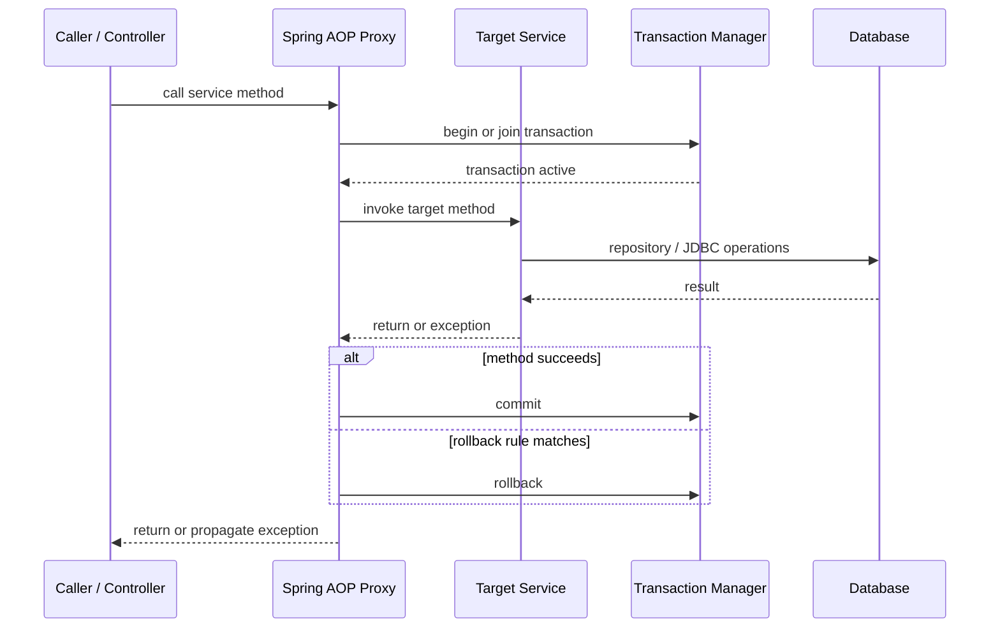
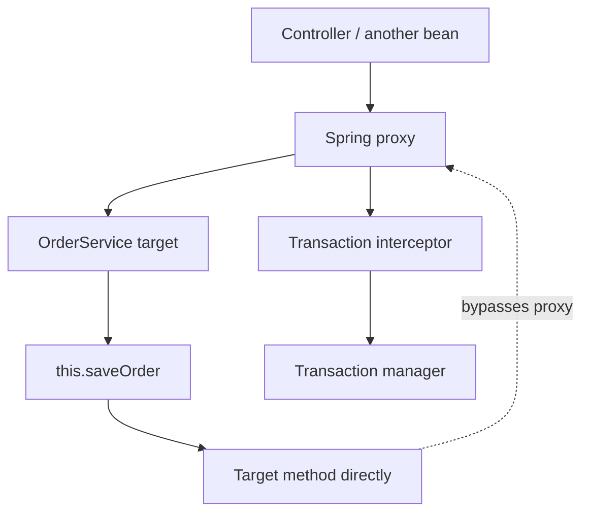
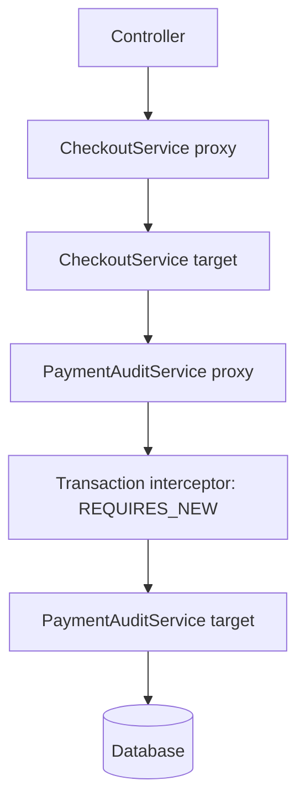

# Proxies, Self-Invocation, and Why @Transactional Has No Effect

In a **Spring Data Relational JDBC** application, the **@Transactional** annotation is commonly used at the service layer to group multiple repository/JDBC operations into a single transaction. However, simply placing the annotation on a method does not guarantee a transaction will be opened. Under Spring's default transaction configuration, the call must go through a **Spring AOP proxy** so the transaction interceptor has a chance to run.

A frequent mistake is **self-invocation**: a method inside a bean calls another method in that exact same bean using **this.someMethod()**. This internal call goes directly to the target object and bypasses the proxy. Consequently, **@Transactional** on the internally called method is not applied as an external call would be.

For example, a **checkout()** method running inside a transaction calls **this.writeAudit()**, while **writeAudit()** is annotated with **Propagation.REQUIRES_NEW**. Because the call bypasses the proxy, Spring does not start a new independent transaction. That method runs inside the existing transaction, and attributes such as propagation, isolation, timeout, or read-only on the internal method are not applied.

This lesson explains how transaction proxies work, why self-invocation bypasses proxies, other reasons **@Transactional** fails to take effect, and how to structure code so transaction boundaries remain clear in Spring Data JDBC applications.

## 1. @Transactional Works Through a Spring Proxy

In default proxy mode, Spring creates a proxy wrapping any Spring bean that has transactional methods. The proxy intercepts calls from other beans, inspects **@Transactional** metadata, asks the transaction manager to begin or join a transaction, and only then invokes the method on the target object.

General call flow:



The proxy is the interception point where the transaction interceptor runs. When a method calls another method directly on the same object, that call does not go back through the proxy.

This explains the difference between the two calls:

```java
// Caller invokes the injected Spring bean:
orderService.checkout(orderId);

// Inside the target object:
this.writeAudit(orderId);
```

The first call can pass through the proxy. The second call is a direct Java invocation on the target object.

### 1.1. Spring Data JDBC and the Transaction Manager

Spring Data JDBC executes SQL statements over JDBC. When a service is wrapped by an appropriate transaction manager, repositories and JdbcTemplate can participate in the same transaction if they share the same DataSource and transaction infrastructure.

Example:

```java
@Service
public class OrderService {

    private final PurchaseOrderRepository orders;
    private final OrderLineRepository lines;

    public OrderService(
            PurchaseOrderRepository orders,
            OrderLineRepository lines
    ) {
        this.orders = orders;
        this.lines = lines;
    }

    @Transactional
    public void confirmOrder(long orderId) {
        PurchaseOrder order = orders.findById(orderId)
                .orElseThrow();

        order.confirm();
        orders.save(order);

        lines.markReserved(orderId);
    }
}
```

If updating the order succeeds but updating the lines fails and the exception triggers transaction rollback, the database changes within the same transaction are rolled back together.

**@Transactional** governs transactions at the application boundary; it does not automatically turn multiple independent DataSources into a distributed transaction. If repositories and JDBC templates use different DataSources/transaction managers, configure transactions appropriately for each data source.

## 2. What Is Self-Invocation?

Self-invocation happens when one method of a bean calls another method on the same instance. Example:

```java
@Service
public class OrderService {

    public void checkout(long orderId) {
        this.saveOrder(orderId);
    }

    @Transactional
    public void saveOrder(long orderId) {
        // Database writes
    }
}
```

If a controller calls **orderService.checkout(...)** through the proxy, the proxy only sees the **checkout()** call. Because **checkout()** has no transaction metadata, the transaction interceptor does not start a transaction for that method.

Then **checkout()** calls **this.saveOrder(...)**. That is a direct call on the target object and does not pass back through the proxy. **@Transactional** on **saveOrder()** is therefore never processed.

Result: operations inside **saveOrder()** can run without the transaction requested by that annotation.

### 2.1. Self-Invocation Diagram



A proxy cannot intercept arbitrary Java calls happening inside the target. It only intercepts calls entering through the proxy.

### 2.2. this Is Not the Proxy

In a Spring-managed class, the target object and the proxy play two different roles:

- The proxy is the object visible to callers when the bean is injected.
- The target is the object executing the business method.
- **this** inside a method points to the executing target object.
- Calling **this.otherMethod()** does not route the call back through the proxy.

Whether the proxy is created using JDK dynamic proxies or CGLIB, the self-invocation rule in proxy mode remains the same.

## 3. When Does Self-Invocation Break Transactions?

### 3.1. The Internal Method Is the Only One Annotated with @Transactional

Example:

```java
@Service
public class InventoryService {

    public void reserve(long productId, int quantity) {
        updateStock(productId, quantity);
        writeReservation(productId, quantity);
    }

    @Transactional
    public void updateStock(long productId, int quantity) {
        // UPDATE stock
    }

    @Transactional
    public void writeReservation(long productId, int quantity) {
        // INSERT reservation
    }
}
```

If the caller invokes **reserve()**, which has no transaction, neither internally called method starts a transaction. One operation may commit while the other fails.

This easily leads to mismatched data: stock has been deducted while the reservation was never recorded.

### 3.2. Outer Method Has a Transaction, Inner Method Requests REQUIRES_NEW

Example:

```java
@Service
public class OrderService {

    @Transactional
    public void checkout(long orderId) {
        updateOrder(orderId);
        this.writeAuditInNewTransaction(orderId);
    }

    @Transactional(propagation = Propagation.REQUIRES_NEW)
    public void writeAuditInNewTransaction(long orderId) {
        // Write audit
    }
}
```

When the caller invokes **checkout()** through the proxy, the outer transaction is opened. However, **this.writeAuditInNewTransaction(...)** bypasses the proxy, so Spring never sees the **REQUIRES_NEW** requirement.

As a result, the audit insert runs inside the outer transaction. If **checkout()** subsequently throws an exception and the outer transaction rolls back, the audit rolls back too. This contradicts the original intent of committing the audit in an independent transaction.

### 3.3. Inner Method Requests NOT_SUPPORTED or MANDATORY

Self-invocation also ignores other propagation attributes:

- **NOT_SUPPORTED**: should suspend the current transaction, but the internal call never asks the proxy to do so.
- **MANDATORY**: should require an active transaction, but the internal call is never checked by the interceptor.
- **NEVER**: should reject an active transaction, but that rule is not enforced on an internal call.
- **NESTED**: should use a nested transaction/savepoint if supported by the transaction manager, but the inner method's setting is ignored.

Likewise, **readOnly**, **timeout**, **isolation**, **rollbackFor**, or **noRollbackFor** attributes on an inner method do not establish a new boundary when the proxy is bypassed.

### 3.4. Outer Method Already Has a Transaction

One nuance to understand: if the outer method was invoked via the proxy and already has an active transaction, an internally invoked inner method still executes inside that existing transaction. Its SQL statements can still participate in that transaction because the transaction context was opened at the outer boundary.

What gets ignored is **the inner method's own transaction configuration**.

For example, if the inner method has **Propagation.REQUIRED**, it effectively still runs inside the outer transaction, though not because the annotation on the inner method was processed by the interceptor. If the inner method specifies **REQUIRES_NEW**, it still fails to split into a separate transaction.

## 4. Failure Example and Actual Outcome

Suppose the following service handles order payments:

```java
@Service
public class CheckoutService {

    private final PurchaseOrderRepository orders;
    private final PaymentAuditRepository audits;

    public CheckoutService(
            PurchaseOrderRepository orders,
            PaymentAuditRepository audits
    ) {
        this.orders = orders;
        this.audits = audits;
    }

    @Transactional
    public void checkout(long orderId) {
        PurchaseOrder order = orders.findById(orderId)
                .orElseThrow();

        order.markAsPaid();
        orders.save(order);

        this.writeAudit(orderId);

        throw new IllegalStateException("Simulated failure");
    }

    @Transactional(propagation = Propagation.REQUIRES_NEW)
    public void writeAudit(long orderId) {
        audits.insertPaidEvent(orderId);
    }
}
```

The author's expectations might be:

1. Update the order in the outer transaction.
2. Write the audit in a new transaction.
3. If checkout fails, roll back the order.
4. The audit still persists because the new transaction committed.

However, **this.writeAudit(...)** bypasses the proxy. The audit insert joins the outer transaction. The subsequent exception rolls back both the order and the audit.

Outcome table:

| Step | Expected when REQUIRES_NEW applies | Actual under self-invocation |
|---|---|---|
| Update order | Outer transaction | Outer transaction |
| Insert audit | Independent new transaction | Outer transaction |
| Throw exception after audit | Rolls back outer transaction | Rolls back outer transaction |
| Final order state | No change | No change |
| Final audit state | Still persists | Rolled back |

**REQUIRES_NEW** itself is not broken. The transaction interceptor simply never received the call to the method carrying that configuration.

## 5. Best Fix: Extract the Transaction Boundary Into a Separate Bean

The cleanest solution is moving the method that needs its own transaction into another Spring bean. The caller injects that bean and invokes it through the target bean's proxy.

Example:

```java
@Service
public class PaymentAuditService {

    private final PaymentAuditRepository audits;

    public PaymentAuditService(PaymentAuditRepository audits) {
        this.audits = audits;
    }

    @Transactional(propagation = Propagation.REQUIRES_NEW)
    public void writePaidEvent(long orderId) {
        audits.insertPaidEvent(orderId);
    }
}
```

Checkout service:

```java
@Service
public class CheckoutService {

    private final PurchaseOrderRepository orders;
    private final PaymentAuditService paymentAuditService;

    public CheckoutService(
            PurchaseOrderRepository orders,
            PaymentAuditService paymentAuditService
    ) {
        this.orders = orders;
        this.paymentAuditService = paymentAuditService;
    }

    @Transactional
    public void checkout(long orderId) {
        PurchaseOrder order = orders.findById(orderId)
                .orElseThrow();

        order.markAsPaid();
        orders.save(order);

        paymentAuditService.writePaidEvent(orderId);

        throw new IllegalStateException("Simulated failure");
    }
}
```

New call flow:



**paymentAuditService** is a separate bean injected from the Spring container. The call passes through its proxy, so **REQUIRES_NEW** takes effect: the outer transaction is suspended, a new audit transaction is opened and committed when the audit method succeeds. Then the outer transaction resumes; if checkout fails, it rolls back independently of the committed audit transaction.

### 5.1. Split Beans by Responsibility, Not Just to Dodge Proxies

Do not create a new class arbitrarily just to relocate one method. Split when the method has a clear responsibility and a distinct business/technical transaction boundary.

Sensible examples:

- **OrderService**: coordinates order changes.
- **PaymentAuditService**: writes audits requiring an independent transaction.
- **InventoryReservationService**: manages inventory reservations.
- **NotificationOutboxService**: writes outbox rows inside the appropriate transaction.

Bean boundaries make transaction boundaries visible through dependency injection and easier to test.

## 6. Alternative Fixes: Intentionally Calling Through the Proxy

You can invoke the method through the proxy rather than **this**, though this couples code to proxy infrastructure.

### 6.1. Self-Injecting the Bean

Example using self injection:

```java
@Service
public class OrderService {

    private final OrderService self;

    public OrderService(@Lazy OrderService self) {
        this.self = self;
    }

    public void checkout(long orderId) {
        self.writeAuditInNewTransaction(orderId);
    }

    @Transactional(propagation = Propagation.REQUIRES_NEW)
    public void writeAuditInNewTransaction(long orderId) {
        // Write audit
    }
}
```

When **self** is the proxy injected by Spring, calling **self.writeAuditInNewTransaction(...)** goes through the proxy.

However, self injection has several drawbacks:

- Creates a circular dependency within the same bean.
- Makes transaction boundaries harder to spot when reading code.
- Can depend on proxy and injection configuration.
- Is prone to confusion during refactoring or plain unit testing.

Therefore, extracting the transaction collaborator into a separate bean is usually easier to maintain.

### 6.2. AopContext.currentProxy()

Another option is retrieving the current proxy:

```java
@EnableAspectJAutoProxy(exposeProxy = true)
@Configuration
class AopConfiguration {
}
```

Then:

```java
public void checkout(long orderId) {
    ((OrderService) AopContext.currentProxy())
            .writeAuditInNewTransaction(orderId);
}
```

This requires exposing the proxy and depends on the Spring AOP context. It tightly couples code to AOP, so use it only with a specific justification and acceptance of that coupling.

Do not call **AopContext.currentProxy()** inside an object not running under a proxy or when proxy exposure is disabled; doing so can raise a runtime error.

## 7. Use TransactionTemplate When Programmatic Boundaries Are Needed

If transaction boundaries are decided dynamically or do not fit annotations well, **TransactionTemplate** provides explicit transaction control.

Example:

```java
@Service
public class OrderCommandService {

    private final TransactionTemplate transactionTemplate;
    private final PurchaseOrderRepository orders;

    public OrderCommandService(
            PlatformTransactionManager transactionManager,
            PurchaseOrderRepository orders
    ) {
        this.transactionTemplate =
                new TransactionTemplate(transactionManager);
        this.orders = orders;
    }

    public void confirm(long orderId) {
        transactionTemplate.executeWithoutResult(status -> {
            PurchaseOrder order = orders.findById(orderId)
                    .orElseThrow();

            order.confirm();
            orders.save(order);
        });
    }
}
```

To create an independent **REQUIRES_NEW** transaction, configure propagation on a dedicated template:

```java
TransactionTemplate requiresNew =
        new TransactionTemplate(transactionManager);

requiresNew.setPropagationBehavior(
        TransactionDefinition.PROPAGATION_REQUIRES_NEW
);

requiresNew.executeWithoutResult(status -> {
    auditRepository.insertPaidEvent(orderId);
});
```

**TransactionTemplate** does not depend on self-invocation proxies for code inside its callback. It is useful when programmatic boundaries are needed or when keeping logic in the same class without self-proxying.

Still, avoid creating too many templates with different propagations inside the same service if a bean collaborator expresses the boundary more clearly.

## 8. AspectJ Mode: Option When Self-Invocation Must Be Intercepted

Spring supports transaction management in AspectJ mode. Unlike proxy mode, AspectJ weaving applies advice directly into the class bytecode. Therefore, self-invocation can be intercepted.

High-level configuration:

```java
@Configuration
@EnableTransactionManagement(mode = AdviceMode.ASPECTJ)
public class TransactionConfiguration {
}
```

This requires the AspectJ transaction aspect and compile-time or load-time weaving setup appropriate for the application, typically involving the **spring-aspects** dependency and weaving configuration.

Comparison:

| Criterion | Proxy mode | AspectJ mode |
|---|---|---|
| Mechanism | Proxy wrapping the bean | Bytecode weaving |
| Self-invocation | Not intercepted | Can be intercepted |
| Configuration | Typically simple; default | More complex |
| Weaving required | No | Yes |
| Suitable for | Most standard service transactions | Cases needing advice on internal calls as well |

Do not switch to AspectJ just to fix one self-invoked method if you can extract a bean or use **TransactionTemplate**. AspectJ fits architectures already adopting weaving intentionally.

## 9. Proxy Types: JDK Dynamic Proxy vs. CGLIB

Spring AOP can create proxies in two common ways.

### 9.1. JDK Dynamic Proxy

A JDK proxy creates an object implementing the bean's interfaces. Callers must access the bean through the interface provided by the proxy.

Example:

```java
public interface OrderOperations {
    void checkout(long orderId);
}
```

```java
@Service
public class OrderService implements OrderOperations {

    @Override
    @Transactional
    public void checkout(long orderId) {
        // ...
    }
}
```

When using a JDK interface proxy, the invoked method must be declared on the proxied interface. A public method existing only on the implementation class and not on the interface is not a JDK proxy entry point.

### 9.2. CGLIB Class-Based Proxy

CGLIB creates a subclass of the proxied class. This allows proxying beans by concrete class without requiring an interface.

However, subclass proxying has Java language constraints:

- Cannot subclass a **final** class.
- Cannot override a **final** method.
- Cannot override a **private** method.
- **static** methods cannot be overridden in the way proxies require.

Hence, final or private methods cannot be intercepted by standard class-based proxies.

### 9.3. Visibility Rules by Proxy Type

In modern Spring Framework, class-based proxies can support public, protected, and package-visible methods under the default transaction attribute source. With interface-based proxies, transactional methods must be public and declared on the interface.

To keep code independent of proxy strategy and easy to understand, follow a safe convention:

- Place **@Transactional** on public methods of service beans.
- Call those methods from other beans via dependency injection.
- Avoid private, final, or self-invocation on methods requiring a distinct transaction boundary.
- Place annotations on concrete service methods so metadata is clear.

What not to rely on:

```java
@Service
public class OrderService {

    @Transactional
    private void persistOrder() {
        // Private method cannot be overridden by a subclass proxy.
    }
}
```

Make the public application method the transaction boundary, then call regular private helpers inside that boundary.

## 10. Other Reasons @Transactional Fails to Work

Self-invocation is common, but not the only cause. When a transaction fails to start or roll back as expected, check the following points as well.

### 10.1. Bean Is Not Managed by Spring

If you instantiate an object with **new**, it is not wrapped by a Spring AOP proxy:

```java
OrderService service = new OrderService(...);
service.checkout(orderId);
```

The annotation is still present on the class, but Spring never gets a chance to create a proxy for this manually instantiated object.

Inject the bean from the Spring container instead:

```java
@Service
public class CheckoutController {

    private final OrderService orders;

    public CheckoutController(OrderService orders) {
        this.orders = orders;
    }

    public void checkout(long orderId) {
        orders.checkout(orderId);
    }
}
```

### 10.2. Transaction Management Is Not Enabled

In Spring Boot, transaction infrastructure is usually auto-configured when the appropriate dependencies and transaction manager are present. In manually configured Spring apps, enable transaction management:

```java
@Configuration
@EnableTransactionManagement
public class TransactionConfiguration {
}
```

A matching **PlatformTransactionManager** is required for the database. For JDBC, use **JdbcTransactionManager** or **DataSourceTransactionManager** depending on version and configuration.

Without an appropriate transaction manager, the app may fail when calling transactional methods or lack the expected transaction infrastructure.

### 10.3. Using the Wrong Transaction Manager

Applications with multiple databases may have multiple transaction managers. If a service uses manager A while a repository accesses DataSource B, A's transaction does not automatically cover operations on B.

Specify the manager explicitly:

```java
@Transactional(transactionManager = "ordersTransactionManager")
public void confirmOrder(long orderId) {
    // Repository must use the same DataSource managed by this manager.
}
```

The manager bean name must match the actual configuration. A local JDBC transaction manager does not automatically coordinate transactions across multiple independent databases.

### 10.4. Method Call Does Not Pass Through the Proxy

Typical cases:

- Method called via **this.method()**.
- Caller uses an object created with **new**.
- Bean called through a reference to the unwrapped target rather than the proxy.
- Method not exposed on the interface under a JDK proxy.
- Private or final method that class-based proxies cannot intercept.

Verify that the bean injected into the caller is actually a proxy, rather than relying solely on inspecting annotations in source code.

### 10.5. Exception Does Not Trigger Rollback by Default

Spring transaction's standard default is rolling back when a method throws **RuntimeException** or **Error**. Checked exceptions generally do not trigger rollback without additional configuration.

Example:

```java
@Transactional
public void importOrders() throws IOException {
    repository.save(...);
    throw new IOException("File is invalid");
}
```

To roll back on checked exceptions as well:

```java
@Transactional(rollbackFor = IOException.class)
public void importOrders() throws IOException {
    repository.save(...);
    throw new IOException("File is invalid");
}
```

You can configure **noRollbackFor** when a commit is needed despite a specific exception. Define rollback rules according to actual exceptions and the project's transaction setup.

### 10.6. Exception Is Caught and Not Marked for Rollback

Example:

```java
@Transactional
public void process() {
    try {
        repository.save(...);
        callExternalStep();
    } catch (RuntimeException ex) {
        log.warn("Processing failed", ex);
        // Not rethrown and not marked rollback-only.
    }
}
```

If the exception is caught and the method returns normally, the transaction interceptor may commit. If rollback is desired, rethrow the exception or mark the transaction rollback-only using the appropriate mechanism.

An inner transaction joining an outer transaction can also mark it rollback-only. When the outer method tries to commit, Spring may throw **UnexpectedRollbackException**.

### 10.7. @Transactional on an Unsuitable Method

Private, final, static methods, or methods unreachable via proxy can prevent the annotation from taking effect as expected. With JDK proxies, the method must be on the interface. With class-based proxies, the method must not be private/final if overriding is needed to intercept.

Use public service methods as transaction boundaries, especially if the project might change proxy strategies.

### 10.8. Transaction Crosses a Thread Boundary

JDBC transactions in Spring are usually bound to the current thread. If a transactional method dispatches work via **@Async**, an executor, or a new thread, the transaction context does not automatically propagate to that thread.

Example:

```java
@Transactional
public void createOrderAsync() {
    repository.save(...);

    executor.execute(() -> {
        // Does not automatically join the calling thread's transaction.
        repository.save(...);
    });
}
```

If background work needs a transaction, call another Spring bean inside the worker thread and place the transaction boundary on the method running on that thread.

## 11. Transaction Propagation and Self-Invocation

Propagation is processed only when the transaction interceptor is invoked. The table below summarizes what gets bypassed when a method is self-invoked:

| Propagation on inner method | Behavior if proxy intercepts | Under self-invocation |
|---|---|---|
| **REQUIRED** | Joins existing transaction or creates a new one | No separate boundary; uses existing transaction if outer already opened one |
| **REQUIRES_NEW** | Suspends outer transaction and opens a new one | Does not suspend, does not open a new transaction |
| **SUPPORTS** | Joins if active; otherwise runs non-transactionally | Inner annotation is ignored |
| **NOT_SUPPORTED** | Suspends current transaction | Does not suspend |
| **MANDATORY** | Throws error if no transaction exists | Inner method's check is not enforced |
| **NEVER** | Throws error if a transaction exists | Inner method's check is not enforced |
| **NESTED** | Uses nested transaction/savepoint if manager supports it | Does not create a savepoint per inner annotation |

Especially with **REQUIRES_NEW**, do not infer from the inner method running while an outer transaction is active that it created a new transaction. It may simply be running inside the outer method's transaction.

## 12. Where Should Transaction Boundaries Live in a Spring Data JDBC App?

Normally, the transaction boundary belongs on the application service representing a business use case.

Example:

```java
@Service
public class OrderApplicationService {

    private final PurchaseOrderRepository orders;
    private final InventoryService inventory;

    public OrderApplicationService(
            PurchaseOrderRepository orders,
            InventoryService inventory
    ) {
        this.orders = orders;
        this.inventory = inventory;
    }

    @Transactional
    public void confirm(long orderId) {
        PurchaseOrder order = orders.findById(orderId)
                .orElseThrow();

        order.confirm();
        inventory.reserve(order);
        orders.save(order);
    }
}
```

**confirm()** is the entry point from another bean. The proxy opens a transaction before the target method runs. Repositories and JDBC operations sharing the DataSource can participate in that transaction.

If **InventoryService.reserve(...)** is also annotated with **@Transactional(REQUIRED)**, calling it via the inventory bean passes through its proxy and joins the existing transaction.

If inventory requires an independent transaction, place **REQUIRES_NEW** on a public method of another bean and invoke it via the injected proxy.

### 12.1. Do Not Place Transaction Boundaries Too Deep in Repository Helpers

One repository method may be called from multiple use cases. If transaction boundaries are scattered across internal helpers, it becomes hard to tell whether multiple operations actually share a transaction.

An application service clarifies the business unit:

- Load the aggregate.
- Check domain invariants.
- Call collaborators.
- Save changes.
- Commit/roll back at a well-defined boundary.

### 12.2. Transactions Do Not Make External Side Effects Atomic

A JDBC transaction can roll back SQL on the same database. It does not automatically roll back:

- Emails already sent.
- HTTP requests to other services.
- Messages published to a broker.
- Files written to the filesystem.
- Work already executed on another executor thread.

When database changes must stay synchronized with messaging, consider a transactional outbox. If calling an external service within a transaction, account for timeouts, retries, and idempotency.

## 13. How to Diagnose Transaction Proxies

When **@Transactional** appears not to work, inspect from the outside in.

### 13.1. Verify Whether the Bean Is a Proxy

You can check in tests or during debugging:

```java
import org.springframework.aop.support.AopUtils;

boolean proxy = AopUtils.isAopProxy(orderService);
boolean classProxy = AopUtils.isCglibProxy(orderService);
boolean jdkProxy = AopUtils.isJdkDynamicProxy(orderService);
```

If the bean is not a proxy, check whether the bean is Spring-managed, whether transaction management is enabled, and whether transaction metadata is recognized.

This is a diagnostic tool; do not branch production business logic based on whether a bean is proxied.

### 13.2. Check Whether a Transaction Is Active

You can use **TransactionSynchronizationManager** in logs/tests:

```java
boolean active =
        TransactionSynchronizationManager.isActualTransactionActive();

boolean synchronizationActive =
        TransactionSynchronizationManager.isSynchronizationActive();
```

These two states differ:

- **isActualTransactionActive()** indicates whether an actual transaction is bound to the thread.
- **isSynchronizationActive()** indicates whether transaction synchronization is active.

An active transaction cannot be verified merely by inspecting annotations in source code. Check directly at the point of repository/JDBC execution.

### 13.3. Enable Transaction Logging While Debugging

You can enable logging in local/test environments:

```properties
logging.level.org.springframework.transaction=TRACE
logging.level.org.springframework.jdbc.datasource=DEBUG
```

Exact logger names and useful log levels may vary across versions. Logs reveal when transactions start, join, suspend, commit, or roll back.

Do not enable overly verbose logging in production if it exposes SQL parameters or sensitive data.

### 13.4. Trace the Call Order

Set breakpoints at:

1. Calling method.
2. Proxy/interceptor if deep debugging is needed.
3. Target method.
4. Repository/JdbcTemplate call.
5. Transaction manager begin/commit/rollback.

If the caller enters the target method directly without hitting the proxy, review how the bean is invoked. If a transaction is active yet propagation behaves unexpectedly, the inner method was likely self-invoked.

## 14. Testing Self-Invocation vs. REQUIRES_NEW

An integration test can verify the difference between calling through a proxy and self-invocation.

Suppose **CheckoutService.checkout()** opens an outer transaction, writes an order, calls an audit writer, and then throws an exception. The audit writer is marked **REQUIRES_NEW**.

**Working case — audit writer is a separate bean:**

1. Invoke checkout through the proxy.
2. Outer transaction begins.
3. Audit service is invoked through its own proxy.
4. Outer transaction is suspended.
5. Audit transaction commits.
6. Exception rolls back outer transaction.
7. Verify the order was not updated while the audit row persists.

**Self-invocation case:**

1. Invoke checkout through the proxy.
2. Outer transaction begins.
3. **this.writeAudit()** invokes the target method directly.
4. No new transaction is created.
5. Exception rolls back outer transaction.
6. Verify neither the order update nor the audit row persists.

Tests should run as database integration tests using the same transaction manager/DataSource as production. This verifies real transaction boundaries rather than merely inspecting annotations via reflection.

### 14.1. Avoid Wrapping the Test in an Outer Transaction

Some test frameworks automatically run each test method inside a transaction and roll it back after the test. This makes observing independent transaction commits difficult.

When testing **REQUIRES_NEW**, pay attention to the test's own transaction. Use non-transactional tests or explicitly manage transactions to observe data after the service returns.

If the test method holds an active transaction, **REQUIRES_NEW** may commit separately while the outer test transaction stays active. Queries inside that same outer transaction might not see the data as expected depending on isolation/database behavior. Design tests to inspect from a separate transaction or after the test transaction ends.

## 15. Common Mistakes and Fixes

| Symptom | Common cause | Fix |
|---|---|---|
| Method has @Transactional but no transaction is active | Self-invocation or bean bypassed Spring proxy | Call through a bean proxy from another bean |
| REQUIRES_NEW does not commit independently | Inner method called via `this` | Extract inner method to a separate bean or use TransactionTemplate |
| Inner method still rolls back with outer | Inner method's propagation was not applied by interceptor | Ensure call passes through proxy |
| private @Transactional does not work | Proxies do not intercept private methods | Place boundary on public service method |
| final @Transactional does not work with CGLIB | CGLIB cannot override final methods | Remove `final` or use an appropriate proxy structure |
| Bean created with `new` has no transaction | Not Spring-managed | Inject bean from container |
| JDK proxy cannot invoke implementation method | Method is not on the proxied interface | Add method to interface or intentionally use class-based proxying |
| Checked exception does not roll back | Default rollback mainly applies to RuntimeException/Error | Declare rollbackFor or configure rollback rules |
| Exception caught yet data still commits | Method exited normally and transaction was not marked rollback-only | Rethrow exception or mark rollback-only |
| Repository and JdbcTemplate do not share a transaction | Different DataSource/transaction manager | Use the same transaction manager and DataSource |
| @Async does not join caller's transaction | JDBC transaction is bound to current thread | Place transaction boundary in worker bean |
| Test does not see REQUIRES_NEW commit | Test method holds an open transaction or reads inside old transaction | Control test transaction and verify from an independent transaction |

## 16. Easy-to-Remember Design Principles

- In proxy mode, **@Transactional** is processed when calls pass through a Spring AOP proxy.
- Self-invocation such as **this.otherMethod()** bypasses the proxy.
- If the outer method already has a transaction, an internally self-invoked method still runs inside that transaction, but the inner method's own propagation and attributes are ignored.
- **REQUIRES_NEW** creates an independent transaction only when the transaction interceptor actually receives the call.
- Place transaction boundaries on public application service methods and call them via injected beans.
- When an independent transaction is needed, extract the collaborator into another bean; use **TransactionTemplate** when programmatic boundaries are needed.
- AspectJ weaving can intercept self-invocation, at the cost of more complex setup.
- Check proxy type, visibility, Spring bean lifecycle, transaction manager, DataSource, and rollback rules whenever a transaction does not behave as expected.
- In Spring Data JDBC, repositories and JdbcTemplate share a transaction only when they participate in the same transaction infrastructure/DataSource.
- Database transactions do not automatically cover emails, HTTP calls, brokers, or other threads.

**@Transactional** is metadata for the transaction interceptor; it is not an instruction that opens a transaction on every method call. When using default proxy mode, design calls across bean boundaries so the interceptor sees the managed methods. Especially with **REQUIRES_NEW**, **NOT_SUPPORTED**, or custom rollback rules, avoid self-invocation and test real transactions against the database.
