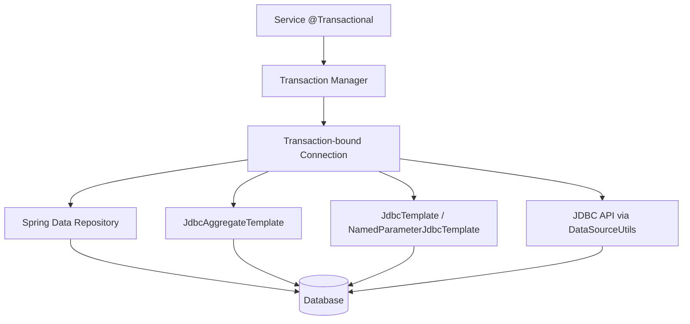

# Transactions When Mixing Repositories, Templates, and Direct JDBC

In a **Spring Data Relational JDBC** application, a single use case may require multiple ways of accessing the database: saving an aggregate via a repository, manipulating another aggregate with `JdbcAggregateTemplate`, and running custom SQL with `JdbcTemplate` or the plain JDBC API. These access methods can participate in **the exact same transaction** if they share the same DataSource and the same transaction manager through Spring's resource management mechanism.

For example, an order placement workflow needs to save an order, create an inventory reservation, and write an audit entry. If one step fails, the application usually wants all changes rolled back. To achieve this, place the transaction boundary at the service layer, let repositories and templates join that transaction, and use transaction-aware connection acquisition when writing direct JDBC.

Merely sharing the same database URL or the same database server is not enough to guarantee operations belong to the same transaction.

## 1. Why Mix Multiple Data Access Approaches?

Each API has its own role:

| Access approach | Common role |
|---|---|
| Spring Data repository | Save and load aggregates using CRUD or query methods |
| `JdbcAggregateTemplate` | Manipulate aggregates directly via the aggregate-level persistence API |
| `JdbcTemplate` | Execute custom SQL, batch updates, and result mapping |
| `NamedParameterJdbcTemplate` | Write SQL with named parameters |
| Direct JDBC API | Use `Connection`, `PreparedStatement`, and `ResultSet` when specific JDBC features are needed |

Order placement use case example:

1. `PurchaseOrderRepository` saves the order aggregate.
2. `JdbcAggregateTemplate` saves an independent reservation aggregate.
3. `NamedParameterJdbcTemplate` inserts an audit row into a technical table.
4. All changes must commit or roll back together.

There is no need to force every query through a single abstraction. Repositories fit aggregates; JDBC templates fit custom SQL. What must be unified is the transaction and DataSource they use.

## 2. Placing the Transaction at the Service Layer

A service-level transaction spanning the entire business operation:

```java
@Service
public class OrderApplicationService {

    private final PurchaseOrderRepository orderRepository;
    private final JdbcAggregateTemplate aggregateTemplate;
    private final NamedParameterJdbcTemplate jdbc;

    public OrderApplicationService(
            PurchaseOrderRepository orderRepository,
            JdbcAggregateTemplate aggregateTemplate,
            NamedParameterJdbcTemplate jdbc) {
        this.orderRepository = orderRepository;
        this.aggregateTemplate = aggregateTemplate;
        this.jdbc = jdbc;
    }

    @Transactional
    public Long placeOrder(
            PurchaseOrder order,
            InventoryReservation reservation) {

        PurchaseOrder savedOrder = orderRepository.save(order);

        aggregateTemplate.insert(reservation);

        jdbc.update(
            """
            INSERT INTO order_audit (
                order_id, action, created_at
            )
            VALUES (
                :orderId, :action, CURRENT_TIMESTAMP
            )
            """,
            Map.of(
                "orderId", savedOrder.id(),
                "action", "ORDER_PLACED"
            )
        );

        return savedOrder.id();
    }
}
```

Assuming all three components are configured with the same DataSource and transaction manager:

- When the service begins, the transaction manager opens a transaction and binds an appropriate JDBC connection to the current transaction.
- The repository executes the save inside the active transaction.
- `JdbcAggregateTemplate` uses the JDBC infrastructure configured for the same DataSource.
- `NamedParameterJdbcTemplate` acquires the connection via Spring's mechanism and joins that transaction.
- When the method returns normally, the transaction commits.
- If a rollback-triggering error occurs, database changes inside the transaction roll back together.

`@Transactional` on the service expresses the business boundary. This is the right pattern when a single operation coordinates multiple repositories, templates, or SQL statements.

### 2.1. Why Not Let Each Statement Manage Its Own Transaction?

CRUD methods on `CrudRepository` have default transactions: read operations use a read-only configuration, and remaining operations use default `@Transactional`. Without an outer transaction, each repository call can start and finish its own transaction.

Example:

```java
public void placeOrder(PurchaseOrder order) {
    orderRepository.save(order);
    auditRepository.save(new AuditEntry(...));
}
```

If each call runs in its own transaction, the first save may already commit before the second save fails. The workflow ends up only partially completed.

When the service method is annotated with `@Transactional`, repository methods with default `REQUIRED` propagation join the outer transaction instead of committing independently.

### 2.2. Repository Query Methods Need Transaction Coverage

Application-declared query methods do not always have the same default transactions as inherited CRUD methods. Place `@Transactional(readOnly = true)` on query methods/interfaces or invoke them inside a service transaction when appropriate.

Spring Data JDBC may need multiple SQL statements to finish reading an aggregate. Without a shared transaction, those statements might run on different connections, increasing pressure on the connection pool and in some scenarios contributing to deadlocks.

## 3. Conditions for Repositories, Templates, and JdbcTemplate to Share a Transaction

For operations to participate in the same local JDBC transaction, key conditions must be met:

1. Use the exact same DataSource managed by the transaction manager.
2. Call operations within the scope of an active transaction.
3. Have JDBC code acquire connections via Spring's transaction-aware mechanism.
4. Never manually commit, roll back, or close connections managed by the transaction manager.
5. Never offload operations to another thread expecting the transaction to follow automatically.



The diagram shows the APIs sharing a single transaction resource when properly configured. Do not assume each API holds a `Connection` object in a field; Spring manages acquiring, synchronizing, and releasing connections per transaction context.

### 3.1. Same Database URL Is Not Enough

Two DataSource beans can point to the exact same database/schema yet still issue separate physical connections. If each bean is managed by its own local transaction manager, a transaction on the first bean will not automatically include statements executed on the second bean.

Inspect the actual bean wiring:

- Which DataSource are repositories configured with?
- Which DataSource does `JdbcAggregateTemplate` use?
- Which DataSource does `JdbcTemplate` or `NamedParameterJdbcTemplate` use?
- Which transaction manager bean is selected by `@Transactional`?

What matters is sharing the same transaction resource in Spring's configuration, not merely the same hostname or database name.

### 3.2. Same Transaction Manager

For a JDBC DataSource, Spring typically uses `JdbcTransactionManager` or `DataSourceTransactionManager`. This transaction manager binds a connection to the thread executing the transaction.

Spring JDBC components such as `JdbcTemplate` and `NamedParameterJdbcTemplate` use this mechanism automatically. Spring Data JDBC repositories integrate with the application's DataSource and transaction infrastructure as well.

If multiple transaction managers exist, writing plain `@Transactional` without specifying the right manager may cause the service to open a transaction on a different DataSource than the one used by the repositories.

## 4. JdbcTemplate Automatically Joins Spring Transactions

When using `JdbcTemplate` or `NamedParameterJdbcTemplate` inside a `@Transactional` method, you do not need to acquire connections manually:

```java
@Transactional
public void updateOrderAndAudit(long orderId, String status) {
    orderRepository.updateStatus(orderId, status);

    jdbcTemplate.update(
        "UPDATE order_statistics SET update_count = update_count + 1"
    );
}
```

`JdbcTemplate` uses Spring's connection retrieval mechanism. If the current transaction already has a connection bound to the matching DataSource, the template reuses that connection. The template also handles statements, result sets, and resource cleanup.

This lets custom SQL participate in transactions alongside repositories without manual connection boilerplate.

### 4.1. NamedParameterJdbcTemplate

Named parameters only change how SQL parameters are expressed; they do not create a separate transaction:

```java
@Transactional
public void recordAudit(long orderId, String action) {
    MapSqlParameterSource parameters = new MapSqlParameterSource()
        .addValue("orderId", orderId)
        .addValue("action", action);

    namedParameterJdbcTemplate.update(
        """
        INSERT INTO order_audit(order_id, action, created_at)
        VALUES (:orderId, :action, CURRENT_TIMESTAMP)
        """,
        parameters
    );
}
```

`NamedParameterJdbcTemplate` still uses the configured DataSource and participates in the active transaction via Spring JDBC's mechanism.

### 4.2. Batch Updates Also Join the Transaction

A batch update executed through `JdbcTemplate` can participate in the same transaction as repositories:

```java
@Transactional
public void updateInventory(List<InventoryChange> changes) {
    jdbcTemplate.batchUpdate(
        """
        UPDATE inventory
        SET available_quantity = available_quantity + ?
        WHERE product_id = ?
        """,
        changes,
        100,
        (ps, change) -> {
            ps.setInt(1, change.quantityDelta());
            ps.setLong(2, change.productId());
        }
    );
}
```

If the batch runs inside the service transaction and a rollback-triggering error occurs, database changes in that transaction follow the rollback policy. Batching does not create an independent transaction simply because it sends multiple statements.

## 5. Using the Direct JDBC API While Staying in the Transaction

Occasionally you need direct access to `Connection` or `PreparedStatement`. Do not call `dataSource.getConnection()` directly inside a Spring transaction if you want to share the connection.

Two standard approaches exist:

- Use `JdbcTemplate.execute(ConnectionCallback)` so Spring supplies the right connection.
- Use `DataSourceUtils.getConnection(dataSource)` and `DataSourceUtils.releaseConnection(connection, dataSource)` when low-level access is genuinely required.

### 5.1. Preferred Approach: ConnectionCallback

```java
public int markAuditProcessed(long auditId) {
    return jdbcTemplate.execute(
        (ConnectionCallback<Integer>) connection -> {
            try (PreparedStatement statement =
                    connection.prepareStatement(
                        "UPDATE order_audit SET processed = ? WHERE id = ?"
                    )) {

                statement.setBoolean(1, true);
                statement.setLong(2, auditId);

                return statement.executeUpdate();
            }
        }
    );
}
```

`JdbcTemplate` supplies a connection properly managed for the transaction context and cleans up resources after the callback. The `PreparedStatement` created by your code is closed with try-with-resources; do not close the template-managed connection.

If this method is invoked inside a `@Transactional` service using the same DataSource, the UPDATE statement joins the service's transaction.

### 5.2. Using DataSourceUtils at a Low Level

If an existing API forces working directly with a `DataSource`:

```java
import java.sql.Connection;
import java.sql.PreparedStatement;
import java.sql.SQLException;

import javax.sql.DataSource;

import org.springframework.dao.DataAccessResourceFailureException;
import org.springframework.jdbc.datasource.DataSourceUtils;

public int updateAudit(
        DataSource dataSource,
        long auditId) {

    Connection connection =
        DataSourceUtils.getConnection(dataSource);

    try {
        try (PreparedStatement statement =
                connection.prepareStatement(
                    "UPDATE order_audit SET processed = ? WHERE id = ?"
                )) {

            statement.setBoolean(1, true);
            statement.setLong(2, auditId);

            return statement.executeUpdate();
        }
    } catch (SQLException exception) {
        throw new DataAccessResourceFailureException(
            "Could not update audit record",
            exception
        );
    } finally {
        DataSourceUtils.releaseConnection(connection, dataSource);
    }
}
```

`DataSourceUtils.getConnection` checks whether the current transaction already has a connection bound to this DataSource. If so, it returns the transaction-synchronized connection. `releaseConnection` releases according to ownership rules: if the connection belongs to an active transaction, Spring does not prematurely close it.

In new code, `JdbcTemplate` is usually cleaner and less error-prone. Use `DataSourceUtils` when working directly with the JDBC API or integrating a low-level library.

### 5.3. Do Not Call commit/rollback on a Spring-Managed Connection

When a connection belongs to a Spring-controlled transaction, never manually call:

```java
connection.commit();
connection.rollback();
connection.setAutoCommit(true);
```

The transaction manager is responsible for commit/rollback and managing connection state. Controlling these manually can corrupt the transaction boundary, causing partial commits unexpectedly or leaving the transaction manager in an inconsistent state.

## 6. Why Calling `DataSource.getConnection()` Directly Can Break Transactions

The following code is a common bug:

```java
@Transactional
public void placeOrder(PurchaseOrder order) throws SQLException {
    orderRepository.save(order);

    try (Connection connection = dataSource.getConnection();
         PreparedStatement statement =
             connection.prepareStatement(
                 "INSERT INTO order_audit(order_id, action) VALUES (?, ?)"
             )) {

        statement.setLong(1, order.id());
        statement.setString(2, "ORDER_PLACED");
        statement.executeUpdate();
    }
}
```

`DataSource.getConnection()` obtains a connection directly from the DataSource. It does not look up the connection bound to the thread by the transaction manager. With a connection pool, this call can receive a completely different connection.

Possible consequences:

1. The repository saves the order on the connection belonging to the Spring transaction.
2. Direct JDBC writes the audit on a separate connection.
3. The second connection may run with auto-commit enabled.
4. The audit can commit immediately even if the service transaction rolls back later.
5. The database ends up with an audit record but no corresponding order.

This is why you should use `JdbcTemplate`, `DataSourceUtils`, or a `TransactionAwareDataSourceProxy` in special legacy integration cases.

### 6.1. Do Not Close a Transaction-Bound Connection Manually

If you acquire a connection via `DataSourceUtils`, release it with `DataSourceUtils.releaseConnection`. Calling `connection.close()` directly can close or release the connection currently in use by the transaction manager, causing subsequent operations to fail.

With `JdbcTemplate`, never close the connection passed to the callback. Only close statements/result sets created by your own code.

### 6.2. TransactionAwareDataSourceProxy for Legacy APIs

`TransactionAwareDataSourceProxy` wraps a DataSource so legacy code that only knows the `DataSource` interface can still participate in Spring transactions when calling `getConnection()`.

This is a compatibility solution when a library or legacy codebase cannot be changed. For new code, prefer `JdbcTemplate` or `DataSourceUtils` because they make transaction participation and resource management explicit.

## 7. How Does JdbcAggregateTemplate Participate in Transactions?

`JdbcAggregateTemplate` is Spring Data JDBC's aggregate persistence API. The template uses the JDBC/DataSource infrastructure configured in the application context.

When the service opens a transaction on the same DataSource:

```java
@Transactional
public void reserveInventory(InventoryReservation reservation) {
    aggregateTemplate.insert(reservation);

    jdbcTemplate.update(
        """
        UPDATE inventory
        SET available_quantity = available_quantity - :quantity
        WHERE product_id = :productId
        """,
        Map.of(
            "quantity", reservation.quantity(),
            "productId", reservation.productId()
        )
    );
}
```

Both operations share the same transaction when `JdbcAggregateTemplate` and `JdbcTemplate` use the same DataSource managed by the transaction manager. If the UPDATE fails and the exception triggers rollback, inserting the reservation aggregate rolls back too.

Do not rely on independent default transactions created by individual template calls to group multiple operations. Place the transaction boundary on the service for use cases requiring atomicity.

### 7.1. Repository and Template Operating on the Same Aggregate

Spring Data JDBC repositories already use Spring Data's aggregate persistence infrastructure. Thus, you do not need to call both repository save and template save for the same change just to "ensure" a transaction.

Choose the API by responsibility:

- Repository for application aggregate contracts and queries.
- Template when a service or custom persistence component needs direct aggregate APIs.
- JDBC template for custom SQL or read models.

If multiple APIs touch the same aggregate within one use case, establish clear ordering and data state to avoid redundant writes or overwrites.

## 8. Transaction Propagation When Components Call Each Other

By default, `@Transactional` uses `Propagation.REQUIRED`. If a transaction already exists, the new method joins it; otherwise, Spring starts a new transaction.

| Propagation | Behavior | Impact when mixing APIs |
|---|---|---|
| `REQUIRED` | Joins existing transaction or creates a new one | Common choice for services and repositories |
| `REQUIRES_NEW` | Suspends outer transaction, creates a new transaction | Inner operation can commit independently |
| `SUPPORTS` | Joins if active; otherwise runs non-transactionally | No atomicity guarantee when called standalone |
| `MANDATORY` | Requires an active transaction | Useful for components meant to run only inside transactional use cases |
| `NOT_SUPPORTED` | Suspends existing transaction | Operation is outside the outer transaction |
| `NEVER` | Fails if a transaction is active | Used when execution inside a transaction is forbidden |
| `NESTED` | Creates a nested scope typically backed by savepoints | Depends on transaction manager and database |

### 8.1. REQUIRED Is the Common Choice

```java
@Transactional
public void placeOrder() {
    orderRepository.save(order);
    auditService.record(order.id());
}
```

If `auditService.record` also uses `@Transactional(propagation = REQUIRED)`, it joins `placeOrder`'s transaction. When an operation triggers rollback, changes in the shared transaction roll back together.

### 8.2. REQUIRES_NEW Can Create Independent Commits

```java
@Transactional(propagation = Propagation.REQUIRES_NEW)
public void recordIndependentAudit(AuditEntry entry) {
    auditRepository.save(entry);
}
```

If this method is called from an active transaction:

- The outer transaction is suspended.
- A new transaction performs the audit.
- The audit transaction can commit.
- Then the outer transaction resumes.

If the outer transaction rolls back, the audit committed in `REQUIRES_NEW` can still remain. This may be right for technical audits, but wrong if the audit must be atomic with order placement.

`REQUIRES_NEW` can also require an extra connection while the outer transaction holds one. Overuse with a small pool can cause connection exhaustion or mutual waiting.

### 8.3. NESTED and Savepoints

With `DataSourceTransactionManager`/`JdbcTransactionManager` and a savepoint-capable driver, `PROPAGATION_NESTED` can create a savepoint within the same physical transaction. If the nested part rolls back, Spring can roll back to the savepoint while the outer transaction continues.

It is not like `REQUIRES_NEW`: a nested transaction has no independent physical commit. Verify savepoint support on your database/driver and transaction manager before using it.

## 9. Multiple DataSources or Multiple Transaction Managers

A local JDBC transaction manager manages transactions for one DataSource. If repositories use DataSource A while custom JDBC uses DataSource B, a `@Transactional` selecting manager A will not cover operations on B.

```java
@Transactional("ordersTransactionManager")
public void process() {
    orderRepository.save(order);        // DataSource A
    reportingJdbcTemplate.update(...);  // DataSource B
}
```

If `reportingJdbcTemplate` is configured with DataSource B, that statement will not automatically join DataSource A's transaction. It may run in another transaction or auto-commit depending on configuration.

### 9.1. Specifying the Transaction Manager

`@Transactional("ordersTransactionManager")` selects the transaction manager by bean name/qualifier. It does not automatically combine multiple managers into a distributed transaction.

If a service invokes two independent managers, one database can commit while the other rolls back. There is no global atomicity merely because both methods carry annotations.

### 9.2. When Is XA/JTA Needed?

If business rules strictly require multiple resources/databases to commit or roll back as a single distributed unit, you need an XA/JTA-capable transaction coordinator and supporting resources. This setup is more complex than local JDBC transactions and must be supported by databases, drivers, pools, and transaction managers.

For many systems, a transactional outbox, saga, or compensating workflow is a better fit than distributed transactions. Choose based on consistency requirements, retry capability, and tolerance for intermediate states.

## 10. Rollback When One Operation Fails

Spring declarative transaction defaults:

- `RuntimeException` and `Error` trigger rollback.
- Checked exceptions do not trigger rollback by default.
- `rollbackFor` can be declared to roll back on specific checked exceptions.
- Catching an exception and returning normally may let the transaction commit unless already marked rollback-only.

Example:

```java
@Transactional
public void placeOrder(PurchaseOrder order) {
    orderRepository.save(order);

    jdbcTemplate.update(
        "INSERT INTO order_audit(order_id, action) VALUES (?, ?)",
        order.id(),
        "ORDER_PLACED"
    );

    throw new IllegalStateException("Force rollback");
}
```

If both operations share the same transaction, the runtime exception rolls back the transaction, and neither the order nor the audit commits.

### 10.1. Do Not Swallow Exceptions When Rollback Is Required

Avoid:

```java
@Transactional
public void placeOrder(PurchaseOrder order) {
    orderRepository.save(order);

    try {
        writeAudit(order);
    } catch (DataAccessException exception) {
        log.error("Audit failed", exception);
        // Method still completes normally.
    }
}
```

If the exception is caught and not rethrown, the transaction interceptor may treat the method as successful and commit earlier changes.

If the business allows continuing when auditing fails, clarify whether the audit must be atomic. If rollback is mandatory, let the exception propagate or mark the transaction rollback-only using an appropriate mechanism.

### 10.2. Checked Exceptions

```java
@Transactional(rollbackFor = IOException.class)
public void importAndPersist() throws IOException {
    orderRepository.save(order);
    writeFile();
}
```

When `writeFile` throws `IOException`, the transaction is configured to roll back. Without the matching `rollbackFor`, checked exceptions do not roll back by default.

### 10.3. Exceptions Occurring After a Repository Method Has Completed

If a repository method is called inside an outer `REQUIRED` transaction, it has not committed independently when it returns. The SQL has executed, yet committing belongs to the outer transaction. Thus an error in a later JDBC step can still roll back the repository's changes.

Without an outer transaction, a repository CRUD method can commit as soon as the repository method finishes. Then an error in a subsequent JDBC command cannot roll back the earlier commit.

## 11. Read-Only Transactions When Combining APIs

For read-only use cases, you can use:

```java
@Transactional(readOnly = true)
public OrderView loadOrder(long orderId) {
    PurchaseOrder order = orderRepository.findById(orderId)
        .orElseThrow();

    return jdbcTemplate.queryForObject(
        "SELECT status FROM order_status_view WHERE order_id = ?",
        (rs, rowNum) -> new OrderView(
            order.id(),
            rs.getString("status")
        ),
        orderId
    );
}
```

`readOnly = true` is a hint passed down to the transaction infrastructure/driver to allow optimizations. It is not a guarantee that code cannot execute INSERT/UPDATE. Some databases reject write operations in read-only transactions; exact behavior depends on the database and driver.

If a method both reads and writes via repositories, templates, or JDBC, do not mark it read-only merely because most statements are SELECTs.

## 12. Transactions Do Not Automatically Propagate Across Threads

Spring-managed JDBC transactions are typically bound to the current thread. If a service opens a transaction and dispatches work to an executor or `@Async`, the new thread does not automatically inherit that transaction.

```java
@Transactional
public void placeOrder(PurchaseOrder order) {
    orderRepository.save(order);

    asyncAuditService.writeAudit(order.id());
}
```

If `asyncAuditService` runs on another thread, its JDBC operations do not belong to the calling thread's active transaction. It needs its own transaction according to the async method's configuration.

If the audit must be atomic with the order, write the audit inside the current transaction or write an outbox record in the same transaction and process asynchronously after commit.

Never pass a transaction-managed `Connection` to another thread. Never store a connection in a field or share it across requests.

## 13. A Complete Example with Repository, JdbcAggregateTemplate, and Direct JDBC

Suppose an order placement workflow must:

- Save the `PurchaseOrder` aggregate via a repository.
- Save the `InventoryReservation` aggregate via `JdbcAggregateTemplate`.
- Write an audit entry with `JdbcTemplate`.
- Update a metrics table using `ConnectionCallback`.

```java
@Service
public class CheckoutService {

    private final PurchaseOrderRepository orders;
    private final JdbcAggregateTemplate aggregateTemplate;
    private final JdbcTemplate jdbcTemplate;

    public CheckoutService(
            PurchaseOrderRepository orders,
            JdbcAggregateTemplate aggregateTemplate,
            JdbcTemplate jdbcTemplate) {
        this.orders = orders;
        this.aggregateTemplate = aggregateTemplate;
        this.jdbcTemplate = jdbcTemplate;
    }

    @Transactional
    public Long checkout(
            PurchaseOrder order,
            InventoryReservation reservation) {

        PurchaseOrder saved = orders.save(order);

        aggregateTemplate.insert(reservation);

        jdbcTemplate.update(
            """
            INSERT INTO order_audit(order_id, action, created_at)
            VALUES (?, ?, CURRENT_TIMESTAMP)
            """,
            saved.id(),
            "CHECKOUT"
        );

        jdbcTemplate.execute(
            (ConnectionCallback<Void>) connection -> {
                try (PreparedStatement statement =
                        connection.prepareStatement(
                            """
                            UPDATE checkout_metrics
                            SET completed_count = completed_count + 1
                            WHERE metric_name = ?
                            """
                        )) {
                    statement.setString(1, "orders");
                    statement.executeUpdate();
                }

                return null;
            }
        );

        return saved.id();
    }
}
```

Required configuration details:

- `PurchaseOrderRepository` is backed by Spring Data JDBC.
- `JdbcAggregateTemplate` is configured by Spring.
- `JdbcTemplate` uses the same DataSource.
- The transaction manager is configured for that exact DataSource.
- `checkout` is invoked through a Spring proxy so `@Transactional` takes effect.

If the final statement encounters a SQL error, the exception is translated into a Spring data access exception. When the exception exits the method, the runtime transaction rolls back; earlier changes in the transaction roll back as well.

This example assumes tables and aggregate mappings are already configured properly. Its purpose is illustrating how multiple APIs share a transaction, not presenting a complete application schema.

## 14. Testing Atomicity When Mixing APIs

Have integration tests running with a Spring context and an appropriate database. Unit tests mocking repositories/JdbcTemplate cannot prove multiple APIs actually share one connection and transaction.

A helpful scenario:

1. Service saves an order via the repository.
2. Service inserts a reservation via the template.
3. Service writes an audit using JdbcTemplate.
4. A final operation intentionally fails.
5. After the service exits, verify all three changes are absent.

Test skeleton example:

```java
@SpringBootTest
class CheckoutTransactionIntegrationTest {

    @Autowired
    CheckoutService checkoutService;

    @Autowired
    PurchaseOrderRepository orderRepository;

    @Autowired
    InventoryReservationRepository reservationRepository;

    @Autowired
    JdbcTemplate jdbcTemplate;

    @Test
    @Transactional(propagation = Propagation.NOT_SUPPORTED)
    void rollsBackRepositoryTemplateAndJdbcChangesTogether() {
        PurchaseOrder order = testOrder();
        InventoryReservation reservation = testReservation();

        assertThatThrownBy(() ->
            checkoutService.checkoutThenFail(order, reservation)
        ).isInstanceOf(DataAccessException.class);

        assertThat(orderRepository.findById(order.id())).isEmpty();
        assertThat(reservationRepository.findById(reservation.id())).isEmpty();

        Integer auditCount = jdbcTemplate.queryForObject(
            "SELECT COUNT(*) FROM order_audit WHERE order_id = ?",
            Integer.class,
            order.id()
        );

        assertThat(auditCount).isZero();
    }
}
```

This example assumes a test-only variant `checkoutThenFail` or a SQL step that intentionally violates a constraint. `Propagation.NOT_SUPPORTED` on the test prevents an outer test transaction from altering how the service's own transaction is observed. Use fixtures and IDs matching your actual schema.

### 14.1. Testing Direct JDBC Paths

If code uses `DataSourceUtils` or `ConnectionCallback`, tests should verify:

- Direct SQL participates in the service transaction.
- Connections are released properly.
- No independent commits occur.
- SQL exceptions are translated appropriately and trigger rollback.

### 14.2. Testing Two DataSources

If the application has multiple DataSources, write dedicated tests proving which transaction governs each operation. Never infer atomicity merely because operations target the same database server.

## 15. Common Mistakes

| Symptom | Cause | Fix |
|---|---|---|
| Repository saves, subsequent JDBC fails, repository data remains | Two operations ran in separate transactions | Wrap the entire use case in a single service-level transaction |
| Audit persists after order rolls back | JDBC code called `DataSource.getConnection()` and used a separate connection | Use `JdbcTemplate` or `DataSourceUtils` |
| JdbcTemplate does not roll back with repository | Different DataSource or transaction manager | Share the same DataSource bean and manager |
| Template and repository are not atomic | Missing service transaction or template uses a different DataSource | Check wiring and open the transaction on the service |
| Connection pool exhausted | Repeated `REQUIRES_NEW` calls while outer transaction holds connections | Review propagation and pool capacity |
| Manually closing connection breaks next SQL statement | Closed a transaction-bound connection | Use `releaseConnection` or let JdbcTemplate manage connections |
| Premature commit mid-use-case | Repository method ran without an outer transaction | Wrap steps with `@Transactional` |
| Bulk SQL skips aggregate lifecycle | Direct JDBC does not invoke aggregate persistence lifecycle | Handle events/audits explicitly per use case |
| Async task does not see caller's transaction | Transactions are bound to the current thread | Open a separate transaction on the worker thread or use an outbox |
| Exception caught and transaction still commits | Exception swallowed without marking rollback-only | Rethrow exception or mark rollback-only |
| Checked exception does not roll back | Default policy does not roll back checked exceptions | Configure `rollbackFor` appropriately |
| Write to second database does not roll back | Local transaction manager governs only one DataSource | Use XA/JTA or outbox/saga depending on requirements |

## 16. Workflow for Choosing Data Access Approaches

When designing a use case with multiple APIs, determine in order:

1. Which aggregates must be persisted via repositories or templates?
2. Which SQL operations require a JDBC template or the JDBC API?
3. Must the operations be atomic with one another?
4. Do they share the same DataSource and transaction manager?
5. Does any direct JDBC snippet call `DataSource.getConnection()` or commit manually?
6. Do any methods use `REQUIRES_NEW`, `NOT_SUPPORTED`, or async execution that splits transactions?
7. Do integration tests prove rollback across all APIs together?

If the business requires atomicity, place the transaction on the service and keep all operations on the same transaction resource. If operations span multiple databases/resources, design distributed transactions or an appropriate consistency model rather than expecting a local transaction to span everything.

## 17. Practice Exercises

**Exercise 1.** A service calls `repository.save()` and then `JdbcTemplate.update()` inside the same `@Transactional` method. Can both operations roll back together?

*Answer:* Yes, if both share the same DataSource and transaction manager, and the call goes through Spring's transaction infrastructure.

**Exercise 2.** Why can calling `DataSource.getConnection()` directly cause an audit write to commit even if the order rolls back?

*Answer:* It can obtain a different connection not bound to the current transaction; that connection may auto-commit independently.

**Exercise 3.** Which API should be used when you need a JDBC `PreparedStatement` directly while still participating in a Spring transaction?

*Answer:* Prefer `JdbcTemplate.execute(ConnectionCallback)`. For lower-level access, use `DataSourceUtils.getConnection` and `releaseConnection`.

**Exercise 4.** Does `REQUIRES_NEW` cause an audit write to roll back along with the order placement transaction?

*Answer:* No. It creates an independent transaction after suspending the outer transaction; the audit can commit even if the order placement transaction rolls back.

**Exercise 5.** Do two DataSources with the same URL automatically join a single transaction?

*Answer:* No. A local JDBC transaction manager manages only the resource of its configured DataSource. Cross-resource atomicity requires an appropriate distributed solution or an outbox/saga design.

**Exercise 6.** Should you call `connection.commit()` inside a `JdbcTemplate` callback?

*Answer:* No. The transaction manager manages commit/rollback. Calling commit directly can corrupt Spring's transaction.

**Exercise 7.** A `@Transactional` method calls `@Async` to write an audit. Is the audit inside the caller's transaction?

*Answer:* No. Async execution runs on another thread; it requires its own transaction or writing an outbox record in the original transaction.

## 18. Things to Remember

- Repositories, `JdbcAggregateTemplate`, and `JdbcTemplate` can share a single JDBC transaction if they use the same DataSource and transaction manager.
- Place `@Transactional` on the application service to span the entire use case requiring atomicity.
- CRUD repository methods have default transactions; the outer service transaction determines the effective boundary when methods join via `REQUIRED`.
- `JdbcTemplate` and `NamedParameterJdbcTemplate` automatically use Spring's connection-aware mechanism to join the active transaction.
- For direct JDBC API usage, prefer `ConnectionCallback`; if lower-level control is needed, use `DataSourceUtils.getConnection` and `releaseConnection`.
- Do not call `DataSource.getConnection()` directly when you need the connection bound to a Spring transaction.
- Do not manually commit, roll back, or close connections managed by the transaction manager.
- `REQUIRES_NEW` creates an independent transaction; it can commit even if the outer transaction rolls back.
- A local JDBC transaction manages only its configured DataSource. Multiple DataSources require separate transaction designs, XA/JTA, or outbox/saga if atomicity is required.
- JDBC transactions are thread-bound; async tasks do not automatically inherit the caller's transaction.
- Write integration tests verifying rollback across repositories, templates, and direct JDBC on a suitable database.

### Official References

- [Spring Data Relational — Transactionality](https://docs.spring.io/spring-data/relational/reference/jdbc/transactions.html): default repository transactions, service facades, and query methods.
- [Spring Framework — Synchronizing Resources with Transactions](https://docs.spring.io/spring-framework/reference/data-access/transaction/tx-resource-synchronization.html): resource synchronization and using `DataSourceUtils`.
- [Spring Framework — Controlling Database Connections](https://docs.spring.io/spring-framework/reference/data-access/jdbc/connections.html): `DataSourceTransactionManager`, `JdbcTransactionManager`, and `TransactionAwareDataSourceProxy`.
- [Spring Framework — JDBC Core](https://docs.spring.io/spring-framework/reference/data-access/jdbc/core.html): `JdbcTemplate`, callbacks, and JDBC resource management.
- [Spring Framework — Using @Transactional](https://docs.spring.io/spring-framework/reference/data-access/transaction/declarative/annotations.html): propagation, rollback rules, and selecting transaction managers.

During implementation, verify the actual DataSource and transaction manager of each bean. The key to mixing repositories, templates, and direct JDBC is ensuring every operation requiring atomicity shares the same transaction resource, and that low-level JDBC code obtains connections through Spring-managed mechanisms.
