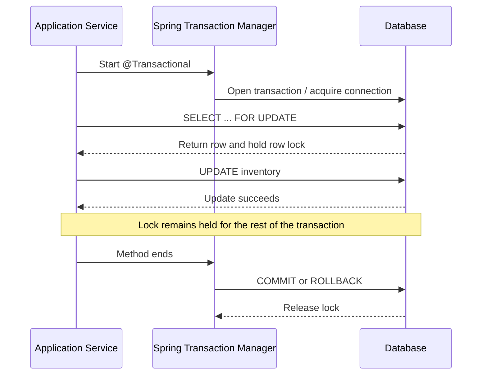
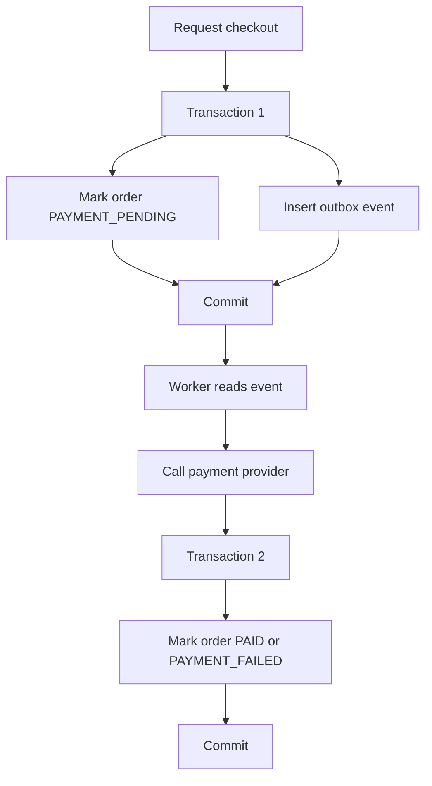
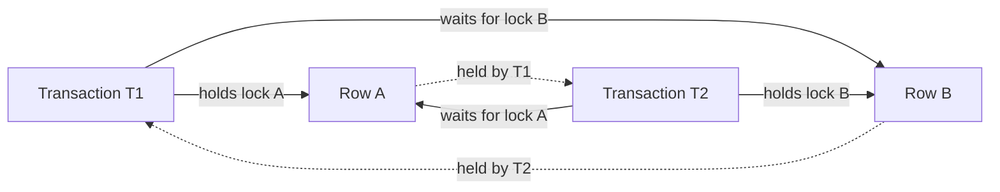

# Lock duration, deadlocks, and data access ordering

In **Spring Data Relational JDBC**, read/write operations can acquire database locks to protect data when multiple transactions access it concurrently. Locks are typically held until the transaction commits or rolls back. If a transaction runs long, it can hold connections and row locks for a long time, forcing other transactions to wait. If multiple transactions lock rows in different orders, they can wait on each other and form a **deadlock**.

Three key principles when designing concurrent operations:

- **Keep transactions short:** execute only the database operations that must commit/roll back together inside the transaction; avoid HTTP calls, waiting on users, or expensive processing while holding locks.
- **Access data in a consistent order:** every business flow locking multiple rows should use the same ordering, such as by resource type and then ascending primary key.
- **Prepare for conflicts:** use constraints, optimistic locking, or row locks according to invariants; when the database detects a deadlock or serialization conflict, perform bounded retries of the entire transaction if business rules allow.

## 1. How long are database locks held?

In a relational database, locks protect a portion of data from conflicting operations. With pessimistic row locking, a transaction typically holds locks until the transaction ends—commit or rollback. The SQL statement that acquires the lock may execute very quickly, yet the lock remains held as long as the transaction stays open.

Example:

```java
@Transactional
public void reserveStock(Long productId, int quantity) {
    Inventory inventory = loadForUpdate(productId);
    inventory.reserve(quantity);
    inventoryRepository.save(inventory);

    // The row lock can still be held here.
    writeAuditRecord(productId, quantity);

    // Only when the method finishes and the transaction commits/rolls back
    // does the database release the transaction's locks.
}
```

If `writeAuditRecord` makes a network call or waits on an external system, the transaction can hold the row lock far longer than actually needed to update inventory.

### Lock lifecycle inside a transaction



In autocommit mode, a single statement is usually its own transaction; the lock is released when the statement/transaction completes. Therefore, `SELECT ... FOR UPDATE` executed outside an explicit transaction generally does not protect the window between reading and writing: the SELECT's transaction can end immediately after the statement.

**Key point:** lock hold duration depends on the lifetime of the transaction, not just the execution time of the SQL statement that acquired the lock.

## 2. Common lock types

Databases have multiple lock types. Exact names and details depend on the engine, but the following concepts are generally useful:

| Lock type | Purpose | Example |
|---|---|---|
| Shared/read lock | Allows multiple transactions to read per engine rules, blocks certain conflicting changes | `SELECT ... FOR SHARE` on supporting databases |
| Exclusive/write lock | Protects a row being modified, prevents conflicting writes | `UPDATE account SET balance = ...` |
| Pessimistic row lock | Locks rows before the application decides on updates | `SELECT ... FOR UPDATE` |
| Table lock | Locks table scope, potentially affecting many rows | DDL or certain engine-specific operations/statements |
| Predicate/range/gap lock | Protects a key range or search condition | InnoDB next-key/gap locking in certain isolation/query patterns |

Not every `SELECT` locks rows. A regular read query usually does not take exclusive row locks; MVCC databases can let readers see a snapshot without blocking writers. Conversely, `UPDATE`, `DELETE`, `SELECT ... FOR UPDATE`, constraint enforcement, and certain DDL operations can acquire locks.

### `SELECT ... FOR UPDATE`

This is the common way to read rows and request a write lock before modifying them:

```sql
SELECT id, balance
FROM account
WHERE id = :accountId
FOR UPDATE;
```

Other transactions trying to update or lock the same row usually must wait until the current transaction finishes. Exact syntax and lock types depend on the database. SQL Server uses locking hints like `UPDLOCK` instead of standard `FOR UPDATE` syntax; databases may also support `NOWAIT`, `SKIP LOCKED`, or different lock modes.

### Updates acquire locks automatically

Even without writing `SELECT ... FOR UPDATE`, the statement:

```sql
UPDATE inventory
SET available = available - :quantity
WHERE product_id = :productId;
```

still requires appropriate locks to modify the row. For simple operations, a conditional UPDATE statement can be safer and shorter than separate read, lock, and write steps. You can inspect the `update count` to see whether any row matched the condition.

## 3. Why do long transactions degrade concurrency?

Long transactions can cause several problems at once:

- Holding row/table locks for a long time, making other transactions wait.
- Holding a connection from the pool for an extended period.
- Increasing deadlock risk because the transaction has more opportunities to acquire additional locks.
- Making versions or data snapshots staler before commit.
- Increasing the volume of undo/MVCC versions the database must retain and clean up.
- On rollback, forcing the database to undo more work.

Poor example:

```java
@Transactional
public void checkout(Long orderId) {
    PurchaseOrder order = orderRepository.findById(orderId).orElseThrow();
    order.markPaymentPending();
    orderRepository.save(order);

    paymentClient.charge(order); // HTTP call can take seconds or time out
    notificationClient.sendReceipt(order); // another network call

    order.markPaid();
    orderRepository.save(order);
}
```

The database transaction remains open across calls to two external systems. If `paymentClient` hits a 30-second timeout, the connection and locks related to the order can be held throughout that period. Moreover, a database rollback cannot undo a payment that already succeeded at the payment service.

### Splitting long workflows into short transactions

A better design records the status and an outbox event in a short transaction, then handles payment in a separate worker/service:



Each transaction holds locks only during its database work. Network calls stay outside transactions. The workflow needs idempotency, retries, and intermediate states to handle process crashes or ambiguous payment outcomes.

## 4. What is a deadlock?

A deadlock occurs when two or more transactions hold locks that other transactions need, while each waits for a lock held by another transaction. None of the transactions can proceed unless one is aborted or locks are released.

Example with two accounts `A` and `B`:

- Transaction T1 locks account A, then wants to lock B.
- Transaction T2 locks account B, then wants to lock A.



The wait-for graph forms a cycle: T1 waits for T2 and T2 waits for T1. The database detects the cycle, picks one transaction as the **deadlock victim**, rolls it back, and lets the other transaction continue.

### SQL example that causes a deadlock

Suppose two transactions run concurrently:

```sql
-- Transaction T1
BEGIN;
UPDATE account SET balance = balance - 10 WHERE id = 1;
-- T1 is holding the lock on account 1

-- Next, T1 wants to update account 2
UPDATE account SET balance = balance + 10 WHERE id = 2;
```

```sql
-- Transaction T2
BEGIN;
UPDATE account SET balance = balance - 20 WHERE id = 2;
-- T2 is holding the lock on account 2

-- Next, T2 wants to update account 1
UPDATE account SET balance = balance + 20 WHERE id = 1;
```

If T1 and T2 interleave at the right timing, each transaction holds one row and waits for the other row. The database detects the deadlock and aborts one side. The application must handle the error; never assume both transactions will complete automatically.

## 5. How does a deadlock differ from a lock wait timeout?

Two situations are often confused:

| Aspect | Deadlock | Lock wait timeout |
|---|---|---|
| Condition | A cycle of lock waits exists | A transaction waits for a lock past the configured limit |
| Cycle required? | Yes | No |
| Database handling | Detects cycle and picks a victim | Cancels or errors the waiting statement/transaction per engine semantics |
| When it occurs | Often detected quickly once the cycle forms | Must wait until the timeout expires |
| Remediation | Fix access ordering, shorten lock duration, retry transaction | Reduce wait time, investigate blocker, tune timeout deliberately |

A transaction can wait a long time because another transaction has not committed yet without forming a deadlock. For example, T1 locks a row and hangs on a network call; T2 waits for that row. There is no cycle, so the database will not report a deadlock, yet the system stalls.

Increasing lock timeouts only makes transactions wait longer; it does not fix deadlocks or transactions holding locks too long. Investigate lock holders and access ordering before changing timeouts.

## 6. The most important rule: lock in a consistent order

If multiple use cases must lock multiple rows, standardize a system-wide ordering. A simple convention is:

1. Lock by fixed resource group (e.g., `account` before `ledger`).
2. Within the same group, lock in ascending primary key order.
3. Across multiple aggregate/table types, every business flow uses the exact same order.

Example transferring funds between two accounts:

```java
@Transactional
public void transfer(long fromId, long toId, BigDecimal amount) {
    long firstId = Math.min(fromId, toId);
    long secondId = Math.max(fromId, toId);

    Account first = accountDao.findByIdForUpdate(firstId);
    Account second = accountDao.findByIdForUpdate(secondId);

    Account source = fromId == firstId ? first : second;
    Account target = toId == firstId ? first : second;

    source.debit(amount);
    target.credit(amount);

    accountRepository.save(source);
    accountRepository.save(target);
}
```

`findByIdForUpdate` uses locking SQL:

```java
public Account findByIdForUpdate(long id) {
    return jdbcTemplate.queryForObject(
            "SELECT id, balance, version FROM account WHERE id = ? FOR UPDATE",
            accountRowMapper,
            id
    );
}
```

Two transfers in opposite directions (A → B and B → A) both lock the smaller ID first and the larger ID second. Thus they cannot form a cycle just because the two accounts' business roles are reversed.

The SQL above illustrates PostgreSQL/MySQL InnoDB/Oracle with appropriate syntax; SQL Server requires locking hints and other databases may have their own syntax. This method must run inside an active transaction, otherwise the lock may be released right after the SELECT.

### Why not rely solely on `ORDER BY id`?

A query like `SELECT ... WHERE id IN (...) ORDER BY id FOR UPDATE` can express the desired order, but the actual order in which the database acquires locks depends on the execution plan and storage engine. When strict ordering is required, a clear approach is to normalize and sort the ID list in the application and lock rows in a fixed sequence. For very large sets, weigh round-trip costs and use a verified database-specific strategy.

Consistent ordering must be followed in **every code path** that can lock those resources, not just one service. If a batch job locks B then A while the transfer service locks A then B, deadlocks can still happen.

## 7. Using conditional updates to reduce lock duration

Some business operations can be performed with a single atomic UPDATE, eliminating the gap between read and write:

```sql
UPDATE inventory
SET available = available - :quantity,
    version = version + 1
WHERE product_id = :productId
  AND available >= :quantity;
```

If `update count = 1`, the reservation succeeded. If 0, the product does not exist or lacks sufficient stock (or another condition failed). You can perform a follow-up read to distinguish causes if business logic needs it.

Benefits:

- The database evaluates the condition and mutates the row in a single atomic statement.
- No row lock is held across application object processing between SELECT and UPDATE.
- No separate `SELECT ... FOR UPDATE` is required if the invariant can be expressed as a SQL predicate.

However, direct SQL does not trigger entity callbacks/auditing and does not automatically apply Spring Data JDBC optimistic locking. If using a `version` column, include the version predicate and increment the version manually as shown. After a direct update, previously loaded objects can be stale; reload them when needed.

## 8. Optimistic locking avoids holding locks from read time

Not every use case needs pessimistic locks. When conflicts are rare, use `@Version` to detect concurrent updates:

```java
@Table("inventory")
public class Inventory {

    @Id
    private Long productId;

    @Version
    private Long version;

    private int available;

    public void reserve(int quantity) {
        if (quantity <= 0 || quantity > available) {
            throw new InsufficientStockException();
        }
        available -= quantity;
    }
}
```

On save, Spring Data JDBC generates a conditional update matching the ID and current version, then increments the version. If another transaction updated earlier, the update does not match the version and Spring throws `OptimisticLockingFailureException`.

Optimistic locking generally avoids holding an explicit row lock throughout the window while the application reads and decides. Still, the UPDATE statement itself acquires a write lock during execution, and the database can still detect deadlocks if transactions modify multiple rows in different orders.

| Mechanism | How conflicts are detected | Characteristics |
|---|---|---|
| Optimistic locking (`@Version`) | Compares version at update time | Suited for low contention; callers can reload/retry |
| Pessimistic locking (`FOR UPDATE`) | Locks rows before reading/deciding | Suited when serialization is needed; holds lock until transaction end |
| Conditional update | Condition checked inside one UPDATE | Great for simple invariants expressible in SQL |
| Database constraint | Database rejects invalid states | Final safety net for unique/check/FK invariants |

Do not mechanically combine `@Version` and `FOR UPDATE` together. Choose the mechanism based on conflict frequency, invariants, and transaction length.

## 9. Indexes affect lock scope and wait times

A locking query needs to locate the target rows. Without a suitable index on the predicate, the database may scan many rows or wide index ranges. Depending on the engine and isolation level, this can increase lock counts, lock contention, or lock hold times.

Example:

```sql
SELECT id, status
FROM purchase_order
WHERE customer_id = :customerId
  AND status = 'OPEN'
FOR UPDATE;
```

If the application frequently locks orders by `customer_id` and `status`, consider an appropriate index:

```sql
CREATE INDEX idx_purchase_order_customer_status
    ON purchase_order(customer_id, status, id);
```

The right index depends on query workload, selectivity, sorting, and database engine. Do not blindly create indexes per query: indexes add INSERT/UPDATE/DELETE overhead and can affect locking when updating index entries.

### Gap locks and next-key locks

In MySQL InnoDB, under certain isolation levels/query patterns, transactions may acquire gap locks or next-key locks to protect key ranges rather than only existing rows. A locking query on a non-unique condition or range scan can block inserts into that range.

Therefore:

- Use indexes tailored to the `WHERE` conditions.
- Understand the effective isolation level (e.g., InnoDB's default is typically `REPEATABLE READ`).
- Inspect execution plans and lock monitoring when contention appears.
- Do not assume `SELECT ... FOR UPDATE` locks strictly one row if the predicate can match multiple rows or ranges.

These details vary across PostgreSQL, MySQL/InnoDB, SQL Server, Oracle, and DB2. Rely on your target database's documentation.

## 10. Foreign keys and deadlocks

Foreign key enforcement can also require transactions to check/lock rows in referenced tables. For example, inserting an `order_line` with `product_id` pointing to `product.id` requires the database to protect referential validity during the write.

Deadlocks can arise across operations on multiple tables even when the code contains no `SELECT ... FOR UPDATE`:

- Transaction T1 updates `purchase_order`, then inserts `order_line`.
- Transaction T2 updates `order_line` or a related table, then updates `purchase_order`.
- Triggers, foreign keys, or index maintenance add additional locks.

To reduce risk:

- Define a consistent update order across tables/aggregates for every use case.
- Avoid triggers that create reverse-order update chains hidden from Java code.
- Use appropriate foreign keys/indexes and inspect lock graphs when deadlocks occur.
- Keep transactions short and limit oversized bulk operations inside interactive transactions.

Do not drop foreign keys just to avoid locks. Foreign keys protect referential integrity; address write ordering, transaction scope, and indexing instead.

## 11. `SKIP LOCKED` and `NOWAIT` for job workers

Some databases support options when acquiring row locks:

- `NOWAIT`: if a row is already locked, fail immediately instead of waiting.
- `SKIP LOCKED`: skip rows currently locked by other transactions.

PostgreSQL example for a worker queue:

```sql
SELECT id, payload
FROM job_queue
WHERE status = 'READY'
ORDER BY id
FOR UPDATE SKIP LOCKED
LIMIT 20;
```

Two workers can pull batches concurrently without waiting on rows locked by the other worker. Worker A locks the first jobs; worker B skips them and picks other jobs.

Usage requirements:

- Must run inside a transaction to hold locks while marking/claiming jobs.
- Immediately after fetching rows, update status to `PROCESSING` or record a lease/claim owner in the same transaction and commit.
- Do not keep the transaction open while running slow job work; commit the claim first, process outside the transaction, then open another transaction to save results.
- Include lease/timeout recovery to reclaim jobs if a worker crashes after claiming.
- Accept that `SKIP LOCKED` may skip older locked rows and does not guarantee strict FIFO order.

The syntax and semantics of `NOWAIT`/`SKIP LOCKED` are database-specific. Do not place them into shared queries if your application targets multiple dialects without an appropriate abstraction.

## 12. Configuring lock timeouts and transaction timeouts

Distinguish between these timeout types:

| Timeout | What does it limit? | Example |
|---|---|---|
| Lock wait timeout | How long the database waits for a lock | PostgreSQL `lock_timeout`, MySQL `innodb_lock_wait_timeout`, SQL Server `SET LOCK_TIMEOUT` |
| Transaction timeout | How long a transaction may stay open per transaction manager config | `@Transactional(timeout = 5)` |
| Statement/query timeout | How long a SQL statement may run/wait per JDBC statement | `JdbcTemplate`/`DataSourceUtils` transaction timeout or query timeout |

Transaction timeout example:

```java
@Transactional(timeout = 5)
public void reserve(Long productId, int quantity) {
    // Database operations must complete within the configured transaction limit.
}
```

Spring's transaction timeout does not guarantee every database lock wait is interrupted at exactly 5 seconds. Enforcement depends on the transaction manager, JDBC statement, and driver. To bound lock waiting inside the database, configure the appropriate database/session setting.

Do not raise timeouts merely to silence errors in logs. Excessive timeouts keep requests holding connections and locks longer, growing queues. Choose timeouts based on target latency and database behavior.

## 13. Retrying deadlocks and serialization failures

A deadlock victim has already been rolled back by the database. To retry, the application must re-run the **entire transaction** inside a fresh transaction. Do not continue executing remaining logic inside a failed or rollback-only transaction.

Errors that can often be transient:

- Deadlock detected.
- Serialization failure under high isolation levels.
- Lock acquisition timeout in certain retryable use cases.

However, not every `DataAccessException` should be retried. Unique constraint, FK, check constraint, invalid input, or business rejection errors are rarely fixed by retrying immediately.

### Bounded retry with backoff

Conceptual example using Spring Retry:

```java
@Retryable(
        retryFor = {
                CannotAcquireLockException.class,
                PessimisticLockingFailureException.class
        },
        maxAttempts = 3,
        backoff = @Backoff(delay = 100, multiplier = 2, random = true)
)
public void executeTransfer(TransferCommand command) {
    transferTransactionService.transferInNewTransaction(command);
}
```

`transferInNewTransaction` should live on a separate Spring bean annotated with `@Transactional`, so each retry invokes a fresh transaction. The example above only illustrates exception classes you might encounter; actual exception translation depends on the database, driver, and transaction manager. Verify the exceptions/SQLStates translated in your running environment and retry only genuine transient failures.

Do not place retries inside a single transactional method if the retry still runs within a rollback-only transaction. A common structure puts retries in an outer layer and transactions on the bean performing a single attempt:

```java
@Service
public class TransferFacade {

    private final TransferTransactionService transactionService;

    public TransferFacade(TransferTransactionService transactionService) {
        this.transactionService = transactionService;
    }

    @Retryable(
            retryFor = PessimisticLockingFailureException.class,
            maxAttempts = 3,
            backoff = @Backoff(delay = 100, multiplier = 2, random = true)
    )
    public void transfer(TransferCommand command) {
        transactionService.transferInNewTransaction(command);
    }
}

@Service
public class TransferTransactionService {

    @Transactional
    public void transferInNewTransaction(TransferCommand command) {
        // Single transaction execution; exceptions escape to trigger rollback.
    }
}
```

Verify proxy/interceptor ordering so retry wraps outside the transaction. Add an idempotency key if retries could repeat external effects or if callers also retry requests.

### Retrying does not replace lock ordering design

If two transactions always lock A then B and B then A, deadlocks will keep recurring under sufficient load. Retrying only gives one request a chance to succeed after the victim rolls back; fixing lock ordering addresses the root cause.

## 14. Observing deadlocks and lock contention

When requests slow down or deadlock errors appear, determine:

1. Which transaction is holding the lock?
2. Which transaction is waiting on which lock?
3. Which statement acquired the lock first?
4. Is there a wait-for graph cycle or simply a slow blocker?
5. Are queries using appropriate indexes?
6. Is a transaction holding locks during network calls or non-database work?
7. Do triggers/FKs/cascades add locks not obvious in application code?

Diagnostic tools depend on the database:

| Database | Common observation sources |
|---|---|
| PostgreSQL | `pg_stat_activity`, `pg_locks`, `pg_blocking_pids()`, deadlock details in server logs |
| MySQL/InnoDB | `performance_schema.data_locks`, `data_lock_waits`, `SHOW ENGINE INNODB STATUS` |
| SQL Server | DMVs such as `sys.dm_tran_locks`, `sys.dm_os_waiting_tasks`, Extended Events/deadlock graphs |
| Oracle | `V$LOCK`, `V$SESSION`, `DBA_BLOCKERS`, `DBA_WAITERS`, and appropriate traces |

PostgreSQL example to inspect sessions blocking other sessions:

```sql
SELECT
    waiting.pid AS waiting_pid,
    waiting.query AS waiting_query,
    blocking.pid AS blocking_pid,
    blocking.query AS blocking_query
FROM pg_stat_activity AS waiting
JOIN LATERAL unnest(pg_blocking_pids(waiting.pid)) AS blocker(pid)
    ON true
JOIN pg_stat_activity AS blocking
    ON blocking.pid = blocker.pid;
```

These views require appropriate permissions and columns/queries can vary by PostgreSQL version. Do not run heavy diagnostic queries continuously in production; use them during investigations or integrate them into monitoring at reasonable intervals.

### Spring JDBC logs

You can enable SQL logging in development:

```yaml
logging:
  level:
    org.springframework.jdbc.core: DEBUG
    org.springframework.transaction: TRACE
```

Spring logs reveal statement ordering and transaction interceptors, though they do not always show the exact locks held by the database. To diagnose deadlocks, combine SQL logs with database deadlock reports/lock monitoring.

Do not log passwords, tokens, or sensitive parameter data. To correlate transactions, log trace/request IDs and transaction timing rather than full payloads.

## 15. Data access ordering in Spring Data JDBC

Spring Data JDBC persists the aggregate root together with its owned entities. A single `save(root)` call can issue multiple statements across root and child tables. When a use case saves multiple aggregates, statements can acquire locks across multiple tables/rows.

Suppose one transaction updates:

```text
PurchaseOrder → OrderLine → Inventory
```

While another transaction updates:

```text
Inventory → OrderLine → PurchaseOrder
```

If two flows lock rows in reverse orders, deadlocks can happen even though each individual repository method is valid.

To prevent this:

- Document an access ordering convention for aggregates/tables that may be updated in the same use case.
- Follow the same order across services, batch jobs, scheduled tasks, and direct SQL.
- When an aggregate save internally generates multiple DbActions, observe actual SQL to understand lock order; do not infer it merely from Java field order.
- Consider splitting use cases into local transactions/outbox if coordinating multiple aggregates does not need immediate atomicity.
- Avoid holding locks on aggregate A while calling an external service that calls back to update aggregate B.

### Batch operations and lock duration

`JdbcAggregateTemplate.insertAll`, `updateAll`, or `saveAll` can process multiple aggregates in one call. Wrapping an entire batch in one transaction can keep locks generated during writes held until the whole batch finishes and commits.

For large batches:

- Split into appropriately sized chunks.
- Decide explicitly between all-or-nothing batch atomicity vs. committing per chunk.
- Sort inputs by a stable lock order if multiple aggregates touch shared resources.
- Avoid unrelated logic between writes while a transaction is open.
- Measure lock waits, transaction duration, pool utilization, and throughput on a real database.

Chunking reduces duration and work per transaction, but changes semantics: already-committed chunks will not automatically roll back if a later chunk fails. That is a business decision, not purely a technical optimization.

## 16. Common mistakes and fixes

| Symptom | Possible cause | Approach |
|---|---|---|
| Other requests wait long even though UPDATE is fast | First transaction keeps holding the lock after the statement | Inspect transaction duration; move network calls/waits out of the transaction |
| Deadlock on bidirectional transfers | Two flows lock accounts in opposite orders | Lock in ascending ID order across all flows |
| Deadlocks appear in batch jobs | Batch updates roots/tables in a different order than interactive services | Standardize lock ordering, shrink chunks and transaction duration |
| `SELECT ... FOR UPDATE` fails to protect the update | SELECT ran outside a transaction or on a different connection | Place `@Transactional` and share the same DataSource/transaction manager |
| Lock timeout without a deadlock | A transaction holds a lock for too long without forming a cycle | Find the blocker, active queries, and long-open transactions |
| Increasing timeout slows the system further | Transactions wait longer and hold connections longer | Investigate blockers, reduce lock duration, tune timeouts deliberately |
| Frequent optimistic locking failures | Many requests update the same root | Reduce contention, apply bounded retries, or consider pessimistic locking |
| Database locks more rows than expected | Predicate lacks an index or triggers range scan/gap locks | Inspect indexes, execution plans, isolation, and engine lock behavior |
| Retries keep deadlocking repeatedly | Inconsistent lock order or overly long transactions | Fix the root cause; retry is only a recovery layer |
| `SKIP LOCKED` skips jobs for too long | Rows stay locked by other workers or leases aren't recovered | Bound transactions, implement lease/timeouts, and monitor job age |
| Transaction rolls back but HTTP payment succeeded | Network call ran inside the JDBC transaction | Use outbox/saga, idempotency, and compensation |

## 17. Workflow for designing safe multi-row operations

1. **Identify invariants:** which data must be protected from concurrent updates?
2. **Select the mechanism:** constraints, conditional updates, `@Version`, or pessimistic row locks.
3. **Identify the rows to lock:** use clear predicates/selectivity and appropriate indexes.
4. **Define the ordering:** lock by fixed resource type, then stable ID order.
5. **Open the transaction in the right place:** place `@Transactional` on the application service sharing the same DataSource/manager.
6. **Keep transactions short:** avoid HTTP calls, waiting on users, or large file processing while holding locks.
7. **Bound batches:** split large data into chunks and accept per-chunk commit semantics.
8. **Set appropriate timeouts:** distinguish transaction timeout, statement timeout, and lock wait timeout.
9. **Observe contention:** inspect deadlock graphs, blockers, SQL logs, execution plans, and transaction durations.
10. **Retry safely:** retry only transient errors, retry the whole new transaction, use backoff and idempotency.
11. **Test concurrency:** run genuinely concurrent transactions/connections on the target database.

### Quick decision table

| Scenario | Approach |
|---|---|
| Updating a single value with a simple condition | Conditional `UPDATE ... WHERE ...` |
| Multiple requests editing the same aggregate with rare conflicts | `@Version` optimistic locking |
| Must read then update rows with strict serialization | `SELECT ... FOR UPDATE` in a short transaction |
| Multiple transactions locking the same set of rows | Global lock order, e.g., ascending primary key |
| Workers pulling jobs from a queue | `FOR UPDATE SKIP LOCKED` if supported, short claim then commit |
| Workflow calling external systems | Outbox/saga; never hold DB locks across network calls |
| Very large batch writes | Chunking, clear transaction boundaries, stable input order |
| Transient deadlock/serialization failure | Bounded/backoff retry of a fresh transaction |

**Core takeaway:** row locks are generally held until the transaction ends. The longer the transaction, the longer connections and locks remain held; accessing multiple rows in inconsistent orders can create deadlocks. Keep transactions short, lock in a stable order, use proper indexes and concurrency mechanisms, and retry the entire fresh transaction only when errors are truly transient.

## Official references

- [Spring Framework — Transaction Management](https://docs.spring.io/spring-framework/reference/data-access/transaction.html): transaction boundaries, propagation, and transaction management.
- [Spring Framework — Declarative Transaction Management](https://docs.spring.io/spring-framework/reference/data-access/transaction/declarative.html): `@Transactional`, proxies, and rollback rules.
- [Spring Data Relational — Transactionality](https://docs.spring.io/spring-data/relational/reference/jdbc/transactions.html): transactions in Spring Data JDBC and the service layer.
- [Spring Data JDBC — Optimistic Locking](https://docs.spring.io/spring-data/relational/reference/jdbc/mapping.html): version property and handling concurrent updates.
- [PostgreSQL — Explicit Locking](https://www.postgresql.org/docs/current/explicit-locking.html): row/table locks, deadlocks, and lock modes.
- [PostgreSQL — `SELECT`](https://www.postgresql.org/docs/current/sql-select.html): `FOR UPDATE`, `NOWAIT`, and `SKIP LOCKED`.
- [PostgreSQL — Lock Management](https://www.postgresql.org/docs/current/monitoring-locks.html): monitoring locks and waiting sessions.
- [MySQL — InnoDB Locking](https://dev.mysql.com/doc/refman/8.4/en/innodb-locking.html): record, gap, and next-key locks.
- [MySQL — InnoDB Deadlocks](https://dev.mysql.com/doc/refman/8.4/en/innodb-deadlocks.html): causes, detection, and reducing deadlocks.
- [SQL Server — Deadlocks Guide](https://learn.microsoft.com/en-us/sql/relational-databases/sql-server-deadlocks-guide): deadlock detection, graphs, and reducing contention.
