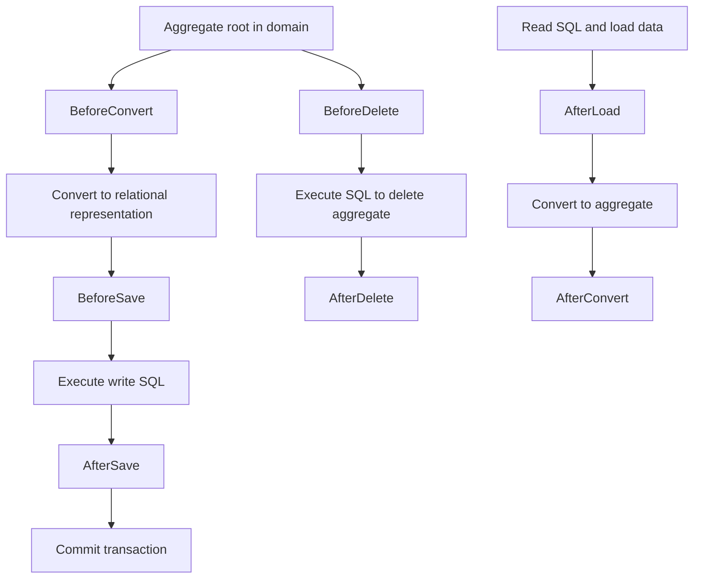
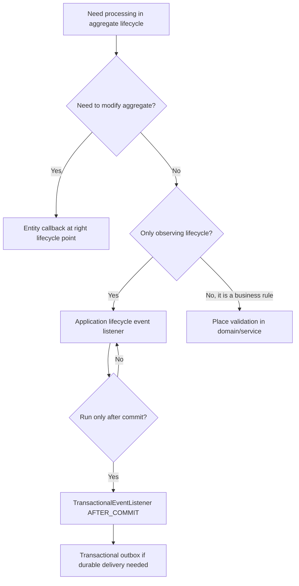

# Stages of Converting, Saving, Reading, and Deleting an Aggregate

Spring Data JDBC manages data by **aggregate**. An aggregate has a root and may contain child objects belonging to the same consistency boundary. When saving, reading, or deleting an aggregate, the framework converts domain objects into relational operations and executes the necessary SQL statements. During that process, Spring Data JDBC provides lifecycle events and callbacks so applications can react at specific points.

Understanding this lifecycle helps place logic in the right spot: normalizing data before writing, checking or enriching information before SQL runs, reacting after saving, processing data after reading, and recording delete operations. This lesson presents the stages of converting, saving, reading, and deleting an aggregate, while distinguishing persistence lifecycle events from domain events and transaction events.

## 1. Aggregate and the persistence lifecycle

Suppose `PurchaseOrder` is the aggregate root and `OrderLine` represents child elements:

```java
@Table("purchase_order")
public record PurchaseOrder(
    @Id Long id,
    @Version Long version,
    Long customerId,
    String status,
    BigDecimal totalAmount,
    LocalDateTime createdAt,
    @MappedCollection(idColumn = "order_id", keyColumn = "line_no")
    List<OrderLine> lines
) {}
```

```java
public record OrderLine(
    Long productId,
    int quantity,
    BigDecimal unitPrice
) {}
```

The root defines the aggregate boundary. Order lines are saved and loaded according to the mapping of `PurchaseOrder`. `Customer`, if it is another aggregate, is typically referenced by ID; it does not automatically become part of the aggregate just because `PurchaseOrder` has `customerId`.

Spring Data JDBC does not behave like a JPA persistence context with continuous dirty checking. The application invokes repository/aggregate operations to ask the framework to save or read an aggregate. During execution, the framework converts objects, creates SQL operations, executes them, and fires the corresponding lifecycle hooks.



The diagram shows lifecycle points at a conceptual level. Specific SQL details, specific callbacks, and transaction commit timing depend on the operation and configuration; `AfterSave` does not mean the transaction has committed.

## 2. Main lifecycle events

Spring Data Relational provides events tied to the aggregate lifecycle:

| Event | General timing | Common purpose |
| --- | --- | --- |
| `BeforeConvertEvent` | Before the aggregate is converted into a representation for writing. | Observe pre-conversion state, log, or prepare data using the appropriate mechanism. |
| `BeforeSaveEvent` | Before the SQL statements saving the aggregate are executed. | Observe the write operation and necessary changes through the appropriate callback. |
| `AfterSaveEvent` | After the SQL operation saving the aggregate completes. | Record the save result or trigger appropriate internal processing. |
| `AfterLoadEvent` | After aggregate data is loaded from the database. | Observe the data just read. |
| `AfterConvertEvent` | After relational data is converted into an aggregate object. | Observe the mapped aggregate. |
| `BeforeDeleteEvent` | Before the aggregate delete operation is executed. | Record or prepare for the delete operation. |
| `AfterDeleteEvent` | After the aggregate delete operation completes. | Record the delete result. |

These events are bound to the aggregate root and persistence operations. Do not assume each row of a child table emits a separate event as an independent entity. If child-level processing is needed, a listener can read the root and iterate through child elements in the aggregate based on the data provided by the event.

Lifecycle events reflect persistence progress. They do not replace domain validation, authorization, or service transaction boundaries.

## 3. Pre-save conversion stage: BeforeConvert

When the application requests to save an aggregate, Spring Data JDBC needs to convert the domain object into a relational representation and write operations. `BeforeConvertEvent` is published before that conversion stage.

Suitable scenarios for observing this stage:

- Logging identifying information and the type of aggregate about to be saved.
- Collecting metrics about operation types.
- Tracking domain values before the framework generates persistence statements.
- Coordinating with callbacks to normalize or supplement data to be saved.

Example of a logging-only listener:

```java
@Component
public class OrderLifecycleListener {

    private static final Logger log =
        LoggerFactory.getLogger(OrderLifecycleListener.class);

    @EventListener
    public void beforeConvert(BeforeConvertEvent<PurchaseOrder> event) {
        PurchaseOrder order = event.getSource();
        log.debug(
            "Preparing PurchaseOrder for conversion: id={}",
            order.id()
        );
    }
}
```

An event listener is suitable for observation. If you need to modify the aggregate before conversion, using the corresponding entity callback expresses intent more clearly because a callback can return a modified instance.

Do not place external service calls, email sending, or slow work inside conversion callbacks. Those operations increase save duration and may run inside a transaction holding a connection.

## 4. Save preparation and execution stage: BeforeSave and AfterSave

After the aggregate is converted and persistence operations are prepared, `BeforeSaveEvent` marks the point before save SQL statements are executed. After the write operation finishes, `AfterSaveEvent` is published.

These two points can be observed:

```java
@Component
public class OrderSaveListener {

    private static final Logger log =
        LoggerFactory.getLogger(OrderSaveListener.class);

    @EventListener
    public void beforeSave(BeforeSaveEvent<PurchaseOrder> event) {
        PurchaseOrder order = event.getSource();
        log.debug("Saving order id={}", order.id());
    }

    @EventListener
    public void afterSave(AfterSaveEvent<PurchaseOrder> event) {
        PurchaseOrder order = event.getSource();
        log.info("Saved order id={}", order.id());
    }
}
```

`BeforeSaveEvent` is useful when you need to observe the aggregate change about to be executed. If you need to modify the entity or persistence operations, use the corresponding callback and supported APIs instead of relying on arbitrarily mutating the event object.

`AfterSaveEvent` indicates that the save operation at the Spring Data JDBC layer has finished running. It **does not guarantee the outer transaction has committed**. If a service opens a larger transaction, an error in a subsequent step after `AfterSaveEvent` can still cause the entire transaction to roll back.

### Saving an aggregate is more than writing a single root row

When saving `PurchaseOrder`, Spring Data JDBC applies the mapping for the root and child components belonging to the aggregate. Depending on insert/update operations, the framework generates the necessary SQL statements for related tables. Therefore, an aggregate-level event should not be interpreted as a notification for only a single `INSERT` or `UPDATE` statement on the root.

If the aggregate uses `@Version`, the framework applies optimistic locking within the managed aggregate save path. Direct SQL outside that path must handle version explicitly if the same guarantee is required.
## 5. Entity callbacks: when you need to transform an aggregate

Application events are typically used to notify listeners that a lifecycle point has occurred. If the goal is to transform an aggregate in the persistence pipeline, Spring Data provides the EntityCallback API.

Common callbacks:

| Callback | Stage |
| --- | --- |
| `BeforeConvertCallback<T>` | Before converting the aggregate into a relational representation. |
| `BeforeSaveCallback<T>` | Before executing the save operation. |
| `AfterSaveCallback<T>` | After the save operation. |
| `AfterLoadCallback<T>` | After aggregate data is loaded. |
| `AfterConvertCallback<T>` | After data is converted into an aggregate object. |

Example callback normalizing notes before conversion:

```java
@Component
public class NormalizeOrderBeforeConvert
        implements BeforeConvertCallback<PurchaseOrder> {

    @Override
    public PurchaseOrder onBeforeConvert(PurchaseOrder order) {
        String normalizedNote = order.note() == null
            ? null
            : order.note().trim();

        return new PurchaseOrder(
            order.id(),
            order.version(),
            order.customerId(),
            order.status(),
            order.totalAmount(),
            normalizedNote,
            order.createdAt(),
            order.lines()
        );
    }
}
```

The aggregate returned by the callback is used in the next step. For immutable objects such as records, create a new instance instead of trying to mutate fields. For mutable entities, still restrict changes to the proper lifecycle point and avoid mutating outside domain invariants.

`BeforeSaveCallback` can also receive `AggregateChange` to work with the prepared persistence changes. This is a lower-level hook; use it only when you genuinely need to intervene in the aggregate change. Do not use callbacks to replace service validation or create side effects outside the database.

### Choosing an event or a callback?

| Need | Appropriate approach |
| --- | --- |
| Logging, metrics, observing lifecycle | Application event listener. |
| Transforming an aggregate and returning a new instance | Entity callback. |
| Checking business rules before an operation | Domain/service method. |
| Coordinating multiple repositories or multiple SQL statements | Service with `@Transactional`. |
| Publishing reliable notifications to external systems | Transactional outbox or an after-commit event publishing mechanism with appropriate guarantees. |

Callbacks and events can coexist. Avoid putting the same logic in both places because it could run twice or create hard-to-control ordering dependencies.

## 6. Aggregate read stage: AfterLoad and AfterConvert

When the application calls an aggregate read operation, Spring Data JDBC queries the root and loads child components according to the mapping. Data from relational rows is converted into domain objects. Two common read lifecycle points are:

- `AfterLoadEvent`: aggregate data has been loaded from the database.
- `AfterConvertEvent`: relational data has been converted into an aggregate object.

Example listener observing the aggregate after conversion:

```java
@Component
public class OrderReadListener {

    private static final Logger log =
        LoggerFactory.getLogger(OrderReadListener.class);

    @EventListener
    public void afterConvert(AfterConvertEvent<PurchaseOrder> event) {
        PurchaseOrder order = event.getSource();
        log.debug(
            "Loaded PurchaseOrder id={}, status={}",
            order.id(),
            order.status()
        );
    }
}
```

Read hooks are useful for metrics, tracing, or technical logic that needs to observe an aggregate after mapping. Avoid using them to issue extra queries per aggregate if that causes N+1 queries or unpredictable read latency.

### Not every SELECT statement publishes aggregate lifecycle events

Spring Data JDBC lifecycle events are tied to the aggregate mapping pipeline. If the application uses `JdbcTemplate` or `NamedParameterJdbcTemplate` to run SQL directly and map a DTO with `RowMapper`, that operation does not go through the aggregate mapping pipeline. Therefore, do not expect aggregate `AfterLoadEvent` or `AfterConvertEvent` to be published for that DTO.

This also means a read screen using custom SQL may need its own logging/tracing. If you need the same rule for both aggregate reads and DTO reads, place observation logic in the service layer or a shared adapter instead of relying entirely on aggregate lifecycle events.
## 7. Aggregate delete stage: BeforeDelete and AfterDelete

When deleting an aggregate, Spring Data JDBC executes delete operations according to the aggregate mapping. Child elements belonging to the root are handled according to dependency relationships; another aggregate referenced only by ID is not automatically deleted along with this root.

Lifecycle points of a delete operation include:

| Event | Timing |
| --- | --- |
| `BeforeDeleteEvent` | Before the aggregate delete statement is executed. |
| `AfterDeleteEvent` | After the aggregate delete operation completes. |

Example of deleting a root:

```java
@Transactional
public void removeOrder(long orderId) {
    PurchaseOrder order = aggregates
        .findById(orderId, PurchaseOrder.class)
        .orElseThrow(() -> new OrderNotFoundException(orderId));

    aggregates.delete(order);
}
```

Loading the aggregate before deleting gives the service the object to check permissions, status, or record necessary domain information. If you only need to delete by ID, aggregate operations also provide delete-by-ID APIs depending on the version; when using that path, do not assume listeners always receive the full root object as when deleting a loaded instance.

### Physical delete and soft delete are two different flows

Physical delete goes through Spring Data JDBC's aggregate delete operation. Soft delete is usually an `UPDATE deleted_at = ...` via custom SQL. A direct `UPDATE` statement is not an aggregate delete operation, so do not expect Spring Data JDBC delete lifecycle events to be published automatically.

If the application needs auditing for both kinds of operations, record the audit explicitly in the service or in an appropriate mechanism. Do not rely on a method name like `softDelete` to assume the framework ran the physical delete lifecycle.

## 8. Application events, entity callbacks, and domain events are different

These three concepts serve different purposes:

| Mechanism | Who defines the event? | Goal |
| --- | --- | --- |
| Persistence lifecycle event | Spring Data JDBC | Notify that a technical stage of convert/save/load/delete occurred. |
| Entity callback | Spring Data callback pipeline and application-implemented callbacks | Allow synchronous processing, optionally returning a transformed aggregate. |
| Domain event | Domain model | Express a meaningful business event, e.g., an order has been confirmed. |

For example, `AfterSaveEvent<PurchaseOrder>` says that the aggregate save operation just finished at the persistence layer. It does not say the business has confirmed the order. An aggregate might be saved because of a change to a note, shipping address, or a technical field.

Conversely, `OrderConfirmed` is a domain event representing a business transition. It can be recorded after a domain method verifies the required conditions, and then published according to the application's mechanism.

### Declaring domain events on the aggregate root

Spring Data supports `@DomainEvents` and `@AfterDomainEventPublication` on the aggregate root when using the repository infrastructure:

```java
public class PurchaseOrder {

    private final List<Object> domainEvents = new ArrayList<>();

    public void confirm() {
        // Validate and update domain state here.
        domainEvents.add(new OrderConfirmed(id));
    }

    @DomainEvents
    public Collection<Object> domainEvents() {
        return List.copyOf(domainEvents);
    }

    @AfterDomainEventPublication
    public void clearDomainEvents() {
        domainEvents.clear();
    }
}
```

`OrderConfirmed` is a business event defined by the application. The repository infrastructure reads the events provided by the aggregate and publishes them on supported repository operations. `@AfterDomainEventPublication` lets the aggregate clear published events.

You need to identify the exact persistence path in use. A direct SQL statement via `JdbcTemplate` does not go through the repository event publication pipeline. If the application calls aggregate operations directly instead of a repository proxy, verify how your version and API publish domain events; do not assume all call paths trigger `@DomainEvents` identically.

## 9. Transactions and when listeners run

Lifecycle events are published while the persistence operation is taking place. With normal synchronous listeners, the listener is invoked on the event-publishing thread. Therefore, `AfterSaveEvent` usually means the save SQL has completed, not that the outer transaction has committed.

Example:

```java
@Transactional
public void confirm(long orderId) {
    PurchaseOrder order = load(orderId);
    aggregates.save(order.withStatus("CONFIRMED"));

    // A subsequent write step here can still fail.
    auditRepository.save(createAudit(orderId));
}
```

If a listener sends an email immediately upon receiving `AfterSaveEvent`, the email may already be sent even if the subsequent audit write fails and the transaction rolls back. The listener cannot unsend the email.

### Execute side effects only after commit when needed

If you want to process after the transaction commits, you can use `@TransactionalEventListener` with the appropriate phase:

```java
@Component
public class OrderNotificationListener {

    @TransactionalEventListener(phase = TransactionPhase.AFTER_COMMIT)
    public void afterOrderSaved(AfterSaveEvent<PurchaseOrder> event) {
        PurchaseOrder order = event.getSource();
        notificationService.notifySaved(order.id());
    }
}
```

This listener is only invoked after the commit of the transaction containing the event. If there is no active transaction, the default behavior of a transactional event listener is not to handle the event; `fallbackExecution` can be configured when truly needed.

`AFTER_COMMIT` is suitable for side effects that should only occur once data has committed. However, it does not automatically guarantee at-least-once delivery: the application could stop after commit but before the listener finishes. For external integrations requiring high reliability, a transactional outbox is usually more appropriate: write the event to an outbox table in the same transaction, then have a worker publish it reliably.

### Synchronous and asynchronous listeners

A standard `@EventListener` runs synchronously on the event-publishing thread. If the listener is slow, the persistence operation may be prolonged. If `@Async` is used, the listener runs asynchronously on the configured executor; in that case, do not rely on the original transaction thread or expect a listener error to roll back an already-completed transaction.

Do not put long-running work, HTTP calls, or unnecessary notifications into synchronous lifecycle callbacks/listeners.

## 10. Events do not replace validation and business logic

Lifecycle hooks are suitable for technical logic tied to persistence. Rules such as an order can only be confirmed when it has order lines, a shipped order cannot be cancelled, or total amount must match order lines should live in aggregate methods or service/domain policies before calling persistence.

Example:

```java
@Transactional
public PurchaseOrder confirm(long orderId) {
    PurchaseOrder order = aggregates
        .findById(orderId, PurchaseOrder.class)
        .orElseThrow(() -> new OrderNotFoundException(orderId));

    PurchaseOrder confirmed = order.confirm();
    return aggregates.save(confirmed);
}
```

`confirm()` is where invariants are checked and a valid domain state is produced. `BeforeConvertCallback` can normalize the representation, while `AfterSaveEvent` can notify that persistence finished. Do not move all business logic into listeners just because events can be fired automatically.
## 11. Listener ordering and scope of processing

When multiple listeners receive the same event, do not rely on an accidental order observed in a single run. If processing order matters, declare ordering with Spring's ordering mechanism such as `@Order`, or design a single explicit orchestrating listener.

Principles that keep lifecycle listeners predictable:

- A listener should perform one small technical task and have a name reflecting its lifecycle point.
- Do not make a listener depend on another listener having mutated domain state.
- Do not create loops, such as a listener receiving `AfterSaveEvent` and saving the same aggregate again, causing events to keep firing.
- If you need to modify the aggregate, use a callback or service before persistence rather than modifying the object after saving.
- If you need per-child processing, iterate children from the root and control the number of operations; an event does not mean one separate event per child row.
- Only use `@Async` when asynchronous processing is acceptable and executor, error handling, retries, and observability are properly configured.

Lifecycle events are an in-process mechanism. They decouple listeners from persistence-calling code, but do not automatically create a durable queue or guarantee listeners always run after a process crash.

## 12. Which operations bypass the lifecycle pipeline?

Not every SQL statement on aggregate tables passes through Spring Data JDBC mapping. The following operations typically bypass the aggregate lifecycle pipeline:

| Operation | Goes through aggregate lifecycle? |
| --- | --- |
| `JdbcAggregateOperations.save(aggregate)` | Yes, via the aggregate persistence pipeline. |
| Repository CRUD saving an aggregate | Yes, via the repository/aggregate pipeline. |
| Repository query reading an aggregate and mapping via Spring Data JDBC | Has corresponding read hooks matching the mapping pipeline. |
| `JdbcTemplate.update(...)` | Does not automatically trigger aggregate lifecycle events. |
| `NamedParameterJdbcTemplate.query(...)` mapping a DTO | Does not automatically trigger aggregate lifecycle events. |
| Direct bulk SQL update/delete | Does not automatically run callbacks/events for each affected aggregate. |

This matters for bulk operations. For example, a single statement updating the status of 10,000 orders can be very efficient, but it does not automatically invoke domain methods or callbacks for each `PurchaseOrder`. If the domain requires auditing, versioning, events, or child row updates, the application must design those responsibilities explicitly.

Do not use a lifecycle listener as the sole mechanism to guarantee all database changes are audited. Direct SQL, migrations, batch jobs, or operations from other systems may bypass that pipeline. For mandatory auditing, consider database auditing/triggers or a service/outbox applied consistently across all writers.

## 13. Testing lifecycle events and callbacks

Tests should verify that events/callbacks fire on the right operations and not confuse persistence timing with commit timing.

### Testing save stages

- Call the save operation for a new aggregate and verify pre-convert/save hooks are invoked.
- Verify `AfterSaveEvent` only appears after the save SQL operation completes.
- Make a subsequent step in the transaction fail and verify `AfterSaveEvent` may have been published even though the transaction ultimately rolled back.
- Verify that a callback returning a new aggregate actually affects the saved object.
- If `@Version` is present, test optimistic locking conflicts.

### Testing read stages

- Read an aggregate via repository/aggregate operations and verify read hooks are published.
- Verify the post-convert object has root and child collections mapped properly.
- Read a DTO using `NamedParameterJdbcTemplate` and do not assume aggregate lifecycle events will appear.
- Avoid listeners issuing extra queries per aggregate if that could cause N+1 queries.

### Testing delete stages

- Delete an aggregate through Spring Data JDBC APIs and verify the corresponding delete hooks.
- Check root and mapped child rows after the delete operation.
- Run custom SQL delete or soft delete and verify it does not automatically trigger aggregate delete lifecycle events.
- If auditing or outbox is used, verify it is recorded in the same transaction as required.

### Testing after commit

With `@TransactionalEventListener(phase = AFTER_COMMIT)`, verify the listener does not run when the transaction rolls back and runs after a successful commit. Tests must actually go through the transaction manager; merely mocking an event publisher cannot test commit/rollback.

A useful lifecycle test usually has two parts: verifying the event was published at the lifecycle point, and verifying database state after the transaction ends. Do not infer the second part solely from the fact that the listener was invoked.

## 14. Common mistakes

| Mistake | Consequence | How to fix |
| --- | --- | --- |
| Sending email directly inside `AfterSaveEvent` | Email may be sent even if the transaction later rolls back. | Use `AFTER_COMMIT` or an outbox. |
| Using lifecycle events to check invariants | Domain rules become late and scattered. | Validate in aggregate/service before saving. |
| Using an event listener to modify an aggregate after saving | Object and database may become out of sync. | Use callbacks before convert/save. |
| Having a listener re-save the same aggregate | Can cause event loops or duplicate writes. | Avoid re-saving in lifecycle listeners. |
| Assuming direct SQL emits aggregate events | Audits or side effects are missed. | Record explicitly in service/outbox or a common mechanism across all writers. |
| Assuming events are durable messages | Notifications are lost if the process stops at an inopportune time. | Use an outbox or durable messaging infrastructure. |
| Assuming each child row has its own event | Missing handling or misunderstanding event scope. | Treat events at the aggregate root level; traverse children from the root when needed. |
| Confusing `AfterSaveEvent` with after commit | Post-save tasks run before the transaction finishes. | Use a transactional event listener by phase or an outbox. |
| Using events to replace transactions | Multiple operations can commit/rollback inconsistently. | Place transaction boundaries at the service layer. |

## 15. Process for choosing a lifecycle hook

Before adding a listener or callback, clearly define the goal:

1. Which moment needs to be observed: before convert, before save, after save, after load, after convert, or delete?
2. Is the logic only for logging/metrics, or does it need to change the aggregate?
3. Is the logic a domain invariant? If so, put it in the aggregate/service.
4. Does the hook run before or after SQL? Could it happen before commit?
5. Must side effects run only after commit?
6. Does the operation go through Spring Data JDBC mapping or direct SQL?
7. Does the root-level event provide enough data to handle children?
8. Does the listener cause extra queries, loops, or slow work?
9. If the process stops, must the notification be redelivered?
10. Are there integration tests for commit, rollback, and bypass paths?

Decision diagram:


## 16. Self-check questions

- What roles do the aggregate root and child entities play in the Spring Data JDBC persistence lifecycle?
- How does `BeforeConvertEvent` differ in timing from `BeforeSaveEvent`?
- Why does `AfterSaveEvent` not mean the transaction has committed?
- When should you use `BeforeConvertCallback` instead of `@EventListener`?
- Which two read stages do `AfterLoadEvent` and `AfterConvertEvent` reflect?
- Why does querying a DTO with `NamedParameterJdbcTemplate` not automatically publish aggregate lifecycle events?
- During which stage are `BeforeDeleteEvent` and `AfterDeleteEvent` used?
- Why is a SQL soft delete using UPDATE not an aggregate delete operation?
- How do persistence lifecycle events differ from domain events like `OrderConfirmed`?
- What do `@DomainEvents` and `@AfterDomainEventPublication` support?
- Why can sending an email directly in an `AfterSaveEvent` listener produce false notifications if the transaction rolls back?
- When should you use `@TransactionalEventListener(AFTER_COMMIT)` and when do you need a transactional outbox?
- Why does bulk SQL not automatically execute callbacks or domain methods for each aggregate?
- Which integration tests prove events are published at the right time and transactions commit/rollback as expected?

The aggregate lifecycle in Spring Data JDBC moves through convert, save, read, and delete stages; each stage has corresponding lifecycle hooks. Use callbacks when you need to transform an aggregate in the pipeline, use application events to observe persistence operations, and use domain events to express what occurred in the business domain. Always distinguish completed SQL operations from committed transactions; for external side effects requiring high reliability, choose an appropriate after-commit or outbox mechanism.
