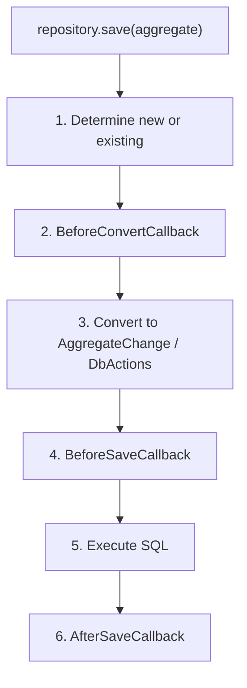

# BeforeConvertCallback and Insert/Update Decision Timing

In Spring Data JDBC, when calling `repository.save(aggregate)`, the framework must determine whether the aggregate is newly created or already exists in order to choose an INSERT or UPDATE statement. Spring makes this decision **before invoking `BeforeConvertCallback`**.

This ordering detail is critical when the application generates IDs itself. `BeforeConvertCallback` is the right place to assign an ID to a new aggregate: the framework has already determined the aggregate is new, then the callback assigns the ID, and the subsequent conversion step uses that ID when building the INSERT statement. The newly assigned ID does not alter the already-made INSERT decision.

This lesson explains the lifecycle of a save operation, how Spring determines new/existing status, how to implement callbacks for immutable aggregates, and why assigning an ID in `BeforeSaveCallback` can be too late to change how the framework handles the ID.

## 1. Two distinct decisions during save

When saving an aggregate, there are two separate questions:

1. **Is the aggregate new?** The answer determines whether Spring executes INSERT or UPDATE.
2. **Who supplies the ID?** After the aggregate is converted into a data-change structure, Spring determines whether to send the existing ID to the database or let the database generate one.

These two decisions occur at different times.

Example of a new aggregate whose initial ID is null:

```text
Input Invoice:
    id = null
    number = "INV-001"

Step 1: Spring checks state
    id is null -> new aggregate
    decision: INSERT

Step 2: BeforeConvertCallback
    assigns id = "a new UUID"

Step 3: Create AggregateChange
    aggregate is still INSERTed
    ID has a value -> send that ID in INSERT

Step 4: Execute SQL
    INSERT INTO invoices (id, number, ...)
    VALUES (?, ?, ...)
```

Key point: **assigning an ID in BeforeConvertCallback does not turn an INSERT into an UPDATE**. The new/existing decision was already made before the callback.

Conversely, if an aggregate already has a non-null ID when `save` is called and no other newness strategy marks it as new, Spring may treat the aggregate as existing and choose UPDATE. Assigning or changing the ID in a callback cannot go back and change that decision.

## 2. Lifecycle order when saving an aggregate

Spring Data Relational documentation describes the save order as follows:



Each step has a single responsibility:

| Step | Work | Meaning |
| --- | --- | --- |
| 1. Determine new/existing | Inspects aggregate state. | Chooses INSERT or UPDATE. |
| 2. `BeforeConvertCallback` | Allows modifying the aggregate before conversion. | Can generate an ID or normalize data before mapping. |
| 3. Convert | Creates `AggregateChange` and `DbAction`s. | Determines SQL operations; determines whether the ID is passed in or generated by the database. |
| 4. `BeforeSaveCallback` | Runs after AggregateChange has been created. | Can inspect/modify the aggregate change before running SQL. |
| 5. Execute SQL | Executes DbActions. | Writes data to the database. |
| 6. `AfterSaveCallback` | Runs after saving. | Performs post-persistence processing. |

This ordering explains why the callback named "Before Convert" is suitable for generating IDs, whereas "Before Save" is too late to change the ID strategy decision.

## 3. How does Spring determine if an aggregate is new?

Spring Data JDBC uses the aggregate's state to decide insert/update. Common strategies include:

| Strategy | Rule for determining new |
| --- | --- |
| Inspect `@Id` (default) | A null ID, or 0 for primitives, is considered new; a populated ID is considered existing. |
| Inspect `@Version` | If a version property is present, null or 0 for primitives indicates new; a different version value indicates existing. When no version exists, the framework falls back to inspecting the ID. |
| Implement `Persistable` | Spring calls `isNew()` on the aggregate to obtain the decision. |

When `@Version` is present, the version strategy takes precedence for newness detection. Therefore, an aggregate with a pre-assigned ID can still be treated as new if its version is in the initial state indicating new.

### 3.1. Null ID under the default strategy

Example:

```java
@Table("invoices")
public record Invoice(
    @Id UUID id,
    String invoiceNumber,
    BigDecimal amount
) {}
```

Creating a new aggregate:

```java
Invoice invoice = new Invoice(
    null,
    "INV-001",
    new BigDecimal("250.00")
);

Invoice saved = invoices.save(invoice);
```

Before the callback runs, the ID is null so Spring classifies the aggregate as new. This is the right state for a callback to assign an application-generated ID.

### 3.2. A pre-populated ID does not automatically mean new

If a UUID is generated directly in the constructor:

```java
Invoice invoice = new Invoice(
    UUID.randomUUID(),
    "INV-002",
    new BigDecimal("500.00")
);

invoices.save(invoice);
```

With the default ID inspection strategy and without `@Version`/`Persistable` overriding it, the ID is already non-null, so Spring may classify the aggregate as existing and perform an UPDATE.

If the row does not exist yet, UPDATE may affect zero rows or fail depending on the persistence path and configuration. Do not assume generating an ID in the constructor causes `save` to always INSERT.

### 3.3. Using @Version for newness detection

Example aggregate with version:

```java
@Table("invoices")
public record Invoice(
    @Id UUID id,
    @Version Long version,
    String invoiceNumber,
    BigDecimal amount
) {}
```

If version is null, the aggregate is considered new under the version strategy, even if the ID already has a value. After insert, Spring updates the version according to the optimistic locking mechanism.

`@Version` also serves to detect concurrent updates; do not add a version solely to work around newness detection if the domain does not need optimistic locking. Choose the strategy based on the aggregate's lifecycle and concurrency rules.

## 4. What is BeforeConvertCallback?

`BeforeConvertCallback<T>` is an `EntityCallback<T>` in Spring Data Relational. It is invoked before the aggregate is converted into a database change structure (`AggregateChange`).

Package:

```java
import org.springframework.data.relational.core.mapping.event.BeforeConvertCallback;
```

The interface has the method:

```java
T onBeforeConvert(T aggregate);
```

The callback receives the aggregate root and returns the aggregate to be persisted. It can return the same instance or a modified instance.

This callback is suitable for changes that must appear in the mapping and SQL generated in the next step, such as:

- Generating an application ID for a new aggregate.
- Normalizing values before writing.
- Assigning a business code derived from aggregate data.
- Enriching required data before creating AggregateChange.

Callbacks are invoked for the aggregate root. If you need to process child entities, go through the aggregate root containing them and update the corresponding collection/property; do not expect Spring to invoke separate callbacks for each child entity.

## 5. Example of generating a UUID in BeforeConvertCallback

Suppose the application does not use database auto-increment IDs and wants to generate a UUID for each invoice itself.

### 5.1. Immutable domain aggregate

Using a record to demonstrate a callback returning a new instance:

```java
import java.math.BigDecimal;
import java.util.UUID;

import org.springframework.data.annotation.Id;
import org.springframework.data.relational.core.mapping.Table;

@Table("invoices")
public record Invoice(
    @Id UUID id,
    String invoiceNumber,
    BigDecimal amount
) {
    public Invoice withId(UUID newId) {
        return new Invoice(
            newId,
            invoiceNumber,
            amount
        );
    }
}
```

Schema:

```sql
CREATE TABLE invoices (
    id UUID PRIMARY KEY,
    invoice_number VARCHAR(40) NOT NULL UNIQUE,
    amount DECIMAL(12, 2) NOT NULL
);
```

The ID column in the example accepts a UUID supplied by the application.

### 5.2. Implementing the callback

```java
import java.util.UUID;

import org.springframework.data.relational.core.mapping.event.BeforeConvertCallback;
import org.springframework.stereotype.Component;

@Component
public class InvoiceIdGeneratingCallback
        implements BeforeConvertCallback<Invoice> {

    @Override
    public Invoice onBeforeConvert(Invoice invoice) {
        if (invoice.id() != null) {
            return invoice;
        }

        return invoice.withId(UUID.randomUUID());
    }
}
```

The condition `invoice.id() != null` is critical. The callback is called for both new and existing aggregates. Only generate an ID when the ID is missing; do not generate a new UUID on every save.

Because Spring already determined the aggregate is new before the callback, returning an Invoice with a UUID does not change the chosen operation. When creating AggregateChange afterward, the ID already has a value and is included in the INSERT statement.

### 5.3. Repository and usage

```java
import java.util.UUID;

import org.springframework.data.repository.CrudRepository;

public interface InvoiceRepository
        extends CrudRepository<Invoice, UUID> {
}
```

Service:

```java
@Service
public class InvoiceService {

    private final InvoiceRepository invoices;

    public InvoiceService(InvoiceRepository invoices) {
        this.invoices = invoices;
    }

    public Invoice create(
        String invoiceNumber,
        BigDecimal amount
    ) {
        Invoice newInvoice = new Invoice(
            null,
            invoiceNumber,
            amount
        );

        return invoices.save(newInvoice);
    }
}
```

Execution flow:

1. The service creates an Invoice with a null ID.
2. The repository receives the aggregate and determines it is a new aggregate.
3. `InvoiceIdGeneratingCallback` generates a UUID.
4. Spring creates an AggregateChange for an INSERT operation with the populated UUID ID.
5. The database saves the invoice.
6. The save result returns the aggregate persisted according to the callback and Spring Data JDBC's ID mechanism.

The callback only supplies the ID. It does not automatically check whether the UUID already exists in the database; the primary key constraint remains the final safeguard.

## 6. Why is BeforeSaveCallback too late to generate an ID?

`BeforeSaveCallback<T>` is called after the aggregate has already been converted into a `MutableAggregateChange<T>`.

Package:

```java
import org.springframework.data.relational.core.mapping.event.BeforeSaveCallback;
```

Signature:

```java
T onBeforeSave(
    T aggregate,
    MutableAggregateChange<T> aggregateChange
);
```

At this point:

- Spring has already decided INSERT or UPDATE.
- The `DbAction`s have already been created.
- The ID strategy has already been decided: whether the ID is sent to the database or the database needs to generate an ID.
- The callback can inspect or adjust the aggregate change before SQL runs.

Therefore, if the goal is to generate an ID for a new aggregate, use `BeforeConvertCallback`. Assigning an ID in `BeforeSaveCallback` does not go back and change the ID decision already made when creating AggregateChange.

### 6.1. Comparison table of the two callbacks

| Criterion | `BeforeConvertCallback` | `BeforeSaveCallback` |
| --- | --- | --- |
| Timing | After new/existing decision, before creating AggregateChange. | After AggregateChange is created, before SQL runs. |
| Receives | Aggregate root. | Aggregate root and MutableAggregateChange. |
| Can return a modified instance? | Yes. | Yes. |
| Suitable for generating a new ID? | Yes. | Not recommended; too late for the ID decision. |
| Can access DbAction? | Not yet, because AggregateChange has not been created. | Yes, via AggregateChange. |
| Typical purpose | Generating IDs, normalizing aggregates before mapping. | Adjusting AggregateChange or actions before SQL execution. |

### 6.2. Do not confuse callback name with newness timing

The name `BeforeConvertCallback` might lead readers to think the callback runs before every persistence decision. In reality, the decision of whether the aggregate is new or existing has already happened earlier.

What the callback runs before is **converting the aggregate into AggregateChange**, not before the newness detection step.

This is the core distinction to remember when designing ID generation.

## 7. What happens if a callback changes the ID of an existing aggregate?

Suppose the database already has an invoice with ID `A`. When calling `save` with that object, Spring determines the aggregate is existing before the callback runs.

If the callback changes the ID to `B`:

```java
@Override
public Invoice onBeforeConvert(Invoice invoice) {
    return invoice.withId(UUID.randomUUID());
}
```

then the framework does not go back to choosing INSERT. It still follows the UPDATE path chosen from the beginning, yet the converted data may contain the new ID. This is a dangerous change and can lead to updating the wrong row, optimistic locking failures, or inconsistent data depending on how mapping and SQL are generated.

Therefore:

- Only assign an ID when the aggregate truly has no ID and the callback is meant for new-creation rules.
- Do not change the ID of an existing aggregate.
- Do not use callbacks to change the identifier of an already-existing aggregate.
- If the business requires changing an identifier key, design an explicit migration/key-change use case rather than doing it implicitly in a lifecycle callback.

A callback can be called across multiple saves, so it must be written to be safe on repeated execution.

## 8. Database-generated IDs vs. application-generated IDs

These two strategies need to be distinguished.

### 8.1. Database-generated ID

If the database has identity/auto-increment:

```sql
CREATE TABLE invoices (
    id BIGINT GENERATED BY DEFAULT AS IDENTITY PRIMARY KEY,
    invoice_number VARCHAR(40) NOT NULL
);
```

Domain:

```java
@Table("invoices")
public record Invoice(
    @Id Long id,
    String invoiceNumber
) {}
```

When creating a new one, leave the ID null:

```java
Invoice invoice = new Invoice(null, "INV-DB-001");
Invoice saved = invoices.save(invoice);
```

Spring keeps the ID empty when creating AggregateChange so the database generates the ID. After insert, the generated key is populated on the returned aggregate.

In this case, no callback is needed just to have the database create the ID. If a callback assigns an ID itself before creating AggregateChange, Spring may send that ID in the INSERT instead of letting the database generate one.

### 8.2. Application-generated ID

If the application wants to generate UUIDs itself, a callback can assign the ID after Spring has classified the aggregate as new:

```java
@Override
public Invoice onBeforeConvert(Invoice invoice) {
    return invoice.id() == null
        ? invoice.withId(UUID.randomUUID())
        : invoice;
}
```

When AggregateChange is created, the ID already has a value and is sent in the INSERT.

### 8.3. Comparison

| Characteristic | Database-generated | Application-generated in BeforeConvert |
| --- | --- | --- |
| ID before save | null/initial value | null/initial value |
| Who creates the ID? | Database | Callback/application |
| ID at AggregateChange creation step | Empty for database to generate | Already has a value |
| Callback needed? | Not just to obtain generated ID | Can use callback to supply ID |
| Example | BIGINT identity | UUID |

Do not mix both strategies in the same flow unintentionally. Clearly define who is the source of IDs and ensure the schema matches.

## 9. IDs generated in the constructor and Persistable

Another option is to generate a UUID right when constructing the object:

```java
public Invoice(String invoiceNumber, BigDecimal amount) {
    this.id = UUID.randomUUID();
    this.invoiceNumber = invoiceNumber;
    this.amount = amount;
}
```

This is convenient because the ID is available before calling the repository. However, under the default ID inspection strategy, an object with a non-null ID is treated as existing.

If you want to generate IDs in the constructor, you need another newness strategy, for example:

- Having a `@Version` property in null/0 state so Spring recognizes it as new.
- Implementing `Persistable<ID>` and returning the accurate `isNew()` state.
- Using a callback to generate the ID after Spring has detected the object as new from a null ID.

`Persistable` is useful when the application manages the new/existing lifecycle itself, but the state must be updated accurately after persist/load. If `isNew()` continues returning true after an insert, the next save may try to INSERT again.

Do not implement an `isNew` flag just to avoid understanding lifecycle ordering. Only use it when the entity's identity model and state genuinely require it.

## 10. @Version and BeforeConvertCallback

When an aggregate root has `@Version`, Spring uses the version to determine new/existing state according to Spring Data Relational rules:

- A null reference-type version indicates a new aggregate.
- A primitive version equal to 0 indicates a new aggregate.
- A version already having a value different from the initial state indicates an existing aggregate.
- If there is no version property, Spring uses the ID strategy.

Example:

```java
@Table("invoices")
public record Invoice(
    @Id UUID id,
    @Version Long version,
    String invoiceNumber,
    BigDecimal amount
) {}
```

If version is null, Spring already determined the aggregate is new before the callback. The callback can generate a UUID if the ID is currently null:

```java
@Component
public class InvoiceCallback
        implements BeforeConvertCallback<Invoice> {

    @Override
    public Invoice onBeforeConvert(Invoice invoice) {
        if (invoice.id() != null) {
            return invoice;
        }

        return new Invoice(
            UUID.randomUUID(),
            invoice.version(),
            invoice.invoiceNumber(),
            invoice.amount()
        );
    }
}
```

After insert, Spring manages the version via the optimistic locking mechanism. On the next save, the version has been updated and the aggregate is recognized as existing.

Do not change version arbitrarily in a callback. Version is concurrency metadata; modifying it is not a safe way to force INSERT or UPDATE.

## 11. Callbacks only run on the aggregate persistence path

Spring Data JDBC save/delete lifecycle callbacks are tied to the aggregate persistence process. They are not invoked for derived query methods or annotated queries that modify data, because the framework does not determine which aggregates are affected by that SQL.

Example method:

```java
@Modifying
@Query("""
    UPDATE invoices
    SET status = :status
    WHERE id = :id
    """)
int updateStatus(
    @Param("id") UUID id,
    @Param("status") String status
);
```

This direct SQL path does not go through `repository.save(aggregate)`, so it does not run `BeforeConvertCallback`/`BeforeSaveCallback` like a normal aggregate save.

If a direct SQL operation requires audit data or an ID, update it directly in SQL/triggers or use an appropriate persistence path. Do not rely on callbacks to handle hand-written queries.

## 12. Callback or ApplicationEvent?

Spring Data Relational has both lifecycle events and the EntityCallback API. The two mechanisms have close purposes but operate differently.

| Characteristic | EntityCallback | Lifecycle event |
| --- | --- | --- |
| Usage | Implement a callback interface. | Register an ApplicationListener/event listener. |
| Return result | Can return a modified aggregate. | Events are mainly for notification; some events have mutable entities, but are less flexible than callbacks. |
| Immutable aggregate support | Suitable because callbacks return a new instance. | Less convenient for immutable objects. |
| Processing order | Callback API executes synchronously along the lifecycle. | Depends on ApplicationEventMulticaster; an async executor can be configured. |
| Purpose | Modifying the entity in the persistence lifecycle. | Observing/notifying about the lifecycle. |

If you need to assign an ID or modify the aggregate before conversion, prefer `BeforeConvertCallback`. If you only need to log/observe a save event, a listener may be more appropriate.

Do not use an asynchronous event listener to modify an aggregate and expect that change to definitely be included in the executing SQL. When the event is handled on another thread or after the required point, the change may arrive too late.

## 13. Callbacks and immutable aggregates

One advantage of EntityCallback is that a callback can return a new instance. This fits records or immutable classes well.

Example:

```java
public record Invoice(
    UUID id,
    String invoiceNumber,
    BigDecimal amount
) {
    public Invoice withId(UUID id) {
        return new Invoice(id, invoiceNumber, amount);
    }

    public Invoice withNormalizedNumber() {
        return new Invoice(
            id,
            invoiceNumber.trim().toUpperCase(Locale.ROOT),
            amount
        );
    }
}
```

Callback:

```java
@Component
public class InvoiceNormalizationCallback
        implements BeforeConvertCallback<Invoice> {

    @Override
    public Invoice onBeforeConvert(Invoice invoice) {
        Invoice normalized = invoice.withNormalizedNumber();

        if (normalized.id() == null) {
            return normalized.withId(UUID.randomUUID());
        }

        return normalized;
    }
}
```

In this example the callback creates an instance that is normalized and has an ID. Ensure the normalization rule is genuinely a shared persistence rule for all Invoice save paths. If only one use case needs normalization, an explicit service/domain method may be easier to understand than a global callback.

## 14. Registering callbacks and scope of application

Declare a callback as a Spring bean via component scan:

```java
@Component
public class InvoiceIdGeneratingCallback
        implements BeforeConvertCallback<Invoice> {
    // ...
}
```

Or register via configuration:

```java
@Configuration
public class InvoiceCallbackConfiguration {

    @Bean
    BeforeConvertCallback<Invoice> invoiceIdCallback() {
        return invoice -> invoice.id() == null
            ? invoice.withId(UUID.randomUUID())
            : invoice;
    }
}
```

Spring Data discovers EntityCallback beans and calls the callbacks matching the aggregate type. The generic type binds the callback to `Invoice` rather than all aggregates.

Notes:

- A callback must be a bean in the application context.
- Component scanning must cover the callback's package.
- With multiple callbacks of the same type, consider ordering if a later callback depends on an earlier callback's result.
- Avoid side effects outside the database in callbacks because callbacks may be invoked across multiple save paths and inside transactions.
- Do not recursively re-query the same aggregate from a callback, as that can cause persistence loops or unpredictable behavior.

## 15. Testing INSERT decision timing

A useful integration test should prove that an ID generated in BeforeConvert still results in an INSERT.

Example:

```java
@DataJdbcTest
@Import(InvoiceIdGeneratingCallback.class)
class InvoiceCallbackTest {

    @Autowired
    InvoiceRepository invoices;

    @Autowired
    JdbcTemplate jdbc;

    @Test
    void generatesIdAndInsertsNewAggregate() {
        Invoice saved = invoices.save(
            new Invoice(
                null,
                "INV-NEW-001",
                new BigDecimal("125.00")
            )
        );

        assertThat(saved.id()).isNotNull();

        Integer count = jdbc.queryForObject(
            "SELECT COUNT(*) FROM invoices WHERE id = ?",
            Integer.class,
            saved.id()
        );

        assertThat(count).isEqualTo(1);
    }
}
```

The test requires a matching `invoices` schema and the callback imported into the test context. It verifies the save path creates a row with the ID generated by the callback.

### 15.1. Testing that the callback does not change an existing ID

Save an invoice, then call save again:

```java
@Test
void preservesIdWhenSavingExistingAggregate() {
    Invoice first = invoices.save(
        new Invoice(null, "INV-EXISTING-001",
            new BigDecimal("100.00"))
    );

    UUID originalId = first.id();

    Invoice changed = new Invoice(
        originalId,
        first.invoiceNumber(),
        new BigDecimal("150.00")
    );

    Invoice savedAgain = invoices.save(changed);

    assertThat(savedAgain.id()).isEqualTo(originalId);
}
```

This test checks that the callback only creates an ID when missing. If the callback generated a new UUID on every run, the test would catch the altered identifier.

### 15.2. Testing that the callback is invoked before creating AggregateChange

There is no need to depend on internal details of each `DbAction` to test business behavior. Usually it suffices to verify:

- The input aggregate has a null ID.
- The callback returns an aggregate with an ID.
- The repository saves the row.
- The generated ID is the ID used in the database.
- The subsequent save does not create a different ID.

If you need to verify specific lifecycle ordering, you can use a callback spy or record callback execution order in an integration test. However, avoid writing tests that depend on implementation details outside the public contract of the version in use.

## 16. Common mistakes

| Symptom | Cause | Solution |
| --- | --- | --- |
| Callback assigns an ID but repository still executes UPDATE | Aggregate was already classified as existing before the callback. | Leave ID null before save or use an appropriate newness strategy. |
| Assigning ID in BeforeSave yet database still expects a generated ID | The ID decision was already made when creating AggregateChange. | Use BeforeConvertCallback. |
| Every save creates a new UUID | Callback does not check the existing ID. | Only generate an ID when the ID is null. |
| UUID generated in constructor but row is not INSERTed | ID is already non-null so default ID inspection treats it as existing. | Use a callback after newness detection, `@Version`, or `Persistable`. |
| Callback is not invoked for `@Modifying` query | Direct SQL bypasses the aggregate save lifecycle. | Update data in SQL/triggers or use `repository.save`. |
| Callback does not run for child entities | EntityCallback is bound to the aggregate root. | Handle children through the root callback. |
| Event listener modifies object but SQL does not reflect changes | Event may be handled asynchronously or does not return a modified instance. | Use EntityCallback to transform aggregates. |
| Changing an existing ID in a callback causes errors | UPDATE decision was already chosen; ID changed too late. | Do not change the ID of an existing aggregate. |
| Callback calls save back on the same repository | Causes recursion or repeated persistence. | Keep callbacks pure; do not call the repository again for the same aggregate. |
| Test only unit-tests the callback without testing insert | Has not verified the callback is registered and mapped in practice. | Add repository integration tests. |

## 17. Process for choosing a callback

When needing to modify an aggregate before writing:

1. Determine whether the ID is generated by the database or by the application.
2. Determine how Spring recognizes a new aggregate: ID, version, or Persistable.
3. If you need to assign an application ID to a new aggregate whose initial ID is null, use `BeforeConvertCallback`.
4. Keep the callback conditional so it does not change the ID of an existing aggregate.
5. Use `BeforeSaveCallback` when you need to operate on an already-created AggregateChange, not to decide INSERT/UPDATE.
6. Use `AfterSaveCallback` for processing after SQL has executed.
7. If the operation uses a derived/annotated modifying query, do not expect save lifecycle callbacks.
8. Prefer EntityCallback for entity modifications; use events for notification purposes.
9. Test both the initial insert and subsequent saves.
10. Verify the callback bean is registered in the application context and works with the right aggregate root.

> **BeforeConvertCallback runs after Spring has decided whether the aggregate is new or existing, but before creating AggregateChange.** Therefore, the callback can assign an ID to an aggregate already classified as new while preserving the INSERT path; the subsequent conversion step will use that ID instead of waiting for the database to generate one. BeforeSaveCallback runs after the decision and SQL plan have been created, so it is not the place to generate IDs for new aggregates.

### References

- [Spring Data Relational — Lifecycle Events and EntityCallbacks](https://docs.spring.io/spring-data/relational/reference/jdbc/events.html): callback ordering, events, and the aggregate save process.
- [Spring Data Relational — BeforeConvertCallback API](https://docs.spring.io/spring-data/relational/reference/api/java/org/springframework/data/relational/core/mapping/event/BeforeConvertCallback.html): callback signature and insert/update decision timing.
- [Spring Data Relational — BeforeSaveCallback API](https://docs.spring.io/spring-data/jdbc/docs/current/api/org/springframework/data/relational/core/mapping/event/BeforeSaveCallback.html): callback after AggregateChange is created.
- [Spring Data Relational — Persisting Entities](https://docs.spring.io/spring-data/relational/reference/jdbc/entity-persistence.html): saving aggregates, ID generation, and optimistic locking.
- [Spring Data Relational — Repository Core Concepts](https://docs.spring.io/spring-data/relational/reference/repositories/core-concepts.html): strategies for detecting new entities.
- [Spring Data Commons — Entity Callbacks](https://docs.spring.io/spring-data/commons/reference/entity-callbacks.html): callback API and how to register callbacks.
