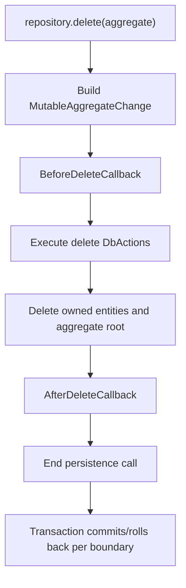

# `BeforeDeleteCallback` and `AfterDeleteCallback`

In **Spring Data Relational JDBC**, deleting an aggregate may require running logic before and after delete SQL statements execute. For example, an application might want to log the aggregate about to be deleted, add actions to the delete plan, or perform bookkeeping after the database deletes the aggregate.

Spring Data JDBC provides two entity callbacks dedicated to the delete lifecycle:

- **`BeforeDeleteCallback<T>`** is called before the aggregate root is deleted. The callback receives the aggregate and `MutableAggregateChange<T>` — the plan of database operations to be executed.
- **`AfterDeleteCallback<T>`** is called after the aggregate root has been deleted. The callback receives the aggregate that was just deleted.

Both callbacks operate at the **aggregate root** level. Owned child entities are deleted according to the aggregate plan, but callbacks are not invoked separately for each child.

The triggering condition is critical: callbacks are only invoked when the delete method receives an **aggregate instance** as an argument, such as `repository.delete(customer)`. Deleting by ID, deleting without arguments, derived delete queries, and annotated queries do not trigger these callbacks.

## 1. Position of delete callbacks in the aggregate lifecycle

When deleting an aggregate via a Spring Data JDBC repository or `JdbcAggregateTemplate`, the conceptual flow is:

1. The application passes an aggregate instance to the delete operation.
2. Spring Data JDBC builds a delete plan (`MutableAggregateChange`) for the aggregate root and owned entities.
3. `BeforeDeleteCallback` is invoked with the aggregate and the delete plan.
4. SQL statements deleting entities belonging to the aggregate are executed in an order matching data relationships.
5. `AfterDeleteCallback` is invoked after the aggregate delete operation completes at the persistence layer.



`BeforeDeleteCallback` runs before the delete SQL; `AfterDeleteCallback` runs after the delete SQL has executed. If the call is inside a Spring-managed transaction, callbacks remain part of that transaction flow. **"After delete" does not mean "after commit"**: the surrounding repository/service transaction may only commit after the transactional method finishes.

## 2. `BeforeDeleteCallback<T>`

The interface resides in the package:

```java
import org.springframework.data.relational.core.mapping.event.BeforeDeleteCallback;
```

The callback method has the signature:

```java
T onBeforeDelete(T aggregate, MutableAggregateChange<T> aggregateChange);
```

Parameters:

| Parameter | Meaning |
|---|---|
| `aggregate` | Aggregate root requested to be deleted |
| `aggregateChange` | Plan of `DbAction`s to be executed for the delete operation |

The callback returns the aggregate (either the original instance or a modified instance). It can also alter the contents of `MutableAggregateChange`.

### Note on when the delete plan is created

`BeforeDeleteCallback` is called **after the aggregate has been converted into `MutableAggregateChange`**. Therefore, changing persistent properties on the `aggregate` object in this callback does not change the already-created delete plan. The API recommends only modifying transient fields of the aggregate in this callback.

If you need to intervene in the persistence plan, the callback can interact with `aggregateChange`. This is a low-level API: only add/modify `DbAction`s when you clearly understand execution order, foreign keys, and aggregate semantics. For most use cases, reading the aggregate, logging, or checking conditions is enough; there is no need to alter the internal plan.

### Example: logging before deleting a Customer

```java
package com.example.customer;

import org.slf4j.Logger;
import org.slf4j.LoggerFactory;
import org.springframework.data.relational.core.conversion.MutableAggregateChange;
import org.springframework.data.relational.core.mapping.event.BeforeDeleteCallback;
import org.springframework.stereotype.Component;

@Component
public class CustomerBeforeDeleteCallback
        implements BeforeDeleteCallback<Customer> {

    private static final Logger log =
            LoggerFactory.getLogger(CustomerBeforeDeleteCallback.class);

    @Override
    public Customer onBeforeDelete(
            Customer aggregate,
            MutableAggregateChange<Customer> aggregateChange) {

        log.info("Deleting customer id={}, email={}",
                aggregate.getId(), aggregate.getEmail());

        return aggregate;
    }
}
```

Spring discovers the callback as a bean in the application context. It can be registered via `@Component` or declared as a bean in `@Configuration`. The generic type `Customer` scopes the callback to that aggregate root.

This example only logs. If email is sensitive data, do not log full values; follow data protection policies and log only appropriate identifiers.

## 3. `AfterDeleteCallback<T>`

The interface resides in the same package:

```java
import org.springframework.data.relational.core.mapping.event.AfterDeleteCallback;
```

Callback method:

```java
T onAfterDelete(T aggregate);
```

`AfterDeleteCallback` receives the deleted aggregate root and can return the same instance or a modified instance. The return value serves the callback chain; it does not revive the aggregate or write changes back to the database.

### Example: recording deletion after persistence

```java
package com.example.customer;

import org.slf4j.Logger;
import org.slf4j.LoggerFactory;
import org.springframework.data.relational.core.mapping.event.AfterDeleteCallback;
import org.springframework.stereotype.Component;

@Component
public class CustomerAfterDeleteCallback
        implements AfterDeleteCallback<Customer> {

    private static final Logger log =
            LoggerFactory.getLogger(CustomerAfterDeleteCallback.class);

    @Override
    public Customer onAfterDelete(Customer aggregate) {
        log.info("Customer aggregate deleted, id={}", aggregate.getId());
        return aggregate;
    }
}
```

The callback can read data still present on the aggregate object to record details. Database rows have already been deleted according to the persistence plan; mutating the object in `onAfterDelete` does not update a row that is already gone.

## 4. Putting both callbacks on the same bean

If pre- and post-delete logic are closely related, one class can implement both interfaces:

```java
@Component
public class CustomerDeleteCallbacks implements
        BeforeDeleteCallback<Customer>,
        AfterDeleteCallback<Customer> {

    private static final Logger log =
            LoggerFactory.getLogger(CustomerDeleteCallbacks.class);

    @Override
    public Customer onBeforeDelete(
            Customer aggregate,
            MutableAggregateChange<Customer> aggregateChange) {

        log.info("About to delete customer {}", aggregate.getId());
        return aggregate;
    }

    @Override
    public Customer onAfterDelete(Customer aggregate) {
        log.info("Deleted customer {}", aggregate.getId());
        return aggregate;
    }
}
```

Splitting into two beans is also valid when the two stages have different dependencies or responsibilities. Keep callbacks small and avoid stuffing the entire delete use case into callbacks.

## 5. How to register callbacks

Spring Data JDBC uses Spring Data's `EntityCallback` infrastructure. Callbacks must be registered as Spring beans for the infrastructure to discover and invoke them.

### Option 1: `@Component`

```java
@Component
public class CustomerBeforeDeleteCallback
        implements BeforeDeleteCallback<Customer> {
    // implementation
}
```

Suitable when component scanning already covers the callback's package.

### Option 2: `@Bean`

```java
@Configuration
public class CustomerCallbackConfiguration {

    @Bean
    BeforeDeleteCallback<Customer> customerBeforeDeleteCallback() {
        return (customer, change) -> {
            // Logic before deletion.
            return customer;
        };
    }

    @Bean
    AfterDeleteCallback<Customer> customerAfterDeleteCallback() {
        return customer -> {
            // Logic after delete SQL executes.
            return customer;
        };
    }
}
```

This option fits when callbacks need configuration or dependencies constructed from other beans. Do not instantiate a new `EntityCallbacks` manually if Spring Data JDBC already configures the infrastructure; register callbacks in the application context used by your repositories/templates.

## 6. Which delete methods trigger callbacks?

This is a key distinction to keep in mind when choosing a delete API:

| Operation | Invokes `BeforeDeleteCallback` / `AfterDeleteCallback`? | Reason |
|---|---|---|
| `repository.delete(entity)` | Yes | Method receives an aggregate instance |
| `repository.deleteAll(entities)` | Yes, for each aggregate instance processed | Method receives aggregate instances |
| `aggregateTemplate.delete(entity)` | Yes | Template receives an aggregate instance |
| `repository.deleteById(id)` | No | Receives only an identifier, no aggregate instance |
| `repository.deleteAllById(ids)` | No | Receives only identifiers |
| `repository.deleteAll()` | No | Receives no aggregate instances |
| Derived delete method, e.g., `deleteByStatus(...)` | No | Query method does not provide individual aggregate instances to callbacks |
| Annotated delete query (`@Query`/`@Modifying`) | No | SQL executes directly; framework does not identify individual affected aggregates |
| `JdbcTemplate.update("DELETE ...")` | No | Direct JDBC; bypasses the aggregate lifecycle |

Spring Data JDBC has no efficient way to identify every aggregate affected by a derived query or annotated query, so delete/save callbacks and lifecycle events are not invoked on those paths.

### When callbacks are needed, load the aggregate and delete by instance

If a use case requires callbacks and needs aggregate data before deletion:

```java
@Service
public class CustomerDeletionService {

    private final CustomerRepository repository;

    public CustomerDeletionService(CustomerRepository repository) {
        this.repository = repository;
    }

    @Transactional
    public void deleteCustomer(Long id) {
        Customer customer = repository.findById(id)
                .orElseThrow(() -> new CustomerNotFoundException(id));

        repository.delete(customer);
    }
}
```

Calling `delete(customer)` passes an instance, so callbacks are triggered. Note that reading then deleting can face race conditions if data changes between the two steps; use transactions and concurrency/constraint mechanisms suited to the domain. Do not switch all deletes to loading aggregates just to trigger callbacks if that data is unnecessary.

## 7. Callbacks apply only to the aggregate root

Suppose an aggregate looks like:

```text
PurchaseOrder (root)
  ├── OrderLine
  └── OrderLine
```

When deleting `PurchaseOrder`, Spring Data JDBC deletes owned entities in the aggregate according to the persistence plan. `BeforeDeleteCallback<PurchaseOrder>` and `AfterDeleteCallback<PurchaseOrder>` are invoked for the root.

The framework does not automatically invoke `BeforeDeleteCallback<OrderLine>` and then `AfterDeleteCallback<OrderLine>` for each child line as if each child were an independent aggregate. If child data needs processing:

- Use the aggregate root inside the callback to read the child collection if the aggregate instance is available and necessary.
- Perform child-specific business logic in the application service before deleting the root.
- If a child has an independent lifecycle/identity and needs its own callbacks, reconsider the aggregate boundary so the child can become its own root.

Do not rely on root callbacks to run a side effect per child without accounting for aggregate size and structure. For large aggregates, processing each child in a callback can significantly slow down deletion.

## 8. Callbacks do not replace domain rules or delete authorization

You can use `BeforeDeleteCallback` to check a condition and throw an exception if deletion should not proceed. However, callbacks only run on delete paths that receive an aggregate instance. `deleteById`, bulk delete queries, and direct SQL do not trigger callbacks.

Consequently, do not place mandatory security invariants or business rules solely inside `BeforeDeleteCallback`. If the rule is "do not delete customers with open orders", place that check in the application/domain service and back it up with appropriate database constraints or transaction/concurrency strategies.

Example check in a use case:

```java
@Transactional
public void deleteCustomer(Long customerId) {
    Customer customer = customerRepository.findById(customerId)
            .orElseThrow(() -> new CustomerNotFoundException(customerId));

    if (orderRepository.existsOpenOrderForCustomer(customerId)) {
        throw new CustomerHasOpenOrdersException(customerId);
    }

    customerRepository.delete(customer);
}
```

Callbacks can add auxiliary logging/metrics or secondary checks, but the application service is where use cases and business preconditions are clearly enforced across all call paths.

## 9. Exceptions in callbacks and transaction rollback

Callbacks are part of the synchronous persistence chain. If `BeforeDeleteCallback` throws an exception, deletion has not executed yet. If `AfterDeleteCallback` throws an exception, delete SQL statements may have run, yet the surrounding transaction is not guaranteed to have committed.

With an active Spring transaction:

- A runtime exception escaping a transactional method normally marks the transaction for rollback.
- If `AfterDeleteCallback` throws a runtime exception and it escapes the transaction boundary, database changes in that transaction can roll back.
- If the exception is caught and swallowed inside the method, the transaction may continue/commit depending on rollback-only status and where the error occurred.
- Checked exceptions do not trigger rollback by default; use `rollbackFor` when needed.

Example:

```java
@Transactional(rollbackFor = CustomerDeletionException.class)
public void deleteCustomer(Customer customer) throws CustomerDeletionException {
    customerRepository.delete(customer);
}
```

Keep callbacks simple and let exceptions reflect genuine errors. Do not use callbacks to orchestrate long workflows or make multiple network calls while a transaction is open.

## 10. Do not confuse `AfterDeleteCallback` with post-commit processing

The name `AfterDeleteCallback` might lead readers to think the database has committed. In reality, the callback is invoked after aggregate delete operations have executed in the persistence flow, while the outer transaction may still be open.

Example to avoid:

```java
@Override
public Customer onAfterDelete(Customer customer) {
    emailClient.sendAccountDeleted(customer.getEmail());
    return customer;
}
```

If the email sends successfully yet the transaction later rolls back, the customer still exists in the database despite already receiving an account-deletion email. A callback cannot roll back a network call.

### Appropriate approach for external side effects

If you need to notify after deletion commits successfully, you can:

1. Write an outbox row in the same transaction as the delete operation.
2. After commit, have a worker read the outbox and send the message/email.
3. Have consumers/workers handle idempotency and retries on transient failures.

Or publish a Spring application event and listen with `@TransactionalEventListener(phase = TransactionPhase.AFTER_COMMIT)` if your application's semantics and durability requirements allow it. For critical notifications that must not be lost if the process stops, a transactional outbox is generally more reliable than in-memory events.

`AfterDeleteCallback` fits synchronous logic inside the persistence flow; an `AFTER_COMMIT` listener or outbox fits actions that must wait for transaction commit.

## 11. Distinguishing EntityCallback from lifecycle ApplicationEvent

Spring Data JDBC also publishes `BeforeDeleteEvent` and `AfterDeleteEvent`. They have matching names yet differ in purpose and mechanism from `BeforeDeleteCallback`/`AfterDeleteCallback`.

| Criterion | Entity callback | Lifecycle event |
|---|---|---|
| API | `BeforeDeleteCallback`, `AfterDeleteCallback` | `BeforeDeleteEvent`, `AfterDeleteEvent` |
| Purpose | Hook in the persistence chain; can return an entity or alter the delete plan in the before callback | Notification about a lifecycle stage |
| Execution | Synchronous along the callback chain | Via `ApplicationEventMulticaster` |
| Entity modification | Supports returning a new instance, suitable even for immutable types | Events are primarily for notification |
| Asynchronous processing | Not an async mechanism by default | Multicaster can be configured with `TaskExecutor`; synchronous order is then not guaranteed |
| Post-commit | Does not mean after-commit | Can use a transactional event listener with phase `AFTER_COMMIT` |

Spring Data documentation recommends entity callbacks when you need ordered hooks and the ability to modify entities. Use lifecycle events when the purpose is notifying listeners. If a listener must run only after commit, configure `@TransactionalEventListener` rather than assuming `AfterDeleteEvent` automatically means the transaction committed.

## 12. Ordering when multiple callbacks exist

An application can have multiple callbacks of the same type for the same aggregate root—for example, one callback writing an audit entry and another updating metadata. Avoid letting outcomes depend on unclear ordering.

- Give each callback a single clear responsibility.
- If order matters, use Spring's ordering mechanism (`Ordered` or `@Order`) and verify in tests against the running framework version.
- Do not let one callback depend on a side effect another callback might not have finished if ordering is not configured.
- Do not perform the exact same action in both a callback and an event listener if that creates duplicate audits/notifications.

In most applications, one before callback and one after callback per aggregate type are enough. If there are multiple order-dependent business steps, move orchestration up to the application service so the flow is clearer and easier to test.

## 13. Testing callbacks with a real repository

Unit tests can test callback logic in isolation, while integration tests verify Spring Data JDBC invokes callbacks on the right delete paths.

### Testing that callbacks are called when deleting an aggregate instance

You can create a callback that records deleted IDs:

```java
class RecordingCustomerDeleteCallback implements
        BeforeDeleteCallback<Customer>,
        AfterDeleteCallback<Customer> {

    final List<Long> beforeIds = new ArrayList<>();
    final List<Long> afterIds = new ArrayList<>();

    @Override
    public Customer onBeforeDelete(
            Customer customer,
            MutableAggregateChange<Customer> change) {
        beforeIds.add(customer.getId());
        return customer;
    }

    @Override
    public Customer onAfterDelete(Customer customer) {
        afterIds.add(customer.getId());
        return customer;
    }
}
```

Register this instance as a bean in the test context and assert:

```java
@Test
void invokesDeleteCallbacksWhenDeletingAnAggregateInstance() {
    Customer customer = customerRepository.save(
            new Customer("Lan", "lan@example.com")
    );

    customerRepository.delete(customer);

    assertThat(recordingCallback.beforeIds).containsExactly(customer.getId());
    assertThat(recordingCallback.afterIds).containsExactly(customer.getId());
}
```

### Testing that delete-by-ID does not invoke callbacks

```java
@Test
void doesNotInvokeDeleteCallbacksForDeleteById() {
    Customer customer = customerRepository.save(
            new Customer("Lan", "lan@example.com")
    );

    customerRepository.deleteById(customer.getId());

    assertThat(recordingCallback.beforeIds).isEmpty();
    assertThat(recordingCallback.afterIds).isEmpty();
}
```

The test context must register the callback properly and use the real Spring repository bean. If the test method itself runs inside an outer transaction, distinguish callback timing from commit timing; callback tests only verify that hooks ran in the persistence chain.

### Additional cases worth testing

- `deleteAll(Iterable)` invokes callbacks for the aggregate instances passed in.
- `deleteAll()` and `deleteAllById(...)` do not invoke callbacks.
- Derived delete methods and `@Modifying @Query DELETE` do not invoke callbacks.
- Aggregate with children: callbacks receive only the root; the database deletes children according to the aggregate plan.
- An exception in a before callback prevents delete SQL from running.
- An exception in an after callback is handled properly with the transaction boundary.
- Callbacks do not emit external side effects before commit without a recovery mechanism.

## 14. Common mistakes

| Symptom | Cause | How to fix |
|---|---|---|
| Callback is not invoked on `deleteById` | Method receives only an ID, no aggregate instance | Load the aggregate and call `delete(entity)` if callbacks are needed |
| Callback is not invoked on `deleteAll()` | Delete API receives no aggregate instances | Use `deleteAll(Iterable)` when per-instance callbacks are needed |
| Callback does not run for `deleteByStatus` | Derived delete queries do not invoke delete callbacks/events | Move hook-requiring logic to the service and delete individual aggregate instances, or handle explicitly in a custom flow |
| Callback does not run for `@Modifying @Query` | Direct DML bypasses the aggregate lifecycle | Do not expect callbacks; implement appropriate side effects/transactions explicitly |
| Callback for child does not run | Callbacks are called on the aggregate root, not each owned entity | Handle children through the root or reconsider aggregate boundaries |
| Modifying a field in `BeforeDeleteCallback` does not alter SQL | Aggregate was already converted into `MutableAggregateChange` before the callback | Only modify transient fields; if the delete plan must change, use `aggregateChange` intentionally |
| `AfterDeleteCallback` sends notification even though transaction rolled back | Callback runs after delete SQL but before transaction commit | Use an outbox or `@TransactionalEventListener(AFTER_COMMIT)` |
| Callback is not discovered by Spring | Class is not a bean in the application context or scan configuration is wrong | Register with `@Component`/`@Bean` in the JDBC context |
| Deleting aggregate fails due to FK | References remain from other tables or ordering/cascade is wrong | Check ownership, FKs, and schema; callbacks do not bypass constraints |
| Callback runs twice | Same logic registered on multiple beans or implemented in both a callback and an event listener | Check bean registration and split responsibilities |

## 15. Process for choosing callbacks and delete APIs

1. **Clarify the goal:** change the delete plan, log synchronously, or notify after commit?
2. **Choose the hook:** `BeforeDeleteCallback` for before SQL; `AfterDeleteCallback` for after SQL in the persistence flow.
3. **Check the delete API:** callbacks only run when the operation receives an aggregate instance.
4. **Register the callback bean:** use `@Component` or `@Bean` in the application context.
5. **Keep root scope:** children are handled through the aggregate root; do not expect per-child callbacks.
6. **Keep callbacks small:** do not pack long workflows or network calls into callbacks.
7. **Choose transaction boundaries:** use `@Transactional` when deleting an aggregate must be atomic with other database operations.
8. **Separate after-commit side effects:** use an outbox or transactional event listener when waiting for commit is required.
9. **Protect domain rules in the service:** do not rely solely on callbacks since delete-by-ID and bulk queries bypass callbacks.
10. **Test each delete path:** instance delete, ID delete, bulk delete, callback exceptions, and transaction rollback.

### Quick decision table

| Need | Suitable approach |
|---|---|
| Logging/secondary checks before deleting an aggregate instance | `BeforeDeleteCallback<T>` |
| Intentional intervention in the `DbAction` plan | `BeforeDeleteCallback<T>` with `MutableAggregateChange<T>` |
| Running synchronous logic after aggregate delete SQL | `AfterDeleteCallback<T>` |
| Processing per child | Logic through the aggregate root or application service |
| Deleting by ID while still needing callbacks | Load aggregate then call `delete(entity)` |
| Bulk delete/derived delete | Handle separately in the use case; do not expect callbacks |
| Sending messages/emails only when commit succeeds | Outbox or `@TransactionalEventListener(AFTER_COMMIT)` |
| Enforcing mandatory delete invariants | Domain/application service and database constraints |

**Key takeaway:** `BeforeDeleteCallback` receives the aggregate and `MutableAggregateChange` before delete SQL runs; `AfterDeleteCallback` receives the aggregate after the delete operation completes. Both apply only to the aggregate root and instance-based delete paths. They are hooks in the persistence lifecycle, not after-commit signals. Use callbacks for synchronous logic, keep domain rules in the application/domain layer, and use an outbox or transactional listener for side effects that must run after commit.

## Official references

- [Spring Data Relational — Lifecycle Events and Entity Callbacks](https://docs.spring.io/spring-data/relational/reference/jdbc/events.html): callback ordering, aggregate root scope, callback/event differences, and query paths that do not trigger callbacks.
- [Spring Data Relational — `BeforeDeleteCallback` API](https://docs.spring.io/spring-data/relational/reference/api/java/org/springframework/data/relational/core/mapping/event/BeforeDeleteCallback.html): `onBeforeDelete` signature, `MutableAggregateChange`, and conditions under which the callback is invoked.
- [Spring Data Relational — `AfterDeleteCallback` API](https://docs.spring.io/spring-data/relational/reference/api/java/org/springframework/data/relational/core/mapping/event/AfterDeleteCallback.html): `onAfterDelete` signature and conditions under which the callback is invoked.
- [Spring Data Relational — `MutableAggregateChange` API](https://docs.spring.io/spring-data/relational/reference/api/java/org/springframework/data/relational/core/conversion/MutableAggregateChange.html): API for representing and adjusting an aggregate change plan.
- [Spring Framework — Transaction-bound Events](https://docs.spring.io/spring-framework/reference/data-access/transaction/event.html): `@TransactionalEventListener` and transaction phases such as `AFTER_COMMIT`.
- [Spring Data JDBC — Transactionality](https://docs.spring.io/spring-data/relational/reference/jdbc/transactions.html): transaction boundaries for the repository and service layers.
