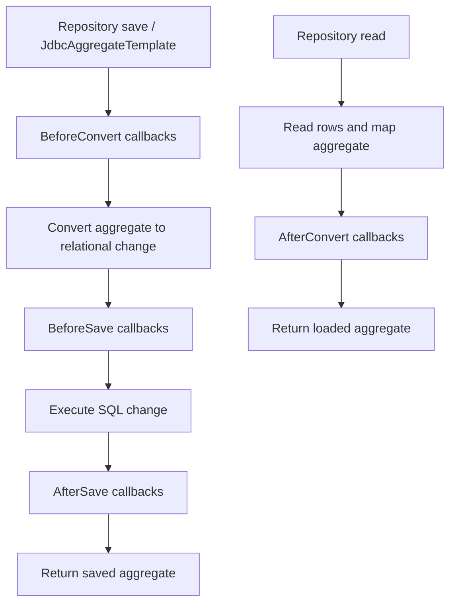
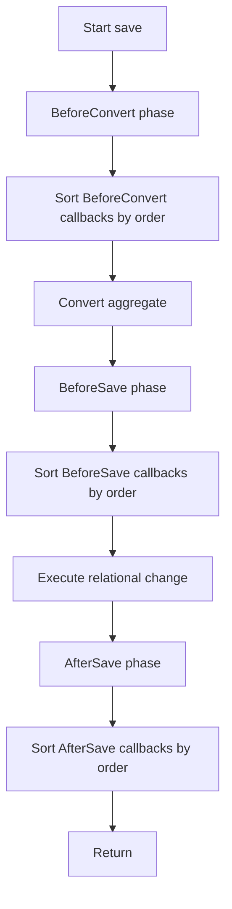

# Callbacks with Immutable Entities and Priority Ordering

In **Spring Data Relational JDBC**, entity callbacks let applications intervene in the read and write lifecycle of aggregates. Callbacks can normalize data before saving, populate timestamps, observe relational changes, or enrich objects after reading.

When the domain model uses **immutable entities**, a callback must return a new instance instead of mutating the received object directly. Spring Data uses the value returned by the callback in the corresponding pipeline. When multiple callbacks of the same type exist, execution order can be controlled using `@Order` or `Ordered`.

Two kinds of ordering must be distinguished:

- **Lifecycle stage ordering:** for example, `BeforeConvertCallback` runs before conversion, followed by `BeforeSaveCallback` and `AfterSaveCallback`.
- **Priority ordering among multiple callbacks in the same stage:** controlled via `@Order` or `Ordered`; lower order values run first.

`@Order` does not swap lifecycle stages. A `BeforeSaveCallback` still belongs to the post-conversion stage even if it has a higher-priority order than a `BeforeConvertCallback`.

This lesson focuses on callbacks in Spring Data JDBC, how to write callbacks for records/immutable classes, how to coordinate multiple callbacks, and considerations when combining auditing, transactions, and aggregate mapping.

## 1. What is an entity callback?

An entity callback is a Spring Data extension point that lets you execute logic at a specific moment during entity mapping and persistence. In Spring Data JDBC, callbacks typically operate on the aggregate root read or written by a repository or `JdbcAggregateTemplate`.

Common callbacks:

| Callback | Timing | Purpose |
|---|---|---|
| `BeforeConvertCallback<T>` | Before the aggregate is converted into a relational representation | Normalize or populate values to be saved |
| `BeforeSaveCallback<T>` | After conversion, before SQL changes are executed | Observe or adjust relational changes via supported APIs |
| `AfterSaveCallback<T>` | After aggregate changes have been executed | React after a save operation or finalize the returned object |
| `AfterConvertCallback<T>` | After relational data is converted into an object | Enrich the in-memory object after reading |

Spring Data Relational callback interfaces reside in the `org.springframework.data.relational.core.mapping.event` package. Callbacks using `Converter` or `EntityCallback` belong to the corresponding Spring Data/Spring Core packages.

Callbacks help keep technical logic close to the persistence lifecycle. For example:

- Normalizing an order code before writing.
- Assigning default values when creating an aggregate.
- Updating metadata derived from domain values.
- Logging or recording metrics for a save operation.
- Populating values used only inside the object after reading.

Callbacks do not replace domain methods. Business rules such as "an order can only be paid while in NEW status" should still live in the domain model or application service so callers can see and control them.

## 2. Callback stages when saving and reading aggregates

Saving an aggregate through a repository or `JdbcAggregateTemplate` generally passes through the following high-level stages:



This sequence helps pick the right callback:

- Want to modify a field written to the database: usually use `BeforeConvertCallback` to change the object before conversion.
- Want to intervene in relational changes after conversion: use `BeforeSaveCallback` and the change API supported by your version.
- Want to process after SQL has run: use `AfterSaveCallback`.
- Want to enrich the in-memory object after reading: use `AfterConvertCallback`.

### 2.1. BeforeConvertCallback

`BeforeConvertCallback<T>` receives an aggregate and returns an aggregate. This is the right place to construct an immutable copy containing new values before Spring Data turns the object into SQL columns.

Typical signature:

```java
public interface BeforeConvertCallback<T> {
    T onBeforeConvert(T aggregate);
}
```

Example normalizing an order code:

```java
@Component
public class NormalizeOrderCodeCallback
        implements BeforeConvertCallback<PurchaseOrder> {

    @Override
    public PurchaseOrder onBeforeConvert(PurchaseOrder order) {
        String normalized = order.orderCode()
                .trim()
                .toUpperCase(Locale.ROOT);

        return order.withOrderCode(normalized);
    }
}
```

Because `PurchaseOrder` is immutable, the callback does not mutate the old object. It creates a new instance via `withOrderCode` and returns it. The returned instance is used in the next conversion step.

### 2.2. BeforeSaveCallback

`BeforeSaveCallback<T>` runs after the aggregate has been converted into a relational change and before the change is executed. The callback typically receives the aggregate along with `AggregateChange<T>`:

```java
public interface BeforeSaveCallback<T> {
    T onBeforeSave(T aggregate, AggregateChange<T> aggregateChange);
}
```

Example callback observing changes before writing:

```java
@Component
public class OrderBeforeSaveCallback
        implements BeforeSaveCallback<PurchaseOrder> {

    private static final Logger log =
            LoggerFactory.getLogger(OrderBeforeSaveCallback.class);

    @Override
    public PurchaseOrder onBeforeSave(
            PurchaseOrder order,
            AggregateChange<PurchaseOrder> change
    ) {
        log.debug("Saving order id={}, code={}",
                order.id(), order.orderCode());

        return order;
    }
}
```

Distinguish this moment from `BeforeConvertCallback`: the relational change has already been built. If you need to change a domain field so that field is converted into SQL, do it in `BeforeConvertCallback`. Do not assume returning a new immutable copy from `BeforeSaveCallback` will cause Spring Data to re-run conversion and rebuild the entire SQL change.

`AggregateChange` provides information about the relational operations generated for the aggregate. Whether the change can be modified depends on the specific Spring Data Relational version's API; only use operations publicly supported by your project's version.

### 2.3. AfterSaveCallback

`AfterSaveCallback<T>` is called after the relational change has been executed:

```java
@Component
public class OrderAfterSaveCallback
        implements AfterSaveCallback<PurchaseOrder> {

    @Override
    public PurchaseOrder onAfterSave(PurchaseOrder order) {
        return order;
    }
}
```

The callback receives the object after the save operation. It can return that object or a different instance if you need to adjust the value returned to the caller. However, creating a copy at this stage does not write that copy back to the database. SQL was already executed before the callback.

If you need to change a persisted value, move the change to the pre-conversion stage or perform another explicit persistence operation in an appropriate transaction.

### 2.4. AfterConvertCallback

`AfterConvertCallback<T>` is called after Spring Data converts relational data into an object:

```java
@Component
public class OrderAfterConvertCallback
        implements AfterConvertCallback<PurchaseOrder> {

    @Override
    public PurchaseOrder onAfterConvert(PurchaseOrder order) {
        return order;
    }
}
```

This callback fits enriching the in-memory object after reading. If returning an immutable copy, the caller receives the new instance. That change is not automatically written back to the database.

Do not use `AfterConvertCallback` to run extra queries per aggregate if that can cause N+1 queries. If additional data from other tables is needed, design explicit read queries/projections or batch loading.

## 3. Immutable entities and callbacks must return a new instance

Immutable entities do not allow changing fields after creation. With a Java record, components are set in the canonical constructor and accessors only read values.

Aggregate example:

```java
import java.time.Instant;

import org.springframework.data.annotation.Id;
import org.springframework.data.annotation.Version;
import org.springframework.data.relational.core.mapping.Column;
import org.springframework.data.relational.core.mapping.Table;

@Table("orders")
public record PurchaseOrder(
        @Id Long id,
        @Column("order_code") String orderCode,
        OrderStatus status,
        @Column("created_at") Instant createdAt,
        @Column("last_modified_at") Instant lastModifiedAt,
        @Version Long version
) {

    public PurchaseOrder withOrderCode(String value) {
        return new PurchaseOrder(
                id, value, status, createdAt, lastModifiedAt, version
        );
    }

    public PurchaseOrder withCreatedAt(Instant value) {
        return new PurchaseOrder(
                id, orderCode, status, value, lastModifiedAt, version
        );
    }

    public PurchaseOrder withLastModifiedAt(Instant value) {
        return new PurchaseOrder(
                id, orderCode, status, createdAt, value, version
        );
    }

    public PurchaseOrder withStatus(OrderStatus value) {
        return new PurchaseOrder(
                id, orderCode, value, createdAt, lastModifiedAt, version
        );
    }
}
```

The `with...` methods create a new record while preserving unchanged components. This is a common pattern for partially updating immutable objects.

Callbacks should never attempt to use reflection or fake setters to mutate a record. Return a new instance instead.

### 3.1. Data normalization callback

```java
@Component
public class NormalizeOrderCodeCallback
        implements BeforeConvertCallback<PurchaseOrder> {

    @Override
    public PurchaseOrder onBeforeConvert(PurchaseOrder order) {
        String normalized = order.orderCode()
                .trim()
                .toUpperCase(Locale.ROOT);

        if (normalized.equals(order.orderCode())) {
            return order;
        }

        return order.withOrderCode(normalized);
    }
}
```

Checking before creating a copy avoids allocating a new object when the value is already valid. This is not strictly required for persistence, though it can make callbacks easier to follow.

### 3.2. Callback assigning creation timestamp

Example setting `createdAt` when missing:

```java
@Component
public class CreatedAtCallback
        implements BeforeConvertCallback<PurchaseOrder> {

    private final Clock clock;

    public CreatedAtCallback(Clock clock) {
        this.clock = clock;
    }

    @Override
    public PurchaseOrder onBeforeConvert(PurchaseOrder order) {
        if (order.createdAt() != null) {
            return order;
        }

        return order.withCreatedAt(clock.instant());
    }
}
```

Do not infer solely from `id == null` that an aggregate is new if the application supports assigned IDs. Check a field or domain state suited to your creation rules. In this example, an unset `createdAt` signals that the timestamp needs to be populated.

### 3.3. Callback updating modification timestamp

```java
@Component
public class LastModifiedAtCallback
        implements BeforeConvertCallback<PurchaseOrder> {

    private final Clock clock;

    public LastModifiedAtCallback(Clock clock) {
        this.clock = clock;
    }

    @Override
    public PurchaseOrder onBeforeConvert(PurchaseOrder order) {
        return order.withLastModifiedAt(clock.instant());
    }
}
```

Using `Clock` instead of calling `Instant.now()` directly lets tests fix the time. Example bean configuration:

```java
@Configuration
public class TimeConfiguration {

    @Bean
    Clock applicationClock() {
        return Clock.systemUTC();
    }
}
```

## 4. Priority ordering among multiple callbacks

An aggregate can have multiple callbacks of the same type. For example, before conversion, the application might want to:

1. Normalize the order code.
2. Assign the creation timestamp if missing.
3. Update the modification timestamp.

If these callbacks all implement `BeforeConvertCallback<PurchaseOrder>`, order can be specified using `@Order`.

```java
@Component
@Order(10)
public class NormalizeOrderCodeCallback
        implements BeforeConvertCallback<PurchaseOrder> {
    // ...
}
```

```java
@Component
@Order(20)
public class CreatedAtCallback
        implements BeforeConvertCallback<PurchaseOrder> {
    // ...
}
```

```java
@Component
@Order(30)
public class LastModifiedAtCallback
        implements BeforeConvertCallback<PurchaseOrder> {
    // ...
}
```

Lower values have higher priority and execute first. In the example:

```text
@Order(10) -> @Order(20) -> @Order(30)
```

The result returned by an earlier callback becomes the input to the next callback in the same callback pipeline. Thus, the second callback receives the immutable copy created by the first callback.

### 4.1. Using Ordered instead of @Order

You can implement the `Ordered` interface:

```java
@Component
public class NormalizeOrderCodeCallback
        implements BeforeConvertCallback<PurchaseOrder>, Ordered {

    @Override
    public int getOrder() {
        return 10;
    }

    @Override
    public PurchaseOrder onBeforeConvert(PurchaseOrder order) {
        String normalized = order.orderCode()
                .trim()
                .toUpperCase(Locale.ROOT);

        return order.withOrderCode(normalized);
    }
}
```

`@Order` fits when the order is fixed metadata on the class. `Ordered` fits when you want to express order through a method or instance configuration.

There is no need to use both on the same callback if one mechanism is already clear.

### 4.2. Order constants

Spring provides:

- `Ordered.HIGHEST_PRECEDENCE`: highest-priority value, runs first.
- `Ordered.LOWEST_PRECEDENCE`: lowest-priority value, runs last.

You can use small numbers like 10, 20, 30 to leave room for callbacks added later. Avoid using the same order for callbacks that have an ordering dependency.

If multiple callbacks share the same order, do not rely on bean registration order or component scan order as a stable contract. Whenever order matters, assign distinct order values.

## 5. @Order orders callbacks of the same type, not lifecycle phases

This is the most important rule when designing callbacks.

Suppose you have:

- A `BeforeConvertCallback` with `@Order(100)`.
- A `BeforeSaveCallback` with `@Order(1)`.

The BeforeConvert callback still runs before the BeforeSave callback. Order values do not cause BeforeSave to run before conversion.



Within each phase, callbacks of the same type are sorted by order. The phases themselves follow the order dictated by the persistence lifecycle.

Consequently:

- Use `@Order` to sort callbacks of the same type.
- Use the right callback phase for the work to be done.
- Do not use order to try moving a read callback before a write callback or vice versa.
- If logic depends on the outcome of an earlier phase, use the aggregate value returned by the earlier callback or design an appropriate service/domain method.

## 6. Complete example: ordered immutable callbacks

Suppose an aggregate needs to normalize the order code before building a search key, and only then assign timestamps.

Record:

```java
public record PurchaseOrder(
        Long id,
        String orderCode,
        String orderCodeKey,
        OrderStatus status,
        Instant createdAt,
        Instant lastModifiedAt,
        Long version
) {

    public PurchaseOrder withOrderCode(String value) {
        return new PurchaseOrder(
                id, value, orderCodeKey, status,
                createdAt, lastModifiedAt, version
        );
    }

    public PurchaseOrder withOrderCodeKey(String value) {
        return new PurchaseOrder(
                id, orderCode, value, status,
                createdAt, lastModifiedAt, version
        );
    }

    public PurchaseOrder withCreatedAt(Instant value) {
        return new PurchaseOrder(
                id, orderCode, orderCodeKey, status,
                value, lastModifiedAt, version
        );
    }

    public PurchaseOrder withLastModifiedAt(Instant value) {
        return new PurchaseOrder(
                id, orderCode, orderCodeKey, status,
                createdAt, value, version
        );
    }
}
```

Callback 1: normalize the code:

```java
@Component
@Order(10)
public class NormalizeOrderCodeCallback
        implements BeforeConvertCallback<PurchaseOrder> {

    @Override
    public PurchaseOrder onBeforeConvert(PurchaseOrder order) {
        String normalized = order.orderCode()
                .trim()
                .toUpperCase(Locale.ROOT);

        return order.withOrderCode(normalized);
    }
}
```

Callback 2: build the search key from the normalized code:

```java
@Component
@Order(20)
public class OrderCodeKeyCallback
        implements BeforeConvertCallback<PurchaseOrder> {

    @Override
    public PurchaseOrder onBeforeConvert(PurchaseOrder order) {
        String key = order.orderCode().toLowerCase(Locale.ROOT);
        return order.withOrderCodeKey(key);
    }
}
```

Callback 3: update timestamps:

```java
@Component
@Order(30)
public class OrderTimestampCallback
        implements BeforeConvertCallback<PurchaseOrder> {

    private final Clock clock;

    public OrderTimestampCallback(Clock clock) {
        this.clock = clock;
    }

    @Override
    public PurchaseOrder onBeforeConvert(PurchaseOrder order) {
        Instant now = clock.instant();

        PurchaseOrder result = order;
        if (result.createdAt() == null) {
            result = result.withCreatedAt(now);
        }

        return result.withLastModifiedAt(now);
    }
}
```

When saving, the pipeline takes the original object, runs callback order 10 to normalize, passes the new object to callback order 20 to build the search key, and then passes the next object to callback order 30 to assign timestamps. Conversion occurs after the BeforeConvert chain completes.

This example shows why order matters: if the search-key callback ran before normalization, the key could be computed from an unnormalized string. Use ordering to express that dependency explicitly.

## 7. Callbacks with non-record immutable classes

Java records are not mandatory. An immutable class can provide a full constructor and copy methods.

Example:

```java
public final class Customer {

    private final Long id;
    private final String displayName;
    private final Instant createdAt;

    public Customer(
            Long id,
            String displayName,
            Instant createdAt
    ) {
        this.id = id;
        this.displayName = displayName;
        this.createdAt = createdAt;
    }

    public Long getId() {
        return id;
    }

    public String getDisplayName() {
        return displayName;
    }

    public Instant getCreatedAt() {
        return createdAt;
    }

    public Customer withDisplayName(String value) {
        return new Customer(id, value, createdAt);
    }

    public Customer withCreatedAt(Instant value) {
        return new Customer(id, displayName, value);
    }
}
```

Callback:

```java
@Component
public class CustomerNameCallback
        implements BeforeConvertCallback<Customer> {

    @Override
    public Customer onBeforeConvert(Customer customer) {
        String normalized = customer.getDisplayName().trim();

        if (normalized.equals(customer.getDisplayName())) {
            return customer;
        }

        return customer.withDisplayName(normalized);
    }
}
```

With immutable classes, ensure the constructor or factory preserves the full state of the object. A copy method that omits a field can accidentally drop data when the callback returns a new instance.

You can use a builder or copy constructor if the entity has many fields. The key requirement is that the callback returns a complete instance, not an object carrying only the fields the callback cares about.

## 8. Callbacks and auditing

Spring Data JDBC supports auditing with annotations such as:

- `@CreatedBy`
- `@CreatedDate`
- `@LastModifiedBy`
- `@LastModifiedDate`

The auditing infrastructure uses callbacks to populate metadata on the aggregate at the appropriate lifecycle stage. If a custom callback also modifies the same audit fields, execution order affects the final value.

For example, if a callback sets `lastModifiedAt` and auditing also sets that field, only one mechanism should be responsible for it. If there is a reason to coordinate, check the auditing callback and its order in your Spring Data version, then configure explicit ordering.

Do not rely on an unverified internal order number for your application version. Inspect the actual dependency API/source if you need to order custom callbacks relative to auditing callbacks.

### 8.1. Choosing auditing or callbacks for timestamps

Use auditing when requirements call for standard metadata such as created/modified timestamps and actors. Use custom callbacks when timestamp logic has custom rules, such as pulling time from a domain clock or applying conditional rules.

Avoid:

- Auditing updating `lastModifiedAt`.
- Another callback also updating `lastModifiedAt`.
- A database trigger overwriting `last_modified_at` again.

Three writers updating the same field can create unpredictable results. Pick one responsible source or define clear ordering/ownership.

### 8.2. AuditorAware and immutable entities

When auditing needs an actor, provide an `AuditorAware`. With immutable entities, the auditing infrastructure must return the appropriate instance according to your version's callback mechanism. There is no need to add setters just to support auditing.

If your application uses records or constructor-only entities, test that the auditing callback updates the right components and values are written to the database.

## 9. Callbacks and aggregate child entities

Spring Data JDBC saves the aggregate root together with child entities according to aggregate mapping. However, do not assume callbacks are invoked recursively for each child object in all cases.

Callbacks are generally bound to the entity/aggregate root processed by the persistence lifecycle. If you need to normalize a child collection before saving, you can transform it from the root callback by constructing a new root with a transformed child list, or place the logic in a domain method/factory.

Conceptual example:

```java
public PurchaseOrder withLines(List<OrderLine> newLines) {
    return new PurchaseOrder(
            id,
            orderCode,
            orderCodeKey,
            status,
            createdAt,
            lastModifiedAt,
            version,
            List.copyOf(newLines)
    );
}
```

A root BeforeConvert callback can map over the collection, create new immutable children, and return a new root. Ensure copying does not lose order, keys, or `@MappedCollection` mapping relationships.

If a child needs an independent lifecycle, a root callback is no substitute for a separate aggregate boundary.
## 10. When do callbacks run inside a transaction?

When save is called from a `@Transactional` method and the call passes through the transaction proxy, callbacks during save generally execute synchronously on that operation's execution thread.

High-level sequence:

1. Transaction interceptor starts or joins a transaction.
2. Repository/template starts processing the aggregate.
3. Pre-conversion callbacks run.
4. Spring Data builds the relational change.
5. Pre-save callbacks run.
6. SQL is executed.
7. Post-save callbacks run.
8. The method returns to the transaction interceptor.
9. The transaction commits or rolls back according to outcome and rollback rules.

Because `AfterSaveCallback` runs after SQL yet before the transactional method completes, this callback **does not mean the database has committed**. An exception thrown after the callback can still cause the transaction to roll back.

### 10.1. Do not emit external side effects just because AfterSave ran

For instance, do not send emails or publish messages directly in `AfterSaveCallback` assuming the event is committed. If the transaction later rolls back, external systems may still have received the notification.

If you need to publish events durably alongside data, consider a transactional outbox. If you only need post-commit execution, use transaction synchronization or an appropriate after-commit event mechanism.

Callbacks should focus on mapping/persistence lifecycle concerns. Business side effects usually belong in the application service or an outbox publisher.

### 10.2. Exceptions from callbacks

If a callback throws an exception and it propagates outside the transaction boundary, the transaction manager applies rollback rules just as for exceptions from normal methods. Runtime exceptions trigger rollback by default; checked exceptions require matching rollback rules if rollback is desired.

Do not catch and swallow exceptions inside callbacks if doing so makes the caller believe the save succeeded when data was not processed as required.
## 11. Callbacks do not run automatically for every JDBC statement

Spring Data Relational callbacks are invoked by the persistence lifecycle integrated with entity callbacks. A direct SQL statement via `JdbcTemplate` does not automatically invoke `BeforeConvertCallback`, `BeforeSaveCallback`, or `AfterSaveCallback`.

Example:

```java
jdbcTemplate.update(
        "UPDATE orders SET status = ? WHERE id = ?",
        "PAID",
        orderId
);
```

This statement simply executes SQL. If callbacks are responsible for normalizing codes, updating audits, or generating metadata, direct DML must perform the corresponding logic explicitly or rely on designed database mechanisms.

Similarly, not every custom query produces the same aggregate lifecycle as repository save/read. Identify the data access path being used before relying on callbacks.

## 12. Callback order with multiple implementations

In a large application, multiple modules may register callbacks of the same type. For example:

- Order module normalizes codes.
- Audit module populates actor/time.
- Search module generates normalized keys.
- Compliance module attaches metadata.

If order matters, declare ordering explicitly:

```java
@Component
@Order(10)
class NormalizeCodeCallback
        implements BeforeConvertCallback<PurchaseOrder> {
    // ...
}

@Component
@Order(20)
class CreateSearchKeyCallback
        implements BeforeConvertCallback<PurchaseOrder> {
    // ...
}

@Component
@Order(30)
class StampModifiedTimeCallback
        implements BeforeConvertCallback<PurchaseOrder> {
    // ...
}
```

Do not rely on component scan order or bean declaration order in configuration. That order should not become a business contract.

### 12.1. Callbacks with the same order

If two callbacks share the same order, do not depend on any particular business execution order between them. Avoid ordering dependencies among callbacks at the same priority level.

If two callbacks are independent, sharing an order may not affect outcomes. If callback B needs callback A's output, assign distinct order values and write tests to verify.

### 12.2. Different callback types

`@Order` on a BeforeConvert callback is not compared with `@Order` on an AfterSave callback to alter phases. They belong to two different points in the lifecycle.

Separate logic by phase first, then order callbacks within the same phase.

## 13. Registering callbacks as Spring beans

Callbacks must be discovered by Spring Data in the application context. They can be registered via component scanning:

```java
@Component
@Order(10)
public class NormalizeOrderCodeCallback
        implements BeforeConvertCallback<PurchaseOrder> {
    // ...
}
```

Or declared as a bean:

```java
@Configuration
public class OrderCallbackConfiguration {

    @Bean
    @Order(10)
    NormalizeOrderCodeCallback normalizeOrderCodeCallback() {
        return new NormalizeOrderCodeCallback();
    }
}
```

Do not instantiate `new NormalizeOrderCodeCallback()` elsewhere and expect Spring to discover that instance automatically. Manually created instances sit outside Spring container callback discovery unless registered via an appropriate mechanism.

Constructor injection is ideal for callbacks needing dependencies such as `Clock`, formatters, or small domain services. Avoid making a callback depend back on the repository/service calling it, as that can create dependency cycles or unexpected recursive queries.

## 14. Testing immutable callbacks and priority ordering

Callbacks should be tested at two levels:

- Unit tests to confirm each callback produces the expected immutable copy.
- Integration tests to confirm callbacks are discovered, run in the right order, and final values are written/read through the repository.

### 14.1. Unit testing a single callback

Example code-normalizing callback:

```java
@Test
void normalizesOrderCodeWithoutMutatingOriginal() {
    PurchaseOrder original = new PurchaseOrder(
            10L,
            " po-10 ",
            OrderStatus.NEW,
            null,
            null,
            0L
    );

    PurchaseOrder result =
            normalizeCallback.onBeforeConvert(original);

    assertThat(original.orderCode()).isEqualTo(" po-10 ");
    assertThat(result.orderCode()).isEqualTo("PO-10");
    assertThat(result).isNotSameAs(original);
}
```

The test demonstrates two traits of immutable callbacks:

- The input object is not mutated.
- The returned object holds the new value.

If the callback does not need to modify the object, it may return the same instance.

### 14.2. Testing ordering via the callback chain

Ordering can be tested through an integration context or actual callback pipeline. Do not simply call callbacks manually in your preferred order and conclude Spring will register them properly.

One approach is creating two callbacks with different orders using a value that the second callback can only produce properly when receiving the first callback's output. Then save via the repository and inspect the final column.

### 14.3. Integration testing callback order

Example test using a repository and database fixture:

```java
@DataJdbcTest
class OrderCallbackOrderTest {

    @Autowired
    PurchaseOrderRepository orders;

    @Autowired
    JdbcTemplate jdbc;

    @Test
    void appliesBeforeConvertCallbacksInConfiguredOrder() {
        PurchaseOrder order = new PurchaseOrder(
                null,
                " po-10 ",
                null,
                OrderStatus.NEW,
                null,
                null,
                null
        );

        PurchaseOrder saved = orders.save(order);

        assertThat(saved.orderCode()).isEqualTo("PO-10");

        String storedKey = jdbc.queryForObject(
                "SELECT order_code_key FROM orders WHERE id = ?",
                String.class,
                saved.id()
        );

        assertThat(storedKey).isEqualTo("po-10");
    }
}
```

This test assumes the normalization callback runs before the search-key callback and that mapping/schema declare the corresponding column. It checks the final persistence outcome instead of relying on component scan order.

### 14.4. Testing AfterSave and AfterConvert

For `AfterSaveCallback`, verify the callback runs after SQL execution and the repository return value reflects the callback pipeline.

For `AfterConvertCallback`, read the aggregate through the repository and verify the returned instance is properly enriched. If the callback only modifies the object in memory, a direct SQL query must still show the database retains the original stored value.

## 15. Common mistakes

| Symptom | Possible cause | How to fix |
|---|---|---|
| Immutable entity does not change after callback | Callback created a copy but forgot to return it | Return the new instance |
| New field is not written | Change was made in a post-conversion callback | Put domain value changes in `BeforeConvertCallback` |
| Later callback does not see earlier callback's changes | Earlier callback returned the old object or pipeline ignored result | Return the immutable copy and check callback type |
| Callback order is unstable | Relying on component scan or duplicate order values | Assign distinct `@Order`/`Ordered` values |
| `@Order` does not make BeforeSave run before BeforeConvert | Confusing callback order with lifecycle phase | Pick the right callback phase; phases have a fixed order |
| Callback is not invoked | Instance is not a Spring bean or write path bypasses Spring Data lifecycle | Register bean and use repository/template |
| AfterSave modifies a field yet DB does not change | SQL already ran before the callback | Use BeforeConvert for values that must be stored |
| Expecting AfterConvert to change DB | Confusing in-memory changes with persistence | Perform a separate save if writing is needed |
| Audit timestamp is overwritten | Auditing and callback both update the same field | Pick one writer or define explicit ordering |
| Email/message sent despite transaction rollback | External side effect ran inside AfterSave | Use an outbox or after-commit mechanism |
| Callback drops other fields | Immutable copy failed to pass all components | Use a full constructor/copy method and test |
| Callback runs for root yet children are not processed | Assuming callbacks recurse through the object graph automatically | Transform children in root callback/domain method or use separate boundary |

## 16. Callback design principles

- Use `BeforeConvertCallback` for domain value changes that must be converted into SQL.
- For immutable entities, always return a new instance containing all preserved components.
- Use `BeforeSaveCallback` for the stage where relational changes are already built; do not assume returning a changed object re-runs conversion.
- Use `AfterSaveCallback` for post-SQL processing; modifying the object here does not automatically write back to the database.
- Use `AfterConvertCallback` to enrich the in-memory object after reading.
- Use `@Order` or `Ordered` to sort callbacks of the same type; lower order values run first.
- Do not use `@Order` to alter the order of lifecycle phases.
- Assign distinct order values when callbacks depend on each other's output.
- Avoid having multiple callbacks update the same audit or metadata field.
- Do not place external side effects outside the transaction in post-save callbacks without an after-commit/outbox mechanism.
- Register callbacks as Spring beans and test through the repository/template.
- Do not assume callbacks run automatically for direct JDBC statements or every child object in an aggregate.

Callbacks are part of the mapping/persistence lifecycle, and immutable entities require callbacks to express changes through their return values. When multiple callbacks participate in the same phase, order them explicitly and ensure later callbacks receive the instance updated by earlier ones. Choosing the right phase is just as important as priority ordering: data that must be persisted has to be finalized before conversion, whereas post-save processing only affects the returned object or post-SQL work.
