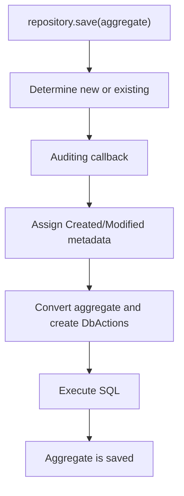

# Enabling Auditing with @EnableJdbcAuditing

Auditing in Spring Data JDBC helps automatically record information such as **who created a record, when it was created, who last modified it, and when it was modified**. Instead of requiring every service to manually assign these four fields before each save, the application can enable auditing with `@EnableJdbcAuditing` and annotate aggregate properties with `@CreatedBy`, `@CreatedDate`, `@LastModifiedBy`, and `@LastModifiedDate`.

Auditing provides lifecycle metadata for data. It does not automatically create a complete change history, does not replace authorization, and does not automatically update custom SQL statements executed directly against the database. To use it properly, you need to understand how Spring resolves the actor, how time is provided, when callbacks are invoked, and the scope of operations covered by auditing.

## 1. What Does Auditing Record?

A business table often needs to store metadata about creation and modification:

| Property | Annotation | Meaning |
| --- | --- | --- |
| Creator | `@CreatedBy` | Actor who first created the aggregate. |
| Creation time | `@CreatedDate` | Timestamp when the aggregate was created. |
| Last modifier | `@LastModifiedBy` | Actor who performed the most recent modification. |
| Last modification time | `@LastModifiedDate` | Timestamp of the most recent update. |

Example of a purchase order:

```text
purchase_orders
+----+-------------+----------+---------------------+------------+---------------------+
| id | order_no    | status   | created_at          | created_by | last_modified_at    |
+----+-------------+----------+---------------------+------------+---------------------+
| 42 | PO-2026-042 | CONFIRMED| 2026-11-13 09:00:00 | alice      | 2026-11-13 09:12:00 |
+----+-------------+----------+---------------------+------------+---------------------+
```

When the order is created, Spring can populate `createdAt` and `createdBy`. When the order is saved again after a change, `lastModifiedAt` and `lastModifiedBy` are updated according to the auditing configuration.

These fields answer the question "who created/modified it and when". They do not store full previous values, the content of changes, or a sequence of events. If a history of every change is needed, you must design an audit log, event table, or separate history mechanism.

## 2. Auditing Annotations

These annotations belong to Spring Data Commons and can be used in a Spring Data JDBC domain model:

```java
import org.springframework.data.annotation.CreatedBy;
import org.springframework.data.annotation.CreatedDate;
import org.springframework.data.annotation.LastModifiedBy;
import org.springframework.data.annotation.LastModifiedDate;
```

### 2.1. @CreatedDate

Marks the property storing the creation timestamp:

```java
@CreatedDate
@Column("created_at")
private Instant createdAt;
```

The value is obtained from `DateTimeProvider`. If no custom provider is configured, auditing uses Spring Data's default time source.

This property is typically set once when the aggregate is created. When saving an existing aggregate, the original creation value is retained.

### 2.2. @LastModifiedDate

Marks the property storing the last modification timestamp:

```java
@LastModifiedDate
@Column("last_modified_at")
private Instant lastModifiedAt;
```

When the aggregate is saved, auditing updates the modification timestamp from the provider. With the default setting `modifyOnCreate = true`, the last-modified field is also populated on initial creation.

If business rules require the modified field to have no value upon creation, you can configure `modifyOnCreate = false` in `@EnableJdbcAuditing`. In that case, make sure the API and schema clearly accept null values on the initial insert.

### 2.3. @CreatedBy and @LastModifiedBy

These two annotations record the current actor:

```java
@CreatedBy
@Column("created_by")
private String createdBy;

@LastModifiedBy
@Column("last_modified_by")
private String lastModifiedBy;
```

Spring obtains the actor from an `AuditorAware<T>` bean. The generic type `T` must be compatible with the type of the audited properties.

For example, if using `AuditorAware<String>`, then `createdBy` and `lastModifiedBy` are typically `String`. If the domain stores user IDs as UUIDs, you can use `AuditorAware<UUID>` and corresponding `UUID` properties.

If no `AuditorAware` is present or the provider returns no actor, the `*By` fields have no new value to assign. Therefore, if the database column is `NOT NULL`, you must deliberately supply a default actor for background jobs or system accounts.

## 3. Domain Model with Auditing Metadata

Example purchase order aggregate root:

```java
import java.time.Instant;

import org.springframework.data.annotation.CreatedBy;
import org.springframework.data.annotation.CreatedDate;
import org.springframework.data.annotation.Id;
import org.springframework.data.annotation.LastModifiedBy;
import org.springframework.data.annotation.LastModifiedDate;
import org.springframework.data.relational.core.mapping.Column;
import org.springframework.data.relational.core.mapping.Table;

@Table("purchase_orders")
public class PurchaseOrder {

    @Id
    private Long id;

    @Column("order_number")
    private String orderNumber;

    private String status;

    @CreatedDate
    @Column("created_at")
    private Instant createdAt;

    @CreatedBy
    @Column("created_by")
    private String createdBy;

    @LastModifiedDate
    @Column("last_modified_at")
    private Instant lastModifiedAt;

    @LastModifiedBy
    @Column("last_modified_by")
    private String lastModifiedBy;

    protected PurchaseOrder() {
    }

    public PurchaseOrder(String orderNumber, String status) {
        this.orderNumber = orderNumber;
        this.status = status;
    }

    public void confirm() {
        this.status = "CONFIRMED";
    }

    public Long getId() {
        return id;
    }

    public String getOrderNumber() {
        return orderNumber;
    }

    public String getStatus() {
        return status;
    }

    public Instant getCreatedAt() {
        return createdAt;
    }

    public String getCreatedBy() {
        return createdBy;
    }

    public Instant getLastModifiedAt() {
        return lastModifiedAt;
    }

    public String getLastModifiedBy() {
        return lastModifiedBy;
    }
}
```

Here, auditing properties are persistence metadata. Services do not need to manually assign timestamps or usernames on every `save` call. When Spring Data JDBC persists the aggregate through the normal lifecycle, the auditing infrastructure updates the annotated properties.

You can use an immutable object/record if the domain model requires immutability. Spring Data supports creating a new instance when applying auditing values; the mutable class example here is intended to make properties and annotations clear.

## 4. Database Schema

The columns must exist in the table with compatible types:

```sql
CREATE TABLE purchase_orders (
    id BIGINT GENERATED BY DEFAULT AS IDENTITY PRIMARY KEY,
    order_number VARCHAR(50) NOT NULL UNIQUE,
    status VARCHAR(24) NOT NULL,
    created_at TIMESTAMP WITH TIME ZONE,
    created_by VARCHAR(120),
    last_modified_at TIMESTAMP WITH TIME ZONE,
    last_modified_by VARCHAR(120)
);
```

Column names are linked via `@Column`. If the project's naming strategy already maps property names directly to the schema, the annotation may not be necessary; in this example, names are declared explicitly for easy comparison.

The temporal type in DDL depends on the database. `TIMESTAMP WITH TIME ZONE` is common syntax in some DBMSs, but its meaning and actual storage differ across PostgreSQL, Oracle, SQL Server, and MySQL. Choose the column type for your database and test with the corresponding JDBC driver.

Auditing columns are often left nullable during initial rollout if the table already contains existing data. After backfilling and ensuring every write path populates metadata, you can consider a `NOT NULL` constraint. Do not immediately add `NOT NULL` to a table with existing rows without proper migration/backfill.

## 5. Enabling Auditing with @EnableJdbcAuditing

Simply adding auditing annotations to the domain class is not enough. You must enable the auditing infrastructure in Spring configuration using `@EnableJdbcAuditing`.

Import:

```java
import org.springframework.data.jdbc.repository.config.EnableJdbcAuditing;
```

Minimal configuration:

```java
import org.springframework.context.annotation.Configuration;
import org.springframework.data.jdbc.repository.config.EnableJdbcAuditing;

@Configuration
@EnableJdbcAuditing
public class JdbcAuditingConfiguration {
}
```

This annotation registers the infrastructure required for Spring Data JDBC to apply auditing metadata during the persistence lifecycle.

When only dates/times are needed, the default configuration can be used without declaring an `AuditorAware`. If you want to populate creator/modifier fields, the application needs to provide an `AuditorAware` to resolve the current actor.

You can explicitly specify the actor provider bean and time provider bean:

```java
@Configuration
@EnableJdbcAuditing(
    auditorAwareRef = "auditorAware",
    dateTimeProviderRef = "auditingDateTimeProvider"
)
public class JdbcAuditingConfiguration {
    // Beans are declared below or in another configuration.
}
```

The names in `auditorAwareRef` and `dateTimeProviderRef` must match the actual bean names in the application context.

## 6. Providing the Current Actor with AuditorAware

`AuditorAware<T>` is the contract that allows Spring Data to obtain the current actor:

```java
import java.util.Optional;

import org.springframework.data.domain.AuditorAware;

public interface AuditorAware<T> {
    Optional<T> getCurrentAuditor();
}
```

For example, suppose the application has an abstraction that retrieves the username from the context:

```java
public interface CurrentActor {
    Optional<String> currentUsername();
}
```

Bean implementation:

```java
import java.util.Optional;

import org.springframework.context.annotation.Bean;
import org.springframework.context.annotation.Configuration;
import org.springframework.data.domain.AuditorAware;

@Configuration
public class AuditorConfiguration {

    @Bean
    AuditorAware<String> auditorAware(CurrentActor currentActor) {
        return currentActor::currentUsername;
    }
}
```

When Spring Data needs to assign `@CreatedBy` or `@LastModifiedBy`, it invokes `getCurrentAuditor()`. If the context returns `Optional.of("alice")`, the auditor properties can receive the value `alice`.

### 6.1. Spring Security Integration

If the application uses Spring Security, `AuditorAware` can retrieve the username from `SecurityContextHolder`:

```java
import java.util.Optional;

import org.springframework.data.domain.AuditorAware;
import org.springframework.security.authentication.AnonymousAuthenticationToken;
import org.springframework.security.core.Authentication;
import org.springframework.security.core.context.SecurityContextHolder;

public class SecurityAuditorAware
        implements AuditorAware<String> {

    @Override
    public Optional<String> getCurrentAuditor() {
        Authentication authentication =
            SecurityContextHolder.getContext().getAuthentication();

        if (authentication == null
                || !authentication.isAuthenticated()
                || authentication instanceof AnonymousAuthenticationToken) {
            return Optional.empty();
        }

        return Optional.of(authentication.getName());
    }
}
```

Registration:

```java
@Bean
AuditorAware<String> auditorAware() {
    return new SecurityAuditorAware();
}
```

Do not assume every request has an authenticated user. Health checks, scheduled jobs, message consumers, or migration tasks may run outside a user's security context. Define a policy for those cases, such as a `system` actor, a service identity, or allowing an empty auditor if the schema/domain permits it.

### 6.2. AuditorAware Is Not Authorization

`AuditorAware` only answers the question "who is performing the operation for metadata recording?". It does not check whether that person has permission to modify the aggregate.

Authorization must still be enforced in the security/application/domain layer. Do not use the auditor value as sole proof that an operation was authorized.

## 7. Providing Time with DateTimeProvider

By default, auditing uses the current system time source. If you need to control the clock, standardize on UTC, or make tests deterministic, you can provide a `DateTimeProvider`.

`DateTimeProvider` returns `Optional<TemporalAccessor>`:

```java
import java.time.Clock;
import java.util.Optional;
import java.time.temporal.TemporalAccessor;

import org.springframework.data.auditing.DateTimeProvider;

public class UtcDateTimeProvider implements DateTimeProvider {

    private final Clock clock;

    public UtcDateTimeProvider(Clock clock) {
        this.clock = clock;
    }

    @Override
    public Optional<TemporalAccessor> getNow() {
        return Optional.of(clock.instant());
    }
}
```

One way to declare the bean:

```java
import java.time.Clock;
import java.time.temporal.TemporalAccessor;
import java.util.Optional;

import org.springframework.context.annotation.Bean;
import org.springframework.context.annotation.Configuration;
import org.springframework.data.auditing.DateTimeProvider;

@Configuration
public class AuditingTimeConfiguration {

    @Bean
    Clock auditingClock() {
        return Clock.systemUTC();
    }

    @Bean
    DateTimeProvider auditingDateTimeProvider(Clock auditingClock) {
        return () -> Optional.<TemporalAccessor>of(
            auditingClock.instant()
        );
    }
}
```

And enable using bean references:

```java
@EnableJdbcAuditing(
    auditorAwareRef = "auditorAware",
    dateTimeProviderRef = "auditingDateTimeProvider"
)
```

Using `Instant` represents an absolute point in time and avoids relying on the default timezone of the host running the application. When mapping to SQL, check the precision and timezone semantics of the column and driver.

If no custom clock is needed, you do not have to create a custom `DateTimeProvider`. The default configuration suits many applications.

## 8. Complete Configuration

A configuration with both an actor provider and a time provider:

```java
@Configuration
@EnableJdbcAuditing(
    auditorAwareRef = "auditorAware",
    dateTimeProviderRef = "auditingDateTimeProvider"
)
public class JdbcAuditingConfiguration {

    @Bean
    Clock auditingClock() {
        return Clock.systemUTC();
    }

    @Bean
    AuditorAware<String> auditorAware(CurrentActor currentActor) {
        return currentActor::currentUsername;
    }

    @Bean
    DateTimeProvider auditingDateTimeProvider(Clock auditingClock) {
        return () -> Optional.<TemporalAccessor>of(
            auditingClock.instant()
        );
    }
}
```

Relevant imports:

```java
import java.time.Clock;
import java.time.temporal.TemporalAccessor;
import java.util.Optional;

import org.springframework.context.annotation.Bean;
import org.springframework.context.annotation.Configuration;
import org.springframework.data.domain.AuditorAware;
import org.springframework.data.auditing.DateTimeProvider;
import org.springframework.data.jdbc.repository.config.EnableJdbcAuditing;
```

If the project already has a configuration containing `@EnableJdbcAuditing`, do not create a second enablement configuration. Add the beans to the existing configuration and ensure the bean references point to the exact names.

## 9. What Happens When repository.save Is Called?

When an aggregate is saved via a standard CRUD repository, Spring Data JDBC applies entity lifecycle callbacks to the aggregate. The auditing infrastructure uses the metadata annotations to update the properties before the data is translated into SQL operations.

Conceptually:



Expected results:

| Operation | CreatedDate/CreatedBy | LastModifiedDate/LastModifiedBy |
| --- | --- | --- |
| Insert new aggregate | Set by auditing | Set when `modifyOnCreate` is enabled (default). |
| Update existing aggregate | Retains original creation values | Updated from the current providers. |
| Read aggregate via repository | Reads stored values | Reads stored values. |
| Custom SQL executed directly | Does not automatically run auditing callback | Does not automatically update. |

The callback executes within Spring Data JDBC's persistence lifecycle. It is not a database trigger. Timestamp and actor values are placed onto the aggregate on the application side before SQL writes the data.

### 9.1. Created and LastModified Do Not Have the Same Semantics

`createdAt` and `createdBy` represent the initial creation. On updates, these values must be preserved.

`lastModifiedAt` and `lastModifiedBy` represent the most recent modification. When the aggregate is saved again, they are updated according to the auditing configuration.

Do not manually assign a new `createdAt` on every update. Letting Spring Data manage properties via annotations keeps semantics consistent across services.

### 9.2. modifyOnCreate

By default `modifyOnCreate` is enabled, so LastModified fields are also set during the initial insert. This is often useful because a newly created aggregate can also be considered newly changed.

If `modifyOnCreate = false` is configured, LastModified fields are not set during creation. In that case, the schema and API must tolerate this state until the next modification.

## 10. Auditing with Spring Boot

In a Spring Boot application using Spring Data JDBC, datasource and repository configuration are usually auto-configured by the starter. However, **do not assume that merely adding the starter automatically enables auditing**. Declare `@EnableJdbcAuditing` in a component-scanned configuration.

Example structure:

```text
com.example.application
├── Application.java
├── config
│   └── JdbcAuditingConfiguration.java
├── domain
│   └── PurchaseOrder.java
├── repository
│   └── PurchaseOrderRepository.java
└── service
    └── PurchaseOrderService.java
```

If `Application.java` resides in the root package `com.example.application`, sub-package configurations are typically component-scanned automatically.

If the configuration lies outside the scanned area, import it explicitly or adjust component scanning. If the application has multiple DataSources or transaction managers, configure repositories and auditing infrastructure consistently with the persistence setup; do not let auditing beans be enabled in one context while repositories actually run in another.

## 11. Auditing with Direct SQL and @Modifying

A critical point: auditing callbacks are tied to the aggregate save lifecycle. A custom SQL query such as:

```java
@Modifying
@Query("""
    UPDATE purchase_orders
    SET status = :status
    WHERE id = :id
    """)
int updateStatus(
    @Param("id") Long id,
    @Param("status") String status
);
```

is executed directly. It does not materialize the aggregate and call `repository.save`, so it does not automatically invoke the auditing callback.

If a direct UPDATE needs to update the modification timestamp, state it explicitly in SQL:

```java
@Modifying
@Query("""
    UPDATE purchase_orders
    SET status = :status,
        last_modified_at = :modifiedAt,
        last_modified_by = :modifiedBy
    WHERE id = :id
    """)
int updateStatus(
    @Param("id") Long id,
    @Param("status") String status,
    @Param("modifiedAt") Instant modifiedAt,
    @Param("modifiedBy") String modifiedBy
);
```

The service retrieves the actor and clock according to the same application policy and passes the values into the query. Another option is a database trigger managing metadata, in which case you must decide whether the database or application is the source of truth for time/actor.

Do not expect `@EnableJdbcAuditing` to automatically rewrite every UPDATE statement written in `@Query` or custom JDBC operations.

## 12. Auditing Does Not Replace Audit History

The four auditing properties typically store only the current metadata state:

```text
created_by        = alice
created_at        = creation timestamp
last_modified_by  = bob
last_modified_at  = last modification timestamp
```

After multiple updates, `last_modified_by` and `last_modified_at` are replaced with new values. Earlier modifications are no longer represented in these columns.

If you need to know:

- Who changed the status from PENDING to CONFIRMED?
- What were the before and after values?
- When did each individual change occur?
- Can a previous version of the data be restored?

then a separate audit history is required, such as a `purchase_order_audit` table, domain events, outbox, or a versioning system. Do not treat the four auditing annotations as a complete historical system.

Auditing also does not automatically record DELETE operations by creating a historical record. If you need to store who deleted a record and when, use soft delete with dedicated metadata or write an audit event prior to deletion in the same transaction.

## 13. Auditing with Aggregate Children

Spring Data JDBC organizes persistence around the aggregate root. Lifecycle callbacks are designed around aggregate persistence; do not assume a callback is invoked independently for each child row/entity in a collection.

For example, a `PurchaseOrder` owns multiple `OrderLine` instances. If the business requirement is for each line item to also have its own creation/modification metadata, explicitly define how those properties are updated in domain operations or design persistence accordingly. Do not just add annotations to a child and assume callbacks will run like a separate repository save for each child.

If a child has an independent lifecycle and requires independent auditing, consider whether it should be its own aggregate root. If it remains a child, you can update metadata through aggregate root logic and verify the actual saved results with tests.

## 14. Testing Auditing with @DataJdbcTest

A repository integration test should verify that metadata is populated on save and properly preserved when read back.

The test configuration can enable auditing with a fixed auditor and fixed time:

```java
@TestConfiguration
@EnableJdbcAuditing(
    auditorAwareRef = "testAuditorAware",
    dateTimeProviderRef = "testDateTimeProvider"
)
static class TestAuditingConfiguration {

    @Bean
    AuditorAware<String> testAuditorAware() {
        return () -> Optional.of("test-user");
    }

    @Bean
    DateTimeProvider testDateTimeProvider() {
        Instant fixed = Instant.parse("2026-11-13T09:00:00Z");
        return () -> Optional.<TemporalAccessor>of(fixed);
    }
}
```

Test:

```java
@DataJdbcTest
@Import(TestAuditingConfiguration.class)
class PurchaseOrderAuditingTest {

    @Autowired
    PurchaseOrderRepository orders;

    @Test
    void populatesAuditingFieldsOnInsert() {
        PurchaseOrder saved = orders.save(
            new PurchaseOrder("PO-AUDIT-001", "PENDING")
        );

        assertThat(saved.getCreatedBy()).isEqualTo("test-user");
        assertThat(saved.getLastModifiedBy()).isEqualTo("test-user");
        assertThat(saved.getCreatedAt())
            .isEqualTo(Instant.parse("2026-11-13T09:00:00Z"));
        assertThat(saved.getLastModifiedAt())
            .isEqualTo(Instant.parse("2026-11-13T09:00:00Z"));

        PurchaseOrder loaded = orders.findById(saved.getId())
            .orElseThrow();

        assertThat(loaded.getCreatedBy()).isEqualTo("test-user");
        assertThat(loaded.getCreatedAt())
            .isEqualTo(Instant.parse("2026-11-13T09:00:00Z"));
    }
}
```

The test requires the `purchase_orders` schema and corresponding entity/repository. Using a fixed timestamp ensures assertions do not depend on machine speed or when the test runs.

### 14.1. Testing Updates

To verify that LastModified changes while Created is preserved, you can use a provider and actor that can be changed between two saves. For example, a test fixture holding `AtomicReference`:

```java
AtomicReference<Instant> now = new AtomicReference<>(
    Instant.parse("2026-11-13T09:00:00Z")
);
AtomicReference<String> actor = new AtomicReference<>("alice");
```

The auditor provider reads `actor.get()`, and `DateTimeProvider` reads `now.get()`. After the insert, update both references before the second save:

```java
actor.set("bob");
now.set(Instant.parse("2026-11-13T09:15:00Z"));

PurchaseOrder changed = orders.findById(saved.getId()).orElseThrow();
changed.confirm();

PurchaseOrder updated = orders.save(changed);
```

Expected assertions:

```java
assertThat(updated.getCreatedBy()).isEqualTo("alice");
assertThat(updated.getLastModifiedBy()).isEqualTo("bob");
assertThat(updated.getCreatedAt()).isEqualTo(createdAt);
assertThat(updated.getLastModifiedAt())
    .isEqualTo(Instant.parse("2026-11-13T09:15:00Z"));
```

This is a way to verify Created and LastModified semantics with deterministic data. When implementing real tests, expose both references via test configuration beans and keep them scoped to the test context.

### 14.2. Testing When There Is No Auditor

If `AuditorAware` returns `Optional.empty()`, verify the desired policy:

- The actor column allows NULL and saves successfully.
- Background jobs use a system actor.
- Or the use case must fail if no actor can be determined.

Do not let this behavior accidentally depend on whether the test happens to have a security context.

## 15. Common Errors

| Symptom | Cause | Resolution |
| --- | --- | --- |
| Created/Modified fields are always null | `@EnableJdbcAuditing` is not enabled or callback infrastructure is not registered. | Enable auditing in a scanned/imported configuration. |
| Dates have values but By is still null | No `AuditorAware` or provider returns `Optional.empty`. | Register a bean with the right type and bean reference. |
| AuditorAware bean not found | Wrong `auditorAwareRef` name or bean is not in context. | Cross-check bean name and configuration. |
| Actor type does not match property | `AuditorAware` generic differs from column/property type. | Use matching types, e.g., String/String or UUID/UUID. |
| CreatedDate changes on every update | Application logic reassigns field or auditing mapping is incorrect. | Let auditing manage Created fields and test multiple saves. |
| LastModifiedDate not populated on insert | `modifyOnCreate` is disabled. | Enable it if modified metadata is wanted from creation. |
| Background job lacks `createdBy` | No security/user context. | Supply a system actor per policy. |
| `@Modifying` does not update LastModified | Direct SQL does not run auditing callbacks. | Update audit columns in SQL or use a trigger. |
| Time drifts across environments | Different timezones/clocks or unsuitable SQL column type. | Use `Instant`/UTC and test mapping against a real database. |
| Legacy table fails NOT NULL on insert | New auditing column has constraint before write paths populate it or migration backfills it. | Expand schema, backfill, then tighten constraint. |
| Expecting full history but only seeing LastModified | Auditing metadata only retains the most recent edit. | Create a separate audit log/event history. |
| Child entity lacks expected metadata | Spring Data JDBC lifecycle callbacks focus on the aggregate root. | Explicitly define child update logic or model an independent lifecycle. |

## 16. Workflow for Enabling Auditing in a Project

When adding auditing to a Spring Data JDBC application:

1. Determine the metadata to store: creator actor, creation time, last-modifier actor, and last-modification time.
2. Add the corresponding columns to the schema via migration.
3. Declare properties in the aggregate and apply auditing annotations.
4. Choose an appropriate time type, usually `Instant` if the domain needs absolute points in time.
5. Enable the infrastructure with `@EnableJdbcAuditing` in a Spring-scanned configuration.
6. If actors are needed, register `AuditorAware<T>` with a generic type matching the properties.
7. If a custom clock or deterministic testing is needed, register `DateTimeProvider`.
8. Define actors for user requests, scheduled jobs, and message consumers.
9. Use standard repository saves so auditing callbacks update metadata.
10. For direct SQL/`@Modifying`, update audit fields explicitly or use a trigger.
11. Write integration tests for insert, update, empty actor, and round-trip persistence.
12. If full history or delete auditing is needed, build a separate audit log/event mechanism.

> **`@EnableJdbcAuditing` enables the auditing infrastructure for Spring Data JDBC.** Created/LastModified annotations mark managed properties; `AuditorAware` supplies the actor and `DateTimeProvider` supplies the time. Auditing is applied in the aggregate save lifecycle, while custom SQL and per-change history must be handled separately.

### References

- [Spring Data Relational — Auditing](https://docs.spring.io/spring-data/relational/reference/jdbc/auditing.html): enabling auditing and configuration in Spring Data JDBC.
- [Spring Data Commons — Auditing](https://docs.spring.io/spring-data/commons/reference/auditing.html): Created/LastModified annotations, `AuditorAware`, and `DateTimeProvider`.
- [Spring Data JDBC — EnableJdbcAuditing API](https://docs.spring.io/spring-data/relational/reference/api/java/org/springframework/data/jdbc/repository/config/EnableJdbcAuditing.html): annotation enabling auditing for JDBC.
- [Spring Data Commons — AuditorAware API](https://docs.spring.io/spring-data/commons/docs/current/api/org/springframework/data/domain/AuditorAware.html): contract providing the current actor.
- [Spring Data Commons — DateTimeProvider API](https://docs.spring.io/spring-data/commons/docs/current/api/org/springframework/data/auditing/DateTimeProvider.html): time source for auditing.
