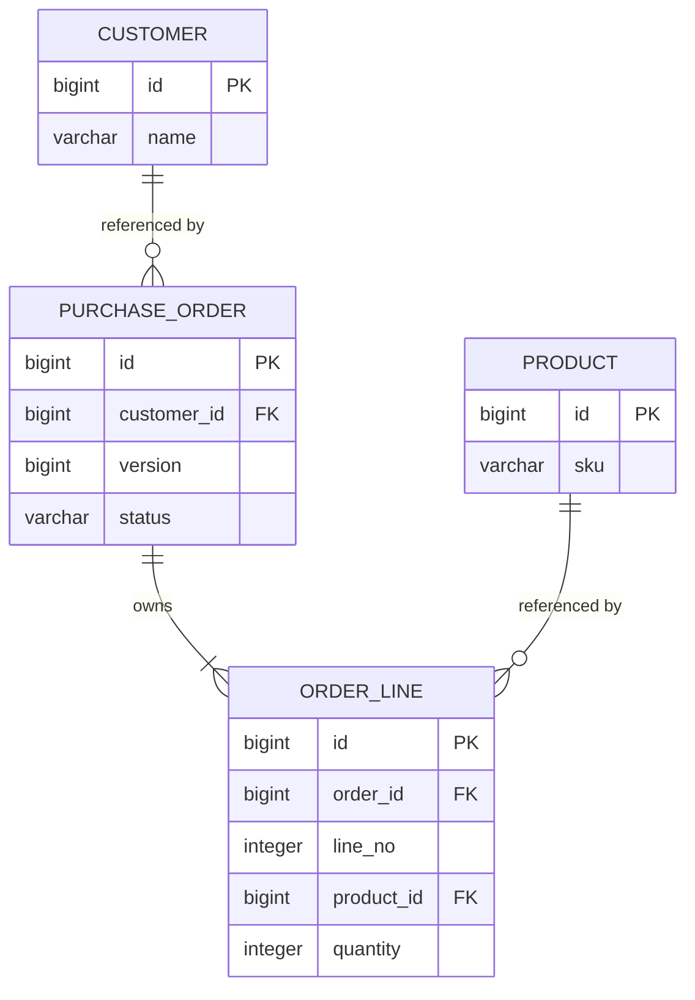

# Designing DDL from Aggregates and Collection Mapping

In **Spring Data Relational JDBC**, the domain model is organized around aggregates: an aggregate root manages the lifecycle of the entities/value objects owned within it. When designing a relational schema, you need to translate that ownership boundary into tables, primary keys, foreign keys, and columns that locate elements within collections.

Fundamental rules:

- Each **aggregate root** is stored in a table with a primary key.
- Owned child entities usually reside in their own tables and have an FK pointing to the root or their direct parent entity.
- `@MappedCollection` declares how a collection is mapped and specifies the FK column name (`idColumn`), along with the key/index column (`keyColumn`) when the collection needs element positioning.
- Value objects can be stored directly in the root table using `@Embedded`, or as a single scalar column via a converter if they have a single store representation.
- Other aggregate roots are referenced by ID/`AggregateReference`; such references do not change ownership.
- Spring Data JDBC uses an existing schema. DDL and schema changes should be managed using migrations such as Flyway or Liquibase.

This guide walks from the aggregate model to DDL, explaining how to choose PKs/FKs, how to map `List`, `Set`, and `Map`, how to distinguish collections from embedded objects, and how to test the schema against the target database.

## 1. Start from Aggregate Boundaries

Suppose an e-commerce domain has the following model:

```text
Customer (separate aggregate root)
  id
  name

Product (separate aggregate root)
  id
  sku

PurchaseOrder (aggregate root)
  id
  customerId  ────────────────> Customer.id
  status
  shippingAddress (value object)
  lines
    ├── OrderLine
    └── OrderLine
```

`PurchaseOrder` owns `OrderLine`, and `ShippingAddress` is a value object belonging to the order. `Customer` and `Product` are independent aggregates; the order only stores IDs to reference them.

The corresponding schema typically has these tables:

| Table | Role | Relationship |
|---|---|---|
| `customer` | Customer aggregate root | Referenced by PurchaseOrder |
| `product` | Product aggregate root | Referenced by OrderLine |
| `purchase_order` | PurchaseOrder aggregate root | Has FK `customer_id`, contains embedded address columns |
| `order_line` | Child entity owned by PurchaseOrder | Has FK `order_id` to `purchase_order`, FK `product_id` to `product` |

Relationship diagram:



This is the most important step: **the DDL must reflect the ownership and identity of the domain**, rather than creating an arbitrary Java object graph and forcing it into table relationships.

## 2. How Does an Aggregate Root Map to a Table?

An aggregate root is typically annotated with `@Table` and has an `@Id` property:

```java
@Table("purchase_order")
public class PurchaseOrder {

    @Id
    private Long id;

    @Version
    private Long version;

    private Long customerId;

    private String status;
}
```

The DDL needs to include:

- An `id` column as the primary key.
- A `version` column if using optimistic locking with `@Version`.
- Scalar columns corresponding to root properties.
- FKs and constraints matching invariants that the database should enforce.

PostgreSQL example:

```sql
CREATE TABLE purchase_order (
    id BIGINT GENERATED BY DEFAULT AS IDENTITY PRIMARY KEY,
    version BIGINT NOT NULL,
    customer_id BIGINT NOT NULL,
    status VARCHAR(30) NOT NULL,
    CONSTRAINT fk_purchase_order_customer
        FOREIGN KEY (customer_id) REFERENCES customer(id)
);
```

`GENERATED BY DEFAULT AS IDENTITY` is PostgreSQL syntax used in the example. MySQL, SQL Server, Oracle, and other databases have different identity/sequence syntax. Use the DDL of your target database.

### Table Names and Column Names

`@Table("purchase_order")` explicitly specifies the table name. `@Column("customer_id")` explicitly specifies the column name for the Java property:

```java
@Column("customer_id")
private Long customerId;
```

If no explicit name is declared, Spring Data Relational uses `NamingStrategy` to derive names. The default convention typically converts camelCase to snake_case, though the project should standardize its naming strategy and verify the actual names produced by the mapping.

When the schema is managed by migrations, using explicit `@Table` and `@Column` for important names helps prevent a naming strategy change from accidentally causing the mapping to drift from the DDL.

## 3. Owned Collections Mapped with `@MappedCollection`

In Spring Data JDBC, owned entity collections are not stored in a JSON column by default. Elements are stored in a separate relational table. `@MappedCollection` specifies the FK column used to link elements to their owner and, when needed, the key column to determine element position/key.

```java
@Table("purchase_order")
public class PurchaseOrder {

    @Id
    private Long id;

    @MappedCollection(idColumn = "order_id", keyColumn = "line_no")
    private List<OrderLine> lines = new ArrayList<>();
}
```

Two key attributes:

| Attribute | Meaning | Example |
|---|---|---|
| `idColumn` | Column in the element table holding the ID of the aggregate/owner | `order_id` |
| `keyColumn` | Column storing the collection element's key/index when the collection requires a key | `line_no` |

`idColumn` is the FK column name in the child table, not the Java ID property name and not the root's PK column name. In the example, `purchase_order.id` is the PK; `order_line.order_id` is the FK pointing to that column.

### Child Entity

```java
@Table("order_line")
public class OrderLine {

    @Id
    private Long id;

    @Column("product_id")
    private Long productId;

    private int quantity;
}
```

DDL:

```sql
CREATE TABLE order_line (
    id BIGINT GENERATED BY DEFAULT AS IDENTITY PRIMARY KEY,
    order_id BIGINT NOT NULL,
    line_no INTEGER NOT NULL,
    product_id BIGINT NOT NULL,
    quantity INTEGER NOT NULL CHECK (quantity > 0),
    CONSTRAINT fk_order_line_order
        FOREIGN KEY (order_id) REFERENCES purchase_order(id),
    CONSTRAINT fk_order_line_product
        FOREIGN KEY (product_id) REFERENCES product(id),
    CONSTRAINT uq_order_line_position
        UNIQUE (order_id, line_no)
);
```

`order_id` links the child to its owner. `line_no` stores the element position in the `List`. `UNIQUE(order_id, line_no)` prevents two elements in the same order from occupying the same position.

If you use a child table across multiple aggregate types or a different naming convention, choose clear FK names and avoid vague generic columns such as `parent` or `owner`.

## 4. Mapping `List`, `Set`, and `Map`

The collection type affects how the schema stores keys/positions:

| Java collection | Meaning | Typical key column needed |
|---|---|---|
| `List<T>` | Ordered, with elements positioned by index | `keyColumn` to store index/position |
| `Map<K, V>` | Elements keyed by map key | `keyColumn` to store map key |
| `Set<T>` | Collection that does not guarantee index-based ordering | Usually no key column just for position |

### `List`: Storing Element Position

```java
@MappedCollection(idColumn = "order_id", keyColumn = "line_no")
private List<OrderLine> lines = new ArrayList<>();
```

`line_no` preserves the element's position in the list. When elements are added, removed, or reordered, the mapping must be able to represent the new positions. The DDL should include a unique constraint on `(order_id, line_no)` to prevent duplicate positions.

Do not use the `line_no` column as a business identifier if positions can change. If an order line has a stable business code, store a separate `line_code` or use a dedicated PK for the child; `line_no` remains strictly the collection position.

### `Set`: Not Relying on Order

```java
@MappedCollection(idColumn = "order_id")
private Set<Tag> tags = new LinkedHashSet<>();
```

With `Set`, the domain model should not rely on persistence/retrieval ordering. If a display order is needed, use a `List` or store an explicit sort order property. `LinkedHashSet` preserves order in memory, but it does not automatically establish a durable ordering contract in relational mapping if the schema does not store a key/order.

### `Map`: Storing Keys

```java
@MappedCollection(idColumn = "order_id", keyColumn = "attribute_name")
private Map<String, OrderAttribute> attributes = new LinkedHashMap<>();
```

In the example, `attribute_name` stores the map key; the child table needs this column and a unique constraint on owner/key:

```sql
CREATE TABLE order_attribute (
    id BIGINT GENERATED BY DEFAULT AS IDENTITY PRIMARY KEY,
    order_id BIGINT NOT NULL REFERENCES purchase_order(id),
    attribute_name VARCHAR(100) NOT NULL,
    attribute_value VARCHAR(500),
    UNIQUE (order_id, attribute_name)
);
```

The `keyColumn` name must align with the key type used by the application and the actual schema. If the map key is an enum or custom value type, verify the store conversion and corresponding column type.

## 5. Nested Collections Create FKs Per Owner Level

An aggregate can have multiple levels of owned entities:

```text
PurchaseOrder
  └── OrderLine
        └── LineNote
```

Each child collection needs a table with an FK pointing to its direct owner. For example:

```java
@Table("order_line")
public class OrderLine {

    @Id
    private Long id;

    private int quantity;

    @MappedCollection(idColumn = "order_line_id", keyColumn = "note_no")
    private List<LineNote> notes = new ArrayList<>();
}
```

DDL:

```sql
CREATE TABLE line_note (
    id BIGINT GENERATED BY DEFAULT AS IDENTITY PRIMARY KEY,
    order_line_id BIGINT NOT NULL REFERENCES order_line(id),
    note_no INTEGER NOT NULL,
    note_text VARCHAR(500) NOT NULL,
    UNIQUE (order_line_id, note_no)
);
```

`line_note.order_line_id` points to `order_line.id`, not directly to `purchase_order.id`, because `OrderLine` is the owner of the `notes` collection.

When designing DDL, walk down from the root level by level and place the FK pointing to the direct owner. This expresses ownership clearly and lets the database enforce integrity for each branch of the aggregate.

Nested collections make aggregates larger and more complex. If a child has its own lifecycle, is referenced by multiple aggregates, or needs independent updates, consider promoting it to its own aggregate root rather than nesting further levels.

## 6. Distinguishing `@MappedCollection` from `@Embedded`

Not every object property needs a separate table. If an object is a value object belonging to the root and its fields can live in the same row, use embedded mapping.

Example:

```java
public class ShippingAddress {

    private String street;
    private String city;
    private String postalCode;
}

@Table("purchase_order")
public class PurchaseOrder {

    @Id
    private Long id;

    @Embedded(prefix = "shipping_")
    private ShippingAddress shippingAddress;
}
```

The root schema contains these columns:

```sql
shipping_street VARCHAR(200),
shipping_city VARCHAR(100),
shipping_postal_code VARCHAR(20)
```

`@Embedded` does not create a `shipping_address` table; it flattens the value object's properties into columns on the owner table. The prefix prevents name collisions with other fields.

| Criterion | `@Embedded` | `@MappedCollection` |
|---|---|---|
| Storage location | Same table as owner | Separate table for entity/value collection |
| Relationship | Value object belonging to root | Entity owned within the aggregate |
| Foreign key | No separate FK needed for embedded fields | Requires FK from child table to owner |
| Cardinality | Single embedded object | Multi-element collection |
| Example | Shipping address | List of order lines |

If you need to store a value object in a single column, a custom domain ↔ simple store type converter may fit. If the value object consists of multiple components that need individual querying/indexing, `@Embedded` is usually better than serializing the whole object into an unstructured JSON string.

## 7. Referencing Other Aggregate Roots by ID

An aggregate does not own another aggregate. For example, `PurchaseOrder` references `Customer`, and `OrderLine` references `Product`. In the domain model, you can store a scalar ID:

```java
@Table("purchase_order")
public class PurchaseOrder {

    @Id
    private Long id;

    @Column("customer_id")
    private Long customerId;
}
```

Or use `AggregateReference<Customer, Long>` when you want to explicitly express a reference to another aggregate root:

```java
private AggregateReference<Customer, Long> customer;
```

The DDL is still an FK column:

```sql
customer_id BIGINT NOT NULL REFERENCES customer(id)
```

This reference does not mean Spring Data JDBC automatically loads `Customer` when loading `PurchaseOrder`, nor does it cascade saves/deletes to the Customer aggregate. If Customer details are needed, an application service or separate query is responsible for fetching the data.

### Why Not Model Bidirectional Object Relationships?

Spring Data JDBC operates along aggregate boundaries and does not provide a persistence context or lazy-loading graph like some ORMs. Avoid modeling two independent aggregates with bidirectional object references that create circular references. Storing IDs makes domain boundaries and transaction boundaries explicit in the domain model.

### Should FKs Have `ON DELETE CASCADE`?

For the FK from `purchase_order.customer_id` to `customer.id`, deleting a Customer should not automatically delete order history. Typically, use `RESTRICT`/`NO ACTION` or soft delete/anonymization according to business policy.

For the FK from `order_line.order_id` to `purchase_order.id`, the child belongs to the root's lifecycle. Spring Data JDBC manages deleting owned entities within the aggregate; the DDL can use a standard FK and let the framework perform deletions in order. `ON DELETE CASCADE` should only be added when the database also needs to support other direct deletion paths and the semantics are clearly defined.

## 8. Choosing Primary Keys for Root and Child

### Root with Database-Generated ID

A common choice is a numeric ID generated by the database:

```java
@Id
private Long id;
```

PostgreSQL DDL:

```sql
id BIGINT GENERATED BY DEFAULT AS IDENTITY PRIMARY KEY
```

The database generates the ID when inserting the root. Spring Data JDBC uses that ID to insert child tables with the corresponding FK.

### Root with Application-Assigned ID

The application can assign a UUID before saving:

```java
@Id
private UUID id;
```

The DDL can use `UUID` on PostgreSQL or `CHAR(36)`/`BINARY(16)` depending on the database. The Java type, converter/dialect, and DDL must be compatible. Application-assigned IDs are useful when references need to be created before insertion, but uniqueness must be guaranteed.

### Child with Its Own ID and Collection Key

A child entity can have its own PK such as `order_line.id`, while also having FK `order_id` and `line_no` to represent its position in a List. These three columns serve distinct roles:

| Column | Role |
|---|---|
| `id` | Identity of the child row in the schema |
| `order_id` | Owner/aggregate root containing the child |
| `line_no` | Position of the child within the order's collection |

Do not merge these three concepts into one column when they have different semantics. If a schema uses a composite key instead of a separate child identity, verify that the mapping strategy accurately supports that structure before implementation.

## 9. DDL Must Reflect `@Version`

If the aggregate root uses optimistic locking:

```java
@Version
private Long version;
```

The DDL must have a corresponding version column:

```sql
version BIGINT NOT NULL
```

Spring Data JDBC uses the version in UPDATE statements to detect concurrent updates. On insert, the framework initializes the version according to mapping rules. On update, the version is incremented; if the current version does not match, the operation can throw `OptimisticLockingFailureException`.

Do not add `@Version` to a class and forget the version column migration. Conversely, if the DDL has a version column but the entity does not map/use it, that column does not automatically provide optimistic locking.

## 10. Choosing SQL Types Based on Java Types and Database

The DDL must match the final store type after mapping/converters:

| Java/domain type | Common SQL types | Things to watch out for |
|---|---|---|
| `Long` | `BIGINT` | Value range and ID generation |
| `Integer` | `INTEGER` | Do not use for IDs that may exceed 32-bit limits |
| `String` | `VARCHAR(n)` / `TEXT` | Choose length based on contract and index requirements |
| `BigDecimal` | `NUMERIC(p,s)` / `DECIMAL(p,s)` | Precision, scale, and rounding |
| `Boolean` | `BOOLEAN` or equivalent | Dialect may use a different physical type |
| `LocalDate` | `DATE` | Does not contain time |
| `LocalDateTime` | `TIMESTAMP` | Does not contain offset/time zone |
| `Instant` | Timestamp type appropriate for the dialect | Clarify UTC semantics and how the driver binds values |
| `UUID` | `UUID`, `CHAR(36)`, or `BINARY(16)` | Depends on database and driver |
| Enum | Usually `VARCHAR` via appropriate conversion | Avoid relying on ordinal if enum order may change |
| Custom value object | Simple store type via converter | DDL must use the post-converter value type |

This is a general type-selection guide, not a mandatory mapping table for every database. Check the actual JDBC driver and dialect, especially for temporal types, UUIDs, JSON, binary, and vendor-specific types.

## 11. Integrity Constraints Belong in DDL

Domain validation helps produce friendly errors, but database constraints protect data against every writer — including batch jobs, manual SQL, or other services.

Commonly needed constraints:

```sql
CREATE TABLE product (
    id BIGINT GENERATED BY DEFAULT AS IDENTITY PRIMARY KEY,
    sku VARCHAR(64) NOT NULL,
    name VARCHAR(200) NOT NULL,
    active BOOLEAN NOT NULL,
    CONSTRAINT uq_product_sku UNIQUE (sku)
);

CREATE TABLE inventory (
    product_id BIGINT PRIMARY KEY REFERENCES product(id),
    available INTEGER NOT NULL,
    CONSTRAINT ck_inventory_available CHECK (available >= 0)
);
```

Consider adding:

- `PRIMARY KEY` for identity.
- `NOT NULL` for required fields.
- `UNIQUE` for business keys like SKU/email if uniqueness is required by the domain.
- `FOREIGN KEY` for references between tables.
- `CHECK` for simple invariants such as non-negative quantities.
- A unique constraint on owner + collection key to prevent duplicate positions/keys.

Not every invariant can be expressed as a CHECK constraint. Rules that read multiple tables or depend on workflows still require domain/application logic and appropriate transaction/concurrency control.

## 12. Indexing Based on Relationships and Query Workload

FKs protect references, but not every database automatically creates an index on FK columns. Look at actual queries to create appropriate indexes.

Example:

```sql
CREATE INDEX idx_purchase_order_customer_created
    ON purchase_order(customer_id, created_at DESC, id);

CREATE INDEX idx_order_line_product
    ON order_line(product_id);
```

The index `(customer_id, created_at, id)` can support queries listing orders by customer, sorted by time and ID. `UNIQUE (order_id, line_no)` already creates an index/constraint for the owner-position pair on databases supporting that constraint style.

Choose indexes based on:

- Frequently used `WHERE` predicates.
- JOIN/FK columns.
- `ORDER BY` ordering.
- Column selectivity/cardinality.
- Write overhead, since every index must be maintained on insert/update/delete.

Do not index every column. Use `EXPLAIN`/execution plans and representative data to verify the benefit.

## 13. Naming Strategy and Schema Evolution

Spring Data Relational uses `NamingStrategy` to derive table/column names from domain metadata. For example, property `createdAt` may map to `created_at`; property `customerId` may map to `customer_id`.

When designing a schema for a long-lived application:

- Choose a consistent table/column naming convention.
- Use `@Table`/`@Column` when names must remain stable or differ from the default.
- Use explicit `idColumn`/`keyColumn` for important collections.
- Name FK/unique/check constraints meaningfully so migrations and database errors are easy to read.
- Do not rename a Java property and assume the database migration happens automatically.

For example, if you change:

```java
@Column("email_address")
private String email;
```

to:

```java
@Column("contact_email")
private String email;
```

then you need a migration to rename the column or add a column/backfill following a compatibility strategy. Annotations only change mapping; they do not automatically rename columns in the database.

## 14. Managing DDL with Migrations

Spring Data JDBC focuses on mapping and persistence, rather than inferring the entire production schema like an ORM schema generator. In real applications, manage DDL with versioned migrations to:

- Reproduce the schema across local/test/staging/production.
- Review schema changes alongside code.
- Add FKs/indexes/constraints in a clear order.
- Backfill data when mappings change.
- Roll forward in a controlled manner and track migration history.

Flyway example:

```text
src/main/resources/db/migration/
  V1__create_customer_and_product.sql
  V2__create_purchase_order.sql
  V3__create_order_line.sql
  V4__add_order_query_indexes.sql
```

Migrations can be split by dependency:

1. Create independent root tables (`customer`, `product`).
2. Create referencing root tables (`purchase_order`) and FKs to customer.
3. Create child tables (`order_line`) and FKs to order/product.
4. Create additional indexes/constraints based on workload.

For breaking changes, prefer the **expand → migrate/backfill → contract** workflow:

- Expand: add new columns/tables while keeping old code functional.
- Migrate: deploy compatible read/write code and backfill data.
- Contract: once the old schema is no longer used, drop old columns/tables in a separate migration.

Do not modify migrations that have already run in shared environments if the migration tool treats them as immutable; create a new migration to change the schema.

## 15. Complete DDL Example for the PurchaseOrder Aggregate

Condensed domain model:

```java
@Table("purchase_order")
public class PurchaseOrder {

    @Id
    private Long id;

    @Version
    private Long version;

    @Column("customer_id")
    private Long customerId;

    private String status;

    @Embedded(prefix = "shipping_")
    private ShippingAddress shippingAddress;

    @MappedCollection(idColumn = "order_id", keyColumn = "line_no")
    private List<OrderLine> lines = new ArrayList<>();
}
```

`OrderLine` has `id`, `productId`, and `quantity`; `ShippingAddress` has `street`, `city`, and `postalCode`.

PostgreSQL DDL:

```sql
CREATE TABLE customer (
    id BIGINT GENERATED BY DEFAULT AS IDENTITY PRIMARY KEY,
    name VARCHAR(150) NOT NULL,
    email VARCHAR(320) NOT NULL,
    CONSTRAINT uq_customer_email UNIQUE (email)
);

CREATE TABLE product (
    id BIGINT GENERATED BY DEFAULT AS IDENTITY PRIMARY KEY,
    sku VARCHAR(64) NOT NULL,
    name VARCHAR(200) NOT NULL,
    CONSTRAINT uq_product_sku UNIQUE (sku)
);

CREATE TABLE purchase_order (
    id BIGINT GENERATED BY DEFAULT AS IDENTITY PRIMARY KEY,
    version BIGINT NOT NULL,
    customer_id BIGINT NOT NULL,
    status VARCHAR(30) NOT NULL,
    shipping_street VARCHAR(200),
    shipping_city VARCHAR(100),
    shipping_postal_code VARCHAR(20),
    CONSTRAINT fk_purchase_order_customer
        FOREIGN KEY (customer_id) REFERENCES customer(id)
);

CREATE TABLE order_line (
    id BIGINT GENERATED BY DEFAULT AS IDENTITY PRIMARY KEY,
    order_id BIGINT NOT NULL,
    line_no INTEGER NOT NULL,
    product_id BIGINT NOT NULL,
    quantity INTEGER NOT NULL,
    CONSTRAINT fk_order_line_order
        FOREIGN KEY (order_id) REFERENCES purchase_order(id),
    CONSTRAINT fk_order_line_product
        FOREIGN KEY (product_id) REFERENCES product(id),
    CONSTRAINT ck_order_line_quantity CHECK (quantity > 0),
    CONSTRAINT uq_order_line_position UNIQUE (order_id, line_no)
);

CREATE INDEX idx_purchase_order_customer_status
    ON purchase_order(customer_id, status);

CREATE INDEX idx_order_line_product
    ON order_line(product_id);
```

Points to cross-check between the model and DDL:

| Domain mapping | DDL |
|---|---|
| `PurchaseOrder @Table("purchase_order")` | Table `purchase_order` |
| `@Id Long id` | `id BIGINT ... PRIMARY KEY` |
| `@Version Long version` | `version BIGINT NOT NULL` |
| `@Column("customer_id") Long customerId` | `customer_id BIGINT` + FK to `customer(id)` |
| `@Embedded(prefix = "shipping_")` | `shipping_street`, `shipping_city`, `shipping_postal_code` |
| `@MappedCollection(idColumn = "order_id", keyColumn = "line_no") List<OrderLine>` | `order_line.order_id` + `order_line.line_no` |
| `OrderLine.productId` | `product_id` + FK to `product(id)` |
| `OrderLine.quantity` | `quantity INTEGER NOT NULL CHECK (quantity > 0)` |

The DDL above is a PostgreSQL example, not a portable migration for every engine. For other databases, adjust identity, boolean/timestamp/UUID types, and constraint/index syntax to the vendor.

## 16. Testing the Schema and Mapping

A correct schema needs to be verified against a real database or a test database compatible with production. You can use `@DataJdbcTest` for the repository slice and Testcontainers to run the exact engine.

Checks to include:

1. **Insert new aggregate:** root is inserted, generated ID is assigned, and child FKs use the correct ID.
2. **Read aggregate:** collections are fully reconstructed; List preserves order via the key column.
3. **Update collection:** adding/removing/reordering children accurately updates the table and unique key.
4. **Delete aggregate:** children are deleted according to the mapping without FK violations.
5. **Embedded fields:** prefix and null/empty semantics map to the right columns.
6. **Independent references:** Customer/Product FKs reject nonexistent IDs.
7. **Version:** updates increment version and stale updates are detected.
8. **Constraints:** unique/check/FK constraints reject invalid data.
9. **Indexes:** execution plans for common queries can utilize the intended indexes.

Basic integration test example:

```java
@DataJdbcTest
class PurchaseOrderMappingTest {

    @Autowired PurchaseOrderRepository repository;
    @Autowired JdbcTemplate jdbcTemplate;

    @Test
    void persistsRootEmbeddedAddressAndOrderedLines() {
        Long customerId = insertCustomer();
        Long productA = insertProduct("SKU-A");
        Long productB = insertProduct("SKU-B");

        PurchaseOrder order = new PurchaseOrder(customerId, "DRAFT");
        order.setShippingAddress(
                new ShippingAddress("1 Main Street", "Hanoi", "100000")
        );
        order.addLine(productA, 2);
        order.addLine(productB, 1);

        PurchaseOrder saved = repository.save(order);

        assertThat(saved.getId()).isNotNull();

        Integer lineCount = jdbcTemplate.queryForObject(
                "SELECT COUNT(*) FROM order_line WHERE order_id = ?",
                Integer.class,
                saved.getId()
        );
        assertThat(lineCount).isEqualTo(2);

        PurchaseOrder loaded = repository.findById(saved.getId()).orElseThrow();
        assertThat(loaded.getLines()).hasSize(2);
        assertThat(loaded.getShippingAddress().getCity()).isEqualTo("Hanoi");
    }
}
```

The test snippet is illustrative; constructors, setters, insert helpers, and schema must match your actual domain model. Do not use `@DataJdbcTest` with H2 to conclude that production PostgreSQL DDL is definitely compatible. Run additional integration tests with PostgreSQL Testcontainers if production uses PostgreSQL.

## 17. Common Pitfalls

| Symptom | Possible Cause | Resolution |
|---|---|---|
| `Table ... not found` | Missing migration or wrong `@Table` | Verify migrations ran and check mapped table name |
| `Column ... not found` | Wrong `@Column`, `idColumn`, `keyColumn`, or naming strategy | Cross-check entity metadata against DDL |
| Child insert violates FK | Parent not yet inserted or `idColumn` points to wrong column | Check ownership and FK to direct owner |
| List read back in wrong order | Missing/wrong key column or position not stored | Use `keyColumn` and proper DDL for List |
| Two elements have duplicate position | Missing unique constraint on owner + key | Add `UNIQUE(owner_id, key_column)` |
| Map key not stored as expected | Incompatible `keyColumn` or key type | Check key mapping and store type |
| Embedded column not found | Prefix/column mismatch | Cross-check `@Embedded(prefix)` with column names |
| Deleting root causes FK violation | Another table still references it or child not handled | Check aggregate ownership, FKs, and delete flow |
| Stale update not detected | Missing `@Version` or version column | Add version property and corresponding migration |
| Migration works locally but fails in production | Dialect-dependent DDL or server version mismatch | Test against same engine/major version as production |
| Renaming property breaks queries/schema | Changed Java mapping only without data migration | Add compatible migration and update mapping in sync |

## 18. Workflow for Designing DDL from a New Aggregate

1. **Draw aggregate boundaries:** identify root, owned entities, embedded value objects, and aggregate references.
2. **Design root table:** one table for the root, explicit PK, version column if using optimistic locking.
3. **Map owned collections:** each entity collection gets its own table; define FK `idColumn` pointing to direct owner.
4. **Choose collection keys:** `List` needs position, `Map` needs key, `Set` should not rely on order.
5. **Map value objects:** choose `@Embedded` for multiple columns or converter for a single store value.
6. **Map aggregate references:** store ID/FK; do not turn references into ownership.
7. **Choose PK/FK and SQL types:** ensure compatibility with Java types, converters, dialect, and driver.
8. **Add constraints:** `NOT NULL`, `UNIQUE`, `CHECK`, FKs, and appropriate delete rules.
9. **Add indexes by workload:** actual filters, joins, sorts, and cardinality.
10. **Write versioned migrations:** create tables in dependency order and roll out schema changes safely.
11. **Test round-trips:** insert/read/update/delete aggregates, collection order/keys, version, and constraints on target database.

### Quick Decision Table

| Domain model | DDL/mapping |
|---|---|
| Aggregate root | Dedicated table + primary key |
| Owned entity in `List` | Child table + FK `idColumn` + `keyColumn` storing index |
| Owned entity in `Map` | Child table + FK + `keyColumn` storing map key |
| Owned entity in `Set` | Child table + FK; do not rely on order |
| Nested collection | Deeper-level table + FK to direct owner |
| Embedded value object | Columns on owner table, optionally with prefix |
| Scalar value object | Domain ↔ store type converter and single column |
| Another aggregate root | ID/`AggregateReference` + FK if needed |
| Optimistic locking | `@Version` property + version column in root table |

**Key takeaway:** design DDL from aggregates by keeping root, ownership, and references distinct. The root has a PK; collection tables have an FK to their direct owner; `List`/`Map` need a key column to store position/key; embedded values live in the owner table; independent aggregates are referenced only by ID. DDL must match mappings, converters, constraints, and database dialect, and should be managed via migrations and tested on the target database.

## Official References

- [Spring Data Relational — Object Mapping Fundamentals](https://docs.spring.io/spring-data/relational/reference/jdbc/mapping.html): aggregate roots, entity mapping, naming strategies, and relational mapping.
- [Spring Data Relational — Mapping Entities](https://docs.spring.io/spring-data/relational/reference/jdbc/mapping.html): `@Table`, `@Column`, `@Id`, `@Version`, `@MappedCollection`, and embedded objects.
- [Spring Data Relational — `MappedCollection` API](https://docs.spring.io/spring-data/relational/reference/api/java/org/springframework/data/relational/core/mapping/MappedCollection.html): `idColumn` and `keyColumn`.
- [Spring Data Relational — `Embedded` API](https://docs.spring.io/spring-data/relational/reference/api/java/org/springframework/data/relational/core/mapping/Embedded.html): prefix and empty behavior of embedded value objects.
- [Spring Data Relational — `AggregateReference` API](https://docs.spring.io/spring-data/relational/reference/api/java/org/springframework/data/relational/core/mapping/AggregateReference.html): referencing another aggregate root.
- [Spring Data JDBC — Optimistic Locking](https://docs.spring.io/spring-data/relational/reference/jdbc/mapping.html): version properties and handling concurrent updates.
- [PostgreSQL — Data Definition](https://www.postgresql.org/docs/current/ddl.html): tables, primary keys, foreign keys, unique/check constraints, and indexes.
- [Flyway — Versioned Migrations](https://documentation.red-gate.com/flyway/flyway-concepts/migrations/versioned-migrations): managing versioned schema migrations.
