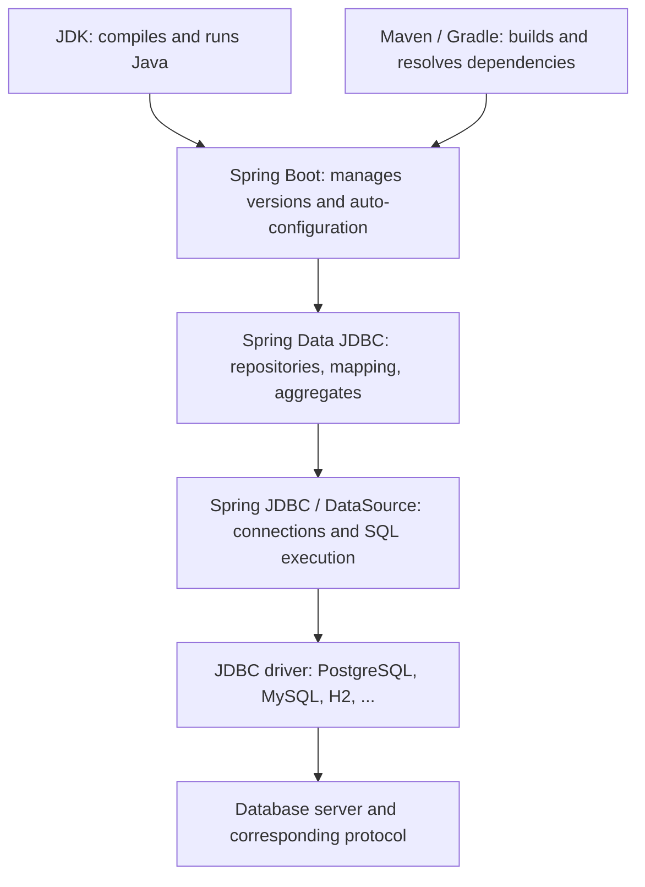

# Choosing a Compatible Java, Spring Boot, Spring Data, and JDBC Driver Combination

When initializing a **Spring Data Relational JDBC** project, version selection does not stop at the question "Which Java version can run Spring Boot?". An application must also use the right generation of Spring Data JDBC, have a JDBC driver compatible with both Java and the database server, and build with a sufficiently recent build tool. Choosing a mismatched link in this chain can prevent the project from compiling, stop it from starting up, or cause errors only when accessing data.

This guide walks through how to select and verify **a well-founded set of versions**, using PostgreSQL as the implementation example and contrasting it with H2/MySQL. The specific versions below are **reference milestones as of November 2026**; when creating a new project, you should check the documentation page for the exact Spring Boot branch you intend to use.

## 1. Understanding the Components That Must Be Compatible



| Component | Responsibility | What to Verify |
|---|---|---|
| **Java/JDK** | Compiles and runs the application; provides the JDBC API in the JDK | Java version meets the minimum requirement and is within the support range of Spring Boot, the build tool, and the driver |
| **Spring Boot** | Auto-configures `DataSource`, manages dependencies via BOM, provides starters | Choose a supported Boot branch and use the BOM from that exact branch |
| **Spring Data JDBC** | Maps aggregates to SQL tables; provides `CrudRepository`, `JdbcAggregateTemplate`, etc. | Spring Data version follows Spring Boot; do not mix versions across different generations |
| **JDBC driver** | Implements `java.sql.Driver`, connects to a specific DBMS | Driver is on the runtime classpath and supports the JDK and database server versions in use |
| **Database server** | Executes SQL, authentication, transactions, data types | Compatible with the driver and has a **dialect** recognized by Spring Data JDBC |
| **Maven/Gradle** | Compiles code, manages dependencies, and runs the Spring Boot plugin | Tool version meets the specific requirements of the Spring Boot plugin |

**Distinguishing three commonly confused names:** `spring-jdbc` is Spring Framework's low-level JDBC access layer; `spring-data-jdbc` provides the repository/aggregate model; `org.postgresql:postgresql` is the **actual driver** that opens PostgreSQL connections. The `spring-boot-starter-data-jdbc` starter brings in Spring Data JDBC and Spring JDBC infrastructure, but it does not automatically choose PostgreSQL or MySQL for you.

Spring Data JDBC uses synchronous (blocking) JDBC. **R2DBC** is a reactive database access mechanism with its own drivers and starters; the `r2dbc-postgresql` driver does not replace `org.postgresql:postgresql`. Spring Data JDBC also differs from **Spring Data JPA**: Hibernate/JPA is not needed to create JDBC repositories.

## 2. Choose Spring Boot First, Let the BOM Choose Spring Data

Spring Boot publishes a **BOM** (*Bill of Materials*) named `org.springframework.boot:spring-boot-dependencies`. The BOM defines a coordinated, tested set of versions for Spring Framework, Spring Data, drivers, and many other libraries.

Safe rules when starting out:

1. Choose **a specific Spring Boot version** in a stable branch, such as `4.1.2`.
2. Use `spring-boot-starter-data-jdbc` **without specifying a separate version**.
3. Declare the driver using the vendor's Maven/Gradle coordinates and let the BOM manage its version if the driver is in the managed list.
4. Only override a Spring Data or driver version when there is a real requirement, clear compatibility documentation, and dedicated testing.

Spring Data uses two version numbers that should be distinguished: the **release train** (for example, `2026.0.x`) is the umbrella release train, while the **Spring Data JDBC module** carries a version like `4.1.x`. They are not two independent dependencies that need to be declared manually when using the Spring Boot starter.

### Reference Matrix for Recent Generations

| Spring Boot | Spring Framework | Spring Data release train | Spring Data JDBC | Minimum JDK | Build Tools to Note |
|---|---|---|---|---|---|
| **4.1.x** (e.g. `4.1.2`) | **7.0.x** | **2026.0.x** | **4.1.x** | Java **17** | Gradle **8.14+** or 9.x; Maven **3.6.3+** |
| **4.0.x** | **7.0.x** | **2025.1.x** | **4.0.x** | Java **17** | Gradle **8.14+** or 9.x; Maven **3.6.3+** |
| **3.5.x** (e.g. `3.5.16`) | **6.2.x** | **2025.0.x** | **3.5.x** | Java **17** | Gradle 8.x from **8.4+** or 7.x branch from **7.6.4+**; Maven **3.6.3+** |

Each row represents a **generational combination**, not advice to pick an arbitrary patch version from one column and pair it with a patch version from another. For example, the BOM for Spring Boot `4.1.2` manages `spring-data-jdbc:4.1.2`; the BOM for `3.5.16` manages the `3.5.x` line. The BOM itself determines the exact patch versions.

**Which direction should you choose?**

- **New projects:** Java **21 LTS** and Spring Boot **4.1.x** make a suitable pairing, with Spring Data JDBC **4.1.x**, a BOM-managed driver, and a sufficiently recent Gradle version. Java 17 still meets Boot 4.1's minimum requirement; Java 21 is convenient when you want a solid LTS baseline for both learning and deployment.
- **Projects already on Boot 3.5:** keep Spring Data JDBC **3.5.x** per the Boot 3.5 BOM during maintenance; plan a **full-generation** upgrade when moving to Boot 4.x.
- **Projects constrained by an older Gradle/JDK:** check plugin requirements before upgrading Spring Boot. A Gradle 8.5 wrapper works with Boot 3.5, but is **not sufficient** for Boot 4.1.

Do not assume that "both using Java 21" means every Spring Boot or Spring Data release is compatible. The JDK is a necessary condition; the Framework, API, and BOM versions must also align.

## 3. Choose a JDBC Driver by Database Management System

The driver sits at the **connection** layer and does not dictate the Spring Data JDBC version. Common choices include:

| Database | Driver Dependency (Gradle/Maven) | JDBC URL Prefix | Notes |
|---|---|---|---|
| PostgreSQL | `org.postgresql:postgresql` | `jdbc:postgresql://` | Uses PostgreSQL JDBC Driver (pgJDBC); verify against the server version |
| MySQL | `com.mysql:mysql-connector-j` | `jdbc:mysql://` | Uses Connector/J for MySQL; check server version and authentication method |
| MariaDB | `org.mariadb.jdbc:mariadb-java-client` | `jdbc:mariadb://` | MariaDB's dedicated driver; prefer the dedicated driver over implicitly using MySQL Connector/J |
| H2 | `com.h2database:h2` | `jdbc:h2:mem:` or `jdbc:h2:file:` | Convenient for running local examples; does not fully represent PostgreSQL/MySQL SQL |
| Microsoft SQL Server | `com.microsoft.sqlserver:mssql-jdbc` | `jdbc:sqlserver://` | Check the driver's JDK, TLS, and SQL Server version requirements |
| Oracle Database | `com.oracle.database.jdbc:ojdbc11` (common example) | `jdbc:oracle:thin:@` | Check the `ojdbc` artifact that matches your JDK and Oracle Database version |

Spring Data JDBC requires a **SQL dialect** to express differences across databases. According to the Spring Data Relational documentation, databases with built-in dialect support include DB2, H2, HSQLDB, MariaDB, Microsoft SQL Server, MySQL, Oracle, and PostgreSQL. If you use a different database, you must verify support or provide a custom dialect; **having a JDBC driver does not mean Spring Data JDBC supports that database**.

For each driver, confirm three distinct compatibility relationships:

1. **Driver ↔ Java:** does this driver version run on your JDK? Pay special attention to vendors that release driver variants per Java line.
2. **Driver ↔ database server:** are the server version, authentication mechanism, TLS/SSL, data types, and protocol supported by the driver?
3. **Database ↔ Spring Data JDBC:** can Spring Data detect the dialect and execute repository operations against that database?

In most modern Spring Boot setups, declaring `spring.datasource.url`, `username`, and `password` is enough; Boot usually infers the driver from the JDBC URL. The `spring.datasource.driver-class-name` property should only be set when inference cannot handle a special configuration.

## 4. Complete Example: Java 21 + Spring Boot 4.1.2 + PostgreSQL

Suppose we are building a book management service using **JDK 21**, **PostgreSQL**, and **Gradle Groovy DSL**. Choosing `Spring Boot 4.1.2`, the BOM determines Spring Data JDBC `4.1.2` and the managed pgJDBC version. The project does not need to manually specify versions for `spring-data-jdbc` or `postgresql`.

### `build.gradle`

```groovy
plugins {
    id 'java'
    id 'org.springframework.boot' version '4.1.2'
}

apply plugin: 'io.spring.dependency-management'

group = 'com.example'
version = '0.0.1-SNAPSHOT'

java {
    toolchain {
        languageVersion = JavaLanguageVersion.of(21)
    }
}

repositories {
    mavenCentral()
}

dependencies {
    implementation 'org.springframework.boot:spring-boot-starter-data-jdbc'
    runtimeOnly 'org.postgresql:postgresql'

    testImplementation 'org.springframework.boot:spring-boot-starter-data-jdbc-test'
}

tasks.named('test') {
    useJUnitPlatform()
}
```

Here `io.spring.dependency-management` automatically imports the BOM for the Spring Boot plugin version in use. You can use Gradle's native `platform(...)` feature instead of the dependency management plugin, but **you only need one consistent version management strategy**. `runtimeOnly` is appropriate for the PostgreSQL driver because application code typically works against `DataSource`, `JdbcTemplate`, or Spring repositories rather than compiling directly against pgJDBC APIs.

> If you use the Gradle wrapper, set the wrapper to **Gradle 8.14+ or 9.x** for Boot 4.1. Having JDK 21 with an 8.5 wrapper still fails to meet the Boot 4.1 plugin requirements.

### `application.yml`

```yaml
spring:
  datasource:
    url: ${DB_URL:jdbc:postgresql://localhost:5432/bookstore}
    username: ${DB_USERNAME:bookstore_app}
    password: ${DB_PASSWORD}
```

Running this configuration requires a running PostgreSQL server, a `bookstore` database, a `bookstore_app` account with appropriate privileges, and the `DB_PASSWORD` environment variable. These names are examples only and do not exist by default when Spring Boot starts. In real environments, supply connection credentials through environment variables or a secret management system.

The main startup flow is:

```text
Spring Boot reads spring.datasource.*
  -> locates the PostgreSQL JDBC driver on the runtime classpath
  -> creates DataSource (typically using HikariCP)
  -> obtains a JDBC Connection to PostgreSQL
  -> Spring Data JDBC detects the PostgreSQL dialect
  -> initializes the repository components
```

Spring Data JDBC **is not a full schema auto-creation/migration tool**, contrary to a common expectation when coming from JPA. Before saving an aggregate, the appropriate tables must exist; real projects can manage schemas with Flyway/Liquibase, while learning examples can use controlled SQL scripts.

### If Using Maven

The Java/Boot/driver choices remain the same. With the Spring Boot parent POM, the minimal declaration looks like this:

```xml
<project xmlns="http://maven.apache.org/POM/4.0.0"
         xmlns:xsi="http://www.w3.org/2001/XMLSchema-instance"
         xsi:schemaLocation="http://maven.apache.org/POM/4.0.0 https://maven.apache.org/xsd/maven-4.0.0.xsd">
    <modelVersion>4.0.0</modelVersion>

    <parent>
        <groupId>org.springframework.boot</groupId>
        <artifactId>spring-boot-starter-parent</artifactId>
        <version>4.1.2</version>
        <relativePath/>
    </parent>

    <groupId>com.example</groupId>
    <artifactId>bookstore</artifactId>
    <version>0.0.1-SNAPSHOT</version>

    <properties>
        <java.version>21</java.version>
    </properties>

    <dependencies>
        <dependency>
            <groupId>org.springframework.boot</groupId>
            <artifactId>spring-boot-starter-data-jdbc</artifactId>
        </dependency>
        <dependency>
            <groupId>org.postgresql</groupId>
            <artifactId>postgresql</artifactId>
            <scope>runtime</scope>
        </dependency>
        <dependency>
            <groupId>org.springframework.boot</groupId>
            <artifactId>spring-boot-starter-data-jdbc-test</artifactId>
            <scope>test</scope>
        </dependency>
    </dependencies>

    <build>
        <plugins>
            <plugin>
                <groupId>org.springframework.boot</groupId>
                <artifactId>spring-boot-maven-plugin</artifactId>
            </plugin>
        </plugins>
    </build>
</project>
```

The Parent POM also imports Spring Boot's dependency management, so the dependencies above omit explicit versions. If the project already has a custom parent, you can import the Spring Boot BOM inside `dependencyManagement` instead of using `spring-boot-starter-parent`.

## 5. Maintenance Example: Currently on Spring Boot 3.5

An existing project using Java 17 or Java 21, Boot `3.5.x`, and Gradle 8.5 should stay on **Spring Data JDBC 3.5.x** as managed by the Boot 3.5 BOM. The dependencies block can look identical to the Gradle example above:

```groovy
dependencies {
    implementation 'org.springframework.boot:spring-boot-starter-data-jdbc'
    runtimeOnly 'org.postgresql:postgresql'
}
```

The deciding factor sits in the **Boot plugin/parent**: when using `3.5.16`, dependency resolution selects the corresponding Spring Data 3.5 line rather than 4.1. Do not manually override `spring-data-jdbc` to `4.1.2` to get new features while staying on Boot 3.5: the required Spring Framework generation has changed from 6.2 to 7.0. Upgrading from Boot 3.5 → 4.1 is a dedicated migration covering APIs, plugins, the Gradle wrapper, and integration testing.

## 6. Verifying the Actual Project Version Set

**Check tool versions first:**

```bash
java -version
./gradlew --version
```

On Windows, you can use `gradlew.bat --version`. Distinguish between **the JDK used to run Gradle** and **the Java toolchain used to compile the application**; they can be configured differently. Make sure both meet their respective requirements.

**Inspect what versions dependencies actually resolved to:**

```bash
./gradlew dependencyInsight --dependency spring-data-jdbc --configuration runtimeClasspath
./gradlew dependencyInsight --dependency postgresql --configuration runtimeClasspath
./gradlew dependencies --configuration runtimeClasspath
```

With Maven:

```bash
./mvnw dependency:tree -Dincludes=org.springframework.data:spring-data-jdbc
./mvnw dependency:tree -Dincludes=org.postgresql:postgresql
```

Once the database is configured, you can verify connectivity with `JdbcTemplate` in the Spring Boot application:

```java
package com.example.bookstore;

import org.springframework.boot.CommandLineRunner;
import org.springframework.boot.SpringApplication;
import org.springframework.boot.autoconfigure.SpringBootApplication;
import org.springframework.context.annotation.Bean;
import org.springframework.jdbc.core.JdbcTemplate;

@SpringBootApplication
public class BookstoreApplication {
    public static void main(String[] args) {
        SpringApplication.run(BookstoreApplication.class, args);
    }

    @Bean
    CommandLineRunner verifyJdbc(JdbcTemplate jdbcTemplate) {
        return args -> {
            Integer result = jdbcTemplate.queryForObject("SELECT 1", Integer.class);
            System.out.println("JDBC connection test: " + result);
        };
    }
}
```

When the program successfully connects to PostgreSQL, the expected output is `JDBC connection test: 1`. This only tests **JDBC connectivity and SQL execution**. To confirm Spring Data JDBC works properly with your schema, you still need to test an actual aggregate and repository by saving and reading data.

## 7. Common Version-Pairing Errors

| Symptom | Possible Cause | How to Fix |
|---|---|---|
| `UnsupportedClassVersionError` or compilation failure | Running/compiling JDK is older than the library bytecode or toolchain configuration | Check `java -version`, Gradle JVM, and Java toolchain; pick a JDK supported by Boot and the driver |
| Spring Boot plugin fails to apply in Gradle | Gradle wrapper is below the minimum version required by the Boot branch | Upgrade the wrapper to a supported version before running the plugin |
| `NoSuchMethodError`, `NoClassDefFoundError` related to Spring | Forcing a Spring Data/Spring Framework version from a different generation than Spring Boot | Remove version overrides; return to a uniform Spring Boot BOM |
| `Failed to configure a DataSource`, `No suitable driver` | Missing runtime driver, wrong JDBC URL, or missing database configuration | Add the correct driver coordinates; check `spring.datasource.*` and the runtime classpath |
| `Connection refused`, timeout, authentication failed | Server not running, wrong host/port, wrong credentials, or network blocked | Check the database server, URL, permissions, authentication, and TLS |
| Unable to determine dialect | Unsupported/unrecognized database, or unable to read connection metadata | Check the supported dialect list, JDBC driver, and connection; consider providing a custom dialect for other DB systems |
| Works with H2 but fails on PostgreSQL/MySQL | Differences in SQL syntax, data types, generated keys, or migrations | Run integration tests against the **same database type** as your deployment environment |
| Repository initializes, but CRUD reports missing table/column | Schema has not been created or differs from the aggregate mapping | Manage tables via SQL migrations and verify naming/mapping |

**Diagnose errors by layer:** for build/toolchain errors, check Java and Gradle/Maven first; for dependency/class errors, check the BOM first; for `DataSource` errors, check the driver/URL first; for SQL/schema errors after connecting, check the dialect and database design. Layering your troubleshooting avoids fixing the wrong thing—such as upgrading Spring Data when the real issue is simply a missing PostgreSQL driver.

## 8. Version Selection Workflow for a Real Project

1. **Identify the database and server version** (for example, the PostgreSQL version running in dev/production) along with TLS and authentication requirements.
2. **Determine the target JDK** based on your deployment platform (for example, Java 21 LTS) and make sure your build tool runs on the chosen JDK.
3. **Select a stable Spring Boot branch** compatible with the JDK and build tool; read the *System Requirements* page for that exact branch.
4. **Use the Spring Data JDBC starter and Boot's BOM**; do not pin a separate Spring Data release train unless there is a specific need.
5. **Choose the vendor's driver**, place the dependency in runtime scope when appropriate, and use the BOM-managed version if available; verify against the vendor's JDK/server support matrix.
6. **Verify the dialect**, configure `DataSource`, inspect the dependency tree, and run a real connection test query.
7. **Verify CRUD against the target database**, manage your schema, and record the version set used (JDK, Boot, driver, server, wrapper) for reproducible environments.

An example of a clearly stated version selection: **"Java 21 + Spring Boot 4.1.2 + Spring Data JDBC 4.1.2 managed by Boot BOM + pgJDBC per Boot BOM + verified PostgreSQL server support + Gradle 8.14 or higher"**. This statement specifies every critical relationship without manually locking down dozens of transitive libraries.

## Official Reference Documentation

- [Spring Boot — System Requirements (current stable branch)](https://docs.spring.io/spring-boot/system-requirements.html)
- [Spring Boot 3.5 — System Requirements](https://docs.spring.io/spring-boot/3.5/system-requirements.html)
- [Spring Boot — Build Systems and Dependency Management](https://docs.spring.io/spring-boot/reference/using/build-systems.html)
- [Spring Boot Gradle Plugin — Managing Dependencies](https://docs.spring.io/spring-boot/gradle-plugin/managing-dependencies.html)
- [Spring Boot — Managed Dependency Coordinates](https://docs.spring.io/spring-boot/appendix/dependency-versions/coordinates.html)
- [Spring Boot — SQL Databases and DataSource](https://docs.spring.io/spring-boot/reference/data/sql.html)
- [Spring Data Relational — JDBC Getting Started and Dialect List](https://docs.spring.io/spring-data/relational/reference/jdbc/getting-started.html)
- [Spring Data — Project, Release Trains, and BOM](https://spring.io/projects/spring-data)
- [PostgreSQL JDBC Driver — Vendor Documentation](https://jdbc.postgresql.org/documentation/)
- [MySQL Connector/J — Vendor Documentation](https://dev.mysql.com/doc/connector-j/en/)
