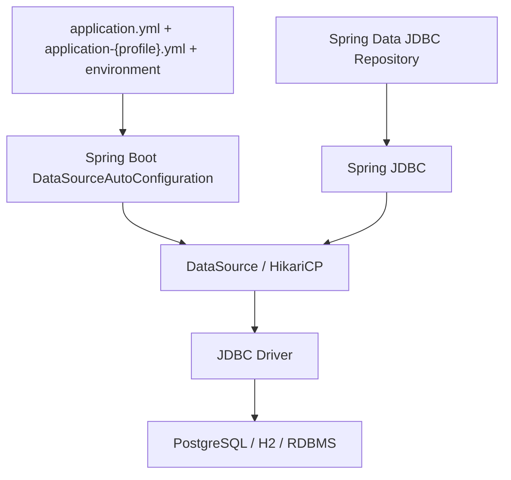

# Configuring `spring.datasource` for Development and Testing Environments

In a **Spring Data JDBC** application, database connections are configured primarily through **Spring Boot**'s `spring.datasource.*` properties. The same code repository can work with different development and testing databases, as long as the application loads the right configuration, has the corresponding JDBC driver, and has a matching schema.

This guide covers how to organize configuration for **development (dev)** and **testing (test)** environments in a Spring Boot + Spring Data Relational/JDBC application, how to select profiles, how to test in practice, and common configuration mistakes.

## 1. Where Does `spring.datasource` Fit in the Spring Data JDBC Flow?

Spring Data JDBC does not read YAML directly and open connections on its own. With Spring Boot, the steps work together as follows:

1. Spring Boot reads properties from `application.yml`, profile-specific files, environment variables, and other configuration sources.
2. `DataSourceAutoConfiguration` creates a `DataSource` suitable for the driver and dependencies present on the classpath, typically using **HikariCP** if available.
3. Spring JDBC uses the `DataSource` to acquire a `Connection` and execute JDBC operations.
4. Spring Data JDBC builds on Spring JDBC infrastructure to perform repository operations and map aggregates to relational tables and columns.



Therefore:

- `spring.datasource.*` governs **connections and pooling**; it does not define entities or mappings.
- `@Table`, `@Id`, and `@MappedCollection` are mapping metadata used when Spring Data JDBC performs persistence.
- `spring.sql.init.*` and migration tools such as Flyway/Liquibase relate to **schema initialization and management**, which is a separate configuration group from `spring.datasource.*`.
- `spring.datasource.hikari.*` properties tune the Hikari pool; they do not replace `url`, `username`, or `password`.

## 2. Preparing Dependencies and Configuration Structure

This example uses Spring Boot 3.x, Java 21, Gradle Groovy, and PostgreSQL as the development database. When using Spring Boot dependency management/BOM, you do not need to manually specify versions for Boot-managed dependencies.

```groovy
dependencies {
    implementation 'org.springframework.boot:spring-boot-starter-data-jdbc'

    // Database used during development and application runtime.
    runtimeOnly 'org.postgresql:postgresql'

    // Lightweight database for a subset of tests.
    testRuntimeOnly 'com.h2database:h2'

    testImplementation 'org.springframework.boot:spring-boot-starter-test'
}
```

`spring-boot-starter-data-jdbc` brings Spring Data JDBC and Spring JDBC infrastructure into the application. PostgreSQL and H2 are **different JDBC drivers/databases**; configuring a URL alone without the matching driver dependency will fail to create a connection.

Files can be organized as follows:

```text
src/
├── main/
│   ├── java/...
│   └── resources/
│       ├── application.yml
│       └── application-dev.yml
└── test/
    ├── java/.../CustomerRepositoryH2Test.java
    └── resources/
        ├── application-test.yml
        └── sql/schema-test.sql
```

- `application.yml`: shared configuration applied regardless of profile.
- `application-dev.yml`: values for the development environment.
- `application-test.yml` inside `src/test/resources`: values present only on the test classpath, useful for preventing test configuration from being packaged into production artifacts.
- Each profile file only takes effect when that profile is **active**. `application-test.yml` does not automatically become active just because a `@Test` method is running; you must activate the appropriate profile or configure the test otherwise.

## 3. Essential `spring.datasource` Properties

| Property | Meaning | Example |
| --- | --- | --- |
| `spring.datasource.url` | JDBC URL containing protocol, host, port, database, and optional connection parameters. | `jdbc:postgresql://localhost:5432/catalog_dev` |
| `spring.datasource.username` | Database account username. | `catalog_dev` |
| `spring.datasource.password` | Database password; should come from an environment variable or secret manager. | `${DEV_DB_PASSWORD}` |
| `spring.datasource.driver-class-name` | JDBC driver class name if explicit declaration is needed. | `org.postgresql.Driver` |
| `spring.datasource.hikari.maximum-pool-size` | Maximum number of connections in the Hikari pool. | `8` |
| `spring.datasource.hikari.minimum-idle` | Minimum number of idle connections Hikari tries to maintain. | `1` |
| `spring.datasource.hikari.connection-timeout` | Maximum time to wait for a connection from the pool, in milliseconds. | `30000` |

Spring Boot usually infers the JDBC driver from the URL if the driver is on the classpath; therefore **`driver-class-name` is not required** for standard PostgreSQL/H2 URLs.

URL examples:

```text
PostgreSQL: jdbc:postgresql://localhost:5432/catalog_dev
H2 memory: jdbc:h2:mem:catalog_test;DB_CLOSE_DELAY=-1
```

With PostgreSQL, `catalog_dev` is an actual database and the server must be running. With H2 `mem:catalog_test`, the database runs **in the memory of the test JVM**, requiring no PostgreSQL server, though data is lost when the database/JVM lifecycle ends.

Pool properties should only be tuned based on the target environment and actual access patterns. The numbers in these examples are illustrative, not optimal settings for every application.

## 4. Shared Configuration: `application.yml`

Place truly shared properties into `src/main/resources/application.yml`:

```yaml
spring:
  application:
    name: catalog-service
  sql:
    init:
      mode: never
```

`spring.sql.init.mode: never` in this example indicates that **schema/data SQL initializer files are not run automatically** via the `spring.sql.init` mechanism, which fits setups where schemas are managed by migrations or a separate setup step.

Do not place production database credentials or hardcoded passwords in shared files. Also avoid setting `spring.profiles.active: dev` by default in packaged deployment config, as doing so can cause an application deployed to another environment to still connect to the dev database.

> Spring Data JDBC **does not automatically create tables from `@Table` like Hibernate/JPA DDL generation**. Even when `DataSource` is configured properly, tables must exist before running repository CRUD operations.

## 5. Development Environment: PostgreSQL with the `dev` Profile

Create `src/main/resources/application-dev.yml`:

```yaml
spring:
  datasource:
    url: ${DEV_DB_URL:jdbc:postgresql://localhost:5432/catalog_dev}
    username: ${DEV_DB_USER:catalog_dev}
    password: ${DEV_DB_PASSWORD}
    hikari:
      maximum-pool-size: 8
      minimum-idle: 1
      connection-timeout: 30000
```

The placeholder syntax `${VAR_NAME:default_value}` means: if the variable is available, use it; otherwise, fall back to the default value. For `${DEV_DB_PASSWORD}` without a default, the application must receive the password from a configuration source; avoid storing real passwords in Git.

The example above assumes you have already created:

- A PostgreSQL database named `catalog_dev`.
- A `catalog_dev` user with the permissions required for development work.
- The `DEV_DB_PASSWORD` environment variable.
- A schema matching the Spring Data JDBC aggregates/repositories.

Run with the `dev` profile using a Spring Boot argument:

```bash
java -jar catalog-service.jar --spring.profiles.active=dev
```

Or when using the Spring Boot Gradle plugin:

```bash
./gradlew bootRun --args='--spring.profiles.active=dev'
```

On PowerShell/Windows, you can use `.\gradlew.bat bootRun --args="--spring.profiles.active=dev"` if the project has a Gradle wrapper. Setting the `SPRING_PROFILES_ACTIVE=dev` environment variable is another way to activate the profile.

**Important note:** When launching with `dev`, the database in the URL must be a dedicated development database. Never share a production database to test creating, deleting, or updating entities.

### 5.1. Supplying Passwords Safely During Development

A PowerShell example for the **current terminal session**:

```powershell
$env:DEV_DB_PASSWORD = "local-secret"
$env:SPRING_PROFILES_ACTIVE = "dev"
.\gradlew.bat bootRun
```

This is a placeholder value for illustration. In practice, retrieve passwords from a secret store, your IDE's environment variable manager, or the runtime environment, and avoid writing real passwords into committed scripts. `.env` files are not automatically loaded by Spring Boot in all situations; if you use one, you need a separate mechanism to load those variables into the process environment or property sources.

You can also use Spring Boot's standard environment variable names directly: `SPRING_DATASOURCE_URL`, `SPRING_DATASOURCE_USERNAME`, and `SPRING_DATASOURCE_PASSWORD`. Under externalized configuration rules, values from environment variables can override matching keys in YAML. Check these variables before assuming a profile file controls the URL.

### 5.2. Should You Configure the JDBC Driver and Hikari in Every Environment?

There is no need to declare `driver-class-name` when Boot automatically detects the driver. For Hikari, `maximum-pool-size` and `minimum-idle` should only be adjusted once you know the database's connection limits and expected load. Small dev apps can rely on defaults to minimize configuration variables.

## 6. Fast Test Environment: H2 In-Memory and the `test` Profile

The goal of this test group is fast execution, independent of an external PostgreSQL instance, making it suitable for basic repository, entity mapping, and transaction tests. It **does not prove full compatibility with PostgreSQL**.

Create `src/test/resources/application-test.yml`:

```yaml
spring:
  datasource:
    url: "jdbc:h2:mem:catalog_test;DB_CLOSE_DELAY=-1;DB_CLOSE_ON_EXIT=FALSE"
    username: sa
    password: ""
  sql:
    init:
      mode: always
      schema-locations: classpath:sql/schema-test.sql
```

Here:

- `jdbc:h2:mem:catalog_test` creates an in-memory H2 database.
- `DB_CLOSE_DELAY=-1` keeps the database alive after the last connection closes, until the JVM exits or the database is shut down.
- `spring.sql.init.mode: always` enables SQL initializer execution, overriding `never` from the shared configuration.
- `schema-locations` points to the schema file on the test classpath.

Create `src/test/resources/sql/schema-test.sql`:

```sql
CREATE TABLE customers (
    id BIGINT GENERATED BY DEFAULT AS IDENTITY PRIMARY KEY,
    full_name VARCHAR(150) NOT NULL
);
```

This is example DDL. With Spring Data JDBC, table and column names must match the mappings on the Java domain model.

### 6.1. One Entity, One Repository, Two Environments

```java
import org.springframework.data.annotation.Id;
import org.springframework.data.relational.core.mapping.Column;
import org.springframework.data.relational.core.mapping.Table;

@Table("customers")
public record Customer(
    @Id Long id,
    @Column("full_name") String fullName
) {}
```

```java
import org.springframework.data.repository.ListCrudRepository;

public interface CustomerRepository
        extends ListCrudRepository<Customer, Long> {
}
```

The repository interface makes no mention of PostgreSQL or H2. The exact same `CustomerRepository` uses whatever `DataSource` is registered in the `ApplicationContext`. This is the key benefit of separating connection configuration from domain/persistence logic.

### 6.2. Testing the Repository with `@DataJdbcTest`

```java
import static org.assertj.core.api.Assertions.assertThat;

import org.junit.jupiter.api.Test;
import org.springframework.beans.factory.annotation.Autowired;
import org.springframework.boot.test.autoconfigure.data.jdbc.DataJdbcTest;
import org.springframework.boot.test.autoconfigure.jdbc.AutoConfigureTestDatabase;
import org.springframework.test.context.ActiveProfiles;

@DataJdbcTest
@ActiveProfiles("test")
@AutoConfigureTestDatabase(
    replace = AutoConfigureTestDatabase.Replace.NONE
)
class CustomerRepositoryH2Test {

    @Autowired
    CustomerRepository customers;

    @Test
    void savesAndFindsCustomer() {
        Customer saved = customers.save(new Customer(null, "Lan"));

        assertThat(saved.id()).isNotNull();
        assertThat(customers.findById(saved.id()))
            .contains(saved);
    }
}
```

Annotation breakdown:

- `@DataJdbcTest` creates a Spring Boot test slice focused on Spring Data JDBC and required JDBC components, rather than booting the entire web application.
- `@ActiveProfiles("test")` activates `application-test.yml`.
- `@AutoConfigureTestDatabase(replace = NONE)` instructs Spring Boot to keep the `DataSource` configured by your test setup. By default, some test slices may **replace the DataSource with an embedded test database**, so this annotation is useful when you need exact control over the URL.
- `@DataJdbcTest` typically wraps each test in a transaction that rolls back after the test; still be mindful of side effects that occur outside transactions.

For the test to run successfully, H2 must be on the test runtime classpath and the schema file must exist at the exact path. If multiple contexts in the same test suite share a fixed-name H2 database, unintended interference can occur; use distinct database names per test group or isolate configurations when needed.

### 6.3. Limitations of H2

H2 is great when you need rapid feedback. However, its SQL syntax, column types, sequences/identities, transaction semantics, collations, functions, and dialect differ from PostgreSQL. Enabling H2's `MODE=PostgreSQL` only provides partial compatibility—it **does not turn H2 into PostgreSQL**.

If the application relies on native SQL, locks, isolation levels, indexes, or PostgreSQL-specific features, you need tests running against a real PostgreSQL instance or a PostgreSQL container.

## 7. Real Compatibility Testing: PostgreSQL via Testcontainers

To verify SQL and mappings against the exact database type used in runtime environments, you can use **Testcontainers** to spin up a dedicated PostgreSQL instance for tests. Containers give each test run a fresh database scoped to the test lifecycle, reducing reliance on shared dev databases.

Add dependencies:

```groovy
dependencies {
    testImplementation 'org.springframework.boot:spring-boot-testcontainers'
    testImplementation 'org.testcontainers:junit-jupiter'
    testImplementation 'org.testcontainers:postgresql'
}
```

Example using Testcontainers JUnit 5 and `@DynamicPropertySource`:

```java
import static org.assertj.core.api.Assertions.assertThat;

import org.junit.jupiter.api.Test;
import org.springframework.beans.factory.annotation.Autowired;
import org.springframework.boot.test.autoconfigure.data.jdbc.DataJdbcTest;
import org.springframework.boot.test.autoconfigure.jdbc.AutoConfigureTestDatabase;
import org.springframework.test.context.DynamicPropertyRegistry;
import org.springframework.test.context.DynamicPropertySource;
import org.springframework.test.context.jdbc.Sql;
import org.testcontainers.containers.PostgreSQLContainer;
import org.testcontainers.junit.jupiter.Container;
import org.testcontainers.junit.jupiter.Testcontainers;

@DataJdbcTest
@Testcontainers
@AutoConfigureTestDatabase(
    replace = AutoConfigureTestDatabase.Replace.NONE
)
@Sql("/sql/schema-test.sql")
class CustomerRepositoryPostgresTest {

    @Container
    static PostgreSQLContainer<?> postgres =
        new PostgreSQLContainer<>("postgres:16-alpine");

    @DynamicPropertySource
    static void configureDatasource(DynamicPropertyRegistry registry) {
        registry.add("spring.datasource.url", postgres::getJdbcUrl);
        registry.add("spring.datasource.username", postgres::getUsername);
        registry.add("spring.datasource.password", postgres::getPassword);
    }

    @Autowired
    CustomerRepository customers;

    @Test
    void persistsCustomerInPostgres() {
        Customer saved = customers.save(new Customer(null, "Mai"));

        assertThat(saved.id()).isNotNull();
        assertThat(customers.findById(saved.id()))
            .contains(saved);
    }
}
```

In this example:

1. Testcontainers starts PostgreSQL and provides the container's JDBC URL, username, and password.
2. `@DynamicPropertySource` supplies `spring.datasource.*` properties directly to the Spring context, overriding matching static configuration.
3. `@AutoConfigureTestDatabase(replace = NONE)` prevents the test slice from replacing the PostgreSQL container with H2.
4. `@Sql` executes the table-creation script before test methods run; the script must be PostgreSQL-compatible. Once the application has formal migrations, run those exact migrations in integration tests to verify the real schema version.

This test does not activate the `test` profile from the H2 section: the shared configuration sets `spring.sql.init.mode: never`, and the test sets up its schema via `@Sql`. If you want to manage it with a dedicated profile, you can create `application-pgtest.yml` and use `@ActiveProfiles("pgtest")`, keeping only properties truly specific to PostgreSQL tests.

Testcontainers requires a runtime environment with a compatible container engine. Choose a PostgreSQL image matching the database version your production system uses; `postgres:16-alpine` is merely an illustration. You can also use Spring Boot's `@ServiceConnection` with `spring-boot-testcontainers` to provide connection details automatically, though there is no need to mix both approaches in the same example.

## 8. Which Test Configuration Should You Choose?

| Requirement | H2 In-Memory | PostgreSQL Testcontainers |
| --- | --- | --- |
| No PostgreSQL server or container runtime needed | Yes | No |
| Fast startup, minimal external dependencies | Usually more convenient | Container startup overhead |
| Verifying simple CRUD/mapping | Suitable | Suitable |
| Verifying PostgreSQL SQL syntax and dialect | Partial compatibility only | Better suited |
| Verifying production migrations/schema | Only if SQL/migrations are H2-compatible | Recommended |
| Verifying PostgreSQL lock/transaction/index behavior | Unreliable | Closer to real environment |

A practical layering strategy is using H2 for simple tests requiring fast feedback and Testcontainers for tests that verify real database compatibility. For projects with heavy custom SQL or strict persistence reliability needs, you can favor Testcontainers from the start.

## 9. Configuration Precedence and Profile Issues

Spring Boot combines multiple property sources. Practical rules when reading `spring.datasource`:

- `application.yml` defines shared values.
- `application-dev.yml` or `application-test.yml` overrides matching keys from the shared config when the corresponding profile is active.
- Environment variables (such as `SPRING_DATASOURCE_URL`) and command-line arguments can override values in YAML files.
- `@DynamicPropertySource` supplies dynamic values for Spring Tests and takes precedence over many standard configuration sources.
- If multiple profiles are active simultaneously and define the same property, profile/property source ordering affects the final value; avoid overlapping datasource definitions that make resolution hard to predict.

A quick overview table:

| Execution Context | Profile | Expected Datasource Configuration Source |
| --- | --- | --- |
| Local dev | `dev` | `application-dev.yml`, possibly overridden by environment variables |
| Fast repository test | `test` | `src/test/resources/application-test.yml` |
| PostgreSQL container test | May not need a dedicated profile | `@DynamicPropertySource` supplies container URL and credentials |
| Production | Dedicated deployment profile | Values from deployment config/secret manager; never reuse dev config |

Note: **Profiles do not automatically create or isolate databases.** Environments are truly isolated only when each datasource points to an independent database.

### 9.1. Ways to Activate a Profile

| Context | How to Activate |
| --- | --- |
| Running JAR | `--spring.profiles.active=dev` |
| From environment | `SPRING_PROFILES_ACTIVE=dev` |
| Running JUnit/Spring Test | `@ActiveProfiles("test")` |
| Running Gradle Boot plugin | `bootRun --args='--spring.profiles.active=dev'` |

Do not configure `spring.profiles.active` inside `application-dev.yml` or a YAML document loaded only for a specific profile: Spring Boot restricts where profile-activation properties may be declared. Activate profiles from a profile-independent source, such as launch arguments or environment variables.

## 10. Managing Schemas, Seed Data, and Transactions

### 10.1. Schemas Do Not Come Automatically with Datasource

Three responsibilities must stay clearly separated:

| Responsibility | Related Components |
| --- | --- |
| Connecting | `spring.datasource.*`, `DataSource`, and JDBC driver |
| Script-based schema/data initialization | `spring.sql.init.*` and `schema.sql`/`data.sql` |
| Schema change history management | Flyway, Liquibase, or an equivalent migration workflow |

For multi-environment applications, Flyway/Liquibase is usually the right fit so dev, test, and production databases evolve along controlled migrations. When using migrations, declare the corresponding dependency, configure it, and let the tool run before repository tests execute. Avoid enabling both SQL initializer table creation and a migration tool that creates the exact same tables unless intentionally designed.

### 10.2. Test Data Must Be Isolated

- Test databases must be separated from dev/production databases; test accounts only need permissions scoped to the test database.
- With `@DataJdbcTest`, the default transaction typically rolls back after each test; operations outside transactions, async processes, or calls made through separate connections may require explicit cleanup.
- With `@SpringBootTest(webEnvironment = RANDOM_PORT)`, HTTP requests from the test client and server-side processing transactions may run on different threads/transactions, so never assume all data written by the server will roll back with the test method's transaction.
- Never use tables containing real user data or sensitive information as test fixtures.

### 10.3. Avoiding Secret Leaks in Logs and Code

Never commit passwords and avoid logging all environment or property sources. Enabling SQL or bind-parameter logging at DEBUG/TRACE levels can expose business data during testing; enable it only when truly needed and use appropriate test data.

## 11. Common Configuration Errors and Troubleshooting

| Symptom | Common Cause | How to Fix |
| --- | --- | --- |
| `Failed to configure a DataSource` | No suitable JDBC URL/embedded database, or missing driver. | Check active profile, URL, JDBC driver dependency, and test classpath. |
| `Connection refused` | Database not running, wrong host/port, incorrect container/localhost setup. | Check the endpoint from the Java process itself and verify PostgreSQL status. |
| `password authentication failed` | Mismatched user/password or invalid login permissions. | Check environment variables, database user, and overriding configuration sources. |
| `relation "..." does not exist` or `Table not found` | Schema not initialized, wrong table name, or wrong schema/search path. | Run migrations/SQL initializer; verify `@Table` and actual table names. |
| Test uses H2 instead of PostgreSQL container | Test slice automatically replaces `DataSource` with an embedded database. | Add `@AutoConfigureTestDatabase(replace = NONE)` and inspect dynamic properties. |
| Test accidentally uses the dev database | Profile or `SPRING_DATASOURCE_URL` overrides the test URL. | Activate the proper profile, inspect CI/IDE environment, and use a dedicated test database. |
| Works on H2 but fails on PostgreSQL | Incompatible dialect, DDL, or SQL functions. | Add integration tests on a PostgreSQL container using real migrations. |
| Pool exhausted or long waits | Queries/transactions hold connections too long, undersized pool, or connection leak. | Review transaction boundaries, query duration, connection handling, and pool sizing. |

Do not try to fix every error by changing `spring.datasource.hikari.maximum-pool-size`. If the wrong profile is active, the schema is missing, or the database is down, increasing pool size will not address the root cause.

## 12. Workflow for Setting Up a New Environment

1. Add the Spring Data JDBC starter and matching JDBC driver.
2. Create `application.yml` for shared settings; place URLs and credentials in environment-appropriate profiles/environment variables.
3. Create a dedicated dev database and prepare the schema via migrations or controlled scripts.
4. Run with `dev` and verify a simple repository read/write operation succeeds.
5. Create `application-test.yml` and an H2 schema for fast tests, or configure Testcontainers for PostgreSQL integration tests.
6. Use `@ActiveProfiles`/`@DynamicPropertySource` as needed; control test database replacement and isolation.
7. In CI, pass database credentials via secrets/environment variables and ensure tests can never write to production databases.

One principle to remember: **Spring Data JDBC repositories do not need to change when switching from dev to test; only the `DataSource` and schema-preparation mechanism change per environment.** Proper profile, driver, and schema configuration yields consistent tests without mixing data across systems.

## 13. Reference Documentation

- [Spring Boot — Externalized Configuration](https://docs.spring.io/spring-boot/reference/features/external-config.html): configuration locations, profiles, and property source precedence.
- [Spring Boot — SQL Databases](https://docs.spring.io/spring-boot/reference/data/sql.html): `DataSource`, connection pooling, and SQL initialization.
- [Spring Boot — Testing](https://docs.spring.io/spring-boot/reference/testing/index.html): test slices, Spring Boot Test, and databases in testing.
- [Spring Data JDBC — Reference Documentation](https://docs.spring.io/spring-data/relational/reference/jdbc.html): repositories, mapping, and persistence behavior.
- [Testcontainers — PostgreSQL Module](https://java.testcontainers.org/modules/databases/postgres/): PostgreSQL container for integration testing.
