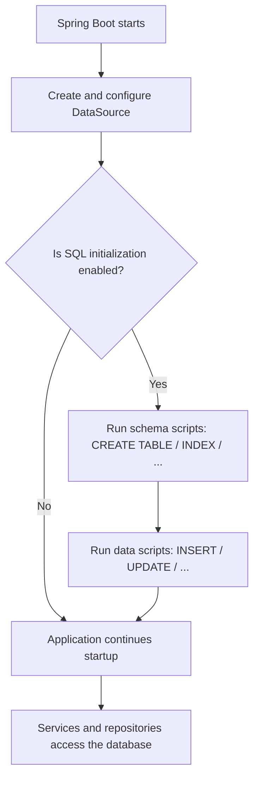

# Initializing Schemas with SQL Scripts and Controlling Data Load Order

In a **Spring Data JDBC** application, repositories operate on tables and columns that already exist in the database. Annotations such as `@Table`, `@Id`, and `@Column` tell the framework how to map data, but **they do not automatically create schemas from Java classes**. Therefore, before calling `repository.findAll()` or `repository.save(...)`, the application needs the appropriate tables, keys, and initial data in place.

A simple way to handle this in a Spring Boot application is to place SQL statements in `schema.sql` and `data.sql`. Spring Boot has a built-in mechanism to run these scripts at startup, with configuration determining **whether to run them, which files to run, and in what order**. This lesson covers the entire flow, a foreign-key example, splitting scripts across multiple files, common pitfalls, and when to switch to a migration tool.

## 1. Distinguishing Schema, Seed Data, and Java Mapping

These three concepts are related, yet each answers a different need:

| Component | Question Answered | Example |
|---|---|---|
| **Schema** | What structure does the database have? | `CREATE TABLE`, `PRIMARY KEY`, `FOREIGN KEY`, `CREATE INDEX` |
| **Seed data** | On startup, which rows should exist in the database? | `INSERT INTO departments ...` |
| **Entity mapping** | Which Java object represents a table/column? | `@Table("departments")`, `@Id Long id` |

For example, the following Java snippet only describes how to read/write the `departments` table:

```java
import org.springframework.data.annotation.Id;
import org.springframework.data.relational.core.mapping.Table;

@Table("departments")
public record Department(@Id Long id, String name) {}
```

For the repository to operate, the database still needs the matching table:

```sql
CREATE TABLE departments (
    id BIGINT PRIMARY KEY,
    name VARCHAR(120) NOT NULL
);
```

If the table is missing, Java code may still compile and the application may boot up to a point, but actual queries will fail because the database cannot find the table. Including SQL initialization during startup ensures an experimental application has its schema and sample data ready right away.

## 2. When Does Spring Boot Execute SQL Scripts?

Spring Boot supports **script-based database initialization** against a `DataSource`. When enabled and matching scripts are present, it executes **schema scripts first**, then **data-loading scripts**. After database initialization completes, code that runs once the application has started—such as an `ApplicationRunner`—can query the loaded data.



The exact path depends on auto-configuration settings, the database type, and any other database initialization beans. Keep in mind that **`schema.sql` and `data.sql` do not run on every repository call**: they are a startup step, whereas repositories execute business SQL while the application is running.

With default configuration, Spring Boot looks for standard SQL resources on the classpath, such as:

```text
src/main/resources/
├── schema.sql
└── data.sql
```

`schema.sql` is for DDL; `data.sql` is for initial data. If you have multiple scripts, you can configure explicit paths instead of relying on default discovery.

## 3. Complete Example: Schema with Foreign Keys and Sample Data

Suppose we are building an employee management application. One department (`departments`) has many employees (`employees`), and every employee must belong to a valid department.

### 3.1. Preparing Dependencies and a Test Database

For a Gradle project using Spring Boot, you need at least Spring Data JDBC and a JDBC driver. This example uses **H2 in-memory** for a learning environment:

```groovy
dependencies {
    implementation 'org.springframework.boot:spring-boot-starter-data-jdbc'
    runtimeOnly 'com.h2database:h2'
}
```

Configure `src/main/resources/application.yml`:

```yaml
spring:
  datasource:
    url: jdbc:h2:mem:companydb;DB_CLOSE_DELAY=-1
    driver-class-name: org.h2.Driver
    username: sa
    password: ''
  sql:
    init:
      mode: always
      encoding: UTF-8
      continue-on-error: false
```

Here `mode: always` explicitly requests script execution even if you change the database type. With H2 in-memory, the default setting is usually sufficient as well because Spring Boot recognizes it as an embedded database. In real projects, avoid defaulting to `always` on a persistent database unless the scripts are designed to be idempotent and safe to re-run.

### 3.2. Writing `schema.sql`

Create `src/main/resources/schema.sql`:

```sql
CREATE TABLE departments (
    id BIGINT PRIMARY KEY,
    name VARCHAR(120) NOT NULL
);

CREATE TABLE employees (
    id BIGINT PRIMARY KEY,
    full_name VARCHAR(160) NOT NULL,
    department_id BIGINT NOT NULL,
    CONSTRAINT fk_employees_department
        FOREIGN KEY (department_id) REFERENCES departments(id)
);

CREATE INDEX idx_employees_department_id
    ON employees(department_id);
```

The statement order here is intentional:

1. Create the **parent** table `departments`.
2. Create the **child** table `employees`, with a foreign key referencing `departments(id)`.
3. Create an index on the column used to look up employees by department.

Reversing this order can cause the `employees` foreign key creation to fail because `departments` does not exist yet. Some databases let you create tables first and add constraints later with `ALTER TABLE`, yet an explicit execution order is still required.

### 3.3. Writing `data.sql`

Create `src/main/resources/data.sql`:

```sql
-- Seed parent table first so department IDs already exist.
INSERT INTO departments (id, name) VALUES
    (10, 'Engineering'),
    (20, 'Operations');

-- Each department_id must reference a valid department.
INSERT INTO employees (id, full_name, department_id) VALUES
    (101, 'Lan Nguyen', 10),
    (102, 'Minh Tran', 10),
    (103, 'Hoa Pham', 20);
```

If `INSERT INTO employees` runs before the `departments` rows exist, the database rejects the child rows due to a foreign key violation. Thus, **data load order is not just a matter of file organization**: it must satisfy schema constraints.

This example uses fixed IDs to seed rows and demonstrate foreign keys. This is not a mandatory design for all tables. In applications where IDs are database-generated, declare the appropriate ID generation strategy and avoid arbitrarily mixing fixed seed IDs with sequences or identity columns.

### 3.4. Reading Data from Spring Data JDBC

Create the entity mapped to `employees`:

```java
import org.springframework.data.annotation.Id;
import org.springframework.data.relational.core.mapping.Table;

@Table("employees")
public record Employee(
        @Id Long id,
        String fullName,
        Long departmentId
) {}
```

Under Spring Data Relational's standard naming strategy, `fullName` maps to `full_name` and `departmentId` maps to `department_id`. Both `Long` fields here are simple key values; Spring Data JDBC does not automatically materialize a `Department` object from `departmentId` merely because a foreign key exists in the database.

Repository:

```java
import org.springframework.data.repository.CrudRepository;

public interface EmployeeRepository extends CrudRepository<Employee, Long> {
    Iterable<Employee> findByDepartmentId(Long departmentId);
}
```

You can read the data right after startup finishes using an `ApplicationRunner`:

```java
import org.springframework.boot.ApplicationRunner;
import org.springframework.context.annotation.Bean;
import org.springframework.context.annotation.Configuration;

@Configuration
class DemoRunnerConfiguration {

    @Bean
    ApplicationRunner showSeededEmployees(EmployeeRepository repository) {
        return args -> {
            System.out.println("Employees: " + repository.count());
            repository.findByDepartmentId(10L)
                    .forEach(System.out::println);
        };
    }
}
```

With an empty H2 database initialized from these two files, the `employees` row count after seeding is `3`; `findByDepartmentId(10L)` returns the two employees in `Engineering`. This shows that the data is already available **before `ApplicationRunner` queries via the repository**.

## 4. Ordering Rules: From Table Structure to Data

Distinguish two levels of ordering:

| Level | Rule | If Reversed |
|---|---|---|
| **Between script types** | Run schema first, data second. | `INSERT` can fail because the table does not exist yet. |
| **Within schema** | Create referenced objects first, dependent objects afterward. | A `FOREIGN KEY`, view, or index may reference an object that does not exist yet. |
| **Within data** | Load parent rows first, child rows afterward. | Foreign key constraint violation. |
| **When deleting to re-seed** | Typically delete child rows first, parent rows afterward. | `DELETE`/`TRUNCATE` can be blocked by foreign keys. |
| **With multiple files** | Declare explicit order with `schema-locations`/`data-locations`. | Relies on resource discovery order, making execution fragile and hard to debug. |

Expected execution flow for the example:


A single `schema.sql` file containing multiple statements is read and executed sequentially from top to bottom; the same applies to `data.sql`. As a schema grows more complex, splitting it into smaller files makes sense, provided the declared execution order is preserved.

## 5. Splitting Scripts into Multiple Files and Controlling Load Order

For larger projects, you can group files by dependency:

```text
src/main/resources/
└── db/
    ├── schema/
    │   ├── 01-departments.sql
    │   ├── 02-employees.sql
    │   └── 03-indexes.sql
    └── data/
        ├── 01-departments.sql
        └── 02-employees.sql
```

For instance, `01-departments.sql` creates the parent table; `02-employees.sql` creates the child table with its foreign key; `03-indexes.sql` creates indexes. Likewise, load parent data before child data.

In `application.yml`, declare the locations **explicitly in the desired order**:

```yaml
spring:
  sql:
    init:
      mode: always
      schema-locations:
        - classpath:db/schema/01-departments.sql
        - classpath:db/schema/02-employees.sql
        - classpath:db/schema/03-indexes.sql
      data-locations:
        - classpath:db/data/01-departments.sql
        - classpath:db/data/02-employees.sql
```

This is an **alternative** to the single `schema.sql` and `data.sql` pair from the initial example: move the contents into the corresponding files and apply the new configuration. Avoid keeping duplicate script copies containing the same table-creation or insert statements and configuring both sets to run; that would cause duplicate-table or duplicate-key errors.

Location prefixes and declarations to understand properly:

- `classpath:` points to a single resource on the classpath, suitable when filenames and order are known.
- `classpath*:` searches for matching resources across multiple classpath roots; useful when intentionally aggregating resources, but you should not rely on discovery order to guarantee foreign key creation order.
- `optional:classpath:...` allows a location to be absent without treating it as an error; use when a file is genuinely optional. For required scripts, keep `classpath:` so typos or missing paths fail fast at startup.
- A wildcard pattern can match multiple files; **prefixes like `01-` and `02-` in filenames do not by themselves guarantee execution order**. Whenever dependencies exist, list each file explicitly in order.

Separating schema and data into two groups also aids troubleshooting: if a table is missing, inspect `schema-locations`; if a foreign key fails while seeding, inspect `data-locations` and referenced data.

## 6. Key `spring.sql.init` Options

Spring Boot uses the `spring.sql.init.*` configuration group to control SQL script execution against `DataSource`.

| Property | Meaning | Typical Usage |
|---|---|---|
| `spring.sql.init.mode` | Controls whether SQL initialization scripts run. | `embedded`, `always`, `never` |
| `spring.sql.init.schema-locations` | List of resources containing schema initialization statements. | `classpath:db/schema/01-tables.sql` |
| `spring.sql.init.data-locations` | List of resources containing seed data statements. | `classpath:db/data/01-parents.sql` |
| `spring.sql.init.platform` | Platform name used to select database-specific scripts. | `h2`, `postgresql`, `mysql` depending on naming convention |
| `spring.sql.init.encoding` | Character encoding used when reading SQL files. | `UTF-8` |
| `spring.sql.init.separator` | SQL statement delimiter. | Usually kept as `;` |
| `spring.sql.init.continue-on-error` | Whether execution continues if a statement fails. | Usually kept `false` so initialization errors surface immediately |

### `mode` and the Difference Between H2 and External Databases

By default, Spring Boot typically runs SQL initialization scripts automatically only for **embedded databases** such as H2, HSQLDB, or Derby. For PostgreSQL, MySQL, and external databases, if you want to run scripts using this mechanism, enable it explicitly:

```yaml
spring:
  sql:
    init:
      mode: always
```

Three main values:

- **`embedded`**: runs only when an embedded database is detected; this is the usual default.
- **`always`**: runs at application startup whenever a suitable datasource/script exists, including external databases.
- **`never`**: disables Spring Boot's SQL script initialization mechanism.

For persistent databases, `always` can cause `CREATE TABLE` to run again on an existing table, or `INSERT` to repeat the same IDs and fail with duplicate data errors. Deciding whether scripts run every time or only on initial provisioning is an architectural decision, not merely flipping a configuration flag.

### Database-Specific Scripts

SQL syntax across H2, PostgreSQL, MySQL, Oracle, and others is not identical. Spring Boot can locate platform-specific scripts, for example:

```text
src/main/resources/
├── schema.sql
├── data.sql
├── schema-h2.sql
└── data-h2.sql
```

With configuration:

```yaml
spring:
  sql:
    init:
      platform: h2
```

Under default location resolution, both the generic scripts and the platform-suffixed scripts can be included in the initialization list. Therefore, **split their contents without duplication** (such as shared parts in `schema.sql` and H2-specific additions in `schema-h2.sql`), or specify `schema-locations`/`data-locations` explicitly when using completely separate script sets. Never put the same `CREATE TABLE departments` statement into both files expecting the framework to pick only one.

## 7. When Is Seed Data Ready for Application Code?

A common startup bug happens when Java code queries the database while Spring is still instantiating beans, before database initialization dependencies have completed. For normal flows, use `ApplicationRunner`, `CommandLineRunner`, or business logic running after the application is ready to read initial data.

When a custom bean truly must query data during its own initialization phase, declare a dependency on database initialization:

```java
import org.springframework.boot.sql.init.dependency.DependsOnDatabaseInitialization;
import org.springframework.stereotype.Component;

@Component
@DependsOnDatabaseInitialization
class SeedDependentComponent {
    // Bean that depends on the database already being initialized.
}
```

This annotation informs Spring Boot that the bean depends on the database initialization process. It is particularly useful when a bean has custom initialization logic that reads data at creation time rather than waiting for a runner. Not every component using a repository needs this annotation.

If the project also uses **JPA/Hibernate**, additional rules govern Hibernate schema generation and SQL script timing (such as `spring.jpa.defer-datasource-initialization`). That is a JPA integration scenario; **do not treat JPA properties as the standard way to create tables in a Spring Data JDBC-only project**.

## 8. What Happens When Initialization Fails?

By default, Spring Boot does not silently ignore SQL initialization errors. When an important statement fails and `continue-on-error` is `false`, initialization fails, preventing the application from starting normally.

Example causing a foreign key error:

```sql
-- Wrong: department_id=99 does not exist in departments yet.
INSERT INTO employees (id, full_name, department_id)
VALUES (999, 'Unknown Employee', 99);
```

If the table already exists and the script runs again:

```sql
-- Can fail on the second startup against a persistent database.
CREATE TABLE departments (
    id BIGINT PRIMARY KEY,
    name VARCHAR(120) NOT NULL
);
```

Some database engines support `CREATE TABLE IF NOT EXISTS`, upsert syntax, or constraints that make scripts repeatable. However, syntax and semantics vary across databases. Simply adding `IF NOT EXISTS` also fails to address **differences between an old schema and a new schema**. For structural changes across versions, a migration tool provides far better control.

`continue-on-error: true` can be helpful in specialized scenarios where errors are intentionally tolerated; it cannot fix wrong dependencies across files or invalid seed data. For practice labs, keep it `false` so any failing statement surfaces immediately.

One point requiring caution: if several DDL statements execute before a failure occurs, the database may be left in a **partially modified** state. You cannot assume every DBMS rolls back all DDL statements in a script as a single transaction. When investigating failures, inspect the actual database state or recreate a clean test database.

## 9. Common Error Diagnostic Table

| Symptom | Possible Cause | How to Fix |
|---|---|---|
| Repository reports *table not found* | Schema has not run; file is not on the classpath; wrong `mode`. | Check `src/main/resources`, configured paths, and `spring.sql.init.mode`. |
| `INSERT` reports table not found | Data ran while schema lacked the table or DDL failed. | Inspect the schema phase and `CREATE TABLE` statement order. |
| *Referential integrity constraint violation* | Child rows seeded before parent rows, or invalid foreign key reference. | Fix `INSERT` order; verify referenced IDs exist. |
| *Table already exists* | Re-initializing schema on a database that already has tables. | Use an empty test database, or switch to versioned migrations. |
| *Duplicate key / unique constraint* | Re-seeding the same IDs/unique values. | Decide whether seeding should re-run; isolate test data strategy. |
| SQL syntax error when switching from H2 to PostgreSQL | Script uses database-specific syntax. | Use compatible SQL or platform-specific scripts. |
| App logs startup success, yet no data appears | File in wrong resource path, connected to wrong DB, or script initialization disabled. | Check actual JDBC URL, locations, mode, and initialization logs. |
| Unable to instantiate Java object from row | Missing/mismatched column name or type incompatible with mapping. | Compare `@Table`, `@Column`, entity fields, and DDL. |

### Enabling Logging for Visibility

You can increase logging for the SQL script execution component:

```yaml
logging:
  level:
    org.springframework.jdbc.datasource.init: DEBUG
```

Exact log levels and output depend on the Spring version and logging configuration. When debugging, inspect **which files ran, which SQL statement failed, and the database error returned**. Explicit `schema-locations`/`data-locations` generally make identifying the active file straightforward.

Also verify **which database the application is actually connected to**. Two H2 URLs `jdbc:h2:mem:companydb` and `jdbc:h2:mem:otherdb` are two completely separate databases. Likewise, an application running under another profile may use a different URL or account than the configuration file you are viewing.

## 10. Testing and Loading Different Data per Environment

Seed data is useful for local development and integration tests, yet **sample data does not belong in every environment**. You can use dedicated profiles to control initialization behavior:

```yaml
# application-test.yml: example for a test environment using H2
spring:
  datasource:
    url: jdbc:h2:mem:testdb;DB_CLOSE_DELAY=-1
    driver-class-name: org.h2.Driver
    username: sa
    password: ''
  sql:
    init:
      mode: always
```

When booted with the `test` profile, Spring Boot loads the test configuration. If `schema.sql`/`data.sql` exist on the classpath, the test environment can automatically create tables and seed shared data for `ApplicationContext` startups.

For data tailored to a specific test class or method, Spring Test also supports `@Sql` to explicitly run scripts before or after tests:

```java
import org.junit.jupiter.api.Test;
import org.springframework.test.context.jdbc.Sql;

@Sql(scripts = "classpath:test-data/specific-employees.sql")
class EmployeeRepositoryTest {

    @Test
    void shouldFindEmployeesFromTestData() {
        // Verify query results match the test data.
    }
}
```

This snippet illustrates where to attach a test script rather than being a full test. `@Sql` is a separate test mechanism with its own transaction and script-timing rules; do not confuse it with `data.sql` executed by Spring Boot during application context startup. If both mechanisms insert the same dataset, duplicate records can be created accidentally.

## 11. When Should You Use Flyway or Liquibase?

`schema.sql`/`data.sql` are very convenient when learning Spring Data JDBC, spinning up in-memory databases, or assembling quick test setups. However, for long-lived databases containing data that must be preserved, systems also need to answer:

- Which schema version is the database currently on?
- Which environments have received a given column change?
- Which scripts have already run successfully and must not re-run?
- How should changes be applied sequentially across multiple software releases?

At that point, migration tools like **Flyway** or **Liquibase** are a better fit. For example, with Flyway you can organize versioned migrations:

```text
src/main/resources/
└── db/
    └── migration/
        ├── V1__create_departments.sql
        ├── V2__create_employees.sql
        └── V3__add_employee_indexes.sql
```

Flyway tracks which migrations have been applied and runs new ones in version order. This is a different mechanism from Spring Boot re-running `schema.sql`/`data.sql` on initialization. When adopting migrations, designate **one clear mechanism responsible for creating and upgrading the schema**, avoiding having both migrations and SQL initialization run overlapping DDL.

Applications can still include reference data or test data, but you need to decide which data is managed by migrations, which exists only in test/local environments, and how to prevent duplicate loads.

## 12. Hands-On Exercise to Verify Load Order

Using the `departments`/`employees` example, try these steps in sequence:

1. Create `schema.sql` and `data.sql`, run the application with H2 in-memory, and call `repository.count()` and `findByDepartmentId(10L)` to verify data loaded.
2. Swap the two `CREATE TABLE` statements so `employees` comes before `departments`; observe the foreign key error during schema creation. Restore the proper order.
3. Swap the `INSERT` statements so employees are inserted before departments; observe the constraint error during data loading. Restore the proper order.
4. Split the scripts into 5 files under `db/schema/...` and `db/data/...`; declare explicit `schema-locations`/`data-locations` order and run again.
5. Switch to a persistent database to observe what happens when scripts re-run; try this only on a test database, then evaluate migrations for schema versioning.

Trace outcomes along the causal chain: **SQL DDL creates structure → SQL seed loads valid data → Spring Data JDBC maps rows to entities → repository returns results to the application**. When a link fails, inspect the right phase rather than making random changes in the repository layer.

## 13. Summary of the Initialization Flow

```text
application.yml + DataSource
          |
          v
spring.sql.init.mode decides whether scripts run
          |
          v
schema-locations  (schema.sql, or an explicit list of DDL scripts)
          |
          v
Create parent tables -> create child tables/FKs -> create indexes
          |
          v
data-locations    (data.sql, or an explicit list of seed scripts)
          |
          v
Insert parent rows -> insert child rows
          |
          v
Application uses repositories to read/write data
```

For **Spring Data JDBC**, control your schema with SQL or migrations, preserve dependency order across DDL and seed data, and remember that `@Table` only maps entities rather than replacing table-creation scripts. Explicit location configuration and separating test environments from long-lived databases keep startup predictable, testable, and easy to scale.
