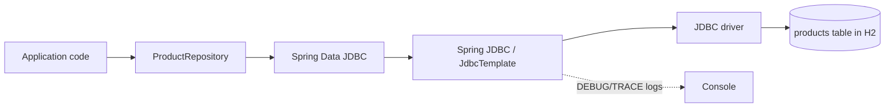

# Running Your First CRUD Cycle and Observing SQL

## 1. Lab Objectives

Once you have initialized a Spring Boot project with Spring Data JDBC, the most important next step is **running a complete Create → Read → Update → Delete cycle against a real database and observing the SQL statements executed by the framework**. This lesson uses an in-memory H2 database so you do not need to install a database server; repository usage remains similar when switching to PostgreSQL or any other supported relational database.

By the end, you will know how to:

- Declare an SQL table, map a Java object, and create a `CrudRepository`.
- Insert a new record, read by ID, update data, and delete a record.
- Enable Spring JDBC logging to observe `INSERT`, `SELECT`, `UPDATE`, and `DELETE`.
- Understand why `save` sometimes issues `INSERT` and sometimes issues `UPDATE`, and why `save` returns an object you should keep using.
- Distinguish SQL emitted by the repository from logs printed by your own application, and recognize common first-run errors.

### Which Components Does CRUD Pass Through?



You invoke Java methods on the repository; Spring Data JDBC generates and executes SQL through the JDBC infrastructure. Enabling logging at the right layer shows the actual SQL sent to JDBC rather than leaving you to infer it from method names.

## 2. Preparing a Minimal Application

Example assumptions:

- **Java 21**, Spring Boot 3.x, or a Spring Boot version compatible with Spring Data JDBC.
- A Gradle project generated via Spring Initializr or an existing Spring Boot project.
- Selected dependencies: **Spring Data JDBC** and **H2 Database**.
- Java package used in this lesson: `com.example.jdbccrud`. If your actual package differs, update the `package` declarations consistently.

With Gradle Groovy DSL, the required dependencies are:

```groovy
dependencies {
    implementation 'org.springframework.boot:spring-boot-starter-data-jdbc'
    runtimeOnly 'com.h2database:h2'
}
```

`spring-boot-starter-data-jdbc` provides Spring Data JDBC and Spring JDBC infrastructure. H2 supplies both the JDBC driver and the embedded database for running the example. When using Spring Boot dependency management, compatible versions of these libraries are managed according to your project's Spring Boot version.

Files to create:

```text
src/
└── main/
    ├── java/com/example/jdbccrud/
    │   ├── JdbcCrudApplication.java
    │   ├── Product.java
    │   └── ProductRepository.java
    └── resources/
        ├── application.properties
        └── schema.sql
```

Spring Web is not needed for this console-based lab. We use `CommandLineRunner`, so the program runs the CRUD steps automatically on startup.

## 3. Configuring the Database and SQL Logging

Create `src/main/resources/application.properties`:

```properties
spring.application.name=jdbc-crud-demo

# In-memory H2 database for the practice session
spring.datasource.url=jdbc:h2:mem:crud_demo;DB_CLOSE_DELAY=-1
spring.datasource.driver-class-name=org.h2.Driver
spring.datasource.username=sa
spring.datasource.password=

# Run schema.sql during application initialization
spring.sql.init.mode=always

# Print SQL statements through Spring JDBC infrastructure
logging.level.org.springframework.jdbc=DEBUG

# Print more detailed PreparedStatement parameter binding info
logging.level.org.springframework.jdbc.core.StatementCreatorUtils=TRACE
```

Explanation:

| Setting | Effect |
| --- | --- |
| `jdbc:h2:mem:crud_demo` | H2 creates an in-memory database inside the Java process; when the application stops completely, practice data is not persisted long term. |
| `DB_CLOSE_DELAY=-1` | Keeps the H2 database alive inside the JVM even after the last connection closes; it does not make in-memory H2 persistent across JVM restarts. |
| `spring.sql.init.mode=always` | Allows Spring Boot to run `schema.sql` at startup. |
| `logging.level.org.springframework.jdbc=DEBUG` | Displays JDBC activity and SQL statements through Spring JDBC in the console. |
| `StatementCreatorUtils=TRACE` | Shows parameter binding details along code paths that use this class; exact detail varies by Spring version. |

**Only enable parameter logging at `TRACE` level in learning environments or controlled diagnostics.** In real applications, bind parameters may contain emails, customer details, or sensitive data.

## 4. Creating the `products` Table with SQL

Create `src/main/resources/schema.sql`:

```sql
CREATE TABLE "products" (
    id       BIGINT GENERATED BY DEFAULT AS IDENTITY PRIMARY KEY,
    name     VARCHAR(120) NOT NULL,
    price    DECIMAL(12, 2) NOT NULL,
    quantity INTEGER NOT NULL CHECK (quantity >= 0)
);
```

Each row has four columns:

- `id`: integer primary key generated by the database on insert.
- `name`: product name, required.
- `price`: price using a decimal type, much better suited than floating-point types for monetary values.
- `quantity`: stock quantity, must be non-negative.

**An easy-to-hit H2 gotcha:** the table name `"products"` is intentionally enclosed in double quotes. By default, H2 folds *unquoted* SQL identifiers to uppercase, whereas `@Table("products")` in the next section specifies the exact lowercase name. Spring Data JDBC may quote identifiers in generated SQL. If you create `CREATE TABLE products` while mapping `@Table("products")`, the application can report table-not-found because `PRODUCTS` and `"products"` are two different identifiers in H2. In this lesson, the table is created with a name matching the mapping.

The columns `id`, `name`, `price`, and `quantity` are unquoted in the DDL, so H2 folds them to uppercase by default; column names derived by Spring Data JDBC for the H2 dialect will match. When moving to another database, verify that dialect's casing and identifier-quoting rules.

Spring Data JDBC **does not auto-create tables from entities like Hibernate DDL mechanisms do**. We create the schema explicitly via script; in real projects, Flyway or Liquibase typically manages schema changes across versions.

## 5. Mapping Rows to a Java Record

Create `src/main/java/com/example/jdbccrud/Product.java`:

```java
package com.example.jdbccrud;

import java.math.BigDecimal;
import org.springframework.data.annotation.Id;
import org.springframework.data.relational.core.mapping.Table;

@Table("products")
public record Product(
        @Id Long id,
        String name,
        BigDecimal price,
        int quantity
) {
}
```

Each `Product` instance represents one row in the table:

| Java | SQL |
| --- | --- |
| `Long id` | `id BIGINT`, primary key |
| `String name` | `name VARCHAR(120)` |
| `BigDecimal price` | `price DECIMAL(12,2)` |
| `int quantity` | `quantity INTEGER` |

`@Table("products")` links the record to the table created earlier; `@Id` from `org.springframework.data.annotation.Id` marks the primary key property. Do not confuse it with JPA's `jakarta.persistence.Id`. Spring Data JDBC does not require JPA's `@Entity`.

Here we use a Java `record` to focus on the CRUD cycle. Records are immutable: once created, you cannot call `setQuantity(...)`; to update, you construct a new record keeping the same ID and pass it to `save`. Spring Data instantiates records using their canonical constructor; when an insert generates an ID, `save` returns a new instance holding that ID.

**Always use the return value from `save`**, especially with records or immutable objects.

## 6. Creating the Repository for the Table

Create `src/main/java/com/example/jdbccrud/ProductRepository.java`:

```java
package com.example.jdbccrud;

import org.springframework.data.repository.CrudRepository;

public interface ProductRepository extends CrudRepository<Product, Long> {
}
```

The two generic parameters mean:

- `Product` is the aggregate root type managed by the repository.
- `Long` is the ID type of `Product`.

You do not need to write an implementation class for basic operations. Spring Data generates the implementation at startup and provides these built-in methods:

| Method | Purpose | Typical SQL |
| --- | --- | --- |
| `save(new Product(null, ...))` | Insert a new row | `INSERT` |
| `findById(id)` | Read one row | `SELECT ... WHERE id = ?` |
| `findAll()` | Read all rows | `SELECT` |
| `save(new Product(id, ...))` | Persist changes to an existing row | `UPDATE` |
| `deleteById(id)` | Delete a row | `DELETE` |
| `existsById(id)` | Check existence | Typically a `SELECT COUNT(...)` query |

Spring Data JDBC distinguishes inserts from updates via its new-entity detection strategy; for a record **without `@Version` in this example**, `@Id = null` indicates a new entity, while a non-null ID is treated as an existing entity. These rules can change when using `@Version`, `Persistable`, or custom new-entity detection.

## 7. Running the Full Create → Read → Update → Delete Cycle

Create `src/main/java/com/example/jdbccrud/JdbcCrudApplication.java`:

```java
package com.example.jdbccrud;

import java.math.BigDecimal;
import org.springframework.boot.CommandLineRunner;
import org.springframework.boot.SpringApplication;
import org.springframework.boot.autoconfigure.SpringBootApplication;
import org.springframework.context.annotation.Bean;

@SpringBootApplication
public class JdbcCrudApplication {

    public static void main(String[] args) {
        SpringApplication.run(JdbcCrudApplication.class, args);
    }

    @Bean
    CommandLineRunner firstCrud(ProductRepository products) {
        return args -> {
            // CREATE
            System.out.println("\n=== CREATE ===");
            Product created = products.save(
                    new Product(
                            null,
                            "A5 Notebook",
                            new BigDecimal("35000.00"),
                            10
                    )
            );
            System.out.println("Created: " + created);

            // READ
            System.out.println("\n=== READ ===");
            Product found = products.findById(created.id())
                    .orElseThrow();
            System.out.println("Found by ID: " + found);

            System.out.println("All products:");
            products.findAll().forEach(System.out::println);

            // UPDATE
            System.out.println("\n=== UPDATE ===");
            Product changed = new Product(
                    found.id(),                    // Keep primary key
                    found.name(),
                    found.price(),
                    25                              // Change quantity 10 -> 25
            );
            Product savedAfterUpdate = products.save(changed);
            System.out.println("Updated: " + savedAfterUpdate);

            Product verified = products.findById(savedAfterUpdate.id())
                    .orElseThrow();
            System.out.println("Read again after update: " + verified);

            // DELETE
            System.out.println("\n=== DELETE ===");
            products.deleteById(savedAfterUpdate.id());
            boolean stillExists = products.existsById(savedAfterUpdate.id());
            System.out.println("Still exists after delete? " + stillExists);
        };
    }
}
```

Place all files in the same package so component scanning finds the beans and Spring Data repository scanning finds the interface. Once the application starts cleanly, Spring invokes `CommandLineRunner` after the application context is ready and the database has been initialized as configured.

### Running the Application

From the project root directory with the Gradle Wrapper:

```bash
./gradlew bootRun
```

On Windows PowerShell:

```powershell
.\gradlew.bat bootRun
```

If your IDE supports running Spring Boot apps, you can also run `JdbcCrudApplication`'s `main` method.

In the console, alongside Spring logs, your printed lines will resemble:

```text
=== CREATE ===
Created: Product[id=1, name=A5 Notebook, price=35000.00, quantity=10]

=== READ ===
Found by ID: Product[id=1, name=A5 Notebook, price=35000.00, quantity=10]
All products:
Product[id=1, name=A5 Notebook, price=35000.00, quantity=10]

=== UPDATE ===
Updated: Product[id=1, name=A5 Notebook, price=35000.00, quantity=25]
Read again after update: Product[id=1, name=A5 Notebook, price=35000.00, quantity=25]

=== DELETE ===
Still exists after delete? false
```

The ID may differ from `1` if the database already contained data or had previously generated IDs. `BigDecimal` formatting depends on how the driver and mapper preserve scale, so trailing zeros after the decimal point can vary slightly. The snippets above are **illustrative output**, not logs captured from a specific run.

## 8. Reading SQL Logs Operation by Operation

With `DEBUG` enabled on `org.springframework.jdbc`, the console shows messages from `JdbcTemplate`, `NamedParameterJdbcTemplate`, transaction components, and related JDBC classes. Exact log formatting, column ordering, identifier quoting, and SQL syntax vary with Spring Data JDBC version, dialect, and driver; verify against your project's actual logs.

For readability, the SQL statements below illustrate only the **statement shape**, omitting timestamps, thread names, logger classes, and certain dialect specifics.

### 8.1. Create: `INSERT`

Call:

```java
Product created = products.save(
        new Product(null, "A5 Notebook", new BigDecimal("35000.00"), 10)
);
```

Equivalent SQL:

```sql
INSERT INTO "products" ("NAME", "PRICE", "QUANTITY")
VALUES (?, ?, ?);
```

At this step:

1. `id` is `null`, so Spring Data JDBC treats this as a new entity.
2. The database generates the primary key using the `IDENTITY` column.
3. The `?` placeholders are JDBC `PreparedStatement` bind parameters; data is sent separately through the parameter API.
4. `save` returns a `Product` with the generated `id`, such as `1L`.

Never concatenate user data directly into SQL strings; bind parameters separate query structure from values and prevent many SQL injection risks.

### 8.2. Read: `SELECT`

Call:

```java
Product found = products.findById(created.id()).orElseThrow();
```

Essentially equivalent SQL:

```sql
SELECT "ID", "NAME", "PRICE", "QUANTITY"
FROM "products"
WHERE "ID" = ?;
```

The bind value for `?` is the product ID. The repository returns `Optional<Product>`: if a row exists, it maps it into a record; otherwise it returns `Optional.empty()`. `orElseThrow()` in the example intentionally fails if the lookup does not find the row.

Calling `findAll()` generates another `SELECT` without an ID filter:

```sql
SELECT "ID", "NAME", "PRICE", "QUANTITY"
FROM "products";
```

When tables grow large, avoid calling `findAll()` and filtering in Java for paginated screens; this lesson only has one row so it is easy to inspect.

### 8.3. Update: `UPDATE`

Call:

```java
Product changed = new Product(
        found.id(), found.name(), found.price(), 25
);
Product updated = products.save(changed);
```

Equivalent SQL:

```sql
UPDATE "products"
SET "NAME" = ?, "PRICE" = ?, "QUANTITY" = ?
WHERE "ID" = ?;
```

Because `id` is no longer `null`, Spring Data JDBC treats this as an existing record and follows the update path. Even though only `quantity` changed, a standard aggregate-root update statement still assigns all mapped columns, not just the field you changed in Java.

**There is no Hibernate/JPA-style dirty checking**: constructing a new record alone emits no SQL; calling `products.save(changed)` is what writes the changes. Calling `findById` afterward is a separate read verifying the persisted values.

If you want to update a single column specifically in SQL, look into custom repository queries, `JdbcTemplate`, or appropriate APIs; that is a different design choice from saving the whole aggregate.

### 8.4. Delete: `DELETE`

Call:

```java
products.deleteById(updated.id());
```

Equivalent SQL:

```sql
DELETE FROM "products"
WHERE "ID" = ?;
```

After deleting, `existsById(id)` can issue an existence-check query (for instance, based on `COUNT`). Returning `false` is expected in this example because there was only one product and it was deleted.

### 8.5. Full CRUD Cycle Comparison Table

| Step | Java Call | Primary SQL | What to Observe |
| --- | --- | --- | --- |
| 1 | `save(new Product(null, ...))` | `INSERT` | A new ID is generated and returned. |
| 2 | `findById(id)` | `SELECT ... WHERE ...` | Data is mapped from the SQL row into `Product`. |
| 3 | `findAll()` | `SELECT ...` | Issues an additional full-table query. |
| 4 | `save(new Product(id, ...))` | `UPDATE ... WHERE ...` | ID stays unchanged; `quantity` updates. |
| 5 | `findById(id)` | `SELECT ... WHERE ...` | Reads back the newly updated data. |
| 6 | `deleteById(id)` | `DELETE ... WHERE ...` | The row is deleted by ID. |
| 7 | `existsById(id)` | Existence check query | Returns `false`; issues extra SQL. |

Do not expect the entire CRUD run to emit only four SQL statements, because the example deliberately calls `findAll`, a second `findById(...)`, and `existsById` to inspect intermediate states.

## 9. Distinguishing SQL Logs from Printed Output

Example:

```text
DEBUG ... JdbcTemplate : Executing prepared SQL statement [...]
TRACE ... StatementCreatorUtils : Setting SQL statement parameter value ...
Created: Product[id=1, name=A5 Notebook, price=35000.00, quantity=10]
```

The first two lines are logs from the database access infrastructure; the last line is `System.out.println` in the application. The `Created` line proves the program received an object; the SQL logs reveal what operations were actually issued at the JDBC layer.

When reading logs, ask yourself:

1. Is the statement `INSERT`, `SELECT`, `UPDATE`, or `DELETE`?
2. Does the table name match `@Table` and `schema.sql`?
3. Does the SQL `WHERE` clause target the right ID?
4. How many `SELECT`s occurred because code invoked multiple read methods?
5. What values do the `?` placeholders represent, and should they be logged in this environment?
6. Did application code, an initializer, or the framework execute any unexpected queries?

Do not assume one repository method always maps to exactly **one** SQL statement in every model. This example uses a simple aggregate root with no child tables; once you add child collections/entities inside an aggregate, saving and loading an aggregate can issue multiple SQL statements.

## 10. Key Concepts After Your First Run

### `save` Is Not Synonymous with `INSERT`

`CrudRepository.save` persists aggregate state. Depending on whether Spring Data JDBC detects the entity as new or existing, the write follows either the insert or update path. For example:

```java
products.save(new Product(null, "A", new BigDecimal("10.00"), 1));
// INSERT path because ID is missing

products.save(new Product(123L, "A", new BigDecimal("10.00"), 2));
// UPDATE path because ID is present; row ID = 123 must actually exist
```

Guessing an ID is not a safe way to insert; if an ID is already assigned yet no row exists, `save` is not an automatic "upsert" that creates the missing row. When an update finds no matching row, failure behavior depends on the update mechanism and state detection; in this practice lab, always use the ID returned from a successful creation.

### Repository Methods and Transactions

Default CRUD repository methods are configured with transaction settings suited to each single operation. However, consecutive calls inside `CommandLineRunner` **do not automatically form a single shared transaction**: create, read, update, and delete are separate calls in this example.

When business logic requires multiple steps to succeed or roll back together, place them in a `@Transactional` service method invoked through a Spring bean. For example, transferring stock between two records must be treated as one business operation with stock checks and consistency guarantees; simply chaining two `save` calls is not enough.

### `@Id` Differs from `@Version`

`@Id` identifies the target record; **it does not stop two concurrent actors from reading and overwriting the same row**. If you need to detect concurrent updates, Spring Data JDBC supports `@Version` for optimistic locking. This first lesson omitted a version column to keep focus on the four basic SQL statements; adding versioning is a natural next step that affects both DDL and `UPDATE` conditions.

### In-Memory H2 Is for Practice, Not Permanent Storage

Restarting the JVM creates a brand-new H2 database and Spring Boot re-runs `schema.sql`. The CRUD cycle deleting the record at the end also leaves the table empty afterward. If you need data to survive restarts, switch to file-backed H2 or a deployed database like PostgreSQL with migrations; when switching, verify the driver, dialect, SQL types, quoting, and transaction behavior.

## 11. Common Errors and How to Fix Them

| Symptom | Common Cause | How to Fix |
| --- | --- | --- |
| `Table "products" not found` | `schema.sql` did not run; table name casing in `@Table` differs from H2 DDL | Check `src/main/resources/schema.sql`, `spring.sql.init.mode`; ensure `CREATE TABLE "products"` matches `@Table("products")`. |
| `Column ... not found` | Column name or quoting rules do not match the mapping | Compare the record, DDL, and SQL in logs; custom `@Column` names must match actual column names. |
| `Failed to configure a DataSource` | Missing H2 dependency/driver or invalid URL | Check `runtimeOnly 'com.h2database:h2'`, URL, and loaded dependencies. |
| Cannot create `ProductRepository` bean | Missing JDBC starter or repository sits outside package scan scope | Check dependencies and place the repository in or beneath the `@SpringBootApplication` package. |
| No SQL appears in the console | Wrong logger configured or `DEBUG` level overridden elsewhere | Enable `logging.level.org.springframework.jdbc=DEBUG`, rerun, and distinguish SQL logs from `System.out.println`. |
| Calling `save` emits no `INSERT` | Entity has a non-null ID, so Spring Data JDBC treats it as existing | Use a `null` ID for new products; use the ID from a persisted record for updates. |
| Table is empty after running | Code called `deleteById` | Temporarily comment out the delete call to inspect post-update state, or re-create on the next run. |
| Restarting loses previous data | Using an in-memory H2 database | Expected behavior; use a persistent database if data must be retained long term. |
| Adding a Java field causes query errors | SQL schema was not updated to match | Update `schema.sql` or migrations alongside the model; Spring Data JDBC does not alter tables automatically. |

When errors occur, read the **first SQL-related exception** in the stack trace, grab the table/column name reported by the database, and compare it directly against your DDL and mapping. Do not tweak logger config to hide errors; loggers are purely for visibility.

## 12. Self-Practice Exercises

Once the first CRUD cycle runs smoothly, try three small variations to solidify how the mechanism works.

**Exercise A — Insert a second record:** create another `Product` with `id = null` and then call `findAll()`. Observe two `INSERT` statements and a `SELECT` returning two rows. Predict the new ID before checking the console.

**Exercise B — Compare the record before and after update:** change `price` while keeping `quantity` unchanged; call `save` and read it back. Notice how the `UPDATE` SQL may still set columns other than the one you intended to change. Explain why calling `save` differs from writing `UPDATE products SET price = ...` yourself.

**Exercise C — Count read queries:** write down your prediction of how many `SELECT` queries the current CRUD cycle executes, then remove `findAll()` and the post-update `findById(...)`. Compare the query counts in the logs. The goal is to see that **every repository check incurs database access cost**.

All test data can be discarded freely when the application stops since H2 runs in-memory. To reset from scratch, simply restart the application with the prepared config and schema files.

## 13. Key Takeaways

With a single table, your first Spring Data JDBC cycle works like this: define DDL → create a model with `@Table`/`@Id` → declare `CrudRepository` → call `save`, `findById`, `save`, `deleteById` → inspect SQL statements via Spring JDBC logs. Repository method names express **application-layer intent**; SQL in the logs shows **actual database access**.

The main takeaway from this lab is connecting three layers of information: **which ID and values the Java object currently holds**, **which repository method was called**, and **which SQL statement the database received**. Once this link is clear, upcoming topics like custom queries, transactions, aggregate relationships, optimistic locking, and performance tuning will be much easier to grasp.

### Official Reference Documentation

- [Spring Data Relational — Getting Started](https://docs.spring.io/spring-data/relational/reference/jdbc/getting-started.html)
- [Spring Data Relational — Mapping](https://docs.spring.io/spring-data/relational/reference/jdbc/mapping.html)
- [Spring Data Relational — Persisting Entities](https://docs.spring.io/spring-data/relational/reference/jdbc/entity-persistence.html)
