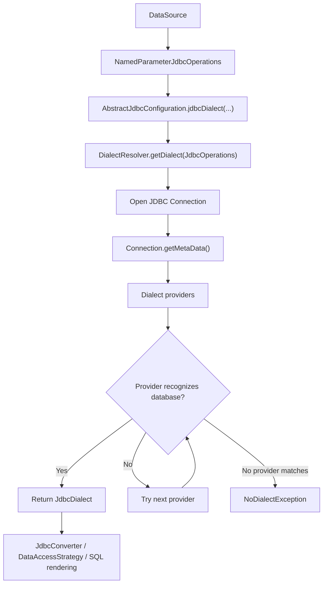

# Detecting Dialect from Connection Metadata

In **Spring Data Relational JDBC**, each database has differences in SQL syntax and how certain operations are executed. For example, how row limits, ID generation, row locking, identifier handling, `UPSERT`, or array types work can differ between PostgreSQL, MySQL, Oracle, and SQL Server. Spring Data JDBC encapsulates these differences into an abstraction named **`JdbcDialect`**.

When initializing the JDBC infrastructure, Spring Data JDBC determines the dialect by default by obtaining a connection from the `DataSource` and inspecting that connection's metadata. Resolution is performed via `DialectResolver`, typically based on `Connection.getMetaData()` and providers discovered through `SpringFactoriesLoader`.

General flow:

1. The application configures `DataSource` and `NamedParameterJdbcOperations`.
2. `AbstractJdbcConfiguration` invokes dialect resolution logic.
3. `DialectResolver` uses JDBC operations to acquire a connection.
4. The resolver reads database/driver metadata.
5. A matching provider returns a `JdbcDialect`.
6. The dialect is used in converters, data access strategies, and Spring Data JDBC SQL generation components.

If the database lacks a supported dialect or custom provider, Spring Data JDBC cannot complete default configuration and the application may fail on startup. This lesson explains the metadata, detection mechanism, built-in dialect list, how to extend providers, and how to troubleshoot errors.

## 1. What is a Dialect and why does Spring Data JDBC need it?

`JdbcDialect` describes the SQL/JDBC characteristics of a database. It enables Spring Data JDBC to generate appropriate SQL statements without having to write a separate repository implementation for each vendor.

Differences typically represented by a dialect:

| Aspect | Example differences |
|---|---|
| Result limiting | `LIMIT/OFFSET`, `FETCH FIRST`, `OFFSET … FETCH`, or vendor-specific syntax |
| ID generation | Identity columns, sequences, or how generated keys are retrieved |
| Row locking | Syntax and placement of `FOR UPDATE`, lock clauses, or locking hints |
| Identifiers | Table/column quoting rules and case sensitivity |
| Inserts | How inserts with default values or generated-key retrieval are expressed |
| Upserts | How insert-or-update statements are built if supported by the database |
| Array columns | Ability to bind/read array types and conversion behavior |
| Native types | Java types handled by the JDBC driver as store-native types |
| Feature flags | Database capabilities such as Single Query Loading or other SQL features |

A dialect is not merely a vendor name string. It is a collection of rules and capabilities that the framework needs to generate SQL, bind data, and process results accurately for the database.

### `Dialect` and `JdbcDialect`

Spring Data Relational has the common interface `org.springframework.data.relational.core.dialect.Dialect`. `JdbcDialect` in package `org.springframework.data.jdbc.core.dialect` extends that interface with JDBC-specific capabilities, such as JDBC array support and SQL type metadata.

```text
org.springframework.data.relational.core.dialect.Dialect
                    ▲
                    │ extends
                    │
org.springframework.data.jdbc.core.dialect.JdbcDialect
```

Spring Data JDBC requires a `JdbcDialect`. When a provider returns an implementation, that implementation must be compatible with the SQL and JDBC behavior of the actual database.

## 2. Where does metadata come from?

JDBC provides `DatabaseMetaData` through a `Connection`:

```java
Connection connection = dataSource.getConnection();
DatabaseMetaData metadata = connection.getMetaData();
```

Metadata contains information about the database and driver serving that connection. Useful methods include:

| Method | Information |
|---|---|
| `getDatabaseProductName()` | Database product name, e.g., PostgreSQL or MySQL |
| `getDatabaseProductVersion()` | Database server version |
| `getDriverName()` | JDBC driver name |
| `getDriverVersion()` | JDBC driver version |
| `getURL()` | JDBC URL of the connection |
| `getUserName()` | Connected user name |
| `getIdentifierQuoteString()` | Character used to quote identifiers according to the driver |
| `supportsTransactions()` | Whether the driver/database supports transactions |
| `supportsBatchUpdates()` | Batch update capability |

Spring Data JDBC uses `JdbcOperations` to obtain a connection and read metadata; applications do not need to open connections manually for standard dialect resolution.

### Diagnostic metadata reading example

When you need to verify which database the driver is connecting to, you can use `JdbcTemplate`:

```java
import java.sql.DatabaseMetaData;

import org.springframework.jdbc.core.ConnectionCallback;
import org.springframework.jdbc.core.JdbcTemplate;
import org.springframework.stereotype.Component;

@Component
public class DatabaseMetadataReporter {

    public DatabaseMetadataReporter(JdbcTemplate jdbcTemplate) {
        jdbcTemplate.execute((ConnectionCallback<Void>) connection -> {
            DatabaseMetaData metadata = connection.getMetaData();

            System.out.println("Database: " + metadata.getDatabaseProductName());
            System.out.println("Database version: " + metadata.getDatabaseProductVersion());
            System.out.println("JDBC driver: " + metadata.getDriverName());
            System.out.println("Driver version: " + metadata.getDriverVersion());

            return null;
        });
    }
}
```

This is diagnostic code, not a replacement for `DialectResolver`. `JdbcTemplate.execute(ConnectionCallback)` acquires a connection through Spring JDBC mechanisms and manages its lifecycle. Do not call `close()` on the connection received from this callback.

Avoid logging the full JDBC URL or user/credentials if the URL contains sensitive information. During investigation, the product name, server version, and driver version are usually sufficient to confirm the database.

## 3. Dialect detection flow at startup

In pure Java configuration, `AbstractJdbcConfiguration` provides the `jdbcDialect(NamedParameterJdbcOperations)` bean. The default implementation uses the resolver infrastructure to determine the dialect from JDBC operations.



Detailed steps:

1. `DataSource` provides a connection to the actual database.
2. `NamedParameterJdbcOperations` is the Spring JDBC abstraction used to execute SQL and access connections.
3. `AbstractJdbcConfiguration.jdbcDialect(...)` determines the dialect while configuring Spring Data JDBC beans.
4. `DialectResolver` obtains a connection via `JdbcOperations` and inspects metadata.
5. `JdbcDialectProvider` instances discovered via `SpringFactoriesLoader` are used to find the matching dialect.
6. A matching provider returns an `Optional` containing the `Dialect`; the resolver uses that dialect for the JDBC infrastructure.

If no provider recognizes the database, the resolver throws `DialectResolver.NoDialectException`. This error usually prevents the application context from initializing because beans such as `JdbcConverter` and `DataAccessStrategy` require a dialect.

### Metadata is more than a name in the JDBC URL

Do not infer the dialect solely by inspecting the `spring.datasource.url` string. The URL is connection configuration; `DatabaseMetaData` reflects the database that the JDBC connection is actually talking to.

For example, the URL might pass through a proxy, cloud database endpoint, or a driver compatible with another protocol. The database name in the URL might not match `getDatabaseProductName()`. Providers should inspect metadata and required capabilities rather than merely parsing the URL.

## 4. Dialects directly supported by Spring Data JDBC

According to Spring Data Relational **4.1.2** documentation, databases with built-in dialects include:

| Database | Built-in JDBC dialect |
|---|---|
| IBM Db2 | `JdbcDb2Dialect` |
| H2 | `JdbcH2Dialect` |
| HSQLDB | `JdbcHsqlDbDialect` |
| MariaDB | `JdbcMariaDbDialect` |
| Microsoft SQL Server | `JdbcSqlServerDialect` |
| MySQL | `JdbcMySqlDialect` |
| Oracle | `JdbcOracleDialect` |
| PostgreSQL | `JdbcPostgresDialect` |

This list covers dialects provided by Spring Data JDBC, not every database that has a JDBC driver. A database with a JDBC driver still needs a dialect for Spring Data JDBC to know how to generate SQL.

If using another database, the application may fail to start with a dialect-not-found error. In that case you can:

- Use a vendor-provided dialect if available.
- Write an appropriate `JdbcDialect` and provider so the resolver auto-detects it.
- Override the `jdbcDialect(...)` bean in `AbstractJdbcConfiguration` if the application only needs a fixed selection and you control the database.

Do not pick a similar-looking dialect just because the database supports part of common SQL syntax. Differences in ID generation, locking, upsert, arrays, type conversion, and query rendering might only surface when running a specific use case.

## 5. Spring Boot and pure Java configuration

### Spring Boot

With Spring Boot and the `spring-boot-starter-data-jdbc` dependency, usually only `DataSource` needs to be configured:

```yaml
spring:
  datasource:
    url: jdbc:postgresql://localhost:5432/sales
    username: app
    password: ${DB_PASSWORD}
    driver-class-name: org.postgresql.Driver
```

When a valid driver and DataSource are present, Spring Boot auto-configures the Spring Data JDBC infrastructure. `AbstractJdbcConfiguration` and dialect resolution are wired in the corresponding infrastructure; the application does not need to call `DialectResolver` manually.

There is no need to declare a dialect name in typical YAML. Spring Data JDBC determines the dialect from connection metadata. The JDBC URL and driver configuration must still match the database the application intends to connect to.

### Java configuration with `AbstractJdbcConfiguration`

When not using Spring Boot or when configuring infrastructure manually:

```java
@Configuration
@EnableJdbcRepositories
public class ApplicationJdbcConfiguration extends AbstractJdbcConfiguration {

    @Bean
    public DataSource dataSource() {
        return DataSourceBuilder.create()
                .url("jdbc:postgresql://localhost:5432/sales")
                .username("app")
                .password(System.getenv("DB_PASSWORD"))
                .driverClassName("org.postgresql.Driver")
                .build();
    }

    @Bean
    public NamedParameterJdbcOperations namedParameterJdbcOperations(
            DataSource dataSource) {
        return new NamedParameterJdbcTemplate(dataSource);
    }

    @Bean
    public PlatformTransactionManager transactionManager(DataSource dataSource) {
        return new JdbcTransactionManager(dataSource);
    }
}
```

`AbstractJdbcConfiguration` provides the default `jdbcDialect(...)` bean. You do not need to declare an extra dialect bean if auto-detection already works.

If overriding `jdbcDialect(...)`, the current signature is:

```java
@Override
@Bean
public JdbcDialect jdbcDialect(NamedParameterJdbcOperations operations) {
    // Deliberately select the dialect.
}
```

This is a configuration extension point; use it when there is a clear requirement, not as a mandatory step in an ordinary application.

## 6. Inspecting the selected dialect in the application

You can inject the `JdbcDialect` bean to inspect the dialect name or capabilities:

```java
import org.springframework.data.jdbc.core.dialect.JdbcDialect;
import org.springframework.stereotype.Component;

@Component
public class JdbcDialectReporter {

    public JdbcDialectReporter(JdbcDialect dialect) {
        System.out.println("Spring Data JDBC dialect: " + dialect.getName());
        System.out.println(
                "Single Query Loading supported: " + dialect.supportsSingleQueryLoading()
        );
    }
}
```

`getName()` and feature flags help diagnose which dialect has been configured. Do not use this single check to conclude all database features work; integration tests against the actual database/driver are still required.

### Which beans are affected by the dialect?

`AbstractJdbcConfiguration` passes the dialect to multiple components:

| Component | Role of dialect |
|---|---|
| `JdbcConverter` | Combines default/custom converters and store-native type information |
| `DataAccessStrategy` | Builds persistence operations tailored to the SQL dialect |
| `JdbcAggregateTemplate` | Uses configured data access strategy/converter to persist aggregates |
| Query/SQL rendering | Generates limit, lock, insert, identifier, and specialized statements |
| ID generation callback | Uses dialect information to handle the appropriate ID generation strategy |

If the dialect is wrong, the application might start up but fail on a less frequently used operation, such as insert with generated keys, upsert, array mapping, or locking. Therefore, checking the dialect name is only the first step.

## 7. `DialectResolver` and the provider SPI

Since Spring Data Relational **3.5**, the current `DialectResolver` resides in package:

```java
org.springframework.data.jdbc.core.dialect.DialectResolver
```

This class provides:

```java
JdbcDialect dialect = DialectResolver.getDialect(jdbcOperations);
```

The method takes `JdbcOperations`, acquires a connection, and resolves the dialect. If no dialect is found, it throws `DialectResolver.NoDialectException`.

The provider extension is the nested interface:

```java
org.springframework.data.jdbc.core.dialect.DialectResolver.JdbcDialectProvider
```

Provider method:

```java
Optional<Dialect> getDialect(JdbcOperations operations);
```

The provider returns `Optional.of(dialect)` if it recognizes the database, or `Optional.empty()` if the database is outside that provider's scope. The returned value must be a dialect compatible with Spring Data JDBC; in practice, return a `JdbcDialect` implementation.

### Deprecated legacy package

Prior to Spring Data Relational 3.5, the resolver lived in package `org.springframework.data.jdbc.repository.config`. The legacy API has been deprecated since 3.5 in favor of `org.springframework.data.jdbc.core.dialect`.

When writing a new provider for Spring Data Relational 3.5 or later, use package `org.springframework.data.jdbc.core.dialect`. Do not start new projects with the old resolver/provider imports.

## 8. Writing a custom provider

Suppose an organization uses a proprietary database named `AcmeDB` that has a JDBC driver, but Spring Data JDBC does not have a built-in dialect yet. You need two parts:

1. An `AcmeJdbcDialect` implementation describing the actual SQL/driver behavior.
2. A provider that recognizes `AcmeDB` from metadata and returns that dialect.

### Provider reading metadata

```java
package com.example.jdbc;

import java.sql.DatabaseMetaData;
import java.util.Optional;

import org.springframework.dao.DataAccessException;
import org.springframework.jdbc.core.ConnectionCallback;
import org.springframework.jdbc.core.JdbcOperations;
import org.springframework.data.jdbc.core.dialect.DialectResolver.JdbcDialectProvider;
import org.springframework.data.relational.core.dialect.Dialect;

public class AcmeDialectProvider implements JdbcDialectProvider {

    @Override
    public Optional<Dialect> getDialect(JdbcOperations operations) {
        return operations.execute((ConnectionCallback<Optional<Dialect>>) connection -> {
            DatabaseMetaData metadata = connection.getMetaData();

            String productName = metadata.getDatabaseProductName();
            String productVersion = metadata.getDatabaseProductVersion();

            if ("AcmeDB".equalsIgnoreCase(productName)) {
                // Replace with the actual JdbcDialect implementation for AcmeDB.
                return Optional.of(new AcmeJdbcDialect());
            }

            return Optional.empty();
        });
    }
}
```

The code above illustrates the SPI and metadata lookup. `AcmeJdbcDialect` is an application/vendor-implemented class; it must implement `JdbcDialect` with appropriate SQL rules. This placeholder class cannot compile before an actual dialect implementation exists.

If the database has multiple major versions with SQL differences, the provider can inspect `getDatabaseProductVersion()` and select an implementation by version. Do not parse versions using simple string comparisons if the vendor uses complex formats; use a tested parser/strategy.

### Registering the provider via `META-INF/spring.factories`

Create file:

```text
src/main/resources/META-INF/spring.factories
```

Content:

```properties
org.springframework.data.jdbc.core.dialect.DialectResolver$JdbcDialectProvider=com.example.jdbc.AcmeDialectProvider
```

Spring Data JDBC uses `SpringFactoriesLoader` to discover providers from the classpath. The provider must have a public no-arg constructor so the loader can instantiate it under this mechanism; avoid requiring Spring application context constructor dependency injection for providers loaded via `SpringFactoriesLoader`.

### When the provider does not recognize the database

If the metadata is not `AcmeDB`, return `Optional.empty()`. That allows the resolver to continue evaluating other providers. Do not return the Acme dialect for every database merely to avoid `NoDialectException`; picking the wrong dialect can generate invalid SQL or cause data corruption.

## 9. Writing a `JdbcDialect` responsibly

The provider only answers the question **"which dialect does this database use?"**. It does not define SQL syntax itself. If the database does not have a compatible dialect, `JdbcDialect` must be implemented.

A dialect must accurately reflect the database's capabilities:

- `limit()` and `lock()` return how limit/lock clauses are rendered.
- `getIdentifierProcessing()` defines identifier quoting/case handling.
- `getIdGeneration()` and `getInsertRenderContext()` support inserts/generated IDs.
- `getUpsertRenderContext()` describes how upserts are generated if supported.
- `getArraySupport()` describes JDBC array binding/reading.
- `simpleTypes()` lists store-native types handled by the driver.
- `getConverters()` provides database-specific converters if needed.
- `supportsSingleQueryLoading()` returns `true` only when the database supports the SQL features required for that mechanism.

Do not implement a dialect by copying another class and just changing `getName()`. A database with PostgreSQL-like `LIMIT` syntax but different ID generation, quoting, arrays, or upsert still needs the right dialect for those features.

### Reusing a built-in dialect when the database is truly compatible

If a database is a distribution fully compatible with an existing dialect, reusing the existing implementation may be considered. However, every feature Spring Data JDBC uses must be verified. Wire protocol compatibility or running a few SELECT statements is not enough to assert dialect compatibility.

For example, do not return `JdbcPostgresDialect` for every database whose product name contains `Postgres`. Confirm that syntax, generated keys, locking, types, and transaction semantics are compatible with the PostgreSQL dialect.

## 10. Explicitly overriding the dialect via `AbstractJdbcConfiguration`

In an application connecting to a single known database where you want to fix the dialect, you can override the bean method:

```java
@Configuration
@EnableJdbcRepositories
public class AcmeJdbcConfiguration extends AbstractJdbcConfiguration {

    @Override
    @Bean
    public JdbcDialect jdbcDialect(NamedParameterJdbcOperations operations) {
        return new AcmeJdbcDialect();
    }
}
```

This replaces default dialect resolution with an explicit choice. Use this only if `AcmeJdbcDialect` is already implemented and the database is guaranteed to match.

Advantages:

- No provider SPI or `spring.factories` needed if the application has only one fixed database.
- A specific dialect can be configured in an isolated configuration module.
- Useful when connection metadata cannot identify the vendor, yet the application controls the exact database.

Limitations:

- Configuration is tied to a fixed dialect; it does not adapt automatically if the DataSource points to a different database.
- Unsuitable if the same application context has multiple repository groups using different dialects with only one global dialect bean.
- Does not solve a missing implementation; the dialect class must still accurately describe the database.

For a new database vendor shared across multiple applications, the provider SPI is usually preferable because it can be packaged in a library and auto-detected from metadata.

## 11. Multiple DataSources need corresponding dialects per database

An application may connect to multiple databases, for example:

```text
ordersDataSource
  └── Orders repositories + Orders DB JdbcDialect

reportingDataSource
  └── Reporting repositories + Reporting DB JdbcDialect
```

The dialect must match the DataSource used by the repository infrastructure. Do not use database A's dialect for database B's `NamedParameterJdbcOperations` merely because both run in the same application.

With multiple DataSources, each repository group and infrastructure must be configured explicitly:

- Corresponding DataSource.
- Corresponding `NamedParameterJdbcOperations`.
- Corresponding transaction manager.
- Corresponding dialect.
- Corresponding mapping/converter/data access strategy if required by configuration.

`AbstractJdbcConfiguration` is designed by default for a single JDBC infrastructure in configuration scope. With multiple databases, separate configuration/repository infrastructure into distinct groups and confirm bean wiring does not cross over. Do not just declare two `DataSource` beans and expect a single dialect bean to auto-select for all repositories.

## 12. Common errors during dialect detection

| Symptom | Possible cause | Resolution |
|---|---|---|
| `DialectResolver.NoDialectException` at startup | No provider recognizes product metadata | Check database product name/version and built-in dialects list; add provider/dialect if needed |
| Error acquiring connection before dialect resolution | Database not ready, wrong URL/credentials, missing driver, or network error | Check DataSource, driver, secrets, firewall, and database readiness |
| Custom provider is not invoked | Wrong key in `spring.factories`, resource missing from artifact, or class cannot be loaded | Check `META-INF/spring.factories`, FQCN, and JAR contents |
| Provider returns `Optional.empty()` for target database | Mismatched casing/product name/version comparison | Safely print metadata in dev/test and fix detection condition |
| Application starts but inserts fail | Wrong dialect selected for generated ID/insert rendering | Check SQL and generated-key behavior on real database |
| Pagination query syntax error | Dialect limit clause incompatible | Check `Dialect.limit()` and rendered SQL |
| Identifiers with uppercase/special characters fail | Incorrect identifier processing/quoting | Check `getIdentifierProcessing()` and database rules |
| `FOR UPDATE` or lock query fails | Lock clause differs across databases | Check `Dialect.lock()` and actual transactions |
| Array/converter errors | Dialect declares wrong native type or array support | Check `getArraySupport()`, `simpleTypes()`, and driver |
| H2 tests pass but production fails | H2 uses a different dialect from production database | Run integration tests with Testcontainers using production engine/driver |
| Two repositories use the wrong dialect | Multiple DataSources with misconfigured shared wiring | Separate repository infrastructure and dialects per DataSource |
| Spring Data upgrade breaks compilation of old provider | Using resolver package deprecated since 3.5 | Switch imports to `org.springframework.data.jdbc.core.dialect` |

## 13. How to investigate `NoDialectException`

When the application context fails to start, proceed in order:

1. **Read the root exception:** confirm whether it is `DialectResolver.NoDialectException` or a connection/driver acquisition error.
2. **Check the JDBC driver:** is the driver dependency present on the runtime classpath?
3. **Check the DataSource:** are URL, username, password, schema, and network reachable?
4. **Read metadata from the connection itself:** `getDatabaseProductName()`, `getDatabaseProductVersion()`, `getDriverName()`.
5. **Compare against built-in dialects:** DB2, H2, HSQLDB, MariaDB, SQL Server, MySQL, Oracle, or PostgreSQL.
6. **If it is a new database:** implement `JdbcDialect` and `JdbcDialectProvider`, or select a dialect explicitly if compatibility is confirmed.
7. **Check discovery:** `META-INF/spring.factories` must be in the JAR/runtime classpath with the exact key and provider class.
8. **Check actual SQL:** run integration tests for insert, generated ID, update/version, pagination, locking, and features used by the application.

Do not work around `NoDialectException` by picking a random dialect with a similar vendor name. The error can turn from an easily recognized startup failure into a much harder-to-investigate runtime SQL failure.

### Distinguishing dialect errors from connection errors

| Error | Signs |
|---|---|
| Cannot connect to database | `SQLException`, connection refused, authentication failure, timeout, or pool acquisition error |
| Dialect not found | `DialectResolver.NoDialectException` after resolver finds no matching provider |
| Dialect selected but SQL incompatible | Application may start; errors appear when executing query/insert/update/lock |
| Missing driver | `ClassNotFoundException`, driver class fails to load, or no suitable driver for JDBC URL |

Diagnosing the right error category prevents debugging the provider when the real problem is that the DataSource cannot connect.

## 14. Testing dialects and real databases

A test that boots the Spring context can confirm the dialect bean is created:

```java
@SpringBootTest
class JdbcDialectConfigurationTest {

    @Autowired JdbcDialect dialect;

    @Test
    void resolvesDialectFromConfiguredDatabase() {
        assertThat(dialect).isNotNull();
        assertThat(dialect.getName()).isNotBlank();
    }
}
```

This test only proves a dialect bean exists; it does not prove every SQL feature works.

### Testing the provider against metadata

You can unit test a provider with mocked/stubbed JDBC operations, but integration tests with the real driver are more important because metadata is returned by the driver. Verify:

- Product name/version matches provider conditions.
- Other databases return `Optional.empty()`.
- Unsupported versions are handled clearly.
- Provider is present in the JAR under `META-INF/spring.factories`.
- `DialectResolver.getDialect(...)` returns the right implementation.

### Testing SQL features per dialect

Run against the exact production database/driver and verify features the application actually uses:

- Insert aggregate and retrieve generated ID.
- Update and optimistic locking with `@Version`.
- Pagination/sorting and SQL limit/offset.
- Lock queries or `SELECT FOR UPDATE` if used.
- Upsert if the application calls that API.
- Arrays/native types/custom conversions if used by the schema.
- Single Query Loading if enabled and declared supported by the dialect.
- Identifier quoting with table/column names having uppercase letters or reserved words.

H2 is very useful for fast tests, but H2 does not replace testing production PostgreSQL/MySQL/Oracle/SQL Server. Different dialects and drivers can generate different SQL and bind types differently.

## 15. Metadata and dialect in connection pool/proxy environments

Production applications typically use HikariCP or another connection pool. A `DataSource` may be a pool, SQL-observing proxy, routing DataSource, or wrapper. When the resolver acquires a connection, metadata reflects the database of the ultimately provided connection.

Notes:

- Ensure the pool is configured with the right JDBC driver.
- If using a routing DataSource, verify connections at startup route to an appropriate database; the resolver usually needs a stable dialect for the mapping context.
- If a routing DataSource can switch between multiple databases with different dialects within one repository infrastructure, a single dialect resolved at startup may be insufficient. Separate infrastructure by dialect or ensure target databases are dialect-compatible.
- Proxies/wrappers must allow retrieving metadata and not strip necessary information.
- If the database only becomes ready after the application starts, dialect resolution can make startup depend on connection availability. Design readiness/health checks and startup ordering appropriately.

Do not assume the resolver re-selects the dialect on every connection acquisition. The dialect is an infrastructure bean determined during configuration, not a dynamic per-statement decision.

## 16. Package history and API versions

When reading older examples, you may encounter two packages:

| API | Status |
|---|---|
| `org.springframework.data.jdbc.repository.config.DialectResolver` | Legacy API, deprecated since Spring Data Relational 3.5, for removal |
| `org.springframework.data.jdbc.core.dialect.DialectResolver` | Current API from 3.5 onward |
| `org.springframework.data.jdbc.core.dialect.DialectResolver.JdbcDialectProvider` | Current SPI for extending dialect detection |
| `org.springframework.data.relational.core.dialect.Dialect` | Common dialect abstraction |
| `org.springframework.data.jdbc.core.dialect.JdbcDialect` | JDBC-specific dialect abstraction |

If upgrading from 3.4 or earlier to 3.5+, update imports and provider registrations to the new package. Do not mix the old resolver class with the new provider interface.

Spring Data Relational **4.1.2** documentation serves as the baseline for API examples and the database list in this lesson. When using another release, check the Javadoc for that exact version because SPIs, packages, and feature flags can change across releases.

## 17. Dialect selection and detection workflow

1. **Identify the actual database:** vendor, product name, major/minor version, and JDBC driver.
2. **Use a built-in dialect if available:** cross-check the database against Spring Data JDBC's supported list.
3. **Configure DataSource:** ensure the driver and connection credentials work.
4. **Let Spring auto-resolve:** use `AbstractJdbcConfiguration`/Spring Boot defaults if metadata is recognized.
5. **Inspect the dialect bean:** inject `JdbcDialect` to record `getName()` and feature flags in tests/diagnostics.
6. **If the database is unsupported:** check if the vendor provides a dialect; if not, implement `JdbcDialect`.
7. **Create a provider:** implement `DialectResolver.JdbcDialectProvider`, read `DatabaseMetaData`, return the dialect when recognized and `Optional.empty()` when not applicable.
8. **Register the SPI:** add the provider to `META-INF/spring.factories` using the current key.
9. **Or override explicitly:** override `jdbcDialect(...)` only when the database/dialect is fixed and compatibility is confirmed.
10. **Test with the real driver:** verify generated IDs, SQL rendering, locking, pagination, type conversion, and feature flags.

### Quick decision table

| Scenario | Approach |
|---|---|
| PostgreSQL/MySQL/Oracle/SQL Server or DB with built-in dialect | Use metadata-based auto-detection |
| New database, has JDBC driver but no dialect yet | Implement `JdbcDialect` + `JdbcDialectProvider` |
| Fixed database and want to force a verified dialect | Override `AbstractJdbcConfiguration.jdbcDialect(...)` |
| Provider does not recognize database | Return `Optional.empty()` so resolver tries other providers |
| `NoDialectException` | Inspect metadata, provider SPI, and dialect implementation |
| Connection refused/authentication failure | Fix DataSource/driver/network first; this is not a dialect error |
| Multiple databases with different dialects | Separate repository infrastructure and dialects per DataSource |
| H2 tests pass but production fails SQL | Run integration tests using production engine and driver |

**Key takeaway:** Spring Data JDBC detects the dialect by acquiring a connection from `NamedParameterJdbcOperations`, reading metadata, and finding a matching provider via `DialectResolver`. Popular databases have built-in dialects; other databases require a vendor-supplied dialect or a custom `JdbcDialect` alongside `JdbcDialectProvider`. The current provider is registered via `META-INF/spring.factories`. Verify product metadata, DataSource configuration, and actual SQL against the target database; do not pick a similar dialect just to make the application start.

## Official references

- [Spring Data Relational 4.1 — Getting Started / Dialects](https://docs.spring.io/spring-data/relational/reference/jdbc/getting-started.html): supported databases list, `AbstractJdbcConfiguration`, and dialect resolution.
- [Spring Data JDBC — `DialectResolver` API](https://docs.spring.io/spring-data/relational/reference/api/java/org/springframework/data/jdbc/core/dialect/DialectResolver.html): `getDialect(JdbcOperations)` and `NoDialectException`.
- [Spring Data JDBC — `DialectResolver.JdbcDialectProvider` API](https://docs.spring.io/spring-data/relational/reference/api/java/org/springframework/data/jdbc/core/dialect/DialectResolver.JdbcDialectProvider.html): provider SPI discovered via `SpringFactoriesLoader`.
- [Spring Data JDBC — `AbstractJdbcConfiguration` API](https://docs.spring.io/spring-data/relational/reference/api/java/org/springframework/data/jdbc/repository/config/AbstractJdbcConfiguration.html): `jdbcDialect(NamedParameterJdbcOperations)` bean and infrastructure beans using the dialect.
- [Spring Data JDBC — `JdbcDialect` API](https://docs.spring.io/spring-data/relational/reference/api/java/org/springframework/data/jdbc/core/dialect/JdbcDialect.html): JDBC dialect interface and array/type support.
- [Spring Data Relational — `Dialect` API](https://docs.spring.io/spring-data/relational/reference/api/java/org/springframework/data/relational/core/dialect/Dialect.html): SQL feature abstraction, limit/lock/identifier processing, and feature flags.
- [Spring Framework — `DatabaseMetaData`](https://docs.oracle.com/en/java/javase/21/docs/api/java.sql/java/sql/DatabaseMetaData.html): JDBC metadata API for database and driver.
- [Spring Framework — `SpringFactoriesLoader`](https://docs.spring.io/spring-framework/docs/current/javadoc-api/org/springframework/core/io/support/SpringFactoriesLoader.html): SPI discovery mechanism via `META-INF/spring.factories`.
