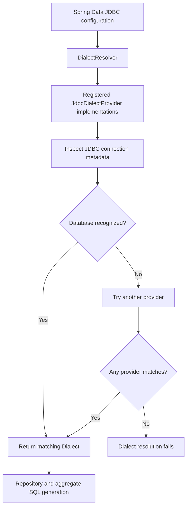

# Customizing or Registering a Dialect per Version SPI

In Spring Data JDBC, a dialect helps the framework generate SQL suited to the characteristics of the database management system. When using a database without a built-in dialect or a variant with distinct syntax, the application can provide a custom dialect and register a provider via Spring Data's SPI.

This lesson covers the role of `Dialect`, how `DialectResolver` discovers providers, how to implement `JdbcDialectProvider`, registration in `META-INF/spring.factories`, and what to verify so the dialect works properly with the running Spring Data Relational version.

## 1. What is a Dialect in Spring Data JDBC?

In Spring Data Relational, **Dialect** describes SQL differences between database management systems so the framework can generate statements appropriate for the connected database.

Databases can differ in areas such as:

- How table names, column names, and case-sensitive identifiers are quoted.
- Pagination syntax such as `LIMIT/OFFSET`, `FETCH FIRST`, or vendor-specific syntax.
- How inserts and generated-key retrieval work.
- How certain SQL operations or specialized data types are expressed.
- Array support and other relational capabilities exposed by that version's dialect.

Spring Data JDBC uses the dialect during SQL generation for repository operations and aggregate persistence. Consequently, the same repository can work across databases with different syntax when the corresponding dialect is provided.

### 1.1. Dialect is not Hibernate Dialect

The name `Dialect` also appears in Hibernate, but the two are not the same API.

| Component | Purpose |
|---|---|
| Spring Data Relational `Dialect` | Provides SQL information and context for Spring Data JDBC/Relational |
| Hibernate `Dialect` | Controls SQL generation and database behavior of Hibernate ORM |
| JDBC Driver | Connects to the database, executes statements, converts JDBC types |
| Spring `Converter` | Converts Java/domain types to relational types and vice versa |

You cannot register `org.hibernate.dialect.*` classes as a Spring Data JDBC dialect. The two frameworks have separate abstractions and SPIs.

### 1.2. Dialect vs. naming strategies and custom converters

These mechanisms solve different problems:

| Need | Appropriate mechanism |
|---|---|
| Database uses different pagination syntax | Dialect |
| Entity table/column name needs customization | `@Table`, `@Column`, or naming strategy |
| Enum stored as code `P` instead of name `PAID` | Custom converter |
| Domain value object mapped across multiple columns | Embedded mapping or custom persistence |
| A reporting query needs specialized SQL | `@Query` or custom repository |
| Database lacks a built-in dialect | Dialect implementation and provider SPI |

Do not create a custom dialect merely to rename a column or convert an enum into a code. A dialect operates at the SQL generation level, whereas mappings and converters address domain data structures.

## 2. How does Spring Data JDBC find a Dialect?

When configuring JDBC repositories, Spring Data needs a dialect matching the `DataSource`. Resolution typically relies on `DialectResolver` and implementations of the `JdbcDialectProvider` SPI.

A provider inspects the database that `JdbcOperations` is connected to. If it recognizes a supported database, the provider returns an `Optional` containing the corresponding dialect. If unrecognized, the provider returns `Optional.empty()` so the resolver can try another provider.

General flow:



Database information typically comes from `DatabaseMetaData`, such as:

- `getDatabaseProductName()`
- `getDatabaseProductVersion()`
- `getDriverName()`
- `getDriverVersion()`

A provider should accurately identify the database it supports. Relying solely on a generic driver name string can lead to selecting the wrong dialect.

### 2.1. Built-in dialects and unsupported databases

Spring Data JDBC includes built-in dialects for several popular database management systems. When a database is recognized by a built-in provider, the framework can use that dialect without manual application registration.

For an unsupported database, or a partially compatible database with distinct SQL semantics, an application can supply:

1. An implementation of Spring Data Relational `Dialect`.
2. An implementation of `DialectResolver.JdbcDialectProvider`.
3. SPI metadata so Spring Data discovers the provider.

If the database already has a built-in dialect, first determine whether the difference genuinely requires a custom dialect or can be solved through custom queries, converters, or schema mappings.

### 2.2. What happens when no dialect is found?

If the resolver finds no matching provider, Spring Data JDBC configuration cannot proceed with the required dialect. The application may fail while bootstrapping repository infrastructure with an error stating no dialect was found for the database.

This is a configuration/runtime dependency error, not a syntax error in an individual repository method. Check:

- Does the JDBC driver match the database?
- What product name/version does `DatabaseMetaData` return?
- Is the provider SPI on the classpath?
- Is `META-INF/spring.factories` packaged inside the artifact?
- Does the provider return a dialect for the running database?

## 3. The Dialect API and what needs customization

The `org.springframework.data.relational.core.dialect.Dialect` interface is Spring Data Relational's contract. Exact components and method signatures may change between release trains, so rely on the Javadoc/source of the exact `spring-data-relational` version used by the application.

A dialect can supply the contexts and capabilities the framework needs to render SQL, such as:

- Select context for building SELECT statements and pagination.
- Insert context for INSERT statements and generated-key strategies.
- Update/delete contexts.
- Identifier processing rules.
- Array support or specialized relational data types.
- Other capabilities added in a specific release.

Not every database requires rewriting all of these components from scratch. If a database is close to an existing dialect, leverage the compatible implementation and change only the parts that actually differ, if the API version permits.

### 3.1. Identifier processing

Identifier processing governs how Spring Data handles table/column names in SQL, such as identifier quoting and letter-casing rules.

Suppose a database has a table named `Order` or a column named `group`; those names may collide with reserved words. An appropriate dialect can supply the right quoting for the vendor.

A quoted identifier can vary across databases, such as double quotes or backticks. Do not concatenate quote characters onto every column name in application code; let the dialect and mapping handle it via the provided abstractions.

### 3.2. Select context and pagination

Pagination syntax is not uniform across all databases. Illustrative examples:

```sql
-- Some databases support LIMIT/OFFSET
SELECT id, order_code
FROM orders
ORDER BY id
LIMIT 20 OFFSET 40;
```

```sql
-- Some databases use OFFSET/FETCH
SELECT id, order_code
FROM orders
ORDER BY id
OFFSET 40 ROWS FETCH NEXT 20 ROWS ONLY;
```

The dialect helps Spring Data render queries suitable for the database. Therefore, when writing a custom dialect, test the SQL generated for paging rather than testing only a simple SELECT.

### 3.3. Insert context and generated keys

Databases can differ in how they generate IDs and retrieve auto-generated values. Some use identity columns and JDBC generated keys; others have sequences or `RETURNING` syntax.

The dialect can describe the insert/generation strategy supported by Spring Data Relational in that release. When customizing, verify all of:

- Generated INSERT SQL.
- How the generated ID is retrieved.
- Mapping the generated ID back onto the entity.
- Insert behavior when IDs are pre-assigned by the application.
- Behavior when saving an aggregate with dependent entities.

A dialect that generates a valid INSERT statement but is incompatible with the driver's generated-key mechanism can still cause `save()` not to return the ID as expected.

### 3.4. Version-dependent capabilities

Do not copy a `Dialect` implementation from a different Spring Data version and expect binary/source compatibility. A release may add methods or alter how render contexts are structured.

When writing a custom dialect:

1. Identify the exact Spring Data JDBC/Relational version via dependency management.
2. Open the Javadoc or source JAR for that exact version.
3. Inspect the `Dialect` interface and corresponding built-in implementations.
4. Leverage the closest implementation if the API allows.
5. Compile and run integration tests against the exact JDBC driver/database.
## 4. Provider precedence and databases with an existing built-in dialect

An application may have both Spring Data's built-in providers and a custom provider. If a database is recognized by multiple providers, the outcome depends on how the resolver fetches and orders providers in that specific release.

Do not assume a custom provider always wins just because `spring.factories` has an entry. When replacing a built-in dialect:

1. Identify which built-in provider recognizes the database product name.
2. Check how `DialectResolver` in your version iterates and orders providers.
3. Check whether the SPI supports ordering via `Ordered` or order annotations in that release.
4. If the release supports ordering, use the documented mechanism and set an explicit order.
5. If a mechanism exists to configure the dialect directly on repository infrastructure, confirm it is a public extension point of that version.
6. Write an integration test proving the expected dialect is actually selected.

Do not rely on line order in a file, component scan order, or classpath order as a stable precedence contract.

### 7.1. Do not override built-in dialects unnecessarily

If the built-in dialect already generates valid SQL for the database, use it. A custom provider returning a different dialect can strip optimizations/capabilities that the built-in dialect already supports.

Only override when there is a confirmed difference, such as a database vendor fork with different pagination, identifier, or generated-key behavior from the upstream dialect.

### 7.2. Separate product recognition from capability checks

Some databases are protocol-compatible with another database but differ in SQL behavior in certain versions. The product name indicates the vendor; version and capability tests determine which implementation fits.

Do not use driver name as sole proof of equivalent SQL semantics. A driver may be a wrapper or proxy driver connecting to a different database.

## 5. Spring Data JDBC versions and SPI compatibility

Dialect is an extension API of Spring Data Relational. A Spring Data JDBC version typically pulls in a matching Spring Data Relational version. Changing a single artifact independently can introduce mismatches between provider, dialect, and render contexts.

### 8.1. Use Spring Boot or Spring Data release train dependency management

In Spring Boot applications, usually let Boot's BOM manage compatible Spring Data versions. Do not upgrade `spring-data-relational` independently to a different version from `spring-data-jdbc` unless there is a reason and compatibility is verified.

If the application manages Spring Data directly, keep modules aligned within the same release train as guided by the Spring Data project.

### 8.2. Verify the exact version's API

Before writing a provider, confirm in your actual dependencies:

- The package of `DialectResolver`.
- Whether the provider interface is named `JdbcDialectProvider` or if the API changed.
- Whether the method signature takes `JdbcOperations` or another abstraction.
- Whether the return type is `Optional<Dialect>` or another type.
- How the resolver loads providers and handles ordering.
- Abstract methods of `Dialect`.
- Which contexts/capabilities the database must supply.

Do not take examples from Spring Data JDBC 2.x, 3.x, or 4.x and mix imports and interfaces across versions. The source JAR and Javadoc attached to your build dependencies are the authoritative source for signatures.

### 8.3. Distinguish Spring Data JDBC and Spring Data R2DBC

Spring Data JDBC and Spring Data R2DBC have separate abstractions for connections and dialects. A provider intended for JDBC is not automatically used by R2DBC.

| Technology | Connection | Dialect/provider |
|---|---|---|
| Spring Data JDBC | JDBC, `DataSource`, `JdbcOperations` | Spring Data Relational `Dialect` and JDBC provider SPI |
| Spring Data R2DBC | Reactive driver, `ConnectionFactory` | Separate R2DBC dialect and provider SPI |

Do not register an `R2dbcDialectProvider` for JDBC repositories or vice versa. Sharing the same database vendor does not mean the two SPIs can share implementations.

## 6. One application connecting to multiple databases

If an application has multiple `DataSource`s, each repository group needs a dialect corresponding to the database it uses.

For example:

- `ordersDataSource` connects to PostgreSQL.
- `reportingDataSource` connects to ExampleDB.
- Order repositories and reporting repositories may require separate JDBC repository configurations.

Do not assume a single dialect can drive repositories connecting to multiple different database vendors.

### 9.1. Separate configuration per DataSource

Architecturally, define for each repository group:

- DataSource.
- Transaction manager.
- `JdbcOperations` or `NamedParameterJdbcOperations`.
- Repository base package.
- Corresponding dialect.

Bean names and how dialects are specified depend on the configuration API of the Spring Data JDBC version in use. Clearly separate repository configurations instead of relying on a single provider recognizing database A and assuming it will handle database B.

### 9.2. Transactions across multiple DataSources

Having two different dialects does not mean two databases automatically participate in the same transaction. A local JDBC transaction manager typically manages a single DataSource.

If a use case must update two databases simultaneously, a distributed transaction architecture or consistency pattern such as outbox/saga is needed. The dialect only affects SQL generation; it does not coordinate commits across multiple databases.

## 7. Testing custom dialects and providers

Testing that the provider merely returns the right dialect object is insufficient. Confirm that the dialect is selected by the resolver and that actual SQL executes properly against the target database.

### 10.1. Testing database recognition

Verify these cases:

- Exact product name is recognized.
- Other product names return `Optional.empty()`.
- Product names differing in letter casing are handled according to policy.
- Supported versions choose the right dialect.
- Unsupported versions produce a clear error.
- Unreadable metadata reports the underlying cause accurately.

Detection logic can be unit tested by mocking `JdbcOperations`/connection metadata, but integration tests with the real JDBC driver remain necessary to check actual product/version strings.

### 10.2. Testing provider discovery

Start the Spring context or repository configuration with the provider packaged via SPI. Confirm Spring Data discovers the provider without manually instantiating it in the test.

A test calling the provider directly does not verify whether `spring.factories` is being read. Therefore, include at least one discovery test through the release's actual resolver/application context mechanism.

### 10.3. Testing SQL behavior through repositories

Create integration tests focused on capabilities the dialect supplies:

| Capability | Test scenario |
|---|---|
| Identifier processing | Table/column names with uppercase letters or reserved words |
| Pagination | Pages with offset, limit, and stable sorting |
| Insert | Insert entity and receive generated ID |
| Sequence/identity | Verify the right ID generation strategy |
| Update | Modify aggregate and read values back |
| Delete | Delete aggregate with dependent mappings |
| Array/type support | Write and read specialized types if used by the app |
| Null/type conversion | Verify binding and extraction on real driver |

Do not inspect only the SQL string. A SQL statement that looks right can still fail due to the JDBC driver, generated keys, or how the database interprets identifiers.

### 10.4. Testing with real databases or Testcontainers

H2 in vendor compatibility mode can help with some quick tests, but does not fully prove SQL behavior of the target database.

For custom dialects, run integration tests against the real database or an appropriate Testcontainers image. This is especially critical for pagination, identity/sequences, quoted identifiers, arrays, and generated keys.

## 8. Inspecting artifacts and diagnosing SPI issues

A provider working in the IDE but failing to be discovered in production usually happens because metadata is missing from the artifact or overwritten during packaging.

### 11.1. Inspecting files inside the JAR

After building the artifact, verify the JAR contains:

```text
META-INF/spring.factories
```

Open that file inside the JAR and verify the provider key and fully qualified class name are intact. For fat JARs, check the resource location inside the archive structure as well.

If using shading/assembly plugins, configure a resource transformer to merge `META-INF/spring.factories` files across dependencies. Do not let one dependency's resource overwrite another dependency's resource.

### 11.2. Enabling logs and checking metadata

When the resolver does not pick the desired dialect:

1. Log product name and product version from connection metadata.
2. Verify the provider class is on the classpath.
3. Verify the SPI file has the exact path and key.
4. Check whether the resolver loads the provider.
5. Check whether the provider returns `Optional.empty()` or a dialect.
6. Check whether another provider is selected first.
7. Confirm the dialect implementation was built against the right API version.

Do not log sensitive connection information or credentials.

### 11.3. Common errors

| Symptom | Possible cause | Resolution |
|---|---|---|
| Dialect not found | No matching provider | Install driver/provider and register SPI |
| Provider not invoked | Wrong `spring.factories` path or key | Inspect resource inside the JAR |
| Provider works in IDE but not in JAR | Resource lost/overwritten during packaging | Configure resource merging |
| Provider always returns empty | Product name mismatches actual metadata | Log `DatabaseMetaData` and adjust recognition |
| Wrong dialect selected | Provider matches too broadly or wrong precedence | Narrow matching conditions and check resolver order |
| `NoSuchMethodError` or `AbstractMethodError` | Dialect/provider compiled against different API version than runtime | Align Spring Data release train |
| Incorrect pagination SQL | Select context unsuitable for database | Check paging SQL and dialect capabilities |
| Insert fails to retrieve ID | Generated-key behavior mismatches driver/database | Check insert context and generated-key path |
| Identifier has wrong casing/quoting | Incorrect identifier processing | Check database quoting/casing rules |
| Works on H2 but fails on real DB | H2 does not fully emulate vendor semantics | Test against target database |

## 9. Checklist when implementing a custom dialect

Before releasing a provider/dialect, confirm each item:

1. **Version:** Spring Data JDBC and Spring Data Relational use a compatible release train.
2. **API:** Provider interface, method signatures, and Dialect contract match the actual dependency's source/Javadoc.
3. **Scope:** Database product and version are recognized accurately.
4. **Fallback:** Provider returns `Optional.empty()` when the database falls outside its scope.
5. **Dialect:** Implementation accurately supports pagination, identifiers, insert/generated keys, and capabilities used by the app.
6. **SPI metadata:** `META-INF/spring.factories` has the exact key and fully qualified provider class name.
7. **Packaging:** SPI resource remains intact in the JAR/fat JAR after merging.
8. **Precedence:** If a built-in provider also matches, tests prove the resolver picks the intended dialect.
9. **Database tests:** Integration tests run on the target database/driver.
10. **Multiple data sources:** Each repository group is configured with its matching dialect and transaction manager.

## 10. End-to-end implementation workflow

A practical workflow can be broken into steps:

### Step 1: Identify the database and SQL differences

Gather product name, product version, driver name/version, and identify actual differences compared to the closest built-in dialect.

Do not start by writing a massive Dialect class. First prove which capabilities repositories actually need that the current dialect does not satisfy.

### Step 2: Identify the version's extension API

Inspect managed Spring Data JDBC/Relational dependencies. Read the provider interface and Dialect contract in the exact source JAR.

If the API version lacks the SPI shown in an example, adapt to the extension point provided by that version. Do not create an interface with the same name in your application package to substitute for the official SPI.

### Step 3: Write the Dialect implementation

Reuse an existing dialect where compatible. If a separate implementation is required, provide the mandatory render contexts/capabilities and keep the class stateless if possible.

A dialect should not hold request state, connections, or business data.

### Step 4: Write the provider

The provider takes `JdbcOperations`, checks metadata, and returns the right dialect. Do not recognize databases with overly broad strings and do not return speculative dialects for unknown databases.

### Step 5: Register the SPI

Add the `DialectResolver$JdbcDialectProvider` entry to `META-INF/spring.factories`. Verify the resource file is packaged into the final JAR.

### Step 6: Verify resolver and repositories

Start the repository infrastructure, confirm the dialect is selected, and then run representative use cases: read, insert, generated ID, update, delete, and pagination.

### Step 7: Check version upgrades

When upgrading the Spring Data release train, recompile the custom dialect/provider and re-run integration tests. Extension APIs can change even when the database vendor has not changed.

## 11. Registering a dialect via the JdbcDialectProvider SPI

Spring Data JDBC provides an SPI to detect dialects based on a JDBC connection. In versions featuring `DialectResolver.JdbcDialectProvider`, the provider typically has a method taking `JdbcOperations` and returning `Optional<Dialect>`.

The provider is responsible for returning the dialect when the database matches. If it does not match, return `Optional.empty()` so the resolver continues searching other providers.

### 4.1. Provider structure

The example below illustrates a provider recognizing a database with product name `ExampleDB`:

```java
package com.example.persistence;

import java.sql.DatabaseMetaData;
import java.util.Optional;

import org.springframework.data.jdbc.repository.config.DialectResolver;
import org.springframework.data.relational.core.dialect.Dialect;
import org.springframework.jdbc.core.ConnectionCallback;
import org.springframework.jdbc.core.JdbcOperations;

public final class ExampleDialectProvider
        implements DialectResolver.JdbcDialectProvider {

    @Override
    public Optional<Dialect> getDialect(JdbcOperations operations) {

        return operations.execute(
                (ConnectionCallback<Optional<Dialect>>) connection -> {

                    DatabaseMetaData metadata = connection.getMetaData();

                    String productName = metadata.getDatabaseProductName();

                    if ("ExampleDB".equalsIgnoreCase(productName)) {
                        return Optional.of(ExampleDialect.INSTANCE);
                    }

                    return Optional.empty();
                }
        );
    }
}
```

`ExampleDialect.INSTANCE` represents the dialect implementation supplied by the application. Class names, packages, and product names in the example are placeholders to be replaced with your actual database.

Use `JdbcOperations.execute(ConnectionCallback)` to read metadata on a Spring JDBC-managed connection. Do not open a new connection yourself and forget to close it; also do not close the connection passed to the callback.

### 4.2. Registering the provider in META-INF/spring.factories

Implementing the provider class alone is not enough. Spring Data needs to discover that implementation via SPI metadata.

Create file:

```text
src/main/resources/META-INF/spring.factories
```

Add the Spring Data JDBC provider key:

```properties
org.springframework.data.jdbc.repository.config.DialectResolver$JdbcDialectProvider=\
com.example.persistence.ExampleDialectProvider
```

The class name on the right-hand side must be the fully qualified class name of the provider. The `$` in the key denotes the nested interface `JdbcDialectProvider` of `DialectResolver`.

When packaging a library or application, `META-INF/spring.factories` must be present in the final JAR. If the build creates a shaded/fat JAR and multiple `spring.factories` files exist, packaging configuration must merge resources properly instead of overwriting metadata from other dependencies.

### 4.3. SPI discovery differs from component scanning

Providers are discovered through Spring's SPI metadata, not simply because the class has `@Component`.

| Registration method | Role |
|---|---|
| `@Component` | Registers a Spring bean via component scanning |
| `@Bean` | Declares a bean in the application context |
| `META-INF/spring.factories` | Declares implementations for the SpringFactoriesLoader SPI |
| `AutoConfiguration.imports` | Declares Spring Boot auto-configuration classes |

For the `JdbcDialectProvider` SPI using `SpringFactoriesLoader`, supply the proper entry in `META-INF/spring.factories`. Do not replace it with `AutoConfiguration.imports` merely because the app upgraded to Spring Boot 3; those two metadata files serve two different mechanisms.

A provider may not need `@Component` because the resolver instantiates implementations from SPI metadata. Registering an extra bean for the same purpose without understanding its lifecycle can create redundant configuration or confusion.

### 4.4. Multiple providers in the same artifact

If an artifact supports multiple databases, multiple provider implementations can be declared under the same SPI key list following the SpringFactoriesLoader syntax used by your Spring Framework version.

For example:

```properties
org.springframework.data.jdbc.repository.config.DialectResolver$JdbcDialectProvider=\
com.example.persistence.ExampleDialectProvider,\
com.example.persistence.AnotherDialectProvider
```

Each provider should recognize only the databases it truly supports. A provider that does not recognize the database must return `Optional.empty()`.

Do not return a default dialect for every product name merely to avoid startup errors. Doing so can cause Spring Data to generate invalid SQL on incompatible databases.

## 12. Creating a Dialect implementation

The provider only solves **selecting** the dialect. If the database needs distinct SQL behavior, the application must also supply a `Dialect` implementation.

### 5.1. Starting from the closest compatible dialect

Before writing the entire interface from scratch, determine which built-in dialect the database is SQL-compatible with:

- Are SELECT and pagination syntax the same?
- Is identifier quoting the same?
- Are generated keys/identity/sequences compatible?
- Do array data types need support?
- Do insert/update/delete contexts differ?

If the database is genuinely compatible with an existing dialect, the provider can return that dialect. Illustrative example when ANSI behavior fits:

```java
return Optional.of(AnsiDialect.INSTANCE);
```

Only use this option after confirming the class and capabilities exist in the exact release, and testing generated SQL on the target database. "The database supports standard SQL" does not mean all generated-key, identifier, or pagination differences are automatically compatible.

### 5.2. Custom implementation skeleton

If no built-in dialect fits, create a custom implementation:

```java
package com.example.persistence;

import org.springframework.data.relational.core.dialect.Dialect;

public final class ExampleDialect implements Dialect {

    public static final ExampleDialect INSTANCE = new ExampleDialect();

    private ExampleDialect() {
    }

    /*
     * Implement the Dialect contract required by the exact
     * Spring Data Relational version used by this application.
     *
     * Supply the required select/insert/update/delete contexts,
     * identifier processing and supported database capabilities.
     */
}
```

This is a structural skeleton, not a complete implementation to copy verbatim. The compiler will require implementing all abstract methods of the `Dialect` interface in your release. Obtain the method list and context types from the actual API version.

If the release provides base implementations or reusable contexts, use them to reduce boilerplate. Do not copy internal or package-private implementation classes from dependencies; those components are not stable extension APIs.

### 5.3. Changing only where the database differs

For example, the database only differs in pagination while other parts are compatible with an existing dialect. In that case, focus on the select rendering context provided by the API version.

If the generated-key strategy differs, focus on the insert context and ID generation behavior.

If identifier quoting differs, provide appropriate identifier processing.

Do not write an entirely new dialect if only one capability differs and the framework provides abstractions to reuse the rest.

### 5.4. Do not put database detection logic inside Dialect

Separate responsibilities cleanly:

- `JdbcDialectProvider`: reads metadata, decides which database is supported, and returns the dialect.
- `Dialect`: describes the SQL behavior/capabilities of the database.
- Repository/template: uses the dialect to generate and execute SQL.

Avoid having the dialect open connections or inspect the database product name itself. The dialect should describe behavior; the provider is the detection component.

## 13. Recognizing databases safely

`DatabaseMetaData` is a crucial identification source, but product names and versions must be handled deliberately.

### 6.1. Case-insensitive product name comparison

For example:

```java
String productName = metadata.getDatabaseProductName();

if ("ExampleDB".equalsIgnoreCase(productName)) {
    return Optional.of(ExampleDialect.INSTANCE);
}
```

Do not use overly broad partial checks such as `contains("SQL")` if multiple databases could match that string. The provider could misidentify another database and return an incompatible dialect.

### 6.2. Considering product version when behavior changes

If a database has multiple major versions with differing SQL capabilities, the provider can inspect product version to decide:

- One shared dialect usable across all supported versions.
- Different dialects for versions with differing behaviors.
- Explicitly rejecting versions outside the supported range.

Illustrative example:

```java
String productName = metadata.getDatabaseProductName();
String productVersion = metadata.getDatabaseProductVersion();

if (!"ExampleDB".equalsIgnoreCase(productName)) {
    return Optional.empty();
}

if (!isSupported(productVersion)) {
    throw new IllegalStateException(
            "Unsupported ExampleDB version: " + productVersion
    );
}

return Optional.of(ExampleDialect.INSTANCE);
```

`isSupported(...)` is application-defined logic tailored to real versions. Do not assume version strings always follow a simple numeric format.

### 6.3. Returning Optional.empty or raising an error?

Use `Optional.empty()` when the provider does not recognize a database within its scope. This lets other providers try next.

If the provider has already recognized the right database but that version is unsupported, returning empty could cause the resolver to pick a wrong dialect. In that situation, an explicit error is usually safer.

Rules:

| Case | Appropriate behavior |
|---|---|
| Product name belongs to another database | `Optional.empty()` |
| Product name matches, supported version | Return corresponding dialect |
| Product name matches, unsupported version | Throw error including version info |
| Metadata unreadable | Let connection/metadata error surface clearly or handle per SPI contract |
| Unknown or unverified database | Do not return a speculative dialect |

## 14. Principles to remember

- Spring Data Relational `Dialect` describes a database's SQL behavior and capabilities for Spring Data JDBC.
- `DialectResolver.JdbcDialectProvider` is the SPI that identifies the database via JDBC metadata and returns the matching dialect.
- A provider that does not recognize the database must return `Optional.empty()` so the resolver tries other providers.
- For provider SPIs using `SpringFactoriesLoader`, register the implementation in `META-INF/spring.factories` under the nested provider interface key matching your version.
- `@Component` alone does not replace SPI metadata.
- Dialect is responsible for SQL generation behavior; mapping annotations and custom converters address column names or domain types.
- Only write a custom dialect when the database genuinely differs from built-in dialects in capabilities Spring Data needs.
- Do not assume custom providers always beat built-in providers; check resolver precedence in your release.
- Keep Spring Data JDBC and Spring Data Relational versions aligned; do not mix SPIs across release trains or between JDBC and R2DBC.
- Test with the real database and driver, especially pagination, identifier quoting, and generated keys.
- Verify SPI resources inside the packaged artifact, not only when running in the IDE.

Dialect customization is how you extend Spring Data JDBC SQL generation for unsupported databases or vendor-specific differences. The provider SPI decides which database uses which dialect; the dialect itself describes how the framework builds SQL and handles capabilities. When implementing, adhere strictly to the API of your running Spring Data Relational version, register the provider via the corresponding SPI metadata, and verify behavior with integration tests against the target database.


