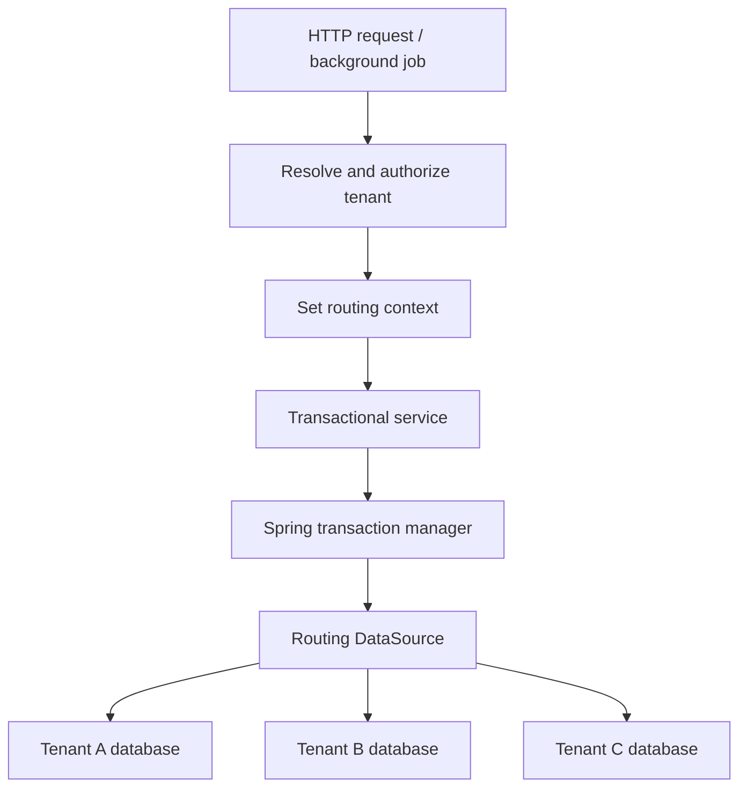
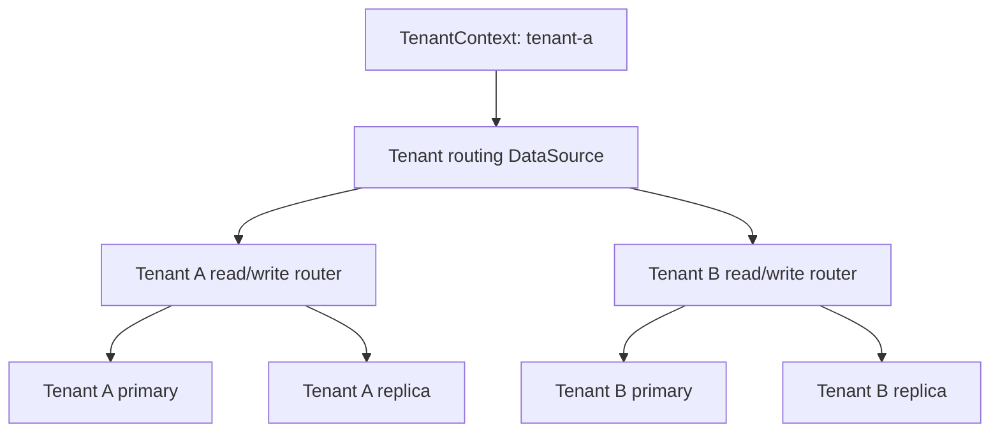
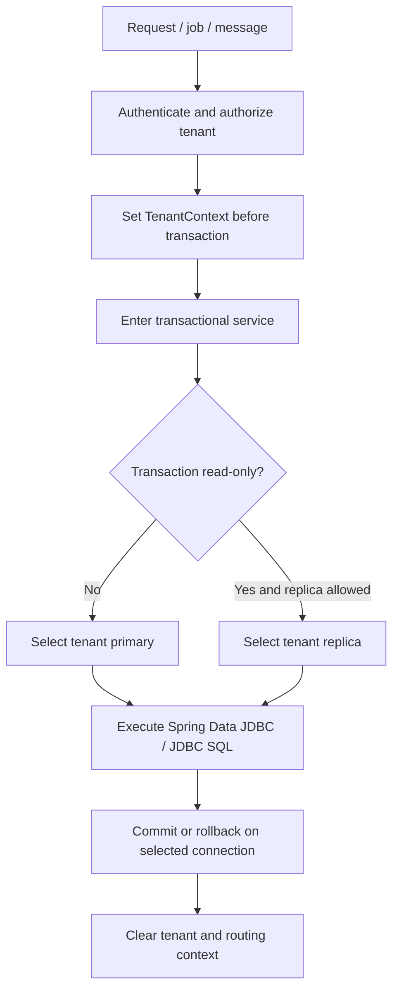

# Tenant or Read/Write Source Routing and Consistency Boundaries

Spring Data JDBC typically works with a preconfigured `DataSource`. When an application serves multiple tenants or uses a database replica for read queries, it must decide which connection executes an operation. This decision is called data source routing.

There are two distinct routing questions:

- **Tenant routing:** which tenant does the request belong to, and which database, schema, or data region must it access?
- **Read/write routing:** must the operation run on primary, or can it run on a read replica?

These two decisions directly affect consistency boundaries. Spring manages a JDBC connection per transaction; once a connection is acquired and bound to the active transaction, changing the routing key mid-flight does not switch the transaction to another database. Therefore, both tenant and read/write mode must be determined before the transaction begins.

This lesson covers multi-tenancy strategies, `AbstractRoutingDataSource`, `TenantContext`, primary/replica routing, replication lag, read-your-writes, protecting tenant boundaries, and testing strategies.

## 1. How does a routing datasource work?

A `DataSource` supplies JDBC connections. Instead of letting every operation borrow connections from a single pool, an application can place a routing datasource in front of multiple target datasources.

Spring provides `AbstractRoutingDataSource` as the foundation for this routing pattern. A subclass supplies a lookup key via `determineCurrentLookupKey()`; Spring uses that key to pick the target datasource when acquiring a connection.



A routing datasource only selects the connection. It does not automatically inject `tenant_id` into SQL statements, does not verify whether a user is authorized for that tenant, and does not guarantee data synchronization across databases.

In Spring Data JDBC, repositories, `JdbcAggregateOperations`, and `JdbcTemplate` must use the routed datasource consistently. If a repository uses one datasource while a custom JDBC template uses another, two operations can hit different targets even when invoked from the same service.

## 2. Choosing a multi-tenancy strategy before routing

A routing datasource is not the only way to isolate tenants. First decide where tenant data is stored:

| Strategy | Organization | Characteristics |
| --- | --- | --- |
| Shared database, shared schema | Tenants share tables; each row has `tenant_id`. | Fewer connection pools, easier centralized operations; every query and constraint must respect tenant isolation. |
| Shared database, schema per tenant | Each tenant has its own schema in the same database. | Separates namespaces and migrations per schema; connection schema/session state must be managed carefully. |
| Database per tenant | Each tenant has its own database, typically with its own datasource/pool. | Stronger data and load isolation; higher overhead for managing pools, migrations, backups, and connections. |

### Shared schema with tenant_id

Example:

```sql
CREATE TABLE purchase_order (
    tenant_id VARCHAR(80) NOT NULL,
    id BIGINT NOT NULL,
    status VARCHAR(30) NOT NULL,
    total_amount NUMERIC(18, 2) NOT NULL,
    PRIMARY KEY (tenant_id, id)
);
```

Queries must constrain by tenant:

```sql
SELECT id, status, total_amount
FROM purchase_order
WHERE tenant_id = :tenantId
  AND id = :orderId;
```

If you only route datasources while all tenants still share one schema, routing does not replace the `tenant_id` predicate. Database row-level security (RLS) can be added as an independent defense layer. Foreign keys and unique constraints should also include `tenant_id` in the key when uniqueness is scoped per tenant.

### Dedicated database or schema per tenant

When each tenant has its own database, `AbstractRoutingDataSource` can pick the pool based on the tenant key. With dedicated schemas, you can use schema-qualified tables or set the connection schema; if modifying session state, ensure that state is reliably reset before the connection returns to the pool.

Do not choose database-per-tenant merely because a routing datasource is available. Weigh tenant count, connection budgets, backup/restore needs, migrations, isolation, and operational overhead.

## 3. Resolving the tenant from an authenticated source

The tenant key must come from an authenticated and authorized source. It can originate from:

- A tenant claim inside a verified access token.
- Mapping between the authenticated account and tenant in the identity system.
- A verified tenant derived from domain/subdomain under trusted configuration.
- Job/message metadata authenticated by the producer or service boundary.

Never take an arbitrary `tenantId` straight from a request and use it directly as a routing key. Clients can tamper with headers or query parameters to probe another tenant. Resolving the tenant and authorizing the user's access to that tenant are two steps that must occur before opening a transaction.

With a shared schema, the tenant predicate must still be applied in every query or enforced via RLS. With dedicated databases/schemas, routing the wrong tenant can load an entire aggregate from the wrong data store, making routing key authorization critical.
## 4. Storing the tenant in request context

A common pattern is storing the current tenant in a `ThreadLocal` for the duration of a synchronous request. The context must have an explicit scope and always be restored/cleared once the request completes.

Scoped context example:

```java
public final class TenantContext {

    private static final ThreadLocal<String> CURRENT =
        new ThreadLocal<>();

    private TenantContext() {
    }

    public static String requireTenantId() {
        String tenantId = CURRENT.get();
        if (tenantId == null || tenantId.isBlank()) {
            throw new IllegalStateException("Tenant context is missing");
        }
        return tenantId;
    }

    public static Scope use(String tenantId) {
        if (tenantId == null || tenantId.isBlank()) {
            throw new IllegalArgumentException("Tenant ID is required");
        }

        String previous = CURRENT.get();
        CURRENT.set(tenantId);

        return () -> {
            if (previous == null) {
                CURRENT.remove();
            } else {
                CURRENT.set(previous);
            }
        };
    }

    @FunctionalInterface
    public interface Scope extends AutoCloseable {
        @Override
        void close();
    }
}
```

The scope restores the previous value, making nested context scopes on the same thread safer. Calling `remove()` when there is no prior value prevents tenant leakage across sequential requests handled by the same worker thread.

### Setting context in a filter/interceptor

Illustrative filter extracting the tenant from an authenticated principal:

```java
@Component
public class TenantContextFilter extends OncePerRequestFilter {

    private final AuthenticatedTenantResolver tenantResolver;

    public TenantContextFilter(AuthenticatedTenantResolver tenantResolver) {
        this.tenantResolver = tenantResolver;
    }

    @Override
    protected void doFilterInternal(
            HttpServletRequest request,
            HttpServletResponse response,
            FilterChain chain) throws ServletException, IOException {

        String tenantId = tenantResolver.requireAuthorizedTenant(request);

        try (TenantContext.Scope ignored = TenantContext.use(tenantId)) {
            chain.doFilter(request, response);
        }
    }
}
```

`AuthenticatedTenantResolver` represents the component validating the tenant from a verified principal/claim. Filters must not blindly trust unauthenticated headers.

For background jobs or message consumers, open an analogous tenant scope before calling transactional services and close it in `finally`/try-with-resources.

## 5. Why must the tenant be set before the transaction?

`@Transactional` is typically applied via a Spring proxy. When a caller invokes a transactional method, the interceptor starts the transaction before executing the method body. The transaction manager can acquire a connection and bind it to the thread at that moment.

Therefore, the following code has the wrong ordering:

```java
@Transactional
public void handle(String tenantId, long orderId) {
    try (TenantContext.Scope ignored = TenantContext.use(tenantId)) {
        // Transaction has already started before the method body runs.
        orders.findById(orderId);
    }
}
```

If the connection was acquired before the tenant context was set, the routing datasource may have picked the wrong tenant or thrown an error due to a missing tenant key. Switching the context afterward does not move the active connection to another datasource.

A clean approach is setting the tenant context in a filter or non-transactional facade, then invoking a separate transactional bean:

```java
@Component
public class TenantOrderFacade {

    private final OrderTransactionService transactions;

    public TenantOrderFacade(OrderTransactionService transactions) {
        this.transactions = transactions;
    }

    public PurchaseOrder loadForTenant(String tenantId, long orderId) {
        try (TenantContext.Scope ignored = TenantContext.use(tenantId)) {
            return transactions.load(orderId);
        }
    }
}

@Service
public class OrderTransactionService {

    private final PurchaseOrderRepository orders;

    public OrderTransactionService(PurchaseOrderRepository orders) {
        this.orders = orders;
    }

    @Transactional(readOnly = true)
    public PurchaseOrder load(long orderId) {
        return orders.findById(orderId)
            .orElseThrow(() -> new OrderNotFoundException(orderId));
    }
}
```

When `transactions.load(...)` is called through the Spring proxy, the tenant context is already populated. A filter is natural for HTTP; a similar facade fits jobs or non-servlet flows.

**Never change tenants mid-transaction.** A JDBC transaction is bound to its chosen connection. If you must act across two tenants, run two separate transactions and explicitly account for the fact that they are not jointly atomic.

## 6. Creating a tenant routing datasource

Simple example using `AbstractRoutingDataSource` to choose a datasource by tenant key:

```java
public class TenantRoutingDataSource extends AbstractRoutingDataSource {

    @Override
    protected Object determineCurrentLookupKey() {
        return TenantContext.requireTenantId();
    }
}
```

Configuring target datasources:

```java
@Configuration
public class TenantDataSourceConfiguration {

    @Bean
    @Primary
    DataSource dataSource(
            @Qualifier("tenantADatasource") DataSource tenantA,
            @Qualifier("tenantBDatasource") DataSource tenantB) {

        Map<Object, Object> targets = new HashMap<>();
        targets.put("tenant-a", tenantA);
        targets.put("tenant-b", tenantB);

        TenantRoutingDataSource routing = new TenantRoutingDataSource();
        routing.setTargetDataSources(targets);
        routing.setLenientFallback(false);
        return routing;
    }
}
```

The `tenantADatasource` and `tenantBDatasource` beans represent separately configured pools, typically HikariCP. The example intentionally shows two tenants for illustration. In dynamic systems, do not create unbounded pools without limits and lifecycle management; use a registry managing tenant enrollment, pool eviction, health checks, and total connection caps.

`setLenientFallback(false)` prevents silently falling back to a default datasource when a lookup key misses. In tenant-isolated systems, do not configure a shared default datasource if falling back could return another tenant's data. `TenantContext.requireTenantId()` also fails fast when context is missing.

### Ensuring Spring Data JDBC uses the routing datasource consistently

The datasource exposed to Spring must be used consistently by:

- Spring Data JDBC repositories.
- `JdbcAggregateOperations`.
- `JdbcTemplate` and `NamedParameterJdbcTemplate`.
- The transaction manager governing JDBC connections.

If a repository or template is accidentally wired with a fixed tenant pool, it bypasses routing. When multiple datasources exist, verify wiring and qualifiers on every bean, not only the primary routing bean.
## 7. Primary and read replica routing

A system may use primary for writes and a replica for read queries to offload traffic. A common approach uses `AbstractRoutingDataSource` and selects the route based on the transaction's read-only flag.

```java
public enum DatabaseRole {
    PRIMARY,
    REPLICA
}

public class ReadWriteRoutingDataSource
        extends AbstractRoutingDataSource {

    @Override
    protected Object determineCurrentLookupKey() {
        boolean readOnly =
            TransactionSynchronizationManager.isCurrentTransactionReadOnly();

        return readOnly ? DatabaseRole.REPLICA : DatabaseRole.PRIMARY;
    }
}
```

Configuring target datasources:

```java
@Bean
DataSource readWriteRoutingDataSource(
        @Qualifier("primaryDataSource") DataSource primary,
        @Qualifier("replicaDataSource") DataSource replica) {

    Map<Object, Object> targets = new HashMap<>();
    targets.put(DatabaseRole.PRIMARY, primary);
    targets.put(DatabaseRole.REPLICA, replica);

    ReadWriteRoutingDataSource routing =
        new ReadWriteRoutingDataSource();

    routing.setTargetDataSources(targets);
    routing.setDefaultTargetDataSource(primary);
    return routing;
}
```

Any transaction not marked read-only, even if it happens to run only SELECT statements, routes to primary. This is the safer default for consistency; only read use cases permitted to accept replica data are marked read-only.

### Why is LazyConnectionDataSourceProxy needed?

Transaction managers typically start a transaction before the service executes SQL. If the routing datasource acquires a physical connection immediately at transaction start, routing may occur before the read-only flag is reflected on the connection.

`LazyConnectionDataSourceProxy` defers physical connection acquisition until the first SQL statement actually needs a connection. This gives the routing datasource an opportunity to read the established transaction metadata:

```java
@Bean
@Primary
DataSource dataSource(
        @Qualifier("readWriteRoutingDataSource") DataSource routing) {
    return new LazyConnectionDataSourceProxy(routing);
}
```

The transaction manager, Spring Data JDBC, and JDBC templates must all use this exposed proxy as the main datasource. The routing datasource sits as the target underneath the proxy. Inspect your application's actual wiring to avoid one repository bean using the proxy while another template points straight to primary or replica.

### Marking read and write use cases

```java
@Service
public class OrderReadService {

    private final PurchaseOrderRepository orders;

    public OrderReadService(PurchaseOrderRepository orders) {
        this.orders = orders;
    }

    @Transactional(readOnly = true)
    public List<PurchaseOrder> findRecent(long customerId) {
        return orders.findByCustomerId(customerId);
    }
}

@Service
public class OrderWriteService {

    private final PurchaseOrderRepository orders;

    public OrderWriteService(PurchaseOrderRepository orders) {
        this.orders = orders;
    }

    @Transactional
    public PurchaseOrder changeStatus(long orderId, String status) {
        PurchaseOrder order = orders.findById(orderId)
            .orElseThrow(() -> new OrderNotFoundException(orderId));

        return orders.save(order.withStatus(status));
    }
}
```

Read-only transactions can route to replica; write transactions route to primary. Do not infer routing solely from SQL SELECT/UPDATE keywords. The decision is driven by transaction metadata and the use case's consistency contract.

`readOnly = true` is a transaction hint, not a database authorization mechanism. To prevent writes on a replica, configure the replica's database user/role as read-only and keep write paths on primary.

## 8. Combining tenant routing with read/write routing

Both dimensions can be composed in a layered structure:



The tenant router chooses the tenant's datasource first; the router inside that tenant chooses primary or replica. Alternatively, a composite lookup key (tenant ID, database role) can replace nested routers, while keeping the same principle: the tenant comes from an authenticated context, and the read/write role comes from transaction policy.

In any setup, all repositories and JDBC templates in the same application must traverse the same datasource chain. If any bean bypasses the tenant router or read/write router, the application can read/write the wrong database.

For tenants that have a primary but no replica yet, policy can route all operations to primary. Never let a missing replica cause routing to another tenant's replica or an unrelated default datasource.
## 9. Replication lag and read-your-writes

Read replicas normally receive data from primary via asynchronous replication. Therefore, after primary commits a change, the replica may not reflect that change immediately.

Example:

1. Request A updates an order's status on primary.
2. The transaction commits successfully.
3. Request B immediately reads the order from replica.
4. The replica has not replayed the committed transaction yet and returns the stale status.

This is replication lag, not a Spring Data JDBC bug. The read-only flag only selects the read path; it does not guarantee the replica has caught up with primary.

Common strategies:

- **Read from primary for consistency-sensitive data:** payment status, recently modified permissions, balances, or confirmation pages immediately after writes.
- **Read-your-writes / sticky primary:** after a user writes successfully, subsequent reads for that workflow/session route to primary for a short window or until signals confirm the replica caught up.
- **Intentional eventual consistency:** analytics screens, feeds, or reports that tolerate slight staleness; the UI should reflect those semantics.
- **Consistency token / replication position:** for tightly controlled systems, return a token/version/LSN from the write path and only read the replica once the replica reaches that position; implementation depends on the database.

### Forcing a critical read query to primary

You can open a dedicated consistency scope:

```java
public enum ReadPreference {
    DEFAULT,
    PRIMARY_ONLY
}

public final class ReadPreferenceContext {

    private static final ThreadLocal<ReadPreference> CURRENT =
        new ThreadLocal<>();

    private ReadPreferenceContext() {
    }

    public static boolean requiresPrimary() {
        return CURRENT.get() == ReadPreference.PRIMARY_ONLY;
    }

    public static Scope use(ReadPreference preference) {
        ReadPreference previous = CURRENT.get();
        CURRENT.set(preference);
        return () -> {
            if (previous == null) {
                CURRENT.remove();
            } else {
                CURRENT.set(previous);
            }
        };
    }

    @FunctionalInterface
    public interface Scope extends AutoCloseable {
        @Override
        void close();
    }
}
```

The router can prioritize the override ahead of read-only transaction metadata:

```java
@Override
protected Object determineCurrentLookupKey() {
    if (ReadPreferenceContext.requiresPrimary()) {
        return DatabaseRole.PRIMARY;
    }

    return TransactionSynchronizationManager.isCurrentTransactionReadOnly()
        ? DatabaseRole.REPLICA
        : DatabaseRole.PRIMARY;
}
```

A facade sets the scope before calling the transactional service:

```java
public PurchaseOrder loadFresh(long orderId) {
    try (var ignored =
            ReadPreferenceContext.use(ReadPreference.PRIMARY_ONLY)) {
        return readService.findById(orderId);
    }
}
```

This scope only illustrates overriding within the same execution flow. Sticky primary across multiple HTTP requests requires storing consistency state per user/session/tenant in an appropriate store, such as a TTL cache or token. Do not rely on ThreadLocal because it is cleared at request end and threads are reused.

## 10. Connection and transaction boundaries

A JDBC transaction normally binds a single connection to the thread via the transaction manager. Routing is decided when the physical connection is acquired. After that point:

- Changing TenantContext does not change the active connection's datasource.
- Changing read preference does not move an in-flight transaction from replica to primary.
- Repositories/templates sharing the same datasource and transaction manager join the active transaction and reuse the bound connection.
- A single transaction cannot automatically read from replica and then write to primary as though they were one connection transaction.

Therefore, select both tenant and read/write policy before starting the transaction. If a use case must read fresh data and then write, route the entire transaction to primary. Do not start a read-only transaction on a replica and attempt to write at the end.

### Cannot promote a read-only transaction to a write transaction via nested calls

Example read service:

```java
@Transactional(readOnly = true)
public PurchaseOrder review(long orderId) {
    return orders.findById(orderId).orElseThrow();
}
```

If this method invokes a write method with REQUIRED propagation, the write method joins the existing read-only transaction. The transaction does not automatically switch to primary/write just because the inner method omits read-only. Depending on the database, the write may be rejected or routed unexpectedly.

Separate read and write use cases into clear transaction boundaries. If an independent transaction is genuinely needed, REQUIRES_NEW can start a new transaction, provided tenant context is properly set and you account for the new transaction committing independently of the outer one.

### Isolation is still governed by the database

Reading multiple times on the same connection does not automatically mean every read sees the same snapshot. Results depend on the isolation level and database semantics. Under READ_COMMITTED, two SELECT statements can observe two different commits. If a report requires a consistent snapshot, choose an appropriate isolation level or explicit snapshot; read-only does not mean REPEATABLE_READ.
## 11. ThreadLocal, async execution, and message consumers

ThreadLocal binds context only to the current thread. It works for synchronous request handling, but does not automatically propagate the tenant to other threads.

Scenarios requiring explicit handling:

- Methods running via executors or @Async.
- Scheduled jobs processing multiple tenants' data.
- Message consumers reading messages with tenant metadata.
- CompletableFuture stages switching to another thread pool.
- Batch tasks splitting work across multiple workers.

Do not assume tenant context survives thread hops. Pass the authenticated tenant ID as an explicit parameter or use a task decorator/executor wrapper to open and close the scope inside the worker.

Simple wrapper example:

```java
public Runnable withTenant(String tenantId, Runnable task) {
    return () -> {
        try (TenantContext.Scope ignored = TenantContext.use(tenantId)) {
            task.run();
        }
    };
}
```

For message consumers, validate tenant metadata before opening the scope. Never let untrusted messages arbitrarily select a database. After processing, always close the scope whether the task succeeds or throws an exception.

In reactive pipelines, ThreadLocal is not an appropriate context propagation mechanism because execution can switch threads. You would need Reactor Context and reactive-compatible routing; Spring Data JDBC is a blocking JDBC technology, so wrapping calls inside a reactive chain does not make it reactive.

## 12. Tenant isolation at the query and schema level

In a shared schema, a routing datasource usually provides no tenant isolation because every tenant shares one pool and one schema. The tenant condition must be enforced in every query:

```sql
SELECT id, status
FROM purchase_order
WHERE tenant_id = :tenantId
  AND id = :orderId;
```

Isolation can be reinforced with:

- Composite primary keys or unique constraints including tenant ID.
- Foreign keys carrying tenant ID on both sides to prevent cross-tenant links.
- Row-level security (RLS) if supported by the database and policies are properly designed.
- Repository/query adapters receiving tenant ID from an authenticated context.
- Negative tests proving tenant A cannot read or modify tenant B's rows.

Do not rely on controller-level tenant checks and omit the predicate at the query layer. Jobs, batches, reports, or other endpoints may call repositories via different paths. Ensure every access path enforces the tenant boundary.

With schema-per-tenant, switching schemas on a connection/session introduces session state that persists across pooled connections. If executing SET SCHEMA or search_path statements, you must reliably set/reset state every time a connection is borrowed or returned. Returning a connection to the pool with the previous tenant's schema poses a severe cross-tenant read/write risk. Use separate pools per schema or a proven schema routing mechanism if session state reset cannot be guaranteed.

With database-per-tenant, separate pools reduce reliance on session state, though the routing registry must still govern tenant keys and pool lifecycles.

## 13. Managing tenant datasources and pools

In multi-tenant systems, each datasource typically holds its own connection pool. Total connections can grow rapidly:

- 100 tenants × max pool of 10 connections can allow up to 1,000 connections.
- Idle pools still hold resources without proper eviction/lifecycle policies.
- One high-traffic tenant can monopolize resources without caps.

A dynamic datasource registry needs:

1. Valid tenant list from a trusted management source.
2. Protected connection configs without logging passwords/secrets.
3. Per-tenant pool caps and system-wide connection limits.
4. Controlled lazy creation or preloading.
5. Health checks and handling for unavailable tenant databases.
6. Pool eviction/closing when a tenant is offboarded or inactive.
7. Migrations and schema versioning per tenant.
8. Metrics by tenant/route while avoiding unbounded cardinality.

Never create a new datasource per request. The routing key should only pick an existing managed pool. At large tenant counts, consider database servers/proxies supporting multiplexing or a shared schema with RLS instead of a physical pool per tenant.

## 14. Fallback and failover must preserve the tenant

Distinguish two types of fallback:

- **A tenant's replica is unavailable:** read queries may route to that exact tenant's primary if consistency policy and load allow.
- **Missing tenant key or unavailable tenant database:** never fall back to another tenant's database.

For a read/write router, primary is a sensible default when role is unclear because it preserves read freshness. For a tenant router, a shared default datasource risks breaking isolation; fail fast when the tenant key is missing or absent from the registry.

If a replica goes down, policy may:
- Route reads to primary and emit metrics/alerts.
- Return a transient error if primary lacks capacity or the use case forbids fallback.
- Retry after health checks confirm replica recovery.

Never retry a failed transaction on another datasource without verifying the prior transaction rolled back and the operation is safe to replay. For writes, retries require idempotency keys or duplicate-write protections.

## 15. Transactions across multiple tenants or multiple datasources

A standard local JDBC transaction manages one datasource/connection resource. If a use case must write to tenant A and tenant B, nesting two routing scopes sequentially does not make them atomic:

```java
@Transactional
public void moveData(String sourceTenant, String targetTenant) {
    // Cannot switch TenantContext and expect the same transaction
    // to automatically switch its connection to another datasource.
}
```

Once the transaction acquires a connection for tenant A, switching context to tenant B does not swap the bound connection. Even when opening two separate transactions, one may commit while the other fails.

If cross-tenant workflows are genuinely required, consider:

- Redesigning so each transaction mutates only one tenant.
- Using a workflow/Saga with compensating steps.
- Using outbox/inbox to reliably propagate changes between tenants.
- Using distributed/XA transactions only when infrastructure, databases, and operations truly support them and the benefits outweigh the cost.

Never let an ordinary transaction create the illusion that multiple databases committed atomically.
## 16. Query methods and transaction policy

An application-declared derived query does not automatically run in a read-only transaction merely because its name starts with find. If called without an active transaction, a router inspecting transaction attributes may not see a read-only flag and pick primary.

Example service setting explicit policy:

```java
@Service
public class CustomerOrderReadService {

    private final PurchaseOrderRepository orders;

    public CustomerOrderReadService(PurchaseOrderRepository orders) {
        this.orders = orders;
    }

    @Transactional(readOnly = true)
    public List<PurchaseOrder> findByCustomer(long customerId) {
        return orders.findByCustomerId(customerId);
    }
}
```

Query methods can be annotated directly, though service-level transactions usually reflect use cases better and span multiple repository calls. If a use case requires strong consistency, do not mark it read-only just to push queries to a replica.

If a service class is marked read-only at class level, write methods must declare an explicit writable transaction and must not inadvertently join an existing read-only transaction opened by a caller. Design boundaries so the route is chosen before the first connection acquisition.

## 17. Testing tenant routing and read/write routing

Routing must be tested at the connection level, not merely by asserting determineCurrentLookupKey returns an enum. Integration tests should prove repositories actually hit the intended datasource.

### Testing tenant isolation

- Set tenant A before calling a transactional service and verify queries read from database A.
- Set tenant B and verify the same repository reads from database B.
- Missing tenant context must fail fast.
- Unregistered tenant keys must error, never falling back to another database.
- Tenant A cannot read, update, or delete tenant B's rows in a shared schema.
- Context is cleared/restored after both success and exceptions so the next request does not inherit an old tenant.
- Jobs/message consumers open the right tenant scope and close it after execution.

### Testing primary/replica routing

- Non-read-only write transactions use primary.
- Services with read-only transactions use replica when policy allows.
- Query methods without a read-only transaction route to the chosen default, usually primary.
- Read preference PRIMARY_ONLY overrides replica routing for critical queries.
- Replica unavailability follows the defined fallback policy.
- No code path writes using replica credentials.
- Verify LazyConnectionDataSourceProxy truly defers physical connection acquisition until after transaction metadata is established.

### Testing consistency

- Write to primary and immediately read on replica to simulate replication lag.
- Verify read-your-writes workflows route to primary or await a consistency token.
- Verify multiple queries in one transaction share the same connection/route.
- Verify a read-only transaction cannot be promoted to a write route by an inner method.
- Verify isolation levels if a use case requires a consistent snapshot.

A straightforward way to test routing is configuring two separate test datasources, each containing a marker table or distinct identifying row. Call the same repository under different contexts and assert results come from the right source. Transaction tests must go through the Spring proxy and transaction manager; calling Java methods directly skips routing/transaction interception.

## 18. Safe routing deployment checklist

Before enabling routing in production, verify:

1. Does tenant isolation use shared schema, schema-per-tenant, or database-per-tenant?
2. Which principal/claim supplies the tenant ID, and where is it authorized?
3. Which filter/facade sets the tenant context before the transaction?
4. Is context cleared on all success/failure paths?
5. Do repositories, aggregate operations, JDBC templates, and the transaction manager share the same datasource chain?
6. Does the tenant router fail fast on missing or unrecognized tenant keys?
7. Do per-tenant pools enforce total connection caps and lifecycles?
8. Which transaction metadata drives the read/write router?
9. Is LazyConnectionDataSourceProxy placed properly in front of the routing datasource?
10. Which use cases accept eventual consistency and which require primary reads?
11. Is sticky primary or a consistency token in place for read-your-writes?
12. Does replica failure fallback preserve the tenant and emit monitoring alerts?
13. How do async jobs and message consumers propagate tenant context?
14. Do cross-tenant workflows have explicit transaction boundaries and compensation?
15. Have integration tests verified real connections, isolation, and replication lag?

Summary diagram:



## 19. Common pitfalls

| Mistake | Consequence | Resolution |
| --- | --- | --- |
| Setting tenant context inside an already @Transactional method | Transaction may acquire a connection before tenant is set. | Set context in a filter/facade before calling transactional beans. |
| Switching tenants inside the same transaction | Current connection still points to the initially selected tenant. | Use separate transactions per tenant. |
| Trusting tenant ID straight from the request | Risk of accessing another tenant's data. | Resolve from verified principal and authorize tenant access. |
| Shared schema without tenant_id filtering | Queries may read or mutate another tenant's rows. | Apply tenant predicates, RLS, and proper constraints. |
| Forgetting to clear ThreadLocal | Subsequent requests on the same thread inherit the old tenant. | Use scoped try-finally and remove context. |
| Assuming ThreadLocal propagates to @Async | Workers may lack tenant context or use stale context. | Pass context explicitly via task wrappers. |
| Reading replica right after a write | May observe stale data due to replication lag. | Use primary reads, sticky primary, or consistency tokens. |
| Routing solely by SELECT statement | Read queries may stay on primary or write routes become inconsistent. | Use explicit transaction policies. |
| Omitting lazy connection when routing by readOnly | Physical connection may be acquired before route metadata is ready. | Place LazyConnectionDataSourceProxy correctly. |
| Falling back invalid tenants to a default datasource | Risk of returning another tenant's data. | Fail fast; never use a default tenant datasource. |
| Single transaction writing to two tenants | Creates an illusion of atomicity. | Split transactions and use Saga/outbox or proper distributed patterns. |
| Too many tenant pools | Connection exhaustion and high resource overhead. | Cap pools, manage lifecycles, or revisit tenancy strategy. |

## 20. Self-check questions

- At what point does AbstractRoutingDataSource select a datasource?
- How does tenant routing differ from primary/replica routing?
- Does a shared schema still need a tenant_id predicate when a routing datasource is present?
- Why must the tenant be authenticated and set in context before a transaction begins?
- Why does changing TenantContext mid-transaction not switch the active connection?
- How must ThreadLocal be cleaned up after a request?
- Why does ThreadLocal not automatically propagate tenants to @Async or reactive pipelines?
- What is TransactionSynchronizationManager.isCurrentTransactionReadOnly() used for in a read/write router?
- How does LazyConnectionDataSourceProxy support routing by read-only transactions?
- Why is readOnly=true not a database authorization mechanism?
- How does replication lag affect read-your-writes?
- When should a read query be routed to primary?
- Why might a query method declared without a read-only transaction not route to replica?
- Why can an ordinary transaction not commit atomically across two tenant databases?
- Which integration tests prove tenant isolation and accurate connection routing?

Tenant routing and read/write routing must be decided before the transaction acquires a connection. Tenant context must come from an authenticated identity, remain fixed throughout the transaction, and be cleared after the request; read/write policies must reflect the consistency level acceptable to each use case. Use routing datasources to select the right pool, transaction boundaries to maintain a consistent connection, and explicit read-your-writes strategies when replicas lag. In shared schemas, continue protecting tenants with predicates, constraints, or RLS; routing does not replace data access controls.
