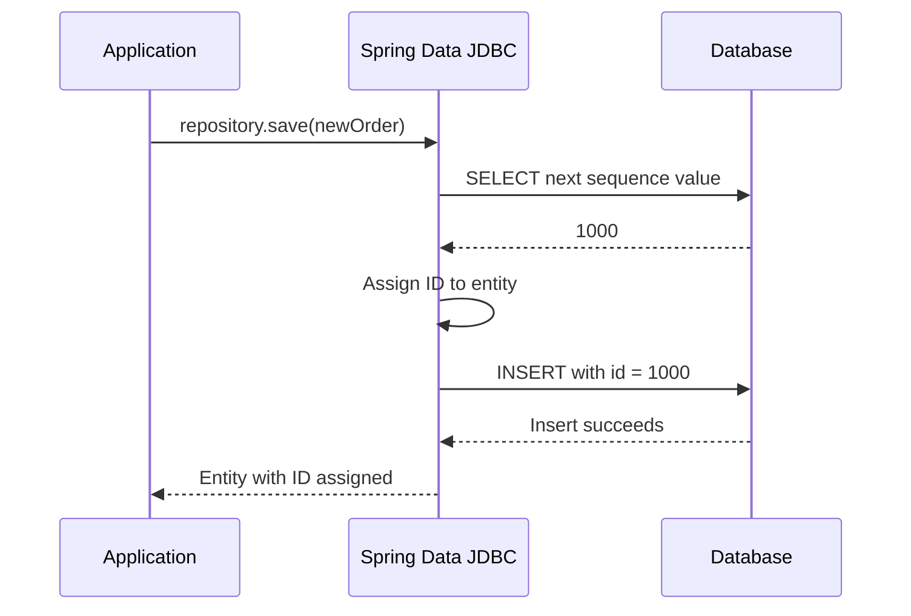
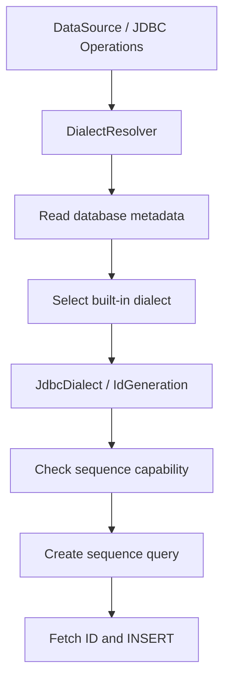

# Sequence, `@Sequence`, and Dialect Support in Supported Versions

Spring Data JDBC supports several ways to generate primary keys. With identity or auto-increment columns, the database usually assigns an ID during the INSERT. Some database management systems also provide a **sequence**: a database object dedicated to issuing sequential numeric values. Sequences can be used to allocate IDs before INSERT, be shared across multiple tables, or follow existing schema conventions.

Starting from **Spring Data Relational 3.5**, Spring Data JDBC provides the **`@Sequence`** annotation to specify the sequence used for a primary key property. This feature depends on the database dialect. Having the annotation in code alone is not enough: the library version must support it, the dialect must declare sequence capability, and the sequence must exist in the database.

This lesson explains how sequences work, how to use `@Sequence`, the differences between sequences and identity columns, the dialects supported by Spring Data JDBC, how to handle databases without a suitable sequence dialect, how to manage sequences with migrations, and how to test them.

## 1. What Is a Sequence?

A sequence is an independent object in the database used to issue numeric values according to configured rules. A sequence typically has attributes such as:

- Starting value (`START WITH`).
- Increment step (`INCREMENT BY`).
- Minimum/maximum values.
- Cycle policy (`CYCLE` or `NO CYCLE`).
- Value caching to reduce access overhead.

PostgreSQL example:

```sql
CREATE SEQUENCE public.purchase_order_id_seq
    START WITH 1000
    INCREMENT BY 1
    NO CYCLE;
```

Each time the next value is requested, the database advances the sequence and returns a new number. In PostgreSQL:

```sql
SELECT nextval('public.purchase_order_id_seq');
```

If the sequence is at its initial state, the statement may return 1000; the next call returns 1001.

A sequence is not a table column, nor is it a data row of an aggregate. It is a separate database object used by tables or applications to obtain values for a column.

### 1.1. Sequence vs. Identity/Auto-Increment

Both sequences and identity columns can generate IDs automatically, but the timing of obtaining the ID differs.

| Aspect | Identity/auto-increment | Explicit sequence |
|---|---|---|
| Where the ID is issued | Database assigns it during INSERT | Application fetches value from database sequence before INSERT |
| When the ID is available | Usually after INSERT | Available before INSERT |
| Typical SQL flow | INSERT then read generated key | SELECT next value, then INSERT with ID |
| Sharing across multiple tables | Usually tied to one column/table | Can use the same sequence across multiple tables |
| Spring Data JDBC declaration | Standard ID mapping | Add `@Sequence` to the `@Id` property |
| Dialect dependency | Generated-key support | Sequence support and next-value SQL query |

If the ID column uses identity/auto-increment and the database generates the value automatically on INSERT, `@Sequence` is generally not needed.

If you want Spring Data JDBC to fetch the ID from a specified sequence before INSERT, use `@Sequence`.

### 1.2. Sequences Do Not Guarantee Gapless Numbers

Sequences generally guarantee that issued values do not collide within the sequence configuration, but they do not guarantee there will be no gaps.

For example:

1. A transaction fetches value 1000.
2. The INSERT fails or the transaction rolls back.
3. The next transaction fetches value 1001.

Value 1000 may never appear in the table, yet the sequence has already advanced. Some databases also cache sequence values, so restarts or crashes can create larger gaps.

Do not use a sequence as a strictly consecutive document number if business rules forbid missing numbers. Legal or audit-controlled numbering requirements need a dedicated mechanism with proper locking and auditing rules.

## 2. `@Sequence` in Spring Data Relational

`@Sequence` belongs to the package:

```java
import org.springframework.data.relational.core.mapping.Sequence;
```

This annotation is placed on the primary key property that already has `@Id`. It specifies the sequence Spring Data JDBC should use to obtain the initial ID value when saving a new entity.

Example:

```java
import org.springframework.data.annotation.Id;
import org.springframework.data.relational.core.mapping.Sequence;
import org.springframework.data.relational.core.mapping.Table;

@Table("purchase_orders")
public class PurchaseOrder {

    @Id
    @Sequence(
        sequence = "purchase_order_id_seq",
        schema = "public"
    )
    private Long id;

    private String orderNumber;

    protected PurchaseOrder() {
    }

    public PurchaseOrder(String orderNumber) {
        this.orderNumber = orderNumber;
    }

    public Long getId() {
        return id;
    }

    public String getOrderNumber() {
        return orderNumber;
    }
}
```

In this example:

- `@Id` marks the property as the primary key.
- `@Sequence` specifies the `purchase_order_id_seq` sequence.
- `schema = "public"` specifies the schema containing the sequence.
- The `Long` type allows the ID to be unset before the entity is persisted.

### 2.1. Attributes of `@Sequence`

The annotation has three attributes:

| Attribute | Meaning |
|---|---|
| `value` | Sequence name |
| `sequence` | Alias for `value` |
| `schema` | Schema containing the sequence |

`value` and `sequence` are two alternative names for the same value. You can use the shorthand:

```java
@Id
@Sequence("purchase_order_id_seq")
private Long id;
```

Or specify attribute names explicitly:

```java
@Id
@Sequence(
    sequence = "purchase_order_id_seq",
    schema = "public"
)
private Long id;
```

If no schema is specified, locating the sequence depends on the database's default schema/search path and how the dialect handles identifiers. In multi-schema systems, specify the schema explicitly to avoid pointing to the wrong sequence.

In Oracle, the schema may correspond to the user owning the sequence. The final sequence name is built from the schema and sequence according to the mapping API's rules.

### 2.2. `@Sequence` Is Only for Primary Keys

Place `@Sequence` alongside `@Id` on the identifier property. Do not use this annotation as a general converter to auto-generate numbers for arbitrary fields in an entity.

Example:

```java
@Id
@Sequence(sequence = "invoice_id_seq", schema = "billing")
private Long id;
```

If another business property needs numbers from a sequence, such as a display invoice number, design a dedicated numbering workflow matching business rules instead of assuming `@Sequence` applies to any property.

### 2.3. Choosing the ID Data Type

Integer types like `Long` generally pair well with sequences. The database column must have a type compatible with the values issued by the sequence.

Example:

```sql
CREATE TABLE purchase_orders (
    id BIGINT PRIMARY KEY,
    order_number VARCHAR(40) NOT NULL
);
```

Avoid using a Java type that is too small if the sequence can exceed that type's limits. Long-lived sequences make `Long`/`BIGINT` a safer choice than `Integer`/`INTEGER` for IDs with a long lifecycle.

## 3. How Does Spring Data JDBC Retrieve Sequence Values?

When saving a new entity whose property is annotated with `@Sequence`, Spring Data JDBC executes an additional query to fetch the next value before the INSERT statement.

With PostgreSQL, the illustrative SQL flow is:

```sql
SELECT nextval('public.purchase_order_id_seq');
```

Suppose the statement returns 1000. Spring Data JDBC uses that ID in the INSERT:

```sql
INSERT INTO purchase_orders(id, order_number)
VALUES (?, ?);
```

The first parameter is 1000, and the second parameter is the order number.



### 3.1. The Sequence Query and INSERT Are Two Separate Operations

Fetching the sequence value and executing the INSERT are not a single SQL statement. The Spring Data Relational documentation recommends executing them within an enclosing transaction to manage the persistence operation as a single unit.

Example:

```java
@Service
public class PurchaseOrderService {

    private final PurchaseOrderRepository repository;

    public PurchaseOrderService(PurchaseOrderRepository repository) {
        this.repository = repository;
    }

    @Transactional
    public PurchaseOrder create(String orderNumber) {
        return repository.save(new PurchaseOrder(orderNumber));
    }
}
```

The transaction protects the save operation at the application layer. However, an already issued sequence value is generally not reclaimed when a transaction rolls back. That is normal and does not indicate partially saved data.

### 3.2. Sequences Are Not Called Again on Every Update

`@Sequence` is an ID acquisition strategy for new entities. Once an entity already has an ID and is determined to exist, a save/update operation should not allocate a new ID for that entity.

Example:

```java
PurchaseOrder saved = repository.save(
    new PurchaseOrder("ORD-1001")
);

Long id = saved.getId();

// Load and update an existing entity that already has an ID.
PurchaseOrder existing = repository.findById(id).orElseThrow();
repository.save(existing);
```

The initial save needs an ID from the sequence. Saving the existing entity uses the existing ID.

How Spring Data determines whether an entity is new or existing depends on entity state detection. With a wrapper ID type like `Long`, the initial value is typically `null`. If you assign an ID manually before saving, Spring Data may treat the entity as existing depending on the state detection strategy.

## 4. The Sequence Must Be Created in the Database

`@Sequence` only declares which sequence Spring Data JDBC should use. The annotation does not create the database sequence automatically and does not replace schema migrations.

With PostgreSQL, you can create the sequence in a Flyway migration:

```sql
-- V001__create_purchase_order_sequence.sql

CREATE SEQUENCE public.purchase_order_id_seq
    START WITH 1000
    INCREMENT BY 1
    NO CYCLE;
```

Create the table using the ID:

```sql
-- V002__create_purchase_orders.sql

CREATE TABLE public.purchase_orders (
    id BIGINT PRIMARY KEY,
    order_number VARCHAR(40) NOT NULL
);
```

Migration ordering must ensure the sequence exists before the application performs an INSERT.

### 4.1. Sequence Permissions

The application's database user needs permission to use the sequence. In PostgreSQL, depending on ownership and security policies, you may need to grant privileges:

```sql
GRANT USAGE, SELECT ON SEQUENCE public.purchase_order_id_seq
TO app_user;
```

If the sequence does not exist, the schema is wrong, or the user lacks permissions, fetching the ID fails before the INSERT runs.

### 4.2. Do Not Create a Sequence Colliding with an Existing Identity Sequence

If a table already uses identity/auto-increment and an internal database-managed sequence, verify how the database assigns IDs before adding `@Sequence`.

Do not arbitrarily attach a new sequence to an identity column without checking the schema and default expression. This can lead to conflicting ID generation mechanisms or a sequence out of sync with existing data.

### 4.3. Synchronizing a Sequence with Existing Data

When migrating a table that already contains data to an explicit sequence, the sequence's starting value must avoid colliding with existing IDs.

In PostgreSQL, you can check:

```sql
SELECT MAX(id) FROM public.purchase_orders;
```

Then adjust the sequence according to your migration policy. Compute a value appropriate for the existing data, sequence state, and database semantics. Do not blindly run a synchronization command in production, as doing so could move the sequence backward or produce duplicate IDs.

## 5. Dialects Supporting Sequences

Spring Data JDBC uses a **dialect** to describe SQL differences across database management systems. The dialect determines how to fetch the next value from a sequence.

According to current Spring Data Relational documentation, the listed dialects with sequence support include:

| Dialect | Sequence support in Spring Data JDBC |
|---|---|
| H2 | Yes |
| HSQL | Yes |
| PostgreSQL | Yes |
| DB2 | Yes |
| Oracle | Yes |
| Microsoft SQL Server | Yes |
| MySQL | No |
| MariaDB | Not listed among the sequence-supporting dialects in documentation |

The key point is that **database server capability and Spring Data JDBC dialect capability are two different things**. A database engine may provide sequences at the server level, yet the Spring Data JDBC dialect in use may not have declared or implemented the corresponding sequence retrieval logic.

Spring Data Relational documentation explicitly states that MySQL is not supported for this feature. MariaDB is not listed among sequence-supporting dialects; do not assume Spring Data JDBC supports it solely because a MariaDB version has its own sequence syntax.

If your application's database is not on the list, check the exact dialect in the library version you are using before adopting `@Sequence`.

### 5.1. Sequence Retrieval SQL Varies by Database

PostgreSQL example:

```sql
SELECT nextval('public.purchase_order_id_seq');
```

Other database systems may use their own syntax, such as `NEXT VALUE FOR`, `sequence.NEXTVAL`, or another expression. Spring Data JDBC does not require the application to hand-write vendor-specific queries for each entity when a built-in dialect supports it.

The dialect generates the query appropriate for the database. Therefore, do not copy PostgreSQL syntax to Oracle, SQL Server, or DB2 and expect it to behave identically.

### 5.2. Sequence Support Does Not Mean Support for Every Vendor Sequence Option

A database may support many sequence options such as caching, cycling, negative increments, ordering, or min/max bounds. `@Sequence` only declares the sequence name and schema so Spring Data JDBC can retrieve the next value.

Sequence configuration properties such as `START`, `INCREMENT`, `CACHE`, and `CYCLE` remain part of database DDL/migrations. The annotation does not replace them.

## 6. Version Milestone: Feature Available Since Spring Data Relational 3.5

`@Sequence` was introduced in **Spring Data Relational 3.5**. The annotation's API documentation states `Since: 3.5`. Two parts of the ID generation API directly tied to this feature were also added in 3.5:

- `IdGeneration.sequencesSupported()`: indicates whether the dialect supports sequences.
- `IdGeneration.createSequenceQuery(SqlIdentifier)`: creates the SQL to fetch the next sequence value.

Therefore, do not check only the database version. You must verify the actual Spring Data Relational version the application is running.

### 6.1. Version Compatibility Table

| Spring Data Relational version | `@Sequence` | Notes |
|---|---|---|
| Before 3.5 | Not available | Cannot use the new sequence annotation/API |
| 3.5.x | Yes | Requires a dialect that supports sequences |
| 4.0.x | Yes | Supported |
| 4.1.x | Yes | Current documentation continues to describe the feature |

These are **Spring Data Relational** version milestones, not Spring Boot version numbers. Spring Boot manages Spring Data versions via its corresponding dependency management/BOM.

### 6.2. Checking Dependencies in Use

In a Maven project, inspect the dependency tree:

```bash
mvn dependency:tree -Dincludes=org.springframework.data:spring-data-relational,org.springframework.data:spring-data-jdbc
```

With Gradle:

```bash
./gradlew dependencyInsight --dependency spring-data-relational --configuration runtimeClasspath
```

Configuration names may vary by project. The goal is to determine the actual resolved library version rather than reading only a version declared in one file.

### 6.3. Upgrading via the Spring Boot or Spring Data BOM

If the project uses Spring Boot, prefer letting Spring Boot dependency management choose compatible Spring Data versions. If managing Spring Data with a standalone release train BOM, ensure all Spring Data modules align with a compatible release train.

Do not upgrade only `spring-data-jdbc` or `spring-data-relational` to a version out of step with related modules without checking compatibility. Mixing versions can cause runtime class/method errors even if code compiles in some cases.

### 6.4. If the Project Uses a Version Earlier Than 3.5

If dependencies lack `@Sequence`, importing the annotation will fail to compile. Options include:

- Use identity/auto-increment supported by the dialect and database.
- Upgrade Spring Data Relational to a release train that includes `@Sequence` and matches the application's Spring Framework/Spring Boot baseline.
- If upgrading is not yet possible, fetch the ID using explicit JDBC code and manage setting the ID explicitly.

Do not create a custom annotation with the same name in your application package to simulate the feature. Spring Data JDBC does not recognize a custom annotation and will not use it for ID generation.

## 7. How Does the Dialect Determine Sequence Capability?

The dialect is the abstraction layer for database-specific SQL behavior. Spring Data JDBC uses the dialect to know how to render SQL, handle data types, retrieve generated keys, and perform other operations.

For sequences, the dialect exposes information through `IdGeneration`:

```java
IdGeneration idGeneration = dialect.getIdGeneration();

boolean supported = idGeneration.sequencesSupported();
```

When the dialect supports sequences, the API can generate the corresponding query:

```java
String sql = idGeneration.createSequenceQuery(sequenceName);
```

These methods belong to the Spring Data Relational API. Typical applications do not call them directly; Spring Data JDBC uses them during persistence.

### 7.1. Automatic Dialect Detection

In standard configurations, Spring Data JDBC attempts to determine the dialect from the database configuration by obtaining a connection and inspecting metadata.



If the database already has a built-in dialect, the application typically requires no manual configuration.

If Spring Data JDBC cannot find a suitable dialect, configuration may fail at startup. In that case, a vendor-provided dialect or an appropriate custom dialect is required.

### 7.2. Checking the Actual Dialect

When an application connects through a database proxy, compatibility driver, or a DBMS with an unusual name/version, metadata can affect which dialect is chosen.

If sequences do not work as expected:

1. Verify the database server/version.
2. Verify the JDBC driver.
3. Verify the Spring Data Relational version.
4. Verify the resolved dialect.
5. Verify the dialect reports sequence support.
6. Check the generated sequence SQL and database permissions.

Do not start by renaming the sequence if the real cause is a dialect that does not support sequences.

## 8. Databases Without a Suitable Built-in Sequence Dialect

If an application uses a database that Spring Data JDBC does not yet support for sequences, a custom dialect may be needed.

A custom dialect must accurately describe the database's characteristics, including the SQL query for retrieving the next value. Do not simply flip the sequence support flag to true if the database does not actually support that capability.

At the API level, custom ID generation must implement:

- Whether sequences are supported via `sequencesSupported()`.
- The SQL query to fetch the next value via `createSequenceQuery(SqlIdentifier)`.
- Identifier/schema rules matching the database.

If the custom dialect needs to be auto-detected by Spring, Spring Data JDBC provides the `DialectResolver.JdbcDialectProvider` SPI. The provider returns the appropriate dialect when it recognizes the database; otherwise, it returns `Optional.empty()`.

In 3.5 versions, providers are discovered via Spring's `SpringFactoriesLoader`. Configuration documentation describes registering the provider in `META-INF/spring.factories` using the key:

```text
org.springframework.data.jdbc.core.dialect.DialectResolver$JdbcDialectProvider
```

Example registration format:

```properties
org.springframework.data.jdbc.core.dialect.DialectResolver$JdbcDialectProvider=com.example.database.CustomJdbcDialectProvider
```

The provider should inspect database metadata so it only supplies the dialect for the intended database. Do not register a blanket custom dialect for every DataSource if it is incompatible.

### 8.1. Do Not Arbitrarily Override Built-in Dialects

If the database already has a built-in dialect, prefer using it. Replacing the dialect affects not only sequences, but also:

- Identifier quoting.
- Limit/offset syntax.
- INSERT and RETURNING/generated keys rendering.
- Data types and converters.
- Lock clauses and upserts.
- Array handling and other features.

A custom dialect that fixes only sequences while breaking other behaviors can cause errors across many persistence operations.

### 8.2. When Should You Use Direct JDBC?

If the dialect does not support sequences and implementing a custom dialect is disproportionate to the need, you can fetch IDs via direct JDBC in a dedicated component. When doing so, the application is responsible for:

- Writing vendor-appropriate SQL.
- Managing transactions.
- Assigning the ID to the entity before insert.
- Handling errors and permissions.
- Testing against the exact database/driver.

This approach does not make `@Sequence` work automatically; it is a separate ID assignment strategy.

## 9. Comparing `@Sequence` with Other ID Strategies

| Strategy | How it works | When appropriate |
|---|---|---|
| Identity/auto-increment | Database assigns ID during INSERT | Schema uses identity columns and dialect supports generated keys |
| `@Sequence` | Spring Data fetches value from sequence before INSERT | Database has sequences and Spring Data dialect supports them |
| Application-assigned ID | Application generates UUID or other ID before save | Need ID available prior to write or offline data creation |
| Dedicated numbering table | Application updates a row counter | Legacy systems or custom numbering rules; requires concurrency control |

### 9.1. When Using Identity

The entity only needs an ID:

```java
@Table("customers")
public class Customer {

    @Id
    private Long id;

    private String name;
}
```

The database generates the ID on INSERT. Spring Data JDBC reads the generated key according to dialect/driver capabilities.

Do not add `@Sequence` if the column is designed for identity and there is no explicit sequence meant for application use.

### 9.2. When Using a Sequence

```java
@Table("invoices")
public class Invoice {

    @Id
    @Sequence(sequence = "invoice_id_seq", schema = "billing")
    private Long id;

    private String invoiceNumber;
}
```

Spring Data JDBC fetches the value from the sequence before INSERT. This is the right choice when the schema explicitly uses a sequence.

### 9.3. When Using an Application-Assigned UUID

```java
@Table("outbox_events")
public record OutboxEvent(
    @Id UUID id,
    String eventType
) {}
```

The application can generate a UUID before saving. When the ID is already present, no database sequence is needed for this property.

## 10. Sequences and Transactions

Spring Data Relational documentation emphasizes that retrieving the sequence value and executing the INSERT are two separate operations, and recommends running them inside an enclosing transaction.

Example:

```java
@Transactional
public PurchaseOrder placeOrder(String orderNumber) {
    PurchaseOrder order = new PurchaseOrder(orderNumber);
    return repository.save(order);
}
```

If the use case also writes other aggregates, place the transaction at the service layer so the operations participate in the appropriate transaction manager.

### 10.1. Rollback Does Not Return the Sequence Value

In many DBMSs, particularly PostgreSQL, retrieving the next value does not roll back with the transaction. For example:

- Transaction A fetches 1000.
- Transaction A fails on INSERT and rolls back.
- Transaction B fetches 1001.

There is no row with ID 1000, but that is not a bug. Sequences are designed to issue unique values, not gapless consecutive numbering.

### 10.2. Concurrent Transactions

Two concurrent transactions fetching values from the same sequence receive distinct values according to the database sequence's synchronization mechanism.

This is a major advantage of sequences over reading `MAX(id) + 1`, which is prone to race conditions:

```sql
SELECT MAX(id) + 1 FROM purchase_orders;
```

Do not use `MAX(id) + 1` as a concurrent ID generation mechanism. Sequences or identity columns are database-managed features designed for this purpose.

### 10.3. Sequence Caching and Gaps

Databases may cache a batch of values to reduce I/O. Caching improves performance, though unused numbers can be lost on database restarts or crashes.

If business logic needs a user-facing sequential number, you can use a separate sequence for that number while still accepting gaps, or design a dedicated document numbering workflow. Never assume a sequence always produces a gapless series.

## 11. Testing `@Sequence`

Test using integration tests against a database with the corresponding sequence dialect. Unit tests that only check annotation presence do not prove Spring Data JDBC generates valid SQL or that the database user has permissions to use the sequence.

Example entity and repository:

```java
@Table("purchase_orders")
public class PurchaseOrder {

    @Id
    @Sequence(sequence = "purchase_order_id_seq", schema = "public")
    private Long id;

    private String orderNumber;

    protected PurchaseOrder() {
    }

    public PurchaseOrder(String orderNumber) {
        this.orderNumber = orderNumber;
    }

    public Long getId() {
        return id;
    }
}
```

```java
public interface PurchaseOrderRepository
        extends CrudRepository<PurchaseOrder, Long> {
}
```

Test:

```java
@DataJdbcTest
class PurchaseOrderSequenceTest {

    @Autowired
    PurchaseOrderRepository repository;

    @Test
    void assignsIdFromDatabaseSequence() {
        PurchaseOrder saved = repository.save(
            new PurchaseOrder("ORD-1001")
        );

        assertThat(saved.getId()).isNotNull();
        assertThat(saved.getId()).isGreaterThanOrEqualTo(1000L);
    }
}
```

The test assumes the migration created a sequence starting at 1000 and the `public` schema is in use. Even if a test transaction rolls back, the sequence may still advance; do not assert that an ID equals a fixed value based on a previous run.

### 11.1. Verifying the Issued Sequence Query

You can enable Spring JDBC logging in test environments:

```properties
logging.level.org.springframework.jdbc=DEBUG
```

When saving a new entity, logs can show the sequence retrieval query before the INSERT. The exact SQL depends on the dialect.

Do not enable detailed SQL logging in production if sensitive data might appear in logs or if log volume is too high.

### 11.2. Testing Against the Target Database with Testcontainers

H2 can verify the basic flow, but it does not prove the syntax and behavior of PostgreSQL, Oracle, DB2, or SQL Server.

If production uses PostgreSQL, use a PostgreSQL container with a compatible major version. If production uses SQL Server or Oracle, test with the database/driver appropriate for that system.

Integration tests should verify:

- The migration creates the sequence successfully.
- The application user has permission to read the sequence.
- The correct dialect is selected.
- The new entity receives an ID.
- The INSERT uses the retrieved ID.
- Transaction rollback leaves no partial rows behind.
- The sequence continues issuing values across multiple saves.

## 12. Common Errors

| Symptom | Cause | How to handle |
|---|---|---|
| `@Sequence` import fails to compile | Spring Data Relational earlier than 3.5 | Upgrade to a compatible release train or use another ID strategy |
| Entity save reports sequences unsupported | Dialect does not declare sequence support | Check dialect/version and supported list |
| Sequence not found | Sequence not created or wrong schema/name | Create sequence via migration and check schema |
| Permission denied | Database user lacks sequence privileges | Grant required privileges to application user |
| Works on PostgreSQL, fails on Oracle | Vendor-specific sequence SQL misused | Let the respective dialect generate the query |
| `@Sequence` does not work on MySQL | MySQL does not support sequences in Spring Data JDBC | Use `AUTO_INCREMENT`/identity or application-assigned ID |
| MariaDB sequence not recognized | Dialect not in documented sequence support list | Check version/dialect; use custom dialect if needed |
| ID collides with existing data | Sequence starts below existing IDs | Synchronize sequence in a controlled migration |
| IDs skip numbers after rollback | Sequence value was already consumed | Accept gaps; sequences do not guarantee gapless numbers |
| Every update fetches a new ID | Incorrect entity state detection or ID mapping | Check ID value and new/existing state |
| Annotation present but sequence not used | Annotation placed on wrong property or non-ID field | Place `@Sequence` on the `@Id` property |
| Custom dialect breaks other queries | Replacement dialect lacks required behaviors | Preserve full dialect semantics and integration-test all persistence |
| H2 tests pass but production fails | Dialect or database permission differences | Test with a production-compatible database/driver |

## 13. Process for Adopting Sequences in a Project

When switching an entity to a sequence, follow these steps in order:

1. Identify the database and JDBC driver version in use.
2. Verify the Spring Data Relational version supports `@Sequence` (3.5 or higher).
3. Confirm the database's dialect supports sequences.
4. Create the sequence in a schema migration.
5. Verify schema, permissions, and starting value of the sequence.
6. Place `@Sequence` on the `@Id` property.
7. Enclose persistence operations in an appropriate transaction.
8. Write integration tests against a compatible database/driver.
9. Inspect SQL logs and assigned IDs.
10. Deploy migrations in an order compatible with running application instances.

If dialect support cannot be met, choose identity, application-assigned IDs, or a tested custom dialect.

## 14. Practice Exercises

**Exercise 1.** In which version of Spring Data Relational was `@Sequence` introduced?

*Answer:* In Spring Data Relational 3.5. This is a Spring Data release train version, not synonymous with Spring Boot 3.5.

**Exercise 2.** Where is `@Sequence` placed?

*Answer:* On the primary key property that already has `@Id`. The annotation belongs to the `org.springframework.data.relational.core.mapping` package.

**Exercise 3.** Does `@Sequence(sequence = "order_seq", schema = "public")` create the sequence automatically in the database?

*Answer:* No. The sequence must be created beforehand using a schema migration or appropriate DDL.

**Exercise 4.** When saving a new entity annotated with `@Sequence`, what SQL steps does Spring Data JDBC perform?

*Answer:* It fetches the next value from the sequence with a SELECT, then uses the retrieved ID in the INSERT statement.

**Exercise 5.** Is MySQL included in Spring Data JDBC's list of sequence-supporting dialects?

*Answer:* No. Spring Data Relational documentation explicitly states that MySQL does not support sequences for this feature.

**Exercise 6.** Can two transactions fetching from the same sequence receive the same ID?

*Answer:* Not under standard database sequence mechanisms; sequences are designed to issue distinct values in allocation order.

**Exercise 7.** Does a transaction rollback return the sequence value that was just fetched?

*Answer:* Normally no. Gaps in IDs are normal sequence behavior.

**Exercise 8.** Should `MAX(id) + 1` be used instead of a sequence?

*Answer:* No. Concurrent transactions can read the same MAX value and produce duplicate IDs. Use database-managed sequences or identity columns.

**Exercise 9.** If a database has native sequences but the Spring Data JDBC dialect does not support them, will `@Sequence` work automatically?

*Answer:* No. You need a supporting dialect, an appropriate custom dialect/provider, or a different ID assignment strategy.

**Exercise 10.** Why should you integration-test sequences with the actual production database?

*Answer:* Sequence retrieval syntax, identifier/schema handling, drivers, and permissions differ by database. H2 cannot fully represent every dialect.

## 15. Things to Remember

- A sequence is a database object that issues numeric values; it is neither a column nor an aggregate row.
- Spring Data Relational supports `@Sequence` starting from version **3.5**.
- Place `@Sequence` on the `@Id` property to specify the sequence that assigns the primary key.
- `value` and `sequence` are alias attributes; `schema` specifies the schema containing the sequence.
- The annotation does not create sequences automatically; create and manage sequences via migrations.
- When saving a new entity, Spring Data JDBC fetches the sequence value before INSERT and writes the ID into the INSERT.
- The sequence query and INSERT are two separate operations; use an enclosing transaction when atomicity is needed.
- Sequences do not guarantee gapless numbers; rollbacks or caching can create gaps.
- The dialect determines sequence support and the SQL used to fetch the next value.
- The current Spring Data Relational list includes H2, HSQL, PostgreSQL, DB2, Oracle, and Microsoft SQL Server; MySQL is not supported, and MariaDB is not listed among sequence-supporting dialects.
- If a database lacks a suitable built-in dialect, a custom dialect/provider or another ID strategy is required.
- Verify the actual Spring Data Relational version and manage dependencies via a compatible BOM.
- Test migrations, sequence permissions, generated SQL, and assigned IDs on a database/driver matching production.

### Official References

- [Spring Data Relational — Sequence Support](https://docs.spring.io/spring-data/relational/reference/jdbc/sequences.html): how to use `@Sequence`, sequence retrieval flow, transactions, and supported dialects.
- [Spring Data Relational 3.5 — Sequence Support](https://docs.spring.io/spring-data/relational/reference/3.5/jdbc/sequences.html): sequence documentation for the 3.5 release train.
- [Spring Data Relational — Sequence API](https://docs.spring.io/spring-data/relational/reference/api/java/org/springframework/data/relational/core/mapping/Sequence.html): `value`, `sequence`, `schema` attributes and `Since 3.5` milestone.
- [Spring Data Relational — IdGeneration API](https://docs.spring.io/spring-data/relational/reference/3.5/api/java/org/springframework/data/relational/core/dialect/IdGeneration.html): `sequencesSupported()` and `createSequenceQuery`.
- [Spring Data Relational — Dialect Configuration](https://docs.spring.io/spring-data/relational/reference/3.5/jdbc/getting-started.html): how dialects are detected and customized.
- [PostgreSQL — Sequence Functions](https://www.postgresql.org/docs/current/functions-sequence.html): `nextval`, `currval`, `setval`, and value allocation semantics.
- [PostgreSQL — CREATE SEQUENCE](https://www.postgresql.org/docs/current/sql-createsequence.html): creating and configuring sequences.

When implementing, verify the Spring Data Relational version, selected dialect, sequence DDL, and JDBC driver together. `@Sequence` works only when all four parts are compatible.
