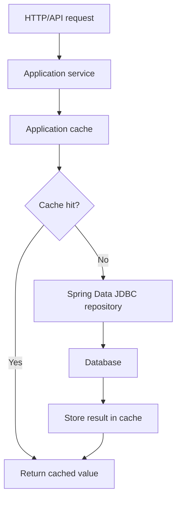
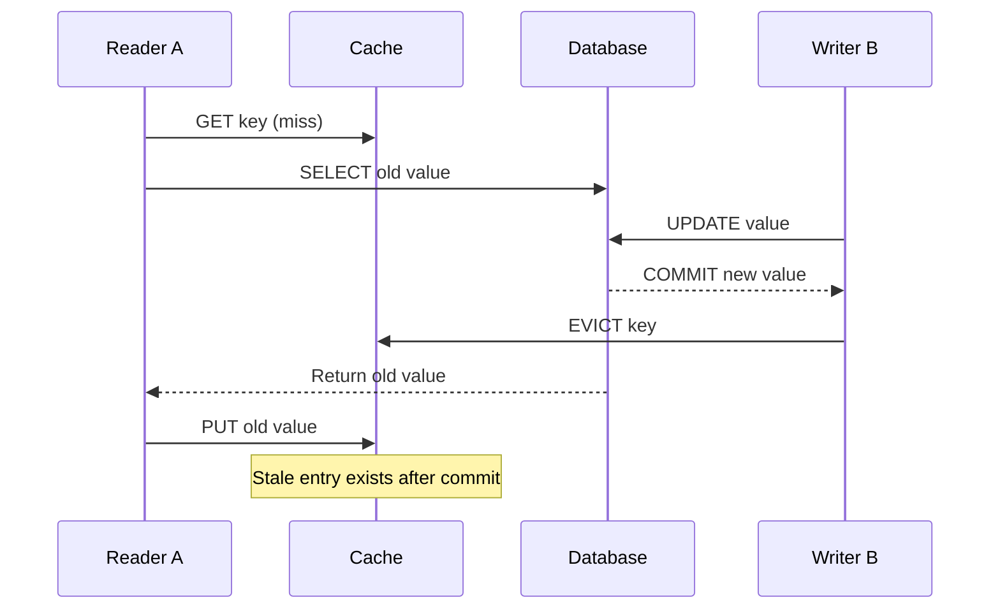
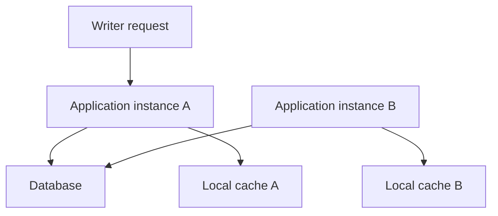
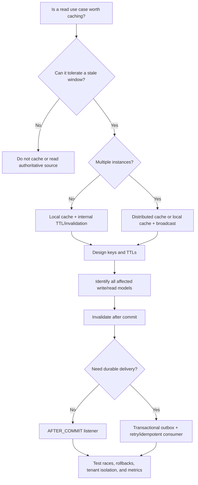

# Application-Level Caching and Write Invalidation Strategies

Application-level caching temporarily stores read results in process memory or a shared cache system to reduce database queries and improve latency. In Spring Data JDBC, caching is typically placed in services, use-case handlers, or query adapters wrapping repositories and read operations. The repository remains the path to durable storage; the cache is a time-bounded copy that must stay synchronized via an explicit write strategy.

The hardest part of caching is not reading cached values, but ensuring the cache stops serving stale data after the database changes. A single write can affect cached aggregates, lists, search results, statistics, and related data. Invalidate too early, and a concurrent reader can reload stale data; invalidate too late or fail to propagate across instances, and the application serves outdated state.

This lesson covers cache-aside and Spring Cache abstraction, key/TTL design, core annotations, invalidation strategies for inserts/updates/deletes, timing relative to transaction commits, race conditions, cache stampedes, multi-instance invalidation, testing, and monitoring.

## 1. What Problem Does Application-Level Caching Solve?

A read request can flow through these layers:



On a cache hit, the service returns the result without running a query. On a cache miss, the service reads the database and stores the result in the cache for subsequent requests.

Caching helps when:

- Specific data is read far more often than written.
- Read results are expensive to compute or join many tables.
- A clearly bounded level of data staleness is acceptable.
- Data has stable access keys and bounded cache size.
- Database or downstream read costs are the bottleneck.

Caching does not automatically speed up every query. For rarely read, rapidly mutating, ultra-high-cardinality, or strictly strongly consistent data, serialization, network, eviction, and invalidation overhead can outweigh the gains.

### Cache Is Not Durable Source-of-Truth Storage

The database remains the authoritative source of truth. Cache entries can vanish on process restarts, node replacements, TTL expirations, or cache server failures. The application must always recover by re-reading the database.

Never place unique business-critical data solely in a cache. Evicting a cache entry must never lose state needed to reconstruct system state.

## 2. Choosing a Caching Strategy

Common patterns:

| Strategy | How it works | When it fits |
| --- | --- | --- |
| Cache-aside (lazy loading) | Application reads cache; on miss, reads DB and populates cache. On write, application actively evicts/updates cache. | Common, straightforward for Spring services. |
| Read-through | Cache layer loads data via a registered loader on miss. | When the cache provider/framework supports loaders and read logic should stay centralized. |
| Write-through | Writes cache and database within one write flow per the cache layer contract. | When cache must update alongside writes with clear guarantees. |
| Write-behind | Writes to cache first; database updates asynchronously later. | Specialized workloads; higher risk since cache becomes temporary write buffer. |

For Spring Data JDBC applications, cache-aside is usually the easiest to reason about: repositories write to the database, and services manage cache keys and invalidation. Do not invent write-behind just to lower latency without durable queues, retries, idempotency, and recovery mechanisms.

### What Data Should Be Cached?

Prioritize caching reusable read outputs:

- Frequently read aggregates by ID.
- DTOs/read models serving screens or APIs.
- Slowly changing metadata like catalogs or public configuration.
- Expensive computation results with stable inputs.
- List queries with common filters and bounded result sizes.

Think carefully before caching:

- Rapidly changing balances, payment statuses, or permissions.
- Results tailored to the current user or current authorization context.
- Free-form search queries yielding millions of distinct keys.
- Very large payloads or sensitive data.
- Queries demanding strict immediate consistency after writes.

## 3. Spring Cache Abstraction

Spring provides an abstraction allowing applications to use annotations rather than coupling directly to one cache provider. Enable caching via configuration:

```java
@Configuration
@EnableCaching
public class CacheConfiguration {
}
```

Then provide a `CacheManager` implementation. Example using Caffeine for process-local caching:

```java
@Configuration
@EnableCaching
public class CacheConfiguration {

    @Bean
    CacheManager cacheManager() {
        CaffeineCacheManager manager =
            new CaffeineCacheManager("orders", "orderLists");

        manager.setCaffeine(
            Caffeine.newBuilder()
                .maximumSize(20_000)
                .expireAfterWrite(Duration.ofMinutes(5))
        );

        return manager;
    }
}
```

This requires the corresponding Caffeine dependency. In multi-instance deployments, each node's local cache is an independent copy; invalidating on node A does not remove entries on node B. When shared caching or cluster-wide invalidation is needed, use Redis or another distributed provider.

Spring Cache abstraction provides these main annotations:

| Annotation | Behavior |
| --- | --- |
| `@Cacheable` | Checks cache before invoking method; on miss, executes method and caches result. |
| `@CachePut` | Always executes method and writes result into cache. |
| `@CacheEvict` | Removes one entry or all entries from cache. |
| `@Caching` | Combines multiple cache operations on one method. |
| `@CacheConfig` | Declares shared cache settings at class level. |

In this documentation, the `@` symbol in the table denotes the single `@` prefix of the annotation name.

### Cache Keys and Cache Regions

Caches are typically partitioned into named caches (regions) like `orders` or `orderLists`. Each entry has a unique key within that region. Key design is part of your data contract: the same key must always map to the same result and access scope.

Example caching an aggregate by ID:

```java
@Service
public class OrderQueryService {

    private final PurchaseOrderRepository orders;

    public OrderQueryService(PurchaseOrderRepository orders) {
        this.orders = orders;
    }

    @Cacheable(cacheNames = "orders", key = "#orderId")
    public PurchaseOrder findById(long orderId) {
        return orders.findById(orderId)
            .orElseThrow(() -> new OrderNotFoundException(orderId));
    }
}
```

When invoked through a Spring proxy, a cache hit returns without executing the method body. Therefore, cached methods must be called through the bean proxy; self-invocation within the same class normally bypasses caching annotations in default proxy mode.

### Choosing a Provider by Deployment Scope

- Local caches like Caffeine offer ultra-low latency and zero network hops, yet each instance holds separate state.
- Distributed caches like Redis share entries across instances, adding network hops, serialization, operations, and an external dependency.
- Cache providers must have size/TTL bounds; unbounded caches can exhaust JVM heap or cache server memory.
- Choose serializers compatible across application versions if cached data survives rolling deployments.

Do not treat a provider name as a consistency strategy. Whether local or distributed, the application still decides when entries expire, update, or are evicted.
## 4. Using @Cacheable on Read Paths

`@Cacheable` checks the cache before running the method. If the key exists, Spring returns the cached value and skips method execution. On a miss, the method runs and its return value is cached under the key.

```java
@Cacheable(cacheNames = "orders", key = "#orderId")
public PurchaseOrder findById(long orderId) {
    return orders.findById(orderId)
        .orElseThrow(() -> new OrderNotFoundException(orderId));
}
```

Keys can be method parameters or SpEL expressions derived from parameters:

```java
@Cacheable(
    cacheNames = "orderSummaries",
    key = "#customerId + ':' + #page + ':' + #size"
)
public List<OrderSummary> findSummaries(
        long customerId,
        int page,
        int size) {
    return queries.findSummaries(customerId, page, size);
}
```

The key must include every input affecting the output. If results depend on customer, tenant, locale, currency, page, filters, or permissions, include those factors in the key or partition caches accordingly. Omitting a parameter can serve one caller another caller's result.

### condition and unless

`condition` is evaluated before the method executes; `unless` is evaluated after a result is produced:

```java
@Cacheable(
    cacheNames = "orders",
    key = "#orderId",
    condition = "#orderId > 0",
    unless = "#result == null"
)
public PurchaseOrder findOptional(long orderId) {
    return orders.findById(orderId).orElse(null);
}
```

- Use `condition` to skip caching for certain invocations.
- Use `unless` to avoid storing certain results after execution, such as `null`.
- Never use cache conditions to replace authorization or tenant validation.

Spring Cache supports `Optional` in the abstraction; an empty `Optional` is typically represented like `null` at the cache layer. Verify exact behavior with your provider and config if caching negative results. If you do not want to cache "not found" results, set `unless` appropriately.

### Avoid Caching Accidentally Mutable Objects

If a cache returns a mutable object, a caller might mutate it in memory without persisting to the database. Subsequent requests then receive that mutated instance. This is especially dangerous with local caches storing object references.

Prefer caching immutable DTOs/records or returning defensive copies. Never let controllers directly mutate aggregates fetched from a cache. Distributed cache serialization usually creates copies on read, yet domain behavior must never depend on provider differences.

## 5. Using @CachePut and @CacheEvict on Write Paths

`@CachePut` always executes the method and stores its return value in the cache. It fits when the method returns the full updated value and the key is known accurately:

```java
@CachePut(cacheNames = "orders", key = "#result.id")
public PurchaseOrder updateStatus(long orderId, String status) {
    PurchaseOrder current = orders.findById(orderId)
        .orElseThrow(() -> new OrderNotFoundException(orderId));

    return orders.save(current.withStatus(status));
}
```

Here `#result.id` is the aggregate's ID after saving. Ensure the method returns the saved object and the key in `@CachePut` matches `@Cacheable` on the read path.

However, `@CachePut` writes to the cache before an enclosing transaction is guaranteed to commit if cache advice runs before transaction commit. When consistency matters, prefer post-commit invalidation over writing directly into the cache inside transactional methods.

### Removing Entries with @CacheEvict

```java
@CacheEvict(cacheNames = "orders", key = "#orderId")
public void deleteOrder(long orderId) {
    orders.deleteById(orderId);
}
```

By default, `@CacheEvict` runs after the method returns successfully. Setting `beforeInvocation = true` moves eviction before method execution, even if the method later fails. For database-backed transactions, avoid `beforeInvocation = true` casually: if the database rolls back, the cache was already cleared early, and a concurrent reader can reload stale state.

`allEntries = true` clears all entries in the cache region:

```java
@CacheEvict(cacheNames = "orderLists", allEntries = true)
public void changeOrderStatus(long orderId, String status) {
    // Update database.
}
```

This is simple but can cause mass cache misses and spike database load. Use it only when entry counts and cold-cache impact are acceptable.

### Do Not Combine @Cacheable and @CachePut Carelessly on One Method

`@Cacheable` skips method execution on a hit; `@CachePut` always runs the method. Placing both on the same method yields confusing semantics. Separate read paths from write paths, or use `@Caching` when multiple explicit cache operations are genuinely required.

## 6. Designing Safe and Complete Cache Keys

A cache key forms part of your data isolation boundary. Keys should:

- Distinguish every input affecting output.
- Prevent cross-tenant data mixing.
- Prevent cross-user/permission mixing when responses are personalized.
- Have a stable representation across application versions.
- Omit secrets, access tokens, or unnecessary sensitive data.
- Maintain bounded cardinality.

Example caching by tenant and ID:

```java
@Cacheable(
    cacheNames = "orders",
    key = "#tenantId + ':' + #orderId"
)
public PurchaseOrder findForTenant(String tenantId, long orderId) {
    return orderQueries.findForTenant(tenantId, orderId);
}
```

`tenantId` must come from an authenticated context, never blindly trusting a client-supplied parameter. Even with database-per-tenant where each tenant has its own ID sequence, tenant ID must still be part of the cache key if caches are shared across the application instance.

For complex criteria objects, consider a `KeyGenerator` instead of manual string concatenation. The generator should normalize field ordering, nulls, collections, and encoding so equivalent requests yield identical keys.

```java
@Component("orderSearchKeyGenerator")
public class OrderSearchKeyGenerator implements KeyGenerator {

    @Override
    public Object generate(
            Object target,
            Method method,
            Object... params) {

        OrderSearchCriteria criteria = (OrderSearchCriteria) params[0];

        return criteria.tenantId()
            + ":" + criteria.status()
            + ":" + criteria.from()
            + ":" + criteria.to()
            + ":" + criteria.page()
            + ":" + criteria.size();
    }
}
```

Usage:

```java
@Cacheable(
    cacheNames = "orderSearch",
    keyGenerator = "orderSearchKeyGenerator"
)
public Page<OrderSummary> search(OrderSearchCriteria criteria) {
    return queries.search(criteria);
}
```

If criteria contain lists of sorts or filters, canonicalize element order before building the key. Otherwise, two equivalent criteria with differently ordered collections produce separate entries—or key collisions if normalized improperly.
## 7. TTL, Size Limits, and Eviction Policies

TTL (time to live) caps how long an entry stays in the cache. Caffeine example:

```java
@Bean
CacheManager cacheManager() {
    CaffeineCacheManager manager =
        new CaffeineCacheManager("orders", "orderLists");

    manager.setCaffeine(
        Caffeine.newBuilder()
            .maximumSize(50_000)
            .expireAfterWrite(Duration.ofMinutes(3))
            .recordStats()
    );

    return manager;
}
```

Common policies:

- `expireAfterWrite`: expires a fixed duration after creation/update.
- `expireAfterAccess`: expires after a period without reads or writes.
- Maximum size/weight: caps total entry count or total weighted size.
- Eviction policy: chooses which entries to drop once capacity is reached.

TTL does not replace invalidation. An entry can become stale immediately after a database write; TTL only caps the maximum lifetime if explicit eviction is missed. Long TTLs boost hit ratios while widening stale data windows; short TTLs shrink stale windows while raising misses and database load.

For data with different access heat, use separate cache regions and TTLs. For example, product catalogs may use longer TTLs, while order statuses use short TTLs or immediate post-write eviction.

### TTL Jitter to Prevent Synchronized Expiration

If thousands of keys are populated simultaneously with identical TTLs, they can expire simultaneously and trigger a query burst. Add small random jitter to TTLs or stagger refreshes. Jitter must stay within the business's acceptable staleness bounds.

## 8. Invalidation on Insert, Update, and Delete

Cache-aside commonly follows the rule: **write to the database first, then evict affected cache entries**. This prevents caches from holding uncommitted values if a database transaction rolls back.

Example write service:

```java
@Service
public class OrderCommandService {

    private final PurchaseOrderRepository orders;

    public OrderCommandService(PurchaseOrderRepository orders) {
        this.orders = orders;
    }

    @Transactional
    public PurchaseOrder changeStatus(long orderId, String status) {
        PurchaseOrder current = orders.findById(orderId)
            .orElseThrow(() -> new OrderNotFoundException(orderId));

        return orders.save(current.withStatus(status));
    }
}
```

When caches are managed separately, the service should emit invalidation signals after transaction commit. Avoid evicting only before calling `save`, because the transaction can fail while a concurrent reader reloads stale data.

### Invalidating Aggregates by ID

When an order changes, at minimum evict the cache entry keyed by ID:

```java
@CacheEvict(cacheNames = "orders", key = "#orderId")
public void evictOrder(long orderId) {
}
```

This illustrates a standalone cache operation. In real applications, centralize invalidation inside dedicated listeners or services rather than scattering empty annotated methods everywhere.

If a write affects lists, search results, or summaries, evict those corresponding cache regions too. Evicting `orders[orderId]` alone does not refresh `orderLists[customerId:page]`.

### Invalidating on Insert

A new insert can affect:

- Cache for the new aggregate ID (usually absent, though negative caching may exist).
- Lists filtered by customer or status.
- Search results and pagination boundaries.
- Total order counts, dashboards, or summaries.
- Related object caches if responses include joined data.

Design invalidation around the set of affected queries/read models, not solely the newly persisted aggregate.

### Invalidating on Delete

Both hard deletes and soft deletes affect caches. With soft deletes, the row remains in the database yet leaves the active dataset; evict the aggregate key plus any list/search/count caches containing active records only.

If negative caching is used for missing items, inserting a record whose ID or business key was negatively cached must evict that negative entry.

## 9. Invalidation Timing: After Commit

A method annotated with both `@Transactional` and `@CacheEvict` may run cache eviction when the method returns yet *before* the database transaction actually commits, depending on advisor/interceptor ordering. Never assume `@CacheEvict` automatically means "after commit".

If the database rolls back after the cache is evicted, data stays consistent while cache misses rise. Worse, a concurrent read arriving between eviction and commit can reload the old value from the database, leaving stale data cached after commit.

One clean way to make timing explicit is publishing an application event inside the transaction and listening in the `AFTER_COMMIT` phase:

```java
public record OrderChanged(long orderId, long customerId) {}

@Service
public class OrderCommandService {

    private final PurchaseOrderRepository orders;
    private final ApplicationEventPublisher events;

    public OrderCommandService(
            PurchaseOrderRepository orders,
            ApplicationEventPublisher events) {
        this.orders = orders;
        this.events = events;
    }

    @Transactional
    public PurchaseOrder changeStatus(long orderId, String status) {
        PurchaseOrder current = orders.findById(orderId)
            .orElseThrow(() -> new OrderNotFoundException(orderId));

        PurchaseOrder saved = orders.save(current.withStatus(status));

        events.publishEvent(
            new OrderChanged(saved.id(), saved.customerId())
        );

        return saved;
    }
}
```

The listener performs invalidation after commit:

```java
@Component
public class OrderCacheInvalidator {

    private final CacheManager cacheManager;

    public OrderCacheInvalidator(CacheManager cacheManager) {
        this.cacheManager = cacheManager;
    }

    @TransactionalEventListener(phase = TransactionPhase.AFTER_COMMIT)
    public void onOrderChanged(OrderChanged event) {
        Cache orders = cacheManager.getCache("orders");
        if (orders != null) {
            orders.evict(event.orderId());
        }

        Cache orderLists = cacheManager.getCache("orderLists");
        if (orderLists != null) {
            orderLists.clear();
        }
    }
}
```

This example clears all of `orderLists` to illustrate the principle. In larger systems, evict by customer, status, or versioned keys instead of clearing an entire region. If no transaction is active, `@TransactionalEventListener` ignores events by default; ensure events are published inside transactions or configure fallback behavior intentionally.

Another option is a transaction-aware cache manager/decorator that defers eligible `put`, `evict`, and `clear` operations until after commit. Check provider and operation semantics carefully; not every API such as `putIfAbsent` is deferred identically. For multi-step invalidation or explicit post-commit guarantees, transactional event listeners or outboxes are usually clearer.

### Why Not Evict Before Writing?

If you clear the cache before updating the database, Request B can miss the cache and read old database data while Request A has not committed yet. Request B writes the old value back into the cache, and then Request A commits. Without a subsequent eviction, the cache serves stale data until TTL expires.

Thus, writing to the database first and invalidating after commit is a far better baseline, though it still does not eliminate every race condition, as explained next.
## 10. Race Conditions Between Cache Misses and Database Writes

Post-commit eviction eliminates many stale-cache bugs, yet cache-aside still has a race condition:

1. Request A misses the cache and begins reading the database, receiving the old value.
2. Request B updates the primary row and commits the new value.
3. Request B evicts the cache after commit.
4. Request A finishes its stale read and writes the old value into the cache *after* the eviction.
5. Subsequent requests read the stale entry written by A.

Diagram:



This is a race between cache population and invalidation. It demonstrates that "evict after commit" is a sound baseline, yet does not automatically guarantee linearizable consistency under all interleavings.

### Protection Levels

- **Do not cache data requiring immediate consistency:** read directly from the primary for sensitive state.
- **Short TTLs:** limit how long stale values survive a race, though they do not prevent the race.
- **Per-key single-flight/locking:** allow only one loader per key at a time; writers must coordinate with the lock if blocking stale loaders.
- **Version/fencing tokens:** cache entries carry database versions; only write to cache if the version is not older than the current version.
- **Versioned cache keys:** keys embed the current version/epoch; after writes, bump the version so stale entries become unreachable.
- **Double invalidation:** some systems evict again after a delay to shrink the race window; this reduces probability rather than guaranteeing correctness.
- **Controlled write-through:** update cache with the new version inside the write workflow alongside retries and idempotency.

Pick safeguards matching your consistency needs. If you cannot prove ordering and atomicity between database and cache, do not describe cache-aside as strongly consistent.

### Illustrating Versioned Keys

Suppose cache keys look like `order:{id}:v{version}`. Readers obtain the current version from an authoritative version source and read that key. After commit, writers increment the version/epoch. An old loader may still populate the previous version's key, yet new requests use the new version and never read the stale entry.

Design this carefully: if the version pointer itself is cached and can go stale, the problem merely shifts to the pointer. Versions must come from a suitably consistent source or be updated via reliable atomic operations.

## 11. Invalidation for Lists, Searches, Counts, and Read Models

One aggregate can appear across multiple cache entries. For example, an order may appear in:

- `orders[id]` — aggregate detail.
- `orderLists[customerId,status,page,size]` — lists by customer and status.
- `orderSearch[criteria]` — search results.
- `orderCounts[customerId]` — counts.
- `dashboard[tenantId]` — summaries.

When `status` changes from `CREATED` to `CONFIRMED`, list entries for both statuses are affected. When `customerId` changes, lists for both old and new customers are affected. On inserts/deletes, pagination boundaries and total counts also change.

### Strategies for Managing List Caches

1. **Evict the entire region:** easy to implement, suitable for small regions or infrequent writes; can cause miss bursts.
2. **Evict by key group:** by tenant/customer/status when key namespaces are designed upfront.
3. **Version/epoch namespaces:** keys embed a collection version; writes increment the epoch so old entries become unreferenced.
4. **Cache low-churn read models only:** cache only lists with fixed filters and clear invalidation rules.
5. **Skip caching dynamic pagination:** if every filter/page combination yields a distinct key hard to invalidate, caching may not pay off.

Example versioned namespace:

```java
String key = "customer:" + customerId
    + ":orders:v" + listVersion;
```

When a customer's data changes, atomically increment `listVersion`. Old versioned keys are left for TTL expiration. Ensure version increments are shared across all application instances when caches are shared.

Do not use `allEntries = true` as the default for every write in systems with large caches. Clearing everything can crater cache hit ratios and overload the database.

## 12. Aggregates with Children and Related Data

In Spring Data JDBC, saving an aggregate can modify the root and child rows. Caches typically store the whole aggregate object, so invalidation must target the root ID after any child change.

For example:

- Adding or deleting an `OrderLine` alters `orders[orderId]`.
- Modifying children alters totals, counts, or summary caches.
- If a read model query joins `Customer`, changing a customer's name affects many `OrderSummary` entries even though `Order` did not change.

Map out dependencies between write models and read models. With many relationships, tracking every affected cache key becomes hard. You can use region clears/version namespaces for read models, or cache only aggregates by ID and stable metadata.

Do not use cached aggregates as a shortcut to share domain objects across use cases with differing access permissions. Dedicated DTOs for read models are usually safer to manage.

## 13. Bulk Updates, Custom SQL, and Write Paths Outside Repositories

`@CacheEvict` on a service method runs only when writes go through that method. Updates via custom SQL, batch jobs, migrations, admin scripts, or another service bypass annotations and invalidation.

Example:

```java
@Repository
public class OrderBulkRepository {

    private final NamedParameterJdbcTemplate jdbc;

    public OrderBulkRepository(NamedParameterJdbcTemplate jdbc) {
        this.jdbc = jdbc;
    }

    public int markExpired(Collection<Long> ids) {
        return jdbc.update("""
            UPDATE purchase_order
            SET status = :status
            WHERE id IN (:ids)
            """,
            new MapSqlParameterSource()
                .addValue("status", "EXPIRED")
                .addValue("ids", ids)
        );
    }
}
```

This bulk statement does not trigger per-aggregate cache annotations. The caller must invalidate affected IDs or namespaces after commit. For huge ID lists, bump a region version or emit grouped events instead of sending millions of individual key evictions.

### Rules for Structuring Write Paths

- Place write use cases in unified services or command handlers.
- Centralize invalidation policies in a single adapter or listener.
- For custom SQL, explicitly declare affected aggregates and read models.
- For scheduled jobs/imports, follow the same invalidation/outbox contract.
- If external writers modify the database, consider CDC or database event mechanisms to drive invalidation.
- Never assume DDL/data migrations automatically trigger Spring event listeners.
## 14. Local vs. Distributed Caches Across Multiple Instances

When running multiple application instances, local caches keep a separate copy on each node:



If instance A evicts its cache after commit, instance B's cache still holds the old entry. Thus, local caches fit only when staleness within TTL bounds is acceptable or when broadcast invalidation is implemented.

Options:

- **Shared distributed cache:** all instances access the same cache backend. Evicting a key applies across instances using that backend, though network errors and database/cache consistency still require handling.
- **Local cache + pub/sub invalidation:** write paths publish events; each instance receives events and evicts local entries. Must handle dropped messages, reconnects, duplicates, and ordering.
- **Local cache with short TTL:** accepts bounded stale windows for consistency-tolerant data.
- **Avoid local caching for frequently mutated data:** prevents hard-to-synchronize copies.

### Invalidation Events Must Be Idempotent

An event like `OrderChanged(orderId, version)` should be safe to process multiple times. Evicting the same key twice is naturally idempotent. If events push updated payloads instead of evicting, compare versions so delayed older events never overwrite newer values.

With non-durable pub/sub, subscribers can miss events while disconnected. On reconnect/restart, clear local caches, resync epochs/versions, or accept TTL-bounded staleness. When high reliability is required, use durable messaging or an outbox.

## 15. Transactional Outbox for Reliable Invalidation

`@TransactionalEventListener(AFTER_COMMIT)` executes in-process after commit, leaving a narrow window: the database commits, then the process crashes before the listener finishes. In-memory events are lost on restart.

When invalidation must be reliably delivered to cache subscribers, write an outbox record within the same database transaction as the business update:

```java
@Transactional
public PurchaseOrder changeStatus(long orderId, String status) {
    PurchaseOrder current = orders.findById(orderId)
        .orElseThrow(() -> new OrderNotFoundException(orderId));

    PurchaseOrder saved = orders.save(current.withStatus(status));

    outbox.insert(new CacheInvalidationMessage(
        "OrderChanged",
        saved.id(),
        saved.version()
    ));

    return saved;
}
```

A worker reads the outbox, publishes messages to a broker or invalidation channel, and marks rows processed. If publishing succeeds yet marking fails, messages can redeliver; consumers must be idempotent.

An outbox guarantees the event persists atomically with the business transaction. It does not turn database and cache into one distributed transaction; instead, it provides retryable delivery and eventual invalidation. Between database commit and subscriber processing, caches can still be stale. If business rules forbid even that window, consistency-sensitive reads must bypass the cache or verify versions against an authoritative source.

### Keep Event Payloads Minimal

Usually only these fields are needed:

- Event type.
- Aggregate ID.
- Tenant ID if keys are tenant-scoped.
- Aggregate version or cache epoch.
- Event ID and timestamp.
- Cache/read-model groups needing invalidation.

Avoid embedding full sensitive aggregates in invalidation messages when subscribers only need to delete keys. Minimal payloads lower data exposure risks and reduce coupling between domain schemas and message contracts.

## 16. Cache Stampedes and Concurrent Misses on Expiration

A cache stampede occurs when many concurrent requests miss a hot key, query the database simultaneously, and write results back together. This commonly happens when TTLs expire en masse or after clearing a large cache region.

Mitigations:

- **Single-flight:** only one request loads a given key while others wait for its result.
- `@Cacheable(sync = true)`: asks the cache provider for synchronized per-key loading; exact semantics depend on the provider and Spring Cache constraints.
- **TTL jitter:** stagger expiration times.
- **Refresh-ahead:** reload hot entries prior to expiration when workloads fit.
- **Stale-while-revalidate:** briefly serve stale values while refreshing in the background; use only when staleness is acceptable.
- **Rate/concurrency limits:** cap how many loaders hit the database concurrently.
- **Negative caching:** briefly cache "not found" results when repeated missing-key lookups are expensive.

Example:

```java
@Cacheable(
    cacheNames = "productCatalog",
    key = "#productId",
    sync = true
)
public ProductView findProduct(long productId) {
    return productQueries.findById(productId)
        .orElseThrow(() -> new ProductNotFoundException(productId));
}
```

`sync = true` is not a cross-instance distributed lock across every provider. Verify your exact provider implementation before relying on it for cluster-wide stampede protection.

### Negative Caching

Caching "not found" outcomes can cut repeated queries for nonexistent IDs. However, inserting a new record with that ID or business key must evict the negative entry. Use shorter TTLs than normal entries since non-existence can change.

Never cache transient infrastructure failures such as database timeouts or connection errors as "not found". Separate valid absence from infrastructure errors.

## 17. Caches and Transaction-Aware Behavior

Spring Cache abstraction does not automatically enlist cache providers in database transactions. Rolling back a database transaction does not automatically undo prior cache operations unless an explicit transaction-aware decorator/integration is configured.

Important distinctions:

- `@Transactional` manages database transactions via a transaction manager.
- `@Cacheable` may read the cache before the method and its inner transaction even start, depending on annotation/advisor order.
- `@CachePut` may update the cache before the database transaction commits.
- `@CacheEvict` does not mean "after commit" by default.
- Transaction-aware cache decorators can defer certain cache operations until after commit, though not every cache API method behaves identically.
- Distributed caches usually do not participate atomically in local JDBC transaction managers.

With cache-aside and Spring Data JDBC writes, the clearest pattern is usually: write DB and outbox/event inside the transaction, then perform invalidation after commit. If durable delivery is unnecessary, `@TransactionalEventListener(AFTER_COMMIT)` may suffice.

Never hold long database transactions open while acquiring distributed cache locks or waiting on cache network calls. Keep database transactions short to avoid holding connections and locks.
## 18. Tenants, Authorization, and Sensitive Data

Caches can leak data if keys omit access scope. This is critical when multiple tenants share application instances or cache backends.

For example, a key with only order ID:

```java
@Cacheable(cacheNames = "orders", key = "#orderId")
public OrderView findOrder(long orderId) {
    // ...
}
```

If IDs are unique only per tenant, two tenants can share the same numeric order ID. That key causes collisions and leaks one tenant's data to another.

Use a tenant-scoped key:

```java
@Cacheable(
    cacheNames = "orders",
    key = "#tenantId + ':' + #orderId"
)
public OrderView findOrder(String tenantId, long orderId) {
    return queries.findForTenant(tenantId, orderId);
}
```

`tenantId` must come from an authenticated security context. Cache keys do not replace authorization: before returning a cached entry, the service must still verify the caller is authorized for that tenant and resource. If responses vary by role, permission, ownership, or user preference, include those dimensions in the key or cache shared data before applying per-caller authorization.

Avoid caching raw responses containing tokens, credentials, payment details, or personal data without explicit security, TTL, encryption, and access-control requirements. Distributed caches require network security, authentication, encryption at rest, and environment isolation.

## 19. Serialization and Compatibility During Rolling Deployments

Distributed caches typically serialize objects to bytes. During rolling deployments, two code versions read and write the same cache concurrently. Changing class shapes, packages, enums, JSON properties, or serializers can prevent older instances from reading entries written by newer instances (and vice versa).

Risk mitigations:

- Cache DTOs with simple, stable schemas rather than complex domain aggregates.
- Use versioned JSON schemas/payloads when entries span multiple releases.
- Include namespace/version prefixes in cache names or keys on breaking format changes.
- Retire old namespaces across transitional releases when cold caches are acceptable.
- Keep TTLs short enough for old entries to age out, though do not rely on TTL alone if new serializers break immediately upon deploy.
- Avoid Java native serialization for long-lived cache contracts unless `serialVersionUID` and class evolution are tightly managed.

Example versioned namespace:

```java
@Cacheable(
    cacheNames = "orderViews:v2",
    key = "#tenantId + ':' + #orderId"
)
public OrderViewV2 findView(String tenantId, long orderId) {
    return queries.findViewV2(tenantId, orderId);
}
```

Changing the namespace creates a separate cache region and avoids parsing incompatible legacy payloads. Plan cleanup of old regions once all instances finish upgrading.

## 20. Cache Failures and Fail-Open vs. Fail-Closed Policies

A cache is an infrastructure dependency. Cache servers can time out, drop connections, run out of memory, or refuse requests. Decide how cache failures affect incoming requests.

### Fail-Open

If caching is purely an optimization, the application can bypass an unavailable cache and query the database. This preserves functionality while increasing database load. Ensure connection pool/database capacity and circuit breakers/rate limits prevent a cache outage from cascading into a database outage.

Spring lets you configure a `CacheErrorHandler` to govern get/put/evict/clear exceptions. Illustrative fail-open handler for cache operations:

```java
@Configuration
@EnableCaching
public class CacheErrorConfiguration implements CachingConfigurer {

    @Override
    public CacheErrorHandler errorHandler() {
        return new CacheErrorHandler() {
            @Override
            public void handleCacheGetError(
                    RuntimeException exception,
                    Cache cache,
                    Object key) {
                log.warn("Cache GET failed for {}", cache.getName(), exception);
            }

            @Override
            public void handleCachePutError(
                    RuntimeException exception,
                    Cache cache,
                    Object key,
                    Object value) {
                log.warn("Cache PUT failed for {}", cache.getName(), exception);
            }

            @Override
            public void handleCacheEvictError(
                    RuntimeException exception,
                    Cache cache,
                    Object key) {
                log.error("Cache EVICT failed for {}", cache.getName(), exception);
            }

            @Override
            public void handleCacheClearError(
                    RuntimeException exception,
                    Cache cache) {
                log.error("Cache CLEAR failed for {}", cache.getName(), exception);
            }
        };
    }
}
```

This example logs errors to illustrate the hook; verify exact fallback behavior for your `CacheErrorHandler` and Spring version. On GET errors, the handler lets the method proceed to the database. On EVICT errors, merely logging and continuing leaves stale entries in cache; add alerts, short TTLs, retries, or re-emitted invalidations.

### Fail-Closed

For data where stale results carry severe consequences, reject requests when freshness cannot be verified, or bypass cache to read from the authoritative primary. Fail-closed does not always mean returning an error immediately; it can mean bypassing cache and hitting the primary database if available.

Never swallow all cache exceptions silently. Maintain metrics and alerts to distinguish normal cache misses from a failing cache backend.

## 21. Do Not Cache Too Deeply in Repositories

You can annotate repository methods with `@Cacheable`, yet caching at the application service or query service layer makes policies clearer:

- Which use cases tolerate stale data.
- Which callers are allowed to use cached data.
- How cache keys incorporate tenant/user/locale.
- Which writes trigger invalidation.
- When reads must bypass cache for primary freshness.

Putting caches deep inside repositories can expose unsuspecting callers to stale data even when their use case requires freshness. Repositories should focus on persistence contracts; services coordinate cache policies around business needs.

An exception is a specialized repository/query adapter for stable reference data where caching is explicitly part of the adapter contract. Even then, document TTLs and invalidation ownership clearly.
## 22. Testing Cache Hits, Misses, and Invalidation

Cache tests must check more than annotation presence. Verify observable behavior: a cache hit skips calling the repository again, committed writes evict entries, rollbacks do not emit post-commit invalidation, and keys isolate tenants.

Example testing service caching with a mocked repository and test cache manager:

```java
@SpringBootTest
class OrderQueryCacheTest {

    @Autowired
    OrderQueryService queryService;

    @MockBean
    PurchaseOrderRepository orders;

    @Test
    void secondReadUsesCachedValue() {
        PurchaseOrder order = sampleOrder(10L);
        when(orders.findById(10L)).thenReturn(Optional.of(order));

        queryService.findById(10L);
        queryService.findById(10L);

        verify(orders, times(1)).findById(10L);
    }
}
```

Tests must invoke the service through its Spring bean proxy. Instantiating `new OrderQueryService(...)` manually bypasses caching annotations.

### Testing Post-Commit Invalidation

With `@TransactionalEventListener(AFTER_COMMIT)`, test both outcomes:

- Successful commit: listener fires and evicts the affected key.
- Rollback: listener does not fire, and the cache is not invalidated by a rolled-back transaction's event.

Illustrative test structure:

```java
@Test
void committedWriteInvalidatesCachedOrder() {
    queryService.findById(orderId);
    assertThat(cacheManager.getCache("orders").get(orderId)).isNotNull();

    commandService.changeStatus(orderId, "CONFIRMED");

    assertThat(cacheManager.getCache("orders").get(orderId)).isNull();
}

@Test
void rolledBackWriteDoesNotRunAfterCommitInvalidation() {
    queryService.findById(orderId);

    assertThatThrownBy(() ->
        commandService.changeStatusAndFail(orderId, "CONFIRMED")
    ).isInstanceOf(IllegalStateException.class);

    assertThat(cacheManager.getCache("orders").get(orderId)).isNotNull();
}
```

This illustrates intent; ensure the command method runs through a transaction proxy and the test manages commits/rollbacks cleanly. If the test class itself runs inside a transaction, use appropriate test transaction boundaries to observe post-transaction state.

### Testing Negative Caching and Bulk Writes

- Cache a not-found outcome, insert a record under that key, and verify the negative entry is evicted.
- Update an aggregate via repository/service and verify both detail and list/read-model caches invalidate.
- Run bulk SQL and verify the caller invalidates all affected cache regions.
- Soft-delete an aggregate and verify active list/count caches no longer return that row.
- Modify child collections and verify the aggregate root cache evicts.
- Modify joined related data such as `Customer` name and verify joined read models refresh.

### Multi-Instance Testing

For local caches, spin up two application contexts or two independent cache managers. Write through instance A and verify instance B receives the invalidation event and removes its entry. Also test subscriber reconnects or dropped messages if pub/sub can lose events.

For distributed caches, test serialization, TTLs, evictions, and behavior when the cache server is down. Local Caffeine tests do not prove Redis serialization or network failure handling works.

## 23. Testing Race Conditions and Stampedes

Concurrency tests should use latches or barriers to enforce deterministic interleavings rather than relying on random timing.

A race test should reproduce this sequence:

1. Reader misses cache.
2. Reader reads old snapshot from database and pauses before `cache.put`.
3. Writer commits new value and evicts key.
4. Reader resumes and attempts to put the stale value.
5. Test asserts your versioning/locking mechanism prevents the stale entry from becoming active.

Never use `Thread.sleep()` as the primary synchronization mechanism. Use `CountDownLatch`, `CyclicBarrier`, or explicit test hooks for reproducible ordering.

For stampedes:

- Launch many concurrent requests reading the same missing key.
- Count how many times the loader/repository is invoked.
- Verify `sync` or single-flight caps load calls as expected.
- Test across multiple application instances if cluster-wide stampede protection is required.
- Measure waiting request counts and wait durations; single-flight lowers DB load while adding wait latency to queued readers.

Do not run a single race test on Caffeine and extrapolate to Redis or another provider. Locking and atomic operations depend on the cache implementation.

## 24. Production Cache Metrics and Monitoring

Caches must be measured like any other performance component, not enabled and assumed helpful.

Key metrics:

| Metric | Question to answer |
| --- | --- |
| Hit ratio | What share of reads are served from cache? |
| Hit/miss counts by cache region | Which regions help and which only add overhead? |
| Load latency | How long do cache misses take to query the database? |
| Cache operation latency | Are GET/PUT/EVICT slowed by network or provider issues? |
| Entry count / estimated size | Is the cache approaching capacity limits? |
| Eviction / expiration counts | Are entries dropped due to capacity or TTL? |
| Invalidation lag | How long from database commit until all nodes receive invalidation? |
| Cache error count | How often do GET/PUT/EVICT/clear fail? |
| Loader concurrency | Are there signs of stampedes or parallel loads on hot keys? |
| Stale-read indicator | Do version or timestamp checks reveal stale cache hits? |

Caffeine exposes statistics when `recordStats()` is enabled. For distributed caches, use provider metrics/exporters and monitor network latency. Spring Boot Actuator/Micrometer integrates cache metrics depending on provider and configuration.

### Hit Ratio Is Not the Only Goal

A high hit ratio can still mask stale data or key collisions. Evaluate hit ratio alongside correctness, p95/p99 latency, database load, memory, invalidation lag, and cache errors. A region with a modest hit ratio protecting critical data may still be worthwhile; a region with a high hit ratio returning cross-tenant data is a severe bug.

Never put raw cache keys containing emails, tenant IDs, or personal data into metric labels due to cardinality and privacy. Use region names, operations, and sanitized key groups.

## 25. Cache and Invalidation Design Workflow

Before adding caching to a Spring Data JDBC use case, answer:

1. Which use cases read this data, and what is the maximum acceptable staleness window?
2. Does the database remain the authoritative source, and can the cache always be rebuilt?
3. Are you caching aggregates, DTOs, lists, or computed results?
4. Which tenant, user scope, locale, filter, sort, and pagination parameters belong in keys?
5. Is the provider local or distributed? Do instances need to invalidate each other?
6. What TTL, maximum size, and eviction policies fit?
7. Which detail, list, search, count, and dashboard caches are affected by inserts/updates/deletes?
8. Does invalidation run post-commit via events, transaction-aware caches, or an outbox?
9. Are there races between stale loaders and invalidations? Do you need versioned keys, locks, or cache bypass?
10. Do custom SQL, batch jobs, soft deletes, and external writers share the same invalidation contract?
11. Should cache outages fail-open or fail-closed?
12. Are serializers compatible across rolling deployments?
13. Are negative caching or stampede protections needed?
14. Which integration tests prove hit/miss, commit/rollback, multi-instance, and race behavior?
15. Which metrics alert on stale data, invalidation lag, and cache outages?

Decision flowchart:



## 26. Common Mistakes

| Mistake | Consequence | Remedy |
| --- | --- | --- |
| Keys omit tenant ID | Cross-tenant data leaks when IDs are tenant-scoped. | Put tenant scope in keys and still authorize callers. |
| Evicting only detail caches | List/search/count caches keep returning stale results. | Map dependencies to all affected read models. |
| Evicting before database commit | Concurrent reads reload stale data. | Invalidate after commit. |
| Assuming `@CacheEvict` always runs `AFTER_COMMIT` | Cache can evict before commit depending on advisor order. | Use `AFTER_COMMIT` events or verified transaction-aware integration. |
| Relying on TTL without invalidation | Stale data persists until TTL expires. | Pair TTLs with write-driven invalidation. |
| Local caches across instances without broadcast | Other nodes keep serving stale entries. | Use distributed cache or pub/sub/outbox invalidation. |
| `@CachePut` before commit | Cache can hold values from rolled-back transactions. | Update/evict after commit. |
| Bulk SQL skips invalidation | Cache stays unaware of changed rows. | Emit ID/namespace invalidations or use CDC. |
| Caching mutable objects | Callers mutate cached instances without writing DB. | Use immutable DTOs/records or defensive copies. |
| Keys omit filters or permissions | Callers receive results built for another scope. | Include all inputs in keys and enforce authorization. |
| Clearing entire caches on every write | Cold-cache bursts and database overload. | Evict by key/group or versioned namespaces. |
| Non-durable pub/sub for mandatory invalidations | Subscribers dropping messages serve stale entries. | Outbox/durable messaging, resync, and TTLs. |
| Missing metrics | Blind to whether caches help or fail silently. | Track hits/misses, latency, evictions, errors, and lag. |

## 27. Self-Check Questions

- How does cache-aside differ from read-through and write-through?
- Why must the database remain the authoritative source of truth?
- How do `@Cacheable`, `@CachePut`, and `@CacheEvict` differ in when the target method runs?
- How do `condition` and `unless` differ?
- Why must cache keys include tenant, filters, sorting, and pagination whenever they affect output?
- Why does `@CacheEvict` not automatically mean after commit?
- Which race condition can still happen even with post-commit eviction?
- When are versioned keys, locks, or cache bypasses needed?
- Why can updating an aggregate child require evicting both root and read-model caches?
- How must bulk SQL and batch jobs handle invalidation?
- How do local caches differ from distributed caches in multi-instance synchronization?
- Why is a transactional outbox more reliable than in-memory events if a process crashes right after commit?
- Does `sync = true` guarantee a cluster-wide distributed lock?
- Which use cases warrant fail-open vs. fail-closed behavior on cache failure?
- Which integration tests prove invalidation runs only after commit?
- Which metrics detect cache stampedes and invalidation lag?

Application-level caching only helps when keys match exact data scopes, TTLs are bounded, and every write path follows an explicit invalidation policy. With Spring Data JDBC, keep the database authoritative, place caching policies at service or read-adapter layers, evict affected aggregates and read models after commit, and use an outbox when invalidation requires durable multi-instance delivery. Test race conditions, rollbacks, tenant isolation, and cache outages; track hit ratios alongside latency and invalidation lag to verify caching improves performance without compromising correctness.
