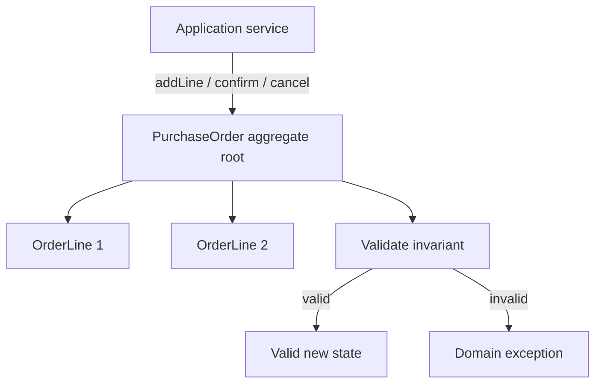
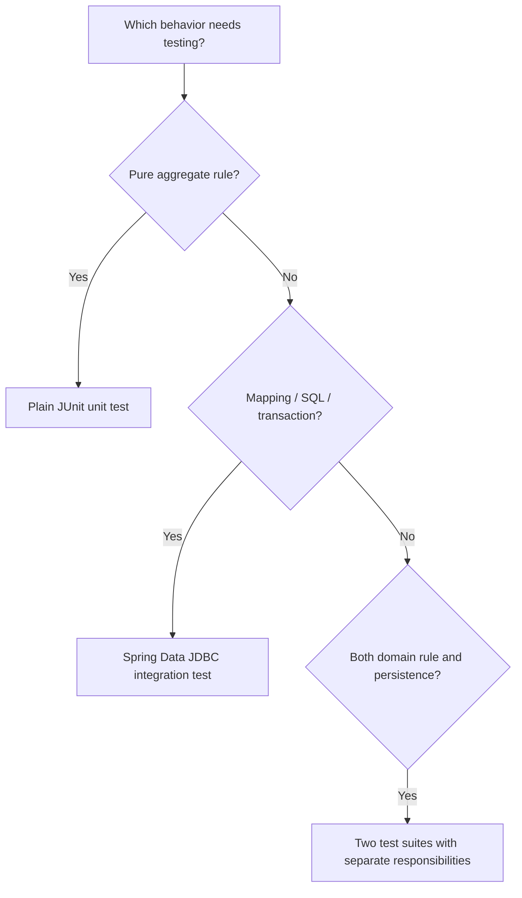

# Testing Aggregate Rules Without a Database

In Spring Data JDBC, an aggregate is the consistency boundary of the domain model: the aggregate root coordinates changes and protects the invariants of its child objects. Many critical rules can be verified by creating an aggregate in memory, calling domain methods, and asserting the resulting state or exception. These tests do not require a database, JDBC driver, Spring application context, or repository mocks.

Testing aggregates without a database provides fast feedback, focuses on business behavior, and clarifies the domain model's contract. They do not replace integration tests for mapping, SQL, transactions, or optimistic locking; they verify that the aggregate itself rejects invalid states and transitions validly according to its rules.

This lesson covers how to design testable aggregates, organize plain unit tests with JUnit, test state transitions/invariants/child collections/domain events, use parameterized and property-based tests, handle time/external dependencies, and draw a clear line for what belongs in database integration tests.

## 1. What Are Aggregate Rules?

An aggregate typically consists of:

- **Aggregate root:** the single object external callers use to request changes to the aggregate.
- **Child entities/value objects:** components living inside the aggregate boundary.
- **Invariants:** conditions that must always hold before and after a valid domain operation.
- **Domain methods:** behaviors that change state and enforce invariants.

For example, an order has root `PurchaseOrder` and order lines `OrderLine`. Some invariants might be:

- Only orders in the `CREATED` state may add or remove order lines.
- Each line's quantity must be greater than 0.
- An order with no lines cannot be confirmed.
- Only a confirmed order may be shipped.
- A shipped order cannot be cancelled.
- The total amount is calculated from the order lines, not accepted as an arbitrary value from the caller.

These rules belong to the domain model. They do not need to know whether data is stored via Spring Data JDBC, PostgreSQL, or another persistence mechanism.

### Aggregate Root Protects Invariants



The caller asks the root to perform a behavior. The root checks the state and child-related conditions before mutating the aggregate. Tests can call the root's methods directly and verify the outcome.

## 2. Why Is No Database Needed for Domain Rules?

A plain unit test can construct objects in memory:

```java
PurchaseOrder order = PurchaseOrder.create("PO-100");

order.addLine(new OrderLine(10L, 2, new BigDecimal("15.00")));

order.confirm();

assertThat(order.status()).isEqualTo(OrderStatus.CONFIRMED);
```

This test verifies the `addLine` and `confirm` logic. It does not need to know which table gets inserted or which SQL statement runs.

Benefits:

- Runs fast because it does not initialize a Spring context or a database.
- Tests focus on business behavior without noise from datasource configuration.
- Easy to construct many edge cases and error states.
- When a test fails, the cause usually lies within domain logic.
- Hundreds or thousands of cases can run in CI at low cost.

Do not add `@DataJdbcTest` or `@SpringBootTest` to tests that only invoke domain methods. Those annotations initialize unnecessary infrastructure and slow down tests.

## 3. Designing Testable Aggregates

An aggregate can be mapped with Spring Data JDBC annotations, but domain methods should not directly invoke repositories or `JdbcTemplate`.

Example aggregate:

```java
@Table("purchase_order")
public class PurchaseOrder {

    @Id
    private Long id;

    @Version
    private Long version;

    private final String reference;
    private OrderStatus status;
    private final List<OrderLine> lines = new ArrayList<>();

    private PurchaseOrder(String reference) {
        if (reference == null || reference.isBlank()) {
            throw new IllegalArgumentException("Reference is required");
        }
        this.reference = reference;
        this.status = OrderStatus.CREATED;
    }

    public static PurchaseOrder create(String reference) {
        return new PurchaseOrder(reference);
    }

    public void addLine(OrderLine line) {
        requireCreated();
        Objects.requireNonNull(line, "line is required");

        boolean duplicateProduct = lines.stream()
            .anyMatch(existing ->
                existing.productId().equals(line.productId()));

        if (duplicateProduct) {
            throw new DuplicateOrderLineException(line.productId());
        }

        lines.add(line);
    }

    public void confirm() {
        requireCreated();

        if (lines.isEmpty()) {
            throw new EmptyOrderCannotBeConfirmedException();
        }

        status = OrderStatus.CONFIRMED;
    }

    public void ship() {
        if (status != OrderStatus.CONFIRMED) {
            throw new InvalidOrderStateException(status, "SHIP");
        }

        status = OrderStatus.SHIPPED;
    }

    public void cancel() {
        if (status == OrderStatus.SHIPPED) {
            throw new ShippedOrderCannotBeCancelledException();
        }

        if (status == OrderStatus.CANCELLED) {
            return;
        }

        status = OrderStatus.CANCELLED;
    }

    private void requireCreated() {
        if (status != OrderStatus.CREATED) {
            throw new InvalidOrderStateException(status, "MODIFY");
        }
    }

    public String reference() {
        return reference;
    }

    public OrderStatus status() {
        return status;
    }

    public List<OrderLine> lines() {
        return List.copyOf(lines);
    }
}
```

Supporting types:

```java
public enum OrderStatus {
    CREATED,
    CONFIRMED,
    SHIPPED,
    CANCELLED
}

public record OrderLine(
    Long productId,
    int quantity,
    BigDecimal unitPrice
) {
    public OrderLine {
        Objects.requireNonNull(productId, "productId is required");
        Objects.requireNonNull(unitPrice, "unitPrice is required");

        if (productId <= 0) {
            throw new IllegalArgumentException("productId must be positive");
        }
        if (quantity <= 0) {
            throw new IllegalArgumentException("quantity must be positive");
        }
        if (unitPrice.signum() < 0) {
            throw new IllegalArgumentException("unitPrice cannot be negative");
        }
    }
}
```

This is an illustrative model; exceptions and constructors may be structured differently in your project. The key point is that the aggregate controls mutations and provides a state inspection API rather than letting callers mutate the collection directly.

### Do Not Let Tests Depend on Persistence Details

Domain tests should not require:

- `ApplicationContext` or `@Autowired`.
- `DataSource`, database containers, or migrations.
- Repository mocks just to call aggregate methods.
- Reflection to modify private fields.
- Database-generated IDs if the rule under test does not depend on an ID.
- Transaction annotations or a transaction manager.

If a rule can only be tested after writing to a database, either that rule is in the wrong layer or it depends on persistence behavior that genuinely requires an integration test.
## 4. Organizing Plain Unit Tests with JUnit 5

A plain test class only needs JUnit and an assertion library. No Spring runner/extension is required:

```java
class PurchaseOrderTest {

    @Test
    void confirmsOrderWhenItHasAtLeastOneLine() {
        PurchaseOrder order = PurchaseOrder.create("PO-100");
        order.addLine(new OrderLine(
            10L, 2, new BigDecimal("15.00")
        ));

        order.confirm();

        assertThat(order.status()).isEqualTo(OrderStatus.CONFIRMED);
    }
}
```

The examples use AssertJ for readable assertions. You can use JUnit assertions if your project does not use AssertJ.

Each test should express three parts:

1. **Arrange:** construct the aggregate and initial state.
2. **Act:** call a domain method.
3. **Assert:** verify state, values, or exceptions.

Test names should describe the behavior and condition, such as `cannotConfirmAnEmptyOrder` or `rejectsDuplicateProductLine`. Avoid generic names like `test1` or implementation-coupled names like `callsSetStatus`.

## 5. Testing Valid State Transitions

Test successful state flows via the aggregate's public behavior:

```java
@Test
void followsCreatedConfirmedShippedLifecycle() {
    PurchaseOrder order = orderWithOneLine();

    assertThat(order.status()).isEqualTo(OrderStatus.CREATED);

    order.confirm();
    assertThat(order.status()).isEqualTo(OrderStatus.CONFIRMED);

    order.ship();
    assertThat(order.status()).isEqualTo(OrderStatus.SHIPPED);
}
```

Fixture helper:

```java
private PurchaseOrder orderWithOneLine() {
    PurchaseOrder order = PurchaseOrder.create("PO-200");
    order.addLine(new OrderLine(
        25L, 1, new BigDecimal("49.90")
    ));
    return order;
}
```

Testing each step of a state transition helps pinpoint exactly which transition broke. If there are many transition paths, consider parameterized tests or a transition table to avoid gaps.

### Testing Idempotent Operations

Some domain operations are designed to be called repeatedly without changing the outcome, such as cancelling an already cancelled order:

```java
@Test
void cancellingAlreadyCancelledOrderIsIdempotent() {
    PurchaseOrder order = orderWithOneLine();

    order.cancel();
    order.cancel();

    assertThat(order.status()).isEqualTo(OrderStatus.CANCELLED);
}
```

Only test idempotency when it is part of the business contract. If repeated calls must be rejected, test for the exception rather than assuming every method should be idempotent.

## 6. Testing Invariants and Invalid States

Negative-path tests are as important as happy-path tests. For example, an empty order cannot be confirmed:

```java
@Test
void cannotConfirmAnEmptyOrder() {
    PurchaseOrder order = PurchaseOrder.create("PO-EMPTY");

    assertThatThrownBy(order::confirm)
        .isInstanceOf(EmptyOrderCannotBeConfirmedException.class);

    assertThat(order.status()).isEqualTo(OrderStatus.CREATED);
}
```

The final assertion confirms that the failed operation did not leave the aggregate in a partially modified state. If a domain method can mutate multiple fields before detecting an error, tests should verify there is no partial mutation.

Other scenarios:

```java
@Test
void cannotShipOrderBeforeConfirmation() {
    PurchaseOrder order = orderWithOneLine();

    assertThatThrownBy(order::ship)
        .isInstanceOf(InvalidOrderStateException.class);

    assertThat(order.status()).isEqualTo(OrderStatus.CREATED);
}

@Test
void cannotCancelShippedOrder() {
    PurchaseOrder order = orderWithOneLine();
    order.confirm();
    order.ship();

    assertThatThrownBy(order::cancel)
        .isInstanceOf(ShippedOrderCannotBeCancelledException.class);

    assertThat(order.status()).isEqualTo(OrderStatus.SHIPPED);
}
```

Exceptions should express stable domain violation types. Avoid asserting entire messages if messages are only for logging or may be translated/reworded. If a message is part of an API contract, verify it in the appropriate service/API test.

## 7. Using Parameterized Tests for Boundary Data

When multiple inputs must be rejected by the same rule, `@ParameterizedTest` reduces duplication:

```java
@ParameterizedTest
@ValueSource(ints = {0, -1, -10})
void rejectsNonPositiveQuantity(int quantity) {
    assertThatThrownBy(() ->
        new OrderLine(
            10L,
            quantity,
            new BigDecimal("12.00")
        )
    ).isInstanceOf(IllegalArgumentException.class);
}
```

You can use `@CsvSource` when multiple values are needed:

```java
@ParameterizedTest
@CsvSource({
    "0, 12.00",
    "-1, 12.00",
    "1, -0.01"
})
void rejectsInvalidLineValues(int quantity, BigDecimal unitPrice) {
    assertThatThrownBy(() ->
        new OrderLine(10L, quantity, unitPrice)
    ).isInstanceOf(IllegalArgumentException.class);
}
```

With `BigDecimal`, pay attention to how the parser converts literals and scales. If scale is part of a monetary contract, create `BigDecimal` directly in a `MethodSource` for exact control.

Use `@MethodSource` for complex cases:

```java
static Stream<Arguments> invalidOrderReferences() {
    return Stream.of(
        Arguments.of((String) null),
        Arguments.of(""),
        Arguments.of("   ")
    );
}

@ParameterizedTest
@MethodSource("invalidOrderReferences")
void rejectsBlankReference(String reference) {
    assertThatThrownBy(() -> PurchaseOrder.create(reference))
        .isInstanceOf(IllegalArgumentException.class);
}
```

Parameterized tests should group inputs that share the same expected behavior. Do not cram unrelated rules into one test just to reduce method count.

## 8. Testing Child Collections Through the Aggregate Root

Code outside the aggregate should modify children through root methods. Tests confirm the root preserves invariants when adding, removing, or modifying children.

For example, a duplicate product cannot be added twice:

```java
@Test
void rejectsDuplicateProductLine() {
    PurchaseOrder order = PurchaseOrder.create("PO-DUP");
    order.addLine(new OrderLine(
        10L, 1, new BigDecimal("5.00")
    ));

    assertThatThrownBy(() ->
        order.addLine(new OrderLine(
            10L, 2, new BigDecimal("5.00")
        ))
    ).isInstanceOf(DuplicateOrderLineException.class);

    assertThat(order.lines()).hasSize(1);
}
```

If business rules require merging quantities of the same product instead of rejecting duplicates, test that exact behavior:

- After adding two lines for the same product, the aggregate has one line.
- The quantity equals the sum of quantities.
- Unit price or discount follows the defined rule.
- The total amount is recalculated properly.

### Protecting Collections Against Direct Mutation

If a getter returns a mutable collection, callers can bypass domain methods and break invariants:

```java
@Test
void returnedLinesCannotMutateAggregateCollection() {
    PurchaseOrder order = orderWithOneLine();

    assertThatThrownBy(() ->
        order.lines().add(new OrderLine(
            99L, 1, new BigDecimal("1.00")
        ))
    ).isInstanceOf(UnsupportedOperationException.class);

    assertThat(order.lines()).hasSize(1);
}
```

With `List.copyOf`, the returned collection is an immutable copy/view. This test protects the aggregate's public API. If a domain model getter intentionally returns a mutable collection, review how callers could mutate state outside root methods.
## 9. Testing Values Derived from Children

If an aggregate has derived values such as total amount, do not accept that value from the outside if the domain can calculate it from its order lines. You can add a method:

```java
public BigDecimal totalAmount() {
    return lines.stream()
        .map(line -> line.unitPrice()
            .multiply(BigDecimal.valueOf(line.quantity())))
        .reduce(BigDecimal.ZERO, BigDecimal::add);
}
```

Test calculation across multiple lines:

```java
@Test
void calculatesTotalFromAllLines() {
    PurchaseOrder order = PurchaseOrder.create("PO-TOTAL");

    order.addLine(new OrderLine(
        10L, 2, new BigDecimal("12.50")
    ));
    order.addLine(new OrderLine(
        20L, 3, new BigDecimal("4.00")
    ));

    assertThat(order.totalAmount())
        .isEqualByComparingTo("37.00");
}
```

`isEqualByComparingTo` compares the numeric value of `BigDecimal` without requiring identical scale. If scale is part of the contract (for example, always storing two decimal places), use exact assertions and normalize scale in the domain.

Boundary tests can include:

- An empty aggregate has a total of zero.
- Large quantities.
- Zero price if allowed.
- Values near the domain's precision limits.
- Discount/tax/rounding in the defined calculation order.
- Different currencies cannot be summed if the aggregate does not support multi-currency.

Do not use floating-point `double` for money. Use `BigDecimal` or a monetary value object with explicit rounding rules.

## 10. Testing Domain Events Emitted by the Aggregate

If an aggregate stores domain events for the application layer to publish after saving, you can test that events are created when business behaviors occur:

```java
@Test
void confirmingOrderRecordsOrderConfirmedEvent() {
    PurchaseOrder order = orderWithOneLine();

    order.confirm();

    assertThat(order.domainEvents())
        .containsExactly(new OrderConfirmed(order.reference()));
}
```

Example aggregate storing events:

```java
private final List<Object> domainEvents = new ArrayList<>();

public void confirm() {
    requireCreated();

    if (lines.isEmpty()) {
        throw new EmptyOrderCannotBeConfirmedException();
    }

    status = OrderStatus.CONFIRMED;
    domainEvents.add(new OrderConfirmed(reference));
}

public Collection<Object> domainEvents() {
    return List.copyOf(domainEvents);
}

public void clearDomainEvents() {
    domainEvents.clear();
}
```

Additional contracts to test:

- A failed operation does not emit domain events.
- Events are created only once according to business semantics.
- Events contain the aggregate ID/reference and required payload.
- Clearing the event collection does not change domain state.
- Domain events represent business occurrences, not notifications that SQL ran.

Spring Data repository publishing `@DomainEvents` is a persistence integration behavior and requires a separate integration test. Unit tests here only verify that the aggregate creates events at the right time.

## 11. Testing Time-Dependent Rules

If domain rules depend on time, do not call `LocalDateTime.now()` or `Instant.now()` directly inside the logic under test. Pass the timestamp into the domain method or inject a `Clock` via a factory or domain service.

Example passing an explicit instant:

```java
public void confirm(Instant confirmedAt) {
    requireCreated();

    if (lines.isEmpty()) {
        throw new EmptyOrderCannotBeConfirmedException();
    }

    this.status = OrderStatus.CONFIRMED;
    this.confirmedAt = Objects.requireNonNull(confirmedAt);
}
```

Deterministic test:

```java
@Test
void recordsProvidedConfirmationTime() {
    Instant confirmedAt =
        Instant.parse("2026-11-13T02:00:00Z");

    PurchaseOrder order = orderWithOneLine();
    order.confirm(confirmedAt);

    assertThat(order.confirmedAt()).isEqualTo(confirmedAt);
}
```

If using `Clock`, pass `Clock.fixed(...)` in tests. Do not use `Thread.sleep` to wait for time to pass. For local-date rules, pass `ZoneId` explicitly and test timezone/DST boundaries.

## 12. Using Builders or Object Mothers for Fixtures

When an aggregate has many required fields, create helpers so tests focus on behavior:

```java
final class PurchaseOrderMother {

    private PurchaseOrderMother() {
    }

    static PurchaseOrder empty() {
        return PurchaseOrder.create("PO-TEST");
    }

    static PurchaseOrder withOneLine() {
        PurchaseOrder order = empty();
        order.addLine(new OrderLine(
            10L, 1, new BigDecimal("20.00")
        ));
        return order;
    }

    static PurchaseOrder confirmed() {
        PurchaseOrder order = withOneLine();
        order.confirm();
        return order;
    }
}
```

Usage:

```java
@Test
void shippedOrderCannotBeCancelled() {
    PurchaseOrder order = PurchaseOrderMother.confirmed();
    order.ship();

    assertThatThrownBy(order::cancel)
        .isInstanceOf(ShippedOrderCannotBeCancelledException.class);
}
```

Fixture helpers should be named after business states or contexts. Avoid overly generic builders that allow creating arbitrary invalid states; if you need to test a specific state, construct it through valid domain behaviors or a controlled test factory.

Do not duplicate the same Object Mother across multiple modules if it hides domain structure or creates hard-to-manage test dependencies. A small factory right inside the test class is often sufficient.

## 13. Property-Based Tests for Invariants

JUnit example tests check specific inputs. Property-based testing generates many inputs to verify that a property always holds across an input domain. You can use a library like jqwik if the project has approved that dependency.

Example property: for every positive quantity, creating an `OrderLine` succeeds and preserves the quantity:

```java
@Property
void positiveQuantityIsPreserved(
        @ForAll @IntRange(min = 1, max = 1_000_000) int quantity) {

    OrderLine line = new OrderLine(
        10L, quantity, new BigDecimal("1.00")
    );

    Assertions.assertThat(line.quantity()).isEqualTo(quantity);
}
```

Some valuable properties:

- The total amount is non-negative when all line prices and quantities follow invariants.
- Adding a valid line increases the total by that exact line's amount.
- Adding a duplicate line is rejected or merged according to the defined rule.
- A SHIPPED state cannot transition back to CREATED/CONFIRMED.
- Cancelling does not alter a SHIPPED aggregate.
- Returned collections cannot directly mutate internal state.

Property tests do not replace example tests. When a bug is found, keep a regression example with concrete input so readers understand the failure case.
## 14. Testing Transitions with a Rule Table

For aggregates with multiple states, creating a transition table clarifies which operations are permitted:

| Current State | Operation | Expected Result |
| --- | --- | --- |
| CREATED | addLine | Succeeds if line is valid. |
| CREATED | confirm with lines | Transitions to CONFIRMED. |
| CREATED | confirm empty | Rejected, remains CREATED. |
| CONFIRMED | ship | Transitions to SHIPPED. |
| CONFIRMED | addLine | Rejected. |
| SHIPPED | cancel | Rejected, remains SHIPPED. |
| CANCELLED | cancel | Idempotent if the domain chooses this policy. |
| CANCELLED | addLine/confirm | Rejected. |

You can write one test per important row. If there are many state/operation combinations, use `@MethodSource` to supply states constructed through domain methods alongside expected operations.

Do not use reflection to set `status` directly to SHIPPED or CANCELLED just to shorten a test. Doing so can construct states the domain never permits and makes the test stop reflecting real execution paths.

## 15. Distinguishing Aggregate Unit Tests from Spring Data JDBC Integration Tests

No database is needed for domain invariants, yet certain behaviors can only be proven at the persistence layer:

| Behavior | Appropriate Test Type |
| --- | --- |
| Reject confirming an empty order | Aggregate unit test. |
| Reject adding lines once confirmed | Aggregate unit test. |
| Calculate total from lines | Aggregate unit test. |
| Emit domain event on confirmation | Aggregate unit test. |
| Spring Data JDBC maps root and `@MappedCollection` properly | Repository integration test. |
| Insert returns generated ID properly | Repository integration test. |
| `@Version` detects stale updates | Database integration test with appropriate transactions/concurrency. |
| Callbacks/auditing run in persistence pipeline | Spring Data integration test. |
| Transaction rolls back multiple repository writes | Transaction integration test. |
| SQL dialect, constraints, and converter round-trip | Integration test on target database. |

Do not use unit tests to pretend to prove that SQL or mapping works. Conversely, do not spin up a database just to prove an aggregate rejects cancelling a shipped order.

### Separating Responsibilities Between Aggregate and Service

The aggregate protects internal invariants. The application service coordinates repositories, authorization, transactions, and other aggregates.

Example:

```java
@Transactional
public PurchaseOrder confirm(long orderId) {
    PurchaseOrder order = orders.findById(orderId)
        .orElseThrow(() -> new OrderNotFoundException(orderId));

    order.confirm();

    return orders.save(order);
}
```

Aggregate unit tests verify `order.confirm()` across different states and lines. Service integration tests verify loading the root, saving it back, and transactions. If a service has a pure policy that needs no database, you can use a fake port in a service unit test; there is no need to mock the JDBC driver.

## 16. Tests Should Not Depend on the Spring Context

A domain test class can typically run directly with JUnit:

```java
class OrderLineTest {

    @Test
    void rejectsNegativePrice() {
        assertThatThrownBy(() ->
            new OrderLine(
                10L,
                1,
                new BigDecimal("-0.01")
            )
        ).isInstanceOf(IllegalArgumentException.class);
    }
}
```

No need for:

```java
@SpringBootTest
@AutoConfigureTestDatabase
class OrderLineTest {
    // Infrastructure unrelated to constructor rules.
}
```

Use `@ExtendWith(MockitoExtension.class)` only when the class under test genuinely depends on a collaborator that needs mocking. Pure aggregates generally do not need mocked repositories, clocks, event publishers, or application services.

If a domain method needs time, pass `Instant` or `Clock` explicitly. If the domain needs an external policy, consider moving the policy into a domain service or passing a value/result resolved by the application layer.

## 17. Testing a Domain Service with a Port Without a Database

A domain service may need to query a policy or collaborator. In that case, define a small port and use an in-memory fake in unit tests:

```java
public interface CreditLimitPolicy {
    boolean allows(CustomerId customerId, Money orderTotal);
}

public class OrderApprovalService {

    private final CreditLimitPolicy creditLimit;

    public OrderApprovalService(CreditLimitPolicy creditLimit) {
        this.creditLimit = creditLimit;
    }

    public void approve(PurchaseOrder order, CustomerId customerId) {
        if (!creditLimit.allows(customerId, order.totalAmount())) {
            throw new CreditLimitExceededException(customerId);
        }

        order.confirm();
    }
}
```

Fake:

```java
final class AllowAllCreditLimitPolicy implements CreditLimitPolicy {
    @Override
    public boolean allows(CustomerId customerId, Money orderTotal) {
        return true;
    }
}
```

Test:

```java
@Test
void approvesOrderWhenCreditPolicyAllowsIt() {
    PurchaseOrder order = orderWithOneLine();
    OrderApprovalService service =
        new OrderApprovalService(new AllowAllCreditLimitPolicy());

    service.approve(order, customerId);

    assertThat(order.status()).isEqualTo(OrderStatus.CONFIRMED);
}
```

The fake expresses the collaborator's contract without needing a database. If a test needs to verify that the SQL query fetches the credit limit accurately or that a transaction wraps the operation, that belongs in a separate integration test.

Do not create interfaces/ports just to mock every class. Only extract a dependency when it represents a genuine boundary of the domain/application architecture.

## 18. Package Organization and Test Naming

You can place unit tests in the same logical package within the test source tree mirroring the production package:

```text
src/
  main/
    java/
      com/example/orders/domain/
        PurchaseOrder.java
        OrderLine.java
        OrderStatus.java
        InvalidOrderStateException.java
  test/
    java/
      com/example/orders/domain/
        PurchaseOrderTest.java
        OrderLineTest.java
```

One test class focuses on one aggregate or value object. Test names can follow patterns such as:

- `confirmsOrderWhenItContainsAtLeastOneLine`.
- `rejectsConfirmationWhenOrderIsEmpty`.
- `rejectsAddingLineAfterConfirmation`.
- `keepsShippedOrderUnchangedWhenCancellationIsRejected`.
- `calculatesTotalFromAllOrderLines`.

Test names should describe the condition and business outcome. Avoid putting private method names or internal field names into test names because implementation can change while behavior stays the same.
## 19. Common Mistakes When Testing Aggregates

| Mistake | Why It Is a Problem | Fix |
| --- | --- | --- |
| Using `@SpringBootTest` for all domain tests | Starts unrelated infrastructure and slows down tests. | Use plain JUnit for aggregate behavior. |
| Mocking a repository in tests calling aggregate methods directly | Mocks do not help verify aggregate invariants. | Construct real aggregates in memory. |
| Modifying private fields via reflection to set up state | Can create states unreachable through the domain API. | Reach states via valid transitions. |
| Asserting private methods were called | Couples tests to implementation instead of behavior. | Assert public state, value objects, exceptions, or domain events. |
| Testing only the happy path | Misses invalid transitions and broken invariants. | Test valid, invalid, and boundary conditions. |
| Checking exception only without checking state after error | Aggregate may have been partially mutated before throwing. | Assert state remains valid after failed operations. |
| Returning mutable collections from the root | Callers can bypass domain methods. | Return immutable copies/views or an appropriate read API. |
| Using `Thread.sleep` to test time rules | Slow and flaky tests. | Pass `Instant` or inject `Clock.fixed`. |
| Testing SQL/mapping with unit tests | Does not run against a database so proves no persistence behavior. | Write separate repository integration tests. |
| Using one huge fixture for every test | Hard to see which data matters for each behavior. | Use small helpers per state/context. |
| Asserting entire exception messages | Tests break easily when wording changes. | Assert exception type and domain code if present. |
| Measuring only line coverage | Code can execute without invariants actually being verified. | Evaluate behaviors and key business branches. |

## 20. Coverage and Mutation Testing

Line coverage tells you which lines executed, but does not prove assertions are strong enough. A test might call `confirm()` and only assert the object is non-null; if the invariant check is deleted, the test still passes.

Prioritize assertions that express the contract:

- State transitions properly.
- Calculated values are accurate.
- The right exception type is thrown for invalid input/state.
- The aggregate retains its state when an operation is rejected.
- Domain events are created only when the action succeeds.
- Child collections cannot be mutated outside the root.

Mutation testing can help evaluate test strength by intentionally mutating code (for instance, removing the empty-order check, changing `>` to `>=`, or skipping a state update) and checking whether tests catch it. Tools like PIT can support Java mutation testing if the project needs it.

Do not run mutation testing on every commit if the cost is too high. Use it nightly/on release or for critical domain modules. The goal is to spot weak assertions, not to maximize a coverage number.

## 21. Complete Illustrative Test Class

Example combining several rules of `PurchaseOrder`:

```java
class PurchaseOrderTest {

    @Test
    void confirmsOrderWithLines() {
        PurchaseOrder order = PurchaseOrder.create("PO-300");
        order.addLine(new OrderLine(
            10L, 2, new BigDecimal("12.50")
        ));

        order.confirm();

        assertThat(order.status()).isEqualTo(OrderStatus.CONFIRMED);
    }

    @Test
    void rejectsEmptyOrderAndKeepsOriginalState() {
        PurchaseOrder order = PurchaseOrder.create("PO-301");

        assertThatThrownBy(order::confirm)
            .isInstanceOf(EmptyOrderCannotBeConfirmedException.class);

        assertThat(order.status()).isEqualTo(OrderStatus.CREATED);
    }

    @Test
    void rejectsDuplicateProductAndKeepsOneLine() {
        PurchaseOrder order = PurchaseOrder.create("PO-302");
        order.addLine(new OrderLine(
            10L, 1, new BigDecimal("5.00")
        ));

        assertThatThrownBy(() ->
            order.addLine(new OrderLine(
                10L, 2, new BigDecimal("5.00")
            ))
        ).isInstanceOf(DuplicateOrderLineException.class);

        assertThat(order.lines()).hasSize(1);
    }

    @Test
    void cannotCancelShippedOrder() {
        PurchaseOrder order = PurchaseOrder.create("PO-303");
        order.addLine(new OrderLine(
            10L, 1, new BigDecimal("5.00")
        ));
        order.confirm();
        order.ship();

        assertThatThrownBy(order::cancel)
            .isInstanceOf(ShippedOrderCannotBeCancelledException.class);

        assertThat(order.status()).isEqualTo(OrderStatus.SHIPPED);
    }
}
```

This test class can run without `@SpringBootTest`, a datasource, or Testcontainers. It verifies several aggregate contracts; persistence tests remain in the repository integration suite.

## 22. Workflow for Building an Aggregate Unit Test Suite

When starting to test a new aggregate or extending existing rules:

1. List the aggregate's valid states and transitions.
2. List invariants on the root and each child/value object.
3. Identify which operations mutate state and which are read-only.
4. Write tests for successful transitions.
5. Write tests for forbidden transitions and verify state does not change.
6. Write boundary input tests using parameterized tests.
7. Verify collections and children mutate only through the root API.
8. Verify derived values such as totals, counts, or statuses.
9. Verify domain events if the aggregate emits events.
10. Fix the clock/timezone or pass an instant into methods when time rules apply.
11. Use property-based tests for invariants with broad input domains if worthwhile.
12. Leave mapping, generated IDs, SQL, transactions, and callbacks to separate integration tests.

A decision flowchart:



## 23. Self-Check Questions

- How does the aggregate root protect invariants?
- Why can state transitions be tested without a repository?
- When should plain JUnit be used instead of `@DataJdbcTest`?
- Why shouldn't private fields be modified via reflection to build fixtures?
- How do you verify that a failed operation does not partially mutate aggregate state?
- When should `@ParameterizedTest` or `@MethodSource` be used?
- Why should child collections be modified through the aggregate root?
- When should `Clock.fixed` or passing `Instant` into a domain method be used?
- How do domain events differ from persistence lifecycle events?
- Which properties are suitable for property-based testing?
- Which tests require a real database to verify Spring Data JDBC mapping?
- Why does line coverage not prove invariants are protected?
- When can mutation testing expose weak assertions?

Test aggregate rules without a database by creating real aggregates in memory, invoking public domain methods, and asserting states, values, exceptions, or domain events. Focus on invariants, valid/forbidden transitions, and child collections; use JUnit, parameterized tests, and fixed clocks to keep tests fast and repeatable. Dedicate separate integration tests for Spring Data JDBC mapping, SQL, generated IDs, transactions, and callbacks so each layer verifies its own contract.
