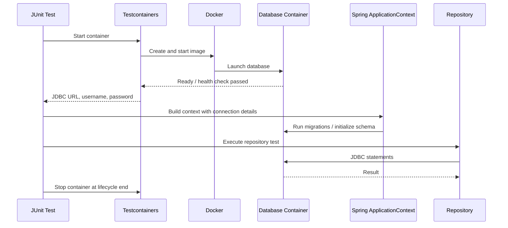

# Testcontainers and Production-Compatible Databases

Testing Spring Data Relational JDBC needs to run against a database management system whose behavior matches the deployment environment. A test passing on H2 does not prove that SQL statements, data types, constraints, pagination, or transactions will behave the same in PostgreSQL, MySQL, SQL Server, or Oracle in production.

**Testcontainers** starts a real database inside a container for tests, supplies dynamic JDBC URL, username, and password values, and cleans up the container according to its configured lifecycle. As a result, repositories, aggregate mapping, custom queries, and migrations can be verified against the exact database engine the application uses in deployment.

The goal is not merely having a database for tests. You need to pick a production-compatible image and configuration, run real schema migrations, verify vendor-dependent behaviors, and manage container lifecycle cleanly alongside the Spring Test context.

## 1. Why Do We Need a Production-Compatible Database?

Spring Data JDBC generates SQL based on dialect, mapping metadata, and the JDBC driver. Different databases can handle the exact same operation differently.

For example:

- PostgreSQL uses `INSERT ... ON CONFLICT`; MySQL uses `ON DUPLICATE KEY UPDATE`.
- UUID, JSON, array, and timestamp types are stored and read differently.
- Identifier quoting rules, casing, and reserved words differ.
- Generated identity, sequences, and how generated keys are returned depend on the database/driver.
- Constraints, isolation levels, locks, and transaction behavior differ.
- Pagination syntax, functions, expressions, and upserts are not uniform.

An H2 test may pass because H2 accepts SQL or mappings that the production database rejects. H2's compatibility modes help test certain syntax, but do not turn H2 into real PostgreSQL, MySQL, or SQL Server.

### 1.1. What a Test Database Should Match

"Production-compatible" should be understood in terms of technical compatibility, not just vendor name.

| Component | Compatibility Level to Aim For |
|---|---|
| Database engine | Same vendor/engine as production |
| Major version | Same major version; match patch version when practical |
| JDBC driver | Same driver family and compatible version |
| Extensions | Include extensions used in production |
| Charset/encoding | Match important encoding and collation settings |
| Timezone | Match timezone or agreed-upon timezone configuration |
| SQL mode/compatibility level | Match modes affecting syntax and constraints |
| Schema | Run the application's exact migration scripts |
| Transaction settings | Verify isolation/locking needed by the use case |

Not every infrastructure detail can be reproduced with a container. Managed database services can add custom extensions, proxies, replication, authentication, or proprietary behavior. Containers verify the database engine and most SQL behavior well; managed-service specifics still need verification in a corresponding environment.

### 1.2. Where Does H2 Still Fit?

H2 remains useful for fast tests when the application does not rely on SQL/vendor-specific behavior. You can use it for simple unit-level persistence checks or logic tests that do not need to verify production dialects.

In the following cases, use a production-compatible database:

- Custom `@Query` or native SQL.
- Pagination and sorting with dialect-specific SQL.
- Generated IDs or sequences.
- JSON, UUID, array, enum mapping, or vendor-specific types.
- Foreign keys, unique constraints, and cascade/restrict behavior.
- Locking, isolation, optimistic locking, and transaction boundaries.
- Flyway/Liquibase migrations containing vendor-specific SQL.

## 2. How Does Testcontainers Work?

Testcontainers uses Docker to start a temporary database instance. Tests obtain connection details from the running container rather than relying on a database pre-installed on a developer's machine.

Typical flow:



Testcontainers provides modules for many databases. Each module supplies a container class and configuration tailored to its image.

Examples:

| Database | Common Container Class |
|---|---|
| PostgreSQL | `PostgreSQLContainer` |
| MySQL | `MySQLContainer` |
| MariaDB | `MariaDBContainer` |
| Microsoft SQL Server | `MSSQLServerContainer` |
| Oracle XE/Free or licensed image | Corresponding container by module and image |

Exact class/package names and supported images depend on the Testcontainers version. Use the official module matching your chosen database and version.

## 3. Dependencies for Testcontainers

For a Gradle project using Spring Boot dependency management, you can add test dependencies:

```kotlin
dependencies {
    implementation("org.springframework.boot:spring-boot-starter-data-jdbc")

    testImplementation("org.springframework.boot:spring-boot-starter-test")
    testImplementation("org.testcontainers:junit-jupiter")
    testImplementation("org.testcontainers:postgresql")
}
```

The two Testcontainers modules serve different roles:

- `junit-jupiter` integrates container lifecycle with JUnit 5.
- `postgresql` provides `PostgreSQLContainer` and PostgreSQL database configuration.

To use Spring Boot service connections from Boot 3.1 onward, add:

```kotlin
dependencies {
    testImplementation("org.springframework.boot:spring-boot-testcontainers")
}
```

To keep Testcontainers versions consistent, use dependency management/BOM compatible with your project's Spring Boot version or import the Testcontainers BOM if managing versions directly. Avoid declaring mismatched versions across modules.

### 3.1. Docker Is Required to Run Tests

Testcontainers requires an active Docker-compatible runtime. This can be Docker Desktop, Docker Engine, or a compatible runtime supported by Testcontainers.

If Docker is not running, the container cannot start and integration tests will fail before repository tests run.

Do not turn missing Docker into a false passing test. In CI, configure runners with permission to run containers and ensure integration tests actually execute.

## 4. Configuring PostgreSQL with @Container and @DynamicPropertySource

A common approach compatible across many Spring Boot versions is using the JUnit Testcontainers extension and registering connection details via `@DynamicPropertySource`.

Example:

```java
import org.junit.jupiter.api.Test;
import org.springframework.beans.factory.annotation.Autowired;
import org.springframework.boot.test.autoconfigure.jdbc.AutoConfigureTestDatabase;
import org.springframework.boot.test.autoconfigure.data.jdbc.DataJdbcTest;
import org.springframework.test.context.DynamicPropertyRegistry;
import org.springframework.test.context.DynamicPropertySource;
import org.testcontainers.containers.PostgreSQLContainer;
import org.testcontainers.junit.jupiter.Container;
import org.testcontainers.junit.jupiter.Testcontainers;

import static org.assertj.core.api.Assertions.assertThat;

@Testcontainers
@DataJdbcTest
@AutoConfigureTestDatabase(
        replace = AutoConfigureTestDatabase.Replace.NONE
)
class CustomerRepositoryIntegrationTest {

    @Container
    static final PostgreSQLContainer<?> postgres =
            new PostgreSQLContainer<>("postgres:16.4")
                    .withDatabaseName("app_test")
                    .withUsername("test_user")
                    .withPassword("test_password");

    @DynamicPropertySource
    static void configureDataSource(DynamicPropertyRegistry registry) {
        registry.add("spring.datasource.url", postgres::getJdbcUrl);
        registry.add("spring.datasource.username", postgres::getUsername);
        registry.add("spring.datasource.password", postgres::getPassword);
        registry.add(
                "spring.datasource.driver-class-name",
                postgres::getDriverClassName
        );
    }

    @Autowired
    CustomerRepository customers;

    @Test
    void savesAndLoadsCustomer() {
        Customer saved = customers.save(
                new Customer(null, "An", "an@example.test")
        );

        Customer loaded = customers.findById(saved.id()).orElseThrow();

        assertThat(loaded.name()).isEqualTo("An");
    }
}
```

Key details:

- `@Testcontainers` enables the JUnit 5 extension.
- `@Container` declares a container managed by the extension.
- A `static` container starts once per test class and stops after the class finishes.
- `@DynamicPropertySource` supplies the URL and credentials once the container has connection details.
- `@AutoConfigureTestDatabase(replace = NONE)` prevents the test slice from replacing the DataSource with an embedded database.
- The image tag in the example is illustrative. Replace it with the database version matching your deployment environment.

`Customer` and `CustomerRepository` are application types. Constructors, properties, and schema in the example must match your actual entities.

### 4.1. Why Is Replace.NONE Needed?

`@DataJdbcTest` is a test slice for Spring Data JDBC. Default configuration may look for an embedded database to replace the DataSource.

When testing a PostgreSQL container, you must preserve the DataSource provided by Testcontainers. Otherwise, tests might silently run on H2 even though the container is declared.

### 4.2. Do Not Hard-Code JDBC URLs

Containers can assign dynamic host ports. Do not assume PostgreSQL always runs on `localhost:5432`.

Use the container accessors:

- `getJdbcUrl()`
- `getUsername()`
- `getPassword()`
- `getDriverClassName()`

That way, tests work even when Docker maps ports differently from defaults.

## 5. Using Spring Boot @ServiceConnection

With Spring Boot **3.1 and later**, you can use `@ServiceConnection` so Spring Boot infers connection details from the Testcontainers object.

Example:

```java
import org.junit.jupiter.api.Test;
import org.springframework.beans.factory.annotation.Autowired;
import org.springframework.boot.test.autoconfigure.jdbc.AutoConfigureTestDatabase;
import org.springframework.boot.test.autoconfigure.data.jdbc.DataJdbcTest;
import org.springframework.boot.testcontainers.service.connection.ServiceConnection;
import org.testcontainers.containers.PostgreSQLContainer;
import org.testcontainers.junit.jupiter.Container;
import org.testcontainers.junit.jupiter.Testcontainers;

@Testcontainers
@DataJdbcTest
@AutoConfigureTestDatabase(
        replace = AutoConfigureTestDatabase.Replace.NONE
)
class CustomerRepositoryIntegrationTest {

    @Container
    @ServiceConnection
    static final PostgreSQLContainer<?> postgres =
            new PostgreSQLContainer<>("postgres:16.4")
                    .withDatabaseName("app_test")
                    .withUsername("test_user")
                    .withPassword("test_password");

    @Autowired
    CustomerRepository customers;

    @Test
    void savesAndLoadsCustomer() {
        Customer saved = customers.save(
                new Customer(null, "An", "an@example.test")
        );

        assertThat(customers.findById(saved.id())).isPresent();
    }
}
```

`@ServiceConnection` requires the `spring-boot-testcontainers` dependency. Spring Boot detects the container type and creates matching connection details for auto-configuration.

In tests using service connections, re-registering `spring.datasource.url`, username, and password with `@DynamicPropertySource` is usually unnecessary.

Choose one clear connection details mechanism for your tests. Do not configure two sources overriding the same set of properties without a specific reason.

### 5.1. When Should DynamicPropertySource Be Used?

`@DynamicPropertySource` is suitable when:

- Using Spring Boot earlier than 3.1.
- The container is not automatically recognized by Spring Boot.
- Custom properties beyond standard connection details must be registered.
- You want explicit control over properties passed to the Spring context.

`@ServiceConnection` is usually shorter when the container type is supported by Spring Boot. Both connect the Spring context to the same container.

## 6. Managing Container Lifecycle and the Spring Context

Container lifecycle must be compatible with the Spring `ApplicationContext` lifecycle. This is an important detail because Spring Test can cache contexts across test classes.

### 6.1. Static Container per Test Class

With:

```java
@Container
static PostgreSQLContainer<?> postgres = ...;
```

The JUnit extension starts the container before the test class and stops it after the class finishes. This is an easy-to-understand option for a standalone test class.

However, if a Spring context is cached and reused after the container stops, another test class might receive a context whose DataSource points to the stopped container.

If multiple test classes share a context, choose a lifecycle so the container outlives the cached context.

### 6.2. Singleton Container for a Group of Tests

You can use a static container started once per JVM:

```java
abstract class AbstractPostgresIntegrationTest {

    static final PostgreSQLContainer<?> POSTGRES =
            new PostgreSQLContainer<>("postgres:16.4")
                    .withDatabaseName("app_test")
                    .withUsername("test_user")
                    .withPassword("test_password");

    static {
        POSTGRES.start();
    }

    @DynamicPropertySource
    static void configureDataSource(DynamicPropertyRegistry registry) {
        registry.add("spring.datasource.url", POSTGRES::getJdbcUrl);
        registry.add("spring.datasource.username", POSTGRES::getUsername);
        registry.add("spring.datasource.password", POSTGRES::getPassword);
    }
}
```

Test classes extending the base class share the same container. This avoids stopping the container after each class while the Spring context remains cached.

Do not simultaneously place `@Container` on a singleton started manually this way, because two lifecycle managers would compete to start/stop the container. Pick one lifecycle management mechanism.

### 6.3. Spring-Context-Managed Container

With Spring Boot service connections, you can declare the container as a bean in a test configuration so its lifecycle is tied to the application context. This helps when you want the container to live alongside the cached context.

Structural example:

```java
@TestConfiguration(proxyBeanMethods = false)
class PostgresContainerConfiguration {

    @Bean
    @ServiceConnection
    PostgreSQLContainer<?> postgresContainer() {
        return new PostgreSQLContainer<>("postgres:16.4")
                .withDatabaseName("app_test")
                .withUsername("test_user")
                .withPassword("test_password");
    }
}
```

Import the test configuration into the test class. Spring manages the bean and container lifecycle with the context. Verify container initialization/shutdown behavior for your Spring Boot version.

Do not mix `@Container` and bean-managed lifecycle on the same container instance.

## 7. Running Real Migrations on the Container

A trustworthy integration test should create its schema the same way the application deploys its schema.

If production uses Flyway or Liquibase, let migrations run against the container. Do not maintain a hand-written test schema that diverges from production migrations.

Example Flyway migration:

```sql
CREATE TABLE customers (
    id BIGINT GENERATED BY DEFAULT AS IDENTITY PRIMARY KEY,
    name VARCHAR(160) NOT NULL,
    email VARCHAR(255) NOT NULL UNIQUE
);
```

When the test context initializes:

1. Testcontainers starts an empty database.
2. Spring creates the DataSource from container connection details.
3. Flyway/Liquibase runs migrations.
4. Spring Data JDBC initializes mappings and repositories.
5. Tests execute persistence operations against the newly created schema.

This tests both migrations and mappings. If a migration uses PostgreSQL-specific syntax, a PostgreSQL container test catches issues that H2 would not detect.

### 7.1. Avoiding Schema Drift

Do not copy all production DDL into a separate test file and forget to update it when migrations change.

Prefer:

- Using the same migration directory.
- Using the same migration version ordering.
- Preserving constraints, indexes, defaults, and generated ID behavior.
- Using separate test fixture data rather than altering migrations for tests.
- Creating a secondary schema only when a test genuinely needs an isolated structure.

### 7.2. Init Scripts and Migrations

Testcontainers allows loading an init script when the container starts. This helps create database extensions or baseline settings before the application runs migrations.

However, do not use init scripts to quietly create all application tables if production uses Flyway/Liquibase. Otherwise, tests will fail to verify the real migrations.

## 8. Testing Spring Data JDBC Repositories

Once connected to the right database, repository tests can verify real persistence behavior.

Example aggregate root:

```java
@Table("customers")
public record Customer(
        @Id Long id,
        String name,
        String email
) {
}
```

Repository:

```java
public interface CustomerRepository
        extends CrudRepository<Customer, Long> {
}
```

Testing insert and generated ID:

```java
@Test
void insertsCustomerAndReturnsGeneratedId() {
    Customer saved = customers.save(
            new Customer(null, "An", "an@example.test")
    );

    assertThat(saved.id()).isNotNull();

    Customer loaded = customers.findById(saved.id()).orElseThrow();

    assertThat(loaded.name()).isEqualTo("An");
    assertThat(loaded.email()).isEqualTo("an@example.test");
}
```

This test confirms:

- `@Id` mapping.
- Generated identity behavior.
- The JDBC driver returning generated keys.
- Spring Data JDBC mapping the row back to the entity.

If tests run on H2 while production uses another database, generated-key behavior may differ. That is why a matching database is essential.

### 8.1. Testing Constraints

Attempt to write a duplicate email violating a unique key or an invalid foreign key. Verify the database rejects the data and the application receives an appropriate exception.

Avoid asserting overly specific exception classes if Spring exception translation differs across drivers or vendors. What matters is verifying that the constraint is enforced and the transaction leaves no partial data behind.

## 9. Testing Aggregates and Child Collections

Spring Data JDBC persists the aggregate root and child rows according to mapping. Testing on a production-like database verifies foreign keys, delete/insert order, and collection mapping.

Example:

```java
@Table("orders")
public record PurchaseOrder(
        @Id Long id,
        String orderCode,
        @MappedCollection(idColumn = "order_id")
        List<OrderLine> lines
) {
}
```

Test scenario:

1. Create an order with two lines.
2. Save the aggregate.
3. Reload the order via the repository.
4. Verify child row count and values.
5. Update the collection according to aggregate semantics.
6. Save again and verify child rows in the database reflect the new state.

Things to observe:

- FK column name in the child table.
- How Spring Data deletes/inserts child rows when saving the aggregate.
- Whether constraints prevent out-of-order deletes.
- Whether child generated IDs are mapped back.
- Transaction rollback if a child operation fails.

### 9.1. Foreign Keys and Delete Order

A database can reject deleting a parent while children still exist if the FK does not cascade. Spring Data JDBC manages aggregate child persistence per mapping, yet tests still need to confirm actual SQL ordering and constraints.

Do not add `ON DELETE CASCADE` just to make a test pass if the production schema does not have that behavior. The test schema must reflect deployed migrations.

## 10. Testing Custom Queries and Dialect-Specific SQL

Repository methods using `@Query`, pagination, or native SQL should run against the target database.

Example pagination test:

```java
@Test
void appliesStablePagination() {
    customers.saveAll(List.of(
            new Customer(null, "An", "an@example.test"),
            new Customer(null, "Binh", "binh@example.test"),
            new Customer(null, "Chi", "chi@example.test")
    ));

    Page<Customer> page = repository.findAll(
            PageRequest.of(0, 2, Sort.by("name").ascending())
    );

    assertThat(page.getContent()).hasSize(2);
}
```

In real tests, ensure fixtures contain no data from other tests and sorting includes a stable tie-breaker if sort values can collide.

Scenarios to verify on a matching database:

- Pagination with offset/limit.
- Sorting by reserved-word columns or quoted identifiers.
- Vendor-native functions or operators.
- Upserts and conflict handling.
- JSON/array/UUID mapping.
- Sequences or generated keys.
- Locking and isolation behavior.

## 11. Transaction Tests and Post-Commit Data

`@DataJdbcTest` normally runs each test method in a transaction and rolls back afterward. This is convenient for isolating data between tests.

However, test transaction rollback can mask certain behaviors:

- `REQUIRES_NEW` committing independently.
- Callbacks or events firing after save but before commit.
- Transaction synchronization.
- Visibility across multiple transactions.
- Locking/concurrency.

When testing real commits, do not let the test method accidentally hold an outer transaction. Use a non-transactional test or control transactions explicitly.

Example non-transactional test:

```java
@DataJdbcTest
@Transactional(propagation = Propagation.NOT_SUPPORTED)
class TransactionBoundaryIntegrationTest {
    // Call the service so the service's own transaction starts/commits.
}
```

When testing transactions, read results from an independent transaction or connection after the service finishes. Querying inside the same old transaction may hide or distort visibility depending on the database's isolation level.

### 11.1. Testing Rollback

A test can invoke an application service that performs two database operations and then throws an exception. After the method finishes, use an independent query to confirm both changes rolled back.

Tests must invoke the service through the real Spring proxy. Constructing the service with `new` bypasses the transaction interceptor and fails to test production behavior.

## 12. Testing Concurrency and Locking

Some bugs appear only when multiple transactions write concurrently.

For optimistic locking:

1. Two transactions read the same version.
2. Transaction A updates and commits.
3. Transaction B attempts to update with the stale version.
4. The database/Spring Data detects the mismatched update count and reports an optimistic locking failure.

For unique constraints, have two transactions insert the same business key and verify one is rejected.

For isolation/locking, write tests using two connections or two threads with explicit synchronization. Avoid using `Thread.sleep()` to assume execution ordering; use latches/barriers and bounded timeouts.

Do not run concurrency tests on the single JUnit test transaction and claim to have simulated two independent transactions. Each worker needs its own transaction/connection.

## 13. Isolating Data Between Tests

A container can be shared across multiple tests, but data should not leak between them.

Common strategies:

- Use `@DataJdbcTest` transaction rollback for standard tests.
- Create fixtures with unique keys per test.
- Delete data in FK order for non-transactional tests.
- Create separate schemas per test suite if the database and migrations support it.
- Use controlled truncation/sequence resets when necessary.

Do not depend on test execution order. Each test must create its own required data without relying on preceding tests.

If using `@Sql` to prepare data, write scripts compatible with the running database and explicitly verify the script's transaction mode.

## 14. Choosing Images and Near-Production Configuration

Do not use the `latest` tag for database images in integration tests. That tag can change versions over time and cause tests to behave differently tomorrow than today.

Pin explicit versions:

```java
new PostgreSQLContainer<>("postgres:16.4")
```

This example only illustrates pinning a tag. Choose a tag matching the major/patch version running in production.

Beyond the image tag, consider:

- Database name, username, and authentication mode.
- Encoding/locale/collation.
- Timezone.
- Extensions such as PostGIS or other extensions.
- SQL mode or compatibility level.
- Memory/configuration needed for the behavior under test.
- Driver version and connection properties.
- TLS/authentication if the application depends on them.

If production uses a customized vendor image, prefer a compatible image or a controlled internal image. Testing with an upstream image cannot verify custom extension behavior if that extension is absent.

### 14.1. Managed Database Services

If production runs a managed cloud database, Testcontainers runs the underlying engine but does not replicate the entire managed service.

Behaviors that may need extra verification in staging:

- Proxy and connection pool behavior.
- Failover, replication, and read replicas.
- IAM/database authentication.
- Backup/restore.
- Network policies and TLS.
- Provider-managed extensions.
- Connection limits or resource quotas.

Container tests focus on SQL, schema, driver, and engine transaction behavior.

## 15. Managing Containers in CI

CI needs a Docker runtime or a Testcontainers-compatible environment. Pipelines should run integration tests on runners authorized to use containers.

A pipeline often separates:

- Unit tests: run fast, no Docker required.
- Integration tests: start database containers and run Spring context/repositories.
- Packaging/build: run after required tests pass.

If CI lacks Docker, configure an appropriate runner or remote Docker endpoint. Do not skip the entire integration suite while claiming the pipeline verified database behavior.

### 15.1. Do Not Silently Disable Tests

Testcontainers has an option in some JUnit configurations to disable tests when Docker is unavailable. This helps for optional local developer workflows, but main CI must ensure Docker is ready and integration tests actually run.

If CI must fail when Docker is absent, do not enable auto-skipping that turns the pipeline green without running tests.

### 15.2. Execution Time and Container Reuse

Container startup has overhead. You can reduce time by:

- Sharing one container across tests targeting the same database/version.
- Leveraging Spring context caching with a matching container lifecycle.
- Keeping test fixtures small.
- Running the database integration suite selectively in local workflows while always running it in required CI pipelines.
- Using cached images on runners if CI policy allows.

Do not enable global reusable containers without understanding the risk of leftover data across builds. Reusing containers can cause tests to depend on stale data if the schema is not reset.

## 16. Common Errors and Troubleshooting

| Symptom | Possible Cause | Fix |
|---|---|---|
| Container fails to start | Docker daemon/runtime not running or unreachable | Check Docker context and runner permissions |
| Tests still run on H2 | Test slice replaces default DataSource | Use `@AutoConfigureTestDatabase(replace = NONE)` |
| Connection refused | Container not ready or wrong properties read | Use container accessors and readiness strategy |
| JDBC URL uses fixed port 5432 | Hard-coded host/port | Use `getJdbcUrl()` |
| Second test class fails to connect | Cached Spring context uses DataSource pointing to stopped container | Align container lifecycle with context or use singleton/context-managed container |
| Migration fails on container | Migration contains SQL differing from real DB or missing extension | Run same migrations and install required extensions |
| Generated ID differs from expectation | Database/driver handles generated keys differently from H2 | Verify mapping and use matching database |
| SQL passes on H2 but fails in production | H2 does not replicate full dialect/SQL semantics | Run Testcontainers with production engine |
| Tests depend on execution order | Data not isolated | Use rollback, cleanup, or isolated fixtures |
| `NoSuchMethodError` in Testcontainers | Mismatched module versions | Use BOM/dependency management |
| Container runs slowly or times out | Image pull, health check, or insufficient resources | Check container logs, image cache, and runner resources |
| Test transaction cannot see data | Reading inside old transaction or snapshot isolation | Observe from an independent transaction after commit |
| Tests skipped in CI | Docker unavailable and tests configured disabled | Provide Docker runtime and require real suite execution |

## 17. Workflow for Setting Up a Reliable Integration Test

You can implement this in the following sequence:

1. Identify the production database engine, major version, driver, and extensions.
2. Select the matching Testcontainers module and image tag.
3. Add Testcontainers/JUnit dependencies and Spring Boot integration if needed.
4. Start the container via `@Container`, singleton, or Spring-managed bean.
5. Register JDBC connection details with `@DynamicPropertySource` or `@ServiceConnection`.
6. Disable embedded database replacement for test slices.
7. Run real migrations on the container database.
8. Verify CRUD, aggregate mapping, constraints, and generated IDs.
9. Verify custom SQL, pagination, transactions, and vendor-dependent locking.
10. Isolate data and align container lifecycle with Spring context caching.
11. Run the suite in CI with a Docker runtime.
12. Supplement with staging tests for managed-service-specific behavior.

## 18. Principles to Remember

- Testcontainers runs real databases in containers to verify Spring Data JDBC on the exact engine.
- Match production vendor and major version; pin image tags instead of using `latest`.
- Align driver, extensions, collation, timezone, and SQL mode whenever they affect behavior.
- H2 is useful for fast tests, but does not replace the production database.
- `@Container` and `@Testcontainers` integrate lifecycle with JUnit 5.
- `@DynamicPropertySource` registers dynamic connection details; Spring Boot 3.1+ can use `@ServiceConnection`.
- With `@DataJdbcTest`, use `@AutoConfigureTestDatabase(replace = NONE)` to preserve the container DataSource.
- Container lifecycle must outlive any Spring context using it.
- Run real Flyway/Liquibase migrations to prevent schema drift.
- Verify aggregate child rows, generated IDs, constraints, pagination, custom SQL, and transaction behavior.
- Testing `REQUIRES_NEW`, commits, and concurrency requires independent transactions and connections.
- CI must enforce running the integration suite on a Docker-capable runner.
- Containers do not replicate every aspect of managed database services; use staging for those specifics.

Testcontainers lets you verify Spring Data Relational JDBC against a database engine matching deployment, closing the gap between test and production across SQL, mapping, migrations, and transaction behavior. Test value depends on the chosen image/version, schema, and configuration. Pin appropriate database versions, run real migrations, align container and Spring context lifecycles, and run the integration suite in CI to catch discrepancies before deployment.

## References

- [Testcontainers for Java — Documentation](https://java.testcontainers.org/)
- [Testcontainers JUnit 5 Integration](https://java.testcontainers.org/test_framework_integration/junit_5/)
- [Testcontainers PostgreSQL Module](https://java.testcontainers.org/modules/databases/postgres/)
- [Spring Boot — Testcontainers and Service Connections](https://docs.spring.io/spring-boot/reference/testing/testcontainers.html)
- [Spring Boot — Testing Spring Data JDBC](https://docs.spring.io/spring-boot/reference/testing/spring-boot-applications.html)
