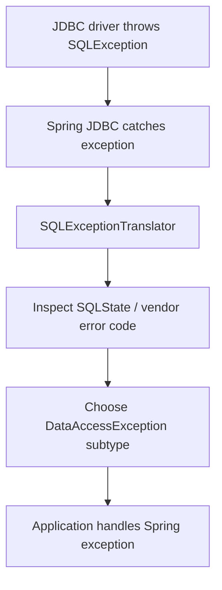

# DataAccessException Hierarchy and JDBC Exception Translation

When working with a database, a JDBC driver can throw different kinds of `SQLException` depending on SQL syntax errors, constraints, timeouts, dropped connections, or concurrency conflicts. If an application service has to depend directly on vendor-specific error codes from each driver, the code becomes hard to read and difficult to port across databases.

Spring solves this problem through **exception translation**: persistence errors at the JDBC layer are converted into a consistent exception hierarchy in the `org.springframework.dao` package. The base class of this hierarchy is `DataAccessException`. Spring Data JDBC and Spring JDBC use these exceptions so the application layer can handle errors based on their data-access semantics rather than vendor details.

This lesson covers the structure of `DataAccessException`, how `SQLException` is translated, common exception types encountered in Spring Data JDBC, and how to handle, retry, log, and test them.

## 1. Why is exception translation needed?

Different JDBC drivers may represent the same business error using different exceptions or vendor error codes.

For example, a unique constraint violation may appear as a `SQLException` with a PostgreSQL-, MySQL-, or SQL Server-specific SQLState/vendor code. If a service inspects these codes directly, business logic becomes coupled to the database.

Without exception translation, the code might have to do the following:

```java
try {
    jdbcStatement.executeUpdate(sql);
} catch (SQLException ex) {
    if ("23505".equals(ex.getSQLState())) {
        // Handle duplicate for a specific database.
    }
    throw new RuntimeException(ex);
}
```

This approach has several drawbacks:

- The application layer knows about JDBC details.
- SQLState and vendor error codes can vary across databases.
- Each repository or service may handle errors inconsistently.
- Changing databases or drivers increases the scope of code changes.
- A generic RuntimeException loses the semantics of the failure.

With Spring, the same scenario can be expressed using an exception at a higher level of abstraction:

```java
try {
    customers.save(customer);
} catch (DuplicateKeyException ex) {
    throw new EmailAlreadyRegisteredException(
        customer.email(),
        ex
    );
}
```

`DuplicateKeyException` indicates that the operation failed due to a duplicate key. The service does not need to know which SQLState or vendor code the driver used to identify the error.

## 2. What is DataAccessException?

`DataAccessException` is the base class of Spring's unchecked exception hierarchy for data access errors.

Package:

```java
import org.springframework.dao.DataAccessException;
```

Characteristics:

- It is a runtime exception, extending `NestedRuntimeException`.
- It is independent of specific persistence technologies at the application level.
- It can retain the original exception as its cause.
- It has subclasses describing error categories such as integrity violations, resource failures, query timeouts, or optimistic locking failures.

Because it is an unchecked exception, `DataAccessException` typically triggers a default rollback when escaping a `@Transactional` method. Exact rollback rules still depend on transaction configuration and whether the exception is caught or swallowed.

### 2.1. High-level hierarchy structure

Main branches:

```text
DataAccessException
├── TransientDataAccessException
├── NonTransientDataAccessException
└── RecoverableDataAccessException
```

This classification reflects whether the error may resolve upon retry or requires changing the underlying condition or logic.

| Category | Meaning |
| --- | --- |
| `TransientDataAccessException` | Errors that are potentially temporary; retrying later may succeed. |
| `NonTransientDataAccessException` | Errors that will not resolve without fixing the root cause or data. |
| `RecoverableDataAccessException` | Errors that can be recovered by performing a recovery step, such as acquiring a new connection or restoring a resource. |

Not every transient exception should be retried immediately. Retrying is only safe when the operation has appropriate semantics, a fresh transaction is started, and retry attempts are bounded.

## 3. Common DataAccessException Subtypes

Spring provides many subclasses to describe common failures.

| Exception | Common meaning | Handling category |
| --- | --- | --- |
| `DuplicateKeyException` | Primary key or unique key violation. | Integrity/data conflict. |
| `DataIntegrityViolationException` | Constraint violation such as NOT NULL, foreign key, check, or unique. | Integrity violation. |
| `BadSqlGrammarException` | Invalid SQL syntax or invalid table/column reference. | Query/schema error. |
| `InvalidDataAccessResourceUsageException` | Invalid usage of a resource or query. | Configuration or statement error. |
| `EmptyResultDataAccessException` | A query expected a row, but none was returned. | Unexpected empty result. |
| `IncorrectResultSizeDataAccessException` | The number of returned rows differs from what was expected. | Cardinality mismatch. |
| `OptimisticLockingFailureException` | Update/delete affected no rows because the version/state no longer matches. | Concurrency conflict. |
| `CannotAcquireLockException` | Unable to acquire the required lock. | Lock contention. |
| `PessimisticLockingFailureException` | Operation failed due to a locking issue. | Concurrency/locking. |
| `QueryTimeoutException` | Query exceeded the allowed execution time. | Timeout. |
| `DataAccessResourceFailureException` | Database/connection resource is unavailable. | Infrastructure. |
| `UncategorizedSQLException` | SQLException that could not be categorized specifically. | Uncategorized JDBC error. |

An exception may sit deep in the hierarchy. When handling errors, prefer catching the specific subclass required by the use case before falling back to the general `DataAccessException`.

### 3.1. DuplicateKeyException and DataIntegrityViolationException

`DuplicateKeyException` is a specific case of an integrity error. `DataIntegrityViolationException` is broader and can cover many other constraints.

Examples:

- Duplicate unique email.
- Duplicate order number.
- A NOT NULL column receives null.
- A foreign key references a nonexistent row.
- A value violates a CHECK constraint.

Do not treat every `DataIntegrityViolationException` as a duplicate. Only translate it into an "already exists" error when there is sufficient evidence that a specific unique constraint was violated.

### 3.2. BadSqlGrammarException

This exception typically indicates SQL that is invalid for the current database, such as:

- Incorrect table or column name.
- Invalid SQL syntax.
- Using a nonexistent function.
- Unapplied query migrations or a schema incompatible with the code.

This is usually an error that requires fixing code or schema, not an error to retry.

### 3.3. EmptyResultDataAccessException

Some JDBC APIs require exactly one row, such as queryForObject. If the query returns no rows, Spring may throw `EmptyResultDataAccessException`.

In Spring Data repositories, APIs such as `findById` typically return `Optional` to represent absence explicitly. You should not catch EmptyResultDataAccessException around every `findById` call.

### 3.4. IncorrectResultSizeDataAccessException

This error occurs when a query is designed to return a specific number of rows, but the database returns a different count.

For example, a query expects one customer by email, but the actual data contains multiple rows. This can indicate:

- A missing unique constraint.
- Legacy data containing duplicates.
- An insufficiently selective query predicate.
- A repository method declaring the wrong cardinality.

Do not arbitrarily pick the first row to hide a cardinality error if the domain requires unique data.

### 3.5. OptimisticLockingFailureException

Spring Data JDBC can use `@Version` to detect updates or deletes based on a stale version that no longer matches.

Example:

```java
@Table("inventory")
public record Inventory(
    @Id Long id,
    Integer quantity,
    @Version Long version
) {}
```

If two transactions both read version 4, the first transaction updates it to version 5. The second transaction attempts to update with version 4, and no row matches the condition. Spring reports an optimistic locking failure.

This is a concurrency conflict, not necessarily an infrastructure failure. The application can ask the user to reload or run a retry workflow that reloads the aggregate and reapplies the domain command.

## 4. How is SQLException translated?

The JDBC driver throws `SQLException`. Spring JDBC uses `SQLExceptionTranslator` to convert that error into a `DataAccessException`.

General flow:



The translator can rely on:

- SQLState provided by the driver.
- Database-specific vendor error codes.
- Specific JDBC exception subtypes.
- Information about the SQL statement and related resources.

Spring provides different translator implementations. `SQLErrorCodeSQLExceptionTranslator` can use database-specific vendor error codes; other translators may rely on SQLState or JDBC exception subtypes. If an error cannot be recognized, it may become an `UncategorizedSQLException`.

### 4.1. SQLState and vendor error code

`SQLException` carries important diagnostic information:

```java
String sqlState = ex.getSQLState();
int vendorCode = ex.getErrorCode();
Throwable cause = ex.getCause();
SQLException next = ex.getNextException();
```

SQLState is typically a standardized code for SQL error classes, whereas the vendor code is specific to the database. Some drivers also provide exception subclasses or chained exceptions accessible via `getNextException()`.

When debugging, you can record SQLState and vendor code in accordance with the application's logging policy. However, application business logic should not depend on these values when Spring already provides an appropriate subclass.

### 4.2. Spring JDBC and repository exception translation

Abstractions such as `JdbcTemplate` catch `SQLException` and translate it into `DataAccessException`.

Spring Data JDBC uses Spring JDBC infrastructure to execute SQL operations. Repositories and templates can emit exceptions from the Spring DAO hierarchy when persistence fails.

For beans annotated with `@Repository`, Spring also provides exception translation infrastructure to translate repository-layer persistence exceptions into the `DataAccessException` hierarchy when a corresponding translator is available.

In application code, let Spring exceptions propagate up to the application service instead of wrapping every failure in a generic RuntimeException.

## 5. Handling exceptions in the application service

The service should translate persistence errors into application/domain errors that are meaningful to the use case. This translation should be specific; do not catch all database errors and return a fake success result.

Example of registering a customer with a unique email:

```java
@Service
public class RegistrationService {

    private final CustomerRepository customers;

    public RegistrationService(CustomerRepository customers) {
        this.customers = customers;
    }

    @Transactional
    public Customer register(RegisterCustomer command) {
        Customer customer = Customer.register(
            command.name(),
            command.email()
        );

        try {
            return customers.save(customer);
        } catch (DuplicateKeyException ex) {
            throw new EmailAlreadyRegisteredException(
                command.email(),
                ex
            );
        }
    }
}
```

A unique constraint in the database remains the final safeguard. Checking `existsByEmail` before inserting does not eliminate race conditions because two requests can both see "does not exist" and then both insert.

Catching `DuplicateKeyException` handles that race cleanly and explicitly.

### 5.1. Preserving the cause when translating exceptions

Custom exceptions should preserve the original exception:

```java
public class EmailAlreadyRegisteredException
        extends RuntimeException {

    public EmailAlreadyRegisteredException(
            String email,
            Throwable cause) {
        super("Email already registered: " + email, cause);
    }
}
```

Preserving the cause allows logs and observability tools to trace back to the original database error. Consider omitting the email or personal data from the message if the exception might be logged where such data is not permitted.

### 5.2. Only catch error types that the use case understands

What not to do:

```java
try {
    return customers.save(customer);
} catch (DataAccessException ex) {
    return customer;
}
```

This masks connection, schema, constraint, timeout, and concurrency errors as false successes. The caller has no way to know whether the data was actually saved.

Instead, only catch subclasses with specific meaning:

```java
try {
    return customers.save(customer);
} catch (DuplicateKeyException ex) {
    throw new EmailAlreadyRegisteredException(
        command.email(),
        ex
    );
}
```

Other errors continue propagating to the appropriate handler to be logged and returned as an error response.
## 6. Distinguishing retryable errors from errors requiring root-cause fixes

Not every `DataAccessException` is suitable for retrying.

| Error category | Examples | Common handling approach |
| --- | --- | --- |
| Transient | Deadlock, temporary lock, brief resource interruption | May retry with limits if the operation is safe. |
| Non-transient | Invalid SQL, missing column, constraint violation | Fix query/schema/data; retrying usually does not help. |
| Concurrency conflict | Optimistic locking failure | Reload the aggregate and reapply the command if business rules allow. |
| Timeout | Query timeout or long lock wait | Identify root cause; controlled retry if timeout is transient. |
| Resource failure | Database connection lost or pool exhausted | Check infrastructure; retry with backoff if the request can be safely repeated. |

Spring's transient/non-transient classification is a hint about the nature of the failure, not an instruction to retry automatically. The application itself must decide whether an operation can be safely repeated.

### 6.1. Errors that should generally not be retried

Typically, do not retry these errors:

- `BadSqlGrammarException`: invalid query or incompatible schema.
- `DataIntegrityViolationException`: data violates a constraint.
- `DuplicateKeyException`: key already exists.
- Mapping or type conversion errors caused by code/configuration.
- Permanent permission/access errors.

Retrying only repeats the same failure and adds load to the database.

### 6.2. Deadlocks and transient errors

A deadlock can be detected by the database, which aborts one transaction to free resources. If the transaction is fully rolled back, the application may retry the entire use case after a short delay.

However, ensure that:

- Retries have a maximum attempt limit.
- Exponential backoff and jitter are applied.
- Each retry starts a new transaction.
- The operation is idempotent or has duplicate-processing protection.
- External side effects outside the database are not emitted before the transaction commits.

Never retry an individual statement inside a transaction that the database has already marked rollback-only and keep using that transaction.

### 6.3. Retrying transactions at the outer boundary

One way to structure this is to wrap an operation that starts a new transaction per attempt inside a retry boundary:

```java
public OrderResult placeOrder(PlaceOrderCommand command) {
    return retryTemplate.execute(context ->
        transactionTemplate.execute(status ->
            placeOrderInTransaction(command)
        )
    );
}
```

This example illustrates the order: retry on the outside, transaction on the inside. Each attempt calls `TransactionTemplate.execute` to obtain its own transaction. Configure the retry policy only for selected transient exceptions with a bounded number of attempts.

If using `@Retryable` and `@Transactional` annotations, proxy/interceptor ordering can affect whether a fresh transaction is opened per attempt. Separating beans or using explicit templates makes the boundary easier to reason about. Never place retry logic inside an already-failed transaction.

## 7. Handling optimistic locking conflicts

`OptimisticLockingFailureException` typically indicates that the aggregate was modified after the current transaction read it.

Example:

```java
try {
    order.confirm();
    orders.save(order);
} catch (OptimisticLockingFailureException ex) {
    throw new OrderChangedConcurrentlyException(
        order.getId(),
        ex
    );
}
```

Handling options:

1. Return a conflict to the caller so the user can reload the data.
2. Reload the aggregate and check whether the command is still valid.
3. Reapply the command to the new state and save, if business rules allow retrying.
4. Record conflicts for monitoring if they happen frequently.

Do not blindly take the old object and re-save it repeatedly without re-running domain logic. For example, inventory quantity or order status may have changed, making the original command invalid.

## 8. Transaction rollback and exception translation

`DataAccessException` is an unchecked exception. When it escapes a `@Transactional` method, Spring rolls back the transaction by default according to runtime exception rollback rules.

Example:

```java
@Transactional
public void createOrder(PlaceOrderCommand command) {
    PurchaseOrder saved = orders.save(
        PurchaseOrder.create(command)
    );

    try {
        outbox.insert(saved.getId(), command.eventPayload());
    } catch (DataAccessException ex) {
        throw new OutboxWriteFailedException(ex);
    }
}
```

Because the custom exception extends RuntimeException, the transaction rolls back by default. If you catch it and only log it without rethrowing or marking rollback-only, the transaction may commit earlier changes.

### 8.1. Checked exceptions and rollback rules

If the application translates a persistence error into a checked exception, the transaction may not roll back under `@Transactional`'s default rules.

You can declare a rollback rule:

```java
@Transactional(rollbackFor = OrderPersistenceException.class)
public void createOrder() throws OrderPersistenceException {
    // ...
}
```

Or design custom application exceptions to extend RuntimeException if that fits your codebase conventions. The key is that rollback behavior must be explicit and tested.

### 8.2. Do not continue using a transaction after a severe error

Some database errors render the current transaction unusable—for example, the transaction is aborted after a constraint violation or deadlock depending on the database. After an error, let the transaction finish/roll back and start a new transaction if further work is needed.

Do not assume that catching an exception leaves the connection and transaction in a healthy state.

## 9. Logging exceptions usefully for diagnostics

When logging database errors, retain enough context for investigation while avoiding leaking sensitive data.

Useful information:

- Use case or repository operation name.
- Correlation ID/trace ID.
- Spring exception type.
- SQLState and vendor code if present in the cause.
- Configured database/datasource name.
- Timestamp, duration, and retry attempt.
- Aggregate identifier if policy permits.

Avoid logging:

- Passwords or tokens.
- Unfiltered sensitive parameters.
- Unnecessary personal content.
- Raw SQL containing user-data literals if logs are not protected.

Example:

```java
catch (DataAccessException ex) {
    log.error(
        "Unable to save order. orderId={}, errorType={}",
        orderId,
        ex.getClass().getSimpleName(),
        ex
    );
    throw ex;
}
```

Pass the exception as the final argument so the logger records the stack trace. Do not log only `ex.getMessage()`, as the message may omit the cause chain and stack trace.

### 9.1. Do not classify errors by parsing message text

Avoid code like this:

```java
if (ex.getMessage().contains("duplicate")) {
    // ...
}
```

Messages can vary by driver, database version, or locale. Catch subclasses like `DuplicateKeyException`, or inspect SQLState/vendor code in a dedicated technical adapter when Spring cannot classify the error.

## 10. Returning appropriate errors via REST API

Application exceptions should be translated into HTTP responses at the web boundary, for example using `@RestControllerAdvice`.

```java
@RestControllerAdvice
public class ApiExceptionHandler {

    @ExceptionHandler(EmailAlreadyRegisteredException.class)
    ResponseEntity<ApiError> handleDuplicateEmail(
            EmailAlreadyRegisteredException ex) {
        return ResponseEntity
            .status(HttpStatus.CONFLICT)
            .body(new ApiError(
                "EMAIL_ALREADY_REGISTERED",
                "Email is already in use"
            ));
    }

    @ExceptionHandler(DataAccessResourceFailureException.class)
    ResponseEntity<ApiError> handleDatabaseUnavailable(
            DataAccessResourceFailureException ex) {
        return ResponseEntity
            .status(HttpStatus.SERVICE_UNAVAILABLE)
            .body(new ApiError(
                "DATABASE_UNAVAILABLE",
                "Data service is temporarily unavailable"
            ));
    }
}
```

`ApiError` is an application response DTO. Do not return raw SQL, SQLState, vendor codes, or stack traces to the client. Those technical details belong in internal logs/traces.

Do not indiscriminately map every `DataAccessException` to HTTP 500. Some errors correspond to conflict, not found, or service unavailable; this mapping should be based on use-case semantics rather than just the exception name.

## 11. Using exception translation in custom JDBC code

When using `JdbcTemplate`, Spring handles `SQLException` automatically and translates it into `DataAccessException`.

Example:

```java
Integer count = jdbcTemplate.queryForObject(
    "SELECT COUNT(*) FROM customers WHERE active = ?",
    Integer.class,
    true
);
```

If calling JDBC APIs directly, code must handle `SQLException`. You can use `SQLExceptionTranslator` to preserve the same Spring abstraction:

```java
SQLExceptionTranslator translator =
    new SQLErrorCodeSQLExceptionTranslator(dataSource);

try (Connection connection = dataSource.getConnection();
     PreparedStatement statement =
         connection.prepareStatement(sql)) {

    // Bind parameters and execute statement.

} catch (SQLException ex) {
    throw translator.translate(
        "Execute customer query",
        sql,
        ex
    );
}
```

In typical Spring applications, prefer `JdbcTemplate` or Spring abstractions that manage connections and transactions. If using direct JDBC, pay attention to transaction-aware connections and avoid manually closing or committing resources managed by Spring transactions.

## 12. Testing exception translation

Testing should cover two levels:

- Unit tests for the application service: verify that a specific Spring exception is translated into the appropriate business error.
- Database integration tests: verify that the driver/database actually raises the error and Spring translates it into the expected subclass.

### 12.1. Unit test for duplicate key

```java
@ExtendWith(MockitoExtension.class)
class RegistrationServiceTest {

    @Mock
    CustomerRepository customers;

    @InjectMocks
    RegistrationService service;

    @Test
    void translatesDuplicateKeyToBusinessException() {
        RegisterCustomer command =
            new RegisterCustomer("An", "an@example.test");

        when(customers.save(any()))
            .thenThrow(new DuplicateKeyException("duplicate"));

        assertThatThrownBy(() -> service.register(command))
            .isInstanceOf(EmailAlreadyRegisteredException.class)
            .hasCauseInstanceOf(DuplicateKeyException.class);
    }
}
```

This test verifies application-level mapping. It does not prove that the database constraint or JDBC exception translator works properly.

### 12.2. Integration test with unique constraint

```java
@DataJdbcTest
class CustomerConstraintTest {

    @Autowired
    CustomerRepository customers;

    @Test
    void rejectsDuplicateEmail() {
        customers.save(Customer.register(
            "An",
            "same@example.test"
        ));

        assertThatThrownBy(() ->
            customers.save(Customer.register(
                "Binh",
                "same@example.test"
            ))
        ).isInstanceOf(DataIntegrityViolationException.class);
    }
}
```

The database schema must have a unique constraint on email. Depending on the database, driver, and translator, the specific duplicate error may be `DuplicateKeyException` or represented by an appropriate integrity subclass. Testing against the target production database helps confirm real behavior.

### 12.3. Testing optimistic locking

Create a versioned aggregate, load the same row in two independent reads, save changes from the first copy, and then attempt to save the second copy with the stale version. Verify that the second save throws `OptimisticLockingFailureException`.

Tests should run against a real database or Testcontainers if version/transaction semantics depend on the engine. Ensure both reads genuinely start with the same initial version and that the first transaction commits before the second save runs.

### 12.4. Do not let test transactions mask outcomes

If a test method is annotated with `@Transactional`, the test framework may roll back the transaction after the test. That helps isolate tests, but it can obscure actual commit timing or service transaction boundaries.

When testing rollback/retry behavior, explicitly clarify which transaction wraps the test and which wraps the service. You can run the real service transaction and then read data in a new transaction to confirm whether changes committed or rolled back.

## 13. Common Pitfalls

| Symptom | Cause | Solution |
| --- | --- | --- |
| Application depends on SQLState/vendor code | Handling SQLException directly in the business layer. | Use DataAccessException and translate into business errors. |
| Every error is treated as a duplicate | Catching DataIntegrityViolationException too broadly. | Distinguish DuplicateKeyException and specific constraints. |
| Invalid queries are retried multiple times | Retrying every DataAccessException. | Only retry selected transient errors. |
| Retries run but transaction stays rollback-only | Retrying inside an already-failed transaction. | Retry outside and open a fresh transaction per attempt. |
| Partial data written even though service failed | Exception caught/swallowed, callback completes normally. | Rethrow or mark transaction rollback-only. |
| Database errors returned as HTTP 200 | Service swallows exception and returns a dummy object. | Translate into application exception and handle at web boundary. |
| Logs lack diagnostic detail | Logging only the message without cause/trace. | Log full exception with correlation ID. |
| Logs leak sensitive data | Logging raw SQL/parameters unfiltered. | Redact sensitive data and restrict log access. |
| H2 tests behave differently from production | SQLState/vendor code and translators differ. | Run integration tests on the target database/driver. |
| Optimistic lock conflict treated as infrastructure error | Failure to distinguish concurrency exceptions. | Handle conflicts according to business rules. |
| Catching EmptyResultDataAccessException around findById | Confusing JDBC APIs with Optional repository methods. | Use Optional for findById; handle exceptions per API contract. |

## 14. Persistence Error Handling Workflow

When a Spring Data JDBC operation fails:

1. Identify the outermost Spring exception and its cause chain.
2. Categorize the failure: integrity, query/schema, concurrency, timeout, or resource failure.
3. Translate it into an application/domain exception if meaningful for the use case.
4. Let errors requiring rollback escape the transaction, or apply explicit rollback rules.
5. Only retry selected transient exceptions, with backoff, limits, and idempotent operations.
6. Each retry attempt must use a fresh transaction if the previous one failed.
7. Log the error type, cause, trace ID, and minimal necessary context.
8. Do not expose SQL/vendor details to API clients.
9. Test both unit-level mapping and integration against a realistic database/driver.
10. Monitor exception frequency to detect constraint violations, deadlocks, timeouts, or database instability.

> **DataAccessException standardizes persistence errors into Spring's exception hierarchy.** Handle errors by subclass and meaning: integrity violations usually warrant a business response, SQL/schema errors require fixing the root cause, optimistic locking is a conflict requiring state reload, and transient errors should only be retried when the operation is safe and each attempt uses a new transaction.

### References

- [Spring Framework — Data Access Exceptions](https://docs.spring.io/spring-framework/reference/data-access/dao.html): DataAccessException hierarchy and exception translation.
- [Spring Framework — JDBC Core](https://docs.spring.io/spring-framework/reference/data-access/jdbc/core.html): JdbcTemplate and SQLException handling.
- [Spring Framework — SQLExceptionTranslator API](https://docs.spring.io/spring-framework/docs/current/javadoc-api/org/springframework/jdbc/support/SQLExceptionTranslator.html): contract for translating SQLException into DataAccessException.
- [Spring Framework — DataAccessException API](https://docs.spring.io/spring-framework/docs/current/javadoc-api/org/springframework/dao/DataAccessException.html): base class for data access exceptions.
- [Spring Data JDBC — Optimistic Locking](https://docs.spring.io/spring-data/relational/reference/jdbc/entity-persistence.html): version property and handling concurrent updates.
- [Spring Framework — Declarative Transaction Management](https://docs.spring.io/spring-framework/reference/data-access/transaction/declarative.html): transaction boundaries and rollback rules.
