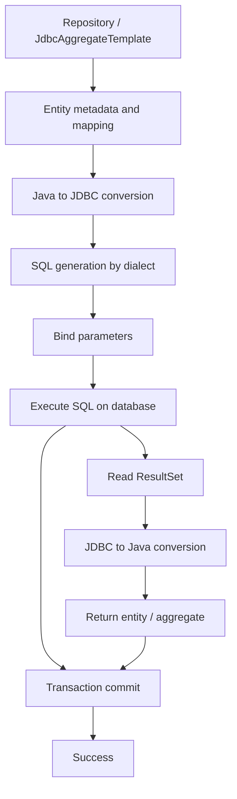
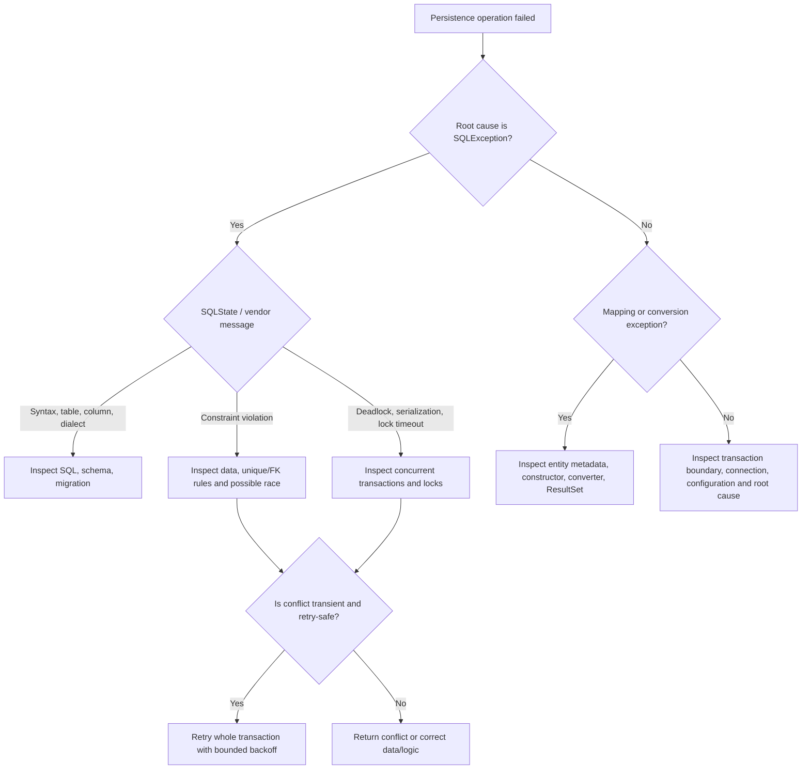

# Distinguishing SQL Syntax Errors, Mapping Errors, and Concurrency Conflicts

When a **Spring Data Relational JDBC** repository operation fails, the service-level error message alone is often not enough to pinpoint the cause. The same `repository.save(...)` call can fail while Spring Data generates SQL, converts Java objects into JDBC values, executes the statement, maps the ResultSet back to an entity, or commits the transaction.

Three error categories must be distinguished:

- **SQL syntax and execution errors:** the database rejects the statement or cannot execute it under the current schema or configuration.
- **Mapping errors:** Spring Data cannot convert or link data between the entity, metadata, and relational rows as declared.
- **Concurrency conflicts:** the operation is valid in isolation, yet collides with another transaction concurrently reading or writing data.

Identifying the right category determines the right fix. Changing SQL will not fix a broken converter; altering mappings will not resolve a deadlock; retrying cannot cure a syntax error.

## 1. Determining Which Stage Failed

A read/write operation in Spring Data JDBC passes through multiple stages:



Each stage produces distinct symptoms:

| Stage | Typical error | Symptom |
|---|---|---|
| Mapping metadata | Mapping/constructor error | Cannot resolve persistent properties or instantiate the entity |
| Java-to-JDBC conversion | Conversion error | Cannot convert an enum, value object, or custom type |
| SQL generation | Dialect/configuration issue | Generated SQL is incompatible with the database |
| SQL execution | SQL grammar/resource/integrity error | Database returns SQLException with SQLState/vendor code |
| ResultSet mapping | Mapping/conversion error | Query runs, yet columns fail to convert into properties |
| Transaction commit | Constraint/concurrency/connection error | Method completes repository calls, yet commit fails |

Errors do not always surface at the exact line visible in the stack trace. Spring can wrap a SQLException inside a `DataAccessException`, while mapping exceptions can be thrown before or after the database runs the statement.

### 1.1. Distinguishing SQL generation time from database execution time

Spring Data JDBC generates SQL from mapping metadata and the dialect. The JDBC driver then binds parameters and sends the statement to the database.

If SQL has invalid syntax, the database typically throws an error during parse or execution. If mapping is wrong, the error can happen before sending SQL (for example, a missing writing converter) or after running the query (for example, failing to instantiate an entity from the ResultSet).

An exception surfacing inside a repository method does not mean the bug is in the repository method itself. Locate the first Spring Data/JDBC frame, the root exception, and the stage the operation reached.

## 2. SQL Syntax and Execution Errors

SQL errors occur when the database cannot parse or execute the submitted statement. Causes include invalid syntax, nonexistent table/column names, improperly quoted identifiers, incompatible data types, missing permissions, or unapplied schema migrations.

### 2.1. Common causes

- Syntax mistakes inside `@Query` or custom repositories.
- Using table/column names that differ from the live schema.
- Using a reserved word as an identifier without proper quoting.
- Writing PostgreSQL-specific SQL and running it against MySQL or SQL Server.
- Pagination, upsert, or function syntax unsupported by the target database.
- Unapplied migrations or migrations run out of order.
- Database schema differing from local/test environments.
- Incorrect aliases, join conditions, or parameter placeholders.
- Database user lacking SELECT/INSERT/UPDATE/DELETE privileges.
- Column data types or constraints rejecting bound values.

### 2.2. Example of a wrong table name or reserved word

Suppose the schema has a table named `orders`, yet the query mistakenly writes:

```java
@Query("SELECT * FROM order WHERE id = :id")
Optional<PurchaseOrder> findOne(long id);
```

The word `order` may be a reserved keyword or simply the wrong table name for the schema. The database may report a syntax error or relation/table not found depending on the vendor.

Fix the query to use the real table name:

```java
@Query("SELECT * FROM orders WHERE id = :id")
Optional<PurchaseOrder> findOne(long id);
```

If an identifier genuinely collides with a reserved word, consider renaming it in the schema. If renaming is impossible, quote it consistently with the database and dialect. Never apply one vendor's quote characters blindly across all databases.

### 2.3. BadSqlGrammarException

Spring JDBC typically translates several SQL grammar failures into `BadSqlGrammarException`, part of `DataAccessException`.

This exception is a helpful signal, but do not interpret it too narrowly as only a missing semicolon or typoed keyword. Depending on the driver and database, missing relations/tables, missing columns, or certain SQL access errors can also fall under grammar/resource-usage categories.

Inspect:

- The exact SQL statement sent.
- SQLState of the underlying SQLException.
- Vendor error code.
- Connected table/column names and schema.
- The error position reported by the database (line, column, or character offset).

Do not react solely to the exception class name while ignoring the message and root cause.

### 2.4. SQLState and vendor error codes

JDBC `SQLException` can supply:

- `getSQLState()`: standardized SQLState error category code.
- `getErrorCode()`: database vendor-specific error code.
- `getNextException()`: the next JDBC exception in the chained list.

SQLState is a clue, not an identical classification contract across every driver. For instance, class `42` generally relates to syntax errors or access rules; class `23` relates to integrity constraints; class `40` typically relates to transaction rollbacks. Look up exact codes and reporting behavior in your database's documentation.

A few common examples:

| Database/error | Common SQLState or vendor code | Clue |
|---|---|---|
| PostgreSQL undefined table | `42P01` | Wrong relation/schema name or missing migration |
| PostgreSQL undefined column | `42703` | Mapping/query references a nonexistent column |
| PostgreSQL unique violation | `23505` | Duplicate unique/primary key |
| PostgreSQL serialization failure | `40001` | Transaction must be retried per policy |
| PostgreSQL deadlock | `40P01` | Deadlock between transactions |
| MySQL deadlock | Vendor code `1213` | Transaction chosen as deadlock victim |
| MySQL lock wait timeout | Vendor code `1205` | Could not acquire lock within allowed time |

Error codes can vary by version, driver, and operation. When diagnosing production issues, cross-reference vendor error documentation and record the driver version.

### 2.5. Schema and migration errors

A query can be syntactically valid yet fail because the live schema does not match the code.

Examples:

- Entity declares `@Column("display_name")` while the migration created `full_name`.
- New code queries a newly added column before migrations ran on one node.
- Tests use an auto-generated schema while production uses separate migrations.
- The application connects to the wrong database or schema.
- A column was renamed, yet an old native query still references the legacy name.

How to resolve:

1. Verify the JDBC URL and connected database/schema.
2. Inspect migration history.
3. Read the live DDL of the failing table/columns.
4. Compare column names in mappings and SQL.
5. Align migrations or mappings with the chosen schema contract.
6. Run integration tests on the same database engine.

Do not fix a missing column error by manually altering only one environment. That creates schema drift and causes the bug to resurface elsewhere.
## 3. What Is a Concurrency Conflict?

A concurrency conflict occurs when multiple transactions read or modify related data over overlapping windows. Each SQL statement may be valid and mappings may be correct, yet one transaction's outcome is disrupted by another transaction's changes.

Common scenarios:

- Two requests simultaneously insert records with the same primary key or unique business key.
- Two transactions concurrently modify the same aggregate.
- One transaction reads data and writes back after another transaction already updated it.
- Two transactions acquire locks in opposite orders, creating a deadlock.
- A transaction cannot acquire a lock within the timeout.
- The database rejects a commit due to serialization/isolation rules.

Unlike SQL grammar errors, fixing punctuation or column names does not solve concurrency conflicts. You must examine locking, versioning, transaction boundaries, data access ordering, and retry policies.

## 4. Optimistic Locking and @Version

Spring Data JDBC supports optimistic locking for aggregates carrying a version property annotated with `@Version`.

Example:

```java
@Table("customers")
public record Customer(
        @Id Long id,
        String name,
        String email,
        @Version Long version
) {
}
```

When loading the entity, Spring Data captures the current version. When updating, the SQL includes both the ID and old version in the WHERE clause while incrementing the version on a successful update.

Conceptual SQL:

```sql
UPDATE customers
SET name = ?, email = ?, version = ?
WHERE id = ? AND version = ?;
```

If another transaction updated the row in the meantime, the database version no longer matches the entity's version. The update affects zero rows. Spring Data detects the unexpected update count and reports an optimistic locking failure, typically as `OptimisticLockingFailureException`.

### 4.1. Example of two concurrent updates

Suppose a customer is at version 4:

1. Request A reads the customer at version 4.
2. Request B also reads the customer at version 4.
3. A updates the email and commits, bumping version to 5.
4. B updates the display name from its version 4 snapshot.
5. B's SQL looks for version 4, but the database holds version 5.
6. B updates zero rows and receives an optimistic locking exception.

This prevents B from silently overwriting A's changes with a stale snapshot.

### 4.2. Optimistic locking failure does not always mean another writer updated the row

An update count of 0 can result from:

- Another transaction updating the version.
- The row having been deleted.
- The ID not existing.
- The entity carrying an old or wrong version.
- The version field mapping mismatching the schema.

Therefore, the exception signals a conflict on the update predicate, so verify row existence, database version, and transaction history before concluding the exact cause.

### 4.3. When should optimistic locking be used?

It fits well when conflicts are infrequent and you want to avoid holding database locks during business logic execution.

Examples:

- Users editing customer profiles.
- Multiple workers potentially updating the same order.
- An aggregate being read, processed in the application, and saved after some delay.
- Preventing stale updates without placing pessimistic locks on every read.

If business logic demands conditional updates—such as transitioning status only when still NEW—use a state-checked SQL update or suitable lock rather than relying on version alone.

## 5. Duplicate Keys and Insert Race Conditions

Two transactions may attempt to create records with the same primary key or unique key simultaneously.

Example:

1. A checks whether a customer with external code `CRM-10` exists.
2. B checks too and sees none exists.
3. A inserts successfully.
4. B inserts the same external code and is rejected by the unique constraint.

This is a check-then-act race condition. Spring typically translates the failure into `DuplicateKeyException` or a corresponding integrity exception, depending on the database and driver.

### 5.1. A duplicate key does not automatically prove a concurrency bug

A duplicate key can stem from:

- A user submitting duplicate business data.
- Re-delivered messages processed twice.
- Retries resending an already-succeeded request.
- A misconfigured ID generator or sequence.
- Two transactions genuinely inserting simultaneously.

Determine which key collided and why multiple requests carried the same key.

### 5.2. Choosing handling based on business rules

| Requirement | Handling strategy |
|---|---|
| Duplicates are a business error | Return conflict to caller or throw a domain error |
| Requests/messages can be redelivered | Design an idempotency key and store processing outcomes |
| Atomic insert-or-update needed | Use native upsert when supported by dialect/API |
| Only one worker should process a job | Use claim/locking or atomic status transitions |
| Check existence before creating | Keep unique constraints as the final safeguard; handle duplicates intentionally |

Never drop a unique constraint simply to avoid exceptions. Constraints are the final line of defense against concurrent writers.

## 6. Deadlocks, Lock Timeouts, and Serialization Failures

### 6.1. Deadlock

A deadlock happens when transaction A holds a lock needed by B, while B holds a lock needed by A. Neither can proceed, so the database detects the wait cycle and aborts one transaction.

Example:

```mermaid
sequenceDiagram
    participant A as Transaction A
    participant B as Transaction B
    participant DB as Database

    A->>DB: Lock row X
    B->>DB: Lock row Y
    A->>DB: Request lock row Y
    Note over A,B: A waits for B
    B->>DB: Request lock row X
    Note over A,B: B waits for A
    DB-->>B: Detect deadlock; abort victim
    B-->>DB: Rollback
    DB-->>A: Lock becomes available
```

Spring can translate this failure into a concurrency/pessimistic locking exception. SQLState and vendor codes confirm the database detected a deadlock.

Ways to reduce deadlocks:

- Acquire locks on multiple rows in a consistent order across all transactions.
- Keep transactions short.
- Avoid HTTP calls or user waits while holding locks.
- Add appropriate indexes to narrow scan/lock ranges.
- Avoid updating multiple tables in inconsistent orders across use cases.
- Retry transactions chosen as deadlock victims when business rules permit.

### 6.2. Lock wait timeout

A lock timeout occurs when a transaction waits for a lock longer than the database or application limit.

Causes include another transaction holding locks too long, queries missing indexes and locking broader ranges than expected, or a transaction hanging during an external service call.

Distinguish lock timeouts from query timeouts and connection timeouts. These three timeouts operate at different layers:

| Timeout | Meaning |
|---|---|
| Connection timeout | Failed to acquire a connection from the pool or connect to the database |
| Query/statement timeout | SQL statement executed longer than allowed |
| Lock wait timeout | Statement waited for a lock longer than allowed |

### 6.3. Serialization failure

At isolation levels like SERIALIZABLE, the database can reject a commit if the concurrent execution history is not equivalent to any valid serial ordering.

For instance, two transactions read overlapping data and update different rows whose combined effect breaks invariants enforced by serializable isolation. One transaction rolls back with an SQLState such as `40001` on PostgreSQL.

A serialization failure does not necessarily mean SQL is wrong. It means the database cannot commit the transaction under the selected isolation guarantees.

### 6.4. Error codes are clues

A few common examples:

| Scenario | Example code |
|---|---|
| PostgreSQL serialization failure | SQLState `40001` |
| PostgreSQL deadlock detected | SQLState `40P01` |
| PostgreSQL lock not available | SQLState `55P03` |
| MySQL deadlock | Vendor error code `1213` |
| MySQL lock wait timeout | Vendor error code `1205` |

Exact codes can vary by database version and driver. Record both SQLState and vendor code during diagnostics.

## 7. Retrying Concurrency Failures Properly

Some concurrency failures can be retried, provided retries happen at the transaction boundary.

### 7.1. Retry the entire transaction

When the database rolls back a transaction due to deadlock or serialization failure, do not attempt to keep executing remaining SQL statements inside that rolled-back transaction.

Instead, start a fresh transaction and rerun the entire retryable unit of work.

Conceptual example:

```java
@Service
public class InventoryService {

    @Transactional
    public void reserve(Long productId, int quantity) {
        // Read current stock, validate and update stock.
    }
}
```

A retry coordinator can invoke this transactional service multiple times. Each invocation must cross the Spring proxy so a new transaction opens per configured propagation.

Never place a retry loop inside a method holding an already rollback-only transaction and expect the loop to open fresh transactions.

### 7.2. Bounded retries with backoff

A retry policy should include:

- A maximum attempt count.
- Backoff delays between attempts.
- Jitter so multiple workers do not retry in lockstep.
- Retrying only explicitly selected transient exceptions.
- An overall timeout for the use case.
- Logs/metrics tracking retry counts and exhaustion.

Do not retry every `DataAccessException`. SQL grammar, mapping errors, invalid data, and permission failures will not resolve themselves a few milliseconds later.

### 7.3. Idempotency and side effects

Retries re-execute business logic. If a method sends emails, makes HTTP calls, or publishes messages before the transaction commits, side effects can duplicate even though the prior database transaction rolled back.

Best practices:

- Design retryable operations to be idempotent.
- Use idempotency keys for requests/messages.
- Write outbox events within the same data transaction.
- Publish outbox events post-commit via a separate worker.
- Never trigger irreversible external side effects before the transaction commits.

### 7.4. When should you NOT retry?

Avoid automatic retries when:

- SQL syntax is invalid or schema elements are missing.
- Converters reject values.
- Entity constructors fail to instantiate objects.
- Input data violates business validation.
- Duplicate keys represent business conflicts the caller must handle.
- Permissions or configurations are wrong.
- Retries would duplicate non-idempotent side effects.

Retries apply strictly to transient failures in safely repeatable use cases.
## 8. Distinguishing the Three Error Groups by Practical Signals

The table below provides an initial triage guide. It does not replace inspecting the root exception and SQLState.

| Signal | SQL error | Mapping error | Concurrency conflict |
|---|---|---|---|
| Did the database receive the statement? | Usually yes; database rejected parse or execution | Maybe not yet, or query ran before read mapping failed | Yes; database processed it, yet transactions conflicted |
| Common exceptions | `BadSqlGrammarException`, `InvalidDataAccessResourceUsageException`, `DataIntegrityViolationException` | `MappingException`, `MappingInstantiationException`, `ConverterNotFoundException`, `ConversionFailedException` | `OptimisticLockingFailureException`, `ConcurrencyFailureException`, `PessimisticLockingFailureException`, `DuplicateKeyException` |
| Indicative SQLState | Class 42, 23, or vendor-specific | Often no SQLState if error occurred in Java mapping | Class 40, lock-related codes, or class 23 on insert races |
| Requires SQL/schema fix? | Usually yes | Only if a mapping/schema mismatch is the cause | Not necessarily |
| Safe to retry? | Usually no | Usually no | Possibly, if transient and the use case is idempotent |
| What to check first? | SQL, schema, dialect, vendor codes | Entity metadata, constructors, converters, ResultSet columns | Versions, transaction timeline, locks, isolation, unique keys |

### 8.1. Exception classes can be misleading

Some failures surface under broader exception categories than expected:

- `DuplicateKeyException` is a database integrity error, yet it may result from two transactions racing to insert.
- `DataIntegrityViolationException` can stem from bad input data or a check-then-insert race.
- `BadSqlGrammarException` can appear when a table or column does not exist, even though the statement looks syntactically fine.
- `OptimisticLockingFailureException` typically indicates a version/update-count conflict, yet deleted rows or nonexistent IDs must also be considered.
- `MappingException` can wrap exceptions thrown inside constructors or converters.

Accurate classification combines exception type, root cause, SQLState, SQL statement, data state, and timing.

## 9. Step-by-Step Diagnostic Workflow

When a repository error occurs locally, in tests, or in production, follow these steps in order.

### Step 1: Capture the full exception

Collect:

- Application-layer exception class.
- Entire cause chain.
- SQLState and vendor error code if a SQLException is present.
- Database error message.
- Repository method and use case name.
- Database product/version and JDBC driver version.

Never log only `exception.getMessage()` and discard the stack trace. Wrapper exceptions often omit the underlying cause.

### Step 2: Determine whether the database executed the statement

Look for clues in SQL logs, driver logs, or database logs:

- No statement sent: check mapping metadata, write conversions, proxies, or configuration.
- Statement sent and rejected by database: check SQL grammar, schema, types, constraints, or permissions.
- SELECT succeeded, yet entity creation failed: check ResultSet mapping, converters, or constructors.
- DML ran, yet transaction rolled back or commit failed: check deferred constraints, deadlocks, serialization, connection, or transaction state.

### Step 3: Inspect SQL and parameters

If SQL was sent, capture the statement produced by Spring Data/the dialect and verify parameter types.

In debug environments, enable JDBC/Spring Data loggers appropriate for your version. Example logger configuration:

```properties
logging.level.org.springframework.jdbc.core=DEBUG
logging.level.org.springframework.transaction=DEBUG
```

Useful logger names and levels depend on version. Do not enable sensitive parameter logging in production without data protection controls.

### Step 4: Inspect schema and mappings

Compare:

- `@Table` against real table names.
- `@Column` against real column names.
- `@Id` against primary keys.
- `@Version` against version columns.
- `@MappedCollection` against child tables and foreign keys.
- Java types against SQL types.
- Constructor parameters against persistent properties.
- Reading/writing converters against actual database values.

If SQL SELECT succeeds, inspect ResultSet column labels and aliases to see exact names and types reaching the mapper.

### Step 5: Inspect transactions and concurrency

If the error occurs intermittently or only under load:

- Look for concurrent requests/transactions touching the same row or unique key.
- Record IDs, before/after versions, and transaction start/commit timestamps.
- Inspect database deadlock reports and lock waits.
- Verify the active isolation level.
- Check whether transactions hold locks while calling external services.
- Check for retries or message redeliveries.

### Step 6: Reproduce on the same database engine

Use Testcontainers or an integration environment running the matching database engine/version. Apply the same migrations and reproduce the exact data and transaction pattern.

H2 or mock repositories cannot reliably verify deadlocks, vendor SQL, generated keys, isolation, or locking behavior of production databases.


## 10. Mapping Errors in Spring Data JDBC

Mapping errors happen when Spring Data cannot align Java entities with relational structures or cannot convert values between Java and JDBC.

Unlike SQL syntax errors, mapping errors can occur even when the database is completely healthy and the SQL is valid. Some happen before SQL is sent; others appear only while Spring Data reads the ResultSet.

### 10.1. Mapping metadata mismatches the entity

Spring Data JDBC uses annotations and naming conventions to determine:

- Aggregate roots and matching tables.
- Primary keys via `@Id`.
- Column names via `@Column`.
- Child collections via `@MappedCollection`.
- Embedded values via `@Embedded`.
- Version fields via `@Version`.
- Constructors/factories for entity instantiation.

If metadata disagrees with the schema, errors can surface during SQL generation or result mapping.

Example entity:

```java
@Table("customers")
public record Customer(
        @Id Long id,
        @Column("display_name") String displayName,
        String email
) {
}
```

The schema must have matching columns such as `id`, `display_name`, and `email`. If the database only has `full_name`, this mapping will not guess that it belongs to `displayName`.

Align the annotation or migration so both sides share one contract:

```java
@Column("full_name")
String displayName
```

Follow the live schema's column names and keep them consistent across migrations, entities, and native queries.

### 10.2. Constructors and immutable entities

Spring Data JDBC must instantiate entities when reading rows. For records, the canonical constructor is the natural instantiation path. For regular classes, Spring Data must resolve an appropriate persistence constructor.

Common problems:

- No constructor has parameters matching persistent properties.
- Multiple constructors exist without marking the persistence constructor.
- Parameter names do not match property names.
- Constructor expects values omitted from the ResultSet.
- Instantiation fails due to incompatible parameter types.
- Using primitives for nullable columns.

Unsuitable example when the database permits `age` to be NULL:

```java
public record Customer(Long id, String name, int age) {
}
```

If `age` can be NULL, primitive `int` cannot represent null. Use the wrapper type:

```java
public record Customer(Long id, String name, Integer age) {
}
```

If the domain forbids null, enforce `NOT NULL` in the schema and backfill existing rows before deploying an entity expecting non-null values.

### 10.3. Property names vs. column names

By default, Spring Data uses a naming strategy to translate Java properties into column names. However, legacy schemas or custom conventions may require explicit annotations.

Example:

```java
@Table("purchase_orders")
public record PurchaseOrder(
        @Id Long id,
        @Column("order_number") String orderNumber,
        @Column("created_on") Instant createdAt
) {
}
```

If a query selects `created_at` while the mapping specifies `created_on`, the two access paths become inconsistent. Verify the physical column name and use it consistently across mappings and native SQL.

### 10.4. Embedded objects and mapped collections

Complex mappings can fail when entities use `@Embedded`, `@MappedCollection`, or nested aggregate structures.

Examples:

- Embedded prefix does not match actual column names.
- Child table lacks the foreign key column required by the mapping.
- Collection key column is misconfigured.
- Child type lacks a valid constructor or mapping.
- Two properties map to the same column unexpectedly.

For aggregates with child collections, inspect both the root table schema and child table schemas. Do not assume a failure during repository save means the root table is the sole culprit.

### 10.5. Missing or one-sided custom converters

A custom domain type may require both reading and writing converters.

Example enum persisted by code:

```java
public enum OrderStatus {
    NEW("N"),
    PAID("P");

    private final String code;

    OrderStatus(String code) {
        this.code = code;
    }

    public String getCode() {
        return code;
    }

    public static OrderStatus fromCode(String code) {
        return switch (code) {
            case "N" -> NEW;
            case "P" -> PAID;
            default -> throw new IllegalArgumentException(
                    "Unknown status code: " + code
            );
        };
    }
}
```

Writing converter:

```java
@WritingConverter
public class OrderStatusWritingConverter
        implements Converter<OrderStatus, String> {

    @Override
    public String convert(OrderStatus source) {
        return source.getCode();
    }
}
```

Reading converter:

```java
@ReadingConverter
public class OrderStatusReadingConverter
        implements Converter<String, OrderStatus> {

    @Override
    public OrderStatus convert(String source) {
        return OrderStatus.fromCode(source);
    }
}
```

If only a writing converter exists, saves succeed while reads fail. If only a reading converter exists, loads succeed while writes may persist an unintended representation.

Use `@WritingConverter` and `@ReadingConverter` to declare conversion direction explicitly, and register them in Spring Data JDBC's conversion configuration.

### 10.6. Legacy data no longer valid for domain types

Suppose new code supports only `N` and `P`, yet the database still holds legacy value `A`. The reading converter invokes `OrderStatus.fromCode("A")` and throws an exception.

This is a read-time conversion/mapping error, even though the SQL SELECT succeeded.

Remediation depends on your data contract:

1. Support legacy aliases in the converter during migration windows.
2. Run a data migration converting old codes to new codes.
3. Log and clean up invalid values.
4. Remove aliases only after legacy values are gone.

Do not silently map unknown codes to a valid state if doing so hides corrupted data.

### 10.7. Common exceptions at the mapping/conversion layer

Useful exceptions to recognize:

| Exception | Cause hint |
|---|---|
| `MappingException` | Spring Data cannot process entity metadata or mappings |
| `MappingInstantiationException` | Cannot instantiate entity via constructor/factory |
| `ConverterNotFoundException` | No converter registered for source/target types |
| `ConversionFailedException` | Conversion path exists, yet value conversion failed |
| `IllegalArgumentException` from converter | Invalid domain value or unsupported code |

The exception class name does not replace inspecting the root cause. For instance, `MappingInstantiationException` can wrap an exception thrown inside a constructor; inspect deeper causes to see whether a constructor lacked an argument, domain validation rejected a value, or a nested converter failed.

### 10.8. Mapping error or SQL error?

A query fails before producing a ResultSet if SQL references a nonexistent column. In that case, the database reports a SQL exception.

Conversely, if SQL runs successfully yet the mapper cannot turn a column value into a Java property, that is a mapping/conversion error.

Examples:

- SQL requests `SELECT unknown_column FROM customers`: database reports a missing column error.
- SQL returns `status_code` containing `Z`, while converter only accepts `N` and `P`: query succeeds, reading converter fails.
- SQL returns `age = NULL` for a record constructor expecting primitive `int`: failure occurs during object mapping.

Separating these moments keeps you from fixing the wrong layer.
+## 11. Spring Exception Translation and Application-Layer Handling

Spring JDBC and Spring Data typically translate persistence errors into exceptions in the `DataAccessException` hierarchy. This lets services handle errors by category rather than coupling directly to each JDBC driver's exception classes.

Common exceptions:

| Exception | Scenario category |
|---|---|
| `BadSqlGrammarException` | Database rejected SQL due to grammar, identifier, or schema access |
| `InvalidDataAccessResourceUsageException` | Invalid usage of a resource or statement |
| `DataIntegrityViolationException` | Constraint or integrity rule violation |
| `DuplicateKeyException` | Duplicate primary key or unique key |
| `DataAccessResourceFailureException` | Database/resource unavailable or access failure |
| `QueryTimeoutException` | Statement/query exceeded timeout |
| `OptimisticLockingFailureException` | Update/delete failed version or optimistic lock check |
| `PessimisticLockingFailureException` | Lock/pessimistic concurrency error |
| `ConcurrencyFailureException` | Spring-classified concurrency error |

Broad exceptions can cover multiple causes. For instance, `DataIntegrityViolationException` alone does not tell you whether the failure was bad user input or a duplicate from a concurrent insert.

### 11.1. Never leak raw database exceptions to API clients

Application services or web boundaries should translate persistence exceptions into appropriate business outcomes:

- Duplicate business key: return conflict if required by business rules.
- Optimistic locking conflict: ask the caller to reload fresh data or resolve the conflict.
- Invalid input: return a validation error.
- SQL grammar or mapping defect: report a system error, log, and investigate; never disguise it as a user input error.
- Transient concurrency failure: retry with bounds at the transaction boundary if the use case allows.

Never expose raw SQL, internal schema names, sensitive parameters, or stack traces to clients.

### 11.2. Do not catch DataAccessException and continue as success

Unsafe example:

```java
@Transactional
public void updateCustomer(Customer customer) {
    try {
        repository.save(customer);
    } catch (DataAccessException ex) {
        log.warn("Could not save customer", ex);
        // Method still finishes normally.
    }
}
```

If the exception is swallowed and the transaction is not marked rollback-only, the interceptor may commit other writes in the transaction. Callers will also assume the save succeeded.

If you cannot handle the failure locally, rethrow it or translate it into an appropriate business exception. If rollback is required despite returning a normal result, explicitly mark the transaction rollback-only via the transaction API.

### 11.3. Preserve the root cause when translating exceptions

You can translate a persistence error into an application exception, while keeping the cause:

```java
try {
    repository.save(customer);
} catch (DuplicateKeyException ex) {
    throw new CustomerAlreadyRegisteredException(
            customer.externalCode(),
            ex
    );
}
```

The business exception constructor in this example should accept the cause. That way, logs and observability tools retain SQLState and vendor details for investigation.

Do not collapse every exception into a single generic `RuntimeException` that strips classification details.

## 12. Reading SQLException and Cause Chains

When Spring wraps an exception, the root SQLException may sit deep in the cause chain. You can walk the cause chain to capture SQLState and vendor codes in controlled logs.

Simple helper example:

```java
static void logSqlCause(Throwable error) {
    Throwable current = error;

    while (current != null) {
        if (current instanceof SQLException sqlException) {
            log.error(
                    "SQLState={}, vendorCode={}, message={}",
                    sqlException.getSQLState(),
                    sqlException.getErrorCode(),
                    sqlException.getMessage()
            );

            SQLException next = sqlException.getNextException();
            while (next != null) {
                log.error(
                        "Next SQL exception: SQLState={}, vendorCode={}",
                        next.getSQLState(),
                        next.getErrorCode()
                );
                next = next.getNextException();
            }
        }

        current = current.getCause();
    }
}
```

This is a diagnostic illustration, not a license to log raw parameters or row contents. In production, redact personal details, tokens, emails, addresses, and sensitive business values.

If such a helper is shared widely, place it in a logging/observability layer rather than duplicating it across repositories.

### 12.1. Log correlation

When investigating concurrency, logs need enough context to stitch operations together:

- Request/correlation ID.
- Log-safe aggregate ID or business key.
- Version prior to write.
- Use case name.
- Transaction start/end.
- Retry attempt.
- SQLState/vendor code.
- Database node/instance in multi-node setups.

Never log passwords, full JDBC URLs containing credentials, or sensitive raw bind parameters.

## 13. Testing to Distinguish the Three Error Categories

Tests should run at the level matching the failure mode being verified.

| Test level | Best suited for verifying |
|---|---|
| Unit test for converter/domain | Value mapping, unknown codes, validation |
| Repository integration test | Table/column mappings, constructors, CRUD, constraints |
| Same-vendor database integration test | SQL dialect, native queries, generated keys, pagination |
| Transaction integration test | Rollback, optimistic locking, isolation, deadlocks/lock timeouts |
| Concurrency test | Race conditions, unique key races, version conflicts |

### 13.1. Testing mapping converters independently

Example testing an enum reading converter:

```java
@Test
void rejectsUnknownStatusCode() {
    assertThatThrownBy(() -> OrderStatus.fromCode("Z"))
            .isInstanceOf(IllegalArgumentException.class);
}
```

This test requires no database because it verifies a domain conversion rule. Still, pair it with an integration test proving the converter is registered and invoked by Spring Data JDBC.

### 13.2. Testing schemas and SQL on a real database

Use Testcontainers with the matching database engine/version to verify:

- Migrations create expected tables/columns.
- Repository queries use valid identifiers.
- Generated IDs map accurately.
- Constraints are enforced.
- Pagination/native queries are valid.
- Custom dialects emit compatible SQL.

H2 tests remain useful for quick feedback, but cannot substitute for production-like database tests on vendor-specific behavior.

### 13.3. Testing optimistic locking with two transactions

Scenario:

1. Create an aggregate with an initial version.
2. Transaction A reads the entity.
3. Transaction B reads the same entity.
4. A updates and commits.
5. B updates its stale snapshot.
6. Verify B receives an optimistic locking failure.
7. Reload the row and confirm A's changes remain intact.

Both transactions must be independent. A single test method wrapped in the default test transaction may not reproduce the real behavior.

### 13.4. Testing duplicate insert races

Use two threads/transactions inserting the same unique business key concurrently. Synchronize execution timing using a latch/barrier rather than arbitrary sleeps.

Verify:

- Only one insert succeeds.
- The other transaction receives a duplicate/integrity exception.
- The database contains only one row.
- The application handles the duplicate according to idempotency/business policy.

Never rely on OS thread scheduling luck to test race conditions.

### 13.5. Controlled testing of deadlocks and lock timeouts

Deadlock tests are database-dependent and can be slow or timing-sensitive. Add them only when the application genuinely needs to verify specific locking patterns.

When writing such tests:

- Use two separate transactions/connections.
- Enforce deterministic lock ordering to force the deadlock.
- Use bounded timeouts.
- Clean up transactions in finally/cleanup blocks.
- Confirm vendor-specific exceptions are translated by Spring.
- Never allow tests to hang indefinitely if a lock is not released.

## 14. Combined Walkthrough: Pinpointing the True Cause

Suppose an order update endpoint invokes:

```java
@Transactional
public PurchaseOrder updateOrder(PurchaseOrder order) {
    return repository.save(order);
}
```

When production reports an error, do not jump straight to changing code. Classify using symptoms.

### Case A: SQL grammar error

The message states the database cannot find column `last_modified_at`.

Likely causes:

- Entity mapping references a new column whose migration has not run.
- A native query still references an old column name.
- The application connects to the wrong schema.
- Dialect or identifier quoting causes the column name to resolve differently than expected.

Resolution:

1. Capture the actual SQL and SQLState/vendor code.
2. Verify the connected schema.
3. Inspect migration history and live DDL.
4. Compare `@Column`, naming strategy, and native queries.
5. Fix migrations/mappings and verify on a matching database engine.

This is a SQL/schema error. Retrying will not help because the database will keep rejecting the statement.

### Case B: Entity instantiation error

SQL SELECT succeeds, yet Spring Data cannot instantiate record `PurchaseOrder` because a required component did not receive a valid value.

Likely causes:

- Constructor parameter mismatches persistent property.
- Nullable column mapped to a primitive.
- Constructor validation rejects a value.
- A reading converter throws an exception.

Resolution:

1. Identify which constructor or factory is used.
2. Inspect ResultSet column labels and JDBC types.
3. Check nullability and Java types.
4. Inspect reading converters.
5. Add unit tests for the constructor/converter and integration tests for repository reads.

This is a mapping/conversion error. Changing the SQL only helps if the ResultSet genuinely lacked columns or returned wrong aliases.

### Case C: Optimistic locking conflict

The SQL update runs yet affects zero rows because the ID/version predicate no longer matches.

Likely causes:

- Another request updated the aggregate.
- The aggregate was deleted.
- The caller submitted a stale snapshot.
- A wrong version value was passed.

Resolution:

1. Reload the row and current version.
2. Identify which request updated first.
3. Decide whether the caller should reload fresh data, merge changes, or surface a conflict.
4. Retry only after refreshing state and if business rules allow.
5. Never blindly retry the same stale entity snapshot.

This is a concurrency conflict. SQL grammar and mappings may both be completely valid.

### Case D: Duplicate key during import

Two workers simultaneously import a customer with the same external code.

Likely causes:

- Message redelivery.
- Two workers claiming the same record.
- Check-then-insert race condition.
- Genuinely duplicate business requests.

Resolution:

1. Identify which unique constraint was violated.
2. Inspect idempotency keys and message delivery.
3. Keep the unique constraint in the database.
4. Choose upsert, claim/locking, or duplicate-as-result based on business rules.
5. If duplicates arise from transient races, handle intentionally; never retry infinitely.

This is an integrity exception potentially tied to concurrency. You cannot conclude the root cause from the exception class alone.

## 15. Quick Diagnostic Decision Tree



This decision tree is a first-pass triage tool. When the exception chain has multiple layers, walk down to the root cause and cross-check SQL logs and database logs before deciding on a fix.

## 16. Mistakes When Handling Errors

### 16.1. Looking only at the outermost exception

A `DataAccessException` can wrap a SQLException, while a mapping exception can wrap a constructor failure. Inspect the cause chain and vendor details before concluding.

### 16.2. Retrying every database error

Retries only make sense for recoverable transient failures. SQL grammar, mapping, permission, and invalid input errors will not fix themselves on the next attempt.

### 16.3. Dropping constraints to avoid duplicates

Unique/FK constraints protect data against all writers, including external scripts or other services. Fix the concurrency workflow rather than removing integrity safeguards.

### 16.4. Testing only against H2

H2 does not faithfully reproduce SQL dialects, generated keys, locking, isolation, or constraint behavior of production databases. Use Testcontainers with the matching database engine for vendor-dependent behaviors.

### 16.5. Swallowing exceptions inside transactions

Catching an exception and returning success can allow a transaction to commit partial writes. Rethrow or explicitly mark rollback-only as intended.

### 16.6. Retrying the same stale snapshot

When optimistic locking reports a version conflict, re-saving the exact same object and version will usually fail again. Reload fresh state and resolve changes before retrying.

## 17. Key Takeaways

- **SQL error:** the database rejects a statement or operation due to syntax, identifiers, schema, types, constraints, or permissions. Inspect actual SQL, SQLState, vendor code, and migrations.
- **Mapping error:** Spring Data cannot align entity/metadata/ResultSet or convert types. Inspect annotations, constructors, nullability, converters, and column labels.
- **Concurrency conflict:** multiple transactions contend on the same data or locks. Inspect versions, unique keys, deadlocks, lock waits, and isolation levels.
- Exception class names are only classification hints; root causes and failure stages confirm the real cause.
- `BadSqlGrammarException` does not strictly mean a keyword typo; table/column/schema mismatches also appear here.
- `DataIntegrityViolationException` and `DuplicateKeyException` may reflect invalid data or race conditions.
- `OptimisticLockingFailureException` warrants checking versions, row existence, and transaction timelines.
- Retry only transient concurrency failures, retry the full transaction, bound attempts, and ensure idempotency.
- Never retry syntax, mapping, permission, or invalid data errors.
- Test against the same database engine used in production to verify dialects, migrations, constraints, and concurrency behavior.
- Never swallow exceptions in ways that trick transactions or callers into believing an operation succeeded.
- Log correlation IDs, aggregate IDs, versions, SQLState, and vendor codes while protecting sensitive data.

Once you distinguish whether a failure occurred during SQL execution, entity mapping, or transaction concurrency, remediation becomes targeted: fix the statement/schema, fix mappings/converters, or redesign locking/versioning/retries. Rely on exception chains, SQLState, database logs, and same-engine tests to confirm the root cause before modifying code.


