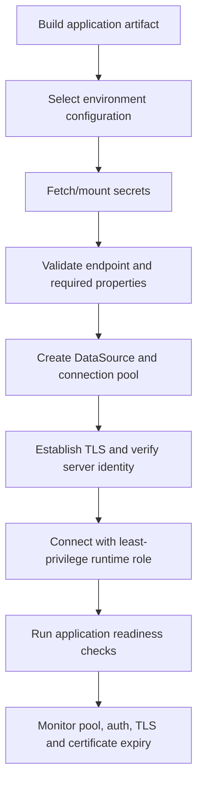

# Managing Credentials, TLS, and Environment-Specific Configuration

Spring Data JDBC accesses the database through a `DataSource` and a JDBC driver. In production environments, connection configuration goes far beyond a JDBC URL, username, and password. The application must also manage secret sources, database authentication, TLS certificates, truststores, access privileges, connection pools, and differences across development, test, staging, and production.

A misconfiguration can leak credentials, allow connecting to a spoofed database, point to the wrong environment's database, or leave the pool reusing stale credentials after rotation. This lesson explains how to externalize secrets, configure datasources per environment, verify TLS, manage database permissions, rotate credentials/certificates, and test configuration safely.

## 1. Components of Database Connection Configuration

A Spring Data JDBC application typically requires these configuration groups:

| Group | Examples | Purpose |
| --- | --- | --- |
| Endpoint | Host, port, database name, JDBC URL | Identifies the target database. |
| Authentication | Username, password, token, or client certificate | Authenticates the application. |
| TLS | SSL mode, CA certificate, truststore, hostname verification | Encrypts traffic and verifies the server. |
| Pool | Maximum pool size, timeouts, max lifetime | Manages JDBC connections. |
| Environment | Profile, region, schema, feature flags | Selects environment-appropriate settings. |
| Authorization | Database roles, grants, schema permissions | Restricts allowed application operations. |
| Rotation | Secret version, certificate renewal, pool refresh | Replaces credentials/certificates safely. |
| Observability | Connection errors, TLS handshake failures, pool metrics | Detects issues without exposing secrets. |

Spring Data JDBC does not need to know whether a password comes from an environment variable, mounted secret, or secret manager. It receives a configured `DataSource`. Therefore, separate credential provisioning from domain and repository code.

## 2. Never Store Credentials in Source Code or Repositories

Do not hardcode credentials in Java:

```java
// Unsafe.
String url = "jdbc:postgresql://prod-db:5432/orders";
String username = "orders_app";
String password = "my-real-password";
```

Never commit passwords in:

- `application.yml` or `application.properties`.
- Dockerfiles, image layers, or build arguments.
- Gradle/Maven build scripts.
- Test fixtures or integration test resources.
- Shell scripts, CI pipeline definitions, or sample configs copied verbatim into production.
- Logs, exception messages, screenshots, or issue trackers.

If a secret has ever been committed, deleting it from the current file is not enough: the secret may still exist in Git history, forks, CI logs, or build artifacts. Revoke/rotate the secret first, then clean history according to your organization's security process.

### Externalizing with Environment Variables

Spring Boot supports binding environment variables into datasource properties:

```yaml
spring:
  datasource:
    url: \${DB_JDBC_URL}
    username: \${DB_USERNAME}
    password: \${DB_PASSWORD}
    driver-class-name: org.postgresql.Driver
    hikari:
      maximum-pool-size: 15
      connection-timeout: 3000
      validation-timeout: 1000
      max-lifetime: 1500000
```

The values for `DB_JDBC_URL`, `DB_USERNAME`, and `DB_PASSWORD` are supplied via runtime/secret injection. Configuration files contain only variable names, never secret values.

Avoid passing passwords as command-line arguments whenever possible, because command lines can appear in process listings, diagnostic dumps, or deployment system logs.

### Local Development

Developers can provide local secrets via environment variables, a gitignored `.env` file, or a local secret store. Template files should contain only variable names and placeholder examples:

```text
DB_JDBC_URL=jdbc:postgresql://localhost:5432/orders
DB_USERNAME=orders_local
DB_PASSWORD=<provide-local-secret>
```

Never share production credentials for local development. Use dedicated local databases/containers and restricted accounts.

## 3. Managing Secrets by Environment

Each environment should have its own credentials:

- Development: local account or container database.
- Test/CI: credentials generated for test databases, scoped to test schemas.
- Staging: separate secrets, with permissions and TLS matching production closely.
- Production: secrets issued from a secret manager or deployment platform with controlled access.

Do not use profiles to store passwords. Profiles only select configuration sets; secrets must still come from a secure source.

Example profile separation:

```yaml
# application.yml
spring:
  datasource:
    hikari:
      maximum-pool-size: 10
      connection-timeout: 3000
```

```yaml
# application-dev.yml
spring:
  datasource:
    url: \${DEV_DB_JDBC_URL}
    username: \${DEV_DB_USERNAME}
    password: \${DEV_DB_PASSWORD}
```

```yaml
# application-prod.yml
spring:
  datasource:
    url: \${PROD_DB_JDBC_URL}
    username: \${PROD_DB_USERNAME}
    password: \${PROD_DB_PASSWORD}
    hikari:
      maximum-pool-size: 30
      max-lifetime: 1500000
```

The `prod` profile selects the appropriate endpoint and pool settings. Password values still come from the deployment environment. Avoid having default production credentials in config; if required variables are missing, the application should fail fast rather than silently connecting to a default database.

### Secret Sources

Depending on the platform, secrets may come from:

- Kubernetes Secrets mounted as files or exposed through a controlled secret integration.
- HashiCorp Vault.
- AWS Secrets Manager or Systems Manager Parameter Store.
- Azure Key Vault.
- Google Secret Manager.
- CI/CD or cloud platform secret stores.

Choose an organization-managed source, restrict read access by workload identity/service account, and audit secret access. Never print secret values to logs when debugging.
## 4. Loading Secrets from Mounted Files or Secret Managers

Some platforms provide secrets as mounted files. Spring Boot supports config trees to bind filenames as properties:

```text
/run/secrets/
  spring.datasource.username
  spring.datasource.password
```

Import configuration:

```yaml
spring:
  config:
    import: "configtree:/run/secrets/"
```

The contents of `spring.datasource.password` are the actual password mounted by the platform. Never put secret files into source control or Docker images. If a secret is mandatory, do not use `optional:` so the app starts with empty credentials when the mount is missing; failing fast catches misconfigurations immediately at deploy time.

For secret managers, integration depends on your platform and chosen libraries. You can use Spring Cloud Vault, AWS/Azure/GCP integrations, or a sidecar agent writing secrets to the filesystem. Whichever approach you choose, the principles remain:

- Workload identity has permission to read only the required secrets.
- Secrets have versioning and a rotation policy.
- Secret access has an audit trail.
- Secrets are never logged or placed in metric labels.
- The application detects missing/expired secrets.
- There is a clear procedure to refresh/restart the pool when a secret changes.

Do not write custom HTTP clients calling the secret manager inside every repository method. Load configuration once at startup boundaries or via a dedicated credential provider.

## 5. Binding and Validating Configuration at Startup

For application-managed settings, use `@ConfigurationProperties` to bind and validate rather than scattering `System.getenv()` calls:

```java
@ConfigurationProperties(prefix = "app.database")
@Validated
public record DatabaseSettings(
    @NotBlank String url,
    @NotBlank String username,
    @NotBlank String password,
    @NotBlank String expectedHost
) {
}
```

Register properties:

```java
@Configuration
@EnableConfigurationProperties(DatabaseSettings.class)
public class DatabaseConfiguration {
}
```

This example illustrates custom configuration; if using Spring Boot's auto-configured `spring.datasource.*`, use `DataSourceProperties` or Boot's datasource mechanisms rather than creating an unnecessary parallel property set.

Validation lets the application fail fast when the URL, username, password, or hostname is missing. Never include password values in validation errors. For endpoints, you can check scheme/host/port allowlists so a production profile never accidentally connects to localhost or an unapproved database.

### Preventing Wrong Profiles from Selecting the Wrong Database

In production:

- Set `SPRING_PROFILES_ACTIVE` explicitly from the deployment manifest.
- Do not rely on a default development profile.
- Validate that host/database names belong to the expected environment.
- Never allow falling back to a local/test datasource when production variables are missing.
- Log sanitized profile names and database hosts, never credentials or URLs containing passwords.

You may log a sanitized string like `jdbc:postgresql://db-prod.internal:5432/orders`, but never log the full URL if query parameters could contain secrets or tokens.

## 6. Protecting JDBC Connections with TLS

TLS protects data in transit and enables the application to verify the database server's identity. Secure configuration requires two parts:

1. **Encryption:** traffic between the application and database is encrypted in transit.
2. **Server identity verification:** the certificate chain is trusted and the hostname in the certificate matches the endpoint the application connects to.

Enabling encryption alone while skipping certificate verification can cause the application to encrypt a connection to an attacker-controlled server. Therefore, enable CA and hostname verification modes for your JDBC driver.

A server certificate typically needs:

- To be unexpired and unrevoked.
- A certificate chain leading to a CA trusted by the application.
- A Subject Alternative Name (SAN) matching the JDBC URL hostname.
- Key usage/extended key usage suited for server authentication.
- Algorithms and TLS versions supported by the driver and JVM.

The truststore holds CA certificates or trust anchors used by the client to verify the server. Do not place the database server's private key in the application truststore. If using mutual TLS, the client certificate/private key is a separate credential and must be protected as a secret.

## 7. Configuring TLS by JDBC Driver

Property names and semantics depend on the database and driver version. Check the documentation for your exact driver version and test with real certificates in staging.

### PostgreSQL JDBC

Example JDBC URL requiring CA and hostname verification:

```yaml
spring:
  datasource:
    url: "jdbc:postgresql://db-prod.example.internal:5432/orders?sslmode=verify-full&sslrootcert=/run/secrets/postgres-ca.crt"
```

`sslmode=verify-full` requires TLS, verifies the certificate chain, and checks the hostname according to driver rules. The certificate needs a SAN matching `db-prod.example.internal`. Use only CA bundles trusted by your organization; never disable verification to work around hostname or CA mismatch errors.

### MySQL Connector/J

Example using `sslMode=VERIFY_IDENTITY` and a truststore:

```yaml
spring:
  datasource:
    url: "jdbc:mysql://mysql-prod.example.internal:3306/orders?sslMode=VERIFY_IDENTITY&trustCertificateKeyStoreUrl=file:/run/secrets/mysql-truststore.p12&trustCertificateKeyStoreType=PKCS12"
    hikari:
      data-source-properties:
        trustCertificateKeyStorePassword: \${MYSQL_TRUSTSTORE_PASSWORD}
```

`VERIFY_IDENTITY` enforces CA and server identity/hostname verification. Check property names and how the truststore password is passed for your Connector/J version. Never place the truststore password directly in the JDBC URL or logs.

### Microsoft SQL Server JDBC

Example:

```yaml
spring:
  datasource:
    url: "jdbc:sqlserver://sql-prod.example.internal:1433;databaseName=orders;encrypt=true;trustServerCertificate=false;hostNameInCertificate=sql-prod.example.internal"
```

`encrypt=true` enables encryption; `trustServerCertificate=false` instructs the driver to validate the certificate rather than skipping checks. The hostname in the certificate must match the endpoint/`hostNameInCertificate`. Configure a truststore if needed using the properties and formats supported by that Microsoft JDBC driver version.

### Configurations to Avoid

- PostgreSQL `sslmode=disable` in production.
- PostgreSQL `sslmode=require` when policy requires full CA/hostname verification; per driver semantics it ensures TLS encryption without replacing verify-full.
- MySQL `sslMode=REQUIRED` when server identity verification is needed; prefer `VERIFY_IDENTITY`.
- SQL Server `trustServerCertificate=true` in production.
- Trust-all TrustManagers or custom hostname verifiers that always return true.
- Disabling certificate checks to bypass expired CAs or SAN mismatches.

Never copy TLS URLs blindly between database drivers. Syntax, property casing, and semantics differ.
## 8. Least-Privilege Database Permissions for Runtime Applications

Valid credentials do not mean the application should hold database admin rights. Create separate roles for each purpose:

| Role | Typical privileges |
| --- | --- |
| Application runtime | SELECT/INSERT/UPDATE/DELETE on required tables; EXECUTE on functions if use cases require them. |
| Migration | DDL and schema modification privileges during migrations. |
| Read-only/report | SELECT on permitted reporting schemas/views. |
| Operations/admin | Administrative privileges granted separately to operators or operational automation. |

Never use the database owner or superuser account as the Spring Boot application's credentials. If the runtime is compromised, least privilege limits the blast radius.

Conceptual PostgreSQL example:

```sql
CREATE ROLE orders_app LOGIN PASSWORD '<provided-by-secret-manager>';
GRANT CONNECT ON DATABASE orders TO orders_app;
GRANT USAGE ON SCHEMA public TO orders_app;
GRANT SELECT, INSERT, UPDATE, DELETE
    ON TABLE purchase_order, order_line TO orders_app;
```

Adjust the example for your schemas, sequences/identities, and actual permissions. If the database uses standalone sequences, the runtime role may need appropriate sequence privileges. Do not grant `CREATE`/`ALTER`/`DROP` just because migrations live in the same project; use separate migration credentials during deployment.

If the application routes reads and writes, use read-only credentials for replicas where supported by the database. If a write is accidentally routed to a replica, database permissions provide an extra safeguard beyond code alone.

## 9. Managing Connection Pools Alongside Credentials

Spring Boot commonly configures HikariCP as its connection pool. Hikari keeps physical connections open for reuse; each connection is authenticated when created. Therefore, changing a password in the secret store does not automatically update credentials on already-open connections.

Key properties:

| Property | Meaning |
| --- | --- |
| `maximum-pool-size` | Caps total connections in the pool. |
| `minimum-idle` | Minimum idle connections if configured. |
| `connection-timeout` | Time to wait for a connection from the pool. |
| `validation-timeout` | Time allowed for connection validation. |
| `max-lifetime` | Maximum lifetime of a physical connection. |
| `idle-timeout` | How long idle connections may stay in the pool above minimum idle. |
| `keepalive-time` | Interval for checking/keeping idle connections alive as configured. |

Do not set the pool size overly large just to avoid waiting for connections. Total connections across all application instances, jobs, and tools must fit within the database's connection limit. `max-lifetime` should also align with limits enforced by proxies, load balancers, and the database.

Example:

```yaml
spring:
  datasource:
    hikari:
      maximum-pool-size: 20
      minimum-idle: 5
      connection-timeout: 3000
      validation-timeout: 1000
      max-lifetime: 1500000
      idle-timeout: 600000
```

These numbers are only examples, not universal settings for every system. Measure connection acquisition times, active/idle/pending counts, and database capacity before sizing pools.

## 10. Rotating Passwords or Tokens Without Disrupting the Application

Credential rotation should include an overlap period so the application transitions to the new credential before the old one is revoked.

A typical workflow:

1. Create a new credential or new secret version.
2. Grant equivalent least-privilege permissions to the new credential.
3. Update the secret manager/config source.
4. Deploy or refresh the application so pools open connections with the new credential.
5. Verify new connections succeed and no connections still use the old credential.
6. Wait for old pools to drain/close as planned.
7. Revoke the old credential.
8. Monitor authentication failures and connection pool metrics.

Hikari does not automatically change the username/password of existing physical connections simply because a secret file changed. Existing connections were authenticated when opened and may keep working until closed, depending on database policy. New connections must use the new credential. For rotation to take effect, the application needs a tested pool refresh/recreation or rolling restart.

`max-lifetime` ensures connections are periodically replaced, but do not assume it reloads secret values on its own. If credentials update at runtime, implement an explicit mechanism to create a new datasource/pool and drain the old pool safely.

### Short-Lived Database Tokens

Some cloud databases support short-lived tokens instead of static passwords. With these tokens, a fresh token may need to be generated for each new physical connection. Never fetch a token once at startup and let the pool try opening new connections after the token expires.

You need a credential provider/connection factory suited to your driver and pool, with clock skew allowance, bounded retries, and metrics. Test opening new physical connections after the previous token's expiration time.

## 11. Rotating TLS Certificates and CA Trust

TLS certificates also require rotation. A safe process typically uses overlap:

1. Distribute a trust bundle containing both the old and new CAs to the application.
2. Confirm the application trusts both chains.
3. Update the database server certificate to the new certificate with the correct SAN.
4. Open new physical connections and confirm TLS handshakes succeed.
5. Drain/recycle older connections according to policy.
6. Remove the old CA from the trust bundle once no endpoint uses the old chain.

Established JDBC connections generally do not perform a new TLS handshake for every query. Thus, new certificates are verified when new connections are established; pools can continue holding older sessions for a while. Account for `max-lifetime`, rolling restarts, or pool refreshes.

If a certificate expires or a hostname mismatches, never disable hostname verification as a quick fix. Fix the SAN, CA chain, truststore, or JDBC endpoint. With multiple primary/replica endpoints, verify each endpoint's certificate is trusted and matches its hostname.
## 12. Secure Configuration in Containers and Kubernetes

Never bake secrets into container images. Images should contain application artifacts and non-sensitive configuration; secrets are injected at runtime by the platform.

With Kubernetes:

- Use workload identity/service accounts to access secret managers whenever possible.
- If using Kubernetes Secrets, restrict read permissions with RBAC and namespace isolation.
- Mount secrets read-only; restrict file permissions and avoid exposing them through unnecessary shared volumes.
- Never place secrets in ConfigMaps.
- Never print manifests containing decoded secrets into CI logs.
- Watch for secret updates and maintain a clear rollout/refresh policy.
- Keep secrets separated per environment and tenant.

When using config trees, mount files named after property keys and import the directory. When using a CSI driver/agent, verify how secret files update and whether the application reloads them. A file changing on disk does not mean the `DataSource` bean or Hikari pool is automatically recreated.

### Separating Non-Sensitive Config from Secrets

Non-sensitive configuration can live in deployment configs:

- JDBC host/database name.
- Pool sizes and timeouts.
- TLS mode and CA certificate paths.
- Schema/migration versions.
- Operational feature flags.

Credentials and private keys stay in the secret store. Even when a URL contains no password, it can still reveal internal hostnames or database topology; log it only at levels permitted by policy.

## 13. Preventing Secret Leaks via Logs, Actuator, and Diagnostics

Common leak vectors:

- Logging the entire `DataSourceProperties` or Hikari config.
- Logging a JDBC URL containing password/token query parameters.
- Driver-returned exception messages containing connection details.
- Publicly exposed Spring Boot Actuator `env` or `configprops` endpoints.
- Heap dumps, thread dumps, or support bundles containing objects that hold credentials.
- CI debug logs printing environment variables.
- Metric labels containing URLs, usernames, or tenant secrets.

Principles:

- Never log passwords, tokens, private keys, truststore passwords, or raw secrets.
- Log only the operation, sanitized host, database name, driver name/version, and SQLState when diagnosing.
- Protect Actuator endpoints with authentication/network policies; expose only needed endpoints.
- Verify masking behavior on your Spring Boot version—do not assume every custom property is masked automatically.
- Restrict permissions and retention for downloading heap dumps/diagnostic artifacts.
- Redact URL query parameters that might hold tokens or passwords.

Never return secrets or detailed internal info in health endpoints. Health checks should report general status such as datasource reachable/unavailable and an appropriate correlation ID.

## 14. Testing Configuration and TLS

Configuration tests should include both startup validation and real connectivity checks.

### Configuration Binding Tests

- Missing `DB_JDBC_URL` or required username/password must make the app fail fast.
- Production profiles must never fall back to local/test URLs.
- Properties bind properly from environment/config trees.
- Passwords never appear in validation errors or startup logs.
- Pool settings stay within expected bounds.
- Database host/schema belongs to the active environment.

You can use `ApplicationContextRunner` or Spring Boot configuration tests to verify binding without connecting to a real database.

### TLS Integration Tests

In test/staging environments, verify:

1. Valid certificate chain and matching hostname: connection succeeds.
2. Untrusted CA: handshake fails.
3. Hostname mismatch with SAN: verification fails.
4. Expired or swapped certificate: application does not silently skip verification.
5. Certificate rotation with overlapping trust bundle: new connections succeed using the new chain.
6. Replica endpoints also enforce TLS verification if the app routes reads/writes.

Default Testcontainers databases usually do not enable production-style TLS. Use custom TLS container configs or run contract tests on staging with real certificates. Never enable `trustServerCertificate=true` or trust-all modes just to make tests pass.

### Testing Credential Rotation

- Create new credentials and confirm the app opens new connections with them.
- Swap the secret and recycle/refresh the pool per deployment procedure.
- Revoke old credentials and confirm the app continues working.
- Confirm the pool does not reopen connections with old credentials after rotation.
- Simulate secret manager unavailability and verify startup/refresh behavior.
- Test short-lived token expiration when the pool needs to open new physical connections.

You do not need production secrets to test rotation. Use test databases and temporary restricted credentials.

## 15. Environment-Specific Configuration and Drift Control

The same application artifact should deploy across environments solely through external configuration. Differences across environments are expressed through config/secrets, never separate code branches.

| Attribute | Development | Test/CI | Staging | Production |
| --- | --- | --- | --- | --- |
| Database | Local/container | Ephemeral database | Production-like | Managed/production |
| Credentials | Dedicated local | Random ephemeral | Dedicated secret | Secret manager |
| TLS | Local cert optional | Test cert if needed | Enforced near-production | Enforced identity verification |
| Database role | Dev-limited | Test-only | Runtime role | Least-privilege runtime |
| Pool | Small | Small, bounded | Near-production | Sized for capacity/load |
| Migration role | Dev/migration | Test migration | Controlled deploy | Separate migration identity |
| Secret rotation | Manual/dev | Per run | Rehearsed | Policy/automated |

### Avoiding Config Drift

- Version-control non-secret configuration files.
- Manage secrets through consistent deployment mechanisms and policies.
- Verify effective configuration post-deploy using sanitized metadata.
- Set alerts when certificates near expiration.
- Track active driver/database versions and TLS modes.
- Never allow staging to use production CAs/credentials unless explicitly required by policy and approved.
- Keep compatible JDBC driver major/minor versions across staging and production.

If an environment needs a different value, document the reason and owner. Never apply undocumented or unmanaged overrides just as a temporary incident workaround.

## 16. Read/Write Datasources and Separate Credentials

If an application has a primary and read replicas, use separate credentials:

- Primary runtime account holds read/write permissions on business tables.
- Replica account holds SELECT permissions only.
- Migration account runs in a separate deployment job.
- Every datasource endpoint has appropriate TLS verification and separate secrets if required.

Never assume only the primary needs TLS. Replicas contain the same data and may sit across different networks; all database connections must comply with encryption and verification policies.

When using per-tenant databases, secrets and certificates may vary by tenant. A datasource registry must fetch secrets from trusted sources, bound pool counts, and never log keys/credentials. Never let a client-supplied tenant ID build a JDBC URL or select arbitrary secrets.
## 17. Common Pitfalls in Datasource Operations

| Mistake | Consequence | Fix |
| --- | --- | --- |
| Hardcoding passwords in source/config | Secrets can leak via Git, artifacts, or logs. | Externalize via secret manager/environment injection. |
| Sharing credentials across dev, staging, and production | Compromise in one environment can affect others. | Dedicated credentials per environment/workload. |
| Using database owner for application runtime | App holds excessive DDL/admin privileges. | Create a least-privilege runtime role and separate migration role. |
| Enabling encryption while skipping hostname verification | Can connect to a spoofed server. | Enable CA and hostname verification per driver. |
| Using trust-all or ignoring certificate errors | Loses server identity verification. | Fix the CA chain, SAN, truststore, or endpoint. |
| Putting passwords inside JDBC URLs | URLs may appear in logs/diagnostics. | Use dedicated datasource username/password properties. |
| Assuming updating a secret file updates the pool | New connections may keep using old credentials. | Perform controlled pool refresh/recreation or rolling restart. |
| Revoking old credentials too early | Instances not yet switched fail to open new connections. | Overlap during rotation, verify pools, then revoke. |
| Rotating server certificates without updating trust bundles | New connections fail TLS handshakes. | Update trust first, overlap CAs, then swap server cert. |
| Setting max pool size too large | Database runs out of connections across instances. | Compute total connection budget and monitor pool metrics. |
| Exposing Actuator env/configprops publicly | Can leak topology or sensitive settings. | Restrict endpoints, verify masking, and sanitize. |
| Production profile falling back to local URLs | App may boot against the wrong database. | Require properties and validate endpoints by environment. |
| Sharing migration credentials with runtime | Runtime compromise can alter schemas. | Separate migration jobs and identities. |
| Testing TLS only on localhost | Misses production SAN/CA/hostname mismatches. | Test in staging with real chains and hostnames. |
| Not tracking certificate expiry | Connections fail en masse when certificates expire. | Alert before expiry and rehearse rotation. |

## 18. Never Log Configuration Objects Containing Secrets

A `@ConfigurationProperties` record can auto-generate a `toString()` containing every field, including passwords. Never log entire configuration objects if they contain secrets.

Example to avoid:

```java
log.info("Database settings: {}", databaseSettings);
```

Replace with sanitized metadata:

```java
log.info(
    "Database configured: host={}, database={}, driver={}",
    safeHost,
    safeDatabaseName,
    driverVersion
);
```

Never log:

- Passwords, tokens, private keys, or truststore passwords.
- Full JDBC URLs if URLs may contain secrets/query tokens.
- Secret manager responses.
- Full environment variables.
- Configuration objects exposing sensitive fields in `toString()`.

When debugging configuration, log which property names are present/missing or the secret version ID, never the values. Version IDs should also be evaluated so unnecessary internal metadata is not exposed.

## 19. Pre-Release Checklist

Before deploying a Spring Data JDBC application to a new environment or changing credentials/TLS, confirm:

1. JDBC URL, username, and password come from managed configuration/secret sources.
2. No secrets exist in Git, Docker images, build logs, or sample configs.
3. Profile/environment is explicitly selected; missing required properties make the app fail fast.
4. Runtime database account has least privilege; migration account is separate.
5. TLS enables encryption and verifies CA/hostname per driver.
6. CA bundle, SAN, certificate expiry, and truststore have been verified.
7. Both primary and replicas have proper TLS/credentials.
8. Connection pool size fits within the database's total connection budget.
9. Secret rotation includes overlap and a pool refresh/drain procedure.
10. Certificate rotation updates trust bundles before the old server cert expires.
11. Actuator, logs, metrics, and diagnostics do not expose secrets.
12. CI uses separate test credentials and never production secrets.
13. Staging has tested TLS handshakes with real certificates/hostnames.
14. Health checks confirm database reachability without returning sensitive info.
15. Alerts exist for authentication failures, TLS handshake failures, pool exhaustion, and certificate expiry.

Deployment flow:



## 20. Self-Check Questions

- Why shouldn't database passwords be hardcoded in `application.yml`?
- How can Spring Boot receive datasource credentials from environment variables or config trees?
- Why should each environment have its own credentials?
- Through what mechanism should a secret manager grant access to a workload?
- How does TLS encryption differ from server identity verification?
- Why is PostgreSQL `sslmode=verify-full` safer than modes that only require TLS when hostname verification is needed?
- What do MySQL `VERIFY_IDENTITY` and SQL Server `trustServerCertificate=false` protect against?
- Why shouldn't certificate verification be turned off to resolve handshake errors?
- What privileges does a runtime database role need, and why should the migration role be separate?
- How does a Hikari pool handle credential rotation for already-open physical connections?
- Why does certificate rotation require overlapping CA trust and connection recycling?
- Which Actuator/log settings can expose secrets?
- How do you test missing secrets, untrusted CAs, and hostname mismatches?
- Which metrics/alerts help detect credential, TLS, or pool issues?

Managing credentials, TLS, and environment-specific configuration is an essential part of operating Spring Data JDBC. Externalize secrets, grant least-privilege database roles, verify both certificate chains and hostnames, isolate configs by environment, and design rotations with overlap alongside your connection pool. Test with each environment's own credentials and certificates, keep secrets out of logs and diagnostics, and monitor authentication, TLS, pools, and certificate expiry to keep database connectivity secure throughout the application lifecycle.
