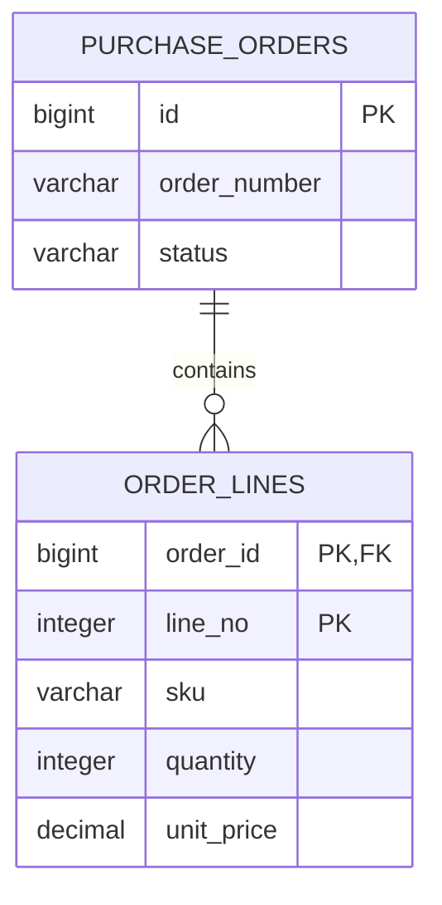

# Experimenting with Saving Child Entities and Observing Actual SQL

Spring Data JDBC persists data by **aggregate**. When saving an aggregate root, the framework uses mapping metadata to write the root row and the child entities belonging to the aggregate into their respective tables. To understand precisely what happens, the best approach is to run a hands-on lab against a real database, enable SQL logging, and inspect the tables directly using JDBC.

This lab builds an order consisting of a `PurchaseOrder` root and a list of `OrderLine`s. We will save a new order, reload the aggregate, modify the list of order lines, remove a line, and then delete the entire order. At each step, SQL logs reveal which statements Spring Data JDBC sends; direct queries using `JdbcTemplate` confirm the final state in the database.

This lesson focuses on child entities within an aggregate and actual executed SQL. Examples use PostgreSQL via Testcontainers so results match a real deployment environment closely.

## 1. Lab objectives

After this lesson, you will be able to:

- Distinguish an aggregate root from child entities persisted along with the aggregate.
- Map a child collection using `@MappedCollection`.
- Design a child table with a foreign key and collection key column.
- Save a new aggregate and observe the insert order.
- Modify a collection and observe how Spring Data JDBC updates child rows.
- Delete a single child or the entire aggregate and verify the executed SQL.
- Use SQL logs and `JdbcTemplate` to observe actual database state.
- Understand the role of transactions when root and child rows are written across multiple statements.

## 2. Domain model used in the lab

We model the order as follows:

- `PurchaseOrder` is the aggregate root, with a primary key and an order number.
- `OrderLine` is a child entity that exists only within the scope of an order.
- An order has multiple order lines.
- The order of lines is preserved by position in a `List`.

Relational diagram:



In this example, `OrderLine` has no independent ID. The child row key consists of `order_id` and `line_no`. This is appropriate when a child is part of an aggregate and has no independent lifecycle.

## 3. Creating the PostgreSQL schema

Create a Flyway migration at:

```text
src/main/resources/db/migration/V1__create_order_tables.sql
```

Contents:

```sql
CREATE TABLE purchase_orders (
    id BIGINT GENERATED BY DEFAULT AS IDENTITY PRIMARY KEY,
    order_number VARCHAR(40) NOT NULL UNIQUE,
    status VARCHAR(20) NOT NULL
);

CREATE TABLE order_lines (
    order_id BIGINT NOT NULL,
    line_no INTEGER NOT NULL,
    sku VARCHAR(40) NOT NULL,
    quantity INTEGER NOT NULL CHECK (quantity > 0),
    unit_price NUMERIC(12, 2) NOT NULL CHECK (unit_price >= 0),
    PRIMARY KEY (order_id, line_no),
    CONSTRAINT fk_order_lines_order
        FOREIGN KEY (order_id)
        REFERENCES purchase_orders(id)
);
```

Important details:

- `purchase_orders.id` is a database-generated identity.
- `order_lines.order_id` is a foreign key pointing to the aggregate root.
- `line_no` is the child's position in the list.
- The composite primary key prevents an order from having two children at the same position.
- `ON DELETE CASCADE` is omitted in this lab so we can observe Spring Data JDBC deleting child rows as part of the aggregate lifecycle.

If the production schema includes cascade rules, tests should use the exact production migrations to observe real behavior.

## 4. Declaring immutable entities

### 4.1. Child entity OrderLine

```java
import java.math.BigDecimal;

public record OrderLine(
        String sku,
        Integer quantity,
        BigDecimal unitPrice
) {
}
```

`OrderLine` does not have `@Id` because it is a child value/entity managed through the aggregate root. Do not create a separate repository for the child in this model.

### 4.2. Aggregate root PurchaseOrder

```java
import java.util.List;

import org.springframework.data.annotation.Id;
import org.springframework.data.relational.core.mapping.Column;
import org.springframework.data.relational.core.mapping.MappedCollection;
import org.springframework.data.relational.core.mapping.Table;

@Table("purchase_orders")
public record PurchaseOrder(
        @Id Long id,
        @Column("order_number") String orderNumber,
        String status,
        @MappedCollection(
                idColumn = "order_id",
                keyColumn = "line_no"
        )
        List<OrderLine> lines
) {

    public PurchaseOrder {
        lines = lines == null ? List.of() : List.copyOf(lines);
    }

    public PurchaseOrder withLines(List<OrderLine> newLines) {
        return new PurchaseOrder(
                id,
                orderNumber,
                status,
                newLines
        );
    }

    public PurchaseOrder withStatus(String newStatus) {
        return new PurchaseOrder(
                id,
                orderNumber,
                newStatus,
                lines
        );
    }
}
```

`@MappedCollection` connects the collection to the child table:

- `idColumn = "order_id"` is the column in the child table holding the root's ID.
- `keyColumn = "line_no"` is the column storing the collection's key/index.
- Because the property is a `List`, Spring Data JDBC stores the element position so order can be reconstructed upon reading.

The record's compact constructor creates a defensive copy so the collection cannot be mutated externally. The `with...` methods create a new aggregate instance while keeping the remaining components unchanged.

### 4.3. Repository

```java
import org.springframework.data.repository.CrudRepository;

public interface PurchaseOrderRepository
        extends CrudRepository<PurchaseOrder, Long> {
}
```

Only a repository for the aggregate root is needed. Spring Data JDBC manages child rows through `PurchaseOrder`'s mapping.

## 5. Configuring dependencies and the test database

Example using Gradle with Spring Boot dependency management:

```kotlin
dependencies {
    implementation("org.springframework.boot:spring-boot-starter-data-jdbc")
    implementation("org.flywaydb:flyway-core")

    runtimeOnly("org.postgresql:postgresql")

    testImplementation("org.springframework.boot:spring-boot-starter-test")
    testImplementation("org.testcontainers:junit-jupiter")
    testImplementation("org.testcontainers:postgresql")
}
```

Use an appropriate BOM/dependency management setup so Testcontainers modules have compatible versions.

### 5.1. PostgreSQL container for integration tests

```java
@Testcontainers
@DataJdbcTest
@AutoConfigureTestDatabase(
        replace = AutoConfigureTestDatabase.Replace.NONE
)
class PurchaseOrderRepositoryTest {

    @Container
    static final PostgreSQLContainer<?> postgres =
            new PostgreSQLContainer<>("postgres:16.4")
                    .withDatabaseName("orders_test")
                    .withUsername("test_user")
                    .withPassword("test_password");

    @DynamicPropertySource
    static void configureDatabase(DynamicPropertyRegistry registry) {
        registry.add("spring.datasource.url", postgres::getJdbcUrl);
        registry.add("spring.datasource.username", postgres::getUsername);
        registry.add("spring.datasource.password", postgres::getPassword);
        registry.add(
                "spring.datasource.driver-class-name",
                postgres::getDriverClassName
        );
    }

    @Autowired
    PurchaseOrderRepository orders;

    @Autowired
    JdbcTemplate jdbc;
}
```

Role of each annotation:

- `@Testcontainers` enables the JUnit 5 extension.
- `@Container` manages the container lifecycle per test class.
- `@DynamicPropertySource` registers the JDBC URL and credentials assigned by the container.
- `@AutoConfigureTestDatabase(replace = NONE)` keeps the PostgreSQL DataSource instead of replacing it with an embedded database.
- `@DataJdbcTest` creates the test slice for Spring Data JDBC.

The image tag is just an example. Pin the version matching your production database. A Docker-compatible runtime must be running before executing the tests.

## 6. Experiment 1: saving a new aggregate

Create an order with two order lines:

```java
@Test
void savesRootAndChildRows() {
    PurchaseOrder order = new PurchaseOrder(
            null,
            "PO-1001",
            "NEW",
            List.of(
                    new OrderLine("SKU-RED", 2, new BigDecimal("12.50")),
                    new OrderLine("SKU-BLUE", 1, new BigDecimal("20.00"))
            )
    );

    PurchaseOrder saved = orders.save(order);

    assertThat(saved.id()).isNotNull();

    Integer rootCount = jdbc.queryForObject(
            "SELECT COUNT(*) FROM purchase_orders WHERE id = ?",
            Integer.class,
            saved.id()
    );

    Integer lineCount = jdbc.queryForObject(
            "SELECT COUNT(*) FROM order_lines WHERE order_id = ?",
            Integer.class,
            saved.id()
    );

    assertThat(rootCount).isEqualTo(1);
    assertThat(lineCount).isEqualTo(2);
}
```

This test verifies two outcomes:

- The database created the root row and Spring Data JDBC returned the generated ID.
- Two child rows were written with the same `order_id`.

### 6.1. SQL typically observed on insert

For a new aggregate, the SQL has this general shape:

```sql
INSERT INTO purchase_orders (order_number, status)
VALUES (?, ?);

INSERT INTO order_lines (
    order_id, line_no, sku, quantity, unit_price
)
VALUES (?, ?, ?, ?, ?);

INSERT INTO order_lines (
    order_id, line_no, sku, quantity, unit_price
)
VALUES (?, ?, ?, ?, ?);
```

Exact statements depend on the dialect, generated-key strategy, driver, and Spring Data JDBC version. The framework must insert the root first to obtain its ID, and then use that ID as the foreign key when writing child rows.

Do not use the exact SQL strings above as hard assertions across all databases. Use SQL logs to understand statement shapes and use data inspection queries to verify results.

## 7. Experiment 2: reloading the aggregate

After saving, load the aggregate through the repository:

```java
@Test
void loadsRootAndChildCollection() {
    PurchaseOrder saved = orders.save(
            new PurchaseOrder(
                    null,
                    "PO-1002",
                    "NEW",
                    List.of(
                            new OrderLine("SKU-A", 1, new BigDecimal("5.00")),
                            new OrderLine("SKU-B", 3, new BigDecimal("7.25"))
                    )
            )
    );

    PurchaseOrder loaded = orders.findById(saved.id()).orElseThrow();

    assertThat(loaded.orderNumber()).isEqualTo("PO-1002");
    assertThat(loaded.lines()).hasSize(2);
    assertThat(loaded.lines())
            .extracting(OrderLine::sku)
            .containsExactly("SKU-A", "SKU-B");
}
```

`line_no` stores each element's position in the collection. When reading the aggregate, Spring Data JDBC uses this key to restore the list's ordering.

### 7.1. SQL typically observed on load

Loading may generate separate SELECT statements for the root and child tables, for example:

```sql
SELECT id, order_number, status
FROM purchase_orders
WHERE id = ?;

SELECT order_id, line_no, sku, quantity, unit_price
FROM order_lines
WHERE order_id = ?
ORDER BY line_no;
```

This SQL illustrates the mapping concept. Actual aliases, projections, and ordering depend on the mapping, dialect, and version.

Do not assume every aggregate read always executes only a single SELECT statement. Check logs to see the actual statement count and evaluate cost when loading many aggregates.

## 8. Experiment 3: modifying the child collection

Spring Data JDBC treats child rows as part of the aggregate. When saving an existing aggregate, the framework may replace the referenced rows based on the current collection. With the child mapping in this lab, observe the pattern of deleting old child rows and inserting the new collection.

For example, the order currently has two lines. Replace them with three lines:

```java
@Test
void replacesChildCollectionWhenAggregateIsSaved() {
    PurchaseOrder saved = orders.save(
            new PurchaseOrder(
                    null,
                    "PO-1003",
                    "NEW",
                    List.of(
                            new OrderLine("SKU-A", 1, new BigDecimal("5.00")),
                            new OrderLine("SKU-B", 2, new BigDecimal("8.00"))
                    )
            )
    );

    PurchaseOrder loaded = orders.findById(saved.id()).orElseThrow();

    PurchaseOrder changed = loaded.withLines(
            List.of(
                    new OrderLine("SKU-A", 4, new BigDecimal("5.00")),
                    new OrderLine("SKU-C", 1, new BigDecimal("15.00")),
                    new OrderLine("SKU-D", 2, new BigDecimal("3.50"))
            )
    );

    orders.save(changed);

    Integer lineCount = jdbc.queryForObject(
            "SELECT COUNT(*) FROM order_lines WHERE order_id = ?",
            Integer.class,
            saved.id()
    );

    assertThat(lineCount).isEqualTo(3);
}
```

With a child mapping that has no independent ID, Spring Data JDBC does not diff by SKU to update only modified rows. Check the logs to observe the child delete/insert operations produced by your version.

### 8.1. SQL typically observed when replacing a collection

Common operation shape:

```sql
UPDATE purchase_orders
SET order_number = ?, status = ?
WHERE id = ?;

DELETE FROM order_lines
WHERE order_id = ?;

INSERT INTO order_lines (
    order_id, line_no, sku, quantity, unit_price
)
VALUES (?, ?, ?, ?, ?);

-- Repeat INSERT for each current element in the collection.
```

Specific SQL may vary, but the key observation is that dependent rows may be replaced entirely. Therefore, do not assume a child row retains its physical identity just because its SKU and domain values were the same before and after.

## 9. Experiment 4: removing an order line

To remove a child, create a new aggregate without that element and save the root:

```java
@Test
void removesLineWhenItIsRemovedFromAggregateCollection() {
    PurchaseOrder saved = orders.save(
            new PurchaseOrder(
                    null,
                    "PO-1004",
                    "NEW",
                    List.of(
                            new OrderLine("SKU-A", 1, new BigDecimal("5.00")),
                            new OrderLine("SKU-B", 2, new BigDecimal("8.00"))
                    )
            )
    );

    PurchaseOrder loaded = orders.findById(saved.id()).orElseThrow();

    PurchaseOrder changed = loaded.withLines(
            List.of(loaded.lines().get(0))
    );

    orders.save(changed);

    Integer remaining = jdbc.queryForObject(
            "SELECT COUNT(*) FROM order_lines WHERE order_id = ?",
            Integer.class,
            saved.id()
    );

    assertThat(remaining).isEqualTo(1);
}
```

After saving, the current collection has one element, so the child table retains only the row corresponding to that element. Under the child replacement strategy, the remaining row may have been re-inserted with its new key/index.

If you need to update a single child row independently without deleting and re-inserting the entire collection, re-evaluate the aggregate boundary or use an intentional separate persistence operation. Do not use a direct child repository to bypass aggregate consistency.

## 10. Experiment 5: deleting the aggregate root

When deleting an aggregate root, Spring Data JDBC must handle dependent rows according to the mapping so foreign keys are not violated.

```java
@Test
void deletesChildRowsAndRoot() {
    PurchaseOrder saved = orders.save(
            new PurchaseOrder(
                    null,
                    "PO-1005",
                    "NEW",
                    List.of(
                            new OrderLine("SKU-A", 1, new BigDecimal("5.00")),
                            new OrderLine("SKU-B", 2, new BigDecimal("8.00"))
                    )
            )
    );

    orders.deleteById(saved.id());

    Integer rootCount = jdbc.queryForObject(
            "SELECT COUNT(*) FROM purchase_orders WHERE id = ?",
            Integer.class,
            saved.id()
    );

    Integer lineCount = jdbc.queryForObject(
            "SELECT COUNT(*) FROM order_lines WHERE order_id = ?",
            Integer.class,
            saved.id()
    );

    assertThat(rootCount).isZero();
    assertThat(lineCount).isZero();
}
```

When inspecting logs, look for the DELETE targeting the child table by `order_id` and the DELETE targeting the root by ID. The exact statement order and count may vary by version and mapping.

Do not add cascade delete just to make a test pass. Understand how Spring Data JDBC manages aggregate children and use the same schema behavior as production.

## 11. Enabling SQL logging to observe actual statements

Spring Data JDBC uses Spring JDBC to execute statements. You can enable loggers in the test profile:

```properties
logging.level.org.springframework.jdbc.core.JdbcTemplate=DEBUG
logging.level.org.springframework.jdbc.core.StatementCreatorUtils=TRACE
logging.level.org.springframework.data.jdbc.core.convert=DEBUG
```

Roles:

- The `JdbcTemplate` logger reveals the executed SQL statements.
- `StatementCreatorUtils` at TRACE level can show bound parameter types and values.
- The Spring Data JDBC logger may provide additional mapping/conversion details depending on version.

Do not enable TRACE logging containing sensitive parameters in production. Bound values may contain emails, addresses, tokens, or personal data. Use a test/local profile and turn it off once the investigation is complete.

### 11.1. Expected log shape

Illustrative log output when saving a new aggregate may resemble:

```text
Executing prepared SQL statement [
    INSERT INTO purchase_orders (order_number, status)
    VALUES (?, ?)
]

Executing prepared SQL statement [
    INSERT INTO order_lines
        (order_id, line_no, sku, quantity, unit_price)
    VALUES (?, ?, ?, ?, ?)
]
```

For an aggregate with two order lines, you may see two child inserts or a batch depending on implementation and version. Do not treat log line counts as an API contract; inspect the SQL and the database state.

### 11.2. Bind parameter logging

When bind logging is enabled at TRACE, you can see the data types and values passed to `PreparedStatement`. This helps detect:

- Wrong parameter ordering.
- Null values bound to `NOT NULL` columns.
- Java types bound as unexpected JDBC types.
- Incorrectly converted decimal or temporal values.
- Root ID not being propagated to child rows.

In production environments, prefer logging non-sensitive metadata or using tracing/SQL instrumentation that redacts parameters.

### 11.3. SQL logging does not replace database inspection

Logs show which statements the application sent. They do not by themselves prove that statements committed or that final row values match expectations.

Combine three sources:

1. SQL logs from Spring JDBC.
2. Exception/transaction logs from Spring.
3. Direct database queries via `JdbcTemplate` or a SQL client.

## 12. Inspecting data directly with JdbcTemplate

You can inspect child rows after each operation using simple SQL.

Reading order lines in order:

```java
List<OrderLineRow> rows = jdbc.query(
        """
        SELECT line_no, sku, quantity, unit_price
        FROM order_lines
        WHERE order_id = ?
        ORDER BY line_no
        """,
        (rs, rowNum) -> new OrderLineRow(
                rs.getInt("line_no"),
                rs.getString("sku"),
                rs.getInt("quantity"),
                rs.getBigDecimal("unit_price")
        ),
        orderId
);
```

DTO used solely for test inspection:

```java
public record OrderLineRow(
        Integer lineNo,
        String sku,
        Integer quantity,
        BigDecimal unitPrice
) {
}
```

After reading, assert:

```java
assertThat(rows)
        .extracting(OrderLineRow::sku)
        .containsExactly("SKU-A", "SKU-B");
```

Direct querying separates two concerns:

- Does the repository return the aggregate with the right mapping?
- Are the physical rows in the child table as expected?

If the repository loads missing children while a direct query shows all rows, check mapping metadata, key columns, and conversions. If the direct query is also missing rows, inspect the write SQL and transaction commit/rollback behavior.

## 13. Transaction boundaries when saving root and child

Saving an aggregate can emit multiple statements: insert/update root, delete old child rows, and insert new child rows. If one statement fails, the application typically needs to roll back the entire use case's changes.

Place the transaction boundary on the application service:

```java
@Service
public class OrderApplicationService {

    private final PurchaseOrderRepository orders;

    public OrderApplicationService(PurchaseOrderRepository orders) {
        this.orders = orders;
    }

    @Transactional
    public PurchaseOrder create(PurchaseOrder order) {
        return orders.save(order);
    }

    @Transactional
    public PurchaseOrder replaceLines(
            Long orderId,
            List<OrderLine> newLines
    ) {
        PurchaseOrder current = orders.findById(orderId)
                .orElseThrow();

        return orders.save(current.withLines(newLines));
    }

    @Transactional
    public void delete(Long orderId) {
        orders.deleteById(orderId);
    }
}
```

Repository operations inside one service method participate in the same transaction if they share the same DataSource and transaction manager.

`@DataJdbcTest` normally wraps each test method in a transaction and rolls it back at the end of the test. Therefore, `JdbcTemplate` queries within the same test can see recently written changes even though they have not committed outside the test transaction.

If you need to verify an actual commit, use a non-transactional test or read from an independent transaction/connection after the service completes.

### 13.1. Testing rollback when child insert fails

You can intentionally create an invalid child, such as quantity `0` to violate the `CHECK` constraint:

```java
PurchaseOrder invalid = new PurchaseOrder(
        null,
        "PO-ROLLBACK",
        "NEW",
        List.of(
                new OrderLine("SKU-OK", 1, new BigDecimal("2.00")),
                new OrderLine("SKU-BAD", 0, new BigDecimal("3.00"))
        )
);

assertThatThrownBy(() -> orderService.create(invalid))
        .isInstanceOf(DataAccessException.class);
```

After the error, verify using an appropriate connection that the root row does not exist when both operations run in the same transaction and rollback rules apply.

This test helps observe transaction atomicity. The exact exception class can depend on the database/driver and Spring exception translation; what matters is that the constraint is enforced and data is not left half-persisted.

## 14. Comparison table of operations and observed SQL

As you run each test, record the operation, SQL log, and direct query result:

| Operation | Typical SQL observed | Result to confirm |
|---|---|---|
| Save new aggregate | INSERT root, then INSERT child rows | One root and the expected number of children |
| Find aggregate | SELECT root and SELECT child rows by root ID | Collection restored in proper order |
| Save aggregate with changed collection | UPDATE root, DELETE old child rows, INSERT current collection | Child table reflects the new collection |
| Remove one child from List and save | Child rows replaced according to the new collection | Removed child no longer exists in table |
| Delete aggregate root | DELETE dependent rows then DELETE root | Neither root nor child rows remain |
| Child insert violates CHECK/FK | Statement fails and transaction rolls back | No partial aggregate data persisted |

This is the common operation pattern for aggregate mapping in Spring Data JDBC. Exact statement count, batch behavior, generated-key retrieval, and ordering can differ by dialect, driver, and version. Use logs from your actual project to confirm exact behavior.

## 15. Common mistakes in this lab

| Symptom | Possible cause | Resolution |
|---|---|---|
| Root saves successfully but has no children | Null/empty collection or misconfigured child mapping | Check `@MappedCollection`, `idColumn`, `keyColumn` |
| Child insert violates foreign key | Root ID not properly assigned or FK points to wrong table/column | Check generated ID and DDL |
| Child rows have unexpected keys/indexes | Incorrect `keyColumn` or collection type | Use an explicit key column and verify `line_no` |
| Aggregate read has no children | Child rows do not match root ID or wrong table mapping | Query child table directly by root ID |
| List reads in wrong order | Key/order not persisted or custom query missing `ORDER BY` | Check key column and ResultSet order |
| Saving aggregate emits many DELETE/INSERTs | Spring Data replaces dependent rows according to current collection | Evaluate cost and aggregate semantics |
| Unchanged child rows are deleted and recreated | Children are managed by aggregate, not diffed per object | Do not assume children have independent physical identity |
| Deleting root causes FK violation | Child rows unhandled or schema has other relationships | Check mapping and foreign key dependencies |
| Test runs against H2 | Test slice replaced DataSource | Use `@AutoConfigureTestDatabase(replace = NONE)` |
| No SQL logs appear | Loggers not enabled or wrong log level | Enable Spring JDBC loggers in the test profile |
| Logs expose sensitive values | Bind parameter logging at TRACE | Enable only locally/in tests and redact sensitive data |
| Test cannot see commit | Test slice runs in a rolling-back transaction | Inspect from an independent transaction or use non-transactional test |

### 15.1. Checking the child table mapping

If you use `List<OrderLine>` with:

```java
@MappedCollection(idColumn = "order_id", keyColumn = "line_no")
List<OrderLine> lines
```

then the child table must have an `order_id` column linking to the root and a `line_no` column storing the collection key. Both column names must match the actual DDL.

### 15.2. Do not create a child repository if the child is not an aggregate root

If `OrderLine` only has meaning inside `PurchaseOrder`, adding or removing children should go through the aggregate root. Creating an independent child repository allows callers to mutate data without enforcing the root's invariants or lifecycle.

If an order line needs to be accessed, modified, and managed independently, revisit the domain boundary: it may need to become its own aggregate root with its own ID and use cases.

## 16. End-to-end lab workflow

1. Add Spring Data JDBC, PostgreSQL driver, Flyway, and Testcontainers dependencies.
2. Create the migration for root and child tables.
3. Declare the child record and aggregate root with `@MappedCollection`.
4. Create a repository for the aggregate root.
5. Configure the PostgreSQL container and dynamic DataSource.
6. Enable SQL logging in the test profile.
7. Run the test saving a new aggregate and verify root/child rows.
8. Run the test loading the aggregate and verify collection ordering.
9. Modify the child list, save again, and observe SQL DELETE/INSERT statements.
10. Remove a child and confirm the row is gone.
11. Delete the root and confirm dependent rows are handled.
12. Create an invalid child to test constraints and rollback.
13. Compare SQL logs against data read directly via `JdbcTemplate`.

## 17. Principles to remember

- Spring Data JDBC persists the aggregate root and child entities within a single aggregate boundary.
- Use `@MappedCollection` to declare the foreign key column and collection key/index column.
- Children without independent lifecycles generally do not need their own repositories.
- When inserting a new aggregate, the root must be written to obtain an ID before child rows can reference that ID.
- For child collections, saving an existing aggregate may replace dependent rows via DELETE and INSERT rather than diffing individual children.
- Remove a child by replacing the collection and saving the root; delete the aggregate via the root repository.
- Use SQL logs to observe statements, and use direct queries to confirm the data actually written.
- Exact SQL varies by dialect, JDBC driver, and Spring Data version; avoid hard-asserting full SQL strings unnecessarily.
- Use the same database type as production to verify DDL, generated keys, foreign keys, and transaction behavior.
- Place transaction boundaries on the application service when multiple statements must be atomic.
- `@DataJdbcTest` typically rolls back test transactions after each method; write a separate test if you need to verify real commits.
- Protect sensitive data when enabling bind parameter logging.

This lab demonstrates that child entities are persisted as part of the aggregate root. `@MappedCollection` ties the collection to the child table, while SQL logs reveal how Spring Data JDBC executes inserts, selects, deletes, and updates against a real database. Combining repository assertions with `JdbcTemplate` queries helps separate mapping bugs from SQL errors and confirms the physical state of child rows after every operation.
