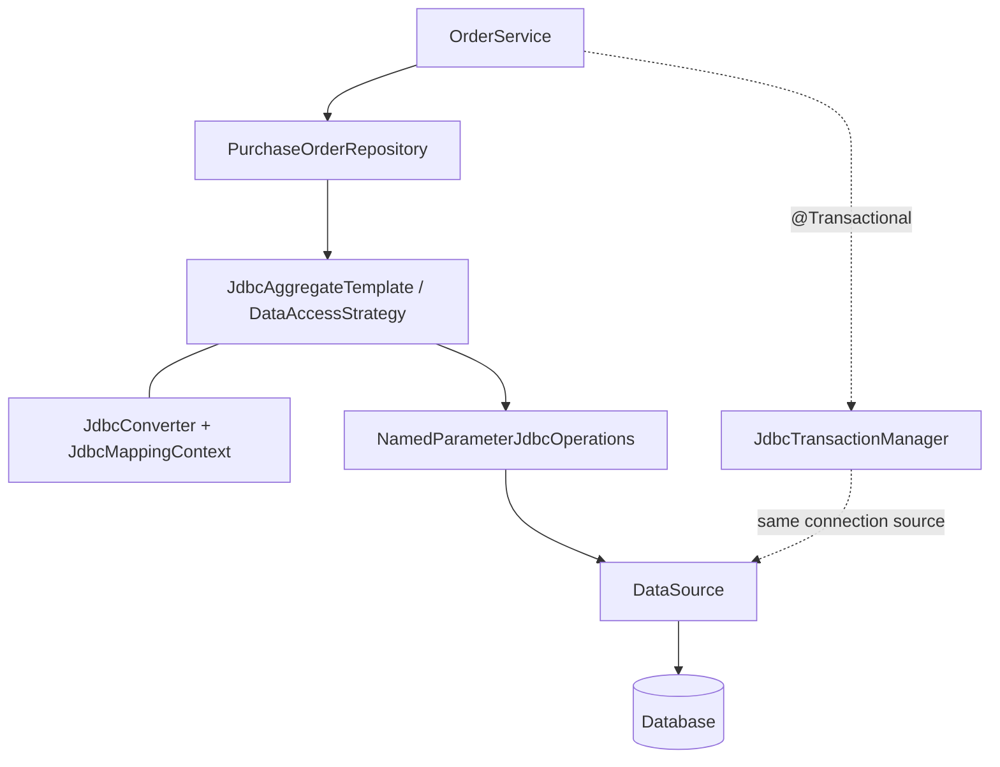
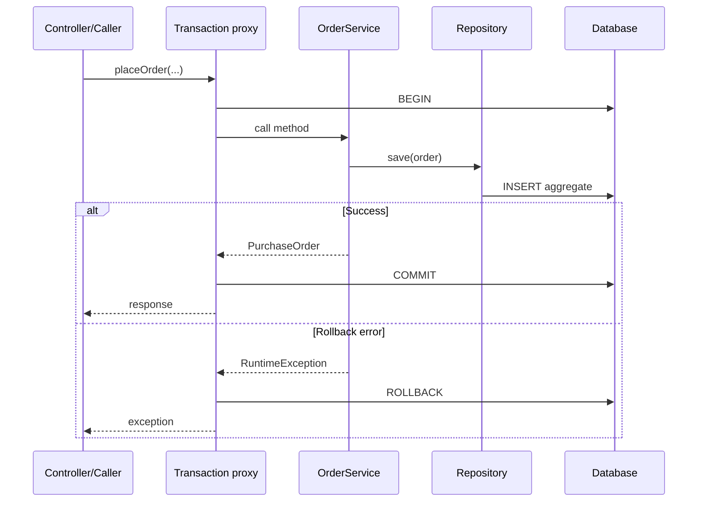

# Manual Configuration of Spring Data JDBC with `AbstractJdbcConfiguration`

Spring Data JDBC provides repositories to work with relational data in terms of **aggregates**, but a repository only works when the application has a database connection, a JDBC executor, a data mapper, and transaction management. The `AbstractJdbcConfiguration` class is the starting point for registering the Spring Data JDBC infrastructure when configuring via Java. The application extends this class, declares the remaining connection beans, and enables repository scanning.

This article moves from a bean diagram to a runnable order example with **Spring Framework, Spring Data JDBC, and H2**, and then explains how it interacts with Spring Boot, transactions, converters, and common configuration errors.

## 1. Understanding the Role of `AbstractJdbcConfiguration`

Normally, a Spring Boot application using `spring-boot-starter-data-jdbc` can run with just the dependency, a JDBC driver, and `spring.datasource.*`. Auto-configuration will provide many default beans.

Manual configuration is useful when:

- Running Spring Framework without Spring Boot auto-configuration.
- Wanting to manually choose the `DataSource`, JDBC template, transaction manager, and repository scan scope.
- Needing clear management of data infrastructure in a multi-module architecture.
- Needing to extend mapping conventions, custom converters, or handle specialized database types.
- Wanting to diagnose missing beans, duplicate beans, wrong database, or wrong transaction errors.

`AbstractJdbcConfiguration` **does not replace `DataSource`**. It provides Spring Data JDBC-related beans such as the mapping context, JDBC converter, data access strategy, and aggregate template. When using manual configuration, you must still ensure the foundational JDBC beans appear in the Spring ApplicationContext.

| Component | Responsibility | Source in Manual Configuration |
| --- | --- | --- |
| `DataSource` | Opens connections to the database. | Created by the application. |
| `NamedParameterJdbcOperations` | Runs SQL commands with named parameters. | Application creates `NamedParameterJdbcTemplate`. |
| `PlatformTransactionManager` | Starts, commits, and rolls back transactions. | Application creates `JdbcTransactionManager`. |
| `AbstractJdbcConfiguration` | Registers mapping and aggregate infrastructure components. | Spring Data JDBC configuration class. |
| `@EnableJdbcRepositories` | Scans repository interfaces and registers implementations/proxies. | Annotation on application configuration class. |
| `@EnableTransactionManagement` | Enables `@Transactional` proxies in plain Spring. | Annotation on application configuration class. |



**Important principle:** JDBC operations and the transaction manager must use the same `DataSource` for a standard JDBC transaction. If you accidentally wire the repository to datasource A while the transaction manager uses datasource B, read/write and rollback behavior can behave unexpectedly.

## 2. Setting Up the Order Scenario

We use a small part of an order management model. The aggregate root is `PurchaseOrder`, containing header information and multiple `OrderLine` items. Each line records the product ID, quantity, and price at the time of ordering. Lines exist only within the order's lifecycle; no standalone repository is created for `OrderLine`.

Source structure:

```text
src/main/java/com/example/orders/
├── config/
│   └── ManualJdbcConfiguration.java
├── domain/
│   ├── PurchaseOrder.java
│   └── OrderLine.java
├── repository/
│   └── PurchaseOrderRepository.java
└── OrderDemo.java
src/main/resources/
└── schema.sql
```

Spring Context, Spring JDBC, Spring Data JDBC, and H2 are needed on the classpath. One way to get aligned dependencies using Spring Boot's version management is:

```groovy
dependencies {
    implementation 'org.springframework.boot:spring-boot-starter-data-jdbc'
    runtimeOnly 'com.h2database:h2'
}
```

Having the starter on the classpath **does not automatically start Spring Boot auto-configuration** if the program runs via `AnnotationConfigApplicationContext` as in the example below. Compatible versions of Spring Boot, Spring Framework, Spring Data JDBC, and the driver must be used, typically via a unified BOM/platform.

### Initial Schema

Create `src/main/resources/schema.sql`:

```sql
CREATE TABLE purchase_order (
    id BIGINT GENERATED BY DEFAULT AS IDENTITY PRIMARY KEY,
    customer_id BIGINT NOT NULL,
    status VARCHAR(20) NOT NULL,
    total_amount DECIMAL(19, 2) NOT NULL
);

CREATE TABLE order_line (
    order_id BIGINT NOT NULL,
    line_no INTEGER NOT NULL,
    product_id BIGINT NOT NULL,
    quantity INTEGER NOT NULL CHECK (quantity > 0),
    unit_price DECIMAL(19, 2) NOT NULL CHECK (unit_price >= 0),
    PRIMARY KEY (order_id, line_no),
    CONSTRAINT fk_order_line_order
        FOREIGN KEY (order_id) REFERENCES purchase_order(id)
);
```

The `order_line` table uses a composite key `(order_id, line_no)`. The `order_id` column points to the aggregate root; `line_no` represents the element's position in `List<OrderLine>`. Prices use `DECIMAL` in the database and `BigDecimal` in Java to avoid binary floating-point rounding errors.

This is a minimal schema for the configuration lesson, so there are no `customer`, `product` tables, or full order rule checks yet. In a real system, add FKs, indexes, statuses, data policies, and migrations using a tool like Flyway/Liquibase. Spring Data JDBC does not automatically create full SQL tables solely from Java classes.

## 3. Mapping the Aggregate and Declaring the Repository

File `domain/OrderLine.java`:

```java
package com.example.orders.domain;

import java.math.BigDecimal;
import org.springframework.data.relational.core.mapping.Table;

@Table("order_line")
public record OrderLine(
    Long productId,
    int quantity,
    BigDecimal unitPrice
) {}
```

File `domain/PurchaseOrder.java`:

```java
package com.example.orders.domain;

import java.math.BigDecimal;
import java.util.List;
import org.springframework.data.annotation.Id;
import org.springframework.data.relational.core.mapping.MappedCollection;
import org.springframework.data.relational.core.mapping.Table;

@Table("purchase_order")
public record PurchaseOrder(
    @Id Long id,
    Long customerId,
    String status,
    BigDecimal totalAmount,
    @MappedCollection(
        idColumn = "order_id",
        keyColumn = "line_no"
    )
    List<OrderLine> lines
) {}
```

Meaning of the mapping points:

- `@Table("purchase_order")` maps the record to a table with an explicit name.
- `@Id` specifies the primary key. New orders are created with `id = null`.
- `@MappedCollection` specifies the foreign key column `order_id` and the list index column `line_no`.
- `customerId` and `productId` are scalar IDs, not JPA-style `@ManyToOne` object relationships.
- Spring Data JDBC handles child objects within the aggregate boundary; it does not provide a persistence context and dirty checking like JPA/Hibernate.

File `repository/PurchaseOrderRepository.java`:

```java
package com.example.orders.repository;

import java.util.List;
import com.example.orders.domain.PurchaseOrder;
import org.springframework.data.repository.CrudRepository;

public interface PurchaseOrderRepository
        extends CrudRepository<PurchaseOrder, Long> {

    List<PurchaseOrder> findByCustomerId(Long customerId);
}
```

Spring Data JDBC automatically creates implementations for `CrudRepository`'s `save`, `findById`, `deleteById` operations and the derived query method `findByCustomerId(...)`. Turning this interface into a Spring bean requires `@EnableJdbcRepositories`.

## 4. Complete Configuration with `AbstractJdbcConfiguration`

File `config/ManualJdbcConfiguration.java`:

```java
package com.example.orders.config;

import javax.sql.DataSource;

import com.example.orders.repository.PurchaseOrderRepository;
import org.springframework.context.annotation.Bean;
import org.springframework.context.annotation.Configuration;
import org.springframework.data.jdbc.repository.config.AbstractJdbcConfiguration;
import org.springframework.data.jdbc.repository.config.EnableJdbcRepositories;
import org.springframework.jdbc.core.namedparam.NamedParameterJdbcOperations;
import org.springframework.jdbc.core.namedparam.NamedParameterJdbcTemplate;
import org.springframework.jdbc.datasource.embedded.EmbeddedDatabaseBuilder;
import org.springframework.jdbc.datasource.embedded.EmbeddedDatabaseType;
import org.springframework.jdbc.support.JdbcTransactionManager;
import org.springframework.transaction.PlatformTransactionManager;
import org.springframework.transaction.annotation.EnableTransactionManagement;

@Configuration
@EnableJdbcRepositories(
    basePackageClasses = PurchaseOrderRepository.class
)
@EnableTransactionManagement
public class ManualJdbcConfiguration
        extends AbstractJdbcConfiguration {

    @Bean
    public DataSource dataSource() {
        return new EmbeddedDatabaseBuilder()
            .setType(EmbeddedDatabaseType.H2)
            .generateUniqueName(true)
            .addScript("schema.sql")
            .build();
    }

    @Bean
    public NamedParameterJdbcOperations namedParameterJdbcOperations(
            DataSource dataSource) {

        return new NamedParameterJdbcTemplate(dataSource);
    }

    @Bean
    public PlatformTransactionManager transactionManager(
            DataSource dataSource) {

        return new JdbcTransactionManager(dataSource);
    }
}
```

### Why Is Each Part Needed?

**`@Configuration`.** Tells Spring this is a source of bean definitions. Because the class extends `AbstractJdbcConfiguration`, Spring also processes the Data JDBC infrastructure bean declaration methods from the superclass.

**`@EnableJdbcRepositories`.** Scans the package containing `PurchaseOrderRepository` and its subpackages. Using `basePackageClasses` helps avoid package name mistakes during refactoring. If the repository interface lies outside the scan area, Spring does not create the corresponding bean.

**`dataSource()`.** `EmbeddedDatabaseBuilder` initializes in-memory H2; `generateUniqueName(true)` avoids name collisions across multiple context creations; `addScript("schema.sql")` runs DDL right when the database initializes. In-memory H2 is a choice for examples/tests; data is lost when the database closes.

**`namedParameterJdbcOperations(...)`.** Spring Data JDBC uses the `NamedParameterJdbcOperations` interface to execute SQL. The `NamedParameterJdbcTemplate` bean receives the `DataSource` injected by Spring into the method, so components share the same connection source.

**`transactionManager(...)`.** `JdbcTransactionManager` manages transactions on the same datasource. With older Spring Framework setups, `DataSourceTransactionManager` is also a common JDBC implementation.

**`@EnableTransactionManagement`.** In plain Spring, this annotation activates the interceptor/proxy for `@Transactional` on service beans. Having a transaction manager bean alone does not guarantee Spring processes transaction annotations.

**What the superclass handles.** `AbstractJdbcConfiguration` creates components such as the mapping context, JDBC converter, data access strategy, and aggregate template in the manner supported by the version in use. You do not need to write these beans manually just to complete a default configuration. When recreating an infrastructure bean, you must understand dependencies across mapping, converters, dialects, and aggregate operations to avoid mismatched configuration.

## 5. Running and Observing the Result

Create `OrderDemo.java` using the Spring context directly:

```java
package com.example.orders;

import java.math.BigDecimal;
import java.util.List;

import com.example.orders.config.ManualJdbcConfiguration;
import com.example.orders.domain.OrderLine;
import com.example.orders.domain.PurchaseOrder;
import com.example.orders.repository.PurchaseOrderRepository;
import org.springframework.context.annotation.AnnotationConfigApplicationContext;

public class OrderDemo {

    public static void main(String[] args) {
        try (var context = new AnnotationConfigApplicationContext(
                ManualJdbcConfiguration.class)) {

            var orders = context.getBean(PurchaseOrderRepository.class);

            var lines = List.of(
                new OrderLine(11L, 2, new BigDecimal("120000.00")),
                new OrderLine(12L, 1, new BigDecimal("45000.00"))
            );

            var newOrder = new PurchaseOrder(
                null,
                1L,
                "CREATED",
                new BigDecimal("285000.00"),
                lines
            );

            PurchaseOrder saved = orders.save(newOrder);
            System.out.println("Saved ID = " + saved.id());

            PurchaseOrder loaded = orders.findById(saved.id())
                .orElseThrow();
            System.out.println("Status = " + loaded.status());
            System.out.println("Line count = " + loaded.lines().size());
        }
    }
}
```

The `save(newOrder)` call passes through the repository, aggregate infrastructure, `NamedParameterJdbcOperations`, and down to `DataSource`. With a `null` ID, creating a new record inserts the `purchase_order` header, receives the database-generated ID, and writes the `order_line` rows with corresponding `order_id` and `line_no`. Then `findById(...)` reloads the aggregate including its order lines.

The expected output is a generated ID, status `CREATED`, and a line count of `2`. Do not assume the specific ID is always `1`, as it depends on database state and key generation strategy.

In the example, `totalAmount` is passed directly to illustrate saving data. In a real application, the service must verify the customer/product, retrieve trusted prices from the database, and **compute the total itself** from `quantity × unitPrice`. Do not treat client-submitted prices and totals as trustworthy data.

### Do You Need to Run Additional Initialization Scripts in Spring Boot?

In the plain Spring example, `EmbeddedDatabaseBuilder.addScript("schema.sql")` already executed the DDL. If moving to Boot and letting Boot initialize SQL automatically, choose **one owner** for schema initialization to prevent scripts from running twice and causing table-already-exists errors. In production environments, managed migrations should be used instead of ad-hoc schema creation on every application startup.

## 6. Combining `@Transactional` with Manual Configuration

Creating a repository bean is one step; transactions across multiple business operations are another step. When creating an order also requires writing other data simultaneously, all operations participating in the transaction should commit together or roll back together.

Example `OrderService.java`:

```java
package com.example.orders.service;

import com.example.orders.domain.PurchaseOrder;
import com.example.orders.repository.PurchaseOrderRepository;
import org.springframework.stereotype.Service;
import org.springframework.transaction.annotation.Transactional;

@Service
public class OrderService {

    private final PurchaseOrderRepository orders;

    public OrderService(PurchaseOrderRepository orders) {
        this.orders = orders;
    }

    @Transactional
    public PurchaseOrder placeOrder(PurchaseOrder order) {
        // Example focused on transaction boundaries.
        // Real business logic should validate and recompute totalAmount.
        return orders.save(order);
    }

    @Transactional(readOnly = true)
    public PurchaseOrder requireOrder(Long id) {
        return orders.findById(id).orElseThrow();
    }
}
```

For Spring to create the `@Service` bean in a plain configuration, you must add `@ComponentScan(basePackageClasses = OrderService.class)` to an appropriate `@Configuration` class or declare the `OrderService` bean using `@Bean`. `@EnableJdbcRepositories` only scans repositories; **it does not automatically scan all `@Service` classes**. `OrderDemo` in the previous section operated on the repository directly so it did not need this step yet.



Some limitations to keep in mind:

- By default, `@Transactional` rolls back for `RuntimeException` and `Error`; if a checked exception must trigger rollback, configure `rollbackFor` appropriately.
- Calling a `@Transactional` method from another method on the **same instance** normally bypasses the Spring proxy, so transaction advice is not triggered as expected.
- `readOnly = true` is a hint and usage contract, not a mechanism guaranteed to block all write statements at the database level.
- JDBC operations that manually open connections outside Spring's mechanism may not participate in the managed transaction.
- Transactions guarantee atomicity, but do not automatically handle all concurrent update conflicts; when modifying orders across multiple requests, consider `@Version` or an appropriate locking strategy.

## 7. Using `AbstractJdbcConfiguration` with Spring Boot

Three options must be distinguished:

| Option | How Infrastructure Is Prepared | When to Use |
| --- | --- | --- |
| Plain Spring Framework + `AbstractJdbcConfiguration` | Declare datasource, template, transaction manager, and repository scan in Java. | Need complete manual control. |
| Spring Boot auto-configuration | Boot builds infrastructure based on starter, driver, properties, and bean conditions. | Most standard applications. |
| Spring Boot + explicit configuration | Boot provides remaining default beans; application manages chosen parts manually. | Have specialized requirements while still using Boot. |

With Boot and PostgreSQL, common configuration may only need:

```yaml
spring:
  datasource:
    url: jdbc:postgresql://localhost:5432/orders
    username: orders_app
    password: ${ORDERS_DB_PASSWORD}
```

The PostgreSQL driver and Spring Data JDBC starter must be added. Secrets come from the environment/secret manager; do not commit real passwords.

**You do not automatically have to extend `AbstractJdbcConfiguration` when using Spring Boot.** If the application already has an auto-created `DataSource`, `NamedParameterJdbcTemplate`, transaction manager, and repositories, re-registering them can cause duplicate beans, overlapping scan scopes, or inconsistent configuration.

When needing to manually configure a portion in Boot, decide:

1. Is the `DataSource` bean generated by Boot from `spring.datasource.*` or defined by the application?
2. Which datasource does `NamedParameterJdbcOperations` use?
3. Which transaction manager manages the repository's connections?
4. Does `@EnableJdbcRepositories` scan overlap with repository auto-configuration?
5. Are there multiple datasources/transaction managers, and which qualifiers/identifiers do the beans need?

If declaring a `DataSource` in Java in a custom way, do not assume `spring.datasource.*` properties automatically bind to any custom bean type; there must be an appropriate binding mechanism. Before excluding auto-config, pinpoint the exact duplicated or missing bean rather than disabling configurations wholesale.

### Switching to a Real DataSource

To replace in-memory H2 with PostgreSQL, MySQL, or another relational database system, replace the `DataSource` bean implementation with a datasource/pool using the appropriate URL, credentials, and driver. The two beans below can remain unchanged and receive the Spring-injected `DataSource`:

```java
@Bean
public NamedParameterJdbcOperations namedParameterJdbcOperations(
        DataSource dataSource) {
    return new NamedParameterJdbcTemplate(dataSource);
}

@Bean
public PlatformTransactionManager transactionManager(
        DataSource dataSource) {
    return new JdbcTransactionManager(dataSource);
}
```

You must manage the connection pool, timeouts, resource closing, schema migrations, and secure connection credentials. `EmbeddedDatabaseBuilder` is a demo/test choice and should not be used as a production data store.

## 8. Extension Points of the JDBC Infrastructure

### Naming Strategy and Column Names

Spring Data JDBC has conventions for mapping Java property names to SQL column names; for example, `customerId` is typically converted to `customer_id`. You can customize the naming strategy when the schema follows a different convention.

For local differences, prefer explicit annotations such as `@Table`, `@Column`, `@MappedCollection`. A global custom naming strategy can simultaneously affect many tables, FK columns, and collection keys.

### Converters for Value Objects

Types such as `Long`, `String`, `BigDecimal` are relatively straightforward. For custom domain value types such as `Money` or `EmailAddress`, custom reading/writing converters may be needed.

`AbstractJdbcConfiguration` provides an extension point for application-registered converters, commonly via the `userConverters()` method in corresponding Spring Data JDBC versions. When creating converters, decide on the SQL column type, nullability, read/write direction, scale/rounding, and bidirectional consistency. Avoid registering multiple converters for the same purpose across different configuration sources.

### SQL Dialect

An SQL dialect represents differences between database systems, such as pagination syntax or how generated keys are retrieved. For supported databases, Spring Data JDBC typically determines the dialect from JDBC metadata via the driver.

If an unrecognized dialect error occurs, check the driver, ability to open connections, metadata, database compatibility, and selection of the right datasource before manually replacing the dialect. Do not assume the exact same DDL syntax or advanced query will work across H2, PostgreSQL, and MySQL.

### Multiple DataSources

When there are multiple datasources, using a single global configuration without distinguishing sources can cause repositories to read from the wrong database or trigger `NoUniqueBeanDefinitionException`. You must separate repository scan regions, assign names/qualifiers, and specify the corresponding JDBC operations and transaction manager according to the configuration mechanism of the version in use.

Two independent `JdbcTransactionManager` beans managing two different databases **do not automatically create an atomic distributed transaction**. If a business operation requires consistency across multiple datasources, an architecture-appropriate transaction/coordination solution must be chosen.

## 9. Identifying Common Configuration Errors

| Symptom | Possible Cause | How to Check |
| --- | --- | --- |
| `NoSuchBeanDefinitionException` for `PurchaseOrderRepository` | Repository is not inside a scanned package. | Check `@EnableJdbcRepositories` and `basePackageClasses`. |
| Missing `NamedParameterJdbcOperations` | Template not declared and no auto-config creates it. | Verify `NamedParameterJdbcTemplate` bean and datasource. |
| Missing transaction manager | `PlatformTransactionManager` not declared. | Check manager bean and that it shares the repository's datasource. |
| `@Transactional` has no effect | Transaction proxy not enabled or internal call on same instance. | Check `@EnableTransactionManagement` and call path through bean proxy. |
| `BadSqlGrammarException` when saving | Table/column name mismatch or schema not yet created. | Compare `schema.sql` with annotations and SQL logs. |
| Foreign key error on `order_line` | Invalid parent ID or wrong `order_id` mapping. | Cross-check FK, aggregate write order, and datasource. |
| `NoUniqueBeanDefinitionException` | Two or more beans of the same type without a clear selection. | List datasource/template/manager beans; use qualifiers/identifiers. |
| Unable to determine SQL dialect | Incompatible driver, JDBC metadata, or DB. | Check connection, driver, database version. |
| Data lost after stopping app | Using in-memory H2. | Switch to persistent database and proper migrations. |
| Saving aggregate emits DELETE/INSERT for child lines | Spring Data JDBC's aggregate save model may replace child collections. | Observe actual SQL; do not expect JPA dirty checking. |

In a plain Spring context, you can observe the count of infrastructure beans:

```java
System.out.println(
    context.getBeanNamesForType(DataSource.class).length
);
System.out.println(
    context.getBeanNamesForType(
        NamedParameterJdbcOperations.class
    ).length
);
System.out.println(
    context.getBeanNamesForType(
        PlatformTransactionManager.class
    ).length
);
```

When using Boot, enable SQL logging in development if needed:

```yaml
logging:
  level:
    org.springframework.jdbc.core: DEBUG
    org.springframework.data.jdbc.core: DEBUG
```

Do not enable logging of parameters containing sensitive data in production without proper controls. Observing SQL helps reveal which datasource actual statements execute against and how aggregates are persisted.

## 10. Recommended Practice Exercises

1. **Bootstrapping with plain Spring:** create an H2 schema, configure `AbstractJdbcConfiguration`, save an order with two lines, and read it back by ID.
2. **Changing scan scope:** temporarily point to a wrong repository package to observe the missing bean error; restore to the correct package.
3. **Testing mismatched mapping:** rename a column in `schema.sql` while keeping the old annotation, inspect the SQL error, then realign the schema and Java code.
4. **Enabling transactions on the service:** register `OrderService` via component scan/bean, invoke it through the context, and test rollback when a write operation fails.
5. **Observing collection updates:** change the quantity of one line, save the entire aggregate, and inspect the SQL written to `order_line`.
6. **Switching to PostgreSQL:** change the datasource and driver, run corresponding schema/migrations, and verify the repository uses the right connection.
7. **Comparing with Boot:** rebuild the connection setup using the starter and `spring.datasource.*`, and check how many beans actually need manual declaration.

Change only one factor per experiment and compare results to distinguish **bean configuration** errors, **SQL mapping** errors, and **business logic** errors.

## 11. Mental Model to Remember

```text
DataSource (connections)
    ├── NamedParameterJdbcOperations (executes SQL)
    └── JdbcTransactionManager (transactions)
               │
AbstractJdbcConfiguration (mapping and aggregate infrastructure)
               │
@EnableJdbcRepositories (creates repository beans)
               │
PurchaseOrderRepository
               │
OrderService / API
```

Manual configuration with `AbstractJdbcConfiguration` makes each responsibility in Spring Data JDBC clear: the application selects the datasource, template, and transaction manager; the superclass supplies aggregate mapping infrastructure; the repository annotation creates the data access layer. Once you understand the three connection paths **repository → JDBC operations → datasource**, **transaction → datasource**, and **aggregate → tables/child rows**, switching databases, adding converters, or diagnosing configuration errors will have a solid foundation.
