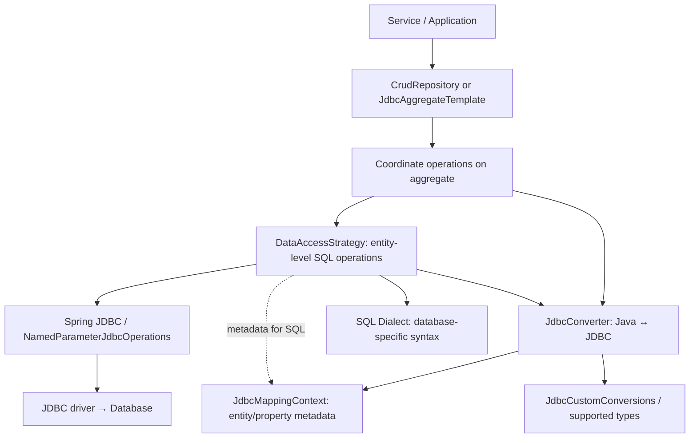
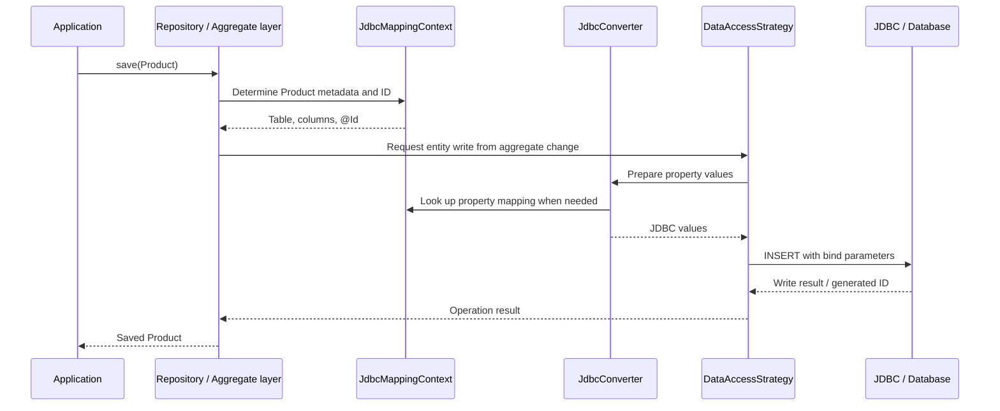
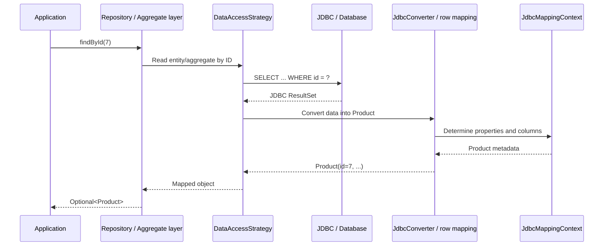

# Responsibilities of `JdbcMappingContext`, `JdbcConverter`, and `DataAccessStrategy`

In **Spring Data Relational JDBC**, a simple command like `repository.save(product)` involves several distinct tasks: determining which table/columns a Java object corresponds to, converting Java data into JDBC values, and executing SQL statements against the database. Three key components participating in this process are **`JdbcMappingContext`**, **`JdbcConverter`**, and **`DataAccessStrategy`**.

Understanding the exact boundaries between them helps explain why mapping annotations take effect, where custom converters are invoked, and why a single `save` can generate multiple SQL statements. This lesson focuses on the architecture of **Spring Data JDBC**, not Spring Data JPA or R2DBC.

## 1. Big Picture: Metadata → Conversion → Data Access

| Component | Question It Answers | Typical Inputs | Outputs / Effects |
|---|---|---|---|
| **`JdbcMappingContext`** | "How is this class/property mapped to the relational model?" | Java domain classes, annotations, `NamingStrategy`, simple type configuration | Metadata about entities, properties, tables, columns, IDs, and relationships within an aggregate |
| **`JdbcConverter`** | "How are Java values converted into JDBC data and read back?" | Mapping metadata, object values, JDBC results, custom conversions | Values bindable to JDBC and objects/properties constructed from read results |
| **`DataAccessStrategy`** | "Which SQL operations read/write an entity?" | Entity type, ID, values to write, converter, dialect, and JDBC operations | Executes `SELECT`, `INSERT`, `UPDATE`, `DELETE`, and entity-level data operations |

Conceptual flow diagram:



This is a **responsibility diagram**, not a mandatory 1:1 call graph for every version or every query. Individual Spring Data JDBC branches may change implementation details and read optimizations, but these three architectural boundaries remain essential to grasp.

Above these three components sit **repositories**, `JdbcAggregateTemplate`, and classes coordinating aggregate changes. Below them sit **Spring JDBC** (`JdbcOperations`/`NamedParameterJdbcOperations`), `DataSource`, the JDBC driver, and the database. `Dialect`, `NamingStrategy`, and custom conversions are collaborating components, not replacements for the roles of the three main components.

## 2. `JdbcMappingContext`: Knowing *Where Data Belongs*

`org.springframework.data.jdbc.core.mapping.JdbcMappingContext` is the JDBC `MappingContext` implementation, extending `RelationalMappingContext`. It provides and manages metadata for Spring Data JDBC entities. When encountering a domain class, the framework needs to know:

- Which table does the entity map to? Is the name specified by `@Table` or derived via a naming convention?
- Which property is the primary key (`@Id`), and which properties are regular columns (`@Column`)?
- Is a property a simple value, an embedded object, a collection belonging to the same aggregate, or a reference to be handled according to aggregate rules?
- For mapped relationships, what is the back-reference column name or collection key column?
- Which details are supplied by annotations, `NamingStrategy`, and the simple type set (`SimpleTypeHolder`)?

Example of a basic entity:

```java
package com.example.inventory;

import org.springframework.data.annotation.Id;
import org.springframework.data.relational.core.mapping.Column;
import org.springframework.data.relational.core.mapping.Table;

@Table("inventory_products")
public class Product {

    @Id
    private Long id;

    @Column("display_name")
    private String name;

    @Column("unit_price_cents")
    private int priceCents;

    public Product() {}

    public Product(String name, int priceCents) {
        this.name = name;
        this.priceCents = priceCents;
    }

    public Long getId() { return id; }
    public void setId(Long id) { this.id = id; }
    public String getName() { return name; }
    public void setName(String name) { this.name = name; }
    public int getPriceCents() { return priceCents; }
    public void setPriceCents(int priceCents) { this.priceCents = priceCents; }
}
```

Expected metadata for the class above:

| Java | Relational Metadata |
|---|---|
| `Product` | Table `inventory_products` |
| `id` | Primary key property, column `id` |
| `name` | Column `display_name` |
| `priceCents` | Column `unit_price_cents` |

This is a **mapping description**; `JdbcMappingContext` does not issue `CREATE TABLE`, does not execute `INSERT`, and does not directly check whether the database already has all required columns. If an annotation declares `display_name` while the actual table only has `name`, the SQL error only surfaces when querying/writing the relevant data.

### Where Is Metadata Used?

`JdbcMappingContext` supports creating `RelationalPersistentEntity<?>` and `RelationalPersistentProperty` for other components to look up. Example of reading metadata for `Product` in a configured Spring Data JDBC application:

```java
import org.springframework.data.jdbc.core.mapping.JdbcMappingContext;
import org.springframework.data.relational.core.mapping.RelationalPersistentEntity;
import org.springframework.data.relational.core.mapping.RelationalPersistentProperty;

RelationalPersistentEntity<?> entity =
        mappingContext.getRequiredPersistentEntity(Product.class);

RelationalPersistentProperty property =
        entity.getRequiredPersistentProperty("name");

System.out.println(entity.getTableName());    // inventory_products
System.out.println(property.getColumnName()); // display_name
```

Here `mappingContext` is a `JdbcMappingContext` bean injected into the code (for instance, via constructor injection). The printed values represent `SqlIdentifier` objects; their representation can be affected by quoting/naming configuration. The benefit of reading metadata is seeing the names **Spring Data understands**, then comparing them against the actual schema.

### Changes That Commonly Affect MappingContext

- `@Table`, `@Column`, `@Id`, `@MappedCollection`, `@Embedded`, and how the aggregate is organized.
- A custom `NamingStrategy`, such as changing the rule for converting property names to column names.
- Custom conversions configuration and types treated as **simple values** instead of objects requiring further mapping.

**Important limitation:** MappingContext knows the *shape of the mapping*. It does not manage JPA persistence context entity state, does not track dirty checking, does not generate SQL, and does not replace database schema migrations.

## 3. `JdbcConverter`: Knowing *How Values Flow Through JDBC*

`org.springframework.data.jdbc.core.convert.JdbcConverter` is the abstraction that converts between domain objects/values and the relational data representation used in JDBC. The familiar implementation is `MappingJdbcConverter`.

When **writing**, the converter coordinates with metadata to prepare property values for JDBC: for example, taking `Product.name`, recognizing the corresponding column is `display_name`, and converting the Java value into a type bindable to a statement. When **reading**, it coordinates with metadata and row-mapping components to build the entity/property from JDBC results. For aggregates with child entities, building relationships also involves `RelationResolver` and reading strategies; the converter itself does not act as a standalone SQL executor.

Example with a data row:

```text
id = 7
display_name = 'Mechanical Keyboard'
unit_price_cents = 159000
```

The mapping/conversion layer produces an equivalent `Product`:

```java
Product p = /* result read by Spring Data JDBC from the DB */;
// p.getId()         == 7L
// p.getName()       == "Mechanical Keyboard"
// p.getPriceCents() == 159000
```

It is not the converter that runs a `SELECT` query to fetch this row: `DataAccessStrategy` and JDBC components handle access, while the converter handles **interpreting and transforming data**.

### Default Conversions and Custom Conversions

Common types such as `String`, numbers, several date/time types, enums, and types supported by the JDBC dialect have built-in conversion mechanisms. When the domain uses its own **value object**, you can register a pair of writing/reading converters. For example, `ProductCode` stored in a `VARCHAR` column:

```java
public record ProductCode(String value) {}
```

```java
import org.springframework.core.convert.converter.Converter;
import org.springframework.data.convert.ReadingConverter;
import org.springframework.data.convert.WritingConverter;

@WritingConverter
public final class ProductCodeToString
        implements Converter<ProductCode, String> {
    @Override
    public String convert(ProductCode source) {
        return source.value();
    }
}

@ReadingConverter
public final class StringToProductCode
        implements Converter<String, ProductCode> {
    @Override
    public ProductCode convert(String source) {
        return new ProductCode(source);
    }
}
```

For Spring Data JDBC to use these two classes, they must be **registered** with `JdbcCustomConversions` through the configuration mechanism matching the project version (for example, `userConverters()` in a configuration extending `AbstractJdbcConfiguration`). Merely creating the converter class files does not guarantee they are loaded. The `@ReadingConverter` and `@WritingConverter` annotations specify conversion direction, avoiding ambiguity between Java types and store types.

For complex or vendor-specific types, additional support from the dialect and JDBC types may be required rather than just a `Converter<X, String>`. Do not assume a converter will automatically alter table structures or change how SQL is generated.

### Distinguishing Mapping from Conversion

Suppose you change `@Column("display_name")` to `@Column("product_label")` while keeping `String name`:

- `JdbcMappingContext` sees the new **column address**.
- `JdbcConverter` can still convert the `String` value normally.
- `DataAccessStrategy` uses metadata/SQL components to access `product_label`.
- If the database does not have the `product_label` column yet, queries will fail even though the converter works fine.

Conversely, if you keep the column unchanged but replace `String name` with the value object `ProductCode` without registering an appropriate converter, the issue lies in **type conversion**, not the column name.

## 4. `DataAccessStrategy`: Knowing *Which Data Operation to Execute*

`org.springframework.data.jdbc.core.convert.DataAccessStrategy` is the data access abstraction at the **single-entity level**, with methods typically implementable by a single SQL statement. It differs from `JdbcAggregateOperations`/`JdbcAggregateTemplate`, which perform operations on **complete aggregates**.

Key responsibilities of `DataAccessStrategy` include:

- Inserting an entity record (`INSERT`), handling generated keys when applicable.
- Updating an entity (`UPDATE`), including variants involving versions/optimistic locking.
- Deleting, finding by ID, checking existence, counting, or performing necessary entity-level query operations.
- Combining mapping metadata, conversions, SQL generation/dialect, and `NamedParameterJdbcOperations` to actually interact with the database.

According to the Spring Data JDBC API, the default implementation `DefaultDataAccessStrategy` **creates SQL based on entity metadata**. In some branches, `DataAccessStrategyFactory` may configure a strategy supporting *single-query loading* with a fallback to the default strategy. Therefore, you should not assume the entire aggregate loading process always uses a single SQL query or always uses a single implementation class.

Illustrative SQL from the `Product` entity:

```sql
-- Logical example of INSERTing a new Product
INSERT INTO inventory_products (display_name, unit_price_cents)
VALUES ('Mechanical Keyboard', 159000);

-- Logical example of querying a Product by ID
SELECT id, display_name, unit_price_cents
FROM inventory_products
WHERE id = 7;
```

This is **illustrative SQL**, not an exact snapshot of the SQL every version of Spring Data JDBC will log. Actual SQL normally uses **bind parameters**, quoting/returning generated IDs depends on the dialect, and an aggregate with relationships may require multiple statements.

### Boundary Between `DataAccessStrategy` and `JdbcTemplate`

`JdbcTemplate`/`NamedParameterJdbcOperations` is the **JDBC execution** infrastructure: preparing SQL, binding parameters, running statements, and processing `ResultSet`s. `DataAccessStrategy` sits at a higher layer, knowing **which entity operation** is requested and how to use metadata, converters, and dialects to construct/execute that operation.

Thus:

```text
DataAccessStrategy : entity operations + corresponding SQL
JdbcConverter      : converts Java objects/values ↔ JDBC
JdbcMappingContext : entity/property mapping metadata
JdbcTemplate       : executes prepared JDBC statements
JDBC driver        : communicates with database server
```

`DataAccessStrategy` also does not decide business transaction boundaries on its own. Transactions are coordinated by the repository/template/service layer alongside Spring transaction management. Placing `@Transactional` on a multi-operation use case is a responsibility at the appropriate layer; do not confuse a strategy object with a transaction manager.

## 5. Tracing `save()` and `findById()` End to End

Repository definition:

```java
package com.example.inventory;

import org.springframework.data.repository.CrudRepository;

public interface ProductRepository extends CrudRepository<Product, Long> {}
```

When calling:

```java
Product saved = repository.save(new Product("Mechanical Keyboard", 159000));
Product loaded = repository.findById(saved.getId()).orElseThrow();
```

### Write Flow: `repository.save(new Product(...))`



Explanation: the repository/aggregate layer determines whether the entity is new or existing according to new-entity detection rules (`@Id`, possibly also `@Version`/`Persistable`), prepares the changes to perform, and uses `DataAccessStrategy` for each entity-level operation. `JdbcConverter` participates in value processing/reading-writing; `JdbcMappingContext` provides metadata. If the primary key is database-generated, the save result supplies the ID for the returned object.

**Very common pitfall:** For an aggregate with a list of child entities, `save()` operates on the **aggregate**. Under the Spring Data JDBC model, when updating an existing aggregate, child entities may be deleted and re-inserted to synchronize state; `DataAccessStrategy.update(...)` by itself only updates **one entity** and does not automatically manage all child relationships. That is why an aggregate coordination layer sits above the strategy.

### Read Flow: `repository.findById(id)`



For aggregates with collections, the result may be assembled through multiple SELECT statements or an appropriate optimization strategy. Row mappers and relation resolvers collaborate with the converter to complete the result. That is why the diagram emphasizes **separation of responsibilities** rather than locking into a single internal call path.

## 6. Connecting the Java Model to a Real Database

For `Product` above, a suitable PostgreSQL table can be created via migration:

```sql
CREATE TABLE inventory_products (
    id BIGINT GENERATED BY DEFAULT AS IDENTITY PRIMARY KEY,
    display_name VARCHAR(200) NOT NULL,
    unit_price_cents INTEGER NOT NULL
);
```

The database must actually have the matching table/columns; `JdbcMappingContext` only holds metadata and does not create schemas for you. An example `DataSource` configuration:

```yaml
spring:
  datasource:
    url: jdbc:postgresql://localhost:5432/inventory
    username: inventory_app
    password: ${DB_PASSWORD}
```

In a project with `spring-boot-starter-data-jdbc`, the PostgreSQL driver, and valid datasource settings, Spring Boot/Spring Data usually registers the necessary components automatically. Business code should start from `ProductRepository` or `JdbcAggregateTemplate`, without manually constructing `JdbcMappingContext`, `JdbcConverter`, or `DataAccessStrategy` for typical cases.

To observe actual SQL in a development environment, you can enable appropriate logging, for example:

```yaml
logging:
  level:
    org.springframework.jdbc.core: DEBUG
```

When reading logs, distinguish between the **executed SQL statement** (related to `DataAccessStrategy` and JDBC operations), **column/table names** (mapping metadata), and **values or type-casting errors** (converter/JDBC driver). Avoid enabling detailed bind-value logging in production because it can expose sensitive data.

## 7. When Should Each Component Be Customized?

| Need | Component to Consider First | Why? |
|---|---|---|
| Rename a table/column for one entity | `@Table`, `@Column`, and metadata from `JdbcMappingContext` | Changes mapping description without replacing the SQL engine |
| Change table/column naming rules for all entities | `NamingStrategy` | Applies consistent naming conventions at the mapping layer |
| Persist `ProductCode`, `Money`, or value objects in a single column | `JdbcCustomConversions`, `@ReadingConverter`, `@WritingConverter` | Handles Java type ↔ storage type conversion |
| Write a specialized query for one repository | `@Query`, repository extension, or `JdbcTemplate` where appropriate | Avoids replacing the default access strategy application-wide |
| Change foundational data access behavior across many entities | Consider a specialized `DataAccessStrategy` | Low-level SQL extension point requiring deep understanding of aggregates/dialects |
| Update multiple entities in one business transaction | Service + Spring transaction management | Transactions are not the role of metadata/converter/strategy individually |
| Migrate from PostgreSQL to MySQL | Driver, `DataSource`, dialect, migrations/schema | Vendor differences cannot be solved merely by changing `JdbcConverter` |

In Spring Data JDBC configuration, `AbstractJdbcConfiguration` provides bean creation hooks such as `jdbcMappingContext(...)`, `jdbcConverter(...)`, `dataAccessStrategyBean(...)`, and `jdbcAggregateTemplate(...)`. They show the dependency chain: **the converter takes the mapping context**; **the data access strategy takes the converter and JDBC operations/dialect**; **the aggregate template uses metadata, converter, and strategy**. Exact names/signatures may change across Spring Data branches; when customizing infrastructure, always consult the Javadoc for the version in use.

For example, renaming a column should start with annotations:

```java
@Column("display_name")
private String name;
```

For complex statistical queries, place the query in `@Query` or a separate dedicated JDBC class rather than overriding `DataAccessStrategy` for all repositories. Customizing the strategy at a low level can affect `save`, `delete`, aggregate loading, and generated key or optimistic locking mechanisms.

## 8. Common Architectural Misconceptions

### "MappingContext creates tables because it knows table names"

False. Mapping annotations provide **in-application metadata**. Creating/modifying schemas is the job of migrations (`Flyway`, `Liquibase`, controlled SQL scripts, or separately configured database initialization mechanisms). Correct mapping with a mismatched schema still fails.

### "Converter sends SQL and queries child entities itself"

Do not think of it that way. The converter is responsible for reading/writing **values and objects**. When an aggregate has relationships, row mappers, resolvers, and data access components collaborate to retrieve data; statement execution belongs to the data access layer.

### "DataAccessStrategy.save saves the entire aggregate tree"

`DataAccessStrategy` provides **entity-level** operations; `JdbcAggregateOperations`/`JdbcAggregateTemplate` at the layer above manages the **aggregate** lifecycle. This explains why a single `repository.save(root)` call can correspond to multiple statements for the root and child components.

### "Spring Data JDBC is like JPA, with a persistence context and automatic dirty checking"

Spring Data JDBC does not use a JPA EntityManager and does not maintain Hibernate-style dirty checking. Calling `save()` expresses intent to persist aggregate state. The aggregate layer itself must plan the appropriate inserts/updates/deletes; do not rely on an assumption that every property mutation is tracked automatically.

### "Having a JDBC driver means DataAccessStrategy works on every database"

The driver allows opening connections, but Spring Data JDBC also needs a **matching dialect** to generate SQL and handle database differences. If a database is not directly supported, evaluate a custom dialect or another access mechanism; changing converters alone is not enough.

### "An SQL error is always caused by the converter"

If the error reports a missing column or table, inspect mapping metadata and schema. If the error involves `cannot convert`, `type mismatch`, or custom values failing to read/write, check conversions and JDBC types. If the SQL syntax or bind parameters are wrong, inspect strategy/dialect and JDBC logs.

## 9. Quick Troubleshooting Table

| Scenario | Symptom | First Place to Check |
|---|---|---|
| Java field `name` reads from wrong column | Missing/wrong column data or SQL reports unknown column | `@Column`, `NamingStrategy`, `JdbcMappingContext` |
| `ProductCode` cannot be stored in `VARCHAR` | Type conversion exception | `JdbcConverter`, `JdbcCustomConversions`, JDBC type |
| `save(new Product(...))` does not return expected ID | Wrong generated key/ID | `@Id`, schema identity/sequence, strategy/dialect |
| `save()` issues multiple INSERTs/DELETEs | Aggregate has child entity collections | Aggregate layer and `DataAccessStrategy` operations |
| Repository works on H2 but fails on PostgreSQL | SQL dialect/schema/data type differences | Driver, dialect, migrations, and actual SQL |
| Need specialized statistical queries | Poor fit for default CRUD | Repository query or `JdbcTemplate` |
| Reading `null` into a non-null property fails | Nullability/type mismatch | DB result, constructor/mapping, and converter |

A helpful mnemonic is to ask three questions in order:

1. **Is the data address right?** (`JdbcMappingContext` and schema.)
2. **Are the values converted right?** (`JdbcConverter` and custom conversions.)
3. **Is the data operation right?** (`DataAccessStrategy`, dialect, JDBC operations, and aggregate orchestration.)

Once you can answer those three questions, reading Spring Data JDBC stack traces becomes systematic. You also know which parts can be customized via domain annotations and which parts are infrastructure that should only be replaced with clear evidence.

## Official References

- [Spring Data JDBC — Mapping](https://docs.spring.io/spring-data/relational/reference/jdbc/mapping.html): mapping conventions, aggregates, and referenced entities.
- [Spring Data JDBC — `JdbcMappingContext` API](https://docs.spring.io/spring-data/jdbc/docs/current/api/org/springframework/data/jdbc/core/mapping/JdbcMappingContext.html): JDBC metadata implementation.
- [Spring Data JDBC — `JdbcConverter` API](https://docs.spring.io/spring-data/jdbc/docs/current/api/org/springframework/data/jdbc/core/convert/JdbcConverter.html): Java ↔ relational/JDBC value conversion.
- [Spring Data JDBC — `DataAccessStrategy` API](https://docs.spring.io/spring-data/jdbc/docs/current/api/org/springframework/data/jdbc/core/convert/DataAccessStrategy.html): entity-level data access operations.
- [Spring Data JDBC — `DefaultDataAccessStrategy` API](https://docs.spring.io/spring-data/relational/reference/api/java/org/springframework/data/jdbc/core/convert/DefaultDataAccessStrategy.html): SQL generated from metadata.
- [Spring Data JDBC — `AbstractJdbcConfiguration` API](https://docs.spring.io/spring-data/relational/reference/api/java/org/springframework/data/jdbc/repository/config/AbstractJdbcConfiguration.html): registering mapping, conversion, strategy, and aggregate template beans.
- [Spring Data JDBC — `JdbcConfiguration` API](https://docs.spring.io/spring-data/relational/reference/api/java/org/springframework/data/jdbc/repository/config/JdbcConfiguration.html): dependency relationships when creating mapping context, converter, and data access strategy.
