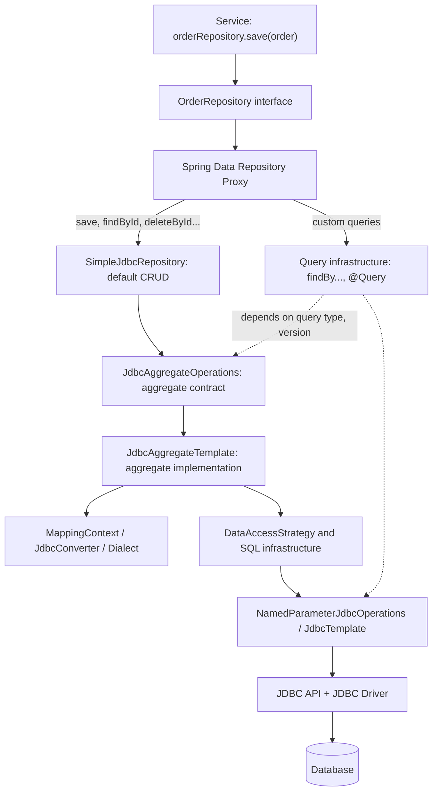
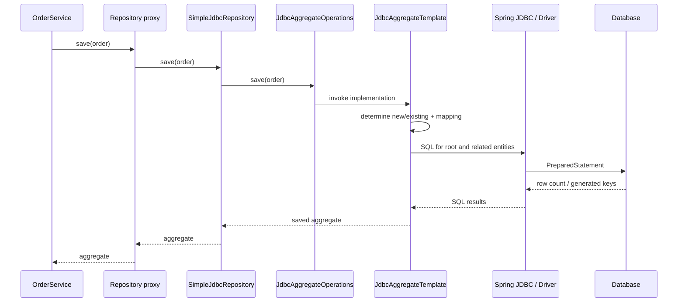

# Relationship Between SimpleJdbcRepository, JdbcAggregateOperations, and JDBC

When writing applications with **Spring Data Relational JDBC**, we often just declare an interface such as `OrderRepository extends CrudRepository<Order, Long>` and call `save()`, `findById()`, or `deleteById()`. Those methods still translate into real SQL statements on a relational database. Between the Java call and SQL, several layers collaborate, with **`SimpleJdbcRepository`**, **`JdbcAggregateOperations`**, and **JDBC** each handling distinct responsibilities.

Three concepts to distinguish from the start:

- **`SimpleJdbcRepository`:** the class providing the default implementation for many CRUD methods of a Spring Data JDBC repository.
- **`JdbcAggregateOperations`:** the interface describing operations to *save, read, and delete an aggregate*; `JdbcAggregateTemplate` is the common implementation of this interface.
- **JDBC:** the Java API for working with databases via drivers, connections, prepared statements, and result sets. Spring JDBC, such as `JdbcTemplate` and `NamedParameterJdbcTemplate`, assists with executing SQL on top of JDBC.

Thus, for default CRUD operations, you can picture the path:

`Repository interface → Repository proxy → SimpleJdbcRepository → JdbcAggregateOperations → JdbcAggregateTemplate → Spring JDBC → JDBC Driver → Database`.

This is the **typical** path, not a rule for all repository methods. Derived queries (`findBy...`) and SQL written via `@Query` have their own execution mechanisms.

## 1. Overall Architecture Diagram



The diagram helps identify responsibilities, but does not guarantee that every version of Spring Data JDBC uses the exact internal classes or call order shown.

| Layer | Component | Main Responsibility | Typical Inputs |
|---|---|---|---|
| Application | Service, repository interface | Expresses business requests | Objects, IDs, filter criteria |
| Repository | Proxy, `SimpleJdbcRepository` | Handles default CRUD calls | `save`, `findById`, `deleteById` |
| Aggregate | `JdbcAggregateOperations` | Defines operations on the entire aggregate | Aggregate root, domain type |
| Aggregate implementation | `JdbcAggregateTemplate` | Coordinates mapping, determines write/read actions | Metadata, converters, aggregate |
| Relational access | `DataAccessStrategy` and SQL infrastructure | Performs entity/table-level operations | Tables, columns, IDs, conditions |
| Spring JDBC | `JdbcTemplate`, `NamedParameterJdbcOperations` | Executes SQL, binds parameters, reads results, manages resources | SQL, parameters, `RowMapper` |
| JDBC | `Connection`, `PreparedStatement`, driver | Sends requests to the database system | SQL commands and values |

A common point of confusion: **`JdbcAggregateOperations` is not `JdbcOperations`**. Both contain "Jdbc" and "Operations", but `JdbcAggregateOperations` belongs to Spring Data JDBC, whereas `JdbcOperations` belongs to Spring JDBC at a layer closer to SQL.

## 2. SimpleJdbcRepository at the Repository Layer

Full class name:

`org.springframework.data.jdbc.repository.support.SimpleJdbcRepository`

In Spring Data JDBC, you can declare:

```java
import org.springframework.data.repository.CrudRepository;

public interface OrderRepository extends CrudRepository<PurchaseOrder, Long> {
}
```

You do not need to write the method bodies for:

```java
PurchaseOrder persisted = orderRepository.save(order);
Optional<PurchaseOrder> found = orderRepository.findById(10L);
boolean exists = orderRepository.existsById(10L);
long total = orderRepository.count();
orderRepository.deleteById(10L);
```

Spring Data creates the repository bean via a **repository factory** and a **proxy**. Default CRUD methods are backed by a base repository class, typically `SimpleJdbcRepository`.

### 2.1. Delegating Rather Than Hand-Writing SQL per Entity

Look at the following pseudocode. This is a **simplified simulation**, not a copy of Spring's source code:

```java
// PSEUDOCODE: illustrates delegation direction only
class SimpleJdbcRepository<T, ID> {

    private final JdbcAggregateOperations operations;
    private final Class<T> domainType;

    public <S extends T> S save(S aggregate) {
        return operations.save(aggregate);
    }

    public Optional<T> findById(ID id) {
        return Optional.ofNullable(
            operations.findById(id, domainType)
        );
    }

    public void deleteById(ID id) {
        operations.deleteById(id, domainType);
    }
}
```

Accordingly:

1. `SimpleJdbcRepository` knows the **domain type** the repository manages.
2. It forwards standard CRUD operations to `JdbcAggregateOperations`.
3. It returns the exact repository contract types: for example, `Optional<T>` for `findById`.
4. It is not the place where developers normally customize SQL per table.

The real implementation uses metadata such as `PersistentEntity` as well as converters, query-by-example, paging/sorting, and transactions. The pseudocode above only highlights the core relationship.

### 2.2. Repository Proxy Differs from SimpleJdbcRepository

Suppose you extend the interface:

```java
import java.util.List;
import org.springframework.data.repository.CrudRepository;

public interface OrderRepository extends CrudRepository<PurchaseOrder, Long> {

    List<PurchaseOrder> findByStatus(String status);
}
```

`findByStatus` is a **derived query method**, parsed by Spring Data from the method name. It does not magically exist as a built-in method on `SimpleJdbcRepository`. The repository proxy distinguishes CRUD calls, query methods, and custom fragments, routing each to the appropriate handler.

Therefore, the statement **"all repository methods call SimpleJdbcRepository"** is false. Only a subset of methods, notably default CRUD, goes through this class in the manner shown above.

## 3. JdbcAggregateOperations: Contract for Aggregate Operations

Full name:

`org.springframework.data.jdbc.core.JdbcAggregateOperations`

Representative capabilities of the interface include:

```java
// Representative signatures simplified:
<T> T save(T aggregate);
<T> T insert(T aggregate);
<T> T update(T aggregate);
<T> T findById(Object id, Class<T> domainType);
<T> void deleteById(Object id, Class<T> domainType);
long count(Class<?> domainType);
```

Depending on the version, the interface also provides methods for multiple aggregates, sorting, criteria queries, and existence checks.

The core difference compared to `JdbcTemplate` is that this interface operates on **domain objects**. You pass an aggregate, not SQL strings like `"INSERT INTO..."`.

### 3.1. What Is an Aggregate?

Consider an order:

```text
PurchaseOrder (aggregate root)
    id = 42
    customerId = 7
    items:
      OrderItem(productId=101, quantity=2)
      OrderItem(productId=102, quantity=1)
```

The data can be stored in two tables:

```sql
CREATE TABLE purchase_orders (
    id BIGINT PRIMARY KEY,
    customer_id BIGINT NOT NULL
);

CREATE TABLE order_items (
    order_id BIGINT NOT NULL REFERENCES purchase_orders(id),
    product_id BIGINT NOT NULL,
    quantity INTEGER NOT NULL CHECK (quantity > 0),
    PRIMARY KEY (order_id, product_id)
);
```

In Java, `PurchaseOrder` is the **aggregate root** if you model the order as the object responsible for its `OrderItem` lines. Then `save(order)` may require writing multiple rows across the related tables.

Important point: *aggregate boundaries are defined by domain mapping*; merely having a foreign key does not cause Spring Data JDBC to manage all related objects inside the same aggregate. One aggregate can reference the ID of another aggregate without managing the other aggregate's lifecycle.

### 3.2. The save, insert, and update Methods

| Method | Meaning |
|---|---|
| `save(entity)` | Spring Data JDBC determines whether the entity is new or existing to pick the corresponding save path |
| `insert(entity)` | Explicitly inserts the aggregate, bypassing `save`'s new/existing detection step |
| `update(entity)` | Explicitly updates the aggregate, bypassing `save`'s new/existing detection step |
| `findById(id, Type.class)` | Loads an aggregate by ID and domain class |
| `deleteById(id, Type.class)` | Deletes an aggregate by ID and domain class |

`save` **is not synonymous** with an atomic database SQL `UPSERT` statement. The notion of "new" may rely on `@Id`, `@Version`, or implementing `Persistable`, depending on the model and version. With database-generated IDs, a common case is `id == null` indicating a new entity.

If the application assigns IDs to new entities itself, `save` might consider the object existing depending on the newness strategy; `insert` expresses the insert intent more clearly.

### 3.3. Why Must You Use the Return Value?

```java
PurchaseOrder before = new PurchaseOrder(null, "An", "NEW");
PurchaseOrder after = operations.save(before);

Long assignedId = after.id();
```

When the domain is an immutable record, Spring Data JDBC can create a returned object containing the database-generated ID. Therefore, always keep the **returned result of `save`/`insert`** instead of assuming the original object was mutated in place.

## 4. JdbcAggregateTemplate as the Implementation of the Aggregate Contract

Full name:

`org.springframework.data.jdbc.core.JdbcAggregateTemplate`

Interface/implementation relationship:

```java
public class JdbcAggregateTemplate implements JdbcAggregateOperations {
    // The real implementation includes many details of aggregate mapping and persistence.
}
```

Applications may inject `JdbcAggregateOperations`; in standard configurations, Spring provides an implementation based on `JdbcAggregateTemplate`.

`JdbcAggregateTemplate` coordinates components such as:

- **Mapping context:** understands which table/columns a domain class maps to, where the ID is, and which parts are entities belonging to the aggregate.
- **`JdbcConverter`:** converts Java data types to storage values and builds objects from results.
- **`DataAccessStrategy`:** lower-level relational data operations, typically per entity.
- **Dialect:** adapts SQL statements/database capabilities to the database management system.
- **Lifecycle callbacks and events:** provides hooks before/after converting, saving, or loading aggregates.

`JdbcAggregateTemplate` differs from `JdbcTemplate` even though both share the "Template" suffix: one understands **aggregates + mapping**, while the other understands **SQL + JDBC**.

### 4.1. A Single save Can Generate Multiple SQL Statements

For a new aggregate:

```text
operations.save(newOrder)
    → recognize new Order
    → INSERT Order row into root table
    → receive database-generated ID (if any)
    → INSERT child entities belonging to the aggregate
    → return saved aggregate
```

For an existing aggregate:

```text
operations.save(existingOrder)
    → recognize existing Order
    → translate aggregate state into write actions
    → update Order and synchronize child entities
    → return saved aggregate
```

In the standard Spring Data JDBC model, when saving an existing aggregate that contains child entities, **child rows may be deleted and reinserted**, even if only a small portion of them changed. The reason is that Spring Data JDBC does not maintain a persistence context to keep a full snapshot and track dirty fields like JPA/Hibernate.

Therefore, when you see SQL logs with multiple `DELETE`/`INSERT` statements for a single `repository.save(order)` call, do not immediately conclude the code is calling save multiple times. Inspect the aggregate mapping and how Spring Data JDBC synchronizes child components.

### 4.2. JdbcAggregateTemplate Is Not a JDBC Driver

`JdbcAggregateTemplate` does not open sockets to PostgreSQL/MySQL on its own. It relies on lower Spring Data JDBC layers, Spring JDBC, and the JDBC driver configured via `DataSource`.

One way to layer it:

```text
JdbcAggregateTemplate
    aggregate root + conversion + lifecycle
             ↓
DataAccessStrategy / SQL infrastructure
    operations against tables and entities
             ↓
NamedParameterJdbcOperations / JdbcTemplate
    SQL + bind parameters + ResultSet
             ↓
JDBC Connection / PreparedStatement / Driver
             ↓
Relational Database
```

## 5. JDBC: Where Real SQL Is Executed

JDBC is the built-in Java ecosystem API for programs to interact with relational databases:

- `DataSource` supplies connections (typically via a connection pool).
- `Connection` represents a connection session.
- `PreparedStatement` uses parameterized SQL, avoiding concatenating user input into SQL strings.
- `ResultSet` holds queried rows.
- The JDBC driver translates Java calls into the database protocol.

Plain JDBC example:

```java
String sql = """
    SELECT id, customer_name, status
    FROM purchase_orders
    WHERE id = ?
    """;

try (Connection connection = dataSource.getConnection();
     PreparedStatement statement = connection.prepareStatement(sql)) {

    statement.setLong(1, 42L);

    try (ResultSet result = statement.executeQuery()) {
        if (result.next()) {
            long id = result.getLong("id");
            String customerName = result.getString("customer_name");
            String status = result.getString("status");
            // The developer constructs the Java object manually.
        }
    }
}
```

When using Spring JDBC, we typically write much less code:

```java
List<String> names = namedParameterJdbcTemplate.query(
    """
    SELECT customer_name
    FROM purchase_orders
    WHERE status = :status
    ORDER BY id
    """,
    Map.of("status", "NEW"),
    (rs, index) -> rs.getString("customer_name")
);
```

`NamedParameterJdbcTemplate` performs parameter binding and manages JDBC resources. However, it **does not automatically know** which child entities `PurchaseOrder` has or which actions saving an aggregate requires. That work belongs to the aggregate layer.

### 5.1. Role of DataAccessStrategy

In Spring Data JDBC, `DataAccessStrategy` is an abstraction for data operations typically involving **one entity** and its corresponding SQL statement. It sits below `JdbcAggregateOperations`, which understands operations across the **entire aggregate**.

Example of saving an Order with two OrderItems:

```text
"Save aggregate Order"
    JdbcAggregateTemplate
        → decides to write root and 2 items
    DataAccessStrategy
        → performs data operations against each related table
    Spring JDBC
        → executes SQL and maps results
    JDBC Driver
        → sends commands to the database
```

Concrete classes underneath may evolve across versions, but the boundary between "organizing an aggregate" and "executing SQL statements" remains useful when reading code or debugging.

### 5.2. Distinguishing Similarly Named APIs

| Type | Package | Abstraction Level |
|---|---|---|
| `JdbcAggregateOperations` | `org.springframework.data.jdbc.core` | Entire aggregate |
| `JdbcAggregateTemplate` | `org.springframework.data.jdbc.core` | Implementation of aggregate operations |
| `JdbcOperations` | `org.springframework.jdbc.core` | SQL + row mapping |
| `NamedParameterJdbcOperations` | `org.springframework.jdbc.core.namedparam` | SQL + named parameters |
| `java.sql.Connection` | `java.sql` | Low-level JDBC connection |

## 6. Lifecycle of a save() Call

Suppose a service calls:

```java
PurchaseOrder saved = orderRepository.save(
    new PurchaseOrder(null, "An", "NEW")
);
```

Steps from a **logical** viewpoint:

1. The application calls the `OrderRepository` bean, which is actually a proxy generated by Spring Data.
2. The proxy identifies `save` as a default CRUD method and forwards to `SimpleJdbcRepository`.
3. `SimpleJdbcRepository.save` calls `JdbcAggregateOperations.save`.
4. `JdbcAggregateTemplate` determines whether the aggregate is new or existing, processes mapping, callbacks, and changes to write.
5. `DataAccessStrategy`/SQL infrastructure executes the entity persistence actions.
6. Spring JDBC acquires a JDBC connection, binds parameters, and runs SQL through the driver.
7. The database returns row counts/IDs/other results; the mapping and aggregate layers finalize the return value and pass it back to the service.



If the aggregate has only a root and no child entities, illustrative SQL might look like:

```sql
-- Insert new
INSERT INTO purchase_orders (customer_name, status)
VALUES (?, ?);

-- Read by ID
SELECT id, customer_name, status
FROM purchase_orders
WHERE id = ?;

-- Update
UPDATE purchase_orders
SET customer_name = ?, status = ?
WHERE id = ?;
```

This is **not a guaranteed SQL capture** of Spring Data JDBC. Actual SQL depends on mapping, dialect, version, ID generation, and child components.

## 7. Complete Layer-by-Layer Spring Boot Example

The example uses Java 21, PostgreSQL, and `spring-boot-starter-data-jdbc`. To focus on architecture, the aggregate in this section has only **one table**, unlike the Order example with child entities above.

### 7.1. Minimal Schema

```sql
CREATE TABLE purchase_orders (
    id BIGINT GENERATED BY DEFAULT AS IDENTITY PRIMARY KEY,
    customer_name VARCHAR(120) NOT NULL,
    status VARCHAR(24) NOT NULL
);
```

The ID is generated by the database, suitable for creating new records with `id = null`.

### 7.2. Entity

```java
import org.springframework.data.annotation.Id;
import org.springframework.data.relational.core.mapping.Table;

@Table("purchase_orders")
public record PurchaseOrder(
    @Id Long id,
    String customerName,
    String status
) {}
```

Under common naming strategies, the `customerName` property maps to the `customer_name` column. For schemas differing from the convention, set names explicitly with `@Column`.

### 7.3. Repository

```java
import java.util.List;
import org.springframework.data.repository.CrudRepository;

public interface OrderRepository
        extends CrudRepository<PurchaseOrder, Long> {

    List<PurchaseOrder> findByStatus(String status);
}
```

`save` and `findById` are default CRUD methods. `findByStatus` is resolved by Spring Data's query infrastructure from its name.

### 7.4. Service Using Both Repository and Aggregate Operations

```java
import java.util.List;
import java.util.NoSuchElementException;
import org.springframework.data.jdbc.core.JdbcAggregateOperations;
import org.springframework.stereotype.Service;
import org.springframework.transaction.annotation.Transactional;

@Service
public class OrderService {

    private final OrderRepository repository;
    private final JdbcAggregateOperations aggregateOperations;

    public OrderService(OrderRepository repository,
                        JdbcAggregateOperations aggregateOperations) {
        this.repository = repository;
        this.aggregateOperations = aggregateOperations;
    }

    @Transactional
    public PurchaseOrder createWithRepository(String name) {
        return repository.save(
            new PurchaseOrder(null, name, "NEW")
        );
    }

    @Transactional
    public PurchaseOrder createWithOperations(String name) {
        return aggregateOperations.insert(
            new PurchaseOrder(null, name, "NEW")
        );
    }

    @Transactional(readOnly = true)
    public PurchaseOrder find(long id) {
        return repository.findById(id)
            .orElseThrow(() -> new NoSuchElementException("Order not found"));
    }

    @Transactional(readOnly = true)
    public List<PurchaseOrder> listNew() {
        return repository.findByStatus("NEW");
    }

    @Transactional
    public PurchaseOrder confirm(long id) {
        PurchaseOrder previous = repository.findById(id)
            .orElseThrow(() -> new NoSuchElementException("Order not found"));

        return aggregateOperations.update(
            new PurchaseOrder(
                previous.id(),
                previous.customerName(),
                "CONFIRMED"
            )
        );
    }
}
```

**Explanation of each branch:**

- `createWithRepository` calls `repository.save`; passes through the CRUD repository implementation to aggregate operations.
- `createWithOperations` calls `insert` directly on the aggregate API; clearly expresses insert intent.
- `find` uses the repository's `Optional`; the aggregate API `findById(id, PurchaseOrder.class)` may return `null` when data is missing.
- `listNew` is a derived query, resolved by the proxy via its own mechanism.
- `confirm` uses aggregate-level `update`. Reading then updating in the example does not automatically prevent two competing requests; for frequently modified data, use appropriate concurrency control such as `@Version` or conditional UPDATEs.

### 7.5. Dependencies and Datasource

```groovy
dependencies {
    implementation 'org.springframework.boot:spring-boot-starter-data-jdbc'
    runtimeOnly 'org.postgresql:postgresql'
}
```

```yaml
spring:
  datasource:
    url: jdbc:postgresql://localhost:5432/shop
    username: shop_user
    password: "<obtained from environment secret configuration>"
```

In a properly configured Boot application, Spring usually prepares the datasource, Spring JDBC, mapping/converters, aggregate operations, and repository infrastructure beans automatically. You do not need to instantiate `SimpleJdbcRepository` with `new`.

The schema must exist before running operations. In real applications, Flyway or Liquibase can manage schema changes.

## 8. What Happens with findBy... and @Query?

Add a `@Query` method:

```java
import java.util.List;
import org.springframework.data.jdbc.repository.query.Query;
import org.springframework.data.repository.CrudRepository;

public interface OrderRepository
        extends CrudRepository<PurchaseOrder, Long> {

    List<PurchaseOrder> findByStatus(String status);

    @Query("""
        SELECT id, customer_name, status
        FROM purchase_orders
        WHERE customer_name = :name
        ORDER BY id
        """)
    List<PurchaseOrder> findByCustomerNameSql(String name);
}
```

| Call | Primary Mechanism |
|---|---|
| `repository.save(order)` | Repository proxy → CRUD base implementation → aggregate operations |
| `repository.findById(id)` | Repository proxy → CRUD base implementation → aggregate operations |
| `repository.findByStatus("NEW")` | Repository proxy → derived-query executor |
| `repository.findByCustomerNameSql("An")` | Repository proxy → SQL declared via `@Query` |

Across different versions/query types, the query executor may work with `JdbcAggregateOperations` or lower-level Spring JDBC components. Therefore, do not draw a **single fixed** chain for every query method.

A custom `@Query` SQL does not automatically share the same aggregate persistence lifecycle as `repository.save`. For data-modifying queries using `@Modifying`, distinguish direct SQL updates/deletes from operations managing the entire aggregate and their accompanying callbacks.

### 8.1. When Should Reporting Queries Be Separated from Aggregates?

Suppose you need to count orders by status:

```sql
SELECT status, COUNT(*) AS total_orders
FROM purchase_orders
GROUP BY status;
```

The result has two columns `status` and `total_orders`, not a complete `PurchaseOrder` aggregate. You can build a dedicated DTO/projection and execute explicit SQL via Spring JDBC or an appropriate repository query. There is no need to force statistical results into an aggregate designed for reading and writing by ID.

## 9. Choosing the Right API for the Requirement

| Need | Typically Suitable API | Reason |
|---|---|---|
| Aggregate CRUD by ID | `CrudRepository` | Concise, clear repository contract |
| Query by entity properties | Derived query or `@Query` | Easy to express conditions and results |
| Explicitly insert aggregate with pre-assigned ID | `JdbcAggregateOperations.insert` | Expresses insert intent |
| Explicitly update entire aggregate | `JdbcAggregateOperations.update` | Expresses aggregate-level update intent |
| Write custom repository fragment with aggregate mapping | `JdbcAggregateOperations` / `JdbcAggregateTemplate` | Reuses aggregate lifecycle |
| Reporting JOIN/GROUP BY or specialized DTOs | `NamedParameterJdbcTemplate` | Control over SQL and result mapping |
| Conditional UPDATE reading affected row count | Spring JDBC | Control over atomic SQL statement |
| Very specialized driver features | JDBC or Spring JDBC | Closer access to the database |

### 9.1. Example Using Spring JDBC for Atomic Status Transitions

Suppose a `NEW` order may only transition to `CONFIRMED` if its current status is still `NEW`. Then:

```java
import java.util.Map;
import org.springframework.jdbc.core.namedparam.NamedParameterJdbcTemplate;

public int confirmIfNew(long id, NamedParameterJdbcTemplate jdbc) {
    return jdbc.update(
        """
        UPDATE purchase_orders
        SET status = :newStatus
        WHERE id = :id
          AND status = :expectedStatus
        """,
        Map.of(
            "id", id,
            "newStatus", "CONFIRMED",
            "expectedStatus", "NEW"
        )
    );
}
```

`jdbc.update(...)` returns the number of affected rows. Typically:

- `1`: one matching row, update succeeded.
- `0`: order does not exist or is no longer in `NEW` status.
- Greater than `1`: condition/identifier key has an issue, if `id` is supposed to be unique.

This conditional SQL differs from `aggregateOperations.update(order)` because it focuses on **a single state transition** with a specific condition. Choose the path suited to business rules and aggregate lifecycle.

### 9.2. Extending Repositories with Custom Fragments

You can add custom APIs while still using the aggregate layer:

```java
public interface OrderCustomOperations {
    PurchaseOrder createExplicitly(String name);
}
```

```java
import org.springframework.data.jdbc.core.JdbcAggregateOperations;

public class OrderCustomOperationsImpl implements OrderCustomOperations {

    private final JdbcAggregateOperations operations;

    public OrderCustomOperationsImpl(JdbcAggregateOperations operations) {
        this.operations = operations;
    }

    @Override
    public PurchaseOrder createExplicitly(String name) {
        return operations.insert(
            new PurchaseOrder(null, name, "NEW")
        );
    }
}
```

```java
public interface OrderRepository
        extends CrudRepository<PurchaseOrder, Long>, OrderCustomOperations {
}
```

This is the standard fragment pattern for extending repositories instead of rewriting `SimpleJdbcRepository` for one new method. The interface and implementation class must be placed in the proper package and follow Spring Data's naming conventions/fragment setup in the project.

## 10. Configuration: How Beans Are Created and Wired

A typical Spring Boot application has components roughly arranged as:

```text
DataSource + JDBC Driver
        │
        ├─────────────── TransactionManager
        │
        ▼
Spring JDBC operations
        ▲
        │
Dialect + MappingContext + JdbcConverter
        │
        ▼
DataAccessStrategy
        │
        ▼
JdbcAggregateTemplate : JdbcAggregateOperations
        │
        ▼
JdbcRepositoryFactory / SimpleJdbcRepository
        │
        ▼
Repository proxy → OrderRepository
```

This diagram expresses **configuration relationships**, not exact bean initialization order. Some mapping and database access components may be wired differently across versions.

### 10.1. How Does the Repository Factory Work?

The repository factory is the mechanism that creates repository proxies from interfaces. It needs to know the domain type, ID type, mapping metadata, and configured operations.

In a Spring Boot application with `spring-boot-starter-data-jdbc`, repository scanning/bean auto-configuration is usually enabled under standard configuration. When configuring Spring Data JDBC manually, `@EnableJdbcRepositories` can be used to enable repository scanning.

In newer Spring Data JDBC lines, `@EnableJdbcRepositories` provides the `jdbcAggregateOperationsRef` attribute to select the aggregate operations bean used for repositories. Some older configuration options pointing solely to `DataAccessStrategy` or JDBC operations have been deprecated in newer versions. Therefore, when customizing infrastructure, always check the Javadoc for the exact dependency version.

### 10.2. When Is a Custom JdbcAggregateTemplate Needed?

Some applications want to control how aggregates are saved, add observability, or build custom mapping mechanisms. These are advanced scenarios; creating a custom `JdbcAggregateOperations` bean must keep converter, mapping context, dialect, and data access strategy **consistent**.

Do not manually create an extra repository factory or `JdbcAggregateTemplate` just to "enable" basic CRUD. When configuration fails, check datasource, driver, schema, package scan, or bean wiring first.

### 10.3. Layer-by-Layer Troubleshooting

| Symptom | First Layer to Check |
|---|---|
| Repository bean not found | Repository scanning, factory configuration |
| Cannot inject `JdbcAggregateOperations` | Data JDBC configuration, bean registration |
| Table/column mapped incorrectly | `@Table`, `@Column`, mapping strategy, converter |
| Saving child aggregates emits many SQLs | Aggregate mapping, `JdbcAggregateTemplate` |
| SQL syntax incompatible with database | Dialect, generated SQL, database version |
| Connection / timeout errors | `DataSource`, pool, driver, database |
| `@Query` returns wrong columns | Custom SQL, projection, row mapping |
| Transaction does not roll back | Service `@Transactional`, exception, transaction manager |

## 11. Transactions: Do Repositories and Aggregate Operations Share the Same Transaction?

Yes, if called within a `@Transactional` service and both participate in the same transaction manager and datasource.

```java
import org.springframework.transaction.annotation.Transactional;

@Transactional
public void createTwoOrders(
        OrderRepository repository,
        JdbcAggregateOperations operations) {

    repository.save(new PurchaseOrder(null, "An", "NEW"));
    operations.insert(new PurchaseOrder(null, "Binh", "NEW"));
}
```

If the second operation fails and the exception triggers rollback according to the transaction policy, both changes can roll back together. With Spring's JDBC transactions, sharing the same datasource/transaction manager is an important condition; opening another connection manually outside Spring's context can break expected consistency.

`SimpleJdbcRepository` has default transaction declarations for CRUD methods, but that **does not automatically merge multiple separate repository calls into a single business transaction**. When multiple operations must be atomic, declare the boundary at the service layer.

### 11.1. Transactions Alone Do Not Resolve All Concurrency Conflicts

Two requests might execute:

```text
Request A: findById(42) → status NEW
Request B: findById(42) → status NEW
Request A: save(status = CONFIRMED)
Request B: save(status = CANCELLED)
```

An isolated transaction does not ensure Request B knows Request A already changed the status. You can use:

- `@Version` on the aggregate to support **optimistic locking**.
- `UPDATE ... WHERE id = ? AND status = ?` and check the row count.
- Appropriate locks or isolation levels when stronger guarantees are required.

In business processing, correctness is the result of **transaction + concurrency conditions + aggregate boundaries**, not just choosing `save`.

### 11.2. Comparison with JPA/Hibernate

| Aspect | Spring Data JDBC | JPA/Hibernate |
|---|---|---|
| Design orientation | Aggregate following the relational model | ORM with persistence context |
| `EntityManager` | No equivalent API in the JPA model | Has `EntityManager` |
| Dirty checking | Does not automatically track field changes like JPA | Supported for managed entities |
| Child entities | May delete/reinsert when saving aggregate | Multiple relationship synchronization mechanisms |
| Lazy-loading proxy | Does not provide JPA-style relationship lazy loading | Can be supported |
| Manual SQL level | Can combine directly with Spring JDBC | Has JPQL/native queries/Criteria |

Do not apply JPA assumptions such as dirty checking, cascading, and lazy loading directly to Spring Data JDBC just because both share `CrudRepository`.

## 12. Observing the Actual Path with Logs and Debugging

In development, you can enable SQL logging at an appropriate level:

```yaml
logging:
  level:
    org.springframework.jdbc.core: DEBUG
    org.springframework.data.jdbc.core: DEBUG
```

Loggers and detail levels also depend on the version. Some JDBC loggers at TRACE may print bind values; avoid logging sensitive parameters in production.

With the example:

```java
PurchaseOrder created = repository.save(
    new PurchaseOrder(null, "An", "NEW")
);

PurchaseOrder reloaded = repository.findById(created.id())
    .orElseThrow();
```

Observe the generated SQL statements, ID values, query timing, and number of statements. If the mapping has child entities, try modifying just one item and calling `save` to observe the aggregate synchronization strategy.

When debugging library code, place breakpoints in `SimpleJdbcRepository.save` and `JdbcAggregateTemplate.save`. Then trace into the SQL access classes of the exact Spring Data JDBC version in use. If the IDE downloads source JARs from a different version, stack traces and APIs may not match the code you are reading.

### Observation Check Questions

1. Which repository class does `repository.save(newEntity)` go through?
2. Does the program use `JdbcAggregateOperations` via its interface or which implementation?
3. Which metadata does `JdbcAggregateTemplate` need to construct write actions?
4. How many SQL statements does one `save` emit and why?
5. How does the call path of `repository.findByStatus(...)` differ from `repository.findById(...)`?
6. Through what mechanism does the driver/database return auto-generated IDs?
7. Do the SQL commands participate in the service's transaction?

## 13. Misconceptions to Avoid

| Misconception | Correct Understanding |
|---|---|
| "SimpleJdbcRepository is a JDBC driver." | It is Spring Data's default CRUD repository implementation |
| "JdbcAggregateOperations is the same as JdbcOperations." | One operates on aggregates, the other is Spring JDBC for SQL |
| "JdbcAggregateTemplate = JdbcTemplate." | Two classes at two different levels of abstraction |
| "All repository methods use SimpleJdbcRepository." | Derived queries and `@Query` have their own execution mechanisms |
| "save is always a single INSERT/UPDATE." | An aggregate may emit multiple statements |
| "save is definitely a native UPSERT." | New/existing entity detection differs from native UPSERT |
| "findById on repository and aggregate ops have identical return types." | Repository uses `Optional`; aggregate operations may return `null` |
| "Having a foreign key means every table is saved with the aggregate." | Only components mapped within that aggregate boundary are included |
| "Having a transaction prevents concurrent overwrites." | Optimistic locking, conditional updates, or isolation policies are still needed |
| "To write custom queries you must modify SimpleJdbcRepository." | Use derived queries, `@Query`, custom fragments, or Spring JDBC |

## 14. Practice Exercises and Self-Check Questions

**Exercise 1 — Explain a CRUD call.** For `repository.save(new PurchaseOrder(null, "An", "NEW"))`, describe the path from the repository proxy down to JDBC. Why doesn't application code need to create `PreparedStatement` manually?

*Guidance:* `SimpleJdbcRepository` delegates to `JdbcAggregateOperations`; `JdbcAggregateTemplate` coordinates mapping and SQL infrastructure, then Spring JDBC executes SQL via the driver.

**Exercise 2 — Compare two APIs.** Explain the difference between:

```java
repository.save(order);
aggregateOperations.insert(order);
```

*Guidance:* `save` decides between insert and update based on new/existing state, whereas `insert` explicitly requests inserting a new record.

**Exercise 3 — Reading results.** If `findById(42L)` finds no order, how do the repository API and aggregate API typically represent the missing result?

*Guidance:* Repository returns `Optional.empty()`. Aggregate API `findById(id, PurchaseOrder.class)` may return `null`.

**Exercise 4 — Multi-table SQL.** Why can a single `save` generate one INSERT into `purchase_orders` and two INSERTs into `order_items`?

*Guidance:* Because aggregate-level operations can persist the root along with child entities belonging to the aggregate.

**Exercise 5 — Query methods.** Must `findByStatus` be a method written inside `SimpleJdbcRepository`?

*Guidance:* No. Spring Data's query infrastructure parses the method name and executes the query.

**Exercise 6 — Concurrency.** Two requests both read status `NEW` and want to change it to two different statuses. Why is `@Version` or a conditional UPDATE needed?

*Guidance:* Isolated transactions do not automatically detect and resolve lost updates.

**Exercise 7 — Choosing an API.** You want to aggregate order counts by status with `GROUP BY`, returning `status / totalOrders`. Choose among CRUD repository, aggregate template, and Spring JDBC.

*Guidance:* This is a reporting projection; parameterized SQL with a DTO/projection is the right approach, either via a repository query or Spring JDBC.

## 15. Remembering the Relationships

`SimpleJdbcRepository` is where default repository CRUD methods are implemented. It **delegates** aggregate operations to `JdbcAggregateOperations`. `JdbcAggregateTemplate` is the typical implementation of that interface; it uses mapping and data access strategies to translate aggregates into SQL operations. **Spring JDBC and the JDBC driver** ultimately perform the real communication with the database.

```text
CRUD repository call
    ↓
SimpleJdbcRepository
    ↓
JdbcAggregateOperations
    ↓
JdbcAggregateTemplate
    ↓
Mapping / DataAccessStrategy
    ↓
Spring JDBC
    ↓
JDBC Driver
    ↓
Database
```

For **derived queries or `@Query`**, start tracing from the repository proxy to the query executor; the execution path may differ from default CRUD.

### Official References

- [Spring Data Relational — Persisting Entities](https://docs.spring.io/spring-data/relational/reference/jdbc/entity-persistence.html): how Spring Data JDBC saves aggregates and the template API.
- [SimpleJdbcRepository JavaDoc](https://docs.spring.io/spring-data/relational/docs/current/api/org/springframework/data/jdbc/repository/support/SimpleJdbcRepository.html): role of the default repository class and dependency on aggregate operations.
- [JdbcAggregateOperations JavaDoc](https://docs.spring.io/spring-data/jdbc/docs/current/api/org/springframework/data/jdbc/core/JdbcAggregateOperations.html): save/insert/update/read/delete aggregate contract.
- [JdbcAggregateTemplate JavaDoc](https://docs.spring.io/spring-data/relational/docs/current/api/org/springframework/data/jdbc/core/JdbcAggregateTemplate.html): implementation of `JdbcAggregateOperations`.
- [EnableJdbcRepositories JavaDoc](https://docs.spring.io/spring-data/jdbc/docs/current/api/org/springframework/data/jdbc/repository/config/EnableJdbcRepositories.html): repository infrastructure configuration.

When consulting source code or JavaDoc, use the **exact Spring Data Relational version your application runs**, because some constructors, bean wiring, and APIs can differ across release lines.
