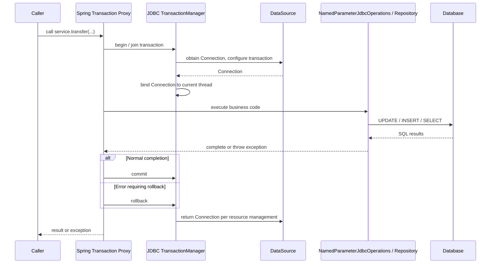

# Registering `NamedParameterJdbcOperations` and a Transaction Manager

In **Spring Data JDBC**, a repository does not open a new JDBC connection for each command and decide on its own when to commit or roll back. It relies on components registered in the **Spring ApplicationContext**: `DataSource` supplies connections to the database; `NamedParameterJdbcOperations` executes SQL with named parameters; and the **transaction manager** manages transaction boundaries. Configuring these three components consistently is the foundation for repositories, custom SQL code, and `@Transactional` methods to operate together on the right database and the right transaction.

This lesson focuses on how to register those beans in two scenarios: **Spring Boot auto-configuration** and **manual Java configuration**, then explains how they collaborate, how to use them in services, and common errors.

## 1. What Do the Three Components Handle?

| Component | Representative Java Type | Responsibility |
| --- | --- | --- |
| Connection source | `javax.sql.DataSource` | Supplies `Connection`s to the database; real applications typically use a connection pool |
| Named-parameter JDBC access | `org.springframework.jdbc.core.namedparam.NamedParameterJdbcOperations` | Provides `query`, `queryForObject`, `update`, `batchUpdate`… using parameters such as `:customerId` |
| Transaction management | `org.springframework.transaction.PlatformTransactionManager` | Starts, commits, and rolls back transactions according to `@Transactional` or explicit transaction APIs |

Common implementations for a single-database JDBC application are:

- `NamedParameterJdbcTemplate` implements `NamedParameterJdbcOperations`, relying on Spring JDBC to send SQL statements.
- `JdbcTransactionManager` is the JDBC-focused transaction manager, extending `DataSourceTransactionManager` with exception translation during commit/rollback. `DataSourceTransactionManager` is also a valid choice in plain JDBC setups.
- `HikariDataSource` is commonly used by Spring Boot to manage the pool when HikariCP is on the classpath and no alternative configuration exists.

```mermaid
flowchart TB
    A[HTTP / Job / Command] --> B[Service @Transactional]
    B --> C[Spring Data JDBC Repository]
    B --> D[NamedParameterJdbcOperations custom SQL]
    C --> E[Spring JDBC / DataAccessStrategy]
    D --> E
    B -. begin, commit, rollback .-> T[PlatformTransactionManager]
    T --> S[DataSource]
    E --> S
    S --> DB[(Relational Database)]
```



The `DataSource` in the SQL execution branch and in the transaction manager **must point to the same managed transactional resource**. If the repository writes to database A while the transaction manager uses database B, `@Transactional` may appear to run without actually protecting the required operations on A.

## 2. How Does `NamedParameterJdbcOperations` Differ from `JdbcTemplate`?

With traditional JDBC, developers manipulate `Connection`, `PreparedStatement`, and `ResultSet` directly. Spring JDBC provides `JdbcTemplate` to reduce boilerplate and handle resources/exceptions. `NamedParameterJdbcTemplate` builds on that mechanism, adding **named parameters** instead of positional `?` placeholders.

SQL with positional parameters:

```java
String sql = "SELECT id FROM customers WHERE status = ? AND city = ?";
// Must ensure value order matches the order of ? placeholders.
```

SQL with named parameters:

```java
String sql = """
    SELECT id
    FROM customers
    WHERE status = :status AND city = :city
    """;
```

`NamedParameterJdbcOperations` is the **interface** for declaring dependencies by contract. `NamedParameterJdbcTemplate` is an **implementation** that can be registered as a bean:

```java
@Bean
NamedParameterJdbcOperations namedParameterJdbcTemplate(DataSource dataSource) {
    return new NamedParameterJdbcTemplate(dataSource);
}
```

Parameters `:status` and `:city` are converted into bind values for a prepared statement; they separate **data values** from SQL. However, parameters cannot replace dynamic table names or column names: if business logic requires choosing table/column names, use an allowlist in the application layer—never concatenate arbitrary user input into SQL strings.

`NamedParameterJdbcOperations` **is not** a transaction manager. It executes SQL and participates in the current transaction if Spring already manages transactions for that `DataSource`; starting and ending transactions is the responsibility of `PlatformTransactionManager`.

## 3. Recommended Approach with Spring Boot: Let Auto-Configuration Register Beans

For a Spring Boot application using **a single relational database**, usually all you need is the Spring Data JDBC starter, a JDBC driver, and `spring.datasource` configuration. Spring Boot creates the necessary JDBC beans when auto-configuration conditions are met. There is no need to manually declare `NamedParameterJdbcTemplate` or a transaction manager just to use standard repositories.

### 3.1. Dependencies and Connection Configuration

Gradle example (Groovy DSL, in a project already using Spring Boot and dependency management):

```groovy
dependencies {
    implementation 'org.springframework.boot:spring-boot-starter-data-jdbc'
    runtimeOnly 'org.postgresql:postgresql'
}
```

Example `application.yml`:

```yaml
spring:
  datasource:
    url: jdbc:postgresql://localhost:5432/shopdb
    username: shop_app
    password: ${DB_PASSWORD}
```

The snippet above assumes the database and account already exist, the environment provides `DB_PASSWORD`, and the application is permitted to connect to PostgreSQL. Spring Boot typically registers:

1. A `DataSource` configured from `spring.datasource.*`.
2. A `JdbcTemplate` and a `NamedParameterJdbcTemplate` (implementing `NamedParameterJdbcOperations`) using that `DataSource`.
3. A suitable JDBC transaction manager when no user-provided transaction manager bean exists.
4. Spring Data JDBC components to create repositories from interfaces and map aggregates.

Auto-configurations depend on the Spring Boot version, present starters, number of `DataSource`s, and manually declared beans. Therefore, **do not treat auto-configured beans as immutable**: when adding a second database or providing a custom transaction manager, re-verify which components are actually created.

### 3.2. Using the Registered Beans

```java
package com.example.shop.customer;

import java.util.Map;
import org.springframework.jdbc.core.namedparam.NamedParameterJdbcOperations;
import org.springframework.stereotype.Repository;

@Repository
public class CustomerStatisticsDao {
    private final NamedParameterJdbcOperations jdbc;

    public CustomerStatisticsDao(NamedParameterJdbcOperations jdbc) {
        this.jdbc = jdbc;
    }

    public long countByStatus(String status) {
        String sql = """
            SELECT COUNT(*)
            FROM customers
            WHERE status = :status
            """;

        Long count = jdbc.queryForObject(
            sql,
            Map.of("status", status),
            Long.class
        );
        return count == null ? 0 : count;
    }
}
```

Constructor injection receives the managed bean, so this DAO shares JDBC resources with other components. There is no need to call `new NamedParameterJdbcTemplate(dataSource)` inside each method.

Spring Data JDBC repositories like the following are also discovered by Spring Boot when placed within the appropriate package scan scope:

```java
import org.springframework.data.repository.CrudRepository;

public interface CustomerRepository extends CrudRepository<Customer, Long> {
}
```

Here `Customer` is an aggregate mapped with Spring Data JDBC, for example using `@Table("customers")` and an `@Id` property. The repository is created by Spring Data JDBC; `CustomerStatisticsDao` is a DAO using manual SQL for specialized queries. Both approaches can coexist in one application.

### 3.3. When Is Manual Registration Needed?

Only consider replacing or adding beans when there is a specific requirement such as:

- Not using Spring Boot auto-configuration or initializing the ApplicationContext in a custom way.
- Wanting explicit control over the `DataSource`, transaction manager, pool, or connection management strategy.
- Having multiple `DataSource`s where each repository group needs its corresponding connection and transaction manager.
- Needing a custom-configured `NamedParameterJdbcOperations` to integrate with a specialized data access mechanism.

Adding a bean of the same type can cause auto-configuration to **back off**, create dependency injection ambiguity, or point repositories to an unintended bean. Therefore, clearly determine the purpose of the configuration before overriding defaults.

## 4. Manual Java Configuration for Spring Data JDBC

In an application using Spring Framework without relying on Spring Boot auto-configuration, Spring Data JDBC can be enabled via `@EnableJdbcRepositories`. The `AbstractJdbcConfiguration` class supplies the infrastructure beans for Spring Data JDBC; the application must provide `DataSource`, `NamedParameterJdbcOperations`, and the transaction manager.

The example below uses embedded H2 to illustrate the complete registration; add the appropriate H2 dependency and place `schema.sql` on the classpath when running the example:

```java
package com.example.shop.config;

import javax.sql.DataSource;

import org.springframework.context.annotation.Bean;
import org.springframework.context.annotation.Configuration;
import org.springframework.data.jdbc.repository.config.AbstractJdbcConfiguration;
import org.springframework.data.jdbc.repository.config.EnableJdbcRepositories;
import org.springframework.jdbc.core.namedparam.NamedParameterJdbcOperations;
import org.springframework.jdbc.core.namedparam.NamedParameterJdbcTemplate;
import org.springframework.jdbc.datasource.embedded.EmbeddedDatabaseBuilder;
import org.springframework.jdbc.datasource.embedded.EmbeddedDatabaseType;
import org.springframework.jdbc.support.JdbcTransactionManager;
import org.springframework.transaction.PlatformTransactionManager;
import org.springframework.transaction.annotation.EnableTransactionManagement;

@Configuration
@EnableJdbcRepositories(basePackages = "com.example.shop.repository")
@EnableTransactionManagement
public class JdbcPersistenceConfiguration extends AbstractJdbcConfiguration {

    @Bean
    DataSource dataSource() {
        return new EmbeddedDatabaseBuilder()
            .setType(EmbeddedDatabaseType.H2)
            .addScript("schema.sql")
            .build();
    }

    @Bean("namedParameterJdbcTemplate")
    NamedParameterJdbcOperations namedParameterJdbcOperations(
            DataSource dataSource) {
        return new NamedParameterJdbcTemplate(dataSource);
    }

    @Bean("transactionManager")
    PlatformTransactionManager transactionManager(DataSource dataSource) {
        return new JdbcTransactionManager(dataSource);
    }
}
```

Minimal `schema.sql` example for the customers table:

```sql
CREATE TABLE customers (
    id BIGINT GENERATED BY DEFAULT AS IDENTITY PRIMARY KEY,
    email VARCHAR(255) NOT NULL UNIQUE,
    status VARCHAR(30) NOT NULL
);
```

Role of each part:

| Configuration Element | Effect |
| --- | --- |
| `@Configuration` | Registers `@Bean` declarations into the Spring ApplicationContext |
| `@EnableJdbcRepositories` | Scans packages containing repository interfaces and registers Spring Data JDBC implementations |
| `extends AbstractJdbcConfiguration` | Provides mapping, converter, dialect, and JDBC repository infrastructure beans per Spring Data JDBC configuration |
| `dataSource()` | Creates the database connection source; embedded H2 is solely for learning examples |
| `namedParameterJdbcOperations(...)` | Registers the SQL access interface with explicit bean name `namedParameterJdbcTemplate` |
| `transactionManager(...)` | Registers the JDBC transaction manager with bean name `transactionManager` |
| `@EnableTransactionManagement` | Enables `@Transactional` annotation processing at the service layer in manual Spring configuration |

**Bean name and bean type serve different roles.** `NamedParameterJdbcOperations` and `PlatformTransactionManager` are the types used for injection; `namedParameterJdbcTemplate` and `transactionManager` are bean names that some repository/transaction mechanisms look up by name. Using the default names integrates easily with Spring Data JDBC. If using custom names, you must specify the right references or build infrastructure configuration matching the version in use.

The configuration example above **should not be copied verbatim** into a Spring Boot application that already auto-configures equivalent beans. With Spring Boot, you can keep datasource settings in `application.yml` and let the framework handle the rest.

### `JdbcTransactionManager` or `DataSourceTransactionManager`?

Both classes manage local JDBC transactions over a single `DataSource`:

```java
@Bean("transactionManager")
PlatformTransactionManager transactionManager(DataSource dataSource) {
    return new JdbcTransactionManager(dataSource);
}
```

Or:

```java
@Bean("transactionManager")
PlatformTransactionManager transactionManager(DataSource dataSource) {
    return new DataSourceTransactionManager(dataSource);
}
```

In the second example, the import is `org.springframework.jdbc.datasource.DataSourceTransactionManager`; in the first, the import is `org.springframework.jdbc.support.JdbcTransactionManager`. `JdbcTransactionManager` inherits standard JDBC transaction management and supports commit/rollback exception translation under Spring JDBC's exception hierarchy. Both are suitable for a single relational database accessed via JDBC; pick one transaction manager bean according to your version and actual needs.

## 5. How Is a JDBC Transaction Opened and Ended?

When calling a `@Transactional` method through a Spring proxy, the typical flow is:



Spring JDBC uses mechanisms like `DataSourceUtils` to obtain the connection managed by the transaction manager, allowing calls to repositories and `NamedParameterJdbcOperations` **to share a single transaction** when they use the same `DataSource` and are called within an appropriate transactional context. There is no need to pass a `Connection` object from one DAO to another.

With a standard JDBC transaction manager, the transaction is bound to the **execution thread**. If you offload database writes to another thread or invoke `@Async` asynchronously, you cannot assume the caller's transaction will automatically follow. `@Transactional` here is the imperative JDBC transaction model, not R2DBC's reactive transaction mechanism.

## 6. Example Using `NamedParameterJdbcOperations` in a Real Transaction

Suppose we have a simple digital wallet table to study transactions:

```sql
CREATE TABLE wallets (
    id BIGINT PRIMARY KEY,
    balance DECIMAL(18, 2) NOT NULL CHECK (balance >= 0)
);

INSERT INTO wallets (id, balance)
VALUES (1, 1000.00), (2, 100.00);
```

A money transfer requires two atomic changes: debit the source wallet, credit the target wallet. If debit succeeds but credit fails, both changes must roll back.

```java
package com.example.shop.wallet;

import java.math.BigDecimal;
import java.util.Map;

import org.springframework.jdbc.core.namedparam.NamedParameterJdbcOperations;
import org.springframework.stereotype.Service;
import org.springframework.transaction.annotation.Transactional;

@Service
public class WalletTransferService {
    private final NamedParameterJdbcOperations jdbc;

    public WalletTransferService(NamedParameterJdbcOperations jdbc) {
        this.jdbc = jdbc;
    }

    @Transactional
    public void transfer(long fromId, long toId, BigDecimal amount) {
        if (fromId == toId) {
            throw new IllegalArgumentException("Source and target wallets must be different");
        }
        if (amount == null || amount.signum() <= 0) {
            throw new IllegalArgumentException("Amount must be positive");
        }

        int debited = jdbc.update("""
            UPDATE wallets
            SET balance = balance - :amount
            WHERE id = :id AND balance >= :amount
            """, Map.of("id", fromId, "amount", amount));

        if (debited != 1) {
            throw new IllegalStateException("Source wallet does not exist or has insufficient funds");
        }

        int credited = jdbc.update("""
            UPDATE wallets
            SET balance = balance + :amount
            WHERE id = :id
            """, Map.of("id", toId, "amount", amount));

        if (credited != 1) {
            throw new IllegalStateException("Target wallet not found");
        }
    }
}
```

If the target wallet does not exist, the method throws `IllegalStateException` (a `RuntimeException`). Under default transaction rules, Spring rolls back the earlier debit statement as well. Conversely, if both SQL statements succeed, the transaction manager commits them together. The `balance >= :amount` condition in the `UPDATE` avoids unsafe *read-then-update* balance checks under concurrent transactions; the `CHECK` constraint in the database also protects against negative balances.

This example illustrates atomicity within one database. A real financial system also needs a ledger, idempotency, reconciliation, monetary data types, authorization, retry capability, deadlock handling, and other business rules.

**Conditions for rollback to truly protect both statements:** `WalletTransferService` is a Spring bean, `transfer` is invoked through the Spring proxy, a transaction manager is registered, and `NamedParameterJdbcOperations` uses the `DataSource` managed by that transaction manager. If a DAO opens a new connection from `DriverManager` or commits independently, the two statements may not participate in the same transaction.

### Sharing One Transaction Across Repository and Manual SQL

```java
@Service
public class OrderService {
    private final OrderRepository orders;
    private final NamedParameterJdbcOperations jdbc;

    public OrderService(OrderRepository orders,
                        NamedParameterJdbcOperations jdbc) {
        this.orders = orders;
        this.jdbc = jdbc;
    }

    @Transactional
    public void confirmOrder(Long orderId) {
        Order order = orders.findById(orderId).orElseThrow();
        order.confirm();
        orders.save(order);

        jdbc.update("""
            INSERT INTO order_audit (order_id, action)
            VALUES (:orderId, :action)
            """, Map.of("orderId", orderId, "action", "CONFIRMED"));
    }
}
```

This snippet assumes the `Order` entity, `OrderRepository`, and `order_audit` table already exist. If both components use the same database/transaction manager, saving the order and writing the audit log will succeed together or roll back on error. You do not need to install a separate transaction manager for each repository.

## 7. `@Transactional`: Choosing Boundaries, Propagation, and Rollback

A **transaction boundary** should represent a consistent business operation, such as `confirmOrder`, `transfer`, or `createCustomerAndAddress`. Marking a service method with `@Transactional` allows multiple repository/DAO calls to participate in the same transaction.

```java
@Transactional
public void createOrder(...) {
    // Multiple write operations in one unit of work.
}

@Transactional(readOnly = true)
public OrderView findOrder(...) {
    // Data reading steps within one read transaction boundary.
}
```

Commonly used attributes:

| Attribute | Practical Meaning |
| --- | --- |
| `propagation = REQUIRED` (default) | Joins an existing transaction, or starts a new one if none exists |
| `propagation = REQUIRES_NEW` | Suspends the current transaction (if any) and runs in an independent transaction; may require an extra connection and increase pool pressure |
| `readOnly = true` | Sends a read-only hint to infrastructure/driver; **not** a default guarantee blocking all write operations |
| `isolation = READ_COMMITTED` | Requests an isolation level when starting a new transaction; support and side effects depend on DB/driver |
| `timeout = 10` | Configures a transaction time limit where supported by the transaction manager |
| `rollbackFor = SomeCheckedException.class` | Extends rollback rules to the specified checked exception |

By default, Spring marks rollback on `RuntimeException` or `Error`; **checked exceptions** normally do not trigger rollback unless configured additionally. Furthermore, if a service catches an error and returns normally, the proxy may treat the transaction as successful and commit. Only catch and swallow exceptions when you intentionally accept the changes already made.

For Spring Data JDBC, inherited CRUD repository methods already have default transaction settings; read methods use `readOnly = true`, write operations use standard transactions. **Custom-declared query methods** should have appropriate transaction configuration, especially when the framework needs multiple queries to assemble an aggregate. A service-level transaction encompassing multiple repository calls defines the shared boundary.

Under Spring Framework's default proxy mechanism, `@Transactional` takes effect when calls pass **through the Spring proxy**. Scenarios that commonly cause confusion:

```java
@Service
class ExampleService {
    public void outer() {
        inner(); // Self-invocation on the same object; usually bypasses the proxy.
    }

    @Transactional
    public void inner() {
        // Does not automatically get a transaction just because outer() calls inner().
    }
}
```

Creating an object with `new ExampleService()` outside the container also fails to activate transaction proxying. A straightforward approach is to make transactional methods public APIs of a service bean and have another bean invoke them via dependency injection; avoid placing transactions solely on internally invoked methods.

## 8. Multiple `DataSource`s: Specifying the Right JDBC Operations and Transaction Manager

When an application connects to two databases (for example, `sales` and `reporting`), simply configuring two `DataSource`s does not mean Spring Data JDBC automatically routes every repository as the developer intends.

Example registering beans per connection source:

```java
@Configuration(proxyBeanMethods = false)
public class TwoDatabaseJdbcBeans {

    @Bean("salesNamedJdbc")
    NamedParameterJdbcOperations salesNamedJdbc(
            @Qualifier("salesDataSource") DataSource dataSource) {
        return new NamedParameterJdbcTemplate(dataSource);
    }

    @Bean("salesTransactionManager")
    PlatformTransactionManager salesTransactionManager(
            @Qualifier("salesDataSource") DataSource dataSource) {
        return new JdbcTransactionManager(dataSource);
    }

    @Bean("reportingNamedJdbc")
    NamedParameterJdbcOperations reportingNamedJdbc(
            @Qualifier("reportingDataSource") DataSource dataSource) {
        return new NamedParameterJdbcTemplate(dataSource);
    }

    @Bean("reportingTransactionManager")
    PlatformTransactionManager reportingTransactionManager(
            @Qualifier("reportingDataSource") DataSource dataSource) {
        return new JdbcTransactionManager(dataSource);
    }
}
```

The snippet above assumes two `DataSource` beans named `salesDataSource` and `reportingDataSource` already exist, along with the corresponding Spring imports (`@Bean`, `@Configuration`, `@Qualifier`, `DataSource`, `PlatformTransactionManager`, `NamedParameterJdbcOperations`, `NamedParameterJdbcTemplate`, `JdbcTransactionManager`). This is **JDBC/transaction registration**, not yet a complete configuration for two groups of Spring Data JDBC repositories.

The service must pick the matching pair:

```java
@Service
public class SalesReportService {
    private final NamedParameterJdbcOperations salesJdbc;

    public SalesReportService(
            @Qualifier("salesNamedJdbc") NamedParameterJdbcOperations salesJdbc) {
        this.salesJdbc = salesJdbc;
    }

    @Transactional(transactionManager = "salesTransactionManager")
    public void markProcessed(long id) {
        salesJdbc.update("""
            UPDATE sales_jobs SET processed = TRUE WHERE id = :id
            """, Map.of("id", id));
    }
}
```

For Spring Data JDBC repositories, you must also configure `@EnableJdbcRepositories` scope and the corresponding aggregate/mapping components. In **Spring Data JDBC 3.x**, `@EnableJdbcRepositories`'s `jdbcOperationsRef` and `transactionManagerRef` attributes can be used to select the referenced beans in an appropriate setup. Starting with **Spring Data JDBC 4.0**, `jdbcOperationsRef` and `dataAccessStrategyRef` have been deprecated; multi-repository configuration moves toward `jdbcAggregateOperationsRef` to select **the entire aggregate operations chain** consistently. Therefore, when designing multiple data sources, check the exact API of your target version and specify dialect, converter, strategy, aggregate operations, and transaction manager name; merely marking one `DataSource` with `@Primary` does not completely solve repository routing.

**Note on cross-database transactions:** two local `JdbcTransactionManager` beans do not automatically form a distributed transaction. A `@Transactional(transactionManager = "salesTransactionManager")` only protects the transaction on `salesDataSource`. If the same operation also writes to the reporting database, rolling back sales does not guarantee reporting rolls back. Achieving atomicity across multiple resources requires an appropriate transaction architecture (such as JTA/XA where supported) or eventual consistency patterns like outbox/saga depending on the problem.

## 9. Checking Beans Actually Registered by Spring

You can inspect by **type** to see what configuration the container provides. Example diagnostic component during development:

```java
import java.util.Arrays;
import javax.sql.DataSource;
import org.springframework.boot.ApplicationRunner;
import org.springframework.context.ApplicationContext;
import org.springframework.context.annotation.Bean;
import org.springframework.context.annotation.Configuration;
import org.springframework.jdbc.core.namedparam.NamedParameterJdbcOperations;
import org.springframework.transaction.PlatformTransactionManager;

@Configuration(proxyBeanMethods = false)
class JdbcBeanInspection {
    @Bean
    ApplicationRunner logJdbcBeans(ApplicationContext context) {
        return args -> {
            System.out.println("DataSources: " + Arrays.toString(
                context.getBeanNamesForType(DataSource.class)));
            System.out.println("Named JDBC: " + Arrays.toString(
                context.getBeanNamesForType(NamedParameterJdbcOperations.class)));
            System.out.println("Transaction managers: " + Arrays.toString(
                context.getBeanNamesForType(PlatformTransactionManager.class)));
        };
    }
}
```

This is an optional diagnostic snippet for a Spring Boot application; there is no need to keep it in production code. When multiple beans share a type, the bean names help clarify why constructor injection requires `@Qualifier`. You can inspect specific implementations and referenced `DataSource`s via appropriate monitoring/configuration tools, while avoiding printing passwords or sensitive connection details to logs.

To observe SQL in development, you can raise the log level on Spring JDBC's package:

```yaml
logging:
  level:
    org.springframework.jdbc.core: DEBUG
```

Depending on the version/driver, more verbose logging levels may display SQL parameters, including sensitive data. Do not enable unconditionally in production.

## 10. Common Configuration Errors

| Symptom | Causes Worth Checking | Resolution |
| --- | --- | --- |
| Cannot inject `NamedParameterJdbcOperations` | Missing `spring-jdbc`, missing `DataSource`, auto-configuration conditions unmet, or bean not manually declared | Check dependencies, `DataSource`, and register `NamedParameterJdbcTemplate` |
| No transaction manager bean | No JDBC transaction config in context, or auto-config disabled by another condition | Register a suitable `PlatformTransactionManager` or restore auto-config |
| `NoUniqueBeanDefinitionException` | Multiple JDBC operations/transaction managers of the same type without priority/qualifier | Use `@Qualifier`, intentional `@Primary`, or manager name in `@Transactional` |
| `@Transactional` does not roll back | Service not managed by Spring, internal call bypassing proxy, caught and swallowed error, checked exception not configured for rollback, or SQL running outside manager's connection | Check call boundary, rollback rules, datasource, and connection management |
| Repository writes to wrong database | Default beans or `@Primary` make Spring pick the wrong connection path in a multi-datasource app | Route repositories and entire aggregate infrastructure per datasource |
| Multiple operations do not roll back together | Using manager from different datasource, manually opening standalone connection, or writing to another system/database | Use the same transaction manager for atomic resources; design distributed transactions if truly needed |
| Repository not discovered | Missing suitable package scan or missing `@EnableJdbcRepositories` in plain Spring config | Check config and repository packages, and JDBC repository enablement |
| Long-running transactions, pool exhaustion | Transaction wrapping slow I/O, heavy use of `REQUIRES_NEW`, or unoptimized queries | Narrow transaction boundaries, optimize SQL, and evaluate pool size |
| SQL runs but updates wrong data | Wrong parameter name or missing WHERE clause; `update` returns unexpected row count | Check parameter names, SQL conditions, updated row count, and DB constraints |

In particular, **do not confuse bean names** with Java method names or class types. Spring can resolve a bean by type when there is only one choice, but some repository and transaction components have name-based lookup rules. When multiple beans exist, clear naming and explicit references make behavior predictable.

## 11. Important Design Boundaries

### JDBC Transactions and R2DBC Transactions Differ

Spring Data JDBC uses blocking APIs (`DataSource`, `Connection`, `NamedParameterJdbcOperations`). Spring Data R2DBC uses `ConnectionFactory`, `DatabaseClient`, and `R2dbcTransactionManager` under the reactive model. You cannot swap `JdbcTransactionManager` for `R2dbcTransactionManager` in a JDBC application and expect blocking SQL calls to automatically participate in reactive transactions.

### Spring Data JDBC Does Not Replace Schema Migrations

`AbstractJdbcConfiguration` provides mapping and repository infrastructure; **it does not mean the database is created from Java entities**. Tables, keys, indexes, and constraints still must be created via migrations (e.g., Flyway/Liquibase) or controlled initialization scripts. Successful bean registration does not verify that the schema is right.

### `@Transactional` Does Not Enforce Every Consistency Rule

A transaction groups operations into a commit/rollback unit. However, preventing duplicate writes, lost updates, invalid data, and concurrent contention still requires database constraints, isolation/locking, or optimistic locking depending on the situation. `readOnly = true` is just a hint; `@Transactional` does not replace schema design.

### Do Not Arbitrarily Create Standalone `Connection`s

When direct JDBC access is needed, prefer Spring JDBC-managed APIs or proper use of `DataSourceUtils` over `DriverManager.getConnection(...)`. Manually opening another connection and calling `commit()` independently can break the transaction boundary Spring controls.

## 12. Practice Guide

**Practice A — Spring Boot auto-configuration:** create an application with the Spring Data JDBC starter and PostgreSQL. Configure connection settings in `application.yml`, create the `customers` table, define `CustomerRepository`, and inject `NamedParameterJdbcOperations` into a DAO to run `SELECT COUNT(*) FROM customers`. Identify the `DataSource`, `NamedParameterJdbcOperations`, and `PlatformTransactionManager` beans actually present in the context and test calling both the repository and manual SQL from one service.

**Practice B — Plain Java configuration:** use `@EnableJdbcRepositories`, `AbstractJdbcConfiguration`, `@Bean NamedParameterJdbcOperations`, and `@Bean PlatformTransactionManager` with embedded H2. Try renaming the transaction manager bean and reconfiguring the corresponding reference to understand the role of bean names.

**Practice C — Rollback:** prepare two wallets with IDs `1` and `2`, call `transfer(1, 9999, new BigDecimal("50.00"))`. Confirm the method throws an error and wallet `1`'s balance **is not deducted** after rollback. Then test `transfer(1, 2, new BigDecimal("50.00"))` and confirm both balances change together. Run these tests in a mutable learning environment.

Answer these questions for yourself:

1. Why must the same `DataSource` be used by both JDBC operations and the transaction manager?
2. Why does a single-database Spring Boot app usually not need a manual `NamedParameterJdbcTemplate` bean?
3. How does `@Bean("transactionManager")` differ from `@Transactional(transactionManager = "salesTransactionManager")`?
4. Why can a `@Transactional` method still fail to roll back when called internally within the same class?
5. With two databases, why is registering two `JdbcTransactionManager` beans not enough for an atomic transaction across both?
6. In Spring Data JDBC 4.x, why should you pay attention to `jdbcAggregateOperationsRef` when routing repositories instead of relying only on `jdbcOperationsRef`?

## 13. Official References

- [Spring Data Relational — Getting Started: JDBC Configuration](https://docs.spring.io/spring-data/relational/reference/jdbc/getting-started.html): examples using `@EnableJdbcRepositories`, `AbstractJdbcConfiguration`, `NamedParameterJdbcOperations`, and transaction manager; notes simplification via Spring Boot.
- [Spring Data Relational — JDBC Transactionality](https://docs.spring.io/spring-data/relational/reference/jdbc/transactions.html): transaction boundaries of CRUD repositories, query methods, and services.
- [Spring Data JDBC — `@EnableJdbcRepositories` API](https://docs.spring.io/spring-data/jdbc/docs/current/api/org/springframework/data/jdbc/repository/config/EnableJdbcRepositories.html): attributes for selecting infrastructure beans per version, including transaction manager reference.
- [Spring Boot — SQL Databases](https://docs.spring.io/spring-boot/reference/data/sql.html): configuring `DataSource`, `JdbcTemplate`, and SQL access in Boot applications.

The core architectural principle is consistency among the **connection source**, **SQL executor**, and **transaction manager**. For a single datasource in Spring Boot, prefer auto-configuration and inject the provided beans. With plain Spring or multiple datasources, register and select beans explicitly, ensuring repositories and DAOs participate in their intended transactions.
