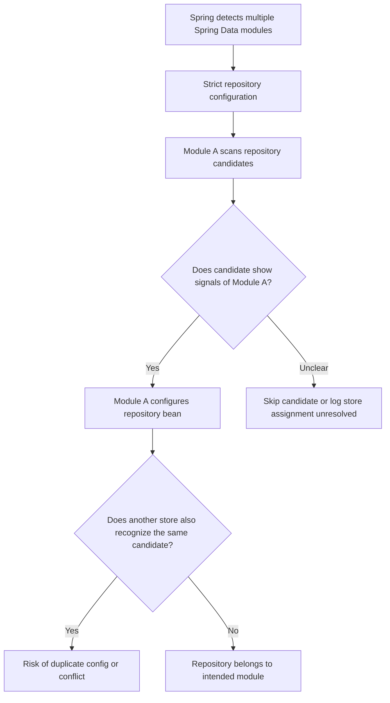

# Coordinating Multiple Spring Data Modules and Avoiding Repository Misidentification

A Spring Boot application might use **Spring Data JDBC** to persist orders in a relational database, **Spring Data JPA** for a legacy subsystem, **Spring Data MongoDB** for documents, or **Spring Data R2DBC** for reactive relational access. When multiple Spring Data modules appear together, Spring must answer a question before creating beans: **which storage module does this repository interface belong to?**

This seemingly simple question directly impacts configuration and architecture. An interface like `CrudRepository<Customer, Long>` belongs to **Spring Data Commons**, so by itself it does not declare whether `Customer` is stored via JDBC, JPA, or another store. If Spring binds a repository to the wrong factory, the application may fail to start, fail to register expected repositories, or run into data mapping errors.

This lesson focuses on how Spring Data identifies repositories, the **strict repository configuration mode** mechanism, methods to isolate repository scan scopes when multiple modules coexist, and specific considerations when Spring Data JDBC works alongside JPA, MongoDB, or R2DBC.

## 1. Distinguishing Spring Data Commons from Storage Modules

**Spring Data** is a family of projects. Modules share many abstractions, yet each has its own way of mapping, querying, and managing data.

| Component | Role | Examples |
|---|---|---|
| **Spring Data Commons** | Provides shared repository interfaces, concepts, and metadata | `Repository`, `CrudRepository`, `PagingAndSortingRepository`, `@Id` |
| **Spring Data JDBC** | Maps relational aggregates via JDBC, saving directly through SQL | `@Table` from Spring Data Relational, `JdbcAggregateTemplate` |
| **Spring Data JPA** | Repositories built on JPA and a persistence context | `JpaRepository`, `jakarta.persistence.Entity` |
| **Spring Data MongoDB** | Accesses MongoDB collections/documents | `MongoRepository`, `@Document` |
| **Spring Data R2DBC** | Accesses relational databases via reactive APIs | `R2dbcRepository`, `ReactiveCrudRepository` |
| **Spring Data Redis** | Stores key/values or hashes in the Redis repository model | `@RedisHash` and corresponding infrastructure |

Modules are not interchangeable just because they share the word *repository*.

Example:

```java
// Both JDBC, JPA, and several other stores can use
// the shared interface from Spring Data Commons.
import org.springframework.data.repository.CrudRepository;

public interface CustomerRepository extends CrudRepository<Customer, Long> {
}
```

If only repository infrastructure for a single matching store is on the classpath, configuration is relatively straightforward. If both JDBC and one or more other modules are present, Spring needs extra information to determine which store this repository belongs to.

**Key takeaway:** `CrudRepository` expresses general CRUD operations; **it does not specify persistence technology**. Shared markers like `org.springframework.data.annotation.Id` are also insufficient to confirm whether an entity belongs to JDBC or MongoDB.

### 1.1. How Does Spring Data JDBC Differ from Spring Data JPA?

Both can access the same kind of relational database management system, but their operating models are not alike.

- **JDBC:** maps aggregates according to Spring Data JDBC rules; you call `save(...)` to write the aggregate. There is no JPA-style persistence context or dirty checking.
- **JPA:** manages entities via `EntityManager`; managed entities can be synchronized to the DB through flushing and dirty checking.
- **Different annotations:** JDBC uses `org.springframework.data.relational.core.mapping.Table`; JPA typically uses `jakarta.persistence.Entity` and may use `jakarta.persistence.Table` to specify the table name.
- **Different repositories:** JPA provides `JpaRepository`; JDBC usually uses `CrudRepository` or appropriate shared abstractions.

Therefore, do not assume "both use PostgreSQL so the two repositories are alike." Spring must pick the matching repository factory, mapping context, query support, and transaction infrastructure.

## 2. What Is Strict Repository Configuration Mode?

When Spring Data detects **multiple repository modules** participating in configuration, it can switch into **strict repository configuration mode**. The goal of this mode is to prevent arbitrarily assigning an ambiguous repository to a store.

Startup logs typically show a message like:

```text
Multiple Spring Data modules found, entering strict repository configuration mode
```

**This is informational about the configuration mechanism, not an error by itself.** Read subsequent repository discovery logs to see whether Spring identified everything properly or skipped any candidates. Exact log wording varies across Spring Data versions.

Conceptually, each module has a `RepositoryConfigurationExtension` to process repositories belonging to its store. In strict mode, Spring Data looks for appropriate identifying signals before handing a candidate to a repository factory. Key signals typically include:

1. **Interface type in the inheritance hierarchy:** whether the repository extends a module-specific interface such as `JpaRepository` or `MongoRepository`.
2. **Annotations on the domain type:** whether the domain class carries mapping annotations recognized by the module, such as JPA's `@Entity`, MongoDB's `@Document`, or Spring Data Relational's `@Table`.
3. **Repository scanning scope:** which packages each `@Enable...Repositories` configuration scans and which interfaces enter the candidate list.
4. **Module filters and rules:** whether a module accepts or ignores a candidate also depends on the store, version, and related configuration.

We can visualize this as:



The diagram describes the general logic. In practice, Spring Data may run multiple scan passes and bean registration mechanisms per module; **strict mode is not a global algorithm that automatically picks a single correct store for every interface**.

### 2.1. Identifying Signals by Module

| Module | Typical Specific Signals | Things to Watch Out For |
|---|---|---|
| Spring Data JPA | `JpaRepository<T, ID>`; domain has JPA `@Entity` | `jakarta.persistence.Table` alone does not replace `@Entity` |
| Spring Data MongoDB | `MongoRepository<T, ID>`; domain has MongoDB `@Document` | Generic `@Id` from Spring Data Commons is not enough to indicate MongoDB |
| Spring Data JDBC | Domain has Spring Data Relational `@Table`; repository package configured separately | `CrudRepository` itself is a shared interface |
| Spring Data R2DBC | `R2dbcRepository<T, ID>`; reactive repository model and relational mapping | Spring Data Relational `@Table` can be shared with JDBC |
| Spring Data Redis | Domain has `@RedisHash` and appropriate Redis repository signals | Do not confuse regular cache objects with configured Redis repositories |

The table lists representative signals; the exact signals supported by each extension should be checked against the version in use. **When multiple stores have similar mapping mechanisms, separating packages via explicit configuration is usually more reliable than relying solely on annotations.**

### 2.2. A Situation Where the Store Cannot Be Inferred Safely

Suppose an application has `spring-boot-starter-data-jdbc` and `spring-boot-starter-data-mongodb`:

```java
import org.springframework.data.annotation.Id;
import org.springframework.data.repository.CrudRepository;

public class Customer {
    @Id
    private Long id;
    private String name;
    // constructors, getters, setters...
}

public interface CustomerRepository extends CrudRepository<Customer, Long> {
}
```

`@Id` here belongs to Spring Data Commons. `CrudRepository` also belongs to Commons. Spring has no solid basis to conclude whether this is a JDBC repository or a MongoDB repository from these two signals alone.

In strict mode, a module may skip the repository and log a message meaning "could not safely identify store assignment." Consequently, the application may lack a `CustomerRepository` bean and a service injecting this dependency may fail at startup. Exactly how each module handles the candidate depends on the active configuration.

A consistent fix is to **place each store's repositories and domain models in separate packages, use the right mapping annotations, and specify repository scan scopes explicitly**.

## 3. Designing Packages So Each Module Has Clear Boundaries

Suppose a service uses:

- **Spring Data JDBC** to persist `CustomerRow` in the `customers` table.
- **Spring Data MongoDB** to persist `CustomerDocument` in the `customer_profiles` collection.

An easy-to-follow package structure:

```text
com.example.catalog
├── CatalogApplication.java
├── config
│   └── PersistenceRepositoriesConfig.java
├── jdbc
│   ├── domain
│   │   └── CustomerRow.java
│   └── repository
│       └── JdbcCustomerRepository.java
├── mongo
│   ├── domain
│   │   └── CustomerDocument.java
│   └── repository
│       └── MongoCustomerRepository.java
└── service
    └── CustomerCatalogService.java
```

This is not a mandatory naming rule. What matters is that each module's repository interfaces sit in a **dedicated scan package**, domains have **store-appropriate models**, and services do not depend on Spring guessing the store.

### 3.1. Dependencies for the JDBC + MongoDB Example

Example using Gradle syntax in a Spring Boot application with proper dependency management:

```gradle
dependencies {
    implementation("org.springframework.boot:spring-boot-starter-data-jdbc")
    implementation("org.springframework.boot:spring-boot-starter-data-mongodb")

    // Example when JDBC accesses PostgreSQL.
    runtimeOnly("org.postgresql:postgresql")
}
```

The starters bring the corresponding repository infrastructure into the application. JDBC and MongoDB connections still need to be configured for the runtime environment. Adding starters **does not automatically make an ambiguous repository interface get identified correctly**.

### 3.2. Defining the JDBC Domain and Repository

**`jdbc/domain/CustomerRow.java`:**

```java
package com.example.catalog.jdbc.domain;

import org.springframework.data.annotation.Id;
import org.springframework.data.relational.core.mapping.Table;

@Table("customers")
public record CustomerRow(
        @Id Long id,
        String name,
        String email
) {
}
```

**`jdbc/repository/JdbcCustomerRepository.java`:**

```java
package com.example.catalog.jdbc.repository;

import com.example.catalog.jdbc.domain.CustomerRow;
import org.springframework.data.repository.CrudRepository;

public interface JdbcCustomerRepository
        extends CrudRepository<CustomerRow, Long> {
}
```

Here:

- `@Table` is **`org.springframework.data.relational.core.mapping.Table`**, for Spring Data relational mapping; not JPA's table annotation.
- `@Id` designates the identifier. Even though it is a shared annotation, it is interpreted by Spring Data JDBC within JDBC's mapping context.
- The repository uses `CrudRepository`. Assigning it to JDBC is clarified by both the domain mapping **and** the JDBC scan package configuration in the next step.

In a real application, the `customers` table and columns must match mapping rules or be configured with `@Column`. Mapping a repository to the right store does not mean the database schema automatically exists.

### 3.3. Defining the MongoDB Domain and Repository

**`mongo/domain/CustomerDocument.java`:**

```java
package com.example.catalog.mongo.domain;

import org.springframework.data.annotation.Id;
import org.springframework.data.mongodb.core.mapping.Document;

@Document(collection = "customer_profiles")
public record CustomerDocument(
        @Id String id,
        String displayName,
        String preferences
) {
}
```

**`mongo/repository/MongoCustomerRepository.java`:**

```java
package com.example.catalog.mongo.repository;

import com.example.catalog.mongo.domain.CustomerDocument;
import org.springframework.data.mongodb.repository.MongoRepository;

public interface MongoCustomerRepository
        extends MongoRepository<CustomerDocument, String> {
}
```

`MongoRepository` is an interface **specific to Spring Data MongoDB**. `@Document` also describes the domain as a MongoDB document. Both make persistence intent clearer.

Do not use a single `Customer` class and pile on annotations from every store just so "Spring knows this is an entity." The two stores have different rules for identifiers, relationships, data mutations, and queries; two small models can be much clearer than one multi-purpose model.

### 3.4. Locking Scan Scope with `@Enable...Repositories`

**`config/PersistenceRepositoriesConfig.java`:**

```java
package com.example.catalog.config;

import com.example.catalog.jdbc.repository.JdbcCustomerRepository;
import com.example.catalog.mongo.repository.MongoCustomerRepository;
import org.springframework.context.annotation.Configuration;
import org.springframework.data.jdbc.repository.config.EnableJdbcRepositories;
import org.springframework.data.mongodb.repository.config.EnableMongoRepositories;

@Configuration(proxyBeanMethods = false)
@EnableJdbcRepositories(
        basePackageClasses = JdbcCustomerRepository.class
)
@EnableMongoRepositories(
        basePackageClasses = MongoCustomerRepository.class
)
public class PersistenceRepositoriesConfig {
}
```

With `basePackageClasses`, Spring uses the **package containing the specified class/interface** as the starting point for scanning that repository type. In the example:

- JDBC scanning starts at `com.example.catalog.jdbc.repository`.
- MongoDB scanning starts at `com.example.catalog.mongo.repository`.
- `JdbcCustomerRepository` lies only within the JDBC scope.
- `MongoCustomerRepository` lies only within the MongoDB scope.

The *type-safe* nature of `basePackageClasses` makes refactoring packages easier than a hard-coded string. If you want to specify packages as strings, you can use:

```java
@EnableJdbcRepositories(
        basePackages = "com.example.catalog.jdbc.repository"
)
@EnableMongoRepositories(
        basePackages = "com.example.catalog.mongo.repository"
)
```

Both syntaxes are **repository scan scope configurations**, not replacements for configuring `DataSource` or MongoDB client connections. Only enable the modules you actually use.

**Note:** the package used for one module should not be a parent package encompassing repositories of other modules. For instance, scanning JDBC from `com.example.catalog` can pull MongoDB interfaces into the candidate list before strict mode filters decide whether to accept them.

### 3.5. Choosing Repository Names to Avoid Bean Name Collisions

Even if two interfaces reside in different packages, if both are named `CustomerRepository`, default bean naming can cause a name collision (for example, both becoming `customerRepository`) in the same context.

Names like `JdbcCustomerRepository` and `MongoCustomerRepository` clarify intent, read cleanly in configuration, and avoid common collisions. This is an architectural choice, not a mandatory requirement of Spring Data.

## 4. Coordinating Spring Data JDBC with Spring Data JPA

A common scenario is an application already using JPA that starts moving certain features to Spring Data JDBC. Because both use relational databases, it is even easier to confuse identically named annotations.

### 4.1. Domain Annotations Are Not the Same

**JDBC domain:**

```java
import org.springframework.data.annotation.Id;
import org.springframework.data.relational.core.mapping.Table;

@Table("invoices")
public class JdbcInvoice {
    @Id
    private Long id;
    // Appropriate properties and constructors.
}
```

**JPA domain:**

```java
import jakarta.persistence.Entity;
import jakarta.persistence.Id;
import jakarta.persistence.Table;

@Entity
@Table(name = "legacy_invoices")
public class JpaInvoice {
    @Id
    private Long id;
    // JPA entity needs constructor and mapping per JPA rules.
}
```

Same `@Table` name, yet different packages and different roles:

| Annotation | Module | Meaning |
|---|---|---|
| `org.springframework.data.relational.core.mapping.Table` | Spring Data JDBC / R2DBC (relational mapping) | Links an aggregate to a relational table |
| `jakarta.persistence.Entity` | JPA | Marks a class as a JPA entity |
| `jakarta.persistence.Table` | JPA | Customizes table info for a JPA entity |
| `org.springframework.data.mongodb.core.mapping.Document` | MongoDB | Links a domain object to a MongoDB collection/document |

In files involving similarly named annotations, use explicit imports or fully qualified names. **Do not grab a same-named annotation from another module just because the IDE auto-imported it.**

### 4.2. JPA Repositories Have Their Own Interface

```java
import org.springframework.data.jpa.repository.JpaRepository;

public interface LegacyInvoiceRepository
        extends JpaRepository<JpaInvoice, Long> {
}
```

`JpaRepository` clearly indicates the repository belongs to JPA. In contrast, JDBC repositories normally use the shared CRUD interface:

```java
import org.springframework.data.repository.CrudRepository;

public interface JdbcInvoiceRepository
        extends CrudRepository<JdbcInvoice, Long> {
}
```

When running both modules, restrict their scan scopes separately:

```java
import com.example.billing.jdbc.repository.JdbcInvoiceRepository;
import com.example.billing.jpa.repository.LegacyInvoiceRepository;
import org.springframework.context.annotation.Configuration;
import org.springframework.data.jdbc.repository.config.EnableJdbcRepositories;
import org.springframework.data.jpa.repository.config.EnableJpaRepositories;

@Configuration(proxyBeanMethods = false)
@EnableJdbcRepositories(
        basePackageClasses = JdbcInvoiceRepository.class
)
@EnableJpaRepositories(
        basePackageClasses = LegacyInvoiceRepository.class
)
class BillingRepositoriesConfig {
}
```

The configuration illustrates repository boundaries. To run JPA, the application also needs an `EntityManagerFactory`, datasource, and appropriate entity scanning. To run JDBC, the application needs matching JDBC infrastructure and mapping.

### 4.3. Do Not Routinely Use One Class as Both a JPA Entity and a JDBC Aggregate

For example, a class annotated simultaneously with:

```java
@jakarta.persistence.Entity
@org.springframework.data.relational.core.mapping.Table("customers")
class Customer {
    // ...
}
```

This can cause multiple modules to recognize the same domain as a valid candidate, especially when the repository interface only extends `CrudRepository` and falls under overlapping scan scopes. Beyond identification issues, the lifecycle, relationship mapping, and dirty checking of the two modules also differ.

A clearer design is to put `JpaCustomer` and `JdbcCustomer` in separate packages and map them to a **DTO or independent business model** at the service boundary when data needs to be shared. If both modules access the same table, you also need policies for data ownership, updates, and consistency; proper repository scanning only solves bean creation.

## 5. Special Case: JDBC and R2DBC Share Relational Mapping

Spring Data JDBC and Spring Data R2DBC share part of the **Spring Data Relational** mapping model. Consequently, `@Table` from:

```java
org.springframework.data.relational.core.mapping.Table
```

is not always enough on its own to distinguish whether a domain belongs to JDBC or R2DBC when both modules are present.

However, the repository interfaces and execution models differ:

```java
// JDBC: synchronous/blocking API.
public interface JdbcTaskRepository
        extends CrudRepository<JdbcTask, Long> {
}

// R2DBC: reactive API.
public interface ReactiveTaskRepository
        extends R2dbcRepository<ReactiveTask, Long> {
}
```

Corresponding imports:

```java
import org.springframework.data.repository.CrudRepository;
import org.springframework.data.r2dbc.repository.R2dbcRepository;
```

Do not treat `ReactiveCrudRepository` as a JDBC repository, and do not assume using `@Table` causes an R2DBC repository to automatically appear in JDBC configuration. With both modules present, you should:

1. Separate JDBC and R2DBC repository packages.
2. Use distinct interfaces matching synchronous or reactive APIs.
3. Specify `@EnableJdbcRepositories` and `@EnableR2dbcRepositories` on the right packages when explicit configuration is needed.
4. Verify separate infrastructure: **JDBC uses `DataSource` and `PlatformTransactionManager`**; **R2DBC uses `ConnectionFactory` and `ReactiveTransactionManager`**.

R2DBC carries transaction context along the reactive publisher stream; JDBC transactions typically bind a connection to the running thread. Do not expect these two mechanisms to share a single transaction simply because both talk to the same PostgreSQL database.

## 6. Setups That Look Valid but Easily Misassign Repositories

### 6.1. Putting All Repositories in One Shared Package

```text
com.example.app.repository
├── OrderRepository.java          // JDBC
├── ProductRepository.java        // JPA
└── SearchDocumentRepository.java // MongoDB
```

If multiple `@Enable...Repositories` annotations scan this entire package, each module may have to evaluate every interface. With generic interfaces and domains lacking store metadata, the risk of misidentification, skipping, or duplicate configuration increases.

Separate repositories by store or by functional module with non-overlapping configuration boundaries:

```text
com.example.app.jdbc.repository
com.example.app.jpa.repository
com.example.app.mongo.repository
```

If architecture mandates keeping a single shared package, you can configure include/exclude filters for each scanner, though the rules must be documented and maintained as repositories are added. Separating packages is usually easier to understand.

### 6.2. Using `@ComponentScan` Hoping to Control Repository Scanning

`@ComponentScan` primarily discovers regular component beans such as services, controllers, and configurations. Spring Data repositories are registered by **repository infrastructure** with its own scanning mechanism.

For example:

```java
@SpringBootApplication(scanBasePackages = "com.example.app.service")
class Application {
}
```

does not specify that JDBC repositories live in `com.example.app.jdbc.repository`. Conversely, scanning components alone does not ensure repositories are created. When you need to scope repositories per module, configure `@EnableJdbcRepositories`, `@EnableJpaRepositories`, `@EnableMongoRepositories` accordingly, or rely on auto-configuration with proper package layout.

### 6.3. Placing `@Repository` on an Interface as a Way to Pick a Store

`org.springframework.stereotype.Repository` is a Spring stereotype indicating a data-access role. It **is not a general directive telling Spring Data JDBC to create this interface**.

```java
@Repository
public interface CustomerRepository extends CrudRepository<Customer, Long> {
}
```

This interface can still lack sufficient store signals if the domain lacks appropriate mapping and scan scopes overlap. In Spring Data, valid repository interfaces are normally discovered by repository infrastructure without adding `@Repository`.

### 6.4. Assuming `@Id` or `@RepositoryDefinition` Selects a Store

`@Id` from Commons marks an identifier; it says nothing about JDBC vs. MongoDB. Similarly, `@RepositoryDefinition` lets you declare a repository without extending `Repository`, yet that annotation by itself also does not guarantee store assignment in a multi-module application.

If using Commons abstractions, add **store-specific domain metadata** and **clear scan boundaries**.

### 6.5. Using the Wrong `@Query`

The name `@Query` exists in multiple Spring Data modules, but its interpretation differs.

```java
// Spring Data JDBC: SQL.
import org.springframework.data.jdbc.repository.query.Query;

// Spring Data JPA: typically JPQL, can use native SQL depending on config.
import org.springframework.data.jpa.repository.Query;

// Spring Data MongoDB: MongoDB document/filter query.
import org.springframework.data.mongodb.repository.Query;
```

You cannot take JPA's `@Query` and expect Spring Data JDBC to understand JPQL. Import the right annotation and write queries for the chosen repository's store.

### 6.6. Letting a Shared Base Interface Enter the Real Repository List

When wanting repositories to share methods, many projects define an intermediate interface:

```java
public interface BaseRepository<T, ID> extends CrudRepository<T, ID> {
    // Shared methods.
}
```

If this interface is scanned as a concrete repository, it lacks a domain type and can cause configuration errors. Use `@NoRepositoryBean`:

```java
import org.springframework.data.repository.CrudRepository;
import org.springframework.data.repository.NoRepositoryBean;

@NoRepositoryBean
public interface BaseRepository<T, ID>
        extends CrudRepository<T, ID> {
}

public interface JdbcCustomerRepository
        extends BaseRepository<CustomerRow, Long> {
}
```

`@NoRepositoryBean` tells Spring **not to create a repository bean directly from this base interface**. It **does not replace JDBC/Mongo/JPA signals** on child repositories; appropriate mapping and scan scopes are still required.

## 7. Spring Boot Auto-Configuration and When Explicit Configuration Is Needed

With a single Spring Data module, a sensible package structure, and the right dependencies, Spring Boot typically sets up repository scanning automatically. For instance, a `@SpringBootApplication` class in `com.example.catalog` provides the auto-scan root for components in subpackages per Boot's conventions.

When multiple modules are enabled together, distinguish three configuration layers:

| Layer | Question It Solves |
|---|---|
| **Dependencies/classpath** | Which modules' infrastructure is present? |
| **Repository scanning** | Which repository interfaces fall under each module's management? |
| **Data-access infrastructure** | Which `DataSource`, `EntityManagerFactory`, MongoDB client, or `ConnectionFactory` does that repository use? |

**Not everything can be solved with a single annotation.** For instance, pointing `@EnableJdbcRepositories` at the right package while misconfiguring `DataSource` still prevents the repository from accessing the database. Conversely, a working datasource connection does not prove the JDBC repository was created.

### 7.1. When Are Defaults Enough?

Defaults are usually suitable if:

- The application uses only one Spring Data repository module;
- application, domain, and repository packages align with Boot's auto-scanning mechanism;
- connection and transaction manager setup is simple, with a single data source;
- there are no shared base repository interfaces or auxiliary modules altering identification.

When an application only uses JDBC, do not mechanically add lots of `@Enable...Repositories` annotations if Boot already auto-configures things properly.

### 7.2. When Should You Proactively Partition Scanning?

Consider explicit configuration when:

- combining JDBC + JPA, JDBC + MongoDB, or JDBC + R2DBC;
- different modules own different repository packages;
- migrating gradually from JPA to JDBC and needing to avoid two modules claiming the same repository;
- using multiple `DataSource`s or `EntityManagerFactory` instances;
- importing shared repository interfaces from an internal library or module;
- strict configuration logs indicate an unrecognized candidate or unexpected repository counts.

Some `@Enable...Repositories` attributes also allow pointing to the corresponding infrastructure. For example, `@EnableJpaRepositories` can select `entityManagerFactoryRef` and `transactionManagerRef`; `@EnableJdbcRepositories` has corresponding JDBC references such as `jdbcOperationsRef` in complex setups. Exact attribute names and auto-configuration behavior should be verified against the Spring Data version in use before applying.

### 7.3. Watch Out for Dependencies Pulling In Unexpected Modules

A dependency can bring an extra Spring Data module onto the classpath transitively. If logs report strict mode even though the project "only meant to use JDBC," inspect the dependency tree on the **runtime classpath** and see which starters are actually present.

Adding a plain JDBC driver library is not the same as adding Spring Data JDBC. Conversely, a full Spring Data starter normally adds repository infrastructure. Pinpointing the exact dependency that changes scanning mode helps decide whether to keep it, configure explicitly, or remove an unused dependency.

## 8. Transactions and Consistency Boundaries Across Multiple Stores

**Properly identifying repositories only solves bean creation.** From a business perspective, multiple stores raise another question: which transaction manager governs data write calls?

Example of a service using both a JDBC repository and a MongoDB repository:

```java
@Service
public class CustomerSynchronizationService {
    private final JdbcCustomerRepository jdbcCustomers;
    private final MongoCustomerRepository mongoCustomers;

    public CustomerSynchronizationService(
            JdbcCustomerRepository jdbcCustomers,
            MongoCustomerRepository mongoCustomers) {
        this.jdbcCustomers = jdbcCustomers;
        this.mongoCustomers = mongoCustomers;
    }

    public void synchronize(CustomerRow row, CustomerDocument document) {
        jdbcCustomers.save(row);
        mongoCustomers.save(document);
    }
}
```

Having both calls in the same method **does not automatically create a distributed transaction**. If the JDBC write succeeds while MongoDB fails, data can become out of sync. Even when `@Transactional` is placed on the method, Spring must pick a specific transaction manager; a JDBC transaction manager cannot roll back an already-committed MongoDB operation on its own.

### 8.1. Choosing a Transaction Manager Deliberately

When multiple `PlatformTransactionManager`s exist, default selection for `@Transactional` can become ambiguous unless the application defines how to resolve it. You can specify a particular bean:

```java
@Transactional(transactionManager = "jdbcTransactionManager")
public void saveJdbcData() {
    // Operations are coordinated by the selected JDBC transaction manager.
}
```

The name `jdbcTransactionManager` is an **illustrative name**; use it only when the application defines a matching transaction manager bean. JPA transaction managers and MongoDB transaction managers have their own configuration conditions, semantics, and infrastructure requirements. MongoDB multi-document transactions also require a supporting server/topology setup.

When accessing the same database via both JDBC and JPA, certain configurations allow coordinating JDBC access inside a JPA transaction if connections and transaction managers are set up compatibly. **Do not assume independent transaction managers form one shared transaction by default**, even if both access the same database. Verify how the datasource, entity manager, and connection retrieval are configured.

Between JDBC and R2DBC, the gap between thread-bound transactions and reactive-context transactions makes "merging" both mechanisms under a single annotation even more inappropriate.

### 8.2. Cross-Store Data Coordination Patterns

If a workflow must update multiple stores without a guaranteed shared transaction, common architectural options include:

- One store **owns the source of truth**, while the other holds a query projection/copy.
- Publish events after source data commits, designing consumers to handle duplicate delivery safely (*idempotent*).
- For relational DBs, use the **transactional outbox** pattern to write business data and outgoing events in the same source DB transaction; another process relays events to external systems.
- If a multi-step workflow can fail midway, design retries and compensating actions as needed (e.g., saga), rather than assuming a JDBC rollback will undo every external system.

These mechanisms address **cross-store consistency**; separating repository packages keeps architecture manageable but does not provide cross-store atomicity in place of transactions.

## 9. Reading Logs and Troubleshooting Misidentified Repositories

A multi-module project should watch two groups of logs: Spring Data detecting **modules** and Spring Data discovering **repository interfaces**.

The following lines are illustrative; exact wording depends on the version:

```text
Multiple Spring Data modules found, entering strict repository configuration mode
Bootstrapping Spring Data JDBC repositories ...
Spring Data JDBC - Could not safely identify store assignment for repository candidate interface ...
Finished Spring Data repository scanning ... Found 0 JDBC repository interfaces.
```

Distinguish between:

- **Strict mode** line: announces the configuration mode.
- **Could not safely identify store assignment** line: the candidate was not claimed by that module; inspect its type/domain/package.
- **Found 0 ... repositories** line: normal if the module owns no repositories, but investigate if you expected beans to be created.
- **No qualifying bean** error: a service/controller needs the repository, yet no bean exists in the context.
- **Duplicate bean definition** or bean name conflict: multiple scanners registered the same interface or two interfaces yielded the same bean name.
- **Mapping/query errors after startup**: the repository was created, but domain annotations, queries, or schemas belong to an incompatible store.

### 9.1. Diagnostic Table

| Symptom | Possible Cause | What to Check |
|---|---|---|
| Strict configuration log appears | Multiple repository modules on classpath | Are all Spring Data starters truly needed; read subsequent logs |
| `JdbcCustomerRepository` has no bean | JDBC scanner did not scan package or strict mode skipped candidate | `@EnableJdbcRepositories`, package, properly imported `@Table` |
| `CustomerRepository` treated as candidate by multiple modules | Shared `CrudRepository` used, domain/scan lacks distinction | Separate packages, domain mappings, and scan scopes |
| JDBC repository registered into JPA infrastructure | Overlapping scanner boundaries or weak store signals | `@EnableJpaRepositories`, `JpaRepository`, `@Entity`, and imports |
| Ambiguity between R2DBC and JDBC repositories | Both use Spring Data Relational mapping | Separate packages; use matching blocking/reactive repository interfaces |
| Two repositories in different packages collide on bean name | Duplicate interface names yielding the same bean name | Rename interfaces or configure distinct bean names |
| `BaseRepository` treated as a real repository | Missing `@NoRepositoryBean` | Annotate base interface; keep concrete domain types on child interfaces |
| Repository bean exists but queries fail | Wrong module's `@Query` or mismatched domain/table/collection | Check imports and query syntax for the store |
| Service cannot resolve transaction manager | Multiple managers present without a clear selection | Select transaction manager by function and store |
| Modules work individually, fail when combined | Combined context adds extra scanners and mappings | Test application context with full starters/runtime config |

### 9.2. Investigation Sequence on Startup Failure

1. **Inspect the runtime classpath:** determine exactly which Spring Data modules are present.
2. **Locate the failing repository interface:** note its package, super-interface (`CrudRepository` / `JpaRepository` / `MongoRepository` / `R2dbcRepository`), and domain generic type.
3. **Check domain annotations by full import:** distinguish Spring Data `@Table` from JPA `@Table`, store-specific `@Document`, and shared `@Id`.
4. **Read scanner boundaries:** which packages does each `@Enable...Repositories` scan? Does a parent package accidentally cover other modules?
5. **Check initialized repository counts:** did the module accept the intended interfaces or skip all of them?
6. **Verify corresponding infrastructure:** once the repository bean is created, check the datasource, entity manager, MongoDB client, connection factory, mapping, and transaction manager it actually uses.

This sequence separates **repository identification** errors from **connection or query** errors, which require different fixes.

## 10. Verifying Configuration in the Application

After separating packages and scanners, verify the actual behavior of the application context—do not stop at seeing the code compile.

### 10.1. Testing with Repository Beans

An integration test can ask Spring to inject the exact repositories for both stores:

```java
@SpringBootTest
class RepositoryWiringTest {
    @Autowired
    JdbcCustomerRepository jdbcCustomers;

    @Autowired
    MongoCustomerRepository mongoCustomers;

    @Test
    void bothStoresHaveRepositories() {
        assertThat(jdbcCustomers).isNotNull();
        assertThat(mongoCustomers).isNotNull();
    }
}
```

Imports for `@SpringBootTest`, `@Autowired`, `@Test`, and `assertThat` come from the project's chosen testing libraries (such as Spring Boot Test, JUnit 5, AssertJ). For the context to start, the test must have configuration for all active infrastructure, including JDBC and MongoDB. For integration tests, suitable database containers can be used.

Checking bean presence is just the first step. Add write/read cases for each store to confirm repositories use the right mappings and connections.

### 10.2. Test Slices and Full Contexts Test Different Aspects

Spring Boot provides specialized test slices such as:

- `@DataJdbcTest`: focused on JDBC persistence.
- `@DataJpaTest`: focused on JPA.
- `@DataMongoTest`: focused on MongoDB.

A slice may initialize only part of the configuration, so **passing a slice test does not prove multiple modules combine cleanly in the real application context**. For multi-store projects, include startup checks for a context containing all needed modules and test key business flows.

### 10.3. Criteria for Evaluating a Successful Configuration

A repository coordination setup is considered sound when:

- JDBC repositories are created by JDBC repository infrastructure and use matching relational mapping.
- JPA/MongoDB/R2DBC repositories are created by their respective store factories.
- No repository interface is scanned twice unintentionally.
- Each repository has appropriate connection and transaction infrastructure.
- Basic save/read operations run against the right tables, collections, or connections.
- For workflows spanning multiple stores, the design clearly accounts for transaction limits and cross-store error handling.

These are design and integration criteria for learners, not a promise that all stores can be grouped into a single transaction.

## 11. Practice Scenario

You have an application initially using only Spring Data JDBC:

```java
public interface OrderRepository extends CrudRepository<Order, Long> {
}
```

After adding `spring-boot-starter-data-mongodb` to store documents for search, the application logs strict mode. `Order` only has `@Id` from Commons, and the repository is in package `com.example.app.repository`. You also add:

```java
public interface SearchRepository
        extends MongoRepository<SearchDocument, String> {
}
```

Determine:

1. Why might adding the MongoDB starter change how Spring Data evaluates `OrderRepository`?
2. Why are `@Id` and `CrudRepository` insufficient to confirm `OrderRepository` belongs to JDBC?
3. If `OrderRepository` has no bean created, which package scanning and mapping annotations must you check?
4. How do you prevent `SearchRepository` from being evaluated as a JDBC candidate by the JDBC scanner?
5. If a service saves an order via JDBC and then saves a document via MongoDB, does a failure in the MongoDB operation automatically roll back JDBC?

**Solution guide:**

- Having multiple repository modules triggers strict mode; Spring must rely on store-distinguishing signals instead of treating every Commons interface as belonging to a single default module.
- Separate `com.example.app.jdbc.repository` and `com.example.app.mongo.repository`; use `@EnableJdbcRepositories` and `@EnableMongoRepositories` with appropriate scopes when explicit configuration is needed.
- Mark `Order` for Spring Data JDBC using `org.springframework.data.relational.core.mapping.Table` (along with required mappings) and `SearchDocument` with `org.springframework.data.mongodb.core.mapping.Document`.
- Keep `OrderRepository` on the blocking JDBC model and `SearchRepository` with `MongoRepository`.
- Do not assume a JDBC transaction can roll back a MongoDB operation. Design separate data boundaries and synchronization/error-handling mechanisms.

## 12. Summary of Architectural Principles

When working with **Spring Data Relational JDBC** in an application with multiple Spring Data modules, think in four layers:

1. **Domain model** has store-appropriate mappings: Spring Data Relational's `@Table` for JDBC, JPA's `@Entity`, MongoDB's `@Document`; remember that some annotations can be shared between JDBC and R2DBC.
2. **Repository interface** reflects the right API; `CrudRepository` is a generic abstraction, while `JpaRepository`, `MongoRepository`, and `R2dbcRepository` act as module-specific signals.
3. **Repository scanning** scopes packages so each factory inspects only its set of interfaces; use `@Enable...Repositories(basePackageClasses = ...)` when coordinating multiple modules explicitly.
4. **Infrastructure and transactions** are configured for the right store and business boundaries; identifying repositories correctly does not automatically yield a transaction across multiple data technologies.

**Strict repository configuration mode is a safeguard against ambiguity, not an error to suppress at all costs.** Instead of relying on fragile heuristics, a maintainable architecture clarifies which module owns each repository, where it is scanned, and which transaction manager governs it.
