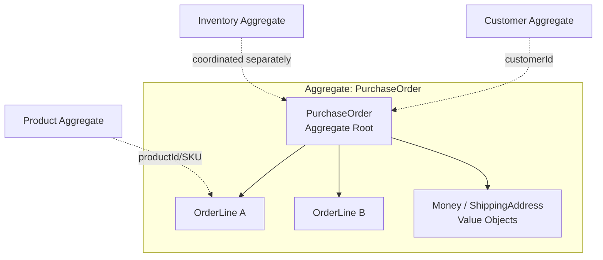

# Aggregates and Aggregate Roots in Domain-Driven Design

When designing an application following **Domain-Driven Design (DDD)**, a database may contain dozens of related tables, yet not every table needs its own repository, and not every foreign key relationship means one object must be saved alongside another. DDD uses **aggregates** and **aggregate roots** to determine which objects belong to the same business boundary, who has the right to change them, and which rules must remain consistent within a single operation.

In **Spring Data Relational/JDBC**, the aggregate concept is especially important because the mapping and persistence mechanism is built around the aggregate root. Designing proper aggregate boundaries helps code accurately reflect the business domain, limits invalid data updates, and avoids unnecessary expensive SQL operations.

## 1. What Problem Do Aggregates Solve?

Consider a sales system with the following data:

- Orders (`PurchaseOrder`).
- Order lines within an order (`OrderLine`).
- Customers (`Customer`).
- Products (`Product`).
- Payments (`Payment`).
- Inventory (`Inventory`).

At the data relationship level, all of them may be linked by primary and foreign keys. At the business level, however, not all of them have to be updated together.

Some rules might be:

1. Only an order in draft status can have lines added or removed.
2. An order line must have a quantity greater than 0 and a non-negative unit price.
3. An order with no lines cannot be confirmed.
4. The order total must be calculated from valid order lines.
5. A customer can exist and change independently of orders.
6. Inventory has its own lifecycle and concurrent update contention, and should not be modified indirectly merely by saving an order.

Rules 1–4 suggest that the order and its lines need to reside within the same **consistency boundary**. Rules 5–6 show that customers and inventory can belong to independent aggregates.

Aggregates help answer three design questions:

- **Where is the data boundary that must be immediately consistent within a single business operation?**
- **Which object is allowed to be the sole entry point and modifier for that group of objects?**
- **Which parts can change independently and should only be referenced by identifier?**

## 2. Distinguishing Entity, Value Object, Aggregate, and Aggregate Root

| Concept | Key characteristic | Example in order management |
| --- | --- | --- |
| **Entity** | Has an **identity** and its own lifecycle; two entities can differ even if their attributes are equal. | `PurchaseOrder` with `orderId`; `OrderLine` with `lineId` if line identity needs to be tracked. |
| **Value Object** | Identified by **value**, typically immutable, needing no separate business identity. | `Money` (amount + currency), `Address` (shipping address). |
| **Aggregate** | A group of entities/value objects treated as **a single unit of consistency** according to business *invariants*. | An order and the order lines belonging to that order. |
| **Aggregate Root** | The leading entity of the aggregate, serving as the **controlled entry point for access and modification** from the outside. | `PurchaseOrder`. |

An aggregate can consist of just **one entity**. It is not mandatory for an aggregate to span multiple tables or contain child objects.

### 2.1. An Entity Is Not Synonymous With an Aggregate Root

An `OrderLine` may have an `id` and be stored in a separate table, yet if it only makes sense within an order, it remains a **child entity** of the `PurchaseOrder` aggregate. Having a primary key does not automatically turn `OrderLine` into an aggregate root.

Conversely, `Customer` usually has an independent lifecycle: registering, updating profiles, deactivating accounts. Therefore, `Customer` is suitable as the root of its own aggregate, even if an order has a `customer_id` column linking to the customer.

### 2.2. A Value Object Does Not Require a Separate Table

A `Money` object might consist only of `amount` and `currency`, stored as columns in the owning entity's table. Value objects are designed based on domain semantics, not on whether data sits in one or multiple tables. In Spring Data Relational, `@Embedded` can be used to map the fields of a value object into its containing table.

### 2.3. The Root Retains Control Over Invariants

Instead of letting external services call `order.getLines().add(...)`, the root exposes behaviors such as:

```java
order.addLine("SKU-BOOK", 2, price);
order.removeLine(lineId);
order.submit();
```

Each behavior can check state and business conditions before making changes. That makes the aggregate root the guardian of the domain model's correctness, rather than just a Java class holding getters and setters.

## 3. The Aggregate Boundary Is a Consistency Boundary

An **invariant** is a domain condition that must always hold true at the moment an operation modifying the aggregate completes. For example:

- `quantity > 0` for every order line.
- A confirmed order cannot have its lines arbitrarily modified.
- The total calculated from the order lines must conform to defined pricing/discount rules.

When executing `order.submit()`, the root can validate the conditions and then transition the state; all changes to the aggregate are saved in an appropriate transaction.



Solid arrows indicate components **owned by the root**. Dashed arrows indicate **references/business relationships between aggregates**, without implying automatic data loading or saving mechanisms.

### 3.1. Internal and External Consistency Rules

Inside an aggregate, invariants should be enforced before completing the operation and written to the database in a consistent transaction.

Between independent aggregates, coordination can occur through application services, domain events, outbox, or sagas when the business requires it. They are usually designed to change independently and may achieve *eventual consistency* in distributed workflows.

**Do not assume it is strictly impossible to update two aggregates in the same database transaction.** Technically, this can be done; DDD encourages avoiding tightly coupled rules that force multiple aggregates to constantly change together just to remain valid. The goal is to have small units of consistency with clear responsibilities.

### 3.2. An Aggregate Is Not a Copy of a Foreign Key Diagram

For instance, `purchase_orders.customer_id` may be a foreign key to `customers.id`. Yet the design meaning remains: the customer belongs to another aggregate, and updating the customer does not require re-saving the order.

Similarly, `order_lines.order_id` is a link in the database, while also representing an ownership relationship within the aggregate if order lines are only created, modified, and deleted through the order.

**Foreign keys describe data integrity constraints; aggregates describe behavioral boundaries and business consistency.** The two perspectives can be compatible, but they are not the same thing.

## 4. A Domain Example: Orders and Order Lines

Suppose the initial rules are:

- Only create a new order when there is a valid `customerId`.
- Only edit order lines while the order is still in `DRAFT`.
- Quantity must be positive; unit price must be non-negative.
- An order can only be submitted for confirmation if it has at least one order line.
- The order value is calculated from the order lines; inventory/payment checks belong to other components.

The illustrative model below uses a class with mutable fields to make it easy to see how Spring Data JDBC restores objects from the database. Important mutating methods are still placed on the root.

### 4.1. Aggregate Root `PurchaseOrder`

```java
package example.order;

import java.math.BigDecimal;
import java.util.ArrayList;
import java.util.Collections;
import java.util.List;

import org.springframework.data.annotation.Id;
import org.springframework.data.annotation.Version;
import org.springframework.data.relational.core.mapping.MappedCollection;
import org.springframework.data.relational.core.mapping.Table;

@Table("purchase_orders")
public class PurchaseOrder {

    @Id
    private Long id;

    @Version
    private Long version;

    private Long customerId;

    private OrderStatus status;

    @MappedCollection(
        idColumn = "order_id",
        keyColumn = "line_position"
    )
    private List<OrderLine> lines = new ArrayList<>();

    protected PurchaseOrder() {
        // Constructor for the materialization mechanism.
    }

    private PurchaseOrder(Long customerId) {
        if (customerId == null || customerId <= 0) {
            throw new IllegalArgumentException("Invalid customerId");
        }
        this.customerId = customerId;
        this.status = OrderStatus.DRAFT;
    }

    public static PurchaseOrder draftFor(Long customerId) {
        return new PurchaseOrder(customerId);
    }

    public void addLine(
        String sku, int quantity, BigDecimal unitPrice
    ) {
        requireDraft();
        lines.add(new OrderLine(sku, quantity, unitPrice));
    }

    public void submit() {
        requireDraft();
        if (lines.isEmpty()) {
            throw new IllegalStateException(
                "Cannot submit an empty order"
            );
        }
        this.status = OrderStatus.SUBMITTED;
    }

    public BigDecimal total() {
        return lines.stream()
            .map(OrderLine::subtotal)
            .reduce(BigDecimal.ZERO, BigDecimal::add);
    }

    public List<OrderLine> getLines() {
        return Collections.unmodifiableList(lines);
    }

    public Long getId() {
        return id;
    }

    public Long getCustomerId() {
        return customerId;
    }

    public OrderStatus getStatus() {
        return status;
    }

    private void requireDraft() {
        if (status != OrderStatus.DRAFT) {
            throw new IllegalStateException(
                "Only orders in DRAFT status can be modified"
            );
        }
    }
}
```

Note the design points:

- `PurchaseOrder` is the **aggregate root**, so external code can only request changes through methods like `addLine` or `submit`.
- `getLines()` returns an unmodifiable list; to change an individual line, the root should expose its own domain method, such as `changeQuantity(...)`.
- `@Id` provides the root's identifier; `@Version` supports optimistic locking when saving.
- `@MappedCollection` describes a list of objects **owned by the root** and mapped to a child table.
- `customerId` is a reference to an independent customer aggregate. The `PurchaseOrder` class does not embed the entire `Customer` as an owned child.

### 4.2. Child Entity `OrderLine`

```java
package example.order;

import java.math.BigDecimal;

import org.springframework.data.annotation.Id;
import org.springframework.data.relational.core.mapping.Table;

@Table("order_lines")
public class OrderLine {

    @Id
    private Long id;

    private String sku;
    private int quantity;
    private BigDecimal unitPrice;

    protected OrderLine() {
        // Constructor for the materialization mechanism.
    }

    OrderLine(String sku, int quantity, BigDecimal unitPrice) {
        if (sku == null || sku.isBlank()) {
            throw new IllegalArgumentException("SKU is required");
        }
        if (quantity <= 0) {
            throw new IllegalArgumentException("Quantity must be positive");
        }
        if (unitPrice == null || unitPrice.signum() < 0) {
            throw new IllegalArgumentException("Invalid unit price");
        }

        this.sku = sku;
        this.quantity = quantity;
        this.unitPrice = unitPrice;
    }

    public BigDecimal subtotal() {
        return unitPrice.multiply(BigDecimal.valueOf(quantity));
    }
}
```

```java
package example.order;

public enum OrderStatus {
    DRAFT,
    SUBMITTED
}
```

This example intentionally provides no separate service/repository to modify `OrderLine`. An order line may have an ID in the database, yet its business lifecycle still depends on the order.

In a real-world application, the total amount may need `Money`, rounding rules, taxes, promotions, and price snapshots at order placement time. Those corresponding invariants should then be defined inside the aggregate or an appropriate domain service; the example above is solely to clarify aggregate boundaries.

### 4.3. Repository for the Root

```java
package example.order;

import org.springframework.data.repository.ListCrudRepository;

public interface PurchaseOrderRepository
        extends ListCrudRepository<PurchaseOrder, Long> {
}
```

`ListCrudRepository` is a contract from **Spring Data Commons**; **Spring Data JDBC** generates the implementation to save and load the `PurchaseOrder` aggregate; **Spring Data Relational** provides mapping metadata such as `@Table` and `@MappedCollection`.

With this design, the application service can do:

```java
package example.order;

import java.math.BigDecimal;

import org.springframework.stereotype.Service;
import org.springframework.transaction.annotation.Transactional;

@Service
public class OrderApplicationService {

    private final PurchaseOrderRepository orders;

    public OrderApplicationService(PurchaseOrderRepository orders) {
        this.orders = orders;
    }

    @Transactional
    public Long createDraft(Long customerId) {
        PurchaseOrder order = PurchaseOrder.draftFor(customerId);
        order.addLine(
            "BOOK-001", 2, new BigDecimal("120000.00")
        );
        return orders.save(order).getId();
    }

    @Transactional
    public void submit(Long orderId) {
        PurchaseOrder order = orders.findById(orderId)
            .orElseThrow(() ->
                new IllegalArgumentException("Order not found")
            );

        order.submit();
        orders.save(order);
    }
}
```

Here, the application service **orchestrates the use case and transaction**, while the root **enforces state rules**. The repository is the persistence gateway; it is not the place that decides which orders can be confirmed.

If a service calls `order.submit()` and forgets `orders.save(order)`, Spring Data JDBC has no JPA persistence context or dirty checking to automatically detect all changes when the transaction ends. In this model, the root save operation must be called explicitly.

## 5. Database Tables and How Spring Data JDBC Maps Aggregates

An illustrative relational schema for the example:

```sql
CREATE TABLE purchase_orders (
    id BIGINT GENERATED BY DEFAULT AS IDENTITY PRIMARY KEY,
    version BIGINT,
    customer_id BIGINT NOT NULL,
    status VARCHAR(24) NOT NULL
);

CREATE TABLE order_lines (
    id BIGINT GENERATED BY DEFAULT AS IDENTITY PRIMARY KEY,
    order_id BIGINT NOT NULL,
    line_position INT NOT NULL,
    sku VARCHAR(64) NOT NULL,
    quantity INT NOT NULL,
    unit_price DECIMAL(18, 2) NOT NULL,
    CONSTRAINT fk_order_lines_order
        FOREIGN KEY (order_id) REFERENCES purchase_orders(id),
    CONSTRAINT uq_order_line_position
        UNIQUE (order_id, line_position)
);
```

The `order_lines` table is attached to the root by `order_id`. The `keyColumn = "line_position"` attribute specifies the column storing the **position in the `List`**, typically using a 0-based index. With `Set` or `Map`, how collection keys/positions are represented differs and requires corresponding mapping.

The annotations come from different packages:

| Annotation | Package | Role |
| --- | --- | --- |
| `@Id` | `org.springframework.data.annotation` | Identifies an entity according to Spring Data Commons. |
| `@Version` | `org.springframework.data.annotation` | Version information for optimistic locking. |
| `@Table` | `org.springframework.data.relational.core.mapping` | Relational table name. |
| `@Column` | `org.springframework.data.relational.core.mapping` | Relational column name when explicitly specified. |
| `@MappedCollection` | `org.springframework.data.relational.core.mapping` | Ownership relationship for child objects/collections within an aggregate. |

**Important:** Defining Java entities does not automatically create the `purchase_orders` and `order_lines` tables via a Hibernate DDL mechanism. Spring Data JDBC normally works with an existing schema; schema management should be handled through Flyway/Liquibase or explicitly configured SQL initialization.

## 6. What Happens When Saving an Aggregate?

An operation like:

```java
PurchaseOrder order = PurchaseOrder.draftFor(42L);
order.addLine("BOOK-001", 2, new BigDecimal("120000.00"));
PurchaseOrder saved = repository.save(order);
```

can be viewed in logical steps:

1. The repository receives the **root** `PurchaseOrder`.
2. Spring Data JDBC infrastructure determines whether the aggregate is new or existing, usually based on `@Id` or `@Version`, and this can be customized.
3. Relational mapping resolves the root to the `purchase_orders` table and the child collection to `order_lines`.
4. Spring Data JDBC executes the necessary INSERT/UPDATE/DELETE statements via Spring JDBC and the JDBC driver.
5. `save` returns the persisted root; whenever you need the persisted result (such as a database-generated ID), use the returned object.

### 6.1. Important Characteristic When Updating Child Collections

Spring Data JDBC does not work like a JPA ORM with a persistence context and per-association dirty checking. Under the traditional aggregate persistence model, when updating an existing root, the framework **may delete and recreate the rows belonging to child collections** to synchronize the aggregate state, rather than updating only the single modified child row.

Practical consequences:

- An aggregate with thousands of child lines can generate a large number of write statements when saved.
- If the child table has triggers, audits, or external references, deletion/recreation can cause unexpected effects.
- Separate IDs on child entities must be designed intentionally; do not assume they are always preserved across every kind of update.
- A very large aggregate may be a sign that the domain boundary has been drawn too broadly.

The way to mitigate the issue is not merely SQL tuning. First check whether those elements genuinely belong to **the same lifecycle and set of invariants**, or whether they should be split into independent aggregates.

### 6.2. Transactions and Saving Aggregates

Saving a multi-table aggregate may require multiple SQL statements. Placing the operation inside a transaction keeps root and child line changes consistent if a step fails:

```java
@Transactional
public void addProduct(Long orderId, String sku) {
    PurchaseOrder order = orders.findById(orderId)
        .orElseThrow();
    order.addLine(sku, 1, new BigDecimal("99000.00"));
    orders.save(order);
}
```

If the application executes additional database operations in the same transaction, determine which business actions truly must commit together. The `@Transactional` annotation belongs to Spring's transaction management mechanism, not a DDD-specific annotation.

## 7. Communication Between Aggregates: Referencing by ID

A common design principle in DDD is that **each independent aggregate references other aggregates via identifier**.

Instead of:

```java
// Easily blurs ownership boundaries if mapped as a child object.
private Customer customer;
```

you can use:

```java
private Long customerId;
```

In Spring Data JDBC, a more expressive option is the `AggregateReference` type:

```java
import org.springframework.data.jdbc.core.mapping.AggregateReference;

// Customer is an independent aggregate root.
// The field below holds the ID, without embedding the entire Customer.
private AggregateReference<Customer, Long> customer;
```

To create a reference value, you can use `AggregateReference.to(customerId)`. This type represents a reference to **another root**, yet it **does not automatically fetch `Customer`** and does not imply cascade save/delete.

### 7.1. Why Are Boundaries Needed?

Suppose an order holds a reference to a customer. When changing the customer's contact address:

- The customer service loads, modifies, and saves the **Customer aggregate**.
- There is no need to load all past orders belonging to that customer.
- There is no need to call `PurchaseOrderRepository.save` for every order.
- It avoids implicitly turning the collection of all orders into a giant aggregate.

If the business requires **preserving the shipping address finalized at order placement time**, the order can keep a copy of *ShippingAddress* as a **value object belonging to the order**. This is a business decision: the shipping address of a placed order does not necessarily change when the customer edits their profile.

### 7.2. Independent Roots Do Not Have to Lack Foreign Keys

The database can still define `purchase_orders.customer_id` as a foreign key pointing to `customers.id` to protect referential integrity. That does not force the code to embed `Customer` into the `PurchaseOrder` aggregate. DDD determines ownership; relational constraints support stored data correctness.

## 8. How to Choose Aggregate Boundaries

To decide which objects belong to the same aggregate, you can ask the following questions in turn.

### 8.1. Are There Invariants Requiring Immediate Synchronization?

If submitting an empty order is disallowed, `PurchaseOrder` needs to know the set of lines belonging to it when executing `submit()`. Those lines are reasonable candidates for entities/value objects inside the aggregate.

If the rule is merely "the customer must be active when creating an order," checking the customer's status can be performed by the application service and an appropriate policy; that alone does not require making the entire `Customer` a child of `PurchaseOrder`.

### 8.2. Does the Child Component Have an Independent Lifecycle?

Ask:

- Can the child component exist when the root is deleted?
- Can it be moved to another root with the same identity?
- Is there any use case that needs to edit it independently of the root?
- Who is responsible for maintaining its business rules?

An `OrderLine` that only has meaning within a single order normally belongs to `PurchaseOrder`. Conversely, `Product` exists independently, is referenced by many orders, and has its own lifecycle, so it makes more sense as a separate aggregate.

### 8.3. Do Changes Contend on the Same Root?

An aggregate is the unit of update control. If hundreds of independent operations must load and save a very large root together, optimistic locking conflicts or heavy child SQL writes may occur. In that case, consider smaller boundaries or splitting use cases, provided doing so does not break invariants that genuinely need synchronous consistency.

### 8.4. Is the Aggregate Being Designed Around UI Screens or JOINs?

You should not group entities into a single aggregate merely because:

- A screen needs to display them together.
- The database has foreign keys between the tables.
- A SQL query can JOIN them.
- An API response needs to represent them as a nested JSON object.

**Data reading** needs can be solved with query models, projections, or SQL JOINs. **Consistent writing** needs are the central factor when choosing aggregate boundaries.

## 9. The Relationship Between Repositories and Aggregate Roots

In common DDD organization, **repositories are defined for aggregate roots**. Application code loads the root, invokes domain behavior, and saves the root back.

```text
Application Service
    │
    ├── PurchaseOrderRepository.findById(orderId)
    │          │
    │          ▼
    │     PurchaseOrder (root)
    │          ├── OrderLine
    │          └── OrderLine
    │
    ├── PurchaseOrder.submit()
    │
    └── PurchaseOrderRepository.save(root)
```

If an `OrderLineRepository` is also created so any service can directly modify order lines, many order rules can be bypassed:

- Adding a line after the order is confirmed.
- Setting quantity to 0 without validation.
- Deleting the last line from an order required to have lines.
- Corrupting the total amount/status without the root knowing.

Spring Data JDBC can run direct SQL to update tables, yet **technical capability does not replace the domain contract**. If a use case truly requires direct SQL modification, ensure invariants and appropriate concurrency controls are still protected.

### 9.1. Repository in Domain or in Infrastructure?

In layered/hexagonal architecture, the root's repository interface can live near domain/application, while the Spring Data JDBC adapter sits in infrastructure. In smaller applications, an interface extending `ListCrudRepository` directly can also be pragmatic. Whichever organization is chosen, the steady principle is that business write operations must protect aggregate boundaries.

## 10. Aggregates and Concurrent Updates

Two concurrent requests can load the same version of a `PurchaseOrder`:

```text
Time          Request A                  Request B
---------     ---------------------      ---------------------
T1            Load Order(version=3)
T2                                       Load Order(version=3)
T3            Add line
T4                                       Submit order
T5            Save(version 3 -> 4)
T6                                       Save(version=3) -> conflict
```

When the root is annotated with `@Version` and the version column is backed in the schema, Spring Data JDBC can detect an update based on a stale version and report an **optimistic locking failure** (typically `OptimisticLockingFailureException` or a subtype).

Key points to remember:

- The version is managed on the **root**, helping detect conflicts when two operations write to the same aggregate.
- With optimistic locking, the application needs clear post-conflict behavior: inform the user, re-read and recompute the command, or perform a conditional retry.
- Do not blindly retry every operation: non-idempotent commands can produce duplicate side effects.
- If other code updates child rows directly without going through the root, the root's version may not change, undermining overall consistency control.

Note that `@Version` does not replace database constraints, transaction isolation, or appropriate locking when checking invariants across multiple data sources.

## 11. Common Mistakes

| Common design | Problem | Better approach |
| --- | --- | --- |
| "Every table is an aggregate" | Confuses the storage model with business boundaries. | Identify invariants, lifecycles, and change control points. |
| One aggregate containing all customer, order, payment, and inventory data | Overly broad boundary, hard to coordinate, heavy loads/writes, and prone to conflicts. | Split by ownership and required consistency. |
| Services directly mutating child collections | The root cannot protect invariants. | Provide domain methods on the root. |
| Creating independent CRUD repositories for every child entity | Can bypass root rules. | Design repositories primarily for aggregate roots. |
| Mapping every foreign key as a nested object | Easily misinterprets another aggregate as an owned component, causing unwanted cascades. | Reference independent aggregates by ID or `AggregateReference`. |
| Treating `save(root)` like JPA dirty checking | Misunderstands JDBC's child collection re-writing behavior. | Understand JDBC aggregate persistence and keep boundaries small enough. |
| Using a large aggregate just to fetch data for a reporting screen | Causes unnecessary object/SQL loading. | Create appropriate read queries/DTOs/projections. |
| Letting roots check an invariant requiring synchronous consistency without coordination | Invalid states can occur under parallel execution. | Re-evaluate boundaries or build appropriate coordination/transactions. |

## 12. Design Scenario: Orders, Payments, and Inventory

Consider the requirement: "Customer clicks Place Order, and the system must reserve stock, create the order, and collect payment." A design might separate:

- **Order aggregate**: root `PurchaseOrder`, `OrderLine` items, order status, finalized pricing info.
- **Inventory aggregate**: available/reserved quantities by SKU or warehouse location; enforces the rule against reserving beyond available supply.
- **Payment aggregate**: payment session, transaction status, and reference code from the payment gateway.
- **Customer aggregate**: customer profile and account status.

An application/service-level workflow can:

1. Validate the request and create the appropriate order placement command.
2. Coordinate with Inventory to reserve stock according to the inventory aggregate's rules.
3. Create or transition the Order status.
4. Emit a payment request event and track the result.
5. When payment succeeds or fails, apply the appropriate domain command to the related aggregates.

In a small system using a single database, some steps can share a database transaction if such consistency is required. In a multi-service system or one involving an external payment gateway, a database transaction cannot directly span every task; idempotency, events/outbox, retries, and controlled compensating actions must be designed.

The crucial point is that **each root owns its own state and invariants**. Do not pull full `Inventory` or `Payment` objects into `PurchaseOrder` simply because the ordering workflow uses them.

## 13. When Should a Large Aggregate Be Split?

Suppose a `Project` has thousands of `Task` items, each updated independently by many users. If all tasks are a child collection of `Project`, every save of the root may need to synchronize a large amount of data. In that situation, ask:

- Is there any rule forcing all tasks to be updated synchronously with the project?
- Do tasks have independent lifecycles, assignees, and statuses?
- Can project-level rules be enforced by a policy or an appropriate summary mechanism?
- Which use cases need to operate on individual tasks without requiring the whole project to be loaded?

If tasks are genuinely independent units of update, modeling `Project` and `Task` as two aggregates with ID references may fit better. However, do not split merely because there are many rows: if invariants truly require every line to remain synchronously consistent, reconsider domain behavior, transactions, and update cost.

## 14. Thinking Checklist Before Writing Mappings

Before adding `@Table` or `@MappedCollection` annotations, answer for yourself:

1. **Who is the root?** Which entity has the identity and lifecycle representing the business concept?
2. **What are the invariants?** Which conditions must hold immediately after each command?
3. **Who can modify?** Which methods on the root will control changes?
4. **Which components are owned?** Are their lifecycles tightly bound to the root?
5. **Which components are independent?** Should they be referenced by ID or `AggregateReference`?
6. **What are the size and write contention characteristics?** Will saving the root cause excessive SQL or version conflicts?
7. **What is the transaction strategy?** Which operations must commit together; where is cross-aggregate coordination needed?
8. **Do read queries require write modeling?** Can reporting/UI needs be solved with SQL projections without expanding the aggregate?

Only after answering these questions should you decide on repository structure, relationship mappings, and transaction boundaries.

## 15. Connecting Back to Spring Data Relational/JDBC

The related layers in the ecosystem play distinct roles:

| Component | Role with respect to aggregates |
| --- | --- |
| **DDD/domain model** | Defines which objects form the aggregate, who the root is, and which invariants must be protected. |
| **Spring Data Commons** | Provides repository contracts, common metadata (`@Id`, `@Version`), and repository support infrastructure. |
| **Spring Data Relational** | Provides table/column and owned collection mappings (`@Table`, `@MappedCollection`). |
| **Spring Data JDBC** | Saves/loads the root and aggregate members via JDBC; executes persistence according to declared mappings. |
| **Spring JDBC + database** | Executes SQL, manages connections/transactions per Spring configuration, and enforces data constraints at the database. |

> **An aggregate is a unit that protects business consistency; an aggregate root is the control gate for changes to that unit.** In Spring Data JDBC, the root is also the primary unit of persistence. Designing aggregates around invariants and domain lifecycles before designing storage relationships helps avoid turning every foreign key or every JOIN into an inappropriate ownership relationship.

### References

- [Martin Fowler — DDD Aggregate](https://martinfowler.com/bliki/DDD_Aggregate.html): aggregate concepts and consistency boundaries.
- [Spring Data Relational — Reference](https://docs.spring.io/spring-data/relational/reference/): overview of relational modules.
- [Spring Data JDBC — Domain-Driven Design and Relational Databases](https://docs.spring.io/spring-data/relational/reference/jdbc/domain-driven-design.html): how Spring Data JDBC views aggregates and persistence responsibilities.
- [Spring Data JDBC — Object Mapping](https://docs.spring.io/spring-data/relational/reference/jdbc/mapping.html): aggregate and entity mapping rules.
