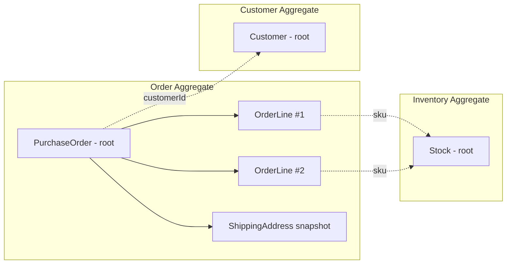
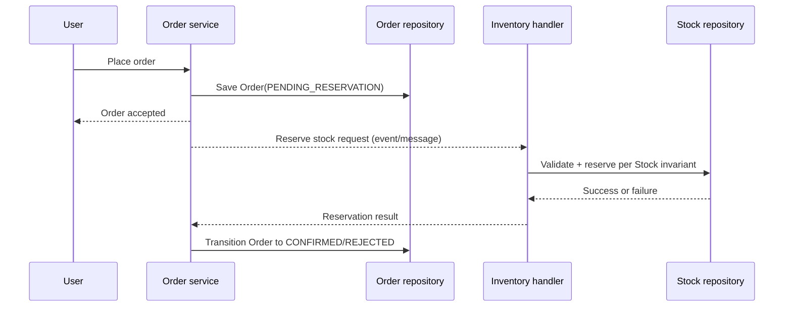
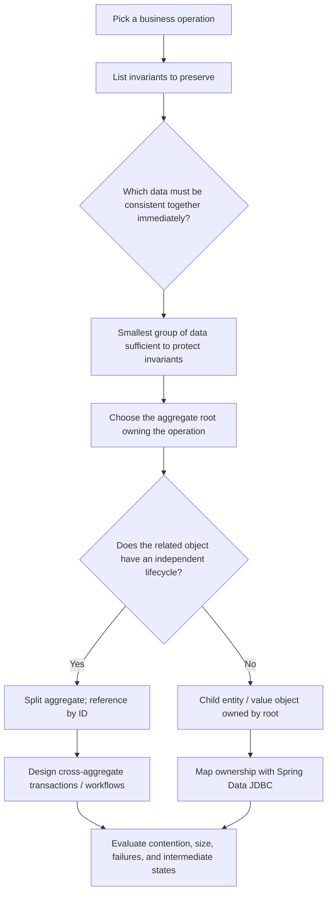

# Determining Aggregate Boundaries From Business Rules and Consistency

In **Spring Data JDBC**, aggregate design determines which data is loaded, modified, and saved as **a single business unit**. If the boundary is too wide, a minor operation can trigger excessive SQL, create update contention, and hinder scalability. If the boundary is too narrow, rules requiring multiple objects to change together can easily be violated. Therefore, the best way to determine aggregates starts from **the business rules that need to be protected**, and only then moves to tables, foreign keys, or class structures.

This lesson focuses on the question: **Which objects must always be consistent with one another immediately after a business operation completes, and which objects can be coordinated via IDs, application transactions, or events?** From that answer, we identify the aggregate root, internal components, and relationships between aggregates, and then map the design to Spring Data JDBC.

## 1. An Aggregate Is a Consistency Boundary, Not a Relational Diagram

In Domain-Driven Design (DDD), an **aggregate** is a group of objects belonging to the same consistency boundary. They are accessed and modified through an **aggregate root**. An aggregate can contain:

- **Aggregate root**: the entity representing and controlling business operations for the entire group, such as `PurchaseOrder`.
- **Child entity**: has an identity or lifecycle managed within the scope of the aggregate, such as an order line belonging to a purchase order.
- **Value object**: represents a value needing no independent identity, such as shipping address details captured when the order is placed.
- **Invariant**: a condition that must always hold true when a business operation is accepted, for example *a submitted order must have at least one valid order line*.

Example with an ordering system:



Solid lines represent components **inside** the order; dashed lines represent **references to other aggregates by ID/business key**. An order may need to know which customer placed it and which item codes were purchased, but that **does not mean** all customer and inventory data must belong to the `PurchaseOrder` aggregate.

A SQL foreign key merely indicates a relationship or referential constraint in the database. It **does not automatically define** an aggregate boundary. A database can have multiple tables within a single aggregate, and multiple aggregates can coexist in a single table if the model and mapping fit.

### Characteristics to Remember in Spring Data JDBC

Spring Data JDBC treats the **aggregate root** as the focal point for working through repositories. When saving an aggregate, the framework can write to multiple tables belonging to the root's ownership structure. There is no persistence context or dirty checking like in JPA: modifying objects in memory does not automatically generate SQL `UPDATE` statements; `repository.save(root)` must normally be called.

Consequently, boundary mistakes not only create business risks but also directly affect **the amount of data rewritten** and **update contention**.

## 2. Start From Business Rules, Not From Tables

Suppose the product has the following requirements:

1. Every order line must have a quantity greater than 0 and a non-negative unit price.
2. An order can only be submitted when it has at least one order line.
3. The order total equals the sum of `quantity × unitPrice` across the order lines, following business rounding rules.
4. Confirmed shipment quantities must not exceed the quantity still allocatable in inventory.
5. Later changes to a customer's name must not alter the confirmed shipping address on past orders.

These rules have different scopes. Ensuring **a single order** has valid lines needs to be protected directly inside `PurchaseOrder`. Meanwhile, the remaining quantity of **a warehouse item** may need to be protected at `Stock` or `InventoryItem`, because many orders contend for that same inventory source.

| Rule | Participating objects | Appropriate place to protect | Consistency requirement |
|---|---|---|---|
| Quantity of each order line must be positive | `OrderLine` | Creating/editing lines inside `PurchaseOrder` | Immediate within the order |
| Do not submit an empty order | `PurchaseOrder`, line list | `PurchaseOrder.submit()` | Immediate upon state transition |
| Total matches the lines | Root and order lines | Calculated from lines, or controlled updates in root | Same order version |
| Do not allocate negative inventory | Allocation requests sharing an item | `Stock` aggregate and concurrent update protection | Immediate upon allocation confirmation |
| Address on old orders does not change when customer edits profile | Order and customer | Store address snapshot inside the order | Confirmed orders remain unchanged |

When listing rules, ask clearly what **"immediate"** means: after a domain method finishes, after the database transaction commits, or perhaps a few seconds later when another process handles an event? This distinction determines boundaries and how aggregates coordinate.

## 3. Strong Invariants and Eventual Consistency

An **invariant** is a condition that must never be violated at a chosen business boundary. For example, a `PurchaseOrder` in `SUBMITTED` status must have at least one order line. If the application can call `submit()` and leave the order in `SUBMITTED` status while empty, the aggregate has failed to protect its rule.

### Strong Consistency Within an Aggregate

For rules that must hold immediately upon saving, design behavior so that the root **checks and changes related data together**:

```text
PurchaseOrder.submit()
    -> Check current status
    -> Check at least one valid OrderLine
    -> Transition status to SUBMITTED
    -> repository.save(order) inside transaction
```

A database transaction groups related SQL statements to commit or rollback consistently. In Spring Data JDBC, a single `save` of an aggregate with collections can produce multiple SQL statements; transactions are needed to ensure those statements succeed together. If a business flow coordinates multiple repository calls, place `@Transactional` at the application service layer to encompass all required work.

### Eventual Consistency Between Aggregates

Some rules allow latency. For example, an order is created in `PENDING_RESERVATION` status, then the inventory module processes the stock reservation request, and then the order transitions to `CONFIRMED` or `REJECTED`. This is a **multi-step workflow**, not a single simultaneous save of the entire object graph.



While waiting for processing, the order can sit in a valid intermediate state. **Eventual consistency is only appropriate when the business accepts that intermediate state.** If the system guarantees *never confirming an order before stock is reserved*, do not label it `CONFIRMED` prior to reservation and hope to update it later.

In real-world systems, event delivery mechanisms must account for communication failures, duplicate processing, ordering, and recovery. A **transactional outbox** is often used to store event info in the same transaction that modifies the aggregate, and then reliably forward the event. Handlers should be idempotent; do not assume every message arrives strictly once.

## 4. Process for Determining Aggregate Boundaries

You can apply the following process before designing tables or repositories.

### Step 1 — List Business Operations and States

Identify business commands that change data, such as:

- `createOrder`, `addLine`, `removeLine`, `submitOrder`, `cancelOrder`.
- `reserveStock`, `releaseStock`, `adjustStock`.
- `changeCustomerAddress`, `deactivateCustomer`.

Avoid listing only generic CRUD operations like "insert a row in a table." Statements like *"only unshipped orders may be cancelled"* or *"quantity cannot be negative"* reveal consistency boundaries better than table names.

### Step 2 — Specify Invariants and Data Required to Check Them

For each command, ask: what conditions must hold before and after the command? Where does the data to check live? If only the order status and order lines are needed, that invariant belongs to `PurchaseOrder`. If inventory counts affected by thousands of different orders are needed, that invariant requires an independent owner such as `Stock`.

### Step 3 — Identify Units That Must Commit Together

Pieces of data that must be changed in **the same consistent operation** are candidates to be placed in the same aggregate. Yet there is no rule saying "all data needing the same transaction must sit in the same aggregate": the application can use a transaction across multiple repositories when genuinely required. Doing so does not merge two aggregates into one.

The deciding factor is **who is responsible for protecting the invariant** and whether that invariant can be maintained without loading an unbounded object graph.

### Step 4 — Choose the Root and Hide Dangerous Operations

The aggregate root needs a clear identity and domain API:

```text
order.addLine(...)
order.submit()
order.cancel(reason)
```

Instead of letting every service mutate arbitrarily:

```text
order.lines.clear()
order.status = SUBMITTED
```

Changes that risk breaking invariants should go through root methods. Children must not be modified independently via a separate repository if they belong to the root's ownership scope.

### Step 5 — Express Cross-Boundary Relationships by Identity

If `PurchaseOrder` needs to reference `Customer`, store `customerId` or an appropriate value reference. The order only needs to reference the customer; it does not own the entire customer profile. If `OrderLine` needs a product, it can store `sku`/`productId` along with finalized details such as name and unit price at placement time, depending on business rules.

### Step 6 — Consider Size, Contention, and Lifecycle

Test real operational scenarios: one customer with 100,000 orders; one product with 50,000 inventory updates; two people editing an order concurrently; an order line being deleted. If every small change forces re-saving too much data, or unrelated changes contend for the same version, the boundary may be too wide.

## 5. Design Example: Orders and Order Lines in One Aggregate

Suppose the order's business rules are:

- Order lines may only be modified while the order is `DRAFT`.
- An order line must have `quantity > 0`, `unitPrice >= 0`.
- Only `submit` when the order has at least one line.
- Once `SUBMITTED`, order lines may not be modified via normal operations.

All of these conditions rely on the root and the lines of **the same order**. Therefore, grouping `PurchaseOrder` with `OrderLine` is a reasonable choice.

### 5.1. Sketch of Domain Code With Invariant-Protecting Behavior

```java
import java.math.BigDecimal;
import java.util.ArrayList;
import java.util.List;
import java.util.Objects;
import org.springframework.data.annotation.Id;
import org.springframework.data.annotation.Version;
import org.springframework.data.relational.core.mapping.MappedCollection;
import org.springframework.data.relational.core.mapping.Table;

enum OrderStatus { DRAFT, SUBMITTED }

@Table("purchase_orders")
public class PurchaseOrder {
    @Id
    private Long id;

    @Version
    private Long version;

    private Long customerId;
    private OrderStatus status = OrderStatus.DRAFT;

    @MappedCollection(idColumn = "order_id", keyColumn = "line_position")
    private List<OrderLine> lines = new ArrayList<>();

    protected PurchaseOrder() { }

    public PurchaseOrder(Long customerId) {
        this.customerId = Objects.requireNonNull(customerId);
    }

    public void addLine(String sku, int quantity, BigDecimal unitPrice) {
        ensureDraft();
        lines.add(new OrderLine(sku, quantity, unitPrice));
    }

    public void submit() {
        ensureDraft();
        if (lines.isEmpty()) {
            throw new IllegalStateException("Cannot submit an empty order");
        }
        status = OrderStatus.SUBMITTED;
    }

    public BigDecimal total() {
        return lines.stream()
                .map(OrderLine::subtotal)
                .reduce(BigDecimal.ZERO, BigDecimal::add);
    }

    public Long getId() { return id; }
    public OrderStatus getStatus() { return status; }
    public List<OrderLine> getLines() { return List.copyOf(lines); }

    private void ensureDraft() {
        if (status != OrderStatus.DRAFT) {
            throw new IllegalStateException("Order is no longer in DRAFT status");
        }
    }
}

@Table("order_lines")
class OrderLine {
    private String sku;
    private int quantity;
    private BigDecimal unitPrice;

    protected OrderLine() { }

    OrderLine(String sku, int quantity, BigDecimal unitPrice) {
        if (sku == null || sku.isBlank()) {
            throw new IllegalArgumentException("SKU must not be blank");
        }
        if (quantity <= 0) {
            throw new IllegalArgumentException("Quantity must be positive");
        }
        if (unitPrice == null || unitPrice.signum() < 0) {
            throw new IllegalArgumentException("Unit price must not be negative");
        }
        this.sku = sku;
        this.quantity = quantity;
        this.unitPrice = unitPrice;
    }

    BigDecimal subtotal() {
        return unitPrice.multiply(BigDecimal.valueOf(quantity));
    }
}
```

This is the core illustrating aggregate design; in a real project, additional constructors, enums, currency rules, state transition checks, and equals/hashCode can be added as needed. The key point is that `PurchaseOrder` **owns the list of order lines** and controls mutation paths. Returning an unmodifiable copy from `getLines()` prevents external code from arbitrarily adding/removing lines and bypassing `addLine()`.

`@MappedCollection(idColumn = "order_id", keyColumn = "line_position")` tells Spring Data JDBC how to persist `List<OrderLine>`: child rows carry a key column referencing the root (`order_id`) and a column storing the position in the list (`line_position`). Column names and key design must match the database schema. `@Version` provides the basis for controlling overwrites from concurrent updates to the aggregate.

### 5.2. Repository Placed at the Aggregate Root

```java
import org.springframework.data.repository.CrudRepository;

public interface PurchaseOrderRepository
        extends CrudRepository<PurchaseOrder, Long> {
}
```

Normally **`OrderLineRepository` is not needed** if `OrderLine` only lives within the order. Creating a repository that writes directly to child lines allows application services to modify data without going through `PurchaseOrder`'s rules.

An application service executing a use case:

```java
import org.springframework.stereotype.Service;
import org.springframework.transaction.annotation.Transactional;

@Service
public class OrderApplicationService {
    private final PurchaseOrderRepository orders;

    public OrderApplicationService(PurchaseOrderRepository orders) {
        this.orders = orders;
    }

    @Transactional
    public PurchaseOrder submit(Long orderId) {
        PurchaseOrder order = orders.findById(orderId)
                .orElseThrow(() -> new IllegalArgumentException("Order not found"));

        order.submit();
        return orders.save(order);
    }
}
```

Here, the service orchestrates `findById` and `save` within a transaction; the aggregate itself decides **whether the order meets the conditions to submit**. Domain logic and application orchestration are cleanly separated.

### 5.3. Illustrative Schema

```sql
CREATE TABLE purchase_orders (
    id BIGINT GENERATED BY DEFAULT AS IDENTITY PRIMARY KEY,
    version BIGINT,
    customer_id BIGINT NOT NULL,
    status VARCHAR(30) NOT NULL
);

CREATE TABLE order_lines (
    order_id BIGINT NOT NULL,
    line_position INTEGER NOT NULL,
    sku VARCHAR(100) NOT NULL,
    quantity INTEGER NOT NULL,
    unit_price DECIMAL(18, 2) NOT NULL,
    PRIMARY KEY (order_id, line_position),
    CONSTRAINT fk_order_lines_order
        FOREIGN KEY (order_id) REFERENCES purchase_orders(id)
);
```

This example uses identity syntax common in H2 and several databases, which is not fully portable DDL across all dialects. `version` supports optimistic locking. `customer_id` is a reference ID to the **customer aggregate**, yet it does not need to be modeled as a `Customer` object inside `PurchaseOrder`.

The `OrderLine` relationship is **owned by the aggregate**: lines do not need an independent lifecycle outside the order. If business requirements later demand each line have its own identifier, return history, and independent approval workflow, the model should be revisited, rather than splitting preemptively just because an ID column is added.

## 6. What Happens When Calling `save` on an Aggregate in Spring Data JDBC?

Spring Data JDBC does not work like an ORM with automatic dirty checking. When calling:

```java
PurchaseOrder order = orders.findById(id).orElseThrow();
order.addLine("SKU-01", 2, new BigDecimal("50.00"));
orders.save(order);
```

The framework processes **the aggregate state supplied**, not just a single `quantity` column or the newly edited line. For collections belonging to an aggregate, Spring Data JDBC's default save strategy may **delete and recreate multiple child records** when updating the root, rather than computing minimal per-child diffs as many expect from JPA.

Overview flow:

```mermaid
flowchart TD
    A[orders.save(order)] --> B{New or existing root?}
    B -->|New| C[INSERT purchase_orders]
    B -->|Existing| D[UPDATE purchase_orders; check version if present]
    C --> E[Write order_lines belonging to aggregate]
    D --> F[Sync/recreate order_lines per mapping]
    F --> G[Return aggregate after save]
    E --> G
```

Design implications:

- An aggregate with a few dozen child elements is straightforward and usually well suited to loading/saving via the root; an aggregate growing unboundedly to tens of thousands of child elements can make `save` very expensive.
- For child components that do not need to live separately, saving via the root is an advantage: the root enforces shared rules.
- If a child needs to be updated at high frequency by hundreds of independent processes, a single aggregate root model can create a contention hotspot.
- You should not assume adding `@MappedCollection` to every SQL relationship is the right approach. Use it only for **owned relationships inside an aggregate**.

That is why aggregate size should reflect **the smallest possible business consistency unit**, not every table linked by foreign keys.

## 7. Independent Aggregates: Inventory Should Not Be a Child of Order

Suppose SKU `P100` has 5 units left. Two different orders simultaneously request 4 units each. If each `PurchaseOrder` held a copy of `Stock(available=5)` and decremented it itself, both orders might see enough stock and confirm, resulting in overselling.

The rule **"do not allocate beyond available stock"** applies across all requests for a SKU, so an owner is needed to control checking and decrementing stock, such as a `Stock` aggregate:

```java
public class Stock {
    // sku/ID, available, reserved, version...

    public void reserve(int quantity) {
        if (quantity <= 0) {
            throw new IllegalArgumentException("Invalid quantity");
        }
        if (available < quantity) {
            throw new IllegalStateException("Insufficient stock");
        }
        available -= quantity;
        reserved += quantity;
    }
}
```

This is **code illustrating domain behavior**, without declaring all fields, mappings, or repositories. To guarantee invariants under concurrent transactions, checking an in-memory `available` variable is not enough. An appropriate enforcement mechanism is required, such as `@Version`/optimistic locking with conflict handling, database locks, or an atomic `UPDATE ... WHERE available >= ?` depending on design.

If orders and inventory live in **the same database**, an application service can use `@Transactional` to coordinate multiple repositories for an operation needing atomicity. That is a use-case transaction decision, **not a requirement to merge `Stock` into the `PurchaseOrder` aggregate**. For systems with separate databases or services, local transactions cannot guarantee cross-system atomicity on their own; clear workflows and compensating/intermediate states must be designed.

Example relationship between aggregates:

```text
PurchaseOrder
  id = 2001
  customerId = 51          -> Customer aggregate
  lines = [
    { sku = "P100", quantity = 4 } -> Stock/Item aggregate by SKU
  ]

Stock
  sku = "P100"
  available = 5
```

The two aggregates protect **two different invariants**: `PurchaseOrder` ensures a valid order, while `Stock` ensures the reservable quantity does not go negative. The place-order command can coordinate both while preserving separate ownership boundaries.

## 8. Identifying Child Components Based on Lifecycle and Ownership

Beyond invariants, examine **lifecycle**:

| Question | If the answer is "yes" | Boundary suggestion |
|---|---|---|
| Does the object only make sense while the root exists? | Order lines of an order are deleted along with the order. | Can be a child component of the root. |
| Must operations on the child always check the root's state? | Do not edit order lines once the order is submitted. | Should be controlled by the root. |
| Is the object managed/queried/updated independently by multiple workflows? | Customer profile is edited independently of orders. | Separate aggregate. |
| Is the object referenced by multiple different roots? | Many orders share the same SKU. | Do not embed the same mutable entity into each root; reference by ID. |
| Can the object change while historical data should not change with it? | Invoice address must remain intact after the customer edits their profile. | Store a snapshot/value object inside the historical aggregate. |

For example, the address in a customer's profile (`Customer`) and the shipping address on an order (`PurchaseOrder`), though sharing similar fields, have **different lifecycles**. The address on an order is a value finalized at placement time; pointing directly to the customer's current address could cause historical data to change unintentionally. A copied address value object on the order is usually more appropriate.

Conversely, if an order line is actually a fulfillment task with its own lifecycle, separate assignee, and independently changing state, keeping it inside a large order aggregate can cause friction. In that case, you can extract a fulfillment aggregate, store `orderId`, and coordinate status via an application service or events.

## 9. Concurrency: How Does `@Version` Protect the Boundary?

Imagine two requests concurrently reading `PurchaseOrder` version 3:

```text
Request A: read Order #2001 (version 3), add SKU-A
Request B: read Order #2001 (version 3), add SKU-B

A: save -> new version, e.g. version 4
B: save based on version 3 -> conflict, no silent overwrite
```

Placing `@Version` on the root allows Spring Data JDBC to check the version when updating the aggregate. When the version condition no longer matches, the operation raises an optimistic locking failure instead of silently overwriting newer data with the stale record. The application can prompt the user to reload, or retry **the entire use case** after reading the fresh state if the operation is safe to retry.

```mermaid
sequenceDiagram
    participant A as Request A
    participant B as Request B
    participant DB as Order row
    A->>DB: Read version 3
    B->>DB: Read version 3
    A->>DB: Write with expectedVersion=3
    DB-->>A: Success; version 4
    B->>DB: Write with expectedVersion=3
    DB-->>B: Optimistic locking conflict
```

**Limitation:** root optimistic locking works when changes go through the aggregate save path and update the version accordingly. Custom SQL directly modifying the `order_lines` table without updating/checking the root's version can break invariants and bypass this mechanism. Aggregate boundaries are therefore also **conventions for write paths** across the entire application.

Do not automatically retry indefinitely commands that have side effects outside the database such as sending emails, charging payments, or emitting events, because retries can duplicate side effects. Those operations require idempotency and appropriate transaction boundaries.

## 10. Small or Large Aggregates: A Practical Balance

The rule "keep aggregates as small as possible" must be understood properly: **as small as possible while still protecting its strong invariants internally**. Do not split data merely to reduce class count or give every table a repository.

| Criterion | Aggregate too large | Aggregate too small |
|---|---|---|
| **Invariants** | Easily lumps unrelated rules together. | A single rule must be checked across multiple roots. |
| **Writes** | A small change can rewrite many child elements. | A single use case must orchestrate multiple repositories. |
| **Concurrency** | Many independent operations contend on the same root version. | Easy to create consistency gaps between changes. |
| **Lifecycle** | Independent objects are unnecessarily tied to a root. | Children without an independent lifecycle get split and mutated arbitrarily. |
| **Scalability** | Root becomes a bottleneck as collections grow rapidly. | Cross-aggregate workflows become more complex. |

If an order typically has 3–20 lines and line-editing rules depend on order status, keeping `OrderLine` inside `PurchaseOrder` is a natural design. However, if "work items" can grow to hundreds of thousands, assigned and updated independently, evaluate whether they are truly children of the order or a separate aggregate holding `orderId`.

Read costs also matter: a screen displaying only a list of orders and totals does not need to call `findAll()` and materialize the entire object graph of every order. You can use dedicated read queries, projections, or summary tables to serve the UI. A **read model** for lookup does not have to mirror the exact aggregate structure used for writes.

## 11. Relationships Between Aggregates in Spring Data JDBC

Spring Data JDBC provides mappings for root-owned components, but **does not provide an ORM mechanism to automatically lazy-load arbitrary relationships**. Simply having `FOREIGN KEY customer_id REFERENCES customers(id)` in the schema does not mean `PurchaseOrder` should have a `Customer customer` field loaded like a JPA association.

In a typical model:

```java
@Table("purchase_orders")
public class PurchaseOrder {
    @Id Long id;
    Long customerId; // Holds only the ID of the Customer aggregate
    // ...
}
```

When customer information is needed for a screen, the application can call `CustomerRepository` separately or use a joined read query (`JOIN`) to construct a DTO. Combining data for **reading** does not change data ownership for **writing**.

Spring Data JDBC also provides `AggregateReference<T, ID>` to express an ID relationship to another aggregate with clearer semantics than a scalar field when useful:

```java
import org.springframework.data.jdbc.core.mapping.AggregateReference;

AggregateReference<Customer, Long> customerRef = AggregateReference.to(51L);
```

The snippet above illustrates creating a reference; it does not automatically load `Customer`. Depending on the version and mapping strategy, appropriate field declarations and converters may be needed when using specialized reference types. For many models, a plain `Long customerId` is already clear enough.

**Do not place two roots in the same `@MappedCollection` tree purely for read convenience.** If one root is treated as a child of another root, Spring Data JDBC's persistence path assumes ownership and can affect that object's lifecycle. Create read queries/DTOs for display needs instead of distorting write boundaries.

## 12. Counterexample Scenario: A `Customer` Containing All Orders

An initial design might look convenient:

```text
Customer aggregate
  -> CustomerProfile
  -> ShippingAddresses
  -> PurchaseOrders
       -> OrderLines
  -> Payments
  -> Shipments
```

Now consider a customer with thousands of orders. Updating the customer's name does not need to update order history. A warehouse worker updating delivery status does not need to edit personal info. Orders have different lifecycles and are processed concurrently. If everything is modeled as one `Customer` aggregate, a small action may load and save huge data sets, unrelated commands contend on the same root, and responsibilities are mixed.

A design closer to invariants:

```text
Customer aggregate: customerId, profile, addresses currently managed by customer
PurchaseOrder aggregate: orderId, customerId, order lines, order status, address snapshot
Payment aggregate: paymentId, orderId, payment lifecycle (if business requires independence)
Shipment aggregate: shipmentId, orderId, fulfillment lifecycle (if independent)
```

These aggregates can reside in the same database and link via foreign keys, yet **the authority to mutate** belongs to their respective roots. An application service or workflow coordinates a use case across multiple boundaries when needed.

## 13. Signs That Boundaries Need Review

| Sign in code or operations | Potential design problem |
|---|---|
| `LineItemRepository.save(...)` can modify a line belonging to a `SUBMITTED` order. | A child is being edited outside the root's control. |
| `Customer` has a `List<PurchaseOrder>` that grows forever over time. | Objects with independent lifecycles were put into an oversized aggregate. |
| Two independent operations repeatedly hit optimistic locks on the same root. | Boundary is too broad or one root combines independent update streams. |
| `submitOrder` must directly mutate `Stock` and `Customer` objects inside `Order`. | Mixing multiple invariant owners into one object graph. |
| `findById(root)` loads huge amounts of child data for a small command. | Aggregate is too large or the read path is ill-suited for the purpose. |
| Hand-written SQL alters a child table without checking root state. | Write path breaks the consistency boundary. |
| Every table has a public CRUD repository even for child data. | Table-driven design rather than lifecycle and domain behavior. |
| Multiple separate transactions are used while demanding immediate system-wide invariants. | Requirements, transaction boundaries, and cross-system coordination need review. |

Some cases have valid technical reasons to use custom SQL, optimized queries, or multi-repository transactions. What must be preserved is that **every write path respects the owner of the invariant**, even when not directly calling a domain method on the root.

## 14. Exercise: Reasoning Boundaries From Business Rules

Consider a library system with entities `BookTitle`, `BookCopy`, `Member`, and `Loan`:

> A. Each physical book copy has an identifier and can only be borrowed if it has no active loan.  
> B. A member cannot have more than 5 active loans.  
> C. Users can rename a book title in the catalog without altering historical loan content.  
> D. A loan has its own borrow date, due date, and return status.

Analysis approach:

1. Rule A requires protecting the state of **one physical book copy** against competing borrow requests. You could create a `BookCopy` aggregate owning availability status, or design an aggregate managing loan registration per copy alongside concurrency control.
2. Rule B is a **per-member** invariant, yet loans are entities with their own lifecycles; a consistently managed loan counter/allowance, appropriate transactions, or an aggregate coordinating quota may be needed. Do not automatically stuff the entire `Loan` history inside `Member`.
3. Rule C indicates historical book info should be snapshotted where it needs to be preserved, or loan history should not depend on the current catalog title.
4. Rule D shows `Loan` may fit as an independent aggregate if renewals, returns, and overdue handling must be processed separately.

There is no single class diagram answer for every organization: boundaries also depend on **business consistency commitments**, data volumes, and concurrency levels. The exercise requires explaining *why* a boundary protects a rule, not merely listing related tables.

## 15. Concise Decision Model

When designing a new aggregate, you can follow this decision flow:



The overarching principle is that **an aggregate holds the invariants it can consistently protect from within**, the root controls changes, and other aggregates are identified via identity. With Spring Data JDBC, boundary choices also tie directly to how `save` writes the entire owned structure, how `@MappedCollection` manages children, and how `@Version` detects concurrent writes. Starting from business commands and consistency timing yields clearer models that are less coupled to SQL implementation details and easier to evolve as requirements change.
