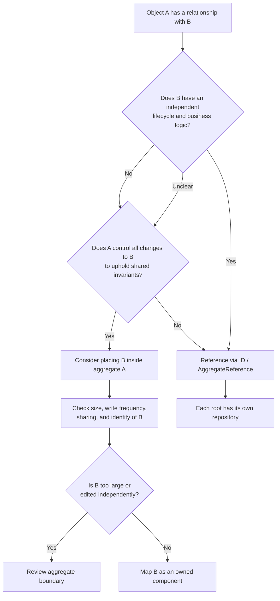

# Distinguishing Owned Relationships Inside an Aggregate From Cross-Aggregate References

In **Spring Data JDBC**, designing relationships between objects starts from a business question: **which objects truly belong under the management of an aggregate root, and which objects have their own lifecycle and should only be referenced by identifier?**

Both cases can be stored in tables with foreign keys, yet **their data management semantics are completely different**. If every foreign key is treated as an ownership relationship, the application easily creates oversized aggregates, unexpected `save` behavior, or accidental modifications to independent objects. If everything is split into separate aggregates, enforcing consistency rules across components that genuinely belong together becomes difficult.

This lesson distinguishes the two relationship types through a sales system example, introduces Spring Data JDBC mappings, and guides choosing aggregate boundaries based on business requirements.

## 1. What Are Aggregates and Aggregate Roots?

Following the *Domain-Driven Design* (DDD) approach, an **aggregate** is a group of objects belonging to the same **consistency boundary**. The business rules that must always hold inside the group are normally maintained through a representative object called the **aggregate root**.

For example, an order has a status, order lines, and a total amount. The rule "an order cannot be confirmed without valid order lines" should be enforced at `Order`, rather than letting the rest of the system edit individual order lines arbitrarily.

```text
                      Aggregate Order
              ┌──────────────────────────┐
              │ Order (aggregate root)   │
              │  id, status              │
              │                          │
              │  ├── OrderLine #1        │
              │  │   SKU, quantity       │
              │  └── OrderLine #2        │
              │      SKU, quantity       │
              └──────────────────────────┘
                   One consistency boundary
```

Here:

- `Order` is the **aggregate root**, the primary entry point for creating, editing, saving, and deleting orders.
- `OrderLine` is a component **owned inside the aggregate**; it lives within the order's business boundary.
- Business code typically operates through `OrderRepository` and methods such as `order.addLine(...)`, rather than creating an independent `OrderLineRepository` for individual lines.

An aggregate **does not necessarily correspond to a single table**: an order and its order lines can be stored in two tables and still belong to the same aggregate. Conversely, two tables having a foreign key does not mean they must sit in the same aggregate.

## 2. Owned Relationships Inside an Aggregate

An **owned relationship** means the child object belongs to the lifecycle and consistency boundary of the aggregate root.

For example, `OrderLine` describes a specific line in an `Order`:

- An order line is added when the business action adds a product to the order.
- When quantity changes, rules about valid quantities are enforced through the order.
- When a line is removed from the order, it is no longer part of this aggregate.
- When saving the order, the state of the order lines belonging to the aggregate is saved along with it.
- An order line is normally not shared as the same **living entity** between two independent orders.

This relationship can be stated in words: **"An Order owns its OrderLines."**

### 2.1. Signs of an Owned Relationship

| Business question | Sign pointing toward an owned relationship |
| --- | --- |
| Does the child object have independent meaning outside the parent? | No; `OrderLine` only makes sense within its corresponding order. |
| Who controls creating, deleting, and editing the child object? | The aggregate root controls it. |
| Are there rules that must always hold across the whole group? | Yes, such as total quantity, total amount, or order status. |
| Does the same child object need to be shared across multiple roots? | No. |
| When operating on the child, must the parent's state always be checked? | Usually yes. |
| Is a separate public repository needed for the child object? | Usually no. |

These are **design criteria**, not rigid rules based merely on class names. An object with a primary key in the database can still be an owned child entity; the mere presence of `id` does not turn it into an aggregate root.

### 2.2. Ownership Is Not Synonymous With "Nested Object in Java"

A class having a `private List<OrderLine> lines` field is a structural clue, yet aggregate boundaries must be decided by **business rules and lifecycle**, and only then mapped to Java and the database.

For instance, `Customer` might be placed inside an object field of `Order` when building an API DTO, but that does not automatically make the whole customer a component owned by the order.

## 3. References Between Independent Aggregates

A **cross-aggregate reference** is used when two objects are **two aggregate roots with separate lifecycles**. One aggregate needs to know who the other object is, yet **does not own and does not manage the internal state** of that object.

For example, a customer can exist before placing an order, continue to exist after the order completes, and have many orders. Therefore, `Customer` and `Order` are two independent aggregates:

```text
       Customer aggregate                  Order aggregate
    ┌────────────────────┐            ┌─────────────────────────┐
    │ Customer           │            │ Order (root)            │
    │ id = 42            │◄───────────│ customerId = 42         │
    │ name = "Ngoc"      │ references │ status = "DRAFT"        │
    └────────────────────┘            │  ├── OrderLine #1       │
                                      │  └── OrderLine #2       │
                                      └─────────────────────────┘

     CustomerRepository                     OrderRepository
     manages Customer                      manages Order + lines
```

Here:

- `CustomerRepository` manages customer information.
- `OrderRepository` manages orders and the order lines belonging to them.
- `Order` holds only `customerId`, which is a **referencing identifier** pointing to `Customer`.
- When customer details are needed, the service queries `CustomerRepository` separately.
- Saving `Order` does not mean Spring Data JDBC must re-save the entire `Customer`.
- Deleting an order does not mean deleting the customer.

Another scenario is `OrderLine` containing `productId`. The order line itself still **belongs to the Order aggregate**, while the product ID it carries can **reference a separate Product aggregate**. An owned component can still hold a reference to another aggregate.

### 3.1. Signs of an Independent Reference

| Business question | Sign pointing toward a cross-aggregate reference |
| --- | --- |
| Can the referenced object exist independently? | Yes, like `Customer` or `Product`. |
| Does it have its own repository and business rules? | Yes. |
| Can multiple other aggregates reference it? | Yes, for example multiple `Order` instances referencing one `Customer`. |
| Does modifying it always require re-saving the referencing aggregate? | No; renaming a customer does not require re-saving all orders. |
| When deleting the referencing aggregate, should the referenced object be deleted? | Usually no. |
| Is it necessary to load the entire other object every time the current aggregate is read? | No; many operations only need the ID. |

The examples here are illustrative: in another domain, the same names "Address", "Payment", or "Line" could lead to different aggregate boundaries because of different lifecycles and rules.

## 4. Direct Comparison of the Two Relationship Types

| Criterion | Owned inside an aggregate | Cross-aggregate reference |
| --- | --- | --- |
| Example | `Order` → `OrderLine` | `Order` → `Customer` |
| Management authority | The root manages child data. | Each root manages its own state. |
| Lifecycle | Child usually depends on the root. | Target object has an independent lifecycle. |
| Java representation with Spring Data JDBC | Collection/child object mapped into the aggregate, e.g., `@MappedCollection`. | Simple ID, or `AggregateReference<T, ID>`. |
| Repository | Usually only the root's repository is needed. | Each aggregate root has its own repository. |
| On `save(root)` | Saves root state and owned data. | Does not automatically save another aggregate merely because its ID is referenced. |
| On deleting root | Owned parts are typically deleted with the aggregate. | Referenced aggregate still exists, subject to business rules and DB constraints. |
| Loading data | Components belonging to the aggregate are mapped as one logical unit. | The other aggregate is not automatically loaded via an ID field. |
| Consistency | Related rules are protected at the root boundary. | Cross-aggregate rules may require services, transactions, or coordination workflows. |
| SQL relationship | Typically has a foreign key from child table to root. | Can also have a foreign key from referencing table to another root. |

**Note:** both types can be implemented using an ID column and a `FOREIGN KEY` constraint. **Ownership** semantics reside in the domain model and how Spring Data JDBC manages aggregates, not in whether a foreign key exists.

## 5. Data Example: Both Use Foreign Keys, Yet Have Different Meanings

Consider three tables of a sales system on PostgreSQL:

```sql
CREATE TABLE customers (
    id BIGINT GENERATED BY DEFAULT AS IDENTITY PRIMARY KEY,
    full_name VARCHAR(150) NOT NULL
);

CREATE TABLE purchase_orders (
    id BIGINT GENERATED BY DEFAULT AS IDENTITY PRIMARY KEY,
    customer_id BIGINT NOT NULL REFERENCES customers(id),
    status VARCHAR(30) NOT NULL
);

CREATE TABLE order_lines (
    order_id BIGINT NOT NULL REFERENCES purchase_orders(id),
    line_position INTEGER NOT NULL,
    sku VARCHAR(80) NOT NULL,
    quantity INTEGER NOT NULL CHECK (quantity > 0),
    PRIMARY KEY (order_id, line_position)
);
```

There are **two foreign keys** with different domain meanings:

1. `order_lines.order_id` points to the order **that owns the order line**. An order line belongs to a specific order; without belonging to that order, it has no independent lifecycle in the current model.
2. `purchase_orders.customer_id` points to the customer **being referenced**. A customer has a separate lifecycle; many orders can reference this customer.

```text
customers                  purchase_orders              order_lines
---------                  ---------------              -----------
id (PK) ◄─────── FK ────── customer_id
                           id (PK) ◄──────── FK ──────── order_id
                           status                        line_position
                                                         sku
                                                         quantity

FK #1: Order -> Customer = independent reference
FK #2: OrderLine -> Order = ownership inside aggregate
```

Database constraints help protect referential integrity. They **do not replace** aggregate rules: looking at the schema alone is not enough to conclude which tables are aggregate roots.

### 5.1. Deleting an Order and Deleting a Customer Have Different Meanings

If an `Order` is deleted, the `OrderLine` rows belonging to that order must be handled according to the order's lifecycle. Spring Data JDBC can delete child rows when deleting the aggregate; the schema can also have an appropriate `ON DELETE CASCADE` policy if required.

If deleting a `Customer` that is still referenced by orders, **deleting all orders** usually makes no sense. A default `FOREIGN KEY` constraint can prevent deleting a referenced customer; the application should have its own business policy, such as restricting deletion, controlled anonymization, or retaining transaction history. Do not casually put `ON DELETE CASCADE` on `purchase_orders.customer_id`.

## 6. Mapping Owned Relationships With Spring Data JDBC

Spring Data JDBC provides annotations such as `@Table`, `@Id`, and `@MappedCollection` to describe aggregates persisted in relational tables.

The example below uses `PurchaseOrder` as the root; the list of `OrderLine` items resides inside the aggregate. `Customer` is independent and referenced via `customerId`.

### 6.1. An Independent Aggregate: Customer

```java
import org.springframework.data.annotation.Id;
import org.springframework.data.relational.core.mapping.Table;

@Table("customers")
public record Customer(
        @Id Long id,
        String fullName
) {
}
```

`Customer` can be managed by its own repository. In this example, it is not nested inside `PurchaseOrder`.

### 6.2. Owned Component: OrderLine

```java
import org.springframework.data.relational.core.mapping.Table;

@Table("order_lines")
public record OrderLine(String sku, int quantity) {

    public OrderLine {
        if (sku == null || sku.isBlank()) {
            throw new IllegalArgumentException("SKU is required");
        }
        if (quantity <= 0) {
            throw new IllegalArgumentException("Quantity must be positive");
        }
    }
}
```

`OrderLine` represents the data of a single order line. No separate repository is declared because in this example it is not an aggregate root. Not having its own `@Id` is **a choice of this illustrative model**, not a general requirement: a child entity inside an aggregate can still have an identifier key if needed.

### 6.3. Aggregate Root: PurchaseOrder

```java
import java.util.ArrayList;
import java.util.Collections;
import java.util.List;

import org.springframework.data.annotation.Id;
import org.springframework.data.relational.core.mapping.Column;
import org.springframework.data.relational.core.mapping.MappedCollection;
import org.springframework.data.relational.core.mapping.Table;

@Table("purchase_orders")
public class PurchaseOrder {

    @Id
    private Long id;

    @Column("customer_id")
    private Long customerId;

    private String status;

    @MappedCollection(
            idColumn = "order_id",
            keyColumn = "line_position"
    )
    private List<OrderLine> lines = new ArrayList<>();

    public PurchaseOrder() {
    }

    public PurchaseOrder(
            Long customerId, String status, List<OrderLine> lines
    ) {
        this.customerId = customerId;
        this.status = status;
        this.lines = new ArrayList<>(lines);
    }

    public Long getId() {
        return id;
    }

    public Long getCustomerId() {
        return customerId;
    }

    public String getStatus() {
        return status;
    }

    public List<OrderLine> getLines() {
        return Collections.unmodifiableList(lines);
    }

    public void addLine(String sku, int quantity) {
        if (!"DRAFT".equals(status)) {
            throw new IllegalStateException(
                    "Only draft orders can be edited"
            );
        }
        lines.add(new OrderLine(sku, quantity));
    }

    public void confirm() {
        if (lines.isEmpty()) {
            throw new IllegalStateException(
                    "Order needs at least one line"
            );
        }
        if (!"DRAFT".equals(status)) {
            throw new IllegalStateException(
                    "Only draft orders can be confirmed"
            );
        }
        status = "CONFIRMED";
    }
}
```

Points to read carefully:

- `@Table("purchase_orders")` and `@Id` map the aggregate root to its table and primary key.
- `@Column("customer_id") private Long customerId` maps the **reference to the Customer aggregate** to an ID column. It does not ask Spring Data JDBC to load a `Customer` object.
- `@MappedCollection(idColumn = "order_id", keyColumn = "line_position")` maps the **list of owned components**.
- `idColumn = "order_id"` specifies the column in the child table used to store the key of the owning `PurchaseOrder`.
- `keyColumn = "line_position"` specifies the column storing the element key, used with `List` to restore the position/order of elements in the collection.
- `addLine` and `confirm` enforce business rules at the root. Callers cannot directly mutate the list via `getLines()` because the returned list is unmodifiable from the API perspective.

In Spring Data JDBC's default mapping, when persisting the aggregate, the framework processes owned fields based on metadata. The `order_lines` table in the example is designed to use `order_id` and `line_position` when saving the list.

**Note on objects:** the illustrative class has a no-arg constructor so Spring Data JDBC can reconstruct the object and use field access; in a production design, you can choose explicit constructor mapping and consider immutability as required. The rules in `addLine`/`confirm` illustrate protecting the aggregate through domain APIs; the database still needs corresponding constraints for essential invariant requirements.

### 6.4. Repositories for Each Aggregate Root

```java
import org.springframework.data.repository.CrudRepository;

public interface PurchaseOrderRepository
        extends CrudRepository<PurchaseOrder, Long> {
}

public interface CustomerRepository
        extends CrudRepository<Customer, Long> {
}
```

Repositories exist for `PurchaseOrder` and `Customer` because **both are independent aggregate roots**. There is no need to declare an `OrderLineRepository` for order lines in this example.

### 6.5. Creating an Order and Reading the Referenced Customer

```java
import java.util.List;

import org.springframework.stereotype.Service;
import org.springframework.transaction.annotation.Transactional;

@Service
public class PurchaseOrderService {

    private final PurchaseOrderRepository orders;
    private final CustomerRepository customers;

    public PurchaseOrderService(
            PurchaseOrderRepository orders,
            CustomerRepository customers
    ) {
        this.orders = orders;
        this.customers = customers;
    }

    @Transactional
    public PurchaseOrder createOrder(Long customerId) {
        if (!customers.existsById(customerId)) {
            throw new IllegalArgumentException(
                    "Customer does not exist"
            );
        }

        PurchaseOrder order = new PurchaseOrder(
                customerId,
                "DRAFT",
                List.of(new OrderLine("BOOK-001", 2))
        );

        return orders.save(order);
    }

    @Transactional(readOnly = true)
    public Customer findCustomerOfOrder(Long orderId) {
        PurchaseOrder order = orders.findById(orderId)
                .orElseThrow();

        return customers.findById(order.getCustomerId())
                .orElseThrow();
    }
}
```

The `createOrder` flow:

```text
createOrder(customerId)
         |
         +--> CustomerRepository.existsById(customerId)
         |       check referenced ID (business validation)
         |
         +--> new PurchaseOrder(customerId, ...)
         |         |
         |         +-- owned List<OrderLine>
         |
         +--> PurchaseOrderRepository.save(order)
                 |
                 +-- save PurchaseOrder root
                 +-- save owned OrderLine items
                 +-- customerId is just a reference column

No CustomerRepository.save(...) during the Order save operation.
```

The `existsById` check is an example of clear business feedback and **does not replace a foreign key**. Another request could still modify data between the check and the write. Database constraints and exception handling still need to be applied for concurrent scenarios.

`findCustomerOfOrder` shows that the ID reference is **explicitly resolved** through `CustomerRepository`. When only displaying the order, the application is not forced to fetch the customer.

## 7. Representing References With AggregateReference

In addition to `Long customerId`, Spring Data JDBC supports `AggregateReference<T, ID>` to express more clearly that the stored value is a **reference to another aggregate root**, not an owned object.

For example, replace just the `customerId` field with:

```java
import org.springframework.data.jdbc.core.mapping.AggregateReference;
import org.springframework.data.relational.core.mapping.Column;

@Column("customer_id")
private AggregateReference<Customer, Long> customer;
```

When creating a reference value:

```java
AggregateReference<Customer, Long> customerRef =
        AggregateReference.to(customerId);
```

When the ID is needed to query the customer:

```java
Long referencedId = customerRef.getId();
Customer customer = customerRepository
        .findById(referencedId)
        .orElseThrow();
```

`AggregateReference<Customer, Long>` helps **clarify semantics at the type level** compared to a plain `Long`: it is specifically a `Customer` ID. However, remember that:

- It is **not** a fully loaded `Customer` object.
- It **does not automatically call a repository** to load `Customer` upon access.
- It **does not create a JPA-like lazy-loading mechanism**.
- It **does not itself guarantee the foreign key or existence of the target row**; constraints remain the schema's job.

Both `Long customerId` and `AggregateReference<Customer, Long>` are valid; choose the one that keeps your project's domain readable and consistent. If switching to `AggregateReference` in the full example, adjust the constructor/getter/service accordingly; do not accidentally declare both fields mapped to the same column.

## 8. Save, Update, and Delete Behavior Along Ownership Boundaries

The behavior of `save` is a major reason why distinguishing the two relationship types affects system design.

### 8.1. Saving a New Aggregate

When a `PurchaseOrder` with `id == null` is saved, Spring Data JDBC may perform:

1. Insert a row into `purchase_orders`.
2. Obtain the database-generated order ID.
3. Insert the `OrderLine` items into `order_lines` with `order_id` equal to the obtained ID and corresponding `line_position`.

During this operation, `customer_id` is written as a foreign key value; there is **no** insertion or update on `customers` rows merely because the order carries the customer's ID.

### 8.2. Updating an Existing Aggregate

When calling `save` on an existing aggregate, Spring Data JDBC persists **the current aggregate state**. For owned parts such as collections, the framework often uses a strategy of **deleting and re-inserting child rows** to recreate the aggregate's state, rather than automatically tracking and updating only the single modified child row like a dirty-checking ORM.

For example, the user removes the second line from `Order` and saves:

```text
Before:
Order 500
   |- Line A
   |- Line B

After editing the object and calling save(root):
Order 500
   |- Line A
```

The desired result is that the owned data in the database reflects the new collection. At the SQL level, the operation may involve multiple `DELETE` and `INSERT` statements on the child table; **you should not assume the framework issues just a single UPDATE for Line B**.

Therefore, a very large collection or one with many elements modified individually at high frequency can be a sign to review aggregate boundaries. If a child row must maintain a stable identity referenced by other aggregates or be updated independently, consider whether it is truly an owned component.

### 8.3. Deleting an Aggregate

Deleting `PurchaseOrder` must handle its owned `OrderLine` rows. For the referenced `Customer`, the logic **has no right to infer** that deleting an order should also delete the customer.

Conversely, deleting a `Customer` may be rejected by the database if orders still reference it. This is an appropriate referential integrity policy for many transaction-history domains; the application should define a customer deletion policy based on specific business and legal requirements.

### 8.4. Be Careful With Cascade Assumptions

In JPA, learners are often used to concepts like `@OneToMany`, `cascade = ALL`, `FetchType.LAZY`. **Spring Data JDBC has a different mapping model**:

- Do not use JPA `@OneToMany`/`@ManyToOne` associations as Spring Data JDBC's way of declaring aggregates.
- Ownership is expressed via aggregate structure and Spring Data Relational mapping metadata, such as `@MappedCollection`.
- Independent references are usually represented via IDs or `AggregateReference`.
- There is no JPA/Hibernate-style persistence context or lazy loading.

Hence, do not blindly copy a JPA entity graph diagram onto Spring Data JDBC without re-evaluating aggregate boundaries.

## 9. Consistency and Transactions: One Aggregate or Multiple Aggregates?

An **aggregate boundary** is primarily a decision about **which business invariants need to be protected together**. A **database transaction** is a technical tool so multiple changes commit or rollback as configured. The two concepts are related, not identical.

### 9.1. Rules Within a Single Aggregate

Example: an order can only become `CONFIRMED` when it has at least one line, and every line's quantity must be positive. These rules live within `Order` and its `OrderLine` items, so confirming and saving the order can be organized through one root.

```java
@Transactional
public void confirmOrder(Long orderId) {
    PurchaseOrder order = orders.findById(orderId)
            .orElseThrow();

    order.confirm();
    orders.save(order);
}
```

In this example, `confirm()` validates rules on the root before updating state. To handle two requests modifying the same order simultaneously, consider **optimistic locking** with `@Version` on the root or an appropriate concurrency mechanism. `@Transactional` alone does not guarantee preventing all overwrite scenarios under concurrent requests.

### 9.2. Rules Involving Two Aggregates

For example, placing an order must **decrement stock** in an independent `ProductStock` aggregate and create an `Order`. Both aggregates have different lifecycles and traffic profiles. There are several ways to coordinate depending on requirements:

- If both update the same database and the business requires atomicity, the service can use **one database transaction** to coordinate both repositories.
- If the aggregates reside in different services/databases, **events, outbox, sagas**, or another orchestration process may be required, along with failure handling and eventual consistency policies.
- Coordinating two aggregates within a single transaction **does not make one aggregate own the other**.

Do not assume every reference relationship must be processed asynchronously, nor that every cross-aggregate rule can be solved by merging them into one giant aggregate.

## 10. Rules for Setting Aggregate Boundaries Before Writing Annotations

When encountering two related classes, you can use the following sequence of questions.

**Step 1 — Identify lifecycle.** Does object B have meaning without A? For example, `OrderLine` usually does not exist independently outside an order; `Customer` does.

**Step 2 — Identify modification authority.** Who is allowed to change B? If all changes must go through A to uphold rules, B may be an owned component. If B has its own business rules and maintainers, it may be an independent aggregate.

**Step 3 — List mandatory invariants.** Which rules must hold true immediately after every business operation? For example, the total of an Order and its lines; whereas a Customer's credit limit belongs to a separate domain.

**Step 4 — Check sharing and references.** Is one B used by multiple As? Many orders sharing the same customer or product is a strong signal to keep B as a separate aggregate.

**Step 5 — Consider data loading and writing.** Does every read/edit of A really need all of B? An aggregate containing tens of thousands of continuously updated child rows can incur heavy cost because of how Spring Data JDBC persists collections.

**Step 6 — Decide the mapping.** If B belongs to A, model it as an internal component of the root and use appropriate relationship mapping. If B is independent, use an ID/`AggregateReference` and a separate repository.



The diagram is an analytical guide, not a substitute for domain judgment. A child entity with its own ID stored in a separate table can still be an owned component if its lifecycle genuinely resides within the root.

## 11. Easily Confused Design Scenarios

### 11.1. "Having a Foreign Key Definitely Means Ownership"

False. `purchase_orders.customer_id` and `order_lines.order_id` are both foreign keys, yet only `Order → OrderLine` is considered ownership in this example.

Evaluate **lifecycle and business invariants**; do not infer ownership from SQL constraints.

### 11.2. "Since There Are Many Orders, Order Should Contain the Entire Customer"

No. If `Order` contained `Customer` as an owned object, aggregate persistence behavior would clash with customers being shared across many orders. Keep `customerId` to separate lifecycles and update authority.

### 11.3. "OrderLine Must Have Its Own Repository Because It Lives in a Separate Table"

Not necessarily. `OrderLine` can still be part of `Order` even though it maps to the `order_lines` table. Repositories are generally designed for **aggregate roots**, not per table.

### 11.4. "Simply Putting a Customer-Typed Field in Order Makes It a Reference"

Unsafe. In Spring Data JDBC, a direct nested object field can be interpreted according to owned aggregate mapping, not as an independent association similar to JPA's `@ManyToOne`. If `Customer` is an independent root, express the reference explicitly via `customerId` or `AggregateReference<Customer, Long>`.

### 11.5. "An Order Referencing a Product Means the Product Is Owned"

No. An `OrderLine` owned by `Order` can store `productId` to reference `Product`. A product can change its name, list price, or be discontinued while past orders retain their finalized transaction data. Some systems store a **snapshot** of the name/selling price at purchase time directly in `OrderLine`; the snapshot is value data belonging to the order, not an owned `Product` object.

Example of data semantics:

```text
Order (root)
  └── OrderLine (owned)
        ├── productId = 88          -> references Product aggregate
        ├── purchasedName = "Book"  -> snapshot belonging to OrderLine
        ├── unitPrice = 120000      -> transaction price snapshot
        └── quantity = 2

Product (separate root)
  ├── id = 88
  ├── currentName = "Book, new edition"
  └── currentPrice = 135000
```

### 11.6. "Reading an Aggregate Must JOIN All Related Aggregates"

No. When loading `Order`, the application retrieves the root and aggregate members per mapping rules; details from `Customer` or `Product` are queried separately only when actually needed.

For reports needing data from multiple aggregates, use SQL `JOIN`, projections, or a dedicated query model. **Joining multiple tables for reporting reads does not alter domain ownership boundaries.**

### 11.7. "To Edit a Line Inside an Aggregate, Call That Line's Repository"

That approach can bypass root invariants and create inconsistent write paths. For an owned `OrderLine`, provide operations like `Order.addLine`, `Order.changeQuantity`, or `Order.removeLine`, and then save `Order`. If business requirements genuinely demand modifying an order line completely independently of the order, that is a reason to **re-examine the aggregate design**.

### 11.8. "Deleting Child Rows in the Database and Deleting an Aggregate Are the Same Thing"

Not quite. Database `ON DELETE CASCADE` is an integrity mechanism at the storage layer. Domain ownership encompasses who can create/edit/delete, methods enforcing rules, and operational boundaries. An `ON DELETE CASCADE` foreign key does not by itself define an aggregate root.

## 12. Extended Example: One-to-Many and Many-to-Many Relationships

Suppose a course management system has `Student`, `Course`, and `Enrollment`.

`Student` and `Course` usually have independent lifecycles. One student enrolls in many courses, and one course has many students. Naively writing `Student.courses: List<Course>` and treating all `Course` objects as owned components creates a conflict because **the same Course would appear in multiple Students' aggregates**.

One modeling option is making `Enrollment` a separate aggregate if enrollment has an independent lifecycle and statuses (registered, paid, deferred, completed):

```text
Student aggregate           Enrollment aggregate           Course aggregate
┌──────────────────┐       ┌──────────────────────┐      ┌───────────────────┐
│ Student id = 3   │◄──────│ studentId = 3        │      │ Course id = 17    │
└──────────────────┘       │ courseId = 17        │─────►└───────────────────┘
                           │ status = "ACTIVE"    │
                           └──────────────────────┘
```

If `Enrollment` is only a tiny element with no separate lifecycle, another model might also be reasonable depending on the domain. What matters is deciding based on **semantics and change boundaries**, rather than mechanically turning every many-to-many relationship into an owned object graph.

## 13. Self-Practice Distinguishing Ownership and Reference

Classify the following cases according to ownership vs. reference criteria, and explain why:

| Scenario | Analysis hint |
| --- | --- |
| `Invoice` has many `InvoiceLine` items | Each line is normally tied to the invoice, contributes to its total, and lacks an independent lifecycle. |
| `Invoice` is associated with `Customer` | Customer is normally an independent root referenced by many invoices. |
| `ShoppingCart` has many `CartItem` entries | Items are usually owned by the cart, though expiration and quantity policies should be checked. |
| `OrderLine` carries `ProductId` | The line belongs to the order; the product is a separate root. |
| `BlogPost` has millions of `Comment` entries | Consider lifecycle, write frequency, pagination, and deletion/moderation needs before placing all comments into the post aggregate. |
| `Account` has `ContactInfo` | If the info is just a value set of the account, it can belong to the aggregate; if managed/shared independently, the model will differ. |

Next, try sketching a diagram with **aggregate boundaries**, marking roots, owned components, and ID reference arrows. Only after the model is clear should you design tables, foreign keys, `@MappedCollection`, and repositories.

A small hands-on exercise with the order example:

1. Create a `Customer` and save it with `CustomerRepository`.
2. Create a `PurchaseOrder` containing two `OrderLine` items and a valid `customerId`; save it with `PurchaseOrderRepository`.
3. Read `PurchaseOrder` to see the root's line list restored; use the ID to query `Customer` when needed.
4. Add an order line via the root's method and re-save the order; observe the child table data.
5. Change `Customer`'s name and save via `CustomerRepository`; verify the order does not need to be updated alongside it.
6. Try deleting `Customer` while orders still reference it and observe the foreign key constraint's effect; determine an appropriate business policy.

## 14. Takeaways When Designing With Spring Data JDBC

- **Owned relationship:** child objects share the root's consistency boundary and lifecycle; mapped as aggregate components, typically via `@MappedCollection` for collections.
- **Independent reference:** each aggregate root manages its own state; other aggregates hold only an ID or `AggregateReference<T, ID>` and query explicitly when needed.
- **Foreign keys do not decide ownership:** both relationship types can use foreign keys in the database; domain decisions rest on lifecycle, invariants, and mutation authority.
- **Repositories follow roots:** avoid creating independent update paths for child entities that should be controlled by the root.
- **Watch how `save` works:** saving an aggregate can delete and re-insert owned child rows; an oversized aggregate can incur significant write costs.
- **Database transactions and constraints remain essential:** the domain defines business boundaries; the database protects data integrity and transactions support atomicity as required.

Once you properly distinguish **"Order owns OrderLine"** from **"Order references Customer"**, your Spring Data JDBC design will align more closely with business rules, avoid treating every table relationship as an object graph to be persisted together, and make the impact of repository operations on actual data clear.
