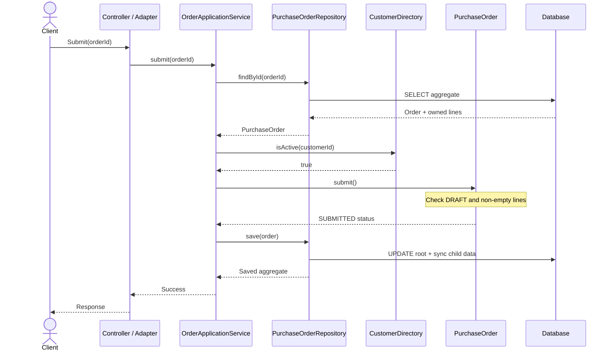

# Placing Business Rules in the Model and Orchestration in the Service Layer

## 1. Why Separate Responsibilities?

When using Spring Data JDBC, we often start with a `@Table` class, a `CrudRepository`, and a service calling `save(...)`. For simple CRUD, this approach seems sufficient. However, once rules appear such as *"a submitted order cannot be modified"*, *"an empty order cannot be submitted"*, or *"product quantity must be positive"*, the important question becomes: **where do the rules live so that every execution path must obey them?**

In aggregate design, separate two kinds of responsibilities:

- **The domain model (especially the aggregate root)** maintains valid state, defines behaviors that change state, and protects *business invariants*.
- **The application service layer** orchestrates a use case: receives normalized input, loads the aggregate via repository, retrieves information from other components when needed, invokes domain behavior, saves the result, and sets transaction boundaries.

The goal is to ensure an order cannot transition into an invalid state simply because a new REST controller, a scheduled batch job, or a message consumer is added later.

> Core principle: **The aggregate decides whether a change is valid according to its own rules; the application service decides which components to coordinate to carry out the use case.**

This fits Spring Data JDBC especially well because the framework encourages aggregates with clear boundaries and repositories operating through aggregate roots.

## 2. Distinguishing Domain Rules From Orchestration

Suppose there is a sales application:

1. A staff member opens a draft order for a customer.
2. The staff member adds order lines.
3. When submitting the order, the system verifies the customer is still active and the order is non-empty.
4. After submission, lines can no longer be added to the order.
5. The system saves the status and may emit a notification for fulfillment processing.

These requirements span multiple levels of responsibility.

| Requirement | Where to place primary logic | Reason |
| --- | --- | --- |
| Quantity of each line must be greater than 0 | `OrderLine` or `PurchaseOrder`'s line-adding behavior | This condition holds for any order line regardless of caller. |
| Unit price must not be negative | `OrderLine` | Keeps child object values valid right at creation time. |
| A submitted order cannot add lines | `PurchaseOrder.addLine(...)` | Rule depends on the aggregate's own state. |
| Cannot submit an empty order | `PurchaseOrder.submit()` | The aggregate has all the data needed to protect the invariant itself. |
| Check whether customer is still active | Application service coordinating with customer info source; separate domain policy if complex | Customer has its own lifecycle and does not belong to the order aggregate. |
| Fetch current product price from catalog | Application service or an adapter invoked by the service | Needs to read data from another aggregate/system. |
| Load order by ID, call behavior, and save | Application service + repository | This is the execution sequence of the use case. |
| Begin/commit/rollback transaction | Application service, via `@Transactional` | Transactions cover data access steps requiring consistency. |
| Return HTTP 404/409/422 and format JSON | Controller/HTTP adapter | This is the communication contract with clients. |
| Push notifications to external systems | Application/infrastructure, usually after commit or via outbox | External communication is not a state-changing behavior inside the aggregate. |

### What Is a Business Invariant?

An **invariant** is a condition that must hold true for the aggregate state at points where the business allows observing or persisting it. For example:

- An order in `SUBMITTED` status must have at least one order line.
- An order line must not have a negative or zero quantity.
- Lines of a submitted order cannot be modified.

Not every rule is checked only in the constructor. A newly opened `DRAFT` order may have no lines yet; requiring at least one line applies **when transitioning to `SUBMITTED`**. Therefore, the proper place for that check is the `submit()` behavior.

Conditions such as "valid email format" can be checked at the request-receiving layer, yet if a valid email is a rule of the domain object, the model still needs to protect itself. HTTP validation cannot replace invariants: internal jobs and message consumers may not pass through a controller.

## 3. Aggregate Boundaries in Spring Data JDBC

For the problem above, a sensible split is:

```text
PurchaseOrder (aggregate root)
├── id, version, customerId, status
└── List<OrderLine>       (owned by the order)
    ├── productId
    ├── quantity
    └── unitPrice

Customer                 (independent aggregate root)
└── id, active, ...

Product                  (independent aggregate root / catalog)
└── id, currentPrice, ...
```

**The order owns its order lines**: adding, removing, and editing lines changes the order's state. Yet **the order does not own customers or products**; it holds only `customerId` and `productId` as references. Putting full `Customer` and `Product` objects into collections inside `PurchaseOrder` can produce oversized aggregates with broken lifecycles.

In Spring Data JDBC, ownership has direct implications for persistence. When calling `save` on an existing aggregate root, owned child entities may be deleted and re-inserted to reflect the aggregate's new state. That makes boundary design and collection size both a business decision and a performance decision.

One repository for `PurchaseOrder` persists the order aggregate. Repositories for `Customer` or `Product`, if present, manage their own respective aggregates.

## 4. Designing the Model With Meaningful Behavior

We use `PurchaseOrder` as the aggregate root and `OrderLine` as a child object. The example uses Java 21 and Spring Boot with Spring Data JDBC. Illustrative classes reside in package `com.example.orders`; each `public class`/`public record` should be saved in its own Java file.

### 4.1. Order Status

```java
package com.example.orders;

public enum OrderStatus {
    DRAFT,
    SUBMITTED
}
```

Defining an enum avoids arbitrary status strings in business code.

### 4.2. Child Object Protecting Its Own Conditions

```java
package com.example.orders;

import java.math.BigDecimal;
import java.util.Objects;

public record OrderLine(
        Long productId,
        int quantity,
        BigDecimal unitPrice
) {
    public OrderLine {
        Objects.requireNonNull(productId, "productId is required");
        Objects.requireNonNull(unitPrice, "unitPrice is required");

        if (productId <= 0) {
            throw new IllegalArgumentException("productId must be positive");
        }
        if (quantity <= 0) {
            throw new IllegalArgumentException("quantity must be positive");
        }
        if (unitPrice.signum() < 0) {
            throw new IllegalArgumentException("unitPrice must not be negative");
        }
    }

    public BigDecimal lineTotal() {
        return unitPrice.multiply(BigDecimal.valueOf(quantity));
    }
}
```

Here, the record constructor rejects invalid states. The "positive quantity" rule does not need to be repeated in every controller and service. The `lineTotal()` calculation also sits right alongside the data it uses.

Note: `unitPrice` on an order line is the *price finalized for that line* when added to the order. It does not automatically fluctuate with the product's current price list; if the business requires repricing, a dedicated behavior must be designed.

### 4.3. Aggregate Root Protecting State Transitions

```java
package com.example.orders;

import java.math.BigDecimal;
import java.util.ArrayList;
import java.util.List;
import java.util.Objects;

import org.springframework.data.annotation.Id;
import org.springframework.data.annotation.Version;
import org.springframework.data.relational.core.mapping.MappedCollection;
import org.springframework.data.relational.core.mapping.Table;

@Table("purchase_orders")
public class PurchaseOrder {

    @Id
    private Long id;

    @Version
    private Long version;

    private Long customerId;
    private OrderStatus status;

    @MappedCollection(idColumn = "order_id", keyColumn = "line_no")
    private List<OrderLine> lines = new ArrayList<>();

    // Constructor for Spring Data JDBC to materialize data from the DB.
    protected PurchaseOrder() {
    }

    private PurchaseOrder(Long customerId) {
        this.customerId = Objects.requireNonNull(
                customerId, "customerId is required");
        if (customerId <= 0) {
            throw new IllegalArgumentException("customerId must be positive");
        }
        this.status = OrderStatus.DRAFT;
    }

    public static PurchaseOrder newDraft(Long customerId) {
        return new PurchaseOrder(customerId);
    }

    public void addLine(Long productId, int quantity, BigDecimal unitPrice) {
        requireDraft();

        boolean alreadyPresent = lines.stream()
                .anyMatch(line -> line.productId().equals(productId));
        if (alreadyPresent) {
            throw new IllegalStateException(
                    "Product already exists in this order");
        }

        lines.add(new OrderLine(productId, quantity, unitPrice));
    }

    public void submit() {
        requireDraft();
        if (lines.isEmpty()) {
            throw new IllegalStateException(
                    "Cannot submit an order without lines");
        }

        status = OrderStatus.SUBMITTED;
    }

    public BigDecimal totalAmount() {
        return lines.stream()
                .map(OrderLine::lineTotal)
                .reduce(BigDecimal.ZERO, BigDecimal::add);
    }

    private void requireDraft() {
        if (status != OrderStatus.DRAFT) {
            throw new IllegalStateException(
                    "Only a draft order can be modified");
        }
    }

    public Long id() {
        return id;
    }

    public Long customerId() {
        return customerId;
    }

    public OrderStatus status() {
        return status;
    }

    public List<OrderLine> lines() {
        return List.copyOf(lines);
    }
}
```

Key points:

1. `newDraft(...)` expresses how a new order is created while setting `DRAFT` status.
2. `addLine(...)` only accepts calls while the order is still a draft; it also prevents adding duplicate `productId` values per the example's assumed rule.
3. `submit()` checks both the current status and disallows empty submissions before transitioning state.
4. There are no public `setStatus(...)` or `setLines(...)` methods, because those allow bypassing domain behaviors.
5. `lines()` returns an unmodifiable list copy; callers cannot mutate the aggregate's collection via `order.lines().clear()`.
6. `@Id` and `@MappedCollection` are Spring Data annotations, **not** JPA `@OneToMany` associations.
7. `@Version` is added to support optimistic locking when multiple transactions edit the order concurrently.

The `version` field together with `id` are persistence details. They do not necessarily become business rules. Placing Spring Data annotations directly on the aggregate is a pragmatic choice for Spring Data JDBC applications; if an architecture requires a pure domain layer, mapping and domain models can be separated at a higher translation cost.

**Caution on validity boundaries:** a no-arg constructor for framework materialization does not mean application code is free to instantiate an empty `PurchaseOrder` and call `save`. Business code should only instantiate via `newDraft(...)` and interact through the defined public behaviors.

## 5. Repositories Handle Data Access

```java
package com.example.orders;

import org.springframework.data.repository.CrudRepository;

public interface PurchaseOrderRepository
        extends CrudRepository<PurchaseOrder, Long> {
}
```

A repository knows how to access data; it should not contain the entire workflow of "check customer, calculate price, submit order, and emit notification." A repository is a tool for the application service to load/save roots, not a replacement for domain behavior.

For example, the fact that an `UPDATE purchase_orders SET status = 'SUBMITTED' WHERE id = ?` statement can execute successfully **does not prove** the order satisfies "must have at least one line." That check still belongs in `submit()`.

When updating aggregates through a repository, remember `save(...)` can generate multiple SQL operations for child collections. For very large collections or requirements to update individual lines independently, re-evaluate aggregate boundaries and persistence strategies; do not assume every small change has a small write cost.

## 6. Application Service Orchestrates Use Cases

The example service needs to do three things: open a draft order, add products, and submit the order. To fetch data from other aggregates/systems, we define two read ports:

```java
package com.example.orders;

import java.math.BigDecimal;

public interface CustomerDirectory {
    boolean isActive(Long customerId);
}

public interface ProductPricing {
    BigDecimal currentPrice(Long productId);
}
```

These are **illustrative contracts**: a real application needs implementations, such as adapters reading from separate repositories or SQL queries. If calling a remote service, consider latency, network errors, and execution timing relative to transactions.

Then create the service:

```java
package com.example.orders;

import org.springframework.stereotype.Service;
import org.springframework.transaction.annotation.Transactional;

@Service
public class OrderApplicationService {

    private final PurchaseOrderRepository orders;
    private final CustomerDirectory customers;
    private final ProductPricing pricing;

    public OrderApplicationService(
            PurchaseOrderRepository orders,
            CustomerDirectory customers,
            ProductPricing pricing
    ) {
        this.orders = orders;
        this.customers = customers;
        this.pricing = pricing;
    }

    @Transactional
    public Long openDraft(Long customerId) {
        PurchaseOrder draft = PurchaseOrder.newDraft(customerId);
        return orders.save(draft).id();
    }

    @Transactional
    public void addProduct(
            Long orderId,
            Long productId,
            int quantity
    ) {
        PurchaseOrder order = load(orderId);
        var unitPrice = pricing.currentPrice(productId);

        order.addLine(productId, quantity, unitPrice);
        orders.save(order);
    }

    @Transactional
    public void submit(Long orderId) {
        PurchaseOrder order = load(orderId);

        if (!customers.isActive(order.customerId())) {
            throw new IllegalStateException(
                    "Customer is not active");
        }

        order.submit();
        orders.save(order);
    }

    private PurchaseOrder load(Long orderId) {
        return orders.findById(orderId)
                .orElseThrow(() -> new IllegalArgumentException(
                        "Order not found: " + orderId));
    }
}
```

**Reading `submit(...)` from top to bottom:**

1. Opens a transaction via `@Transactional`.
2. Loads `PurchaseOrder` using the repository.
3. Asks the customer info source whether the customer is still active.
4. Calls `order.submit()` so the aggregate itself checks rules and transitions status.
5. Calls `orders.save(order)` to persist the aggregate.
6. If everything succeeds, the transaction commits when the method exits normally.

The service **does not directly assign** `order.status = SUBMITTED`; the "non-empty" and "draft-only submission" conditions stay inside the model. Conversely, the model **does not access** `CustomerDirectory`, `ProductPricing`, the database, or HTTP clients to look up required data itself.

In `addProduct(...)`, the service fetches the current price from the catalog and passes that price into the aggregate. The aggregate validates the price and decides whether a line can be added in the current state. If pricing rules involve complex algorithms, they can be extracted into a pure calculation domain service or dedicated value object; fetching external data remains orchestrated by the application layer.

Exceptions in this example are intentionally minimal. Real applications should define meaningful domain errors/exceptions (`OrderNotFound`, `OrderAlreadySubmitted`, `InactiveCustomer`...), and map them to HTTP or message errors in adapters. Domain models should not throw `ResponseStatusException` or know HTTP status codes.

### Orchestration Flow



The diagram shows responsibilities, **not exact SQL statement counts**. In Spring Data JDBC, loading/saving an aggregate with child collections can require multiple SQL statements depending on mappings and data state.

## 7. Why Not Put Everything in the Service?

Consider a common style when models only have getters and setters:

```java
@Transactional
public void submit(Long orderId) {
    PurchaseOrder order = orders.findById(orderId).orElseThrow();

    if (order.lines().isEmpty()) {
        throw new IllegalStateException("Order is empty");
    }
    // Suppose the model had a public setter:
    order.setStatus(OrderStatus.SUBMITTED);
    orders.save(order);
}
```

This approach puts the order submission rule in the service. If a `BatchSubmitService` or message consumer later changes the status as well, they might forget to check "empty order." A model containing only data while all rules live in services is commonly called an **anemic domain model**; it is not always wrong, yet carries greater risk when the business has many invariants and state transitions.

Moving conditions into `PurchaseOrder.submit()` ensures every caller using this behavior gets the exact same rule. The service focuses on orchestration and transactions, remaining easy to read and adjust when steps outside the aggregate change order.

However, **not every CRUD system needs a rich domain model**. For a lookup table that mostly just inserts, updates, and deletes with minimal business rules, thin services and simple entities can be good enough. What matters is protecting rules that truly exist, rather than creating a domain service class for every field assignment.

## 8. When Should a Domain Service Be Used?

Application services and domain services sound similar, yet are not synonymous:

| Criterion | Application service | Domain service |
| --- | --- | --- |
| Purpose | Organizes a use case end-to-end | Expresses a domain rule/operation that does not naturally belong to a single entity or value object |
| Coordinates repositories, transactions, I/O | Yes | Avoids I/O dependencies if possible; isolates external access behind clear ports if needed |
| Business state of aggregates | Invokes aggregate behaviors | Typically applies policies over values/aggregates passed in |
| Example | `submit(orderId)` loads order, checks customer, calls `submit`, saves | Calculates discount by customer tier and order total from provided data |

Suppose a discount policy depends on `CustomerTier` and order total, belonging entirely to neither the order nor the customer. The calculation can live in a pure Java domain service:

```java
package com.example.orders;

import java.math.BigDecimal;

public class DiscountPolicy {

    public BigDecimal discount(
            BigDecimal orderTotal,
            boolean premiumCustomer
    ) {
        if (orderTotal.signum() < 0) {
            throw new IllegalArgumentException("Invalid order total");
        }
        return premiumCustomer
                ? orderTotal.multiply(new BigDecimal("0.10"))
                : BigDecimal.ZERO;
    }
}
```

The application service loads the needed information from repositories/catalogs and passes data into the calculation policy. This policy does not need to know which database is used or which HTTP endpoint was invoked.

When a policy only concerns a single aggregate, prefer placing the behavior inside that aggregate. Avoid creating domain services to wrap lines that can be clearly expressed as `order.submit()` or `order.addLine(...)`.

## 9. Transactions: Execution Boundary of a Use Case

An invariant checked in memory by an aggregate still needs to be **persisted consistently**. With Spring Data JDBC, `@Transactional` is usually placed on the application service method executing a complete business operation.

```java
@Transactional
public void submit(Long orderId) {
    PurchaseOrder order = load(orderId);
    // Verification and state transition steps...
    order.submit();
    orders.save(order);
}
```

Key points to remember:

1. `@Transactional` opens a transaction for data operations using the same matching transaction manager when invoked through a Spring proxy. Internal calls from another method in the same bean may bypass the proxy, so do not assume the annotation activates during self-invocation.
2. Under standard Spring transaction configuration, runtime exceptions and `Error` trigger rollback by default; checked exceptions need explicit rollback configuration if business rules require it.
3. Do not place `@Transactional` directly on every domain method such as `addLine(...)` or `submit()`. Those methods only transition/validate state in memory; the application service owns the persistence boundary.
4. Spring Data JDBC has no JPA-style persistence context or dirty checking. **Mutating objects in memory does not automatically generate UPDATE statements on commit**; the application service still must call `save(...)` or a suitable write operation.
5. A database transaction does not automatically encompass HTTP services, message brokers, or separate databases. Separate solutions are needed for consistency across multiple resources.

### Can One Transaction Update Multiple Aggregates?

Yes. Aggregate boundaries are state-management and domain-design rules; a single database transaction can write multiple aggregates when a use case genuinely requires it. Still, each root should protect its own internal rules. For aggregates with independent lifecycles, weigh coupling, write contention, and the option of splitting into steps/events.

For instance, transferring stock between two warehouse locations may require a single transaction if all data sits in one database and rules demand atomicity. The application service coordinates both aggregates, while each aggregate still rejects negative inventory per its own rules.

## 10. Concurrency: Checking in the Model Is Not Enough

Suppose two users load the same `DRAFT` order simultaneously:

```text
T1: SELECT order(id=7, version=3) -> DRAFT
T2: SELECT order(id=7, version=3) -> DRAFT
T1: addLine(...); save -> version=4
T2: submit(); save -> uses version=3
```

Without concurrency protection, one change can overwrite the other. In our example, `@Version` on the root enables Spring Data JDBC to use **optimistic locking**: the root update checks the current version. When a request saves a stale version, the framework can throw `OptimisticLockingFailureException` or a sibling exception instead of silently letting both writes succeed.

Important points:

- `@Version` protects concurrent updates on **the same aggregate root**, not all cross-aggregate rules.
- Optimistic locking failures must map to an appropriate response (such as HTTP 409) or a conditional retry strategy. Blind retries can re-run wrong business logic or duplicate side effects.
- `UNIQUE`, `NOT NULL`, `CHECK`, and `FOREIGN KEY` constraints in the database remain necessary. Model rules express business logic; the database blocks bad data from other write paths or race conditions.
- Checking `customers.isActive(...)` and then saving an order does not guarantee the customer stays active until transaction end if modified concurrently in another transaction. For cross-aggregate rules needing strong consistency, design appropriate locking, isolation, constraints, or coordination matching real requirements.

In particular, aggregate child collections may be synchronized by Spring Data JDBC via deleting/re-inserting child entities. When many users continuously edit a large aggregate, statement counts and contention increase. That is a signal to review aggregate size or how the use case is implemented.

## 11. Domain Events and Operations Outside the Database

A behavior like `submit()` can lead to sending an email, scheduling delivery, or publishing a message. These are business-related steps, yet **the aggregate should not directly call an email client or message broker**.

An appropriate flow of responsibilities:

```text
Application service
  -> load aggregate
  -> aggregate.submit()              (validate and transition state)
  -> repository.save(aggregate)      (write DB)
  -> write outbox in same transaction if reliable event publishing is needed
  -> commit
Worker / publisher
  -> read outbox
  -> send event to external system
  -> mark processed, with retry/idempotency
```

For simple tasks, `@TransactionalEventListener(phase = AFTER_COMMIT)` can run a listener only after the transaction commits. However, a post-commit listener **does not guarantee event delivery** if the process crashes before sending completes. When event publishing is business-critical and must recover from failures, a transactional outbox is usually worth considering.

The domain can produce a meaningful event such as `OrderSubmitted`. The application service or infrastructure owns **when and how** the event is published. Event content is domain knowledge, whereas HTTP/Kafka/email protocols and retries are coordination/technical responsibilities.

Do not call a payment API or send an email directly inside `PurchaseOrder.submit()`. Doing so makes domain behavior hard to use standalone and drags network failures into maintaining aggregate state.

## 12. Connection to Spring Data JDBC Schema

The example above uses two tables and a version column. Illustrative DDL in PostgreSQL:

```sql
CREATE TABLE purchase_orders (
    id          BIGINT GENERATED BY DEFAULT AS IDENTITY PRIMARY KEY,
    version     BIGINT,
    customer_id BIGINT NOT NULL,
    status      VARCHAR(20) NOT NULL
);

CREATE TABLE order_lines (
    order_id    BIGINT NOT NULL REFERENCES purchase_orders(id),
    line_no     INTEGER NOT NULL,
    product_id  BIGINT NOT NULL,
    quantity    INTEGER NOT NULL CHECK (quantity > 0),
    unit_price  DECIMAL(14, 2) NOT NULL CHECK (unit_price >= 0),
    PRIMARY KEY (order_id, line_no)
);
```

`@MappedCollection(idColumn = "order_id", keyColumn = "line_no")` expresses that order lines belong to the order root; `order_id` is the foreign key and `line_no` is the element index in `List`. `@Version` requires the corresponding `version` column.

This is an illustrative schema to explain mappings and invariants. In real projects, check mappings, naming conventions, identifier quoting, dialect, migrations, and how other relationships are represented. If customer/product live in the same database, corresponding foreign key constraints may exist; **do not create a customer/product table owned by the order** merely for convenient aggregate loading.

Spring Data JDBC **does not automatically generate or update schemas like Hibernate's DDL mechanism**. Use migrations (e.g., Flyway/Liquibase) or explicitly managed SQL scripts. Constraints like `CHECK(quantity > 0)` act as a second line of defense behind the domain model; they do not make defining domain behavior redundant.

## 13. Recognizing Three Code Organizations That Often Cause Trouble

### 13.1. The Service Becomes a "Blob" Holding All Business Logic

Signs: the service has many `if (status == ...)` branches, directly accesses getters/setters, checks every order state itself, and calculates totals itself.

Consequence: every use case must remember to duplicate the rules, easily introducing discrepancies between REST, batch jobs, and message consumers.

Direction: move rules intrinsic to an aggregate into behaviors on the root or value objects; let the service only orchestrate steps needing external interaction.

### 13.2. The Aggregate Directly Calls Repositories or External Services

Inappropriate example:

```java
// Purely to illustrate what to avoid:
public void submit(
        PurchaseOrderRepository repository,
        CustomerDirectory customers,
        EmailSender email
) {
    if (!customers.isActive(customerId)) {
        throw new IllegalStateException("Inactive customer");
    }
    // modify state...
    repository.save(this);
    email.sendConfirmation(id);
}
```

Consequence: the model becomes coupled to the database, network, transactions, and specific adapters. It is hard to unit-test rules in isolation and prone to side effects while the object is only being mutated.

Direction: move loading/saving and external communication to application/infrastructure; let the model receive required domain values and perform valid state changes.

### 13.3. Bypassing the Aggregate With Arbitrary SQL Status Updates

For example, a job uses `JdbcTemplate` to update `status` directly without checking for empty orders or current status. That job can write rule-violating data even though normal APIs always call `order.submit()`.

Direct SQL is not always wrong: bulk updates or operational tasks sometimes need it. However, clearly define **who is allowed to modify the aggregate**, which invariants must be enforced via SQL predicates, database constraints, or separate workflows, and how consistency with other write paths is maintained.

## 14. Process for Designing a New Use Case

When adding business behavior to a Spring Data JDBC system, you can follow this sequence:

1. **Describe valid states.** For example, orders have `DRAFT` and `SUBMITTED`; only `DRAFT` orders can edit lines, and empty orders cannot be submitted.
2. **Choose the aggregate root.** Determine which object owns which collections, which objects are referenced only by ID, and who owns each lifecycle.
3. **Place behaviors on the model.** Write domain-named methods like `addLine`, `removeLine`, `submit`, `cancel`; check invariants before transitioning state.
4. **Identify external data.** Does a policy need customer status, product price, exchange rate, or permissions? Assign an appropriate service/port to supply that data.
5. **Write the application service.** Receive normalized requests, load the aggregate, query needed data sources, invoke behavior, and save the aggregate.
6. **Place transactions properly.** Ensure database operations for a use case commit/rollback per business rules; design concurrency and versioning.
7. **Design side effects.** If external systems must be notified, determine whether post-commit suffices or if outbox, retries, and idempotency are required.
8. **Cross-check mapping and schema.** Verify keys, version, owned collections, constraints, and aggregate re-save costs.

A handy reference table:

| Question when reading code | If "Yes", responsibility usually belongs to |
| --- | --- |
| Does this method decide how the order's own state is allowed to change? | Aggregate |
| Does this rule only use values intrinsic to an order line? | Value object / child entity |
| Must multiple aggregates be loaded, catalog queried, or steps of a use case stitched together? | Application service |
| Is there a business calculation that does not naturally belong to any single object? | Domain service |
| Is it translating exceptions to HTTP statuses or parsing JSON requests? | Controller / adapter |
| Is it running SQL, sending messages, making HTTP calls, or saving to an outbox? | Repository / infrastructure orchestrated by application service |

## 15. Practice Exercises

**Exercise 1 — Cancel an order.** Add a `CANCELLED` status and a `cancel()` behavior. Enforce that only `DRAFT` orders can be cancelled. Put the condition on `PurchaseOrder` and create `OrderApplicationService.cancel(orderId)` to load and save the root. Reason through what happens if a caller tries to cancel an already cancelled order.

**Exercise 2 — Quantity cap.** Suppose total quantity on an order must not exceed 100. Add the condition in `addLine(...)`; the rule must consider the sum of existing lines plus the line being added. Why is checking only in the controller insufficient?

**Exercise 3 — Cross-aggregate rule.** When submitting an order, the customer must still be active. Ask: is customer status fetched from a table in the same database or from an external service? If the customer is locked right as the order is submitted, does the business require strong consistency or accept eventual consistency? Based on the answer, choose an appropriate transaction, locking, or compensating workflow design.

**Exercise 4 — Concurrency handling.** Two requests read the same `PurchaseOrder` and each adds a different line. Explain the role of `@Version`, what happens when one request saves with a stale version, and why a retry must reload the fresh state before calling domain behavior.

These exercises force distinguishing: **where validity conditions live**, **who fetches data to evaluate conditions**, and **who ensures changes are persisted safely**.

## 16. Conclusion

Good design with Spring Data JDBC is not just picking the right annotations and repositories. When a model has business rules, the aggregate root should own the behaviors that protect its state: adding lines, submitting orders, calculating totals, and rejecting invalid transitions. The application service is responsible for orchestrating use cases: loading data, fetching info from other aggregates/systems, invoking domain behavior, saving results, managing transactions, and coordinating side effects.

Maintaining this separation prevents rules from being scattered across REST controllers, scheduled jobs, or message consumers, while clarifying transaction boundaries and consistency boundaries. With Spring Data JDBC, pair that domain design with an understanding of how `save` persists aggregates owning collections, optimistic locking, and database constraints so the system is both business-accurate and performance-predictable.
