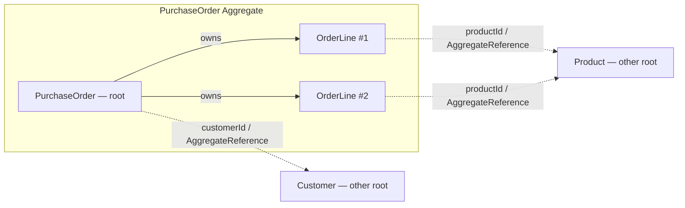

# Avoiding Oversized Aggregates, Circular References, and Arbitrary Object Graphs

In **Spring Data Relational JDBC**, aggregate design is an architectural decision that directly affects how the framework reads, writes, and deletes data. If a class holds a reference to another entity, Spring Data JDBC tends to interpret that entity as an **owned member within the same aggregate**. Consequently, an object model designed as a free-form web of links can lead to a massive aggregate, wrong ownership relationships, or circular references that are hard to map.

This lesson explains how to set **aggregate boundaries** from business rules, how to decouple cross-aggregate references, and how to avoid three mistakes: oversized aggregates, bidirectional circular references, and arbitrary ORM-style object graphs.

## 1. An Aggregate Is a Consistency Boundary, Not the Entire Data Relationship Web

According to Domain-Driven Design (DDD), an **aggregate** is a group of entities/value objects that must maintain *invariants* consistently within a single atomic change. Every aggregate has exactly **one aggregate root** — the entry point for operating on that group.

For example, a sales system has these concepts:

- `PurchaseOrder`: an order, with `OrderLine` items and a total amount that must match the order content.
- `Customer`: a customer with their own profile, status, and lifecycle.
- `Product`: a product with its own details and lifecycle.

Rules like "each line's quantity must be positive" and "the order total is computed from its lines" usually belong to the `PurchaseOrder` aggregate. Rules like "change customer contact address" belong to the `Customer` aggregate. They do not need to live in the same aggregate just because an order has a `customer_id`.



**Ownership** lines stay within one aggregate's boundary; **ID reference** lines merely record relationships between aggregates. In the diagram, `PurchaseOrder` is persisted via `PurchaseOrderRepository`, `Customer` via `CustomerRepository`, and `Product` via `ProductRepository`.

### How Does Spring Data JDBC Interpret a Java Reference?

| Property in domain model | Spring Data JDBC interpretation | Impact on data lifecycle |
|---|---|---|
| `List<OrderLine> lines` in `PurchaseOrder` | `OrderLine` items belong to the order aggregate | Saving/deleting the aggregate can operate on all child lines |
| `ShippingAddress address` mapped with `@Embedded` | Value object stored in the same row as the root | Saved along with the root; no separate repository |
| `Customer customer` in `PurchaseOrder` | Direct entity reference, potentially treated as an **owned entity** | Easily makes the customer an accidental part of the order |
| `Long customerId` | Scalar holding a foreign key at the business level | Does not automatically load or write `Customer` |
| `AggregateReference<Customer, Long> customer` | Typed reference to **another aggregate root** | Stores only the ID; does not pull `Customer` into the order's lifecycle |

**Central principle:** if an entity can be created, modified, deleted, and kept consistent independently of the current aggregate, consider making it **another aggregate root**. Relationships in the database do not have to become ownership relationships in the object model.

## 2. Why Do Oversized Aggregates Cause Problems in Spring Data JDBC?

Suppose a `Customer` contains `List<PurchaseOrder>`, each `PurchaseOrder` contains `List<OrderLine>`, and each line directly contains `Product`, `Supplier`, `InventoryMovement`... At first glance the Java code looks convenient: starting from `customer` you can navigate to any object. However, if all of these are mapped as directly referenced entities, the aggregate stretches across many tables and business lifecycles.

### 2.1. Write Costs Grow With the Number of Child Entities

According to the aggregate persistence mechanism described in Spring Data JDBC documentation, when calling `save()` on a new aggregate, the framework inserts the root and child entities. When saving **an existing aggregate**, referenced child entities may be **deleted and re-inserted**, while the root is updated. This approach reflects the fact that Spring Data JDBC does not retain an old state snapshot of the entire graph like a JPA-style persistence context.

For example, an order has **500 lines** and the user only edits a note on the root:

```text
repository.save(existingOrder)
  ├─ Delete old OrderLine rows belonging to the aggregate
  ├─ UPDATE PurchaseOrder
  └─ Re-INSERT current OrderLine rows
```

This is the behavioral model to factor into design; exact SQL order/syntax may vary by version and dialect. With a few child lines, the cost is usually acceptable. With tens of thousands of child records, deleting/re-inserting can cause heavy I/O, transaction log growth, locks, and impacts on generated child keys. If a child's ID must be stably referenced by other systems, that is also a sign to reconsider treating the child as an owned entity.

> Do not apply a rigid threshold like "over 100 elements is wrong." Suitable size depends on edit frequency, data size, transaction duration, contention, statement counts, and actual read/write needs.

### 2.2. Read and Memory Costs Grow With Structure

In traditional aggregate loading, Spring Data JDBC reads the root and owned entities with additional queries. For large aggregates, the number of rows and amount of data materialized into objects increase. Some versions provide **Single Query Loading** for eligible structures, yet this feature has constraints on aggregate shape, dialect, and query types; do not rely on it to justify an overly broad aggregate boundary.

A screen needing only `customerName`, `orderCount`, and `latestOrderDate` does not need to load `Customer` and traverse all `orders`, `lines`, and `products`. A **dedicated read query** (DTO/projection, JDBC query, aggregated SQL) usually expresses the need far better.

### 2.3. Contention Scope and Transactions Balloon

When many independent actions modify the same large aggregate root, they contend on the same consistency boundary. `@Version` on the root helps **detect** concurrent updates, yet does not make the aggregate smaller. A transaction touching many children also holds database resources longer.

For instance, changing a customer's email should not require re-writing the entire order history. Conversely, changing the quantity of an `OrderLine` may require checking and recalculating the total of **that specific order**; an order's lines have a valid reason to belong to one aggregate.

### Signs to Re-Examine Aggregate Size

| Sign | Why it matters | Direction to think |
|---|---|---|
| Updating one small attribute generates lots of SQL | Child entities are treated as part of the same aggregate | Split data with an independent lifecycle into another root |
| A collection grows unboundedly over time | Every load/save of the aggregate gets heavier | Use a separate repository, paginated queries, or an independent history model |
| Two feature areas often update different parts of the data | Consistency boundary may be too broad | Review which invariants truly require an atomic transaction |
| A child's ID is referenced from external systems | The child has an independent lifecycle/identity | Consider promoting the child to an aggregate root |
| One change locks or validates too many objects | Cross-cutting rules were packed into one aggregate | Express links via IDs and coordinate in application services |
| Only a display record is needed yet the whole tree is loaded | Read model and write model are mixed | Write queries/projections for read use cases |

## 3. Avoiding Circular References and Misbounded Bidirectional Relationships

In Java, writing bidirectional relationships can look natural:

```java
// MODEL TO AVOID when both are directly mapped entities
class Customer {
    @Id Long id;
    List<PurchaseOrder> orders;
}

class PurchaseOrder {
    @Id Long id;
    Customer customer;
    List<OrderLine> lines;
}
```

Here `Customer -> PurchaseOrder -> Customer` forms a **circular reference in the object graph**. If both classes are treated by Spring Data JDBC as owned entities, the model lacks a clear ownership direction: which aggregate contains which, which root owns deletion lifecycle, and which table holds the back-reference? Beyond mapping issues, traversing or JSON-serializing the graph can loop infinitely without separate safeguards.

Points to distinguish:

- **A SQL foreign key is not a Java circular reference.** `purchase_order.customer_id` can reference `customer.id` without needing a direct `Customer` field on `PurchaseOrder`.
- **A physical back-reference does not need a reverse Java field.** When `PurchaseOrder` contains `List<OrderLine>`, Spring Data JDBC uses the FK column in `order_line` to attach lines to the root. There is no need to add a mapped `PurchaseOrder order` or `Long orderId` field inside `OrderLine` for the framework to manage that FK.
- **Cross-aggregate references can work bidirectionally at the query level.** To view a customer's orders, query by `customer_id` instead of keeping `List<PurchaseOrder>` as a persisted field on `Customer`.

### Reasonable Representation

```text
Customer aggregate                         PurchaseOrder aggregate
------------------                         ------------------------
Customer(id, name)     ← customer_id ←     PurchaseOrder(id, customerId)
                                              |
                                              +-- owns OrderLine #1
                                              +-- owns OrderLine #2
```

To find a customer's orders, declare the query on **`PurchaseOrderRepository`** rather than placing an order list inside `Customer`:

```java
public interface PurchaseOrderRepository
        extends CrudRepository<PurchaseOrder, Long> {

    // For models using AggregateReference, an explicit SQL query or dedicated
    // query can be used instead of guessing property paths.
    @Query("SELECT id, version, customer_id FROM purchase_order WHERE customer_id = :customerId")
    List<PurchaseOrder> findRootsByCustomerId(@Param("customerId") Long customerId);
}
```

The snippet above illustrates placing **the query on the order side**. When loading full aggregates with collections is needed, check the result-mapping rules of the Spring Data JDBC version in use; a query returning roots and how relations are read may have limits compared to `findById`. For list screens, return an appropriate **projection/DTO** to avoid loading all `OrderLine` items just to show summary info.

**Do not use `@Transient` as a cure-all for circular references.** That annotation excludes a property from persistence mapping; it is suitable for non-persisted helper data, yet does not establish a proper domain relationship or automatically load another entity. Fix **aggregate boundaries** first.

## 4. Spring Data JDBC Does Not Map Arbitrary Entity Graphs Like an ORM

An object model shaped like:

```text
User → Team → Projects → Members → User → ...
```

can be used for **in-memory navigation**, yet cannot automatically have every edge turned into an entity property persisted by Spring Data JDBC's aggregate mechanism. The framework applies ownership rules: direct references to entities are treated as aggregate members, and those references are primarily suited for **owned 1-to-1 or 1-to-N** relationships.

**N-to-1**, **N-to-N**, or entities shared across multiple roots usually require different modeling:

| Business relationship | Model to consider | What to avoid |
|---|---|---|
| One order has many lines | Root `PurchaseOrder` owns `List<OrderLine>` | Creating a public repository to edit lines while bypassing order invariants |
| Many orders belong to one customer | `PurchaseOrder.customerId` or `AggregateReference<Customer, Long>` | Embedding `Customer` and the full order list inside each other |
| Many lines reference the same product | `OrderLine.productId` or `AggregateReference<Product, Long>` | Copying full `Product` as an owned entity inside every line |
| Many students enroll in many courses | `Enrollment` with appropriate identity/lifecycle, or join table + explicit service/queries | Mapping two bidirectional collections and expecting automatic many-to-many management |
| An entity has many historical events | Separate aggregate/history with paginated queries | Holding an unboundedly growing `List<Event>` in the root |

For **many-to-many**, there is no single formula. If the relationship itself carries attributes and lifecycle (`Enrollment.status`, `enrolledAt`), `Enrollment` can be designed as an aggregate root. If the relationship is purely link data, it can be managed with a join table and dedicated access statements. The core point is never forcing two roots to **co-own** an entity.

### `AggregateReference` Is a Reference to Another Root

Spring Data JDBC provides `org.springframework.data.jdbc.core.mapping.AggregateReference<T, ID>`, an ID wrapper carrying type information about the referenced aggregate:

```java
import org.springframework.data.jdbc.core.mapping.AggregateReference;

AggregateReference<Customer, Long> customerRef = AggregateReference.to(42L);
Long customerId = customerRef.getId();
```

`AggregateReference` **is not a lazy-loading proxy**: calling `getId()` returns the ID without querying `Customer`. If the business logic needs customer details, invoke `CustomerRepository` or a corresponding read query. Spring Data JDBC does not automatically cascade `save` from `PurchaseOrder` to the `Customer` aggregate just because a field holds an `AggregateReference`.

If the domain does not need a typed wrapper, a plain `Long customerId` field is also valid. Choose an expression that is clear and consistent across the project.

## 5. Well-Bounded Aggregate Design Example: Orders and Lines

The model below uses **`PurchaseOrder` as the root**, owning `OrderLine` and referencing `Customer`/`Product` by ID. `Customer` and `Product` are **independent aggregate roots**, defined in their own domain areas. The example targets modern Spring Data JDBC on Java 17+.

### Root `PurchaseOrder`

```java
package com.example.sales;

import java.util.ArrayList;
import java.util.List;

import org.springframework.data.annotation.Id;
import org.springframework.data.annotation.Version;
import org.springframework.data.jdbc.core.mapping.AggregateReference;
import org.springframework.data.relational.core.mapping.Column;
import org.springframework.data.relational.core.mapping.MappedCollection;
import org.springframework.data.relational.core.mapping.Table;

@Table("purchase_order")
public class PurchaseOrder {

    @Id
    private Long id;

    @Version
    private Long version;

    @Column("customer_id")
    private AggregateReference<Customer, Long> customer;

    @MappedCollection(idColumn = "order_id", keyColumn = "line_no")
    private List<OrderLine> lines = new ArrayList<>();

    protected PurchaseOrder() {} // Used when Spring Data constructs the entity from the DB

    public PurchaseOrder(Long customerId) {
        if (customerId == null) {
            throw new IllegalArgumentException("customerId is required");
        }
        this.customer = AggregateReference.to(customerId);
    }

    public void addLine(Long productId, int quantity, long priceCents) {
        if (productId == null || quantity <= 0 || priceCents < 0) {
            throw new IllegalArgumentException("Invalid order line");
        }
        lines.add(new OrderLine(productId, quantity, priceCents));
    }

    public long totalCents() {
        return lines.stream()
                .mapToLong(line -> Math.multiplyExact(
                        line.getQuantity(), line.getPriceCents()))
                .reduce(0L, Math::addExact);
    }

    public Long getId() { return id; }

    public Long getCustomerId() { return customer.getId(); }

    public List<OrderLine> getLines() { return List.copyOf(lines); }
}
```

`addLine` is a behavior on the root and validates part of the invariants. `getLines()` returns an unmodifiable list, preventing application code from accidentally adding/removing lines while bypassing domain methods. When the business has more complex rules — line limits, paid status, discounts — place checks in the corresponding behaviors of the root.

### Child Entity `OrderLine`

```java
package com.example.sales;

import org.springframework.data.annotation.Id;
import org.springframework.data.jdbc.core.mapping.AggregateReference;
import org.springframework.data.relational.core.mapping.Column;
import org.springframework.data.relational.core.mapping.Table;

@Table("order_line")
public class OrderLine {

    @Id
    private Long id;

    @Column("product_id")
    private AggregateReference<Product, Long> product;

    private int quantity;

    @Column("price_cents")
    private long priceCents;

    protected OrderLine() {}

    public OrderLine(Long productId, int quantity, long priceCents) {
        this.product = AggregateReference.to(productId);
        this.quantity = quantity;
        this.priceCents = priceCents;
    }

    public int getQuantity() { return quantity; }

    public long getPriceCents() { return priceCents; }
}
```

Storing the price at placement time (`priceCents`) is a sound **business snapshot**: changing `Product`'s current price must not rewrite order history. `OrderLine` still references `Product` to know which product was purchased, without owning the entire product aggregate.

Here there is **no** `PurchaseOrder order` or `Long orderId` field inside `OrderLine`. Spring Data JDBC manages the physical back-reference column `order_id` per the `@MappedCollection` configuration. For `List`, `keyColumn = "line_no"` stores element position. There is no need to map these two columns as regular properties on the child; avoid having both the framework and application code trying to write the same relationship.

### Repository and Operating on the Root

```java
package com.example.sales;

import org.springframework.data.repository.CrudRepository;

public interface PurchaseOrderRepository
        extends CrudRepository<PurchaseOrder, Long> {}
```

```java
PurchaseOrder order = new PurchaseOrder(customerId);
order.addLine(productId, 2, 150_000L);

PurchaseOrder saved = purchaseOrderRepository.save(order);
Long orderId = saved.getId();
```

If you want to display the customer's name, obtain `order.getCustomerId()` and query `CustomerRepository`, or use a **read query** returning a DTO combining data across tables. Separate retrieving display data from the aggregate's ownership structure.

### Corresponding SQL Schema (PostgreSQL)

Assume the two root tables `customer` and `product` already exist with `BIGINT` primary keys. The migration for orders might look like:

```sql
CREATE TABLE purchase_order (
    id BIGINT GENERATED BY DEFAULT AS IDENTITY PRIMARY KEY,
    version BIGINT NOT NULL,
    customer_id BIGINT NOT NULL REFERENCES customer(id)
);

CREATE TABLE order_line (
    id BIGINT GENERATED BY DEFAULT AS IDENTITY PRIMARY KEY,
    order_id BIGINT NOT NULL REFERENCES purchase_order(id),
    line_no INTEGER NOT NULL,
    product_id BIGINT NOT NULL REFERENCES product(id),
    quantity INTEGER NOT NULL CHECK (quantity > 0),
    price_cents BIGINT NOT NULL CHECK (price_cents >= 0),
    UNIQUE (order_id, line_no)
);

CREATE INDEX idx_order_line_order_id ON order_line(order_id);
CREATE INDEX idx_purchase_order_customer_id ON purchase_order(customer_id);
```

The foreign keys have **different domain semantics** despite all using SQL FKs:

| FK column | Semantics | Lifecycle-managing component |
|---|---|---|
| `order_line.order_id` | **Owned child → aggregate root** relationship | `PurchaseOrder` via Spring Data JDBC aggregate mapping |
| `purchase_order.customer_id` | **Root → root** reference | `Customer` has its own lifecycle; order stores only ID |
| `order_line.product_id` | **Child → other root** reference | `Product` has its own lifecycle; order line stores only ID |

Database FK constraints help catch non-existent IDs, yet **do not solve all cross-aggregate invariants**. For example, when placing an order, the service may need to check customer status and stock availability; depending on consistency needs, use appropriate transactions, stock reservations, or event handling. Do not merge all of `Customer` and `Inventory` into `PurchaseOrder` merely to have a single `save()` call.

## 6. When Should a Child Entity Be Split Into Another Aggregate Root?

Not every list belongs inside a root. Ask four questions before keeping a direct relationship:

1. **Invariants:** must changing a child validate root state and other children within the same transaction?
2. **Ownership:** is the child deleted along with the root, or can it exist and be looked up independently?
3. **Cardinality:** does the list have a natural business limit, or does it grow unboundedly over time?
4. **Access pattern:** do most use cases load/edit the entire group, or only a small slice with pagination?

Comparison examples:

| Business domain | Should stay in one aggregate? | Reason |
|---|---|---|
| `PurchaseOrder` and a few `OrderLine` items being edited | **Usually yes** | Lines and order total must be consistent when confirming the order |
| `Customer` and all orders placed over many years | **Usually no** | Tens of thousands of orders have separate lifecycles and need pagination/querying |
| `Product` and every order line that ever bought it | **No** | Product does not own customers' order history |
| `Invoice` and items used to compute invoice total | **Possibly yes** | Totals, taxes, and issuance status invariants usually sit in one boundary |
| `BlogPost` and millions of comments | **Usually no** | Comments are paginated, moderated, and written concurrently independently |
| `Account` and full historical transaction log | **Usually no** | Logs grow continuously and should have a separate write/read model and clear balancing rules |

If a child is accessed and updated by multiple aggregates via its own identity, it is usually a **candidate aggregate root**. Yet do not split mechanically: if two values **must** change atomically together to preserve an invariant, splitting them can complicate the business logic. Boundaries are decided by **business consistency** first, and then tuned using measured performance.

## 7. Persistence Behavior: Consequences of Aggregate Boundaries

Compare two options for 1,000 historical events of an order:

### Option A: Keep Everything Inside `PurchaseOrder`

```java
@Table("purchase_order")
class PurchaseOrder {
    @Id Long id;
    @MappedCollection(idColumn = "order_id")
    Set<OrderEvent> allHistoricalEvents;
}
```

If events are owned entities, calling `save()` on an existing aggregate can delete and re-insert the large child set even when only modifying another part of the root. The history list is also hard to paginate if read through the aggregate.

### Option B: History as a Separate Model

```java
@Table("order_event")
class OrderEvent {
    @Id Long id;
    Long orderId;       // ID reference, not an owned entity
    String eventType;
}
```

`OrderEvent` can have its own repository, append-only policy, or dedicated query mechanism. Read history with `WHERE order_id = ? ORDER BY id LIMIT ...` (pagination syntax varies by database) instead of holding the full collection inside the root. If business rules require writing the event and updating the order in **the same transaction**, the service can still coordinate two repositories using Spring transaction management; **aggregate boundaries** and **database transaction boundaries** are related concepts, not identical ones.

**Caution:** if events truly form part of the order's invariants, design how those invariants are preserved after splitting; do not split merely to shrink collection size. With asynchronous flows, clearly specify what is immediately consistent and what can be eventually consistent.

## 8. Managing Many-to-Many Relationships and Shared Objects

Suppose students enroll in many courses, and each course has many students. A design like:

```java
// MODEL PRONE TO BOUNDARY MISTAKES IN SPRING DATA JDBC
class Student {
    @Id Long id;
    List<Course> courses;
}

class Course {
    @Id Long id;
    List<Student> students;
}
```

creates both a bidirectional relationship and accidentally treats two roots as entities owned by each other. Instead, when enrollment has status and enrollment timestamp:

```text
Student (aggregate root)
  id

Course (aggregate root)
  id

Enrollment (aggregate root or independent relationship model)
  id
  student_id
  course_id
  enrolled_at
  status
```

`Enrollment` references `Student` and `Course` by ID; querying "a student's courses" uses the enrollment table. This architecture avoids an object graph cycling `Student -> Course -> Student`. When enrollment has its own invariant like "a student cannot enroll twice in the same course," a **unique constraint** on `(student_id, course_id)` helps enforce it in the database alongside domain-layer validation.

## 9. Keep the Write Model Small, Serve Read Screens With Queries

A common reason projects create oversized aggregates is wanting to return nested JSON for a web page:

```json
{
  "orderId": 101,
  "customerName": "An",
  "items": [
    { "productName": "Keyboard", "quantity": 2 }
  ]
}
```

You do not need to make `PurchaseOrder` own `Customer` and `Product` to fulfill this DTO. You can use a SQL `JOIN` query paired with a projection/read model:

```sql
SELECT o.id AS order_id,
       c.name AS customer_name,
       l.line_no,
       p.name AS product_name,
       l.quantity
FROM purchase_order o
JOIN customer c ON c.id = o.customer_id
JOIN order_line l ON l.order_id = o.id
JOIN product p ON p.id = l.product_id
WHERE o.id = :orderId
ORDER BY l.line_no;
```

Then group the rows into `OrderDetailDto` in the read layer. This query does not change ownership of `Customer`, `Product`, or `OrderLine`; it merely aggregates data for display. Paginated list pages and dashboards should likewise use direct queries, avoiding instantiating large aggregates when full invariant enforcement is not needed.

## 10. Transactions, Optimistic Locking, and Cross-Aggregate Consistency

Splitting aggregates shrinks update scope while requiring clear consistency boundaries:

- **Within one aggregate:** make changes via the root and `repository.save(root)`. For a write operation spanning multiple statements, transactions guarantee database atomicity.
- **Multiple aggregates in the same database:** an application service can use `@Transactional` to coordinate repositories if the use case demands it. Doing so does not merge them into one aggregate in the domain model.
- **Multiple services/databases:** design failure handling, retries, and eventual consistency; do not expect `save()` on an object graph to automatically update everywhere.
- **Concurrent updates:** `@Version` on the root enables optimistic locking checks. When `OptimisticLockingFailureException` occurs, the application must handle the conflict (such as asking the user to reload or performing a controlled retry).

For example, `PurchaseOrder` has a `version`, whereas `Customer`/`Product` have different versions and lifecycles. A selling price change in `Product` should not accidentally bump the version of every historical order that ever bought that product. For data that must be **frozen at transaction time** (price, invoice description), store a business snapshot on the order line or invoice rather than relying purely on a shared entity.

## 11. Testing Design Through Three Scenarios

### Scenario A — A Customer Has Millions of Orders

If `Customer` holds `List<PurchaseOrder>`, loading and saving a customer profile could drag along a massive collection. The typical solution is keeping `PurchaseOrder.customerId`/`AggregateReference`, and paginating orders by customer when needed. `Customer` itself stays small with its own lifecycle.

### Scenario B — Order Lines Pointing Back to PurchaseOrder

If `PurchaseOrder.lines` contains `OrderLine` and `OrderLine.order` points back to `PurchaseOrder`, bidirectional ownership occurs. Use `@MappedCollection(idColumn = "order_id")` so the root manages the FK, without adding a mapped parent property in the child. If a child needs `orderId` inside a DTO, include it in the DTO/read model; it does not need to sit in the persistent object graph.

### Scenario C — OrderLine References Product, and Product Holds a List of OrderLines

Using direct `Product` and `List<OrderLine>` bidirectionally mixes product lifecycle and purchase history. Use `AggregateReference<Product, Long>`/`productId` in `OrderLine`. When the product name is needed, query separately or JOIN; when the price at purchase time is needed, use the snapshot stored in `OrderLine`.

## 12. How to Decide When Adding a New Relationship

Instead of starting from "can this class have a field pointing to that class?", follow this order:

1. **Write down business invariants.** Which entities must be consistent immediately after the same action?
2. **Choose one aggregate root.** All internal structural changes go through the root; child entities have no independent lifecycle.
3. **Define ownership direction.** For owned relationships, only one root owns a child; the structure should form a tree/directed acyclic graph under ownership.
4. **Decouple links between aggregates into IDs or `AggregateReference`.** Do not automatically turn FKs into direct entity properties.
5. **Check growth potential.** Can a collection bloat over time? Is pagination or independent element updating needed?
6. **Design a separate read model when needed.** Use queries/DTOs combining cross-aggregate data for screens; do not alter ownership just for convenient JSON.
7. **Determine transactions and concurrency.** Use `@Version`, constraints, transactions, or eventual consistency mechanisms suited to the use case.
8. **Observe actual SQL.** During integration runs, inspect statement counts, row counts, and save/load times with realistic data sizes; adjust boundaries when evidence shows the cost is unsuitable.

### Key Boundary Takeaways

| Question | If the answer is "yes" | Design option |
|---|---|---|
| Is the child deleted when the root is deleted and lacks independent existence? | Yes | Owned entity/value object inside the same aggregate |
| Must root invariants be checked when altering the child? | Yes | Operate through root methods |
| Is the entity referenced by multiple roots or updated independently? | Yes | Separate aggregate root, referenced by ID |
| Can the collection grow unboundedly or require pagination? | Yes | Split out a history/relationship model or use dedicated read queries |
| Does the object graph have edges cycling back to an ancestor/other root? | Yes | Re-examine ownership; use ID/reference or DTOs |
| Is data only combined for display? | Yes | Projections/DTOs or SQL JOINs in the read layer |

**Conclusion:** in Spring Data JDBC, a good aggregate encompasses **what must change consistently together**, rather than trying to encompass **everything related in the database**. Owned entity structures stay small and unidirectional; distinct aggregate roots connect via IDs; and displaying large graphs of information is solved with dedicated read queries. Designing this way avoids circular references, eliminates unnecessary SQL, and keeps each aggregate's responsibilities clear.

## Official References

- [Spring Data JDBC — Domain Driven Design and Relational Databases](https://docs.spring.io/spring-data/relational/reference/jdbc/domain-driven-design.html): aggregate boundaries and rules for roots owning child entities.
- [Spring Data JDBC — Mapping](https://docs.spring.io/spring-data/relational/reference/jdbc/mapping.html): entity references, back-references, `@MappedCollection`, `AggregateReference`, and `@Version`.
- [Spring Data JDBC — Persisting Entities](https://docs.spring.io/spring-data/relational/reference/jdbc/entity-persistence.html): aggregate insert/update rules, deleting and re-inserting child entities, and loading aggregates.
- [Spring Data JDBC — Repository Query Methods](https://docs.spring.io/spring-data/relational/reference/jdbc/query-methods.html): derived queries and `@Query`.
- [Spring Data JDBC — `AggregateReference` API](https://docs.spring.io/spring-data/relational/docs/current/api/org/springframework/data/jdbc/core/mapping/AggregateReference.html): `AggregateReference.to(...)` and `getId()`.
- [Spring Data JDBC — `MappedCollection` API](https://docs.spring.io/spring-data/relational/docs/current/api/org/springframework/data/relational/core/mapping/MappedCollection.html): `idColumn` and `keyColumn`.
