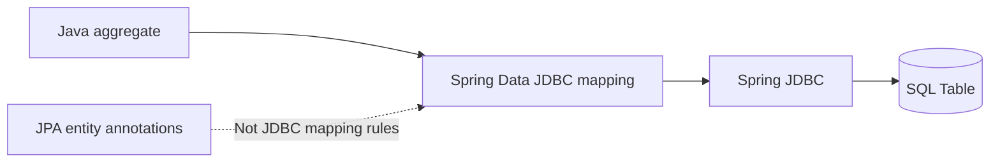
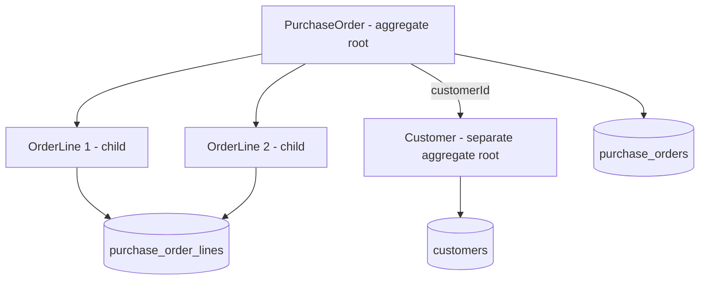
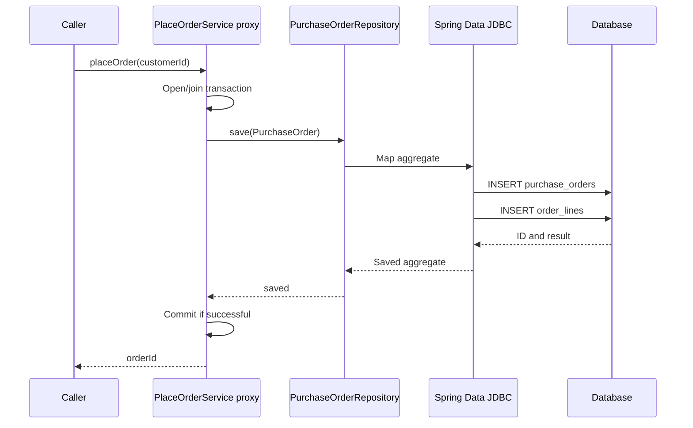

# Using the Right Spring Data Annotations Instead of JPA Annotations

In **Spring Data Relational JDBC** (Spring Data JDBC), a Java class can represent a row in a SQL table, yet **it is not a JPA entity managed by an `EntityManager`**. Therefore, when defining aggregates, primary keys, columns, relationships, and auditing for Spring Data JDBC, you must import **Spring Data annotations**, rather than copying `@Entity`, `@OneToMany`, `@ManyToOne`, or `@GeneratedValue` from Spring Data JPA documentation.

This is especially critical when your IDE auto-imports annotations, when a project includes both `spring-boot-starter-data-jdbc` and `spring-boot-starter-data-jpa`, or when migrating a JPA entity to JDBC. Two annotations sharing the same simple name do not mean they share the same mapping mechanism.

This lesson covers the right annotations, how to use them with SQL tables, examples of aggregates with collections and embedded value objects, and real-world bugs caused by mixing in JPA annotations.

## 1. Two Persistence Models, Two Sets of Mapping Rules

Spring Data JDBC and Spring Data JPA both work with relational databases, but they manage objects differently:

| Aspect | Spring Data JDBC | Spring Data JPA |
|---|---|---|
| Foundation | Spring JDBC and the Spring Data Relational aggregate model | JPA with `EntityManager` and a JPA provider |
| Mapping root | `@Table` from Spring Data Relational; `@Entity` is not required | `@Entity` from Jakarta Persistence |
| Identifier | `@Id` from Spring Data Commons | `@Id` from Jakarta Persistence |
| Data-ownership relationships | Aggregate references and child entities/value objects within the aggregate; `@MappedCollection` when needed | `@OneToMany`, `@ManyToOne`, `@JoinColumn`, ... |
| Change tracking | No JPA persistence context or dirty checking | Managed entities can have changes flushed automatically |
| JPA-style lazy-loading associations | No proxy-based lazy relationship mechanism like JPA | Lazy loading can be configured via the JPA provider |
| Saving data | Call repository/`JdbcAggregateTemplate` to save the aggregate | `persist`/`merge`/repository and persistence context lifecycle |
| Transactions | Spring transaction manager bound to JDBC | JPA transaction manager and JPA persistence context |

Spring Data JDBC treats the **aggregate root** as the consistency boundary. When you call `save(root)`, the framework saves the root and the objects owned by that root according to JDBC mapping rules. It does not interpret JPA's entity graphs or `@OneToMany`/`@ManyToOne` cascade and fetch semantics.



So the question to ask when looking at an annotation is: **which package does this annotation come from, and does Spring Data JDBC understand its metadata?**

## 2. Annotation Comparison Table to Remember

| Purpose | Spring Data JDBC / Spring Data Relational | Commonly Confused JPA Annotation | Notes |
|---|---|---|---|
| Marking a persisted object | `@Table`: `org.springframework.data.relational.core.mapping.Table`; can rely on conventions if omitted | `jakarta.persistence.Entity` | JDBC **does not need `@Entity`** |
| Choosing table name | `@Table("purchase_orders")` | `jakarta.persistence.Table` | The two `@Table` annotations are in different packages |
| Primary key | `org.springframework.data.annotation.Id` | `jakarta.persistence.Id` | For JDBC, import Spring Data's `@Id` |
| Choosing column name | `org.springframework.data.relational.core.mapping.Column` | `jakarta.persistence.Column` | JDBC `@Column` handles column-name mapping |
| Auto-generated ID values | DB generates the ID; Spring Data JDBC receives the ID after insert when supported | `@GeneratedValue` | Do not use `@GeneratedValue` to instruct JDBC to generate keys |
| Optimistic locking | `org.springframework.data.annotation.Version` | `jakarta.persistence.Version` | Different package and update lifecycle |
| Ignoring a property | `org.springframework.data.annotation.Transient` | `jakarta.persistence.Transient` | Only the proper `@Transient` controls JDBC mapping |
| Embedded component | `org.springframework.data.relational.core.mapping.Embedded` | `jakarta.persistence.Embedded`, `@Embeddable` | JDBC flattens value objects into columns of the root table |
| Child collection in aggregate | `org.springframework.data.relational.core.mapping.MappedCollection` | `@OneToMany`, `@JoinColumn`, `@OrderColumn` | Relationships must be designed around aggregates |
| Referencing another aggregate | Store scalar ID or `AggregateReference<T, ID>` | `@ManyToOne`, `@OneToOne` | JDBC does not auto-load related objects via JPA annotations |
| Timestamp auditing | `@CreatedDate`, `@LastModifiedDate` from Spring Data | `@PrePersist`, `@PreUpdate` in JPA | Requires enabling the appropriate auditing mechanism |
| User auditing | `@CreatedBy`, `@LastModifiedBy` from Spring Data | Custom JPA listeners | May require `AuditorAware` |
| Choosing constructor for entity instantiation | `org.springframework.data.annotation.PersistenceCreator` | `jakarta.persistence.` constructor/lifecycle conventions | Records and constructor mapping follow Spring Data |
| Enum / type conversion | Spring Data JDBC mapping/converters | `@Enumerated`, JPA `@Convert` | JPA converters are not applied just by switching imports arbitrarily |
| Lifecycle callbacks | Spring Data `EntityCallback` / corresponding events | `@EntityListeners`, `@PrePersist`, `@PostLoad` | The two lifecycle mechanisms are separate |

`@Id`, `@Version`, `@Transient`, and `@CreatedDate` live in **Spring Data Commons** (`org.springframework.data.annotation`), not in `org.springframework.data.jdbc`. This is intentional: multiple Spring Data modules share this core metadata.

**Important note:** Spring Data JDBC can infer certain table/column names or identifiers by convention, so code using the wrong annotation may sometimes **appear to work in simple cases**. That does not prove the JPA annotation took effect; always inspect the actual mapping metadata and generated SQL.

## 3. `@Table`: Mapping an Aggregate Root to a Table

### 3.1. Correct Import

```java
import org.springframework.data.relational.core.mapping.Table;

@Table("customers")
public class Customer {
    // ...
}
```

Here `@Table("customers")` specifies the table name used by Spring Data JDBC for the aggregate root. If `@Table` is omitted, Spring Data Relational typically derives the table name from the class name via a naming strategy. Using explicit annotations makes table names easy to control, especially when naming conventions differ from code or when multiple Spring Data modules are present.

**Do not confuse with:**

```java
import jakarta.persistence.Entity;
import jakarta.persistence.Table;

@Entity
@Table(name = "customers")
public class Customer {
    // This is JPA-oriented mapping.
}
```

JPA's `@Table` is typically used alongside `@Entity` and belongs to `jakarta.persistence`. Adding those annotations to a class used by Spring Data JDBC neither turns it into a managed JPA entity nor automatically turns a JDBC repository into a JPA repository.

### 3.2. A JDBC Class Does Not Need `@Entity`

Here is a valid JDBC aggregate root at the mapping level:

```java
package com.example.orders.jdbc.domain;

import org.springframework.data.annotation.Id;
import org.springframework.data.relational.core.mapping.Column;
import org.springframework.data.relational.core.mapping.Table;

@Table("customers")
public class Customer {

    @Id
    private Long id;

    @Column("display_name")
    private String displayName;

    protected Customer() {
        // Allows Spring Data to instantiate the object when reading data.
    }

    public Customer(String displayName) {
        this.displayName = displayName;
    }

    public Long getId() {
        return id;
    }

    public String getDisplayName() {
        return displayName;
    }

    public void rename(String newName) {
        this.displayName = newName;
    }
}
```

With the corresponding schema:

```sql
CREATE TABLE customers (
    id BIGINT GENERATED BY DEFAULT AS IDENTITY PRIMARY KEY,
    display_name VARCHAR(160) NOT NULL
);
```

This DDL syntax is for PostgreSQL; identity/auto-increment declarations may differ across other databases. Spring Data JDBC requires actual tables and columns compatible with the mapping. `@Table` **is not a command to auto-generate schema**.

In a Spring Boot application, configure schema creation or migrations separately as needed (such as SQL scripts for learning environments, or Flyway/Liquibase for production environments).

## 4. `@Id` and Primary Key Generation in Spring Data JDBC

### 4.1. Use `org.springframework.data.annotation.Id`

```java
import org.springframework.data.annotation.Id;

@Id
private Long id;
```

**Do not import by mistake**:

```java
import jakarta.persistence.Id; // JPA @Id, not the preferred ID metadata for JDBC.
```

How Spring Data determines whether an entity is new (`isNew`) affects whether Spring Data JDBC performs an insert or an update. Typically, a wrapper-type identifier like `Long` with a `null` value signals that the object has not been persisted yet; after inserting, Spring can retrieve the database-generated ID and populate it on the entity.

Example of creating a customer:

```java
import org.springframework.data.repository.CrudRepository;

public interface CustomerRepository
        extends CrudRepository<Customer, Long> {
}

// In a service:
Customer customer = new Customer("An");
Customer stored = customerRepository.save(customer);
Long generatedId = stored.getId();
```

Always use **the object returned by `save`** if you need values updated during persistence. This is especially important with immutable entities/records: Spring Data may return a new instance to reflect the assigned ID/version.

### 4.2. Why Is JPA's `@GeneratedValue` Not Applicable?

`jakarta.persistence.GeneratedValue` describes key generation strategies under a JPA provider. Spring Data JDBC **does not drive key generation from this annotation**.

In JDBC, the typical flow is:

1. The database defines an auto-generated ID column (identity/auto-increment or another supported mechanism).
2. A new entity starts with an unassigned ID.
3. The repository performs an insert and retrieves the ID returned by the driver/database when supported.
4. The application uses the returned saved entity to read the ID.

Not every database, ID type, or key generation strategy works identically. If you use UUIDs or application-assigned keys, check the new-entity detection rules and design key assignment accordingly; a non-`null` ID can cause the framework to treat the entity as already existing.

### 4.3. Having an `id` Field with the Wrong Import: Why Is the Bug Subtle?

Spring Data has certain conventions for detecting an ID property and field name. As a result, a class with a field named `id` annotated with JPA's `@Id` **might appear to work** due to naming conventions, misleading developers into thinking the JPA annotation was honored.

Do not rely on this coincidence. Always import `org.springframework.data.annotation.Id` explicitly, and verify cases where the key field is not named `id`, especially as the domain model evolves.

## 5. `@Column`: Mapping Column Names, Not JPA DDL Metadata

In Spring Data JDBC:

```java
import org.springframework.data.relational.core.mapping.Column;

@Column("display_name")
private String displayName;
```

`@Column` specifies the column name used when reading/writing the property. If omitted, Spring Data Relational applies its naming strategy, commonly converting the Java name `displayName` into snake_case `display_name` under default conventions.

JPA also has `@Column`, but in a different package:

```java
import jakarta.persistence.Column;

@Column(
    name = "display_name",
    nullable = false,
    length = 160,
    unique = true
)
private String displayName;
```

Attributes such as `nullable`, `unique`, and `length` in the JPA example cannot be transferred directly onto Spring Data JDBC's `@Column`. Actual constraints are defined and enforced in the **database schema**:

```sql
CREATE TABLE customers (
    id BIGINT GENERATED BY DEFAULT AS IDENTITY PRIMARY KEY,
    display_name VARCHAR(160) NOT NULL UNIQUE
);
```

Application-level validation, such as `@NotBlank`, is a separate layer of checks and does not replace database constraints. Spring Data JDBC does not derive full DDL from JDBC annotations the way a JPA ORM configured for schema generation does.

If a table uses uppercase/quoted identifiers or a custom schema, pay attention to database case-folding behavior, naming strategies, and schema configuration. Explicitly declared table/column names must still match how the database actually stores them.

## 6. `@Version`: Optimistic Locking from the Right Package

Spring Data JDBC supports optimistic locking with:

```java
import org.springframework.data.annotation.Version;

@Version
private Long version;
```

When an aggregate is updated, Spring Data JDBC can include the previous version value in the update condition to detect whether someone else modified the record in the meantime. If no row with the expected version remains, the save operation reports a version conflict (typically via an optimistic locking exception). Business logic must decide whether to return an error, reload the data, or retry appropriately.

Example:

```java
import org.springframework.data.annotation.Id;
import org.springframework.data.annotation.Version;
import org.springframework.data.relational.core.mapping.Table;

@Table("accounts")
public class Account {
    @Id
    private Long id;

    @Version
    private Long version;

    private long balanceCents;

    protected Account() {
    }

    public Account(long openingBalanceCents) {
        this.balanceCents = openingBalanceCents;
    }

    public void debit(long amountCents) {
        if (amountCents <= 0 || balanceCents < amountCents) {
            throw new IllegalArgumentException("Invalid debit");
        }
        balanceCents -= amountCents;
    }
}
```

Illustrative schema:

```sql
CREATE TABLE accounts (
    id BIGINT GENERATED BY DEFAULT AS IDENTITY PRIMARY KEY,
    version BIGINT,
    balance_cents BIGINT NOT NULL CHECK (balance_cents >= 0)
);
```

Do not import `jakarta.persistence.Version` just because you were reading a JPA guide. Spring Data JDBC looks up mapping metadata through Spring Data's own mechanisms.

**A detail about newness:** a `@Version` property can also be used to determine whether an object is new, especially when IDs are pre-assigned. For wrapper types (`Long`), `null` typically represents an unsaved state; for primitives, `0` typically corresponds to a new state under Spring Data rules. Because ID/version values drive insert vs. update decisions, design constructors and saving flows consistently.

**Optimistic locking does not mean automatic retries.** When two concurrent transactions update the same aggregate, the application must define the appropriate behavior on conflict.

## 7. `@Transient`: Not Persisting Computed Properties

If a property exists only in Java logic and does not need to be persisted:

```java
import org.springframework.data.annotation.Transient;

@Table("products")
public class Product {
    @Id
    private Long id;

    private long priceCents;

    @Transient
    private String displayPrice;

    // ...
}
```

`displayPrice` will be excluded from Spring Data JDBC's persistence mapping. When loading back from the database, if a display value is needed, the application computes it or builds a DTO:

```java
public String priceLabel(long priceCents) {
    return (priceCents / 100) + "." +
            String.format("%02d", priceCents % 100);
}
```

The correct annotation is `org.springframework.data.annotation.Transient`. Do not use `jakarta.persistence.Transient` and expect JDBC to ignore the property.

Note: if a persistence constructor requires a parameter corresponding to a `@Transient` property, Spring Data may have no column value from the database to pass in. Design constructors to map actually persisted properties; computed values should be derived separately.

## 8. Aggregate Thinking Determines Relationship Annotations

Relationships are where JPA–JDBC confusion happens most often. In JPA, a developer might write:

```java
@OneToMany(mappedBy = "order", cascade = CascadeType.ALL)
private List<OrderLine> lines;

@ManyToOne(fetch = FetchType.LAZY)
@JoinColumn(name = "customer_id")
private Customer customer;
```

This snippet relies on JPA associations, cascading, and fetch semantics. Spring Data JDBC **does not use those annotations to build relationships**.

With Spring Data JDBC, start by defining aggregate boundaries:

- `PurchaseOrder` is an **aggregate root**.
- `OrderLine` belongs to the lifecycle of `PurchaseOrder` and is saved through the root.
- `Customer` is **another aggregate root**; the order can hold `customerId` instead of an object reference to `Customer` that the framework automatically lazy-loads.



From this diagram, you can choose the annotations:

- `@MappedCollection` for owned child components within an aggregate.
- `@Embedded` for value objects flattened into columns of the parent table.
- An ID field or `AggregateReference` for references to another aggregate root.
- `@Table`/`@Column` to match the schema.

### 8.1. `@MappedCollection` for Lists of Child Objects

Example of an order owning multiple order lines:

```java
import java.util.ArrayList;
import java.util.List;

import org.springframework.data.annotation.Id;
import org.springframework.data.annotation.Version;
import org.springframework.data.relational.core.mapping.Column;
import org.springframework.data.relational.core.mapping.MappedCollection;
import org.springframework.data.relational.core.mapping.Table;

@Table("purchase_orders")
public class PurchaseOrder {

    @Id
    private Long id;

    @Version
    private Long version;

    @Column("order_code")
    private String code;

    @Column("customer_id")
    private Long customerId;

    @MappedCollection(
        idColumn = "order_id",
        keyColumn = "line_index"
    )
    private List<OrderLine> lines = new ArrayList<>();

    protected PurchaseOrder() {
    }

    public PurchaseOrder(String code, Long customerId) {
        this.code = code;
        this.customerId = customerId;
    }

    public void addLine(String sku, int quantity) {
        lines.add(new OrderLine(sku, quantity));
    }

    public Long getId() {
        return id;
    }

    public List<OrderLine> getLines() {
        return lines;
    }
}
```

Child class:

```java
import org.springframework.data.annotation.Id;

public class OrderLine {
    @Id
    private Long id;

    private String sku;
    private int quantity;

    protected OrderLine() {
    }

    public OrderLine(String sku, int quantity) {
        if (quantity <= 0) {
            throw new IllegalArgumentException("Quantity must be positive");
        }
        this.sku = sku;
        this.quantity = quantity;
    }

    public String getSku() {
        return sku;
    }

    public int getQuantity() {
        return quantity;
    }
}
```

Illustrative PostgreSQL schema:

```sql
CREATE TABLE purchase_orders (
    id BIGINT GENERATED BY DEFAULT AS IDENTITY PRIMARY KEY,
    version BIGINT,
    order_code VARCHAR(40) NOT NULL,
    customer_id BIGINT NOT NULL REFERENCES customers(id)
);

CREATE TABLE order_lines (
    id BIGINT GENERATED BY DEFAULT AS IDENTITY PRIMARY KEY,
    order_id BIGINT NOT NULL REFERENCES purchase_orders(id),
    line_index INTEGER NOT NULL,
    sku VARCHAR(64) NOT NULL,
    quantity INTEGER NOT NULL CHECK (quantity > 0),
    UNIQUE (order_id, line_index)
);
```

In `@MappedCollection`:

- **`idColumn = "order_id"`:** the column in the child table that links each child row to the aggregate root's ID; this is the *reverse reference/foreign key*, not the child's own ID field.
- **`keyColumn = "line_index"`:** the column storing the element's position in a `List` (or the key for a `Map` under the corresponding mapping).
- **`@Id` on `OrderLine`:** the line's own ID when the model uses child identity.

The child table name is derived from the class/naming strategy if `@Table` is not declared on the child. For example, a class `OrderLine` may normally map to `order_line`, whereas the DDL above uses `order_lines`. To match exactly, add an explicit annotation:

```java
import org.springframework.data.relational.core.mapping.Table;

@Table("order_lines")
public class OrderLine {
    // Fields as in the previous example.
}
```

**Lifecycle implications:** children belong to the aggregate. Saving the aggregate can rewrite child elements according to Spring Data JDBC's persistence strategy, including deleting/reinserting dependent rows on updates. Do not assume child collections share JPA's dirty checking, orphan-removal, and cascade options.

### 8.2. `@Embedded` for Value Objects in the Same Table

A shipping address with `street` and `city` can be stored directly in the order table rather than in a separate child table.

```java
public record ShippingAddress(
        String street,
        String city
) {
}
```

On the aggregate root:

```java
import org.springframework.data.relational.core.mapping.Embedded;

@Embedded(
    onEmpty = Embedded.OnEmpty.USE_NULL,
    prefix = "ship_"
)
private ShippingAddress shippingAddress;
```

The columns in `purchase_orders` must match:

```sql
ALTER TABLE purchase_orders
ADD COLUMN ship_street VARCHAR(180),
ADD COLUMN ship_city VARCHAR(100);
```

`@Embedded` comes from **Spring Data Relational**, not `jakarta.persistence.Embedded`. Setting `prefix = "ship_"` prevents column name collisions when an aggregate holds multiple value objects with the same field names.

`onEmpty` decides how the embedded value is reconstructed when all corresponding columns are `NULL`:

- `Embedded.OnEmpty.USE_NULL`: the embedded property can be `null`.
- `Embedded.OnEmpty.USE_EMPTY`: Spring Data attempts to instantiate an empty embedded instance using an appropriate constructor/mapping.

For nested embedded objects or constructors taking value objects, design the table structure, prefixes, and nullability conditions carefully. **Do not use JPA's `@Embeddable`** to instruct Spring Data JDBC.

### 8.3. Referencing Another Root by ID

In the earlier example:

```java
@Column("customer_id")
private Long customerId;
```

is a data-level foreign key reference. Spring Data JDBC does not automatically execute `customer.get...()` through a JPA proxy.

When you want to express a typed reference explicitly, Spring Data JDBC provides `AggregateReference<T, ID>`:

```java
import org.springframework.data.jdbc.core.mapping.AggregateReference;
import org.springframework.data.relational.core.mapping.Column;

@Column("customer_id")
private AggregateReference<Customer, Long> customer;
```

Given a known ID value:

```java
AggregateReference<Customer, Long> customerReference =
        AggregateReference.to(customerId);
```

`AggregateReference` carries the meaning of **referencing another aggregate by ID**; it does not hold the full `Customer` and provides no lazy-loading proxy. When business logic needs customer details, query `CustomerRepository` separately or use an appropriate query.

**Do not replace an ID field with `@ManyToOne` just to get IDE autocompletion.** Treat cross-aggregate associations as an explicit design choice.

### 8.4. When Should It Be a Collection vs. a Separate Aggregate?

Examples:

- `OrderLine` only exists alongside `PurchaseOrder` and is not edited independently → fits well as a child collection.
- `Customer` has its own lifecycle, access rules, and business operations → fits as a separate aggregate root referenced by ID.
- A list of hundreds of thousands of independently changing records → consider smaller aggregates or a different access pattern; do not stuff everything into a huge `@MappedCollection` just because a foreign key exists.
- Many-to-many relationships require clarifying the join table, owning entity, and aggregates; Spring Data JDBC does not automatically translate JPA's `@ManyToMany`.

The semantics matter more than the annotation name: an aggregate is a consistency boundary, so relationships should be designed around the write operations the business actually requires.

## 9. Common Annotations Beyond Column Mapping

### 9.1. Auditing: `@CreatedDate` and `@LastModifiedDate`

Spring Data JDBC supports Spring Data auditing when configured.

```java
import java.time.Instant;
import org.springframework.data.annotation.CreatedDate;
import org.springframework.data.annotation.LastModifiedDate;
import org.springframework.data.relational.core.mapping.Table;

@Table("customers")
public class Customer {
    // @Id, other fields...

    @CreatedDate
    private Instant createdAt;

    @LastModifiedDate
    private Instant updatedAt;
}
```

The imports must come from `org.springframework.data.annotation`. To enable auditing in JDBC configuration:

```java
import org.springframework.context.annotation.Configuration;
import org.springframework.data.jdbc.repository.config.EnableJdbcAuditing;

@Configuration(proxyBeanMethods = false)
@EnableJdbcAuditing
public class JdbcAuditingConfiguration {
}
```

The schema needs corresponding columns (`created_at`, `updated_at` under standard naming strategy). Database-default timestamps and Spring-populated auditing are two different mechanisms; choose a clear source of truth to avoid conflicting values.

If you also need to record who created or modified the entity, you can use:

```java
import org.springframework.data.annotation.CreatedBy;
import org.springframework.data.annotation.LastModifiedBy;

@CreatedBy
private String createdBy;

@LastModifiedBy
private String lastModifiedBy;
```

Along with configuring an `AuditorAware<String>` to supply the current actor:

```java
import java.util.Optional;
import org.springframework.context.annotation.Bean;
import org.springframework.context.annotation.Configuration;
import org.springframework.data.domain.AuditorAware;

@Configuration(proxyBeanMethods = false)
class AuditorConfiguration {
    @Bean
    AuditorAware<String> auditorProvider() {
        // Example system user; real applications pull from the security context.
        return () -> Optional.of("system");
    }
}
```

When multiple `AuditorAware` beans exist, select the appropriate bean according to the auditing configuration capabilities. In the example above, `system` is an illustrative value for backend jobs, not a real user-tracking approach.

**Do not copy JPA's `@EntityListeners(AuditingEntityListener.class)` directly into JDBC.** Spring Data JDBC uses Spring Data's auditing/event/callback infrastructure and does not run the JPA entity lifecycle.

### 9.2. Constructor Mapping and `@PersistenceCreator`

Spring Data JDBC needs to reconstruct objects from the columns read. Common options:

- A no-argument constructor followed by setting supported properties.
- A suitable parameterized constructor.
- A Java record with a clear canonical constructor.
- When multiple constructors exist and need disambiguation, use `@PersistenceCreator` from Spring Data.

Example with an immutable class:

```java
import org.springframework.data.annotation.Id;
import org.springframework.data.annotation.PersistenceCreator;
import org.springframework.data.relational.core.mapping.Table;

@Table("product_categories")
public class ProductCategory {
    @Id
    private final Long id;
    private final String label;

    @PersistenceCreator
    public ProductCategory(Long id, String label) {
        this.id = id;
        this.label = label;
    }

    public ProductCategory(String label) {
        this(null, label);
    }

    public Long getId() {
        return id;
    }

    public String getLabel() {
        return label;
    }
}
```

When an immutable entity receives a DB-generated ID, Spring Data needs a way to recreate/transform the instance to populate the new ID on the returned object. Supported constructor/with-method mappings follow Spring Data mechanisms; therefore, use `save(...)` and its return value consistently.

Do not treat JPA constructor requirements (such as requiring a default constructor per JPA entity rules) as the sole standard for Spring Data JDBC classes.

### 9.3. Enums and Custom Conversions

Suppose the domain defines:

```java
enum OrderStatus {
    NEW, CONFIRMED, CANCELLED
}

private OrderStatus status;
```

Spring Data JDBC can convert enums and common types through its conversion infrastructure. Storing an enum as its string name is a common default, yet **the schema must be compatible with the SQL type used**.

Do not use JPA's `@Enumerated(EnumType.STRING)` to control Spring Data JDBC. If the database stores codes like `N` or `C` instead of enum names, define appropriate reading/writing converters in Spring Data JDBC and register them via the module's conversions configuration.

Similarly, `jakarta.persistence.Convert` and JPA `AttributeConverter` are not automatically invoked by JDBC repositories. For specialized domain properties, consider Spring Data JDBC converters or designing simple types with clear mappings.

### 9.4. Lifecycle Callbacks Instead of JPA `@PrePersist`

JPA commonly allows:

```java
@PrePersist
void beforeInsert() {
    // JPA callback
}
```

Spring Data JDBC provides **Spring Data entity callbacks/events**, such as callbacks before conversion/save and after save. This is a different mechanism from JPA lifecycle callbacks. If business logic needs to normalize data before saving, you can place it in a constructor/domain method, service, or a Spring Data JDBC callback depending on scope. Do not attach a JPA callback and wait for a JDBC repository to invoke it.

If your primary goal is updating timestamps and auditing metadata, Spring Data's built-in auditing mechanism is usually clearer than hand-rolled callbacks.

## 10. Example Combining Annotations, Repository, and Schema

Suppose an application needs to create an order where:

- `PurchaseOrder` is stored in `purchase_orders`.
- `OrderLine` is stored in `order_lines` with foreign key `order_id` and position column `line_index`.
- `Customer` resides in `customers`, referenced by `customerId`.
- The shipping address is flattened into `ship_street` and `ship_city`.
- `@Version` detects concurrent updates to the order.

The root class, expanded from Section 8:

```java
import java.util.ArrayList;
import java.util.List;

import org.springframework.data.annotation.Id;
import org.springframework.data.annotation.Version;
import org.springframework.data.relational.core.mapping.Column;
import org.springframework.data.relational.core.mapping.Embedded;
import org.springframework.data.relational.core.mapping.MappedCollection;
import org.springframework.data.relational.core.mapping.Table;

@Table("purchase_orders")
public class PurchaseOrder {

    @Id
    private Long id;

    @Version
    private Long version;

    @Column("order_code")
    private String code;

    @Column("customer_id")
    private Long customerId;

    @Embedded(onEmpty = Embedded.OnEmpty.USE_NULL, prefix = "ship_")
    private ShippingAddress shippingAddress;

    @MappedCollection(idColumn = "order_id", keyColumn = "line_index")
    private List<OrderLine> lines = new ArrayList<>();

    protected PurchaseOrder() {
    }

    public PurchaseOrder(
            String code,
            Long customerId,
            ShippingAddress shippingAddress
    ) {
        this.code = code;
        this.customerId = customerId;
        this.shippingAddress = shippingAddress;
    }

    public void addLine(String sku, int quantity) {
        lines.add(new OrderLine(sku, quantity));
    }

    public Long getId() {
        return id;
    }
}
```

`ShippingAddress`:

```java
public record ShippingAddress(String street, String city) {
}
```

`OrderLine` (with explicit table name):

```java
import org.springframework.data.annotation.Id;
import org.springframework.data.relational.core.mapping.Table;

@Table("order_lines")
public class OrderLine {

    @Id
    private Long id;
    private String sku;
    private int quantity;

    protected OrderLine() {
    }

    public OrderLine(String sku, int quantity) {
        if (quantity <= 0) {
            throw new IllegalArgumentException("Quantity must be positive");
        }
        this.sku = sku;
        this.quantity = quantity;
    }
}
```

Repository:

```java
import org.springframework.data.repository.CrudRepository;

public interface PurchaseOrderRepository
        extends CrudRepository<PurchaseOrder, Long> {
}
```

Service using Spring transactions:

```java
import org.springframework.stereotype.Service;
import org.springframework.transaction.annotation.Transactional;

@Service
public class PlaceOrderService {

    private final PurchaseOrderRepository orders;

    public PlaceOrderService(PurchaseOrderRepository orders) {
        this.orders = orders;
    }

    @Transactional
    public Long placeOrder(Long customerId) {
        PurchaseOrder order = new PurchaseOrder(
                "PO-2026-001",
                customerId,
                new ShippingAddress("12 Main Street", "Hanoi")
        );

        order.addLine("BOOK-001", 2);
        order.addLine("PEN-002", 3);

        PurchaseOrder saved = orders.save(order);
        return saved.getId();
    }
}
```

Execution flow when the service is called through a Spring bean:



This is a high-level flow; exact SQL, statement count, and ID assignment depend on the mapping and framework version. Notably, **there are no JPA `@Entity`, `@GeneratedValue`, `@OneToMany`, or `@ManyToOne` annotations**. All mapping annotations follow the Spring Data JDBC model.

### 10.1. Schema Must Match the Mapping

To align the set of examples, the PostgreSQL schema can be written as:

```sql
CREATE TABLE customers (
    id BIGINT GENERATED BY DEFAULT AS IDENTITY PRIMARY KEY,
    display_name VARCHAR(160) NOT NULL
);

CREATE TABLE purchase_orders (
    id BIGINT GENERATED BY DEFAULT AS IDENTITY PRIMARY KEY,
    version BIGINT,
    order_code VARCHAR(40) NOT NULL,
    customer_id BIGINT NOT NULL REFERENCES customers(id),
    ship_street VARCHAR(180),
    ship_city VARCHAR(100)
);

CREATE TABLE order_lines (
    id BIGINT GENERATED BY DEFAULT AS IDENTITY PRIMARY KEY,
    order_id BIGINT NOT NULL REFERENCES purchase_orders(id),
    line_index INTEGER NOT NULL,
    sku VARCHAR(64) NOT NULL,
    quantity INTEGER NOT NULL CHECK (quantity > 0),
    UNIQUE (order_id, line_index)
);
```

Sample data:

```sql
INSERT INTO customers (display_name)
VALUES ('Nguyen An');
```

The service can receive `customerId` after creating a customer via its repository. Foreign-key constraints are enforced by the database, while `@MappedCollection` tells Spring Data JDBC how to read/write children using `order_id` and `line_index`.

For large collections, complex schemas, or frequent independent child updates, consider splitting aggregates to avoid rewriting too many child rows on every save.

## 11. Using JDBC and JPA Together in One Project

When a project includes both starters, Spring Data may switch to **strict repository configuration mode** to identify repositories per store. Because `CrudRepository` comes from Spring Data Commons, the interface alone is not always enough to distinguish a JDBC repository from a JPA repository.

Therefore, in addition to importing the right annotations, organize packages clearly:

```text
com.example.app
├── jdbc
│   ├── domain
│   │   └── PurchaseOrder.java
│   └── repository
│       └── PurchaseOrderRepository.java
├── jpa
│   ├── entity
│   │   └── LegacyInvoiceEntity.java
│   └── repository
│       └── LegacyInvoiceJpaRepository.java
└── config
    └── RepositoryConfiguration.java
```

With explicit configuration:

```java
import org.springframework.context.annotation.Configuration;
import org.springframework.data.jdbc.repository.config.EnableJdbcRepositories;
import org.springframework.data.jpa.repository.config.EnableJpaRepositories;

@Configuration(proxyBeanMethods = false)
@EnableJdbcRepositories(
    basePackages = "com.example.app.jdbc.repository"
)
@EnableJpaRepositories(
    basePackages = "com.example.app.jpa.repository"
)
public class RepositoryConfiguration {
}
```

If you only use one Spring Data module and Spring Boot already auto-configures repository scanning appropriately, manual declarations like this are unnecessary. This example is useful when both JDBC and JPA must coexist.

Avoid annotating the same class with both `jakarta.persistence.Entity` and `org.springframework.data.relational.core.mapping.Table` just to share it across both repositories. Each module manages entities, relationships, and lifecycles differently; create **separate persistence models** when functionality requires both stores. Clear repository scanning boundaries prevent two factories from trying to register the same interface.

Transactions are a separate concern too: a standard JDBC transaction manager does not automatically coordinate every operation of an independent JPA `EntityManager`. If both mechanisms share a database, coordination depends on the actual configuration of the datasource, transaction manager, and connections. **Getting annotations right does not automatically create a shared transaction.**

## 12. How to Spot Import and Mapping Mistakes

### 12.1. Check Package Imports First

When code contains annotations with overlapping names, inspect the imports:

```java
// CORRECT for Spring Data JDBC:
import org.springframework.data.annotation.Id;
import org.springframework.data.annotation.Version;
import org.springframework.data.annotation.Transient;
import org.springframework.data.relational.core.mapping.Table;
import org.springframework.data.relational.core.mapping.Column;
import org.springframework.data.relational.core.mapping.MappedCollection;
import org.springframework.data.relational.core.mapping.Embedded;

// Not the corresponding JDBC mapping annotations:
import jakarta.persistence.Entity;
import jakarta.persistence.Id;
import jakarta.persistence.Table;
import jakarta.persistence.Column;
import jakarta.persistence.OneToMany;
import jakarta.persistence.ManyToOne;
import jakarta.persistence.GeneratedValue;
```

**Do not bring both groups of identically named classes into the same file and let the IDE pick imports.** If for some special reason you must reference multiple annotations with the same name, use fully qualified names explicitly—though a normal JDBC aggregate has no need for JPA annotations.

### 12.2. Common Symptoms and Causes

| Symptom | Cause to Check | How to Fix |
|---|---|---|
| Spring Data JDBC fails to detect the ID properly | Used `jakarta.persistence.Id`, missing Spring Data ID metadata | Switch to `org.springframework.data.annotation.Id`, verify mapping |
| `save(...)` inserts/updates unexpectedly | New-entity detection affected by ID/version values | Use `@Id`/`@Version` properly; design new IDs and key assignment |
| SQL references the wrong table name | Mistakenly imported JPA `@Table` or relied on derived name | Use relational `@Table`, check actual table |
| SQL references the wrong column | Mistakenly imported JPA `@Column` or naming strategy differs from DB | Use relational `@Column` and align schema/mapping |
| Child collection is not saved/loaded as expected | Used JPA `@OneToMany` or wrong foreign-key column | Model as aggregate, use `@MappedCollection(idColumn, keyColumn)` |
| Reference to another aggregate does not auto-load | Expected `@ManyToOne(fetch=LAZY)` to work | Store ID/`AggregateReference`, query separately |
| Embedded fields map to wrong columns | Used JPA `@Embedded` or missing prefix | Use relational `@Embedded` with `prefix`/`onEmpty` |
| Concurrent updates are not detected | Mistakenly imported JPA `@Version` or omitted version | Use Commons `@Version` and define conflict handling |
| Computed field treated as persistent property | Used JPA `@Transient` | Use Commons `@Transient` |
| Auditing timestamps are not populated | Added `@CreatedDate` without enabling auditing or missing columns | Configure `@EnableJdbcAuditing`, schema, and audit values |
| Enum stored in wrong database format | Expected JPA `@Enumerated` or `@Convert` to take effect | Configure appropriate JDBC converters |
| Repository bean fails to create after adding JPA starter | Strict repository config cannot identify store; scan overlap | Separate packages, fix mapping metadata, configure `@Enable...Repositories` |

If you encounter a SQL error, inspect the query and database error message to determine the exact table/column names. If the error happens during context startup, inspect repository scanning and dependency logs. Those are two different layers of errors.

### 12.3. Distinguishing Annotation Errors from Transaction Errors

`@Transactional` from `org.springframework.transaction.annotation` coordinates transactions via Spring AOP. It **does not fix incorrect mapping** from `@Table`/`@Id`.

Example service:

```java
@Service
public class CustomerService {
    private final CustomerRepository customers;

    public CustomerService(CustomerRepository customers) {
        this.customers = customers;
    }

    @Transactional
    public Customer create(String name) {
        return customers.save(new Customer(name));
    }
}
```

Even with `@Transactional`, if the entity uses JPA's `@Column` and the schema does not match Spring Data JDBC's derived names, the SQL statement can still fail. When diagnosing, separate:

1. **Mapping:** which table/column is each Java property read from and written to?
2. **Repository:** which module created the proxy for the interface?
3. **Transaction:** which proxy and transaction manager does the service call pass through?
4. **Schema:** does the database have matching tables, columns, keys, and constraints?

## 13. Applied Questions

**Scenario 1.** A project uses `spring-boot-starter-data-jdbc` and has the entity:

```java
import jakarta.persistence.Entity;
import jakarta.persistence.Id;
import jakarta.persistence.Table;

@Entity
@Table(name = "books")
public class Book {
    @Id
    private Long id;
    private String title;
}
```

*Question:* What needs to change for clear Spring Data JDBC mapping?

*Hint:* Remove `@Entity`; switch to `org.springframework.data.relational.core.mapping.Table`; use `org.springframework.data.annotation.Id`; adjust constructors and schema accordingly. JPA's `@GeneratedValue` is not needed for a database identity column to work.

**Scenario 2.** A `PurchaseOrder` owns `List<OrderLine>`. A developer adds `@OneToMany(cascade = ALL)` out of JPA habit.

*Question:* Does Spring Data JDBC apply JPA cascading automatically? What model should replace it?

*Hint:* Design the aggregate root to own the child collection and use `@MappedCollection`; check the child table name, ID/FK column, and list index column when using `List`.

**Scenario 3.** A `Customer` class has a `name` property and a `displayName` property built solely from `name`. Upon saving, SQL reports that column `display_name` does not exist.

*Question:* Which annotation makes it explicit that `displayName` is not persisted?

*Hint:* `org.springframework.data.annotation.Transient`, or design a getter/DTO to compute it on demand, depending on your property model.

**Scenario 4.** The application needs to store an enum status code as `"N"` in the database. A developer adds `@Enumerated(EnumType.STRING)`.

*Question:* Does that guarantee JDBC stores `"N"`?

*Hint:* No; JPA's `@Enumerated` does not control Spring Data JDBC conversions. Use an appropriate custom conversion mechanism or an explicit code property.

**Scenario 5.** An application adds the JPA starter to support a legacy module, and afterward a JDBC `CrudRepository` is no longer detected properly.

*Question:* What are the first places to check?

*Hint:* Repository packages, strict repository configuration logs, Spring Data Relational `@Table` on domain types, `@EnableJdbcRepositories`/`@EnableJpaRepositories`, and `@Id` imports.

## 14. Key Principles to Remember

When writing **Spring Data JDBC**, start with these rules:

1. **`@Table` and `@Column`:** import from `org.springframework.data.relational.core.mapping`.
2. **`@Id`, `@Version`, `@Transient`, and auditing annotations:** import from `org.springframework.data.annotation`.
3. **`@MappedCollection`, `@Embedded`:** import from `org.springframework.data.relational.core.mapping` and design relationships around aggregates.
4. **Auto-generated keys:** configure via the database and Spring Data JDBC identifier handling; do not copy JPA's `@GeneratedValue`.
5. **Referencing other aggregates:** store an ID or `AggregateReference`, not `@ManyToOne` expecting lazy loading.
6. **Repositories and transactions:** use Spring Data JDBC infrastructure and corresponding Spring transactions; do not rely on JPA lifecycles or mappings.
7. **Schema:** always verify database table names, column names, keys, and constraints against your actual mappings.

Looking at annotation names alone is not enough. **Inspecting full package imports, repository types, and aggregate boundaries** is what ensures Spring Data JDBC maps data using the mechanism your application intends.
