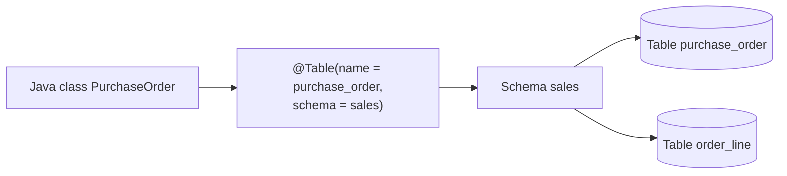
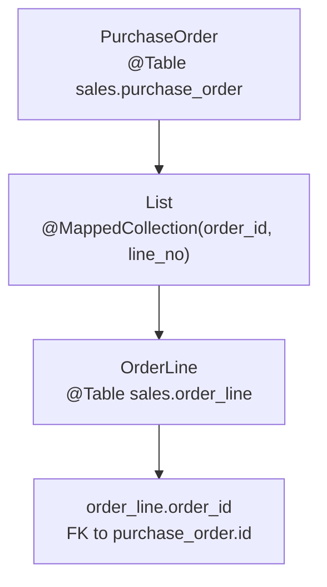

# Defining Tables and Schemas with `@Table` in Spring Data JDBC

When Spring Data JDBC saves a Java object, the framework must know which table in the relational database that object belongs to. **`@Table` is the annotation used to specify that mapping target**. This annotation can specify both the table name and the *database schema*; it does not automatically create tables, define SQL columns, or replace migrations.

This lesson uses an order model consisting of `PurchaseOrder` and `OrderLine` to practice with PostgreSQL. The focus is on understanding the relationship **Java class → table/schema name → SQL statement executed by Spring Data JDBC**, while avoiding confusion between Spring Data Relational's `@Table` and JPA's annotation.

## 1. Distinguishing Class, Table, and Schema

Three concepts that are easily mixed up:

| Concept | Layer | Role |
| --- | --- | --- |
| Class/record `PurchaseOrder` | Java/domain | Represents an order with status, total amount, customer, and lines. |
| Table `purchase_order` | Relational database | Stores order data rows, each with a primary key. |
| Schema `sales` | Namespace in database | Groups database objects such as `sales.purchase_order` and `sales.order_line`. |

In PostgreSQL, fully qualified table name syntax has the form `schema_name.table_name`. For example:

```sql
SELECT id, customer_id, status
FROM sales.purchase_order
WHERE id = 1001;
```

Here:

- `sales` is the **database schema**.
- `purchase_order` is the **table** inside that schema.
- `1001` is the ID of a record, not a table or schema name.

Two tables can also share the same name in different schemas, such as `sales.purchase_order` and `archive.purchase_order`. When SQL is written without specifying a schema, the database uses its default name resolution mechanism, such as PostgreSQL's `search_path`. If the application expects one schema while the connection resolves tables in another, queries can fail with "table not found" or read from the wrong data.



In Spring Data JDBC, `@Table` only configures **mapping metadata**. No `CREATE SCHEMA` or `CREATE TABLE` statement is issued automatically just because you added this annotation.

## 2. Importing the Right `@Table`

Spring Data JDBC's `@Table` belongs to the package:

```java
import org.springframework.data.relational.core.mapping.Table;
```

Minimal example:

```java
import org.springframework.data.annotation.Id;
import org.springframework.data.relational.core.mapping.Table;

@Table("purchase_order")
public record PurchaseOrder(
    @Id Long id,
    Long customerId,
    String status
) {}
```

Meaning:

- `@Table("purchase_order")` sets the target table name to `purchase_order`.
- `@Id` marks the property used as the aggregate's identifier.
- `customerId` and `status` are properties that will map to columns via conventions or other annotations.
- The repository can use this metadata to generate appropriate SQL when saving/reading the object.

**Do not mistakenly import** `jakarta.persistence.Table`. The JPA annotation usually goes with `@Entity`, JPA's `@Id`, and the ORM/Hibernate mechanism; it is not the annotation set used to configure Spring Data JDBC aggregates. In this lesson's examples, IDs must be imported from `org.springframework.data.annotation.Id`.

### Parameters of `@Table`

In modern Spring Data Relational, `@Table` has three main attributes:

| Syntax | Meaning | Notes |
| --- | --- | --- |
| `@Table("purchase_order")` | Table name via `value`. | Shorthand syntax. |
| `@Table(name = "purchase_order")` | Table name via `name`. | `name` and `value` are aliases for the same purpose. |
| `@Table(name = "purchase_order", schema = "sales")` | Table `purchase_order` in database schema `sales`. | Useful when the namespace must be explicit. |

You can write:

```java
@Table(value = "purchase_order", schema = "sales")
public record PurchaseOrder(@Id Long id) {}
```

or:

```java
@Table(name = "purchase_order", schema = "sales")
public record PurchaseOrder(@Id Long id) {}
```

Both ways of specifying the table name serve the same purpose. **Do not set `value` and `name` to two different table names**. `schema` is a separate attribute for the namespace; it is not where you specify a JDBC URL or database name.

Spring Data JDBC versions may vary in details of expression/dialect handling and identifier quoting, so when a project pins a specific version, check the corresponding Javadoc. The `name`/`value`/`schema` attributes are present in modern Spring Data Relational 3.x lines.

## 3. Default Naming Conventions and Why to Use `@Table`

Even without specifying a table name explicitly, Spring Data JDBC can determine the name from the Java type name and `NamingStrategy`. Under default conventions, parts of a CamelCase name are typically separated into snake_case:

| Java Name | Conventionally Derived SQL Name |
| --- | --- |
| `PurchaseOrder` | `purchase_order` |
| `OrderLine` | `order_line` |
| `customerId` | `customer_id` |
| `totalAmount` | `total_amount` |

**Case sensitivity and quoting** when SQL is generated also depend on mapping configuration, dialect, and database identifier rules. PostgreSQL folds *unquoted* identifiers to lowercase, whereas *quoted* identifiers preserve their exact casing. Therefore, do not assume every combination of Java name, SQL name, and quoting is equivalent.

Use `@Table` explicitly when:

1. The actual table name differs from the name produced by the naming strategy.
2. An explicit schema is needed, such as `sales`, `billing`, or `reporting`.
3. You want to reduce coupling to application-wide naming convention changes.
4. The domain name differs from the table name, such as class `PurchaseOrder` mapping to table `order_header`.
5. You are matching an existing schema managed by a DBA or migrations.

**Practical rule:** choose consistent, concise table/schema names, typically lowercase snake_case for PostgreSQL. Avoid names that require quoting due to spaces, unusual characters, or collisions with SQL keywords.

## 4. DDL Example: Creating the `sales` Schema and Two Order Tables

Before running a repository, the database must exist and the connecting user needs sufficient privileges. The following DDL illustrates PostgreSQL:

```sql
CREATE SCHEMA IF NOT EXISTS sales;

CREATE TABLE sales.purchase_order (
    id BIGINT GENERATED BY DEFAULT AS IDENTITY PRIMARY KEY,
    customer_id BIGINT NOT NULL,
    status VARCHAR(20) NOT NULL
        CHECK (status IN ('CREATED', 'CONFIRMED', 'CANCELLED')),
    total_amount NUMERIC(19, 2) NOT NULL
        CHECK (total_amount >= 0)
);

CREATE TABLE sales.order_line (
    order_id BIGINT NOT NULL,
    line_no INTEGER NOT NULL,
    product_id BIGINT NOT NULL,
    quantity INTEGER NOT NULL CHECK (quantity > 0),
    unit_price NUMERIC(19, 2) NOT NULL
        CHECK (unit_price >= 0),
    PRIMARY KEY (order_id, line_no),
    CONSTRAINT fk_order_line_purchase_order
        FOREIGN KEY (order_id)
        REFERENCES sales.purchase_order(id)
);

CREATE INDEX idx_purchase_order_customer
    ON sales.purchase_order (customer_id);
```

The parent table stores the status and total amount; the child table stores the list of lines. `order_line.order_id` links each line to its order. `line_no` is the line's position in `List<OrderLine>`, and also forms a composite primary key with `order_id`.

In a fuller model, `customer_id` and `product_id` would reference customer/product tables with separate foreign keys; this example keeps them as IDs to focus on `@Table` mapping and aggregate ownership.

### Why Write DDL Separately?

`@Table(name = "purchase_order", schema = "sales")` **does not perform**:

- `CREATE SCHEMA sales`.
- `CREATE TABLE sales.purchase_order`.
- Primary key, foreign key, or index creation.
- Adding a new column to the table automatically when you add a field to the record.
- Enforcing business invariants such as state transitions or ensuring the total matches the lines.

Those responsibilities must be handled by SQL scripts, migration tools such as Flyway/Liquibase, or your database provisioning workflow. In production, use versioned migrations that are reviewed and applied in a controlled manner, rather than manual DDL edits after every deployment.

## 5. Mapping the Parent Table with `@Table(schema = ...)`

Create `PurchaseOrder.java`:

```java
package com.example.orders.domain;

import java.math.BigDecimal;
import java.util.List;

import org.springframework.data.annotation.Id;
import org.springframework.data.relational.core.mapping.MappedCollection;
import org.springframework.data.relational.core.mapping.Table;

@Table(name = "purchase_order", schema = "sales")
public record PurchaseOrder(
    @Id Long id,
    Long customerId,
    String status,
    BigDecimal totalAmount,
    @MappedCollection(
        idColumn = "order_id",
        keyColumn = "line_no"
    )
    List<OrderLine> lines
) {}
```

Each element has a clear responsibility:

| Component | Mapping |
| --- | --- |
| `@Table(name = "purchase_order", schema = "sales")` | The root lives in table `sales.purchase_order`. |
| `@Id Long id` | Primary key column `id`. |
| `Long customerId` | Column `customer_id` by naming convention. |
| `String status` | Column `status`. |
| `BigDecimal totalAmount` | Column `total_amount`, matching `NUMERIC(19,2)` semantics. |
| `@MappedCollection(...) List<OrderLine>` | List owned by the root, mapped via `order_id` and `line_no` in the child table. |

Spring Data JDBC applies `@Table` at the **Java type** level, and `@Id`, `@Column`, and `@MappedCollection` at the **property** level according to their roles. You cannot use `@Table` alone to declare all columns, primary keys, and relationships.

`PurchaseOrder` is the aggregate root because repositories operate directly on it. `OrderLine` belongs to the order aggregate; having its own SQL table does not automatically make it an independent aggregate root.

## 6. Mapping the Child Table in the Schema

Create `OrderLine.java`:

```java
package com.example.orders.domain;

import java.math.BigDecimal;
import org.springframework.data.relational.core.mapping.Table;

@Table(name = "order_line", schema = "sales")
public record OrderLine(
    Long productId,
    int quantity,
    BigDecimal unitPrice
) {}
```

The two definitions must match:

- `@Table(name = "order_line", schema = "sales")` states that order line data lives in `sales.order_line`.
- `PurchaseOrder.lines` declares `@MappedCollection(idColumn = "order_id", keyColumn = "line_no")` so Spring Data JDBC knows how to link child rows to the parent row and store element positions.

Setting `schema` on the root's `@Table` **does not mean every child type and every other aggregate will automatically inherit that schema**. When both tables live in a dedicated schema as in this example, specify `schema = "sales"` on the mapped types accordingly, or apply a deliberate shared naming strategy.

In this example `OrderLine` has no `@Id` of its own; the SQL row key relies on `(order_id, line_no)`. That is one option for an owned collection. If the business domain requires an independent ID per line, redesign the mapping, schema, and line lifecycle accordingly.

### Distinguishing `@Table` from `@MappedCollection`



- `@Table`: **which table** stores a type's data.
- `@MappedCollection`: **which column** links a child component back to the root, and which column holds the collection's order/key.
- SQL foreign key: guarantees valid referenced key values at the **database level**.

Putting only `@Table` on `OrderLine` while forgetting to configure the join column properly can cause Spring Data JDBC to look for a default column name different from the `order_id` created by the schema.

## 7. When Real Columns Do Not Follow Conventions: Combining with `@Column`

`@Table` does not replace **column name** mapping. If the database has a column named `order_state` while Java uses the property `status`, specify it with `@Column`:

```java
import org.springframework.data.relational.core.mapping.Column;
import org.springframework.data.relational.core.mapping.Table;

@Table(name = "purchase_order", schema = "sales")
public record PurchaseOrder(
    @Id Long id,
    Long customerId,
    @Column("order_state") String status,
    BigDecimal totalAmount
) {}
```

This shortened example only illustrates a custom column; it corresponds to **a different schema** that has `order_state` instead of `status`. Do not run this snippet verbatim against the DDL from Section 4 without renaming the SQL column to match.

Common companion annotations:

| Annotation | Where Is It Placed? | What Is It Used For? |
| --- | --- | --- |
| `@Table` | Class/record | Specifies table name and optionally schema. |
| `@Id` | Property/record component | Marks the entity's primary key. |
| `@Column` | Property/record component | Overrides the derived column name. |
| `@MappedCollection` | Child/list/map relationship property | Specifies parent-reference column and key/index column. |
| `@Transient` | Property | Excludes a property from persistence mapping. |
| `@Version` | Property | Enables optimistic locking when updating an entity. |

All of the annotations above belong to the appropriate Spring Data packages. Do not mix them with JPA's `@Entity`, `@JoinColumn`, or `@GeneratedValue` when implementing pure Spring Data JDBC.

## 8. How Do Repositories Use Tables and Schemas?

The repository interface does not need to know schema names through manual SQL string concatenation:

```java
package com.example.orders.repository;

import java.util.List;
import org.springframework.data.repository.CrudRepository;
import com.example.orders.domain.PurchaseOrder;

public interface PurchaseOrderRepository
        extends CrudRepository<PurchaseOrder, Long> {

    List<PurchaseOrder> findByCustomerId(Long customerId);
}
```

With proper Spring Data JDBC configuration, the framework reads metadata from `PurchaseOrder` and its child types:

1. On `save(order)`, it accesses the root's `sales.purchase_order` table.
2. For `lines`, it accesses `sales.order_line` and writes `order_id`/`line_no`.
3. On `findById(id)`, it loads the root and its aggregate lines according to the mapping.
4. On `findByCustomerId(customerId)`, Spring Data JDBC uses the root's property to generate the corresponding query.

Conceptual SQL illustration (actual SQL may vary in identifier quoting, statement ordering, and generated ID retrieval depending on the dialect):

```sql
INSERT INTO sales.purchase_order
    (customer_id, status, total_amount)
VALUES
    (7, 'CREATED', 285000.00);

-- Suppose the generated order ID is 1001.
INSERT INTO sales.order_line
    (order_id, line_no, product_id, quantity, unit_price)
VALUES
    (1001, 0, 11, 2, 120000.00),
    (1001, 1, 12, 1, 45000.00);

SELECT id, customer_id, status, total_amount
FROM sales.purchase_order
WHERE id = 1001;
```

The statements above only illustrate the data that needs to exist; **they are not a guaranteed exact SQL output of the repository**. Spring Data JDBC may choose different multi-statement execution paths, parameter styles, and ID retrieval mechanisms. When diagnosing issues, enable SQL logging and inspect the actual queries executed.

### Sample Order Creation Code

```java
var lines = List.of(
    new OrderLine(11L, 2, new BigDecimal("120000.00")),
    new OrderLine(12L, 1, new BigDecimal("45000.00"))
);

var unsaved = new PurchaseOrder(
    null,
    7L,
    "CREATED",
    new BigDecimal("285000.00"),
    lines
);

PurchaseOrder saved = purchaseOrderRepository.save(unsaved);
Long generatedId = saved.id();

PurchaseOrder reloaded = purchaseOrderRepository
    .findById(generatedId)
    .orElseThrow();
```

This snippet assumes the code sits inside a service with the repository injected and `List`, `BigDecimal` imported. Never treat client-submitted amounts as the source of truth: in real business logic, the service must validate product IDs, look up trusted unit prices, and calculate totals.

With immutable Java records, always use the instance returned by `save(...)` because the generated ID may appear on a new instance.

## 9. Creating Schemas and Initializing Tables in a Spring Boot Application

In Spring Boot, datasource configuration only states **which database to connect to**. It does not create the PostgreSQL `sales` schema from `@Table`.

Example `application.yml`:

```yaml
spring:
  datasource:
    url: jdbc:postgresql://localhost:5432/shopdb
    username: shop_app
    password: ${SHOP_DB_PASSWORD}
```

With Spring Boot including the Spring Data JDBC starter and PostgreSQL JDBC driver, repositories are generally auto-configured when conditions are met. Still, you must apply the DDL from Section 4 or an equivalent migration.

There are two initialization approaches:

**Approach A — SQL script for practice exercises.** Place DDL in `src/main/resources/schema.sql` and enable SQL initialization for non-embedded databases:

```yaml
spring:
  sql:
    init:
      mode: always
```

In a demo environment using an empty DB, Boot can run the script to create schemas/tables at startup. The script requires proper privileges and must account for re-runs; `CREATE TABLE` without `IF NOT EXISTS` will fail if the table already exists. Do not let multiple initialization mechanisms own the same DDL simultaneously.

**Approach B — Versioned migrations.** Use Flyway or Liquibase to create and evolve `sales.purchase_order` and `sales.order_line`. For example, a Flyway migration file named `V1__create_order_schema.sql` contains reviewed DDL statements. This approach is far better suited for shared and production environments because it maintains version history and change control.

In PostgreSQL, `CREATE` privileges on the database/schema or schema ownership affect whether migrations can run. The day-to-day application user for reads/writes can be granted narrower privileges than the migration user; avoid silently granting elevated privileges just to work around a configuration error.

### Understanding `search_path`

In PostgreSQL, a connection may have a default `search_path` such as `"$user", public` (depending on the setup). If Spring Data JDBC generates a query **without specifying a schema**, the database searches along the path in order. Adding `@Table(schema = "sales")` ensures mapping metadata targets the intended schema. Configuring `search_path` and `@Table(schema = ...)` are two different mechanisms; decide on a consistent approach rather than expecting one to fix the other.

Some JDBC drivers/pools allow setting a default schema for connections. Availability and syntax depend on the database/driver; if you have specified `@Table(schema = "sales")`, ensure that schema actually exists and the user has access privileges.

## 10. Using Multiple Schemas or Renaming Tables

A single database can partition different kinds of data:

```text
shopdb
├── sales
│   ├── purchase_order
│   └── order_line
└── catalog
    └── product
```

The corresponding types can be declared as:

```java
@Table(name = "purchase_order", schema = "sales")
public record PurchaseOrder(@Id Long id) {}

@Table(name = "product", schema = "catalog")
public record Product(@Id Long id) {}
```

These are two abbreviated records to explain table/schema names. When implementing, each `public` type lives in its own file and must declare all properties/columns matching the real schema.

Notes:

- Different schemas **do not automatically put two objects in the same aggregate**.
- `Product` with an independent lifecycle can be its own root; `PurchaseOrder` only holds `productId` on order lines.
- SQL foreign keys can reference across schemas, but must be explicitly declared in DDL.
- Not all databases share PostgreSQL's notion of a schema. For example, MySQL typically treats `SCHEMA` as a database name; `@Table(schema = ...)` behavior must be verified with your specific dialect and driver.
- If you change a table/schema name in the application without migrating data, the repository will target a new location while old data remains in the old table.

### `NamingStrategy` When You Want a Default Schema Convention

Spring Data Relational allows providing a custom `NamingStrategy`. This extension point can define default table, column, or schema names according to application policy. Unlike `@Table(schema = "sales")` on one class, a naming strategy has broader scope and affects many types.

Choose the solution based on requirements:

| Need | Suitable Approach |
| --- | --- |
| One class has a non-conventional table name | `@Table(name = "...")`. |
| One class resides in a dedicated schema | `@Table(name = "...", schema = "...")`. |
| One column has a non-conventional name | `@Column("...")`. |
| Child collection has custom foreign key/index column names | `@MappedCollection(idColumn = "...", keyColumn = "...")`. |
| Entire app follows a consistent custom naming/schema convention | Consider a custom `NamingStrategy`. |
| Creating/altering schemas or indexes | DDL/migrations, not `@Table`. |

When changing the naming strategy, also inspect child table parent ID columns and key/index columns. This is a global mapping change, not just changing a class's display name.

## 11. Common Error Scenarios

| Symptom | Possible Cause | How to Handle |
| --- | --- | --- |
| PostgreSQL reports `relation "sales.purchase_order" does not exist` | DDL not run, wrong schema/table name, or connected to wrong DB. | Check DB name in JDBC URL, list of schemas/tables, and migration history. |
| `permission denied for schema sales` | Connecting user lacks privileges on schema/table. | Check owner, `USAGE` on schema, and required SELECT/INSERT/UPDATE/DELETE grants. |
| App accesses `public.purchase_order` instead of `sales.purchase_order` | Missing schema config or using a different naming strategy. | Cross-check `@Table(schema = ...)`, SQL logs, and search path. |
| `column "customer_id" does not exist` | Java property and SQL column are not mapped consistently. | Compare DDL names, naming strategy, and `@Column`. |
| `column "order_id" does not exist` when loading lines | Child reference column does not match convention or annotation. | Check `@MappedCollection(idColumn = "order_id")` and `order_line` DDL. |
| `BadSqlGrammarException` with uppercase names or SQL keywords | Identifier quoting/case or column/table names clash with dialect. | Prefer lowercase snake_case names; check actual SQL and avoid keywords. |
| DDL runs twice and fails with table already exists | Two initialization mechanisms manage the schema or script is not idempotent. | Pick a single migration source and disable overlapping init. |
| Data exists in tables but repository fails to load child lines | Wrong collection table/schema mapping or foreign key/index. | Compare child `@Table` and root `@MappedCollection`. |
| Edited `@Table` but data did not move to the new table | Annotation only changes query target, does not move SQL rows. | Write a data migration and adjust the application. |
| Expected `@Table` to auto-create constraints/columns | Confused mapping metadata with DDL generation. | Write SQL scripts/migrations with complete PK, FK, CHECK, and indexes. |

To observe what Spring JDBC actually sends to the database in development, you can enable logging:

```yaml
logging:
  level:
    org.springframework.jdbc.core: DEBUG
    org.springframework.data.jdbc.core: DEBUG
```

Logger names and verbosity may vary by version. Do not log sensitive parameter values in production without proper controls.

In PostgreSQL, several metadata inspection queries are very helpful:

```sql
SELECT schema_name
FROM information_schema.schemata
WHERE schema_name = 'sales';

SELECT table_schema, table_name
FROM information_schema.tables
WHERE table_schema = 'sales'
ORDER BY table_name;

SELECT column_name, data_type, is_nullable
FROM information_schema.columns
WHERE table_schema = 'sales'
  AND table_name = 'purchase_order'
ORDER BY ordinal_position;

SHOW search_path;
```

These commands help distinguish errors caused by **a missing schema**, **a missing table/column**, or **searching in the wrong namespace**.

## 12. Step-by-Step Lab Exercises

1. **Create the schema:** run the `CREATE SCHEMA sales` DDL and both tables from Section 4 on PostgreSQL; inspect table/column metadata via `information_schema`.
2. **Declare mappings:** write `PurchaseOrder` and `OrderLine` with `@Table(name = ..., schema = ...)` and `@MappedCollection` as shown.
3. **Test writes:** save an order with two lines via the repository, reload it, and verify `status`, `totalAmount`, and the `lines` list.
4. **Observe SQL:** enable logging and check which schema/table appears in INSERT and SELECT statements; compare against Java names.
5. **Induce a controlled error:** temporarily change `schema = "sales"` to a schema without tables, run a read, then revert. Note the difference between mapping errors and DDL errors.
6. **Rename a column:** rename `status` to `order_state` in a test schema copy, add `@Column("order_state")` on the property, and test reads/writes again.
7. **Separate schemas:** create `catalog.product`, map a separate `Product` root with `@Table(schema = "catalog")`; reference it from `OrderLine` solely via `productId`.
8. **Move from scripts to migrations:** place the DDL into a versioned migration; verify a fresh app startup creates the schema cleanly in an empty database and does not recreate tables on subsequent restarts.

Each exercise should cross-check three pieces of evidence: Java annotations, actual schema metadata, and the executed SQL/read values. When all three align, table/schema mapping is consistent.

## 13. Self-Check Questions

- Which package is Spring Data JDBC's `@Table` imported from? How does it differ from `jakarta.persistence.Table`?
- Do `@Table("purchase_order")` and `@Table(name = "purchase_order")` differ in purpose?
- If you want to store records in `sales.purchase_order`, where do you declare `schema`? Do you still need to create the SQL schema beforehand?
- Why can adding `@Table(schema = "sales")` without running migrations still cause the repository to report that the table does not exist?
- How do `@Table` and `@Column` address two different levels of naming?
- What information does `@MappedCollection` hold that `@Table` does not provide?
- If a PostgreSQL connection has an unexpected `search_path`, what mapping errors might appear?
- Changing a table name from `purchase_order` to `order_header` requires changing what besides the annotation?

A sound mapping model must answer four questions: **what is the Java type, which SQL table stores it, which schema holds that table, and what mechanism creates/maintains the actual schema?** `@Table` answers the mapping target; DDL/migrations handle the storage structure. Mastering this boundary helps you scale repositories and aggregates reliably.

### Official Documentation for Further Reference

- [Spring Data Relational – JDBC Mapping](https://docs.spring.io/spring-data/relational/reference/jdbc/mapping.html): naming conventions, mapping annotations, and collections.
- [Spring Data Relational – Javadoc `@Table`](https://docs.spring.io/spring-data/jdbc/docs/3.3.x/api/org/springframework/data/relational/core/mapping/Table.html): `value`, `name`, and `schema` annotation attributes.
