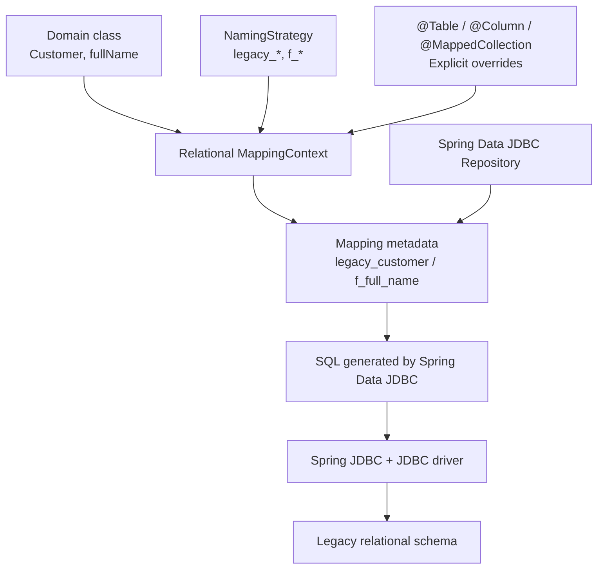

# Customizing NamingStrategy for an Existing Schema

When a Spring Data JDBC application connects to an **existing database**, table and column names often do not follow the framework's default conventions. A legacy system might use prefixes on every table, uppercase columns, business abbreviations, DBA-mandated foreign-key names, or a schema shared across multiple applications.

If renaming tables in the database is not feasible, the application must adjust **the name-mapping rules** between Java and SQL. Spring Data Relational's **`NamingStrategy`** handles cases where names follow a **shared pattern**; annotations such as `@Table`, `@Column`, and `@MappedCollection` handle exceptions.

This lesson walks through designing and registering a `NamingStrategy` for Spring Data JDBC, combining it with explicit mappings, and verifying that the application accesses the legacy schema accurately.

## 1. Why Does an Existing Schema Need a NamingStrategy?

Suppose a customer management application has the Java class:

```java
public record Customer(
    Long id,
    String fullName,
    String contactEmail
) {}
```

Meanwhile, the operations team created the table under legacy conventions:

```sql
CREATE TABLE legacy_customer (
    f_id BIGINT GENERATED BY DEFAULT AS IDENTITY PRIMARY KEY,
    f_full_name VARCHAR(160) NOT NULL,
    f_contact_email VARCHAR(255) NOT NULL UNIQUE
);
```

The names in Java and the database do not match:

| Java Element | Actual Name in Database |
| --- | --- |
| Class `Customer` | Table `legacy_customer` |
| Field `id` | Column `f_id` |
| Field `fullName` | Column `f_full_name` |
| Field `contactEmail` | Column `f_contact_email` |

Two patterns stand out:

1. Table names use `legacy_` + the class name in `snake_case`.
2. Column names use `f_` + the field name in `snake_case`.

If dozens of tables follow this rule, repeating `@Table` and `@Column` on every class and field is tedious and error-prone. `NamingStrategy` lets you express the rule in one place so the relational mapping infrastructure applies it consistently.

**Core boundary:** `NamingStrategy` only adjusts how **mapping identifier names** are generated; it does not create tables, alter physical schemas, or rewrite all developer-written SQL.

## 2. Where Does NamingStrategy Live in Spring Data JDBC?

Three parts of the Spring Data ecosystem have distinct roles:

- **Spring Data Commons** provides the repository abstraction, identifier types, and shared infrastructure.
- **Spring Data Relational** provides `NamingStrategy` and relational mapping metadata such as `@Table`, `@Column`, and `@MappedCollection`.
- **Spring Data JDBC** uses that metadata to build aggregate read/write operations and execute SQL via Spring JDBC and the JDBC driver.



Spring Data Relational holds metadata describing entities and properties; `NamingStrategy` is one source for determining their default names. When a repository runs `save`, `findById`, or a supported derived query, Spring Data JDBC uses the configured metadata to target the right tables and columns.

By contrast, when you write directly:

```java
jdbcTemplate.queryForList("SELECT * FROM legacy_customer");
```

that SQL string is supplied by the developer. `NamingStrategy` **does not transform** it into different SQL.

## 3. Default Rules and Legacy Naming Mismatches

Without customization, Spring Data JDBC derives table names from class names and column names from property names, converting Java-style names to SQL-friendly names such as `camelCase` → `snake_case`. Casing and identifier quoting also depend on the dialect and database.

For `Customer.fullName`, the usual derived name looks like `customer.full_name`. Yet the legacy table is `legacy_customer` with column `f_full_name`. Because the two sides do not match, database calls can fail with errors like:

```text
relation "customer" does not exist
column "full_name" does not exist
invalid identifier
```

Exact error messages vary across PostgreSQL, MySQL, SQL Server, Oracle, and different drivers.

In mapping design, distinguish clearly between:

| Name Category | Example | Who Decides? |
| --- | --- | --- |
| Java class/property name | `Customer.fullName` | Domain model |
| Derived table/column name | `legacy_customer.f_full_name` | `NamingStrategy` or annotations |
| Identifier rendered in SQL | `legacy_customer`, `"legacy_customer"`, ... | SQL infrastructure with dialect and quoting rules |
| Actual physical name | Name in `CREATE TABLE` / database catalog | Existing schema |

Do not embed quotes, schema-qualified dots, or arbitrary delimiters inside strings returned by `NamingStrategy` expecting every dialect to treat them identically.

## 4. Designing a Custom NamingStrategy for a Legacy Schema

`NamingStrategy` resides in the package:

```java
org.springframework.data.relational.core.mapping.NamingStrategy
```

Commonly used extension points include:

| Method | Role |
| --- | --- |
| `getTableName(Class<?> type)` | Default table name for a domain type. |
| `getColumnName(RelationalPersistentProperty property)` | Default column name for a simple property. |
| `getReverseColumnName(RelationalPersistentProperty property)` | Back-reference column name pointing to the aggregate owner in mapped relationships. |
| `getKeyColumn(RelationalPersistentProperty property)` | Column name holding the key/index of mapped collections. |
| `getSchema()` | Default schema name if supplied by the strategy and used by the config/dialect. |

Methods related to collection relationships require separate thought: foreign-key column names in child tables do not necessarily follow the same rule as regular fields. If a schema uses irregular names, `@MappedCollection(idColumn = ..., keyColumn = ...)` is usually clearer and safer.

### 4.1. An Implementation Applying Consistent Prefixes

With the rule `legacy_` for tables and `f_` for columns:

```java
package example.catalog.persistence;

import java.util.Locale;
import org.springframework.data.relational.core.mapping.NamingStrategy;
import org.springframework.data.relational.core.mapping.RelationalPersistentProperty;

public final class LegacyNamingStrategy implements NamingStrategy {

    @Override
    public String getTableName(Class<?> type) {
        return "legacy_" + toSnakeCase(type.getSimpleName());
    }

    @Override
    public String getColumnName(RelationalPersistentProperty property) {
        return "f_" + toSnakeCase(property.getName());
    }

    private static String toSnakeCase(String input) {
        String separated = input
            .replaceAll("([A-Z])([A-Z][a-z])", "$1_$2")
            .replaceAll("([a-z0-9])([A-Z])", "$1_$2");
        return separated.toLowerCase(Locale.ROOT);
    }
}
```

Conversion examples:

| Input | `toSnakeCase` | Final Name |
| --- | --- | --- |
| `Customer` (class) | `customer` | `legacy_customer` |
| `PurchaseOrder` (class) | `purchase_order` | `legacy_purchase_order` |
| `fullName` (field) | `full_name` | `f_full_name` |
| `contactEmail` (field) | `contact_email` | `f_contact_email` |
| `URLValue` (field) | `url_value` | `f_url_value` |

`Locale.ROOT` prevents case-conversion rules from being affected by the JVM locale. The helper above suits standard camel/PascalCase Java names; if the codebase has unusual acronyms, Unicode identifiers, or irregular abbreviations, adjust the rule accordingly or use explicit annotations.

**Do not hardcode passwords or ad-hoc business table names into a generic transformation.** For example, `legacy_customer` fits a rule, whereas `CUST_MST` and `CUSTOMER_DATA_2021` cannot be reliably inferred from `Customer` alone.

### 4.2. Registering the Strategy as a Spring Bean

In a Spring Boot application with the Spring Data JDBC starter, configure a `NamingStrategy` bean:

```java
package example.catalog.persistence;

import org.springframework.context.annotation.Bean;
import org.springframework.context.annotation.Configuration;
import org.springframework.data.relational.core.mapping.NamingStrategy;

@Configuration(proxyBeanMethods = false)
public class LegacyRelationalMappingConfiguration {

    @Bean
    NamingStrategy namingStrategy() {
        return new LegacyNamingStrategy();
    }
}
```

When the configuration is scanned/loaded into the `ApplicationContext`, Spring Data JDBC uses the configured naming strategy to build mapping metadata.

If the application already defines repository configuration manually via `AbstractJdbcConfiguration` or defines multiple `NamingStrategy` beans, control explicitly how that configuration picks the strategy; avoid accidentally creating competing beans or a mapping context separate from the one repositories use.

This is **a global decision for the associated mapping context**. Do not register a global bean just to fix one entity's name if all other entities rely on the default convention.

### 4.3. Minimal Dependencies

With Spring Boot and Gradle Groovy:

```groovy
dependencies {
    implementation 'org.springframework.boot:spring-boot-starter-data-jdbc'
    runtimeOnly 'org.postgresql:postgresql'
}
```

The starter brings in Spring Data JDBC along with Spring Data Relational and Spring Data Commons. You do not need to add a separate `spring-data-relational` artifact just to use `NamingStrategy` in a standard starter setup.

The application still needs a `DataSource` connected to a database with a compatible schema.

## 5. Using the Strategy on Entities and Repositories

Entity using Spring Data JDBC:

```java
package example.catalog.domain;

import org.springframework.data.annotation.Id;

public record Customer(
    @Id Long id,
    String fullName,
    String contactEmail
) {}
```

Without `@Table` or `@Column`, names are derived via `LegacyNamingStrategy`:

```text
Customer            -> legacy_customer
Customer.id         -> f_id
Customer.fullName   -> f_full_name
Customer.contactEmail -> f_contact_email
```

Repository:

```java
package example.catalog.domain;

import java.util.Optional;
import org.springframework.data.repository.ListCrudRepository;

public interface CustomerRepository
        extends ListCrudRepository<Customer, Long> {

    Optional<Customer> findByContactEmail(String contactEmail);
}
```

Illustrative service:

```java
package example.catalog.application;

import example.catalog.domain.Customer;
import example.catalog.domain.CustomerRepository;
import org.springframework.stereotype.Service;
import org.springframework.transaction.annotation.Transactional;

@Service
public class CustomerService {

    private final CustomerRepository customers;

    public CustomerService(CustomerRepository customers) {
        this.customers = customers;
    }

    @Transactional
    public Customer register(String name, String email) {
        Customer candidate = new Customer(null, name, email);
        return customers.save(candidate);
    }
}
```

With the matching `legacy_customer(f_id, f_full_name, f_contact_email)` schema and valid configuration, Spring Data JDBC can save new records and read them back via the repository. When the database generates IDs, always use the object returned by `save`, especially with immutable `record` entities.

When declaring a query method `findByContactEmail`, the framework parses the property name `contactEmail` from the domain model and maps it to the corresponding column name. When a method name falls outside the patterns supported by Spring Data JDBC, use an explicit query or custom repository.

## 6. When Names Follow No Pattern: Use Explicit Annotations

Not every legacy schema follows an algorithmic naming convention. You may encounter:

```sql
CREATE TABLE crm_customer_master (
    cust_no BIGINT PRIMARY KEY,
    cust_display VARCHAR(160) NOT NULL,
    e_mail VARCHAR(255) NOT NULL
);
```

With names like `cust_no`, `cust_display`, and `e_mail`, trying to write a function that infers them from `id`, `fullName`, and `contactEmail` is unreliable. A simpler approach is explicit declaration:

```java
import org.springframework.data.annotation.Id;
import org.springframework.data.relational.core.mapping.Column;
import org.springframework.data.relational.core.mapping.Table;

@Table("crm_customer_master")
public record Customer(
    @Id @Column("cust_no") Long id,
    @Column("cust_display") String fullName,
    @Column("e_mail") String contactEmail
) {}
```

These annotations specify the entity's table and column names directly. They are useful when there are only a few exceptions in a system using a shared `NamingStrategy`, or when the schema has no inferable pattern at all.

Selection guideline:

| Situation | Usually Best Approach |
| --- | --- |
| Many tables share the same prefix and column convention | `NamingStrategy` |
| A few tables have irregular names | `@Table` on those entities |
| A few columns use non-derivable abbreviations | `@Column` on those properties |
| Collection join columns have custom names | `@MappedCollection(idColumn, keyColumn)` |
| A query needs SQL JOINs or database-specific expressions | `@Query` / custom query / `NamedParameterJdbcOperations` |
| Physical table/column names must change in the database | DDL migration, not `NamingStrategy` |

A sound rule of thumb is **NamingStrategy for the common pattern, annotations for exceptions**.

## 7. Aggregate Relationships and Foreign Key Columns in Child Tables

In Spring Data JDBC, an aggregate root can own child entities. In that case, the child table usually holds a column referencing the root and sometimes a column holding the collection index or key.

Suppose the existing schema is:

```sql
CREATE TABLE legacy_purchase_order (
    f_id BIGINT GENERATED BY DEFAULT AS IDENTITY PRIMARY KEY,
    f_customer_id BIGINT NOT NULL
);

CREATE TABLE legacy_order_line (
    f_id BIGINT GENERATED BY DEFAULT AS IDENTITY PRIMARY KEY,
    order_header_id BIGINT NOT NULL,
    line_seq INTEGER NOT NULL,
    f_sku VARCHAR(64) NOT NULL,
    f_quantity INTEGER NOT NULL,
    CONSTRAINT fk_line_to_order FOREIGN KEY (order_header_id)
        REFERENCES legacy_purchase_order(f_id)
);
```

The application models `PurchaseOrder` as the root and `OrderLine` as a child element:

```java
import java.util.ArrayList;
import java.util.List;
import org.springframework.data.annotation.Id;
import org.springframework.data.relational.core.mapping.MappedCollection;

public class PurchaseOrder {

    @Id
    private Long id;

    private Long customerId;

    @MappedCollection(
        idColumn = "order_header_id",
        keyColumn = "line_seq"
    )
    private List<OrderLine> lines = new ArrayList<>();

    // Constructors, getters, and domain behavior omitted.
}
```

```java
import org.springframework.data.annotation.Id;

public class OrderLine {

    @Id
    private Long id;

    private String sku;
    private int quantity;

    // Constructors and accessors omitted.
}
```

The strategy from Section 4 continues to derive:

- `PurchaseOrder` → `legacy_purchase_order`, field `customerId` → `f_customer_id`.
- `OrderLine` → `legacy_order_line`, field `sku` → `f_sku`.
- `@MappedCollection(idColumn = "order_header_id")` specifies the column referencing the root from `legacy_order_line`.
- `keyColumn = "line_seq"` specifies the position column for the `List`.

In this example, the foreign-key name `order_header_id` and ordering column `line_seq` **do not follow the `f_` rule**. Declaring them explicitly avoids incorrect inference.

### 7.1. When Do You Need `getReverseColumnName` and `getKeyColumn`?

If every collection across every aggregate follows a uniform custom convention for back-reference and key column names, you can consider overriding the corresponding methods on `NamingStrategy`.

However, make sure you understand the metadata each method receives and test the actual naming behavior for the property/collection type being mapped. A simple field-name prefix is rarely enough to derive every child table's join columns. For example, a `PurchaseOrder` root might use `po_id`, while a `CustomerGroup` root uses `group_master_no`.

In an inconsistent legacy schema, the clearest choice is setting `idColumn`/`keyColumn` directly on the collection so anyone reading the mapping knows which columns implement the ownership relationship.

**Note:** `@MappedCollection` describes part of an **aggregate owned by its root**. For a separate independent aggregate, use an ID or `AggregateReference` instead of embedding that object as a child just to leverage foreign-key mapping.

## 8. Schema Names, Case Sensitivity, and Quoted Identifiers

A **schema** name in an RDBMS is not the same as the **database** name in a JDBC URL.

PostgreSQL example:

```sql
CREATE SCHEMA legacy_app;
CREATE TABLE legacy_app.legacy_customer (
    f_id BIGINT GENERATED BY DEFAULT AS IDENTITY PRIMARY KEY,
    f_full_name VARCHAR(160) NOT NULL,
    f_contact_email VARCHAR(255) NOT NULL UNIQUE
);
```

There are several ways to configure table placement depending on the situation:

1. Specify the schema in the entity mapping if the annotation/version you are using supports the `schema` attribute.
2. Use a naming strategy with a default schema when applied consistently.
3. Configure an appropriate schema search path or default schema on the connection/database.

Example of a naming strategy implementing a default schema name:

```java
@Override
public String getSchema() {
    return "legacy_app";
}
```

Make sure that schema exists and the database account has privileges to use it. If the database lacks the schema, changing `NamingStrategy` cannot create it.

### 8.1. Case Sensitivity

Some RDBMSs fold **unquoted** identifiers to lowercase or uppercase; **quoted** identifiers usually preserve exact casing. For instance, in PostgreSQL:

```sql
CREATE TABLE LEGACY_CUSTOMER (...);
```

actually creates the table `legacy_customer` when unquoted. Whereas:

```sql
CREATE TABLE "LEGACY_CUSTOMER" (...);
```

creates an uppercase table name that must be referenced with appropriate quoting.

Therefore, do not make `getTableName` return `"LEGACY_CUSTOMER"` with literal double quotes inside the string just to fix a casing error. Distinguish **the identifier name** from **how the SQL dialect quotes/renders identifiers**, and verify the exact name in the database catalog.

### 8.2. Reserved Keywords and Special Characters

Some legacy schemas name tables or columns after SQL keywords or include spaces. Such cases require checking how your Spring Data version/dialect quotes identifiers, or mapping names explicitly; concatenating quote characters manually into name strings is not a portable cross-database solution.

If the application is permitted to evolve the schema, a migration to standardize names can reduce long-term maintenance cost. If the schema belongs to a shared system, annotations/strategies must honor the existing contract.

## 9. NamingStrategy Does Not Rewrite Hand-Written SQL

Suppose a repository defines a query:

```java
import java.util.Optional;
import org.springframework.data.jdbc.repository.query.Query;
import org.springframework.data.repository.ListCrudRepository;
import org.springframework.data.repository.query.Param;

public interface CustomerRepository
        extends ListCrudRepository<Customer, Long> {

    @Query("""
        SELECT f_id, f_full_name, f_contact_email
        FROM legacy_customer
        WHERE f_contact_email = :email
        """)
    Optional<Customer> findByEmailSql(@Param("email") String email);
}
```

The SQL string inside `@Query` uses **the physical table and column names** of the schema. `NamingStrategy` does not scan that string to replace `Customer` with `legacy_customer` or `contactEmail` with `f_contact_email`.

Similarly, the following remain responsible for their own SQL:

- `JdbcTemplate`, `NamedParameterJdbcTemplate` / `NamedParameterJdbcOperations`.
- SQL initialization files (`schema.sql`, `data.sql`).
- Flyway/Liquibase migrations.
- Stored procedures, views, functions, or standalone SQL reports.

When the schema structure changes, you may have to update both mapping code and hand-written SQL. Centralizing shared conventions in `NamingStrategy` does not eliminate the need to manage migrations and query contracts.

## 10. Testing Against an Existing Schema

To verify mappings, use a test database structured like the target schema. You can use PostgreSQL Testcontainers or a test database built from the exact legacy schema/migrations. The example below illustrates testing a repository against a pre-created schema.

A Spring Data JDBC test slice:

```java
import static org.assertj.core.api.Assertions.assertThat;

import example.catalog.domain.Customer;
import example.catalog.domain.CustomerRepository;
import example.catalog.persistence.LegacyRelationalMappingConfiguration;

import org.junit.jupiter.api.Test;
import org.springframework.beans.factory.annotation.Autowired;
import org.springframework.boot.test.autoconfigure.data.jdbc.DataJdbcTest;
import org.springframework.context.annotation.Import;

@DataJdbcTest
@Import(LegacyRelationalMappingConfiguration.class)
class LegacyCustomerRepositoryTest {

    @Autowired
    CustomerRepository customers;

    @Test
    void saveAndReadUsingExistingNames() {
        Customer saved = customers.save(
            new Customer(null, "Nguyen An", "an@example.test")
        );

        assertThat(saved.id()).isNotNull();

        Customer reloaded = customers.findById(saved.id())
            .orElseThrow();

        assertThat(reloaded.fullName()).isEqualTo("Nguyen An");
        assertThat(reloaded.contactEmail())
            .isEqualTo("an@example.test");
    }
}
```

Conditions required for this test to run:

- The test classpath has the right JDBC driver and the `DataSource` is configured to point to **a test database**, never production.
- The `legacy_customer` table already exists with the right column names and data types.
- When using `@DataJdbcTest`, ensure the test context actually loads `LegacyRelationalMappingConfiguration`, as with `@Import` above.
- When using Testcontainers PostgreSQL, configure Spring Boot test not to replace the chosen `DataSource` with an embedded database; `@AutoConfigureTestDatabase(replace = NONE)` can be used.
- The test database must be isolated, with appropriate data reset/rollback handling across tests.

This is an illustrative mapping test. A full application may also require migrations, test configuration, JDBC URLs, the PostgreSQL driver, and seed data setup.

### 10.1. Cross-Checking Layer by Layer

When a “table/column not found” error appears, trace through these checks:

| Question | How to Verify |
| --- | --- |
| Which database/schema is the app connecting to? | Check `spring.datasource.url`, user, default schema, and active profile. |
| Which entity is the aggregate root? | Check the class managed by the repository. |
| Where does the table name come from? | `@Table` or `getTableName`. |
| Does the property column have its own annotation? | `@Column` or `getColumnName`. |
| Does a child collection have custom join columns? | `@MappedCollection`, `getReverseColumnName`, `getKeyColumn`. |
| Is the query framework-generated or hand-written SQL? | Distinguish CRUD/derived queries from `@Query`/`JdbcTemplate`. |
| Does the database use quoted/case-sensitive identifiers? | Compare DDL and metadata in the database catalog. |

When you need to observe the SQL emitted by the framework, enable appropriate Spring JDBC/driver logging in **the test environment**. Remember that SQL logs and bound parameter values may contain sensitive data, so use synthetic fixtures and avoid enabling overly verbose logging indiscriminately in production.

## 11. Migration Strategy for Many Legacy Tables

For a large schema, pick an appropriate level of customization instead of stuffing an entire mapping into a function with hundreds of `if` branches:

### 11.1. Global Pattern

If the vast majority of tables follow `T_...` and columns follow `C_...`, build a purely rule-based `NamingStrategy`. The benefits are readability, uniform application, and centralized adjustment.

### 11.2. Common Pattern with a Few Exceptions

Use `NamingStrategy` for standard names; for `CUSTOMER_MASTER`, `EXT_ORDER_NO`, or irregular foreign-key columns, declare `@Table`, `@Column`, and `@MappedCollection` accordingly. Keeping exceptions on the entity itself makes them easy to trace.

### 11.3. Most Names Follow No Pattern

If every table uses different ad-hoc abbreviations, putting them all into `NamingStrategy` makes the code hard to follow. Explicit names in annotations are often clearer. If complex mapping across multiple schemas, data sources, or runtime tables is needed, evaluate your repository/`DataSource` architecture rather than expecting a single `NamingStrategy` to solve everything.

### 11.4. Rule Changes Affect Many Entities

`NamingStrategy` is shared configuration. Changing `f_` to `col_` can affect dozens of repositories. Treat such a change as **a persistence contract change**, coordinated with schema/migrations and verified at the appropriate deployment stage.

## 12. Common Misconceptions

### “Changing `@Column` on one field makes all fields use the new rule?”

No. `@Column` applies only to the declared property. Remaining properties still use names derived from `NamingStrategy` or other configuration.

### “Can `NamingStrategy` rename databases and create tables automatically?”

No. It only supplies names for mapping. DDL and schemas must be managed separately with database/migration tools.

### “Does `NamingStrategy` rewrite SQL inside `@Query` too?”

No. In hand-written SQL, you must use the real table/column names or explicitly build another query abstraction.

### “Can I put `@Table` on a class and still use `NamingStrategy` for its columns?”

Yes. The table name is specified explicitly, while columns without `@Column` still use `NamingStrategy`. This lets you handle isolated table exceptions without abandoning the global strategy.

### “Does `NamingStrategy` dictate foreign keys for every relationship?”

Not every database relationship is an owned aggregate relationship in Spring Data JDBC. `@MappedCollection` and related naming methods map owned children; independent aggregates are usually referenced by ID. Complex relationships or manual JOIN queries must still reflect domain semantics and the schema.

### “If no `NamingStrategy` bean is visible, does that mean the framework uses no `NamingStrategy`?”

No. Spring Data Relational has a default naming strategy. A custom bean is only needed when the real schema differs from the default pattern or you want explicit control over the rule.

## 13. Combined Example: Global Rule and Exceptions

A CRM system has two tables:

```sql
CREATE TABLE legacy_customer (
    f_id BIGINT GENERATED BY DEFAULT AS IDENTITY PRIMARY KEY,
    f_full_name VARCHAR(160) NOT NULL,
    f_contact_email VARCHAR(255) NOT NULL
);

CREATE TABLE legacy_customer_note (
    f_id BIGINT GENERATED BY DEFAULT AS IDENTITY PRIMARY KEY,
    f_customer_id BIGINT NOT NULL,
    memo_text VARCHAR(1000) NOT NULL
);
```

In Java:

```java
import org.springframework.data.annotation.Id;
import org.springframework.data.relational.core.mapping.Column;

public record CustomerNote(
    @Id Long id,
    Long customerId,
    @Column("memo_text") String text
) {}
```

With `LegacyNamingStrategy`:

| Entity/Property | How It Is Resolved | Name in Database |
| --- | --- | --- |
| `CustomerNote` | `getTableName` | `legacy_customer_note` |
| `id` | `getColumnName` | `f_id` |
| `customerId` | `getColumnName` | `f_customer_id` |
| `text` | `@Column("memo_text")` | `memo_text` |

One irregular column is declared explicitly while the rest of the mapping uses the consistent global rule. This avoids repeating annotations on every property and is far cleaner than encoding the `memo_text` exception into a complex global strategy.

**Distinguish `customerId` in `CustomerNote` from an owned collection:** in this example, `CustomerNote` can be modeled as its own aggregate referencing the customer by ID. If `CustomerNote` were genuinely a child of the `Customer` aggregate, model ownership using an appropriate collection mapping while handling reference columns and child lifecycle according to Spring Data JDBC semantics.

## 14. Principles for Real-World Projects

When integrating an existing schema into Spring Data JDBC:

1. **Read the actual DDL** and build a mapping sheet of classes/properties to tables/columns, including IDs, foreign keys, schemas, and identifier formatting.
2. **Identify repeating patterns** (prefixes, suffixes, camel/snake, casing).
3. **Create a `NamingStrategy`** only for stable patterns, avoiding turning it into a giant list of special cases.
4. **Add annotations** for names that cannot be derived, especially foreign-key and key columns of child collections.
5. **Register the bean in the right context** for Spring Data JDBC and ensure no unintended competing configurations exist.
6. **Verify with real queries** against a test database containing the matching schema; watch out for hand-written SQL and dialect differences.
7. **Keep schema ownership clear**: update DDL/migrations and mappings together whenever the database contract changes.

> **`NamingStrategy` is a name-transformation rule at the Spring Data Relational layer; `@Table`, `@Column`, and `@MappedCollection` override individual exceptions.** With Spring Data JDBC and an existing schema, good design honors the existing physical names, keeps rules consistent, and verifies mappings against a real database.

### References

- [Spring Data Relational — Reference Documentation](https://docs.spring.io/spring-data/relational/reference/): relational mapping fundamentals.
- [Spring Data JDBC — Object Mapping](https://docs.spring.io/spring-data/relational/reference/jdbc/mapping.html): object, table, and column mapping rules.
- [Spring Data JDBC — Custom Conversions and Mapping](https://docs.spring.io/spring-data/relational/reference/jdbc/mapping.html): extending mapping when integrating existing schemas.
- [Spring Boot — SQL Databases](https://docs.spring.io/spring-boot/reference/data/sql.html): datasource connections and schema initialization mechanisms.
