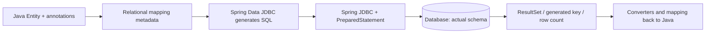

# Cross-Checking Mapping Metadata Against DDL and Actual SQL

In **Spring Data JDBC**, a Java class maps to database tables and columns through Spring Data Relational metadata. Yet metadata only describes **where and how Spring Data intends to read and write**; the database itself determines whether the table exists, whether column types match, whether keys are valid, and whether the SQL statement can execute.

Therefore, when creating or modifying an entity, always cross-check **three views of the same data model**:

1. **Mapping metadata**: classes, properties, `@Table`, `@Id`, `@Column`, `@Transient`, and naming conventions.
2. **DDL (Data Definition Language)**: `CREATE TABLE`, column types, primary keys, foreign keys, `NOT NULL`, `UNIQUE`, `CHECK` constraints, and indexes.
3. **Executed SQL**: `SELECT`, `INSERT`, `UPDATE`, and `DELETE` generated by Spring Data JDBC or declared via `@Query`, including JDBC parameters.

All three must align: **Java property → physical column name → SQL/JDBC value → returned Java object**. This lesson uses one continuous example to demonstrate how to cross-check and pinpoint root causes instead of guessing annotation edits one by one.

## 1. Metadata, DDL, and SQL Are Not Synonymous

| Perspective | Where Is It Defined? | Responsible For | Cannot Do on Its Own |
|---|---|---|---|
| **Spring Data Relational Metadata** | Java entity, annotations, naming strategy, custom converters | Specifying tables/columns, ID, persisted properties, type conversion rules | Does not auto-create or update schema in Spring Data JDBC |
| **Database DDL** | SQL migrations, `schema.sql`, DB admin tools | Creating tables/columns, data types, keys, and constraints | Does not decide which Java properties an entity has |
| **Data Manipulation SQL** | Generated by Spring Data JDBC or hand-written SQL | Reading/writing specific columns, binding parameters, receiving results | Cannot succeed if metadata and DDL diverge |

For example, `@Table("catalog_products")` makes Spring Data JDBC look for the table `catalog_products`; that annotation **is not equivalent** to `CREATE TABLE catalog_products (...)`. If the real table is named `products`, the repository still queries `catalog_products` and the database reports table not found.

Similarly, `@Column("product_code")` says the Java property uses the `product_code` column. It does not create that column, turn `product_code` into `VARCHAR`, or add a `UNIQUE` constraint.



What matters when debugging is identifying **which side of the boundary** failed: did Spring Data pick the wrong table/column name, or is the name right while the database lacks the matching structure?

## 2. Reference Example: `catalog_products` Table and `Product` Entity

Suppose the application manages a product catalog. Each product has a unique SKU code, display name, stock quantity, status, and creation timestamp.

### 2.1. DDL as the Reference Source

The following example uses H2-compatible syntax for the hands-on walkthrough. Other database engines may require adjusting identity syntax, data types, or identifier quoting.

Place in `src/main/resources/schema.sql`:

```sql
CREATE TABLE catalog_products (
    id BIGINT GENERATED BY DEFAULT AS IDENTITY PRIMARY KEY,
    product_code VARCHAR(40) NOT NULL,
    display_name VARCHAR(150) NOT NULL,
    stock_quantity INTEGER NOT NULL,
    status VARCHAR(20) NOT NULL,
    created_at TIMESTAMP NOT NULL,

    CONSTRAINT uq_catalog_products_code UNIQUE (product_code),
    CONSTRAINT ck_catalog_products_stock CHECK (stock_quantity >= 0)
);
```

The DDL enforces physical rules:

- `id` is a `BIGINT` primary key that the database can generate on `INSERT`.
- `product_code` cannot be `NULL`, has a max length of 40 characters, and must be unique.
- `stock_quantity` is a non-negative integer; the `CHECK` constraint protects data inside the database.
- `status` is stored as a string up to 20 characters.
- `created_at` is a required timestamp; this DDL **has no `DEFAULT`**, so inserts must supply a valid value.

### 2.2. Entity Carrying Mapping Metadata

Create `Product.java`:

```java
import java.time.LocalDateTime;
import org.springframework.data.annotation.Id;
import org.springframework.data.relational.core.mapping.Column;
import org.springframework.data.relational.core.mapping.Table;

enum ProductStatus {
    ACTIVE, ARCHIVED
}

@Table("catalog_products")
public record Product(
        @Id Long id,
        @Column("product_code") String sku,
        String displayName,
        int stockQuantity,
        ProductStatus status,
        LocalDateTime createdAt
) {}
```

A `record` fits well here because Spring Data JDBC can construct objects through the constructor and create a new instance when assigning a generated key. Spring Data's `@Id` comes from `org.springframework.data.annotation.Id`; do not use `jakarta.persistence.Id` just because the name matches. `@Table` and `@Column` come from `org.springframework.data.relational.core.mapping`, not JPA annotations.

Key metadata to note:

- `@Table("catalog_products")` states the table name explicitly rather than relying on a name derived from `Product`.
- `@Id Long id` marks the aggregate root's identifier property.
- `@Column("product_code") String sku` maps a **Java name that differs from the column name**.
- `displayName`, `stockQuantity`, and `createdAt` use default naming rules to map to `display_name`, `stock_quantity`, and `created_at`.
- `ProductStatus` is an `enum`; in typical default mapping, enum names like `ACTIVE` are stored in the string column `status`. To encode enums differently, register an appropriate custom converter.

Spring Data Relational's default naming strategy normally converts camel case to snake case. However, projects can customize the strategy, and databases have differing case-sensitivity rules; do not rely solely on guessing column names when troubleshooting real failures.

### 2.3. Property-by-Property Alignment Table

| Java Property | Metadata/Strategy | DDL Column | Java Type ↔ SQL Type | Conditions That Must Match |
|---|---|---|---|---|
| `id` | `@Id` | `id` | `Long` ↔ `BIGINT` | Primary key, compatible ID generation mechanism |
| `sku` | `@Column("product_code")` | `product_code` | `String` ↔ `VARCHAR(40)` | Non-null, unique, fits length |
| `displayName` | Derived name | `display_name` | `String` ↔ `VARCHAR(150)` | Non-null, fits length |
| `stockQuantity` | Derived name | `stock_quantity` | `int` ↔ `INTEGER` | Non-negative per `CHECK` |
| `status` | Derived name + enum conversion | `status` | `ProductStatus` ↔ `VARCHAR(20)` | Stored values and enum constants compatible |
| `createdAt` | Derived name | `created_at` | `LocalDateTime` ↔ `TIMESTAMP` | Non-null, matching timezone and temporal type |

This is an **operational alignment table**: each row must link a Java property to its physical column. DDL can also contain database-managed columns or technical tables not mapped onto the entity; that is not necessarily wrong as long as framework-generated statements remain valid.

## 3. Setting Up the Environment to See Real SQL

Gradle example using Spring Boot with Spring Data JDBC and H2:

```groovy
dependencies {
    implementation 'org.springframework.boot:spring-boot-starter-data-jdbc'
    runtimeOnly 'com.h2database:h2'
}
```

Create `src/main/resources/application.yml`:

```yaml
spring:
  datasource:
    url: jdbc:h2:mem:mappingdemo;DB_CLOSE_DELAY=-1
    driver-class-name: org.h2.Driver
    username: sa
    password: ''
  sql:
    init:
      mode: always

logging:
  level:
    org.springframework.jdbc.core: DEBUG
    org.springframework.jdbc.core.StatementCreatorUtils: TRACE
```

`spring.sql.init.mode=always` runs SQL initialization at startup. With in-memory H2, tables are recreated fresh whenever the database starts; with a persistent database, handle script re-runs or use migrations.

To have data ready to read immediately, create `src/main/resources/data.sql`:

```sql
INSERT INTO catalog_products (
    product_code, display_name, stock_quantity, status, created_at
) VALUES (
    'BOOK-001', 'Spring JDBC Handbook', 12, 'ACTIVE',
    TIMESTAMP '2026-01-10 09:30:00'
);
```

Spring Boot executes the schema script followed by the data script via SQL initialization. `data.sql` does not use Java property names like `sku` or `displayName`: it must use **real column names** from the DDL.

`DEBUG` on `org.springframework.jdbc.core` typically reveals statements executed via Spring JDBC; `TRACE` on `StatementCreatorUtils` can additionally log parameter bindings. Log formats vary across versions and execution paths, and parameters can contain sensitive data; enable detailed logging primarily in development.

## 4. From Repository to `SELECT`: Aligning Property Names and Column Names

Create the repository:

```java
import java.util.Optional;
import org.springframework.data.repository.CrudRepository;

public interface ProductRepository extends CrudRepository<Product, Long> {
    Optional<Product> findBySku(String sku);
}
```

Invoke:

```java
Optional<Product> product = repository.findById(1L);
Optional<Product> bySku = repository.findBySku("BOOK-001");
```

### `findById(1L)`

Spring Data JDBC uses `@Id`, `@Table`, and mapped column names to construct an equivalent query:

```sql
SELECT id, product_code, display_name, stock_quantity, status, created_at
FROM catalog_products
WHERE id = ?;
-- bind: 1
```

The database returns rows over JDBC, and Spring Data maps each value into a `Product` object. If no row is found, `findById` returns `Optional.empty()`; otherwise it returns an `Optional<Product>` containing the mapped data.

### `findBySku("BOOK-001")`

**`Sku` in the method name is the Java property name**, parsed under query derivation rules. `@Column("product_code")` metadata causes the SQL condition to use `product_code`:

```sql
SELECT id, product_code, display_name, stock_quantity, status, created_at
FROM catalog_products
WHERE product_code = ?;
-- bind: 'BOOK-001'
```

This is a frequent point of confusion: in **repository methods**, write `findBySku`; in **plain SQL**, write `WHERE product_code = ...`. Writing `findByProductCode` when the entity has no `productCode` property prevents Spring Data from deriving the query even though the database has a `product_code` column.

Illustrative SQL statements show the query logic; actual framework-generated SQL may include table prefixes before column names, aliases, quoting, different column order, or dialect-specific syntax. When investigating errors, compare **the real SQL identifiers and conditions in logs** against DDL, rather than expecting a character-for-character match with examples.

## 5. From `save` to `INSERT`: Aligning Written Columns

For a new entity with `id == null`:

```java
Product draft = new Product(
        null,
        "BOOK-002",
        "Data Access Basics",
        8,
        ProductStatus.ACTIVE,
        LocalDateTime.of(2026, 2, 3, 14, 0)
);

Product saved = repository.save(draft);
Long generatedId = saved.id();
```

Under standard new-entity detection, `@Id Long id` being `null` causes Spring Data JDBC to run `INSERT`. Illustrative SQL:

```sql
INSERT INTO catalog_products (
    product_code, display_name, stock_quantity, status, created_at
) VALUES (?, ?, ?, ?, ?);

-- bind in order:
-- 'BOOK-002', 'Data Access Basics', 8, 'ACTIVE',
-- 2026-02-03 14:00:00
```

Because the DDL declares `id` as auto-generated, Spring Data JDBC can fetch the generated key via JDBC and return a `Product` with the ID populated. With an immutable `record`, always use **the object returned by `save`**; `draft.id()` remains `null`, whereas `saved.id()` holds the assigned ID.

Points to cross-check:

1. **Target table**: the `INSERT` must target `catalog_products`.
2. **Column list**: `sku` goes into `product_code`, not a column named `sku`; `displayName` goes into `display_name`.
3. **Parameter count and order**: each `?` must receive the right JDBC value/type; verify actual order from logs or statement construction.
4. **Generated ID**: DDL and new-entity detection must align; if the application assigns IDs, design the strategy differently.
5. **Database constraints**: `stock_quantity < 0`, duplicate `product_code`, overly long `display_name`, or `created_at = NULL` will be rejected by the database per the schema.

On some databases, `INSERT` may use `RETURNING` syntax, specialized generated-key retrieval, or specific column quoting. Those are dialect/driver details; the mapping semantics remain the same.

## 6. From `save` to `UPDATE`: Aligning ID and Constraints

An object that already has an ID is usually treated by Spring Data JDBC as an existing entity, so `save` takes the update branch:

```java
Product current = repository.findById(1L).orElseThrow();

Product changed = new Product(
        current.id(),
        current.sku(),
        "Spring JDBC Handbook, 2nd Edition",
        15,
        current.status(),
        current.createdAt()
);

Product updated = repository.save(changed);
```

Conceptually equivalent SQL:

```sql
UPDATE catalog_products
SET product_code = ?,
    display_name = ?,
    stock_quantity = ?,
    status = ?,
    created_at = ?
WHERE id = ?;
```

Spring Data JDBC **does not have JPA-style persistence contexts or dirty checking**. Creating `changed` does not update the database automatically; you must call `save`. In normal updates, the framework writes the state passed in rather than necessarily writing only the changed field. Therefore, when columns are `NOT NULL`, the passed object must carry valid values for the written properties.

Do not treat `save` as an automatic SQL `UPSERT`. If an entity has an ID whose corresponding row does not exist, the update can fail rather than falling back to insert, depending on state rules and update-count checks.

If the entity has `@Version`, the DDL needs a matching version column and the update can check both the ID and prior version to catch concurrent write conflicts:

```sql
-- Illustrating when a version column and @Version exist on the entity.
UPDATE catalog_products
SET display_name = ?, version = ?
WHERE id = ? AND version = ?;
```

In the baseline example, `Product` has no `@Version`, so do not expect a version condition in SQL. **Adding the annotation without updating the DDL** typically causes a missing-column error.

## 7. `@Query`: Hand-Written SQL Must Use Real Table/Column Names

With derived queries, the framework translates **Java property names** to physical columns. With `@Query` containing plain SQL, the author must use **database identifiers**:

```java
import java.util.List;
import org.springframework.data.jdbc.repository.query.Query;
import org.springframework.data.repository.query.Param;

public interface ProductRepository extends CrudRepository<Product, Long> {

    @Query("""
        SELECT id, product_code, display_name, stock_quantity,
               status, created_at
        FROM catalog_products
        WHERE stock_quantity >= :minimumStock
        ORDER BY product_code
        """)
    List<Product> findWithMinimumStock(
            @Param("minimumStock") int minimumStock);
}
```

In this SQL:

- `catalog_products`, `product_code`, and `stock_quantity` are **database** names, not class/property names.
- `:minimumStock` is the parameter name bound into the query; it is **not** a column name.
- `Product` requires columns matching the record constructor to instantiate objects properly. Missing required columns in a custom query can lead to mapping errors or unexpected values.

Writing JPQL-habit SQL such as `SELECT sku, displayName FROM Product` is wrong in Spring Data JDBC's `@Query`. This is **direct SQL**, not JPQL/HQL. When returning a DTO/projection with fewer columns, design the return type and mapping to match rather than forcing an incomplete row into a full aggregate.

## 8. Inspecting the Metadata Spring Data Actually Builds

Reading entity source code alone is sometimes not enough to know the final column names, especially when a project uses a **custom naming strategy** or mapping annotations on fields/constructors. You can inspect `RelationalMappingContext` to see the names Spring Data Relational resolved.

Example `ApplicationRunner` printing mapping info:

```java
import org.springframework.boot.ApplicationRunner;
import org.springframework.context.annotation.Bean;
import org.springframework.context.annotation.Configuration;
import org.springframework.data.relational.core.mapping.RelationalMappingContext;
import org.springframework.data.relational.core.mapping.RelationalPersistentEntity;
import org.springframework.data.relational.core.mapping.RelationalPersistentProperty;

@Configuration
class MappingDiagnosticsConfiguration {

    @Bean
    ApplicationRunner inspectProductMapping(RelationalMappingContext context) {
        return args -> {
            RelationalPersistentEntity<?> entity =
                    context.getRequiredPersistentEntity(Product.class);

            System.out.println("Table mapping: " + entity.getTableName());

            for (RelationalPersistentProperty property : entity) {
                System.out.printf(
                        "%s -> %s%s%n",
                        property.getName(),
                        property.getColumnName(),
                        property.isIdProperty() ? " [ID]" : ""
                );
            }
        };
    }
}
```

Conceptually, the output should confirm mappings like `sku → product_code`, `displayName → display_name`, and `id → id`. The printed `SqlIdentifier` represents the metadata name; **exact SQL with quoting and casing** still needs to be checked against execution logs and the dialect.

In projects using `@Transient`, properties excluded from persistent mapping will not appear when iterating persistent properties. For collection/embedded relationships, metadata spans multiple levels, so do not assume every property corresponds to a single flat column.

## 9. Inspect the Real Database Schema, Not Just `schema.sql`

The `schema.sql` file expresses intended schema creation. The actual running schema can differ because an earlier migration ran, a different app version or profile is active, or the app is pointing at a different database.

On H2, you can inspect columns with:

```sql
SELECT TABLE_NAME, COLUMN_NAME, DATA_TYPE, IS_NULLABLE
FROM INFORMATION_SCHEMA.COLUMNS
WHERE TABLE_SCHEMA = 'PUBLIC'
  AND TABLE_NAME = 'CATALOG_PRODUCTS'
ORDER BY ORDINAL_POSITION;
```

On other databases, use `information_schema`, DBMS describe commands, or admin tools to inspect names, types, nullability, keys, and indexes. For example, PostgreSQL supports querying `information_schema.columns`; MySQL and SQL Server have differences in catalog/schema layout and type display.

Checklist questions:

1. Which **database/schema** is the app connecting to? Check the JDBC URL, database name, schema/search path, and active profile.
2. Does the physical table have the exact name metadata points to?
3. Do all columns in `SELECT`/`INSERT`/`UPDATE` statements exist?
4. Can the JDBC type convert cleanly to the target Java type? Is `NULL` compatible with primitives like `int`?
5. Do `PRIMARY KEY`, `FOREIGN KEY`, `UNIQUE`, `CHECK`, `DEFAULT`, and column lengths match input rules?
6. If the ID column is DB-generated, do `INSERT` statements and identity/sequence settings support returning generated keys?

If the database structure query differs from the SQL file open in your editor, locate **which schema source is actually in effect**: migrations, an old database container, another schema, or an unexecuted script.

## 10. Inspecting Runtime SQL and Bound Values

Spring Data JDBC builds SQL from entity metadata, repository queries, and the engine's **dialect**. Spring JDBC uses `PreparedStatement` with bound parameters. Hence, looking at SQL with `?` placeholders alone is not enough to verify the whole operation.

Illustrative log output:

```text
Executing prepared SQL statement [SELECT ... FROM catalog_products WHERE product_code = ?]
Setting SQL statement parameter value: column index 1, parameter value [BOOK-001]
```

This is only an **illustrative log format**, not verbatim guaranteed output from a specific framework version. When inspecting, cross-check both SQL and bindings:

| Runtime Observation | What to Cross-Check | Common Mismatch |
|---|---|---|
| `FROM catalog_products` | `@Table` and physical table | Wrong table name, wrong schema |
| `WHERE product_code = ?` | `@Column`, DDL, repository method | Confusing `sku` with `product_code` |
| `SET display_name = ?` | `displayName` property and column type | Null value or length overflow |
| `INSERT ... created_at ...` | Temporal type and `NOT NULL` | Required value omitted |
| `WHERE id = ?` | `@Id` and primary key | Wrong ID or nonexistent entity |
| `?` bound as string/number/time | Converter + JDBC driver | Type or format mismatch |

`TRACE` parameter logging can expose emails, tokens, customer details, or sensitive business data; enable it only in controlled environments and turn it off when no longer needed. With external SQL inspection tools, remember the difference between **bound SQL** and **SQL displayed with inline literals**: the framework still transmits values via parameters even if a tool renders a more readable combined string.

## 11. When Do `@Column`, `@Transient`, and Converters Affect SQL?

### Renaming Columns with `@Column`

If Java renames `sku` to `productCode` while the database keeps `product_code`, map it explicitly:

```java
@Column("product_code")
private String productCode;
```

SQL continues using `product_code`. Conversely, if DDL actually renames the column from `product_code` to `sku_code`, update the metadata or migration accordingly. Renaming a Java field and renaming a database column are **two independent decisions**.

### Excluding Properties from Mapping with `@Transient`

A field used only for UI presentation or temporary calculations does not need a database column:

```java
import org.springframework.data.annotation.Transient;

@Transient
private String displayLabel;
```

When marked with Spring Data's `@Transient`, the field is excluded from normal persistence mapping, so no `display_label` column should be expected in framework-generated `SELECT`/`INSERT`/`UPDATE` statements. Be careful to distinguish `org.springframework.data.annotation.Transient` from Java's `transient` keyword and JPA's annotation.

### Custom Conversions Affect Values, Not DDL

Suppose you want to store a `Money` value object in a `DECIMAL(18,2)` column or encode enums as custom codes (`A`, `R`) instead of `ACTIVE`, `ARCHIVED`. You can register Spring Data JDBC reading/writing converters to translate between objects and JDBC-supported storage types.

```text
Java property             Converter               SQL column
Money(125.50, VND)   ->   DECIMAL value      ->   amount DECIMAL(18, 2)
```

Converters must align in both write and read directions. Registering a converter does not create an `amount` column, widen `DECIMAL` precision, or replace migrations. If the column only holds the numeric amount, the model/metadata must have a way to preserve or supply the currency; do not assume `Money` can be fully reconstructed if persisted data drops the currency.

### Embedded Objects Also Need Physical Columns

If a value object is embedded using Spring Data Relational's `@Embedded`, its inner properties are flattened into columns of the root table (optionally with a prefix). For example, an address with `street` and `city` using prefix `shipping_` requires columns like `shipping_street` and `shipping_city` on the owning table. Having an `Address` object in Java does not mean the database needs a JSON column named `address`.

`@Embedded` provides options for handling all-null columns; choose a setting compatible with DDL nullability and the value object's constructor. Changing the prefix or inner field names points SQL to different column names even if the schema has not changed.

## 12. Relationship Mapping: Check Both Foreign-Key Columns and Child Tables

Spring Data JDBC handles aggregates via **ownership relationships**. For collections inside an aggregate, `@MappedCollection` defines columns such as the root reference and element index, so you must cross-check **multiple tables**.

Example of an order with order lines:

```java
import java.util.List;
import org.springframework.data.annotation.Id;
import org.springframework.data.relational.core.mapping.MappedCollection;
import org.springframework.data.relational.core.mapping.Table;

@Table("orders")
public record Order(
        @Id Long id,
        @MappedCollection(idColumn = "order_id", keyColumn = "line_index")
        List<OrderLine> lines
) {}

@Table("order_lines")
public record OrderLine(String sku, int quantity) {}
```

Illustrative DDL:

```sql
CREATE TABLE orders (
    id BIGINT GENERATED BY DEFAULT AS IDENTITY PRIMARY KEY
);

CREATE TABLE order_lines (
    order_id BIGINT NOT NULL,
    line_index INTEGER NOT NULL,
    sku VARCHAR(40) NOT NULL,
    quantity INTEGER NOT NULL,
    PRIMARY KEY (order_id, line_index),
    FOREIGN KEY (order_id) REFERENCES orders(id)
);
```

Here `order_id` references the root, `line_index` stores the `List` position, and `sku` and `quantity` hold line data. If `idColumn` is `order_id` in the annotation while the DDL calls it `purchase_order_id`, collection queries will fail. A single `save(order)` call can issue **multiple SQL statements** to write the root and children; during aggregate updates, the framework may replace child rows rather than issuing minimal per-field updates.

Note that a SQL foreign key **does not mean** every relationship must use `@MappedCollection`. If `Order` simply references an independent `Customer` aggregate, storing a `customerId`/`AggregateReference` is usually more appropriate than pulling `Customer` in as a child object managed by `save(order)`.

## 13. Common Errors and Tracing Back from SQL to Mapping

| Message or Symptom | Check Metadata | Check DDL/SQL | Appropriate Fix |
|---|---|---|---|
| *Table not found* | `@Table`, schema name, naming strategy | Actual table name, schema/search path | Fix table/schema name or run table migration |
| *Column not found* | `@Column`, derived name, `@Embedded` prefix | Does the column in `SELECT`/`UPDATE` exist? | Align physical names and mapping |
| `findByProductCode` cannot be derived | Does Java property `productCode` exist? | Unrelated to DB having `product_code` | Rename method to match Java property or write `@Query` |
| Hand-written SQL `WHERE sku = ...` fails | Is `sku` mapped to `product_code`? | Plain SQL needs `product_code` column | Use physical identifiers in `@Query` |
| *NOT NULL violation* | Can property be null, is column skipped? | Required column, `DEFAULT`, bound values | Pass valid values or deliberately adjust schema |
| *Duplicate key / unique violation* | ID, `sku` property | `PRIMARY KEY`, `UNIQUE`, bound values | Check duplicate inputs and business rules |
| Enum read failure | Enum and converter | Actual string values in column | Align stored values and decoding logic |
| Time shifted or type mismatch | `LocalDateTime`/`Instant` and converter | `TIMESTAMP` vs. timezone-aware types, driver | Pick a unified temporal model |
| `INSERT` ID error or ID not returned | `@Id`, new-entity rules | `IDENTITY`, `SEQUENCE`, generated keys | Align ID generation strategy |
| Constructor/record mapping error | Constructor names/params, properties | `SELECT`ed columns, types, nullability | Fix constructor/mapping or custom query |
| Missing `version` in SQL | Is `@Version` present? | Does DDL have a version column? | Add matching column via migration |
| Child data lost after `save` | `@MappedCollection`, aggregate ownership | Child table SQL, reference keys | Review aggregate root and collection structure |

A systematic way to investigate is starting from **the most recent failing statement**:

```text
Exception / SQL in logs
       |
       v
Identify table, columns, WHERE clause, and bound parameters
       |
       v
Compare against the connected database schema
       |
       v
Compare against @Table, @Column, @Id, converters, naming strategy
       |
       v
Fix metadata or evolve schema via scripts/migrations
       |
       v
Re-run the affected business operation
```

Do not patch over a *column not found* error by adding arbitrary columns if the real cause is the application pointing at the wrong schema. Likewise, if a valid `INSERT` is rejected by a `CHECK` constraint, the mapping may be fine; fix the input data or business rules instead.

## 14. Schema Changes and Compatibility Control

Suppose `product_code` needs to be renamed to `sku_code`. This is a **contract change across three layers**:

1. **DDL/migrations** rename or add the new column, migrate existing data, and update related indexes/constraints.
2. **Java metadata** updates `@Column("product_code")` to `@Column("sku_code")` or deliberately updates the naming strategy.
3. **Hand-written SQL** in `@Query`, SQL reports, or external queries must be updated wherever `product_code` was referenced.

Changing only one of the three produces broken SQL or unreadable legacy data. In environments running multiple application versions concurrently, plan phased compatibility steps (such as adding the new column, backfilling data, updating the application, and dropping the old column) rather than renaming directly while older instances are still live.

Spring Data JDBC does not auto-upgrade schemas when entity classes change. Use `schema.sql` for experimental databases or Flyway/Liquibase to manage versioned changes and deployment history.

Also check compatibility when changing column types and constraints:

- Changing `String` to `enum` in Java requires all stored values to map cleanly to enum constants.
- Changing `String` to `int` does not guarantee legacy `VARCHAR` values convert safely.
- Changing a column from nullable to `NOT NULL` requires handling existing rows that have `NULL`.
- Shortening `VARCHAR(150)` to `VARCHAR(40)` requires checking existing values and input validation.
- Adding `@Version` requires adding the version column and initializing versions for pre-existing rows.

## 15. Hands-On Lab: Catching Three Different Mapping Errors

Using the `Product` entity, `schema.sql`, `data.sql`, and repository from the sections above—once `findBySku("BOOK-001")` succeeds—try each scenario **on your learning H2 database**:

**Scenario A — Wrong table name.** Change `@Table("catalog_products")` to `@Table("product_catalog")` while keeping the DDL unchanged. Call `findById`. Trace the table name in runtime SQL against actual tables in `INFORMATION_SCHEMA` to pinpoint the mismatch.

**Scenario B — Wrong column name.** Change `@Column("product_code")` to `@Column("sku_code")` without altering DDL. Call `findBySku`. Inspect which column `SELECT` used and why the database could not find it. Then restore the mapping.

**Scenario C — Data error while mapping is right.** Keep metadata and DDL intact, but call `save` with `stockQuantity = -1`. Observe the `CHECK` constraint rejecting `INSERT`. Distinguish **an invariant-violating data error** from **a table/column name mismatch**.

When explaining each failure, record the same four facts: **(1) property/annotation; (2) DDL column; (3) actual SQL and parameters; (4) database response**. This habit prevents trial-and-error guesswork.

## 16. Alignment Checklist Before Using a Repository

Before considering an entity aligned with the database, verify in order:

1. `@Table` targets the exact table and schema the application connects to.
2. Every persisted property has a matching column or is properly mapped by relationship/embedded type.
3. `@Id` matches the primary key; ID generation or assignment is well-defined.
4. `@Column` and naming strategy agree with physical column names.
5. Java types, SQL types, nullability, lengths, and converters fit real data.
6. `UNIQUE`, `CHECK`, and `FOREIGN KEY` constraints enforce the invariants the database must protect.
7. `@Query` writes SQL with physical identifiers and proper parameter binding, returning enough columns to materialize the target type.
8. `@MappedCollection` uses the right root-reference and position/key columns when an entity owns children.
9. Runtime SQL hits the right tables, columns, and predicates; errors are checked against the **actually running schema**, not just files in source control.
10. All schema changes are managed by scripts or migrations synchronized with the application version using them.

Understanding the link **Java metadata ↔ physical DDL ↔ runtime SQL** is fundamental to working effectively with Spring Data JDBC. Metadata defines how the framework intends to access data; the database decides which structures exist and which constraints apply; executed SQL and JDBC parameters provide the observable evidence connecting both sides. When all three agree, repositories read and write Java objects reliably in line with the domain model.
