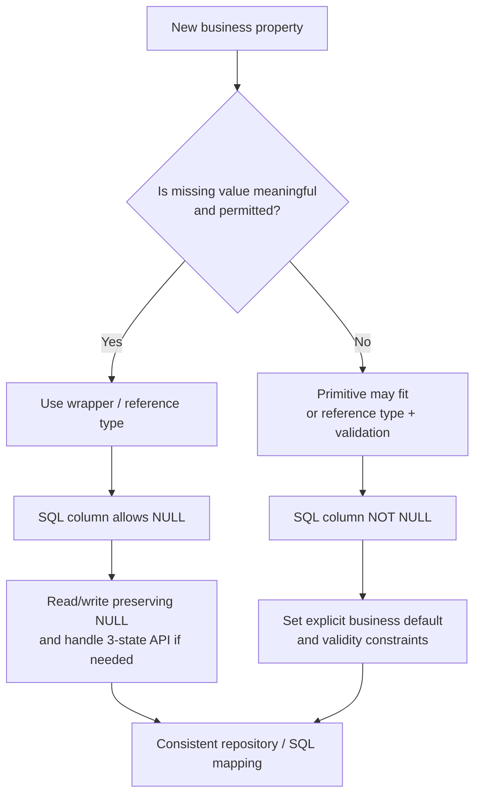

# Mapping Primitive Types, Wrapper Types, and SQL NULL Values

When using **Spring Data JDBC** to save and read data from a relational database, every Java property must be converted to match the SQL column data type. The most important distinction for simple values is that **Java primitive types cannot hold `null`, whereas wrapper types and reference types can represent `null`**.

This difference directly affects reading columns that allow SQL `NULL`, designing `NOT NULL` constraints, handling default values, creating new aggregates, and writing business logic. Choosing `int` instead of `Integer` by mistake can cause “alert threshold not configured” to be interpreted as “threshold equals 0”. Choosing `boolean` instead of `Boolean` can cause “not yet confirmed” to be interpreted as “confirmed as false”.

This lesson focuses on **Spring Data Relational / Spring Data JDBC**, while also explaining the underlying JDBC layer so you understand why the same SQL column can be mapped differently in Java.

## 1. Three Concepts to Distinguish Right from the Start

| Concept | Example | Meaning |
| --- | --- | --- |
| **Java primitive** | `int`, `long`, `boolean` | Stores the value directly; **cannot** hold `null`. |
| **Java wrapper / reference type** | `Integer`, `Long`, `Boolean`, `String`, `BigDecimal` | Can hold an object or a `null` value. |
| **SQL `NULL`** | `restock_threshold INTEGER NULL` | The column has no SQL value; distinct from `0`, `FALSE`, or an empty string. |

Example in inventory management:

- `stockQuantity = 0`: it is known that the stock quantity equals **0**.
- `restockThreshold = null`: the reorder alert threshold has not been configured yet.
- `active = false`: the product has been determined to be **inactive**.
- `featured = null`: the featured status **has not been evaluated yet**.
- `featured = false`: evaluated and concluded that the product is **not featured**.

SQL `NULL` typically represents **missing, unknown, or not applicable**, though its exact meaning must be defined by business rules. It does not implicitly mean “equals 0” or “false”.

```text
         Java Object                          Relational Database

         int stockQuantity = 0   <------->    stock_quantity = 0
         Integer threshold = null <------>    restock_threshold IS NULL
         boolean active = false  <------->    active = FALSE
         Boolean featured = null <------->    featured IS NULL

             Spring Data JDBC converts property ↔ column
                       JDBC driver executes SQL
```

## 2. Java Primitive Types and Wrapper Types

Java has eight primitive types. Each typically has a corresponding wrapper type:

| Primitive | Wrapper | Default value of a primitive **field** | Can the wrapper be `null`? |
| --- | --- | --- | --- |
| `byte` | `Byte` | `0` | Yes |
| `short` | `Short` | `0` | Yes |
| `int` | `Integer` | `0` | Yes |
| `long` | `Long` | `0L` | Yes |
| `float` | `Float` | `0.0f` | Yes |
| `double` | `Double` | `0.0d` | Yes |
| `boolean` | `Boolean` | `false` | Yes |
| `char` | `Character` | `'\u0000'` | Yes |

**Note on the scope of “default value”:** the values in the table apply to **object fields** or array elements after initialization. Java local variables must be assigned before reading; you do not automatically get `0` or `false` just because a variable is a primitive.

Example:

```java
public class TypeExample {
    private int quantity;       // Default 0
    private Integer threshold;  // Default null

    private boolean enabled;    // Default false
    private Boolean reviewed;   // Default null

    public void printValues() {
        System.out.println(quantity);   // 0
        System.out.println(threshold);  // null
        System.out.println(enabled);    // false
        System.out.println(reviewed);   // null
    }
}
```

Wrappers are **reference types**, so `null` can be used to indicate the absence of data. Wrappers also provide APIs like `Integer.parseInt(...)`, but you should not choose a wrapper in a persistent entity solely for these utility methods: the more important reason is **the semantics of a potentially absent value**.

### 2.1. Primitives Do Not Accept `null`

```java
int stockQuantity = 0;
Integer threshold = null;

// int invalid = null; // Does not compile

System.out.println(stockQuantity == 0);  // true
System.out.println(threshold == null);    // true
```

The two variables `stockQuantity` and `threshold` do not represent the same state, even if at some point neither has been assigned a business value through the user interface.

### 2.2. Wrappers Introduce an Additional State

```java
Boolean featured = null;  // Not yet evaluated
featured = Boolean.FALSE; // Determined to be not featured
featured = Boolean.TRUE;  // Determined to be featured
```

The `Boolean` type has **three representable states** at the Java layer: `true`, `false`, and `null`. Meanwhile, `boolean` only has two states.

This is useful for optional data, but it also adds responsibility: code using wrappers must handle the `null` case to avoid misinterpretation or throwing a `NullPointerException`.

## 3. SQL `NULL` Differs from 0, `FALSE`, Empty String, and `DEFAULT`

In SQL, `NULL` is a marker indicating **no value**, not a regular numeric or string literal.

| SQL Value | Is it `NULL`? | Example meaning |
| --- | --- | --- |
| `NULL` | Yes | Alert threshold has not been configured. |
| `0` | No | Threshold has been configured to 0. |
| `FALSE` | No | Status is determined to be inactive. |
| `''` | No in some DBs such as PostgreSQL | Zero-length string; empty string handling depends on the database. |
| `'null'` | No | A text string consisting of the four characters `n`, `u`, `l`, `l`. |
| `DEFAULT` when writing SQL | Not a concrete value | Instructs the database to use the default declared for the column. |

In PostgreSQL, `''` and `NULL` are different. Some other databases, such as Oracle, have different rules for handling empty strings; when designing mappings, you must consider the **dialect of the database being used**.

Example:

```sql
SELECT
    0 AS configured_zero,
    FALSE AS explicit_false,
    NULL AS missing_value,
    '' AS empty_text;
```

This distinction is especially important when data passes through JSON, Java, repositories, and then into the database. You should not automatically convert every missing value to `0` or `false` if the business domain still needs to distinguish “not provided”.

## 4. Rules for Choosing Java Types for SQL Columns

A practical design guideline:

- **Required column (`NOT NULL`) that always has a valid value:** a primitive can be appropriate, especially `int`, `long`, `boolean` with clear semantics. A wrapper can still be used if you need to represent a “not yet filled in” state before validation/persistence.
- **Nullable column where `NULL` has business meaning:** use an appropriate wrapper or reference type, such as `Integer`, `Long`, `Boolean`, `String`, `BigDecimal`.
- **Database-generated primary key:** usually choose a wrapper such as `Long id` to distinguish a new object (`id == null`) from an object that already has an ID.
- **Decimal numbers requiring precision, such as money:** prefer `BigDecimal` for business values; since this is a reference type, it can also be `null` if the schema allows it.
- **Fields with a clearer set of business states than two or three states:** consider an enum or dedicated value type instead of forcing every state into a nullable `Boolean`.

### 4.1. Common Mapping Table

| Java | Suggested SQL Type | Can represent SQL `NULL` in Java? | Notes |
| --- | --- | --- | --- |
| `int` | `INTEGER NOT NULL` | No | Suitable for required quantities; Java `0` is not SQL `NULL`. |
| `Integer` | `INTEGER NULL` or `NOT NULL` | Yes | Suitable for optional numbers like reorder threshold. |
| `long` | `BIGINT NOT NULL` | No | Required large integer value. |
| `Long` | `BIGINT NULL` or `NOT NULL` | Yes | Commonly used for database-generated `@Id`. |
| `boolean` | `BOOLEAN NOT NULL` | No | Determined true/false value. |
| `Boolean` | `BOOLEAN NULL` or `NOT NULL` | Yes | Adds an unknown/unevaluated state if NULL is allowed. |
| `double` / `Double` | `DOUBLE PRECISION` (DB-dependent) | `Double` only | Floating-point type, subject to representation inaccuracy. |
| `String` | `VARCHAR` / `TEXT` | Yes | `null` differs from an empty string; rules may vary by DB. |
| `BigDecimal` | `NUMERIC(p,s)` / `DECIMAL(p,s)` | Yes | Suitable for money and values requiring decimal precision. |
| `char` / `Character` | `CHAR(1)` or equivalent type | `Character` only | Specific conversion depends on driver/dialect; for business code, a 1-character `String` is sometimes clearer. |

These are **schema design suggestions**, not a guarantee that every JDBC driver and every database maps each type identically. The driver, dialect, specific SQL type, and Spring Data JDBC converters determine the final read/write behavior.

## 5. Illustrative Table Design

Suppose a product management application needs to store the following information:

- `stockQuantity`: stock quantity is always required and may be `0`.
- `restockThreshold`: restock threshold, allowed to be left blank before an administrator configures it.
- `active`: whether the product is active, always true or false.
- `featured`: whether the product has been evaluated as featured; `null` means **not yet evaluated**.
- `price`: required unit price, stored as an exact decimal number.
- `id`: database-generated primary key.

With **PostgreSQL**, you can create the table:

```sql
CREATE TABLE products (
    id BIGINT GENERATED BY DEFAULT AS IDENTITY PRIMARY KEY,
    name VARCHAR(200) NOT NULL,
    stock_quantity INTEGER NOT NULL CHECK (stock_quantity >= 0),
    restock_threshold INTEGER NULL CHECK (
        restock_threshold IS NULL OR restock_threshold >= 0
    ),
    active BOOLEAN NOT NULL,
    featured BOOLEAN NULL,
    price NUMERIC(12, 2) NOT NULL CHECK (price >= 0)
);
```

Key points to note:

1. `stock_quantity INTEGER NOT NULL` prevents the database from storing SQL `NULL`; `CHECK (stock_quantity >= 0)` further enforces the non-negative rule.
2. `restock_threshold INTEGER NULL` allows the column to have no value. `CHECK` allows `NULL` or a non-negative number.
3. `active BOOLEAN NOT NULL` only accepts valid PostgreSQL boolean states and rejects `NULL`.
4. `featured BOOLEAN NULL` allows `TRUE`, `FALSE`, and `NULL`.
5. `price NUMERIC(12,2) NOT NULL` preserves decimal numbers according to the precision/scale defined in the schema.
6. `id` is `BIGINT` with database identity generation; in Java you can use `Long id` before creating the row.

**Spring Data JDBC maps to an existing schema** and does not use a `hibernate.ddl-auto`-like mechanism to auto-generate tables like JPA/Hibernate. In real-world applications, tables are typically created/modified using migrations such as Flyway or Liquibase.

### 5.1. Semantically Valid Records

```sql
INSERT INTO products (
    name, stock_quantity, restock_threshold, active, featured, price
)
VALUES (
    'Ballpoint pen', 0, NULL, TRUE, NULL, 7500.00
);

INSERT INTO products (
    name, stock_quantity, restock_threshold, active, featured, price
)
VALUES (
    'Notebook', 50, 10, FALSE, FALSE, 35000.00
);
```

In the first row, “stock quantity equals `0`” and “restock threshold not configured” are **two different states**. In the second row, `featured = FALSE` means the status has been determined to be not featured, not “unknown”.

## 6. Mapping the Table with a Spring Data JDBC Aggregate

Using `@Table`, `@Id`, and `@Column` from Spring Data JDBC:

```java
import java.math.BigDecimal;

import org.springframework.data.annotation.Id;
import org.springframework.data.relational.core.mapping.Column;
import org.springframework.data.relational.core.mapping.Table;

@Table("products")
public record Product(
        @Id Long id,
        String name,
        @Column("stock_quantity") int stockQuantity,
        @Column("restock_threshold") Integer restockThreshold,
        boolean active,
        Boolean featured,
        BigDecimal price
) {
    public Product {
        if (name == null || name.isBlank()) {
            throw new IllegalArgumentException("Name is required");
        }
        if (stockQuantity < 0) {
            throw new IllegalArgumentException("Negative stock");
        }
        if (restockThreshold != null && restockThreshold < 0) {
            throw new IllegalArgumentException("Negative threshold");
        }
        if (price == null || price.signum() < 0) {
            throw new IllegalArgumentException("Invalid price");
        }
    }
}
```

In this class:

| Property | Java type | SQL column | Can the value be absent? |
| --- | --- | --- | --- |
| `id` | `Long` | `id BIGINT ... PRIMARY KEY` | `null` when the aggregate has not been saved yet and is awaiting a generated ID. |
| `name` | `String` | `name VARCHAR(200) NOT NULL` | Java can hold `null`, but the constructor checks it and the database rejects that value. |
| `stockQuantity` | `int` | `stock_quantity INTEGER NOT NULL` | Cannot be `null` in Java or SQL according to the schema. |
| `restockThreshold` | `Integer` | `restock_threshold INTEGER NULL` | Yes; `null` means no threshold configured yet. |
| `active` | `boolean` | `active BOOLEAN NOT NULL` | No; must be true/false. |
| `featured` | `Boolean` | `featured BOOLEAN NULL` | Yes; `null` means status not yet determined. |
| `price` | `BigDecimal` | `price NUMERIC(12,2) NOT NULL` | Java allows null at the type level; constructor and database constraints require a value. |

`@Column` specifies the column name; it **does not create the column, does not set `NOT NULL`, and does not automatically create SQL constraints**. Some conventional names, like Java `stockQuantity` to SQL `stock_quantity`, can be mapped automatically; writing `@Column` explicitly helps readers clearly see the correspondence.

A `record` is chosen because the sample data is concise and easy to read. Spring Data JDBC supports mapping immutable objects via constructors; with records and generated IDs, **use the result returned from `save`** because it may be a new instance containing the ID just created by the database.

## 7. Using a Repository to Save and Read Nullable Values

Declare the repository:

```java
import org.springframework.data.repository.CrudRepository;

public interface ProductRepository
        extends CrudRepository<Product, Long> {
}
```

For a new aggregate:

```java
import java.math.BigDecimal;

Product newProduct = new Product(
        null,                         // id not yet assigned
        "Ballpoint pen",
        0,                            // known to be out of stock
        null,                         // stock threshold not set yet
        true,                         // active
        null,                         // featured status not evaluated yet
        new BigDecimal("7500.00")
);

Product saved = productRepository.save(newProduct);

System.out.println(saved.id());                 // Database-assigned ID
System.out.println(saved.stockQuantity());      // 0
System.out.println(saved.restockThreshold());   // null
System.out.println(saved.featured());           // null
```

Semantically, Spring Data JDBC needs to pass the primitive/wrapper values to the JDBC driver, store them in the corresponding columns, and map them back when querying.

Retrieving a record:

```java
Product loaded = productRepository.findById(saved.id())
        .orElseThrow();

int quantity = loaded.stockQuantity();       // 0
Integer threshold = loaded.restockThreshold(); // null
boolean active = loaded.active();           // true
Boolean featured = loaded.featured();       // null
```

With `@Id Long id`, a `null` value generally helps Spring Data JDBC recognize a new aggregate to execute an `INSERT`. After saving, the ID is assigned and the aggregate is considered existing. New entity detection can also depend on `@Version` or the `Persistable` contract if the project uses them; in basic examples, a nullable wrapper ID is an intuitive choice.

### 7.1. Why Is `Long` Usually Used Instead of `long` for IDs?

The following two declarations have different meanings:

```java
@Id
private Long id;  // null -> no ID yet

@Id
private long id;  // unassigned field will be 0
```

If primitive `long` is used, the state before saving is usually `0`; Spring Data has its own rules for recognizing initial ID values, but `0` is a valid number at the Java type level. The `Long` wrapper clearly represents **“ID does not exist yet”** with `null`, which is especially useful when the database generates primary keys. This is a preferred convention for entities with generated IDs, not a requirement that every Spring Data JDBC ID must be a wrapper.

## 8. Reading SQL `NULL` into Wrappers and Primitives

When the database returns a row, Spring Data JDBC uses its mapping and type conversion mechanism to construct the Java object. **Wrappers like `Integer` can receive SQL `NULL` as Java `null`. Primitives like `int` cannot represent SQL `NULL`.**

For a field corresponding to a `NOT NULL` column, such as `stock_quantity`, using `int` can be appropriate. If someone alters the schema or data so the column allows `NULL` while Java still uses `int`, the application will have a **data contract mismatch**.

The exact consequence depends on how the mapper instantiates the object, constructor/field access, and converters: `NULL` data can cause conversion errors or produce a result that fails to convey the missing-data state. **Do not rely on `int` having a default value of `0` to assume that SQL `NULL` will always map safely to `0`.**

If SQL `NULL` has meaning that must be preserved, use `Integer`; if `NULL` is forbidden by business rules, place `NOT NULL` in the schema and validate inputs in the application.

### 8.1. The `int` / `Integer` Pair

```java
int inventory = 0;       // Guaranteed to have an integer
Integer reorderPoint = null; // Not configured yet
```

This makes sense when the database has:

```sql
stock_quantity INTEGER NOT NULL,
restock_threshold INTEGER NULL
```

If the database contains:

```text
stock_quantity   restock_threshold
--------------   -----------------
0                NULL
10               0
10               5
```

Then the three records have different meanings:

- `0, NULL`: out of stock, threshold not configured.
- `10, 0`: 10 items in stock, threshold configured to 0.
- `10, 5`: 10 items in stock, needs replenishment when reaching threshold 5 according to business rules.

Using `int` for `restockThreshold` would prevent the Java model from clearly representing the first record.

### 8.2. The `boolean` / `Boolean` Pair

```java
boolean active = false;     // Explicitly inactive
Boolean featured = null;    // No conclusion yet
```

With three SQL values:

```text
featured
--------
TRUE
FALSE
NULL
```

`Boolean` preserves all three; `boolean` can only hold `true` or `false`. If business rules require a binary answer, use `BOOLEAN NOT NULL` in the schema and you can use `boolean` in the domain. If the third state is meaningful, a wrapper or a dedicated model type is needed.

## 9. When Using JDBC Directly: Reading NULL Properly

Standard Spring Data JDBC repositories already handle mapping. However, understanding raw JDBC behavior helps you write `RowMapper`, custom SQL, or legacy integrations correctly.

### 9.1. `ResultSet.getInt` Returns `0` When SQL Is `NULL`

A common pitfall: JDBC primitive getters such as `ResultSet.getInt(...)` and `ResultSet.getBoolean(...)` cannot return Java `null`. By the JDBC contract, when a column is SQL `NULL`, `getInt(...)` returns `0` and `getBoolean(...)` returns `false`. To know whether the value was actually `NULL`, **you must call `wasNull()` immediately after the corresponding getter**.

Example using `JdbcTemplate`:

```java
import java.sql.ResultSet;
import java.sql.SQLException;

private Integer readNullableThreshold(ResultSet rs)
        throws SQLException {
    int value = rs.getInt("restock_threshold");
    return rs.wasNull() ? null : value;
}
```

You must read `wasNull()` right after `getInt(...)` because it reports the `NULL` status of **the most recently read column**. If you read another column before calling `wasNull()`, the result no longer reflects `restock_threshold`.

### 9.2. With JDBC Drivers Supporting Typed `getObject`

Another approach is:

```java
Integer threshold =
        rs.getObject("restock_threshold", Integer.class);
Boolean featured =
        rs.getObject("featured", Boolean.class);
```

With drivers that support the corresponding type conversion, `getObject(..., Integer.class)` and `getObject(..., Boolean.class)` can return `null` when the SQL column is `NULL`. Specific SQL types/drivers may have limitations; if compatibility issues arise, `getInt/getBoolean` + `wasNull` is the explicit JDBC mechanism.

**Do not write:**

```java
int threshold = rs.getInt("restock_threshold");
// threshold == 0: cannot tell if the column is actually 0 or SQL NULL!
```

If business logic distinguishes the two cases, the code above loses information.

### 9.3. Writing SQL NULL with PreparedStatement

For an optional column, JDBC can write SQL `NULL` via `setNull`:

```java
import java.sql.Types;

jdbcTemplate.update(
        "UPDATE products SET restock_threshold = ? WHERE id = ?",
        ps -> {
            ps.setNull(1, Types.INTEGER);
            ps.setLong(2, productId);
        }
);
```

If there is an actual value:

```java
jdbcTemplate.update(
        "UPDATE products SET restock_threshold = ? WHERE id = ?",
        ps -> {
            ps.setInt(1, 10);
            ps.setLong(2, productId);
        }
);
```

In a typical Spring Data JDBC repository, the framework takes care of binding parameters and converting `null` for mapped properties; you do not need to manually write `setNull` for every save.

## 10. SQL Default Values Are Not the Same as Java Default Values

Suppose a schema specifies:

```sql
CREATE TABLE demo_defaults (
    id BIGINT GENERATED BY DEFAULT AS IDENTITY PRIMARY KEY,
    quantity INTEGER NOT NULL DEFAULT 0,
    approved BOOLEAN NOT NULL DEFAULT FALSE,
    note VARCHAR(100) DEFAULT 'N/A'
);
```

If SQL **omits** these columns:

```sql
INSERT INTO demo_defaults DEFAULT VALUES;
```

The database uses the defined `DEFAULT` values.

However, if SQL **explicitly** writes `NULL`:

```sql
INSERT INTO demo_defaults (quantity)
VALUES (NULL);
```

PostgreSQL will reject it because `quantity` has a `NOT NULL` constraint. `DEFAULT 0` does not automatically turn an explicitly passed `NULL` into `0`.

In Spring Data JDBC, you should not assume that a Java property being `null` will cause the `INSERT` statement to **omit the column** so the database applies `DEFAULT`. How the framework generates SQL depends on the specific mapping and operation; when a property is included in SQL as `NULL`, the SQL default will not take effect the way omitting the column does.

**Practical design:**

- If a business rule states that a new product starts with `stockQuantity = 0`, assign that value in the constructor/factory/service before calling `save`.
- If a value must always exist, use `NOT NULL` in the database.
- If defaults exist at the database layer, treat them as rules for appropriate SQL write paths; avoid relying on defaults to fix mapping mistakes from Java.
- When using an unassigned primitive `boolean`, the default Java value `false` may be written explicitly, preventing a column's SQL `DEFAULT TRUE` from being used.

Example of a simple factory:

```java
public static Product createNew(String name, BigDecimal price) {
    return new Product(
            null,
            name,
            0,       // Explicit initial business value
            null,    // Threshold not configured yet
            true,    // New product is active
            null,    // Featured status not evaluated yet
            price
    );
}
```

This is an illustrative method **that can be placed inside the `Product` record** from the earlier example, or in a separate factory. Business-determined defaults are created deliberately, without relying on coincidence between Java defaults and SQL defaults.

## 11. Comparing NULL Values in SQL Statements

SQL uses **three-valued logic**: a condition can be `TRUE`, `FALSE`, or `UNKNOWN`. Therefore, ordinary comparisons with `NULL` do not work like integer comparisons.

### 11.1. `= NULL` Does Not Find NULL Rows

**Wrong:**

```sql
SELECT *
FROM products
WHERE restock_threshold = NULL;
```

In standard SQL, the comparison expression `= NULL` evaluates to `UNKNOWN`, even when the column is also `NULL`; the `WHERE` condition does not select these rows.

**Correct:**

```sql
SELECT *
FROM products
WHERE restock_threshold IS NULL;
```

And to fetch products that have a configured threshold:

```sql
SELECT *
FROM products
WHERE restock_threshold IS NOT NULL;
```

### 11.2. `NULL` and Boolean Conditions

Example:

```sql
SELECT *
FROM products
WHERE featured = FALSE;
```

This query selects products marked **FALSE**, but **does not** select products with `featured IS NULL`.

If you want products **not marked TRUE** and intentionally include unevaluated ones:

```sql
SELECT *
FROM products
WHERE featured = FALSE OR featured IS NULL;
```

Whether to combine `FALSE` with `NULL` is a business decision; do not let the SQL query make that decision for you accidentally.

### 11.3. `COALESCE` When a Fallback Value Is Needed at Query Time

`COALESCE` returns the first expression that is not `NULL`:

```sql
SELECT
    id,
    name,
    COALESCE(restock_threshold, 0) AS effective_threshold
FROM products;
```

The result presents `NULL` as `0` for **a specific calculation or screen**, but **does not update the underlying value in the table**. Avoid using `COALESCE` output to infer that `NULL` and `0` share the same meaning in the domain.

### 11.4. `COUNT(*)` and `COUNT(column)`

```sql
SELECT
    COUNT(*) AS total_products,
    COUNT(restock_threshold) AS configured_thresholds
FROM products;
```

`COUNT(*)` counts every selected row; `COUNT(restock_threshold)` only counts rows that have a **non-`NULL`** value in that column. This is another example of the practical impact of SQL `NULL`.

## 12. Querying Nullable Values with a Spring Data JDBC Repository

A repository can also provide queries based on `IS NULL` conditions. Example of writing explicit SQL with `@Query`:

```java
import java.util.List;
import org.springframework.data.jdbc.repository.query.Query;
import org.springframework.data.repository.CrudRepository;

public interface ProductRepository
        extends CrudRepository<Product, Long> {

    @Query("""
            SELECT id, name, stock_quantity, restock_threshold,
                   active, featured, price
              FROM products
             WHERE restock_threshold IS NULL
            """)
    List<Product> findWithoutRestockThreshold();
}
```

The query can construct `Product` instances with `restockThreshold() == null`; that is precisely the state to represent in Java.

In appropriate cases, Spring Data JDBC also supports query derivation from method names, including null condition forms depending on the capabilities of the Spring Data version in use. Explicit SQL in the example makes `IS NULL` clearly visible and avoids confusing it with `= NULL`.

**A distinction to remember:** `Optional<Product>` in the result of `findById` expresses **whether the entire Product record exists or not**. `Integer restockThreshold` inside `Product` expresses **whether a single property has a value or not**. These two concepts of absence are not the same.

```java
Optional<Product> maybeProduct = repository.findById(123L);

// Case 1: Optional.empty() -> Product id=123 not found
// Case 2: Product present, restockThreshold() == null
//         -> Product exists but has no restock threshold yet
```

Avoid using `Optional<Integer>` as a persisted entity property solely to “fix” null without considering mapping mechanisms and update APIs. For a simple nullable SQL property, the `Integer` wrapper is usually clearer; `Optional` is useful for **query return APIs** or for explicitly expressing absence outside the entity.

## 13. Boxing, Unboxing, and NullPointerException

Java automatically converts between primitives and wrappers in certain contexts, called **autoboxing** and **unboxing**:

```java
Integer a = 5; // Boxing: int -> Integer
int b = a;     // Unboxing: Integer -> int
```

However, **unboxing a wrapper that is `null` throws a `NullPointerException`**:

```java
Integer threshold = null;

// int unsafe = threshold; // Throws NullPointerException at runtime
```

Similarly with `Boolean`:

```java
Boolean featured = null;

// if (featured) { ... } // Throws NullPointerException
```

If you need to check all three states explicitly, write:

```java
Boolean featured = product.featured();

if (Boolean.TRUE.equals(featured)) {
    System.out.println("Featured product");
} else if (Boolean.FALSE.equals(featured)) {
    System.out.println("Marked as not featured");
} else {
    System.out.println("Not yet evaluated");
}
```

This preserves the meaning of `NULL` instead of implicitly turning it into `false`.

With nullable numbers:

```java
Integer threshold = product.restockThreshold();

if (threshold == null) {
    System.out.println("Restock threshold not configured");
} else if (product.stockQuantity() <= threshold) {
    System.out.println("Restock threshold reached");
}
```

Do not write the comparison `stockQuantity <= threshold` before checking `threshold != null` because Java must unbox `Integer` during comparison.

## 14. Reading, Creating, Updating, and Clearing Nullable Values

When designing data flows, distinguish between **a Java null value** and **user intent**.

### 14.1. Creating: Intentional Null Assignment

For example, a new product without a stock threshold yet:

```java
Product draft = new Product(
        null,
        "Pencil",
        20,
        null,  // Not configured yet
        true,
        null,  // Not evaluated yet
        new BigDecimal("4000.00")
);

Product saved = repository.save(draft);
```

With `restock_threshold` and `featured` allowing `NULL`, persisting `null` is a valid state.

### 14.2. Updating: Null Can Mean “Clear the Old Value”

Suppose a product currently has `restockThreshold = 10`. If the user explicitly requests to **remove the threshold**, the new state must be `null`:

```java
Product current = repository.findById(productId)
        .orElseThrow();

Product updated = new Product(
        current.id(),
        current.name(),
        current.stockQuantity(),
        null, // Intentionally clear the configured threshold
        current.active(),
        current.featured(),
        current.price()
);

repository.save(updated);
```

Spring Data JDBC persists the state of the passed-in aggregate. When a mapped property is updated to `null`, the corresponding column can be set to SQL `NULL`. With immutable records, you must construct a new instance containing all the other values you want to keep.

### 14.3. PATCH API: “Omitting a Field” Differs from “Sending Field = null”

Suppose a client sends:

```json
{}
```

This can be interpreted as **do not change the threshold**. But if it sends:

```json
{
  "restockThreshold": null
}
```

This can be interpreted as **clear the existing threshold**. If a DTO only has an `Integer restockThreshold` field, both situations may be deserialized to `null` and lose information about **field presence**.

To support a three-state PATCH (omitted / set to NULL / set to a value), you need a DTO contract, JSON handling, or a mechanism that explicitly tracks field presence. Do not use a Spring Data JDBC entity directly as a PATCH DTO and call `save` without handling this distinction.

That problem belongs to the API layer, but its root cause is that a single nullable Java variable cannot on its own distinguish **“property absent from the request”** from **“property explicitly specified as null”**.

## 15. Database Constraints, Application Checks, and Java Types

The three protection layers serve distinct purposes:

| Layer | Example | What does it protect? |
| --- | --- | --- |
| **Java type** | `int stockQuantity` | Prevents the Java variable from holding `null` at the type level; does not forbid negative values. |
| **Business validation** | `if (quantity < 0) throw ...` | Rejects invalid values before writing; clearly communicates the reason. |
| **SQL constraint** | `INTEGER NOT NULL CHECK (stock_quantity >= 0)` | Protects data in the database, even when other write paths exist outside the application. |

Some common misconceptions:

- `String` is a reference type so it can be `null` **even when the SQL column is `NOT NULL`**. Constructors/validation and the database must decide to forbid that value.
- `@Column("name")` specifies the column name; **it does not automatically create a `NOT NULL` constraint**.
- Primitive `int` cannot be null, yet it can still be `-5`; `NOT NULL` does not replace `CHECK` and business validation.
- Wrapper `Integer` can be null, yet a `NOT NULL` database column will still reject a missing value if you attempt to write it.
- Bean Validation annotations such as `@NotNull` (when using the appropriate validation infrastructure) can help validate inputs/objects; **they do not replace migrations and SQL constraints**, and you should not assume every repository call runs Bean Validation automatically unless configured.

For Spring Data JDBC, **an accurate schema is a critical persistence contract**. Java types and domain rules should align with database constraints.

## 16. Common Design Mistakes

### 16.1. Using `int` for a Column with SQL NULL

If `restock_threshold` allows `NULL`, declaring:

```java
private int restockThreshold;
```

leaves the domain with no “not configured” state. Switch to `Integer`, or change the business rules/schema to forbid NULL if a number is truly required.

### 16.2. Using `boolean` When Three States Are Needed

If “not yet evaluated” has its own meaning, use `Boolean`, an enum, or a value object instead of forcing it to `false`. Only use `boolean` when the business concept is strictly binary and a value is required.

### 16.3. Expecting Java `0` to Replace SQL `NULL`

A Java field's default is not an SQL NULL conversion policy. For nullable columns, use a Java type capable of holding null or write an **explicit conversion rule with a clear business rationale**.

### 16.4. Relying on SQL `DEFAULT` When the Framework Writes `NULL`

SQL `DEFAULT` usually applies when the column is omitted or `DEFAULT` is specified in the write statement. If the application explicitly sends `NULL`, a `NOT NULL` constraint can reject it; proactively initialize domain values and understand how the framework writes columns.

### 16.5. Unboxing Wrappers Without Checking for Null

An `Integer` used in addition, comparison, or assignment to `int` can be unboxed automatically. When it is `null`, this throws `NullPointerException`. Use null checks or write an explicit fallback policy.

### 16.6. SQL Comparisons with `= NULL`

Use `IS NULL` / `IS NOT NULL` in SQL queries. `= NULL` does not behave like Java's comparison with `null`.

### 16.7. Using `double` for Money

This is a mistake independent of nullability. `double` is a binary floating-point number that cannot accurately represent many decimal values. Use `BigDecimal` with `NUMERIC/DECIMAL` for monetary data requiring precision; pay attention to scale, rounding, and calculations according to business policy.

### 16.8. Treating Every Nullable Wrapper as Valid Business Data

A wrapper can be null at the type level, but that does not mean the business allows null. For example, `name String` and `price BigDecimal` in `Product` are still required data. Combine constructor/validation checks and SQL `NOT NULL` to enforce rules.

## 17. Workflow for Choosing Types and Mapping for a Column

When adding a new property to an aggregate, you can decide step by step:

1. **Determine business meaning:** is the value required? Does `0` or `false` differ from “unknown”?
2. **Determine SQL type:** are `INTEGER`, `BIGINT`, `BOOLEAN`, `NUMERIC`, `VARCHAR`, etc. appropriate for the range and precision?
3. **Determine schema nullability:** use `NOT NULL` when a value must exist; use `NULL` when an absent value is a permitted state.
4. **Choose the corresponding Java type:** primitive for values that are always required and valid; wrapper or reference type for states that can be absent.
5. **Determine initial values:** constructors/factories set explicit business defaults; do not implicitly rely on `0`/`false` or SQL DEFAULT.
6. **Determine update rules:** is clearing the value back to `null` allowed? How does a PATCH API distinguish omitting a field from requesting deletion?
7. **Place protective constraints:** validation in the application and appropriate `NOT NULL`/`CHECK`/constraints in the database.
8. **Control queries:** for nullable columns, know when to use `IS NULL`, `IS NOT NULL`, or `COALESCE` for calculations without altering the original data's meaning.



Note: this diagram describes **design decisions**, not a mandate that all `NOT NULL` columns must use primitives. For example, `String` and `BigDecimal` are reference types but frequently map to `NOT NULL` columns.

## 18. Self-Study Questions

1. A `quantity INTEGER NOT NULL` column always exists and is allowed to be 0. Should you use `int` or `Integer`? Why is `0` different from `NULL`?
2. A `discount_percent INTEGER NULL` column uses `NULL` to mean “no discount policy yet” and `0` to mean “policy exists with 0% discount”. Which Java type should you use?
3. A `verified BOOLEAN NULL` column needs three states: “verified”, “verification failed”, and “not yet checked”. What happens if you use `boolean`?
4. Why is `ResultSet.getInt(...)` insufficient to distinguish SQL `NULL` from the value `0`? Which method must be called?
5. Why does `WHERE featured = NULL` fail to find rows with `featured IS NULL`?
6. With `id BIGINT GENERATED ...`, why is `@Id Long id` usually clearer than `@Id long id` before saving?
7. A schema has `stock_quantity INTEGER NOT NULL DEFAULT 0`. If an `INSERT` statement explicitly passes `NULL` to that column, will the database necessarily replace it with 0?
8. In a PATCH API, how does omitting `restockThreshold` differ from sending `"restockThreshold": null`? Can a single `Integer` field preserve this difference after deserialization?
9. Why does `BigDecimal price` still need a `NOT NULL` constraint and business validation even though it has no primitive counterpart?
10. When encountering an SQL NULL-to-Java mapping error, should you change the Java type, the SQL constraint, or the default logic? Which business information determines the answer?

### Practice Exercises

Using the `products` table and `Product` record above, try performing these operations:

- Create a product with `stockQuantity = 0`, `restockThreshold = null`, and `featured = null`; read it back via the repository.
- Create a product with `restockThreshold = 0` and `featured = false`; compare its state with the first product.
- Query products without a threshold using SQL `IS NULL`.
- Try intentionally updating a threshold from `10` to `null`.
- Use `Boolean.TRUE.equals(...)` to safely handle the featured status.
- Write a custom `RowMapper` that reads `restock_threshold` with `getInt` followed by `wasNull` to observe the difference from using a primitive getter alone.
- Try an `INSERT` statement with `stock_quantity = NULL` to see the `NOT NULL` constraint protect the data.

When finished, the core takeaway is: **Spring Data JDBC can map primitive types, wrapper types, and reference types to SQL columns, but nullability is a business decision that must be consistently reflected across Java types, SQL schemas, update logic, and queries.** `0`, `false`, and `NULL` cannot be swapped arbitrarily without changing the meaning of the data.
