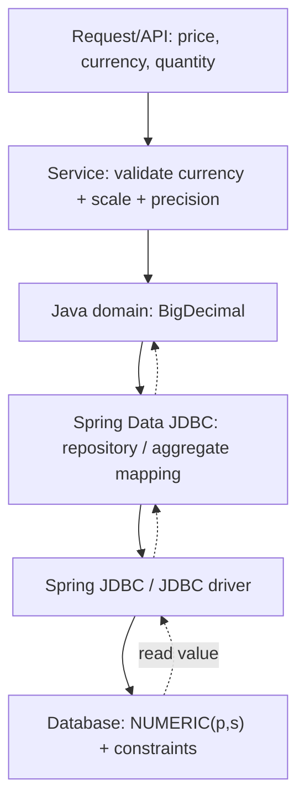

# BigDecimal, Precision, and Scale for Monetary Data

When building applications with **Spring Data Relational JDBC**, values such as product prices, payment amounts, taxes, discounts, or balances often pass through multiple layers: Java → Spring Data JDBC → JDBC driver → SQL column in the database. If each layer represents decimal numbers differently, the system can introduce unintended rounding, lose fractional digits, fail to persist values, or produce incorrect totals.

To store and calculate monetary amounts with exact decimal places, the standard approach in Java is to use **`java.math.BigDecimal`** paired with an exact decimal SQL column type, such as **`NUMERIC(19, 2)`** or **`DECIMAL(19, 2)`**. However, simply picking those two types is not enough. You must understand **precision**, **scale**, rounding rules, currency units, and how Java maps to SQL.

This lesson focuses on using `BigDecimal` properly in the context of **Spring Data JDBC**, while providing practical examples applicable to payment and invoicing workflows.

## 1. Why Should You Not Use float or double for Money?

`float` and `double` are binary floating-point types. Many familiar decimal fractions such as `0.1` and `0.2` do not have an exact finite binary representation, so the stored values are only approximations.

```java
double a = 0.1;
double b = 0.2;

System.out.println(a + b);
// 0.30000000000000004
```

Tiny discrepancies may be acceptable in certain scientific measurements, but for money, the following issues readily occur:

- Comparing a total amount against a payment threshold produces unexpected results.
- Multiplying quantities and summing multiple invoice lines causes rounding errors to accumulate.
- Passing values through JSON, JDBC, SQL, or external systems exposes floating-point inaccuracies.
- Business rounding rules are not enforced consistently.

`BigDecimal` represents a decimal number using an **unscaled integer value** (*unscaled value*) and a **scale**. When constructed from a decimal string, it preserves the exact value of the digits entered:

```java
import java.math.BigDecimal;

BigDecimal a = new BigDecimal("0.1");
BigDecimal b = new BigDecimal("0.2");

BigDecimal result = a.add(b);

System.out.println(result); // 0.3
```

This does not mean every `BigDecimal` operation automatically yields a business-valid result. For instance, `1 / 3` has infinitely many decimal digits; you still have to choose a rounding strategy.

### 1.1. Ways to Construct BigDecimal

```java
BigDecimal fromString = new BigDecimal("19.99"); // Recommended for monetary literals
BigDecimal fromInt = BigDecimal.valueOf(20);    // Exact for integers
BigDecimal fromLong = BigDecimal.valueOf(1500L);
BigDecimal fromDouble = BigDecimal.valueOf(0.1);
```

`BigDecimal.valueOf(double)` uses the string representation of `double` and generally avoids the obvious pitfall of the constructor that accepts a `double` directly. Even so, if the original data has already undergone `double` arithmetic, initial precision may already have been lost.

Avoid writing:

```java
BigDecimal wrong = new BigDecimal(0.1);

System.out.println(wrong);
// 0.1000000000000000055511151231257827021181583404541015625...
```

For monetary data coming from forms, CSV files, or APIs, keep it in canonical decimal text form and convert directly to `BigDecimal`. There is no reason to pass through an intermediate `double`.

## 2. Precision, Scale, and Unscaled Value in BigDecimal

A `BigDecimal` value can be understood by the formula:

**numeric value = unscaledValue × 10^(-scale)**

Where:

- **`unscaledValue()`**: the integer containing the digits of the value.
- **`scale()`**: the number of digits to the right of the decimal point in the current representation; may be 0 or negative.
- **`precision()`**: the number of digits in the unscaled value, excluding any minus sign; for zero, the precision is 1.

Example:

```java
BigDecimal price = new BigDecimal("123.4500");

System.out.println(price.unscaledValue()); // 1234500
System.out.println(price.scale());         // 4
System.out.println(price.precision());     // 7
```

With `scale = 4`, the value is `1234500 × 10^-4 = 123.4500`. The two trailing zeros **are preserved in the representation**, even though they do not change the arithmetic value.

| String Passed to BigDecimal | Unscaled value | Precision | Scale | Value |
|---|---:|---:|---:|---|
| `"123.45"` | 12345 | 5 | 2 | 123.45 |
| `"123.4500"` | 1234500 | 7 | 4 | 123.4500 |
| `"0.0010"` | 10 | 2 | 4 | 0.0010 |
| `"1000"` | 1000 | 4 | 0 | 1000 |
| `"1E+3"` | 1 | 1 | -3 | 1000 |
| `"0.00"` | 0 | 1 | 2 | 0.00 |

### 2.1. Scale Is Not the Number of Decimal Places in Every Printed Form

With `new BigDecimal("1E+3")`, the scale is `-3`. The value is still one thousand, though it can be represented in scientific notation. Therefore, do not guess scale merely by looking at a printed string.

```java
BigDecimal amount = new BigDecimal("1000.00");
BigDecimal stripped = amount.stripTrailingZeros();

System.out.println(stripped);             // 1E+3
System.out.println(stripped.scale());     // -3
System.out.println(stripped.toPlainString()); // 1000
```

`stripTrailingZeros()` removes unnecessary trailing zeros, but it can alter scale and printed output. If the system requires storing money with a fixed scale, use `setScale` according to a defined policy rather than treating `stripTrailingZeros` as a default monetary normalization step.

### 2.2. Precision and Scale Are Properties of the Representation

Two objects with the same arithmetic value can still have different precision/scale:

```java
BigDecimal x = new BigDecimal("1.2");
BigDecimal y = new BigDecimal("1.200");

System.out.println(x.scale());     // 1
System.out.println(y.scale());     // 3
System.out.println(x.precision()); // 2
System.out.println(y.precision()); // 4
```

This is why you must distinguish **numerical magnitude**, **represented precision**, and **monetary decimal-place policy**.

## 3. NUMERIC(p, s) and DECIMAL(p, s) in Databases

In SQL, the two type names `NUMERIC` and `DECIMAL` are commonly used to store exact decimal numbers. However, exact syntax, supported limits, and rounding rules must be checked against your DBMS.

Example with PostgreSQL:

```sql
CREATE TABLE products (
    id BIGINT GENERATED BY DEFAULT AS IDENTITY PRIMARY KEY,
    name VARCHAR(120) NOT NULL,
    price NUMERIC(19, 2) NOT NULL,
    CONSTRAINT ck_products_price_nonnegative CHECK (price >= 0)
);
```

Here **`NUMERIC(19, 2)`** means:

- **Precision `p = 19`**: up to 19 total decimal digits are allowed in the number per column rules.
- **Scale `s = 2`**: stores 2 digits after the decimal point.
- Maximum integer-part digits: **`p − s = 17`** digits for valid values in this column.

For example, the largest positive value representable in the two-decimal-place format of `NUMERIC(19,2)` is:

`99,999,999,999,999,999.99`

Minus signs and decimal points do not count toward precision. Negative magnitudes have a symmetric limit.

### 3.1. A Small Example to Understand Limits

Column:

```sql
amount NUMERIC(5, 2)
```

It has 5 total digits, 2 of which are fractional. The maximum value in this format is `999.99`.

| Input Value | Can It Be Stored in NUMERIC(5,2)? | Reason |
|---|---|---|
| `12.34` | Valid | 2 integer digits, 2 fractional digits |
| `999.99` | Valid | 3 integer digits, 2 fractional digits |
| `1000.00` | Invalid | Integer part requires 4 digits |
| `1.2` | Valid | Can be stored at scale 2 |
| `1.234` | Depends on DB conversion/rounding rules | Input has more than 2 fractional digits |

In PostgreSQL, values with more fractional digits than the declared scale may be **rounded before storage**. If after rounding the integer part no longer fits within the precision, the statement may fail. Do not implicitly rely on this behavior for monetary calculations: the application must apply explicit scale/rounding rules.

### 3.2. Java Precision Does Not Automatically Match SQL Column Precision

`new BigDecimal("1.200")` has `precision() == 4` and `scale() == 3`, while a `NUMERIC(19,2)` column only stores 2 fractional digits. The arithmetic value can still be normalized to `1.20` without losing quantitative information because the third digit is 0.

Conversely:

```java
BigDecimal value = new BigDecimal("1.234");
value.setScale(2, RoundingMode.UNNECESSARY);
```

This statement throws `ArithmeticException` because representing `1.234` with 2 fractional digits requires discarding a non-zero digit. When money must have at most two decimal places and **silent rounding is forbidden**, this behavior detects invalid input.

### 3.3. Choosing p and s by Business Domain

| Data | Example Format | Notes |
|---|---|---|
| Unit price or total amount with 2 decimal places | `NUMERIC(19,2)` | Common example, wide enough for many systems |
| Currencies without fractional units in business | `NUMERIC(19,0)` | Suitable for whole-unit VND/JPY amounts |
| Tax rate or discount rate | `NUMERIC(9,6)` | May require higher precision than final amounts |
| Currency exchange rate | `NUMERIC(22,10)` | Illustrative example; choose based on actual rate requirements |

Do not assume every money-related number needs `scale = 2`. Exchange rates, discount factors, unit prices measured by weight, or amounts in different currencies may require distinct scales.

## 4. BigDecimal Is a Number Type; Money Also Needs Units and Rules

`BigDecimal("100.00")` only tells you a decimal value. It does not tell you whether it is **100 USD**, **100 VND**, or **100 of another currency**.

A complete monetary model typically includes:

```text
Money
  amount: BigDecimal
  currency: USD / VND / JPY / ...
  roundingPolicy: defined by business rules when needed
```

Different currencies have different minor-unit decimal places by currency standards. For instance, in everyday transactions, USD has 2 decimal places, whereas VND and JPY typically use 0 minor-unit digits. Beyond currency standards, an accounting system might choose a larger internal storage scale for intermediate calculations; you must distinguish **storage scale**, **calculation scale**, and **settlement/display scale**.

### 4.1. Do Not Add Different Currencies Directly

```java
BigDecimal usd = new BigDecimal("10.00");
BigDecimal vnd = new BigDecimal("200000");

// BigDecimal addition compiles and runs, but produces a meaningless total:
BigDecimal invalidTotal = usd.add(vnd);
```

The proper approach is to verify matching currency units or perform an **exchange-rate conversion with an explicit rate source, timestamp, and rounding policy** before adding.

Example record representing money:

```java
import java.math.BigDecimal;
import java.util.Currency;
import java.util.Objects;

public record Money(BigDecimal amount, Currency currency) {

    public Money {
        Objects.requireNonNull(amount, "amount");
        Objects.requireNonNull(currency, "currency");
    }

    public Money add(Money other) {
        Objects.requireNonNull(other, "other");

        if (!currency.equals(other.currency())) {
            throw new IllegalArgumentException("Currency mismatch");
        }

        return new Money(amount.add(other.amount()), currency);
    }
}
```

This record illustrates pairing **amount + currency** and blocking cross-currency addition; it does not yet enforce scale checks, precision limits, or currency conversion. Those rules must be added per business requirements before use in a real payment system.

## 5. Important BigDecimal Operations for Monetary Calculations

`BigDecimal` is immutable: operations return a new object without mutating the existing one.

```java
BigDecimal price = new BigDecimal("19.99");

price.add(new BigDecimal("5.00"));
System.out.println(price); // Still 19.99

price = price.add(new BigDecimal("5.00"));
System.out.println(price); // 24.99
```

### 5.1. Addition, Subtraction, and Multiplication

```java
BigDecimal unitPrice = new BigDecimal("19.99");
BigDecimal quantity = BigDecimal.valueOf(3);

BigDecimal subtotal = unitPrice.multiply(quantity);
BigDecimal discount = new BigDecimal("4.00");
BigDecimal afterDiscount = subtotal.subtract(discount);

System.out.println(subtotal);      // 59.97
System.out.println(afterDiscount); // 55.97
```

Addition, subtraction, and multiplication can represent exact decimal results, yet **the resulting scale is not necessarily the monetary scale you want to store**. Choose a business-defined normalization point, such as after computing taxes or line totals.

### 5.2. Division: Always Think About Rounding Rules

```java
import java.math.BigDecimal;
import java.math.RoundingMode;

BigDecimal total = new BigDecimal("10.00");

BigDecimal each = total.divide(
    BigDecimal.valueOf(3),
    2,
    RoundingMode.HALF_UP
);

System.out.println(each); // 3.33
```

If you call `total.divide(BigDecimal.valueOf(3))` without specifying a rounding mode, `BigDecimal` can throw `ArithmeticException` because the result is a repeating infinite decimal.

Also remember that `3.33 × 3 = 9.99`, which is `0.01` short of `10.00`. When splitting money among multiple people or allocating discounts across multiple lines, the system needs a **remainder allocation rule**. For instance, three parts of `3.33`, `3.33`, and `3.34` sum to exactly `10.00`.

### 5.3. setScale and RoundingMode

```java
BigDecimal amount = new BigDecimal("2.345");

BigDecimal halfUp = amount.setScale(2, RoundingMode.HALF_UP);
BigDecimal halfEven = amount.setScale(2, RoundingMode.HALF_EVEN);

System.out.println(halfUp);   // 2.35
System.out.println(halfEven); // 2.34
```

- **`HALF_UP`**: at an exact midpoint, rounds away from zero.
- **`HALF_EVEN`**: at an exact midpoint, chooses the result whose last retained digit is even.
- **`DOWN`**: drops excess digits toward zero.
- **`UP`**: rounds away from zero if any non-zero digits are dropped.
- **`UNNECESSARY`**: asserts no precision loss occurs; throws an exception if rounding is needed.

Additional examples:

```java
new BigDecimal("2.355").setScale(2, RoundingMode.HALF_EVEN);
// 2.36

new BigDecimal("2.345").setScale(2, RoundingMode.HALF_EVEN);
// 2.34

new BigDecimal("2.345").setScale(2, RoundingMode.HALF_UP);
// 2.35
```

There is no single `RoundingMode` that is right for every tax, invoice, and country. Rules must come from business requirements, contracts, and applicable regulations. Clearly define **when to round** and **which rounding mode to use**.

### 5.4. setScale Differs from MathContext

```java
import java.math.MathContext;

BigDecimal value = new BigDecimal("12345.6789");

BigDecimal byScale = value.setScale(2, RoundingMode.HALF_UP);
BigDecimal byPrecision = value.round(new MathContext(5, RoundingMode.HALF_UP));

System.out.println(byScale);     // 12345.68
System.out.println(byPrecision); // 12346
```

`setScale(2, ...)` controls **the number of digits after the decimal point**. `MathContext(5, ...)` controls **the total number of significant digits** when rounding. These two concepts are not interchangeable; using a MathContext precision of 2 does not mean money with two decimal places.

## 6. Comparing BigDecimal: equals vs. compareTo

Two numbers that are equal in value can still have different scales:

```java
BigDecimal a = new BigDecimal("1.0");
BigDecimal b = new BigDecimal("1.00");

System.out.println(a.equals(b));             // false
System.out.println(a.compareTo(b) == 0);     // true
```

- `equals` checks both **numeric value** and **scale**.
- `compareTo` compares **arithmetic value**, without requiring identical scales.

For business checks such as verifying whether an amount equals 0, exceeds a minimum, or two amounts have the same value, `compareTo` is usually more appropriate:

```java
BigDecimal balance = new BigDecimal("0.00");

if (balance.compareTo(BigDecimal.ZERO) == 0) {
    // Balance is arithmetically equal to 0.
}

if (balance.signum() < 0) {
    throw new IllegalArgumentException("Negative balance");
}
```

### 6.1. Watch Out for HashSet and HashMap

Because `equals` distinguishes scale, two keys `1.0` and `1.00` can be treated as **two separate elements** in a `HashSet<BigDecimal>`. In a `TreeSet` using natural ordering, `compareTo` treats them as equal.

If business logic wants all monetary values to share the same scale, normalize them before using them as keys or wrap them in a value object with consistent equality rules.

## 7. Designing Monetary Columns in Spring Data JDBC

Suppose a sales system needs to store the **unit price** of each invoice line, quantity, and currency. This example uses USD with a rule to store **two decimal places**.

### 7.1. Creating the SQL Schema

```sql
CREATE TABLE invoice_lines (
    id BIGINT GENERATED BY DEFAULT AS IDENTITY PRIMARY KEY,
    currency_code VARCHAR(3) NOT NULL,
    quantity INTEGER NOT NULL CHECK (quantity > 0),
    unit_price NUMERIC(19, 2) NOT NULL CHECK (unit_price >= 0)
);
```

Explanation:

- `unit_price NUMERIC(19,2)` stores the unit price as an exact decimal with a scale of two digits.
- `NOT NULL` prevents a missing unit price.
- `CHECK (unit_price >= 0)` lets the database enforce the non-negative price invariant.
- `quantity INTEGER` represents the positive integer quantity in this example.
- `currency_code` stores the currency unit alongside the numeric value.

If products are sold by weight or fractional quantities, `quantity` can be `NUMERIC` with an appropriate scale instead of `INTEGER`; in that case, both the unit of measure and the total rounding rule must also be defined.

### 7.2. Spring Data JDBC Entity

```java
import java.math.BigDecimal;
import org.springframework.data.annotation.Id;
import org.springframework.data.relational.core.mapping.Column;
import org.springframework.data.relational.core.mapping.Table;

@Table("invoice_lines")
public record InvoiceLine(
    @Id Long id,

    @Column("currency_code")
    String currencyCode,

    int quantity,

    @Column("unit_price")
    BigDecimal unitPrice
) {}
```

`BigDecimal` can be mapped by Spring Data JDBC to a `NUMERIC/DECIMAL` column via its conversion/JDBC infrastructure. You do not need to manually convert the unit price to a `double` or string before saving.

`@Table` and `@Column` here are **Spring Data Relational** annotations. Do not use JPA's `@Column(precision = ..., scale = ...)` annotation expecting Spring Data JDBC to manage DDL according to JPA semantics. In this example, **precision and scale belong to the database schema**; the schema should be managed cleanly via SQL migrations.

### 7.3. Repository

```java
import org.springframework.data.repository.CrudRepository;

public interface InvoiceLineRepository
        extends CrudRepository<InvoiceLine, Long> {
}
```

The service layer can save an invoice line:

```java
InvoiceLine line = new InvoiceLine(
    null,
    "USD",
    3,
    new BigDecimal("19.99")
);

InvoiceLine saved = invoiceLineRepository.save(line);
Long generatedId = saved.id();
```

With a database-generated ID column, a new record has a `null` ID. The `save` return value may carry the new ID; **use the returned value** because Java records are immutable.

### 7.4. Why Putting Precision and Scale in the Record Is Not Enough

A record only describes Java types and mapping. If the schema declares `unit_price NUMERIC(5, 2)`, the value `1000.00` will not fit in the column even though `BigDecimal` can hold it accurately in memory.

Conversely, if the schema allows `NUMERIC(19, 4)` while business rules only permit USD payments to 2 decimal places, the database could store values like `19.9999` even though the Java type is still `BigDecimal`. The application must enforce currency policy; `BigDecimal` itself does not restrict values to two decimal places.

## 8. Validating Scale and Precision Before Saving

Two different policies must be distinguished:

1. **Accept only pre-validated amounts**: if there are more than 2 significant decimal places, reject with an error.
2. **Allow calculations with more digits and then round**: round at a defined business step.

When the input is a **finalized USD unit price and silent rounding is not allowed**, you can use `UNNECESSARY`.

### 8.1. USD Price Normalizer

```java
import java.math.BigDecimal;
import java.math.RoundingMode;
import java.util.Objects;

public final class UsdAmountRules {

    private static final int DATABASE_PRECISION = 19;
    private static final int MONEY_SCALE = 2;

    private UsdAmountRules() {}

    public static BigDecimal normalizeUnitPrice(BigDecimal input) {
        Objects.requireNonNull(input, "unit price");

        final BigDecimal scaled;
        try {
            scaled = input.setScale(
                MONEY_SCALE,
                RoundingMode.UNNECESSARY
            );
        } catch (ArithmeticException ex) {
            throw new IllegalArgumentException(
                "Unit price cannot contain fractional cents", ex
            );
        }

        if (scaled.signum() < 0) {
            throw new IllegalArgumentException(
                "Unit price must be nonnegative"
            );
        }

        if (scaled.precision() > DATABASE_PRECISION) {
            throw new IllegalArgumentException(
                "Unit price exceeds NUMERIC(19,2)"
            );
        }

        return scaled;
    }
}
```

Some illustrative results:

| Input | Result |
|---|---|
| `new BigDecimal("12.3")` | `12.30` |
| `new BigDecimal("12.30")` | `12.30` |
| `new BigDecimal("12.3000")` | `12.30` |
| `new BigDecimal("12.345")` | Throws error because rounding would be required |
| `new BigDecimal("-1.00")` | Throws error because negative |
| `new BigDecimal("100000000000000000.00")` | Throws error because precision is exceeded |

`setScale(2, UNNECESSARY)` can drop **extraneous trailing zeros** without changing the arithmetic value. Because it has been normalized to scale 2, `scaled.precision() > 19` enforces a digit count compatible with the `NUMERIC(19,2)` column for the non-negative numbers in this example.

### 8.2. Placing Validation in the Service

```java
import java.math.BigDecimal;
import org.springframework.stereotype.Service;
import org.springframework.transaction.annotation.Transactional;

@Service
public class InvoiceLineService {

    private final InvoiceLineRepository repository;

    public InvoiceLineService(InvoiceLineRepository repository) {
        this.repository = repository;
    }

    @Transactional
    public InvoiceLine createUsdLine(
            BigDecimal unitPrice,
            int quantity) {

        if (quantity <= 0) {
            throw new IllegalArgumentException(
                "Quantity must be positive"
            );
        }

        BigDecimal normalized =
            UsdAmountRules.normalizeUnitPrice(unitPrice);

        InvoiceLine entity = new InvoiceLine(
            null,
            "USD",
            quantity,
            normalized
        );

        return repository.save(entity);
    }
}
```

This example intentionally supports only USD so the scale policy remains simple and explicit. If multiple currencies are supported, select the policy by `currencyCode` and validate the currency code; do not apply the same scale to all currencies just because the schema declares `NUMERIC(19,2)`.

**Two complementary layers of protection:** the service validates according to business rules, while the database enforces constraints to prevent invalid data from other write paths or bugs. The database can reject invalid values; do not use database errors as a substitute for explicit rounding rules in the application layer.

## 9. Invoice Calculations: Preserving Intermediate Precision

Suppose a line item has:

- Unit price: `19.99 USD`
- Quantity: `3`
- Illustrative tax rate: `8.25% = 0.0825`
- Illustrative policy: calculate tax on subtotal, round tax amount to 2 decimal places using `HALF_UP`.

```java
import java.math.BigDecimal;
import java.math.RoundingMode;

BigDecimal unitPrice = new BigDecimal("19.99");
BigDecimal quantity = BigDecimal.valueOf(3);
BigDecimal taxRate = new BigDecimal("0.0825");

BigDecimal subtotal = unitPrice.multiply(quantity);
BigDecimal rawTax = subtotal.multiply(taxRate);
BigDecimal tax = rawTax.setScale(2, RoundingMode.HALF_UP);
BigDecimal grandTotal = subtotal.add(tax);

System.out.println(subtotal);   // 59.97
System.out.println(rawTax);     // 4.947525
System.out.println(tax);        // 4.95
System.out.println(grandTotal); // 64.92
```

Why **not** round `taxRate` to 2 decimal places before multiplying? Because turning `0.0825` into `0.08` changes the tax rate from 8.25% to 8%, producing incorrect monetary amounts.

### 9.1. Round Per Line or Per Invoice?

Two policies can produce different final totals:

- Compute tax per line, round each line, then sum.
- Sum all subtotals, compute tax once, and round at the invoice level.

If lines produce sub-cent tax amounts, the total tax from the two approaches may differ. Which policy is valid depends on tax regulations and business rules. A system must **define and consistently maintain the same rule** across all calculation, storage, and refund flows.

### 9.2. Do Not Round Every Intermediate Result Immediately

Distinguish finalized monetary amounts (`unitPrice`, `chargedTax`, `payableAmount`) from intermediate values (`taxRate`, `rawTax`, `exchangeRate`). Intermediate values may require more fractional digits; normalize only at **business-defined checkpoints**.

If you call `setScale(2)` after every multiplication or division, the system can lose information before the calculation finishes.

### 9.3. Totals Can Exceed the Magnitude Allowed by the Unit Price Column

Just because `unitPrice` fits in `NUMERIC(19,2)` does not mean `unitPrice × quantity` will always fit in a total column with the same precision. With large quantities, products or sums across lines can grow in magnitude.

If you need to store `invoice_total NUMERIC(19,2)`, validate the total value separately before writing, or choose a wider precision for totals based on system limits. Do not infer multiplication safety solely from the data types of individual operands.

## 10. From BigDecimal to JDBC and SQL

When Spring Data JDBC writes an entity, data flows down to Spring JDBC / the JDBC driver. `BigDecimal` integrates cleanly with the JDBC API:

```java
String sql = """
    INSERT INTO invoice_lines (currency_code, quantity, unit_price)
    VALUES (?, ?, ?)
    """;

try (Connection connection = dataSource.getConnection();
     PreparedStatement statement = connection.prepareStatement(sql)) {

    statement.setString(1, "USD");
    statement.setInt(2, 3);
    statement.setBigDecimal(3, new BigDecimal("19.99"));

    statement.executeUpdate();
}
```

Reading from a `NUMERIC` column:

```java
String sql = "SELECT unit_price FROM invoice_lines WHERE id = ?";

try (Connection connection = dataSource.getConnection();
     PreparedStatement statement = connection.prepareStatement(sql)) {

    statement.setLong(1, 1L);

    try (ResultSet result = statement.executeQuery()) {
        if (result.next()) {
            BigDecimal unitPrice = result.getBigDecimal("unit_price");
            // Use BigDecimal directly, without going through double.
        }
    }
}
```

These raw JDBC snippets illustrate the API. In normal Spring Data JDBC code, repositories and mapping infrastructure typically perform these operations; developers do not manually open a `Connection` for `save`.

### 10.1. NULL Values When Reading

`ResultSet.getBigDecimal(...)` can return `null` if the column is `NULL`. Do not assume NULL means `BigDecimal.ZERO`. The example schema uses `NOT NULL` for `unit_price` to avoid ambiguous states.

### 10.2. Why Not Convert via double During Mapping?

Avoid:

```java
double price = result.getDouble("unit_price");
BigDecimal amount = new BigDecimal(price);
```

Those two steps take exact SQL data, convert it into an approximate `double`, and convert it back to a decimal. Use `getBigDecimal`, or let Spring Data JDBC/`JdbcConverter` map the `NUMERIC` column directly to `BigDecimal`.

## 11. Querying Totals with Spring JDBC

Invoice line totals can be aggregated directly in the database:

```sql
SELECT COALESCE(SUM(unit_price * quantity), 0) AS total_amount
FROM invoice_lines
WHERE currency_code = 'USD';
```

`SUM` adds values using SQL's numeric type; for an empty set, `SUM` returns `NULL`, so use `COALESCE(..., 0)` if the business logic expects a total of 0.

In Spring, use named parameters:

```java
import java.math.BigDecimal;
import java.util.Map;
import org.springframework.jdbc.core.namedparam.NamedParameterJdbcTemplate;
import org.springframework.stereotype.Repository;

@Repository
public class InvoiceReportRepository {

    private final NamedParameterJdbcTemplate jdbc;

    public InvoiceReportRepository(NamedParameterJdbcTemplate jdbc) {
        this.jdbc = jdbc;
    }

    public BigDecimal totalForCurrency(String currencyCode) {
        String sql = """
            SELECT COALESCE(SUM(unit_price * quantity), 0)
            FROM invoice_lines
            WHERE currency_code = :currencyCode
            """;

        BigDecimal total = jdbc.queryForObject(
            sql,
            Map.of("currencyCode", currencyCode),
            BigDecimal.class
        );

        return total == null
            ? BigDecimal.ZERO.setScale(2)
            : total;
    }
}
```

Here `:currencyCode` is a Spring JDBC **bind parameter**, not SQL string concatenation. If the project supports multiple currencies, compute or group totals **by currency** rather than adding USD and VND together and calling it one total.

SQL numeric types can preserve precision in intermediate expressions, but how type/precision is inferred for each expression and aggregate function can vary across DBMSs. If the result needs to be persisted back into a fixed-precision/scale column, normalize and validate limits before writing.

### 11.1. Aggregation by Currency

```sql
SELECT currency_code,
       SUM(unit_price * quantity) AS total_amount
FROM invoice_lines
GROUP BY currency_code
ORDER BY currency_code;
```

Each result row corresponds to one currency. This preserves the meaning of the sum; displaying, settling, or converting each currency must be handled by the appropriate business logic.

## 12. Display Formatting Is Not Data Normalization

Users might expect to see `1.234,50 €` or `$1,234.50`, depending on language and currency. That is a matter of **locale and presentation**, and should not alter the stored monetary value.

```java
import java.math.BigDecimal;
import java.text.NumberFormat;
import java.util.Locale;

BigDecimal amount = new BigDecimal("1234.50");

NumberFormat formatter = NumberFormat.getCurrencyInstance(Locale.US);

System.out.println(formatter.format(amount)); // $1,234.50
```

Points to keep in mind:

- Decimal points, commas, and currency symbol placement vary by locale.
- Display formatting may round according to formatter rules; never use formatted display strings for monetary calculations.
- `BigDecimal.toPlainString()` is useful when outputting decimal form without scientific notation.
- JSON can contain numbers or strings. If large decimal values must travel through JavaScript, define the API contract clearly because JavaScript `Number` does not preserve every large integer or high-precision decimal.
- When deserializing from JSON, ensure the reading layer parses directly into `BigDecimal` from the decimal token/string rather than via `double` when high precision is required.

Example:

```java
BigDecimal amount = new BigDecimal("1000000000000000.00");

System.out.println(amount.toPlainString());
// 1000000000000000.00
```

## 13. Common Error Scenarios

| Symptom | Possible Cause | Resolution |
|---|---|---|
| `0.1 + 0.2` does not equal 0.3 | Using `double` or converting through `double` | Use `BigDecimal` constructed from decimal strings |
| Two `BigDecimal` values have equal value but `equals` is false | Different scales | Use `compareTo` for numeric value comparisons |
| `divide` throws `ArithmeticException` | Non-terminating decimal quotient | Specify scale and `RoundingMode` |
| Price `12.345` stored as `12.35` when business forbids it | Database or code rounded silently | Validate with `UNNECESSARY` before saving |
| INSERT rejected due to numeric overflow | Value exceeds `NUMERIC(p,s)` | Validate bounds and choose p/s according to requirements |
| Tax undercalculated | Rate rounded too early | Preserve intermediate precision |
| Total differs after allocation | Multiple parts rounded separately then summed | Define a remainder allocation algorithm |
| Report adds USD and VND together | Currency not tracked | Store and aggregate by currency |
| JSON/JS corrupts large monetary amount | Converted to JavaScript Number losing precision | Define serialization and decimal handling contract |
| JDBC reads as `double` | Using `getDouble` | Use `getBigDecimal` or an appropriate converter |
| SQL column lacks expected p/s | Only set Java type/annotations | Check database DDL/migrations |
| Financial transaction partially written | Multiple statements outside a single transaction | Use transactions and verify outcomes |

## 14. Guided Practice Exercises

### Exercise 1. Determine Precision and Scale

Given:

```java
BigDecimal price = new BigDecimal("75.2500");
```

Determine `unscaledValue`, `precision`, and `scale`.

**Answer:** `unscaledValue = 752500`, `precision = 6`, `scale = 4`. The mathematical value equals `75.25`, while the representation has four decimal places.

### Exercise 2. Check SQL Column Bounds

Which of the following values can a `NUMERIC(6,2)` column store?

- `9999.99`
- `10000.00`
- `25.50`

**Answer:** `9999.99` and `25.50` fit in the column; `10000.00` requires five integer digits, exceeding the `6 − 2 = 4` limit.

### Exercise 3. Comparing BigDecimal

```java
BigDecimal x = new BigDecimal("5.0");
BigDecimal y = new BigDecimal("5.00");
```

**Answer:** `x.equals(y)` returns false, whereas `x.compareTo(y) == 0` returns true. If storing money at scale 2, you can normalize both to scale 2 before using them as canonical keys or values.

### Exercise 4. Exact Monetary Calculation

Unit price `35.75`, quantity `4`, fixed discount `10.00`. What is the pre-tax total?

```java
BigDecimal price = new BigDecimal("35.75");
BigDecimal quantity = BigDecimal.valueOf(4);
BigDecimal discount = new BigDecimal("10.00");

BigDecimal total = price.multiply(quantity).subtract(discount);

System.out.println(total); // 133.00
```

### Exercise 5. Rounding Tax

Subtotal `100.00`, tax rate `7.375%`, and a policy to round the final tax to two digits using `HALF_UP`.

```java
BigDecimal subtotal = new BigDecimal("100.00");
BigDecimal rate = new BigDecimal("0.07375");

BigDecimal rawTax = subtotal.multiply(rate);
BigDecimal roundedTax = rawTax.setScale(2, RoundingMode.HALF_UP);

System.out.println(rawTax);     // 7.3750000
System.out.println(roundedTax); // 7.38
```

Keep the tax rate at the appropriate scale until the final tax amount is determined.

### Exercise 6. Saving Money to the Database

Need to save `new BigDecimal("19.999")` into `unit_price NUMERIC(19,2)`. Should you let the database round automatically?

**Answer:** Not by default. If `unit_price` represents a finalized price accurate to the cent, reject data with invalid fractional cents. If it is a calculated result permitted to be rounded, apply the exact policy in the business layer before saving and document the provenance of the final amount.

### Exercise 7. Finding the Error Boundary

The application receives a price as `BigDecimal("100000000000000000.00")`. Java stores the value, yet INSERT into `NUMERIC(19,2)` fails. Explain why.

**Answer:** `BigDecimal` is not constrained by the column's precision of 19, while `NUMERIC(19,2)` holds at most 17 integer digits. The example has 18 integer digits, exceeding the allowed range.

## 15. Connecting to Spring Data JDBC Architecture

Monetary data travels through multiple layers:



Role of each layer:

- **API/service:** validate inputs, currency, units, rates, rounding rules, and business limits.
- **Java domain:** use `BigDecimal` for decimal arithmetic; avoid converting to `double`.
- **Spring Data JDBC:** map `BigDecimal` properties to SQL columns via repositories and converters.
- **JDBC driver:** transmit and receive decimal values compatible with the SQL database.
- **Database:** enforce precision, scale, `NOT NULL`, `CHECK`, and transactional constraints.

Calling `repository.save(invoiceLine)` does not automatically enforce monetary policy. It simply writes data according to the mapping. Accuracy must be designed continuously from input to schema; at the same time, **`BigDecimal` and `NUMERIC` do not replace transactions, concurrency control, or reconciliation processes** when handling payments.

## 16. Key Takeaways

1. **Use `BigDecimal` for exact decimal monetary calculations**, constructed from strings or reliable decimal sources.
2. **`precision()`** is the number of significant digits in a `BigDecimal` representation; **`scale()`** is the decimal scale exponent, which can be negative.
3. **`NUMERIC(p,s)`** is a database storage constraint with up to `p − s` integer digits when `s ≥ 0`.
4. **Use `setScale` to control fractional digits**, choosing `RoundingMode` and the rounding point according to business rules.
5. **Use `compareTo` when comparing numerical values**; `equals` also compares scale.
6. **Carry the currency unit** and avoid adding amounts of different currencies directly.
7. **Spring Data JDBC maps `BigDecimal` to decimal columns**, yet schema and validation must still be designed explicitly.
8. **Check unit prices, taxes, and totals separately**: multiplications, additions, and exchange rates may require different precisions/scales.

### References for Further Study

- [Java SE — BigDecimal API](https://docs.oracle.com/en/java/javase/21/docs/api/java.base/java/math/BigDecimal.html)
- [Java SE — RoundingMode API](https://docs.oracle.com/en/java/javase/21/docs/api/java.base/java/math/RoundingMode.html)
- [Spring Data Relational — JDBC Mapping](https://docs.spring.io/spring-data/relational/reference/jdbc/mapping.html)
- [Spring Framework — JDBC Core](https://docs.spring.io/spring-framework/reference/data-access/jdbc/core.html)
- [PostgreSQL — Numeric Types](https://www.postgresql.org/docs/current/datatype-numeric.html)

When working with DBMSs other than PostgreSQL or other versions of Spring Data JDBC, verify DDL and mappings against the version you are running. Business rules for money, taxes, and rounding must always be clearly defined in each specific system.
