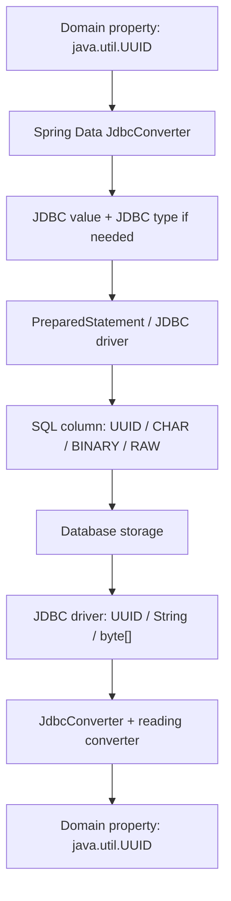

# UUIDs and Representation Differences Across JDBC Drivers

In Java, `java.util.UUID` always represents a 128-bit identifier. However, when persisting that value through **Spring Data JDBC**, the column type, JDBC type, and Java type returned by the driver can vary across PostgreSQL, H2, MySQL, SQL Server, and Oracle. Consequently, a Java `UUID` field does not automatically store identically on every database.

To use UUIDs reliably, you must determine three things: **how the database stores UUIDs**, **which Java types the JDBC driver accepts and returns**, and **which converter or JDBC type hint Spring Data JDBC requires**. This lesson moves from standard representations to configuration examples for each driver family, focusing on UUIDs as primary keys or aggregate properties.

## 1. What Does a UUID Look Like in Java?

A UUID (*Universally Unique Identifier*) is a 128-bit value, commonly displayed as five hexadecimal groups separated by hyphens:

```text
550e8400-e29b-41d4-a716-446655440000
```

The canonical string has **32 hexadecimal digits + 4 hyphens = 36 characters**. Common representations of the same value include:

| Representation | Size | Example / Meaning |
|---|---:|---|
| Java `UUID` | 128 bits | `new UUID(mostSignificantBits, leastSignificantBits)` |
| Canonical string | 36 chars | `550e8400-e29b-41d4-a716-446655440000` |
| Hex without hyphens | 32 chars | `550e8400e29b41d4a716446655440000` |
| Byte sequence | 16 bytes | The 16 octets of the same UUID value |
| Database native UUID column | Typically 16 bytes internally | Type name and JDBC rules depend on the DBMS |

Java creates and parses UUIDs with standard APIs:

```java
import java.util.UUID;

UUID id = UUID.randomUUID();

String canonical = id.toString();
UUID parsed = UUID.fromString(canonical);

long high = id.getMostSignificantBits();
long low = id.getLeastSignificantBits();

System.out.println(canonical);
System.out.println(parsed.equals(id)); // true
```

`UUID.randomUUID()` generates a version 4 UUID. A UUID is an **identifier**, not a password, access token, or authorization mechanism. Do not rely on UUID unpredictability to protect endpoints or data. If you need time-ordered UUIDs to improve index locality, evaluate UUID version 7 and generation/parsing support in your Java environment; do not alter byte ordering on your own without a shared convention.

## 2. Why Do JDBC Drivers Represent UUIDs Differently?

JDBC provides general APIs such as `PreparedStatement.setObject(...)`, `setString(...)`, `setBytes(...)`, `ResultSet.getObject(...)`, `getString(...)`, and `getBytes(...)`. However, JDBC does not define a universal `java.sql.Types.UUID` constant that every database/driver must use. One driver may represent UUIDs via `Types.OTHER`, while others use `CHAR`, `BINARY`, or `VARBINARY`.

Therefore, the exact same UUID column can yield different results when calling `getObject()`:

```text
Database column       JDBC metadata / driver result      Java value
--------------------------------------------------------------------------
PostgreSQL uuid       Types.OTHER                         java.util.UUID
H2 UUID               UUID type                           java.util.UUID
MySQL CHAR(36)        CHAR                                String
MySQL BINARY(16)      BINARY                              byte[]
SQL Server uniqueidentifier CHAR                           String
Oracle RAW(16)        RAW / VARBINARY                     byte[]
```

This table serves as a guide to vendor/driver mappings, not a promise that every driver version returns the exact same class across all `getObject` overloads. Some drivers support `getObject(column, UUID.class)` in newer versions even if `getObject(column)` by default still returns `String` or `byte[]`.

The mapping flow in Spring Data JDBC can be visualized as follows:



Spring Data JDBC supports types accepted by the database driver, along with types converted via custom converters. When a Java type is not accepted directly by the driver, we define **an explicit storage representation** using `JdbcCustomConversions`.

## 3. Common UUID Storage Types

### 3.1. Native UUID Column

PostgreSQL and H2 provide a dedicated `UUID` SQL type. Applications can use `java.util.UUID` directly if the corresponding driver supports binding/reading this type.

Advantages:

- The column conveys its exact UUID meaning rather than being an arbitrary string.
- The database can validate formatting and optimize comparisons/indexes for the dedicated type.
- No manual hyphen parsing or 16-byte conversion is needed in every SQL query.

Things to keep in mind: two databases having a native type does not mean they share the same JDBC type code. PostgreSQL pgJDBC registers `uuid` as `Types.OTHER` and maps it to `java.util.UUID`; H2 accepts `setObject(uuid)` and `getObject()` returns `java.util.UUID`. This is driver- and database-specific support.

### 3.2. Character Columns `CHAR(36)` or `VARCHAR(36)`

UUIDs are stored as canonical text:

```sql
CREATE TABLE account (
    id CHAR(36) PRIMARY KEY,
    email VARCHAR(255) NOT NULL
);
```

The advantage is readability in SQL clients, logs, and export files, along with broad cross-system compatibility. The drawback is higher storage and index overhead compared to a 16-byte representation; collation/casing rules can also affect comparisons if values are not normalized. With MySQL, you can choose an ASCII charset/collation suitable for UUID strings.

### 3.3. Binary Columns `BINARY(16)` or `VARBINARY(16)`

A UUID is exactly 16 bytes, so it can be stored directly in binary form:

```sql
CREATE TABLE account (
    id BINARY(16) PRIMARY KEY,
    email VARCHAR(255) NOT NULL
);
```

The advantage is compact storage and smaller index size compared to 36-character strings. On the downside, values are harder to inspect directly; code must standardize byte order when encoding/decoding. `BINARY(16)` is fixed-length, whereas `VARBINARY(16)` allows variable length; if choosing binary UUIDs, add constraints and checks to ensure values are always 16 bytes.

### 3.4. Oracle's `RAW(16)` Column

Oracle commonly stores 16-byte UUIDs in `RAW(16)`. The JDBC driver maps `RAW` to `byte[]`, so Java can use converters between `UUID` and `byte[]`. Oracle Database 26 also provides `UUID()`, `UUID_TO_RAW()`, and `RAW_TO_UUID()`; these functions operate on `RAW(16)` values and do not imply every Oracle version has a `UUID` SQL column type.

## 4. Typical Differences Across Drivers

| Database | Common SQL Type | Java Type Usually Provided by Driver | Notes |
|---|---|---|---|
| PostgreSQL | `UUID` | `java.util.UUID` | pgJDBC accepts UUID via `setObject` and recognizes PostgreSQL `uuid`; JDBC metadata uses `Types.OTHER` |
| H2 | `UUID` | `java.util.UUID` | H2 documentation specifies `setObject(uuid)` and `getObject()` returns `java.util.UUID` |
| MySQL | `CHAR(36)` / `BINARY(16)` | `String` / `byte[]` | MySQL lacks a native SQL UUID column type equivalent to PostgreSQL; Connector/J 9.4 added `getObject(column, UUID.class)` |
| SQL Server | `uniqueidentifier` | `String` by default mapping | Microsoft JDBC mapping documents `uniqueidentifier → CHAR → String`; use explicit converters if domain uses UUID |
| Oracle | `RAW(16)` or `CHAR(36)` | `byte[]` or `String` | Driver maps `RAW` to byte data; Oracle 26 provides UUID ↔ RAW conversion functions |

### PostgreSQL: Native UUID

PostgreSQL has a `uuid` column type and pgJDBC supports `java.util.UUID`. Example:

```sql
CREATE TABLE account (
    id UUID PRIMARY KEY,
    email VARCHAR(255) NOT NULL
);
```

In raw JDBC, the driver accepts `UUID` via `PreparedStatement.setObject(1, id)` and returns `java.util.UUID` from `ResultSet.getObject(...)`. In pgJDBC, PostgreSQL `uuid` is registered with JDBC type `OTHER` and Java class `java.util.UUID`. If a specific binding path requires specifying the JDBC type, `Types.OTHER`/`JDBCType.OTHER` can be used; normally there is no need to convert UUIDs to strings when the driver accepts them directly.

### H2: Native UUID

H2 also supports `UUID` columns:

```sql
CREATE TABLE account (
    id UUID PRIMARY KEY,
    email VARCHAR(255) NOT NULL
);
```

H2 documentation notes that you can write with `setObject(uuid)` (or `setBytes`/`setString`) and `ResultSet.getObject()` returns `java.util.UUID`. Thus H2 is often convenient for writing tests on UUID fields. However, passing tests on H2 does not prove code will behave identically on PostgreSQL, MySQL, or SQL Server; integration tests against the target database are required.

### MySQL: String or 16 Bytes

MySQL commonly uses `CHAR(36)` when readability is prioritized and `BINARY(16)` when storage/index size is prioritized. MySQL Connector/J maps `CHAR`/`VARCHAR` to `String` and `BINARY`/`VARBINARY` to `byte[]`. Connector/J **9.4.0** added support for calling `ResultSet.getObject(column, UUID.class)`; this does not turn `CHAR(36)` and `BINARY(16)` into a single SQL UUID type, and you should not assume every `getObject()` overload or `setObject(UUID)` behaves identically across versions.

With Spring Data JDBC, the clean approach is to register `UUID ↔ String` converters for `CHAR(36)`, or `UUID ↔ byte[]` converters for `BINARY(16)`. That way the domain continues using `UUID` while the driver works with simple storage types.

### SQL Server: `uniqueidentifier`

SQL Server has the 16-byte `uniqueidentifier` type. However, Microsoft JDBC Driver's default mapping documentation states:

```text
SQL Server type       JDBC type       Java type
uniqueidentifier      CHAR            String
```

Therefore, when the domain model uses `UUID`, convert to canonical strings when writing and parse strings when reading, or use driver-specific APIs after verifying your driver version. Verify both binding and reading; do not assume a SQL type named “uniqueidentifier” means the driver always returns `java.util.UUID`.

### Oracle: `RAW(16)`

Oracle JDBC maps `RAW` to `byte[]`. You can store UUIDs in `RAW(16)` and use binary converters as shown in the example below. On Oracle Database 26, `UUID_TO_RAW('...')` and `RAW_TO_UUID(raw_value)` assist with conversion in SQL. On older versions, use byte/string logic in the application or SQL compatible with that version; do not call 26 functions in migrations targeting older servers.

## 5. Which Representation Should Your Project Choose?

| Criterion | Native UUID | `CHAR(36)` | `BINARY(16)` / `RAW(16)` |
|---|---|---|---|
| Readability in SQL inspection | Quite good (depends on client rendering) | Best | Poor, usually requires hex formatting |
| Data size | Typically 16 bytes | 36 characters | 16 bytes |
| Driver support | Database and driver dependent | Broad, typically uses String | Broad, typically uses byte array |
| Spring Data JDBC converter | May not be needed if driver accepts `UUID` | UUID ↔ String | UUID ↔ byte[] |
| Portability across DBs | Must verify native type | High | High if byte order is clearly specified |

Selection guidelines:

- Use **PostgreSQL/H2 native UUID** if the target database supports it and the driver has been tested.
- Use **`CHAR(36)`** when readability, exports, and multi-system interoperability take priority.
- Use **`BINARY(16)`/`RAW(16)`** when compact storage matters and all applications agree on a single byte-order convention.
- Do not pick binary merely because it is “smaller” if the system frequently requires SQL debugging or multiple languages write data without a shared conversion standard.

## 6. Spring Data JDBC: Let the Driver Handle UUID or Register Converters?

`MappingJdbcConverter` converts entity properties into values JDBC can bind. According to Spring Data JDBC documentation, supported types include **any type accepted by the database driver**, as well as types with appropriate custom converters. Accordingly:

1. If the driver accepts `java.util.UUID` directly (such as pgJDBC with PostgreSQL `uuid` or H2 `UUID`), you can use a `UUID` field directly after verifying with integration tests.
2. If the driver returns `String` or `byte[]`, register bidirectional converters matching the column type.
3. If the JDBC type must be specified explicitly instead of letting Spring/driver infer it, the writing converter can return a `JdbcValue` supplying both the value and a `JDBCType`.

Converters operate at the **property level**: one Java property maps to one database value and back. Do not use these converters to split a UUID across multiple columns or construct complex relational structures.

### 6.1. Example Converters for `CHAR(36)`

The two converters below convert UUIDs to canonical strings and parse them back:

```java
import java.util.UUID;

import org.springframework.core.convert.converter.Converter;
import org.springframework.data.convert.ReadingConverter;
import org.springframework.data.convert.WritingConverter;

@WritingConverter
public final class UuidToStringConverter implements Converter<UUID, String> {
    @Override
    public String convert(UUID source) {
        return source.toString();
    }
}

@ReadingConverter
public final class StringToUuidConverter implements Converter<String, UUID> {
    @Override
    public UUID convert(String source) {
        return UUID.fromString(source);
    }
}
```

Register them via `AbstractJdbcConfiguration.userConverters()`:

```java
import java.util.List;

import org.springframework.context.annotation.Configuration;
import org.springframework.data.jdbc.repository.config.AbstractJdbcConfiguration;

@Configuration
public class MyJdbcConfiguration extends AbstractJdbcConfiguration {

    @Override
    protected List<?> userConverters() {
        return List.of(
                new UuidToStringConverter(),
                new StringToUuidConverter()
        );
    }
}
```

`@WritingConverter` and `@ReadingConverter` are essential because both `UUID` and `String` are simple types. They indicate the conversion direction so Spring does not infer the wrong direction. In modern Spring Data JDBC versions, add user converters via `userConverters()`; do not override `jdbcCustomConversions()` as in older guides if doing so drops dialect-registered converters.

### 6.2. Example Converters for `BINARY(16)`

A `UUID` consists of two 64-bit halves. To produce a deterministic 16-byte layout, the example below writes **most-significant bits first, least-significant bits second**, in `ByteBuffer`'s big-endian order:

```java
import java.nio.ByteBuffer;
import java.util.UUID;

import org.springframework.core.convert.converter.Converter;
import org.springframework.data.convert.ReadingConverter;
import org.springframework.data.convert.WritingConverter;

@WritingConverter
public final class UuidToBytesConverter implements Converter<UUID, byte[]> {
    @Override
    public byte[] convert(UUID source) {
        return ByteBuffer.allocate(16)
                .putLong(source.getMostSignificantBits())
                .putLong(source.getLeastSignificantBits())
                .array();
    }
}

@ReadingConverter
public final class BytesToUuidConverter implements Converter<byte[], UUID> {
    @Override
    public UUID convert(byte[] source) {
        if (source.length != 16) {
            throw new IllegalArgumentException("A UUID must contain exactly 16 bytes");
        }

        ByteBuffer buffer = ByteBuffer.wrap(source);
        return new UUID(buffer.getLong(), buffer.getLong());
    }
}
```

Register these two converters in `userConverters()` instead of the `UUID ↔ String` pair when the column is binary. Do not register multiple converters with the same `UUID` source type and different store target types simultaneously without a clear distinction rule; pick **one representation per schema**.

When you need to specify the JDBC type while writing, Spring Data JDBC provides `JdbcValue`:

```java
import java.nio.ByteBuffer;
import java.sql.JDBCType;
import java.util.UUID;

import org.springframework.core.convert.converter.Converter;
import org.springframework.data.convert.WritingConverter;
import org.springframework.data.jdbc.core.mapping.JdbcValue;

@WritingConverter
public final class UuidToBinaryJdbcValueConverter
        implements Converter<UUID, JdbcValue> {

    @Override
    public JdbcValue convert(UUID source) {
        byte[] bytes = ByteBuffer.allocate(16)
                .putLong(source.getMostSignificantBits())
                .putLong(source.getLeastSignificantBits())
                .array();

        return JdbcValue.of(bytes, JDBCType.BINARY);
    }
}
```

`JdbcValue.of(value, JDBCType.BINARY)` instructs Spring to bind the value as JDBC type `BINARY`. Only use this hint when it matches your specific driver and schema; Oracle `RAW`, `VARBINARY`, and `BINARY` may require different JDBC types. If the driver already infers properly from `byte[]`, a converter returning `byte[]` directly is usually simpler.

### 6.3. Converter for PostgreSQL When a Type Hint Is Needed

With pgJDBC, `java.util.UUID` is recognized by the driver as PostgreSQL `uuid`, corresponding to JDBC `Types.OTHER`. In cases where you need to force the JDBC type explicitly, you can return `JdbcValue`:

```java
import java.sql.JDBCType;
import java.util.UUID;

import org.springframework.core.convert.converter.Converter;
import org.springframework.data.convert.WritingConverter;
import org.springframework.data.jdbc.core.mapping.JdbcValue;

@WritingConverter
public final class UuidToPostgresValueConverter
        implements Converter<UUID, JdbcValue> {
    @Override
    public JdbcValue convert(UUID source) {
        return JdbcValue.of(source, JDBCType.OTHER);
    }
}
```

This is an option **when** a type hint is needed; if the default configuration already binds UUIDs correctly, do not add a converter just for extra code.

## 7. Using UUID as a Primary Key in Spring Data JDBC

Example of an aggregate root that generates its UUID in the application before saving:

```java
import java.util.UUID;

import org.springframework.data.annotation.Id;
import org.springframework.data.annotation.Version;
import org.springframework.data.relational.core.mapping.Table;

@Table("account")
public class Account {

    @Id
    private UUID id;

    @Version
    private Long version;

    private String email;

    protected Account() {}

    public Account(String email) {
        this.id = UUID.randomUUID();
        this.email = email;
    }

    public UUID getId() { return id; }
    public String getEmail() { return email; }
}
```

```java
public interface AccountRepository extends CrudRepository<Account, UUID> {}
```

Important point: if the UUID is already assigned before calling `save()`, `id` is no longer `null`. By default, Spring Data uses the ID to detect new entities; a non-null ID may be treated as an existing entity. When a wrapper `@Version` property such as `Long` is present, a `null` version marks the entity as new. Spring Data JDBC can then insert the application-generated UUID and increment the version after insert. Another option is implementing `Persistable` with `isNew()` managed across its lifecycle.

Therefore, **do not simply assign a UUID in the constructor and ignore entity state detection**. Without `@Version` or `Persistable`, `save()` may take the update path and fail because the row does not exist yet.

With PostgreSQL, the corresponding schema is:

```sql
CREATE TABLE account (
    id UUID PRIMARY KEY,
    version BIGINT NOT NULL,
    email VARCHAR(255) NOT NULL
);
```

With MySQL `CHAR(36)`:

```sql
CREATE TABLE account (
    id CHAR(36) NOT NULL PRIMARY KEY,
    version BIGINT NOT NULL,
    email VARCHAR(255) NOT NULL
);
```

On MySQL, the `UUID ↔ String` converters make the `UUID id` field compatible with the `CHAR(36)` column. With `BINARY(16)`, use binary converters and the matching schema. The domain class can stay unchanged, swapping only the persistence configuration per database.

## 8. MySQL `UUID_TO_BIN` and Byte Order

MySQL provides `UUID_TO_BIN()` and `BIN_TO_UUID()` to convert between UUID strings and 16 bytes. Both functions accept a `swap_flag` parameter:

```sql
SET @id = '6ccd780c-baba-1026-9564-5b8c656024db';

SELECT HEX(UUID_TO_BIN(@id, 0));
-- 6CCD780CBABA102695645B8C656024DB

SELECT HEX(UUID_TO_BIN(@id, 1));
-- 1026BABA6CCD780C95645B8C656024DB
```

With `swap_flag = 1`, MySQL rearranges the time-low/time-high parts of version 1 UUIDs to improve index locality when applicable. MySQL docs state that this rearrangement assumes UUID v1; for UUIDs generated by other schemes, time-part swapping does not yield that benefit. Do not enable `swap_flag = 1` out of habit for all UUIDs.

It is mandatory that **reads and writes follow the same convention**:

```sql
-- If not swapped on write, do not swap on read
INSERT INTO account(id) VALUES (UUID_TO_BIN(:uuid, 0));
SELECT BIN_TO_UUID(id, 0) FROM account;

-- If a legacy schema used swap=1, both sides must use 1
INSERT INTO account(id) VALUES (UUID_TO_BIN(:uuid, 1));
SELECT BIN_TO_UUID(id, 1) FROM account;
```

The Java `ByteBuffer` example above produces bytes in canonical order (unswapped). If the application writes `byte[]` directly to `BINARY(16)`, do not mix it with data generated via `UUID_TO_BIN(uuid, 1)` without proper byte-order conversion. When using SQL functions, you can pass the domain UUID as a string parameter to custom SQL; when using repository mapping, the converter must reconstruct the exact byte order chosen by the schema.

## 9. UUIDs in SQL Server and Oracle

### SQL Server

Example schema:

```sql
CREATE TABLE account (
    id UNIQUEIDENTIFIER NOT NULL PRIMARY KEY,
    email NVARCHAR(255) NOT NULL
);
```

When Spring Data JDBC works through Microsoft JDBC Driver with default `uniqueidentifier → String` mapping, a UUID/String converter pair is easy to control. When using raw JDBC, you can bind the canonical string using `setString()` into a `uniqueidentifier` parameter; test against the exact version of Microsoft JDBC Driver and SQL Server you deploy. The driver also offers proprietary APIs such as `setUniqueIdentifier(...)` in some versions, though that is a vendor-specific extension.

### Oracle

Example schema:

```sql
CREATE TABLE account (
    id RAW(16) PRIMARY KEY,
    email VARCHAR2(255) NOT NULL
);
```

With `RAW(16)`, a UUID/byte[] converter is the natural choice because Oracle JDBC returns `RAW` data as byte arrays. Oracle Database 26 can inspect/format with:

```sql
SELECT RAW_TO_UUID(id) FROM account;
SELECT UUID_TO_RAW('550e8400-e29b-41d4-a716-446655440000') FROM dual;
```

For older Oracle versions, verify server and driver support; do not use the newer UUID functions if the server lacks them. Also verify the JDBC type hint corresponding to `RAW` in your driver, as `RAW` is exposed through JDBC binary type mappings.

## 10. Testing Binding and Round-Trips with the Right Driver

A solid test must verify **write UUID → read UUID back → compare with equals**. Do not merely inspect printed strings or rely solely on H2 when production uses another database.

Raw JDBC example for drivers supporting `UUID` directly, such as PostgreSQL/H2:

```java
UUID expected = UUID.randomUUID();

try (PreparedStatement ps = connection.prepareStatement(
        "INSERT INTO account(id, email) VALUES (?, ?)")) {
    ps.setObject(1, expected);
    ps.setString(2, "demo@example.com");
    ps.executeUpdate();
}

try (PreparedStatement ps = connection.prepareStatement(
        "SELECT id FROM account WHERE id = ?")) {
    ps.setObject(1, expected);

    try (ResultSet rs = ps.executeQuery()) {
        if (!rs.next()) {
            throw new IllegalStateException("UUID row was not found");
        }

        UUID actual = rs.getObject("id", UUID.class);
        if (!expected.equals(actual)) {
            throw new IllegalStateException("UUID round-trip mismatch");
        }
    }
}
```

The snippet above illustrates drivers supporting the UUID type and typed JDBC getters. For MySQL `CHAR(36)` / SQL Server `uniqueidentifier`, use `setString()`/`getString()` or custom converters. For `BINARY(16)` / Oracle `RAW(16)`, use `setBytes()`/`getBytes()` and enforce exactly 16 bytes. Do not copy PostgreSQL-specific JDBC calls verbatim to every database.

In Spring Data JDBC, write integration tests using the repository:

```java
@DataJdbcTest
class AccountRepositoryTest {

    @Autowired AccountRepository repository;

    @Test
    void savesAndLoadsUuid() {
        Account saved = repository.save(new Account("demo@example.com"));

        Account loaded = repository.findById(saved.getId()).orElseThrow();

        assertThat(loaded.getId()).isEqualTo(saved.getId());
    }
}
```

Run tests against the **target database and driver**. When using Testcontainers, select an image matching the production engine version and let the application load the same JDBC driver as production. These tests catch converter, JDBC type, schema, entity state detection, and generated-ID/round-trip bugs.

## 11. Common Errors

| Error / Symptom | Possible Cause | Resolution |
|---|---|---|
| `Can't infer the SQL type to use for an instance of java.util.UUID` | Driver does not know how to bind UUID objects directly | Convert to `String`/`byte[]` via converter; or specify `JdbcValue` with appropriate JDBC type |
| `ConversionFailedException` between `String` and `UUID` | Missing read/write converter, malformed string data, or converter not registered | Check `@ReadingConverter`, `@WritingConverter`, `userConverters()`, and actual data |
| `Data truncation` or wrong binary length | Column/parameter is not 16 bytes, or converter produces wrong byte count | Use `BINARY(16)`/`VARBINARY(16)` and assert `bytes.length == 16` |
| Read UUID differs from written value | Sides use different byte orders or swap flags | Standardize on canonical byte order and `UUID_TO_BIN`/`BIN_TO_UUID` flags |
| Works on H2 but fails on MySQL/SQL Server | H2 uses native UUID while other drivers have separate mappings | Test with the actual production database, driver, and schema |
| `save()` tries to update a nonexistent row | UUID is already populated so entity defaults to existing | Use a nullable `@Version` wrapper, or implement `Persistable.isNew()` properly |
| SQL Server returns `String` instead of UUID | Microsoft JDBC Driver defaults `uniqueidentifier` to `CHAR/String` | Register UUID ↔ String converters or use a verified driver API |
| Oracle returns `byte[]` instead of UUID | `RAW(16)` is mapped by driver as binary | Register UUID ↔ byte[] converters and verify JDBC type hints |
| UUID strings differ in letter case | Clients normalize differently or collations differ | Use `UUID.toString()` for canonical writes, parse and compare as UUID values |

## 12. Project Decision Checklist

Before implementing UUIDs, explicitly document these choices in your design/schema:

1. **Domain type:** use `java.util.UUID` or a value object wrapping UUID?
2. **Generation:** application-generated (`UUID.randomUUID()` or another UUID version generator) or database-generated?
3. **SQL column:** `UUID`, `CHAR(36)`, `BINARY(16)`, `uniqueidentifier`, or `RAW(16)`?
4. **JDBC mapping:** does the driver bind/read `UUID`, `String`, or `byte[]`? What is the JDBC type code?
5. **Spring conversion:** does the driver support it natively, or is a `@WritingConverter`/`@ReadingConverter` pair needed?
6. **Binary layout:** what is the byte order? Is MySQL `swap_flag` used? Do all applications follow the same convention?
7. **Entity state:** if UUID is assigned before save, does `@Version` or `Persistable` accurately detect new entities?
8. **Round-trip test:** have tests run against the exact production engine, driver, schema, and version?

When switching databases, do not only swap the JDBC URL and driver. Inspect DDL, converters, byte order, SQL queries, existing data, and migration tests. If multiple services or languages read a binary column, document the 16-byte layout as part of the data contract.

## Official References

- [Spring Data JDBC — Mapping and supported types](https://docs.spring.io/spring-data/relational/reference/jdbc/mapping.html): driver-accepted types, custom conversions, `JdbcValue`, and `userConverters()`.
- [Spring Data JDBC — Persisting Entities](https://docs.spring.io/spring-data/relational/reference/jdbc/entity-persistence.html): IDs and saving entities.
- [Spring Data — Entity State Detection](https://docs.spring.io/spring-data/relational/reference/data-commons/is-new-state-detection.html): detecting new entities via `@Id`, `@Version`, or `Persistable`.
- [pgJDBC Documentation](https://jdbc.postgresql.org/documentation/): PostgreSQL JDBC driver.
- [pgJDBC `PgConnection` source](https://github.com/pgjdbc/pgjdbc/blob/master/pgjdbc/src/main/java/org/postgresql/jdbc/PgConnection.java): registration of PostgreSQL `uuid` as `Types.OTHER` and `java.util.UUID`.
- [H2 — Data Types: UUID](https://h2database.com/html/datatypes.html): binding and reading UUID via JDBC.
- [MySQL Connector/J — Java, JDBC, and MySQL Types](https://dev.mysql.com/doc/connector-j/en/connector-j-reference-type-conversions.html): mapping between MySQL, JDBC, and Java types.
- [MySQL Connector/J Release Notes](https://downloads.mysql.com/docs/connector-j-relnotes-en.a4.pdf): support for `getObject(column, UUID.class)` starting in Connector/J 9.4.0.
- [MySQL 8.4 — UUID_TO_BIN and BIN_TO_UUID](https://dev.mysql.com/doc/refman/8.4/en/miscellaneous-functions.html): byte layout and `swap_flag`.
- [Microsoft JDBC Driver — Basic Data Types](https://learn.microsoft.com/en-us/sql/connect/jdbc/using-basic-data-types?view=sql-server-ver17): mapping `uniqueidentifier` to JDBC `CHAR` / Java `String`.
- [Oracle Database 26 — UUID_TO_RAW](https://docs.oracle.com/en/database/oracle/oracle-database/26/sqlrf/uuid_to_raw.html): converting UUID strings to `RAW(16)`.
- [Oracle JDBC — JDBC Reference Information](https://docs.oracle.com/en/database/oracle/oracle-database/26/jjdbc/JDBC-reference-information.html): mapping SQL `RAW` and Java `byte[]`.
