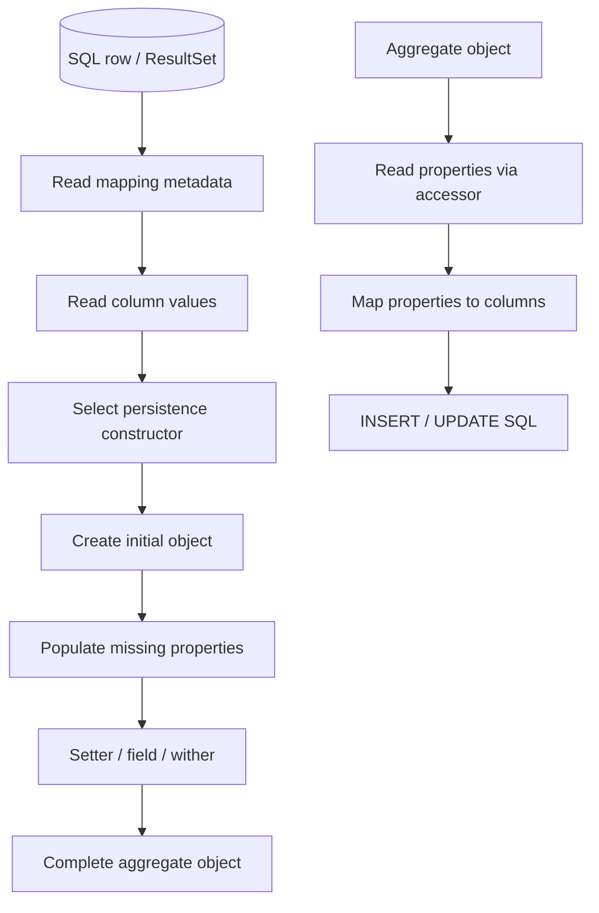

# Mapping Fields, Constructors, Setters, and Wither Methods

In **Spring Data Relational JDBC**, Spring must transform data between two forms: rows in SQL tables and Java objects. When reading, the framework constructs objects from column values; when writing, the framework reads object properties to generate SQL statements. This process is known as **object mapping** or **object materialization**.

Four Java mechanisms strongly influence that process:

- **Field:** where data is actually stored inside the object.
- **Constructor:** how the initial instance is created from read values.
- **Setter:** how a property is updated after the object has been created.
- **Wither:** a method returning a new instance with one property changed, suitable for immutable objects.

Understanding all four mechanisms helps you choose a maintainable domain model, handle database-generated IDs properly, and prevent errors when Spring Data JDBC reconstructs objects from a `ResultSet`. This lesson places these mechanisms in the context of **Object Creation** in Spring Data Relational JDBC.

## 1. How Does Object Mapping Work?

Spring Data JDBC uses metadata to know which class is an aggregate root, which properties need persistence, the corresponding table/column names, and how to instantiate objects. Metadata is built from the Java structure, Spring Data annotations, and the naming strategy.



When reading data, the high-level process is:

1. Spring Data JDBC determines mapping metadata for the domain type.
2. Column names from SQL results are matched to persistent properties.
3. Properties that can be passed to the constructor are used to instantiate the object.
4. Properties not assigned in the constructor are populated afterward via the appropriate access mechanism.
5. The fully constructed object is returned to the repository caller.

When writing data, Spring Data JDBC reads values from the object via property accessors and generates the necessary SQL statements. Property access affects how the framework retrieves values; constructors and withers affect how instances are created, especially when database-generated IDs are involved.

**Spring Data JDBC is not JPA.** It does not use a JPA persistence context, dirty checking, or lifecycle callbacks to automatically track object changes. You call the repository to save an aggregate; the framework uses metadata and JDBC to execute the save operation.

## 2. Fields and Persistent Properties

A Java class typically has fields and accessor methods:

```java
public class Customer {
    private String displayName;

    public String getDisplayName() {
        return displayName;
    }

    public void setDisplayName(String displayName) {
        this.displayName = displayName;
    }
}
```

- `displayName` is the **field** storing the value.
- `getDisplayName()` and `setDisplayName(...)` are JavaBean methods.
- In Spring Data's object mapping model, a property is a metadata element representing a persistent value. A property can be read/written via a field or via getter/setter depending on the access strategy.

### 2.1. Field Access

Spring Data can typically access fields directly via reflection, so entities are not required to have setters for every property. Example:

```java
import org.springframework.data.annotation.Id;
import org.springframework.data.relational.core.mapping.Table;

@Table("customers")
public class Customer {

    @Id
    private Long id;

    private String displayName;

    protected Customer() {
    }

    public Customer(String displayName) {
        this.displayName = displayName;
    }

    public Long getId() {
        return id;
    }

    public String getDisplayName() {
        return displayName;
    }
}
```

The class above has no setters for `id` or `displayName`, yet Spring Data JDBC can still map them through constructors and field access. This is a useful design pattern when you want to restrict external modification to a class.

Field access does not mean you should make fields public. Keep fields `private`, expose business behavior, and allow only the framework to access them according to mapping metadata.

### 2.2. Property Access

If you want Spring Data to read/write via JavaBean properties rather than direct field access, you can use `@AccessType`:

```java
import org.springframework.data.annotation.AccessType;
import org.springframework.data.annotation.Id;
import org.springframework.data.relational.core.mapping.Table;

@AccessType(AccessType.Type.PROPERTY)
@Table("customers")
public class Customer {

    private Long id;
    private String displayName;

    protected Customer() {
    }

    public Customer(String displayName) {
        this.displayName = displayName;
    }

    @Id
    public Long getId() {
        return id;
    }

    public void setId(Long id) {
        this.id = id;
    }

    public String getDisplayName() {
        return displayName;
    }

    public void setDisplayName(String displayName) {
        this.displayName = displayName;
    }
}
```

`@AccessType(AccessType.Type.PROPERTY)` is a Spring Data annotation in package `org.springframework.data.annotation`. It directs mapping to use property access. When choosing this approach, make sure suitable getters/setters exist and behave properly.

You can also place the access type at the property level when adjusting a specific property. Check annotation placement and access type rules of the Spring Data version in use if the class has a complex structure.

### 2.3. Do Not Confuse Fields with Database Columns

Java field names do not have to match column names. Spring Data Relational applies a naming strategy, and you can override it using `@Column`:

```java
import org.springframework.data.relational.core.mapping.Column;

@Column("display_name")
private String displayName;
```

For property `displayName`, the default naming strategy usually derives column `display_name`. Explicit annotation is useful when the schema already has specific names or when you want mapping independent of automatic conventions.

`@Column` here must be `org.springframework.data.relational.core.mapping.Column`. JPA's `jakarta.persistence.Column` annotation is not the corresponding mapping metadata for Spring Data JDBC.

### 2.4. Which Properties Are Persistent?

An ordinary property can be treated as persistent if Spring Data mapping metadata recognizes it and it is not excluded. Some properties may need to be ignored:

```java
import org.springframework.data.annotation.Transient;

@Table("products")
public class Product {

    @Id
    private Long id;

    private long priceCents;

    @Transient
    private String formattedPrice;
}
```

`formattedPrice` is computed data, not a stored column. The right annotation is `org.springframework.data.annotation.Transient`. Do not use `jakarta.persistence.Transient` expecting Spring Data JDBC to interpret the same metadata.

When designing objects, clearly distinguish:

- **Persistent property:** needs to be read/written from the database.
- **Transient/computed property:** calculated from other values or only used for display.
- **Constructor-only input:** a parameter used to construct the object that is not necessarily a stored property; mapping must be designed appropriately so the framework does not fail looking for a corresponding column when reading.

## 3. Constructor: How Spring Data Creates Objects

When Spring Data JDBC reads a data row, it needs an instance to populate with values. The chosen constructor is called the **persistence constructor**.

Spring Data has constructor selection conventions, among which common cases are:

1. If the class has a single suitable constructor, Spring Data usually uses that constructor.
2. If there are multiple constructors, the constructor or factory method to use can be marked with `@PersistenceCreator`.
3. If no constructor is designated and the class has a suitable no-arg constructor, the framework may instantiate the object first and then populate the remaining properties.
4. Java records have a canonical constructor, well suited for immutable models.
5. Constructor parameters must match persistent properties so Spring Data knows which value goes into which parameter.

Avoid defining multiple constructors simultaneously without clarifying which one is for persistence. Doing so makes object restoration confusing or causes failures when mapping metadata cannot determine how to instantiate the class.

### 3.1. No-Arg Constructor

Simple model:

```java
@Table("customers")
public class Customer {

    @Id
    private Long id;

    private String displayName;

    protected Customer() {
        // For object mapping.
    }

    public Customer(String displayName) {
        this.displayName = displayName;
    }

    public Long getId() {
        return id;
    }

    public String getDisplayName() {
        return displayName;
    }
}
```

Spring Data can invoke the no-arg constructor to create an instance, then populate the ID and display name via field/property access. This constructor is often kept `protected` to discourage business code from creating incomplete objects.

Not every class is required to have a no-arg constructor. If you choose constructor-based materialization, you can use a constructor containing the needed properties and omit the no-arg constructor.

### 3.2. Full Constructor

```java
import org.springframework.data.annotation.Id;
import org.springframework.data.relational.core.mapping.Table;

@Table("customers")
public class Customer {

    @Id
    private final Long id;

    private final String displayName;
    private final String email;

    public Customer(Long id, String displayName, String email) {
        this.id = id;
        this.displayName = displayName;
        this.email = email;
    }

    public Long getId() {
        return id;
    }

    public String getDisplayName() {
        return displayName;
    }

    public String getEmail() {
        return email;
    }
}
```

The constructor accepts all persistent properties needed for initialization. When a query returns a row with `id`, `display_name`, and `email`, Spring Data maps them into the corresponding parameters.

A single constructor is usually a clear choice. With multiple constructors, mark the persistence constructor explicitly rather than relying on guesswork.

### 3.3. `@PersistenceCreator` When Multiple Constructors Exist

```java
import org.springframework.data.annotation.Id;
import org.springframework.data.annotation.PersistenceCreator;
import org.springframework.data.relational.core.mapping.Table;

@Table("customers")
public class Customer {

    @Id
    private final Long id;

    private final String displayName;
    private final String email;

    @PersistenceCreator
    public Customer(Long id, String displayName, String email) {
        this.id = id;
        this.displayName = displayName;
        this.email = email;
    }

    public Customer(String displayName) {
        this(null, displayName, null);
    }

    public Long getId() {
        return id;
    }

    public String getDisplayName() {
        return displayName;
    }

    public String getEmail() {
        return email;
    }
}
```

The constructor annotated with `@PersistenceCreator` is the one Spring Data uses to restore objects. The shorter constructor is for business code creating new objects.

The annotation must be imported from `org.springframework.data.annotation.PersistenceCreator`. It is not a JPA annotation and does not replace JPA mapping rules.

If using a static factory method for persistence, Spring Data can also support an appropriately annotated factory. Whether choosing a constructor or a factory, ensure all parameters can be mapped from persistent properties.

### 3.4. Constructor Parameter Names Must Match Properties

Example:

```java
public Customer(Long id, String displayName, String email) {
    // ...
}
```

Spring Data needs to know that parameter `displayName` corresponds to property `displayName`. In Java, parameter names at runtime must be retained via the `-parameters` compiler option or an appropriate parameter-name metadata mechanism. If parameter names are stripped, Spring Data may fail to resolve the corresponding properties.

In Gradle, the Java compiler can be configured as follows:

```gradle
tasks.withType(JavaCompile).configureEach {
    options.compilerArgs.add("-parameters")
}
```

Spring Boot/Gradle projects may already configure this depending on plugins and versions. Check your build configuration before re-adding it. Do not arbitrarily name constructor parameters differently from persistent properties.

With Java records, component names are explicitly preserved in the canonical constructor, making constructor mapping convenient:

```java
@Table("customers")
public record Customer(
        @Id Long id,
        String displayName,
        String email
) {
}
```

Records are immutable and have no setters. Spring Data can use the canonical constructor to restore the record from data.

### 3.5. Constructors Should Reflect Valid State

A constructor is a good place to enforce domain invariants:

```java
@Table("products")
public class Product {

    @Id
    private final Long id;

    private final String name;
    private final long priceCents;

    @PersistenceCreator
    public Product(Long id, String name, long priceCents) {
        if (name == null || name.isBlank()) {
            throw new IllegalArgumentException("Product name is required");
        }
        if (priceCents < 0) {
            throw new IllegalArgumentException("Price must not be negative");
        }

        this.id = id;
        this.name = name;
        this.priceCents = priceCents;
    }

    public Product(String name, long priceCents) {
        this(null, name, priceCents);
    }
}
```

Keep in mind that constructor validation can also run when the object is restored from the DB. If legacy data no longer satisfies new invariants, reading data may fail. That is why schema migrations and domain rules must be managed together.

## 4. Setter: Updating Properties After Object Creation

A setter is a JavaBean method of the form `setProperty(value)`. When Spring Data uses a constructor to instantiate an object and a property was not provided via the constructor, a setter can be used to populate that property if the access strategy allows it.

Example:

```java
@Table("customers")
public class Customer {

    @Id
    private Long id;

    private String displayName;

    protected Customer() {
    }

    public Customer(String displayName) {
        this.displayName = displayName;
    }

    public Long getId() {
        return id;
    }

    public void setId(Long id) {
        this.id = id;
    }

    public String getDisplayName() {
        return displayName;
    }

    public void setDisplayName(String displayName) {
        this.displayName = displayName;
    }
}
```

In this model, Spring Data can instantiate the object and then populate properties. Setters are useful when a class needs to allow post-creation property updates.

However, public setters for every field are not always good domain design. They allow external code to put the object into an invalid state:

```java
customer.setDisplayName(null);
```

If customer name is mandatory, the setter needs validation or you should expose a clearly named business method:

```java
public void rename(String newName) {
    if (newName == null || newName.isBlank()) {
        throw new IllegalArgumentException("Name is required");
    }
    this.displayName = newName;
}
```

The business method `rename` is not automatically treated as a mapping setter; it serves domain changes in the application. Distinguish business APIs from Spring Data property population mechanisms.

### 4.1. Combining Constructors and Setters

You can use a constructor for mandatory properties and setters for remaining properties:

```java
@Table("customers")
public class Customer {

    @Id
    private Long id;

    private final String displayName;
    private String phoneNumber;

    @PersistenceCreator
    public Customer(String displayName) {
        this.displayName = displayName;
    }

    public Long getId() {
        return id;
    }

    public void setId(Long id) {
        this.id = id;
    }

    public String getDisplayName() {
        return displayName;
    }

    public String getPhoneNumber() {
        return phoneNumber;
    }

    public void setPhoneNumber(String phoneNumber) {
        this.phoneNumber = phoneNumber;
    }
}
```

This example should be understood according to the specific mapping metadata: the constructor receives `displayName`; properties such as `id` and `phoneNumber` are populated afterward through the appropriate property/field access mechanism. For an immutable ID or different access strategies, Spring Data may require a way to create a new instance such as a wither. If a constructor omits a property that could be required by the schema, ensure the property can be populated validly.

### 4.2. Setters Can Validate, But Must Not Cause Side Effects

Setters are called during the object mapping phase. Therefore, avoid putting tasks other than property assignment inside setters, such as:

- Calling another repository.
- Sending emails or publishing business events.
- Calling HTTP services.
- Starting nested transactions or running extra SQL.
- Relying on all other properties already being populated.

Property population order must not become part of business logic. If one setter depends on another setter having run first, the object may be constructed in an unexpected state.

If whole-object invariant checks are needed, a full constructor or an explicit domain factory step is usually better suited. If post-read processing is needed, consider Spring Data's appropriate callbacks/events and do not confuse them with JPA lifecycle hooks.

## 5. Wither: Changing a Property by Creating a New Object

A **wither** is a method that returns a new instance of the same type with one property changed to a new value. The common naming convention is `with<Property>(...)`.

Immutable object example:

```java
@Table("customers")
public class Customer {

    @Id
    private final Long id;

    private final String displayName;

    public Customer(Long id, String displayName) {
        this.id = id;
        this.displayName = displayName;
    }

    public Customer withId(Long id) {
        return new Customer(id, this.displayName);
    }

    public Long getId() {
        return id;
    }

    public String getDisplayName() {
        return displayName;
    }
}
```

When the application creates a new object with `id == null` and the database generates an ID after insert, Spring Data JDBC needs to represent the saved aggregate with the new ID. On an immutable object, the framework cannot directly execute `this.id = generatedId`. A wither allows creating a different object:

```java
Customer unsaved = new Customer(null, "Linh");
Customer saved = customerRepository.save(unsaved);

// saved may be a new instance containing the database-generated ID.
// Use saved.getId(); do not assume unsaved was mutated.
Long id = saved.getId();
```

A wither does not modify the original object. It creates a new instance with the updated property.

### 5.1. Rules for Writing a Correct Wither

A wither should:

1. Return the same domain type.
2. Preserve all other properties unchanged.
3. Replace only the requested property.
4. Perform no I/O or side effects.
5. Create a new instance instead of mutating fields on the current instance.

Example with multiple properties:

```java
public class Customer {

    @Id
    private final Long id;

    private final String displayName;
    private final String email;

    public Customer(Long id, String displayName, String email) {
        this.id = id;
        this.displayName = displayName;
        this.email = email;
    }

    public Customer withId(Long id) {
        return new Customer(id, displayName, email);
    }

    public Customer withEmail(String email) {
        return new Customer(id, displayName, email);
    }
}
```

If `withId` forgets to preserve `email`, the object produced when the framework calls the wither may lose data. Therefore, a wither must copy all remaining immutable properties faithfully.

### 5.2. Withers and Generated IDs

Aggregate root example:

```java
@Table("orders")
public class Order {

    @Id
    private final Long id;

    private final String orderCode;

    public Order(Long id, String orderCode) {
        this.id = id;
        this.orderCode = orderCode;
    }

    public Order withId(Long id) {
        return new Order(id, orderCode);
    }

    public Long getId() {
        return id;
    }

    public String getOrderCode() {
        return orderCode;
    }
}
```

When saving:

```java
Order draft = new Order(null, "ORD-2026-001");
Order persisted = orderRepository.save(draft);

System.out.println(draft.getId());     // Still null on the original immutable object.
System.out.println(persisted.getId()); // Database ID on the returned object.
```

Do not ignore the return value of `save`. With mutable objects, the framework may populate the ID on the same instance depending on the access strategy; with immutable objects, it can create a new instance via a wither or constructor/property population mechanism. The safe approach is always to use the object returned by the repository.

### 5.3. Withers Are Not Setters

| Setter | Wither |
|---|---|
| Usually mutates the current instance | Returns a new instance |
| Usually returns `void` | Returns an object of the same type |
| Suited for mutable objects | Suited for immutable objects |
| Example: `setId(id)` | Example: `withId(id)` |
| Can cause shared objects to change unexpectedly | Leaves the old object unchanged |

A method named `withId` that mutates a field and returns `this` is not a wither in the immutable sense. If you choose the wither pattern, preserve clear copy semantics.

## 6. Property Population Order and Choosing an Access Mechanism

Spring Data object mapping coordinates constructors, withers, setters, and field access. You can picture the general selection sequence for a property that needs to be populated:

1. If the property is included in the persistence constructor, the value is passed during object creation.
2. If the property needs to be changed on an immutable object and a suitable wither exists, Spring Data can use the wither to create a new instance.
3. If a suitable setter exists and the access strategy uses property access, the setter may be invoked.
4. If mapping uses field access, Spring Data can assign the field directly using reflection.
5. For immutable objects lacking a suitable setter/wither, the framework needs a constructor strategy that allows reconstructing the object with the required values.

This is a high-level mental model for choosing a design; exact details depend on mapping metadata, access type, and Spring Data version. Do not write business logic assuming a particular setter will always run.

### 6.1. Constructor Receiving Properties vs. Setters Populating Properties?

Example A: all properties in the constructor:

```java
public Customer(Long id, String displayName, String email) {
    this.id = id;
    this.displayName = displayName;
    this.email = email;
}
```

Example B: constructor takes mandatory properties, remaining properties populated afterward:

```java
public Customer(String displayName) {
    this.displayName = displayName;
}

public void setEmail(String email) {
    this.email = email;
}
```

Both can be valid designs as long as Spring Data knows how to construct the object and property mapping is consistent. Constructor-based mapping makes mandatory data explicit; setter/field population keeps constructor APIs shorter. For immutable domains, a full constructor or wither is usually more natural.

### 6.2. Optimizing Object Instantiation and Property Access

Spring Data may use generated instantiator/property accessor mechanisms to reduce reflection overhead when creating objects and reading/writing properties. Those optimizations are implementation details; applications should prioritize clear models and adhere to mapping rules.

Certain cases can reduce optimization eligibility, such as classes/constructors that do not meet accessibility requirements, non-static nested classes, or unsuitable visibility. Do not design your domain around instantiator optimizations; use simple, understandable constructors and access patterns.

## 7. Java Records and Immutable Aggregates

Java records are a convenient choice when objects have immutable data and a clear canonical constructor:

```java
import org.springframework.data.annotation.Id;
import org.springframework.data.relational.core.mapping.Table;

@Table("products")
public record Product(
        @Id Long id,
        String sku,
        String name,
        long priceCents
) {
    public Product {
        if (sku == null || sku.isBlank()) {
            throw new IllegalArgumentException("SKU is required");
        }
        if (priceCents < 0) {
            throw new IllegalArgumentException("Price must not be negative");
        }
    }
}
```

Records have no setters; components are final. Spring Data can use the canonical constructor to restore data. When an ID is generated by the database, the object returned from the repository can be a new record instance holding that ID.

An explicit wither for a record can be written as:

```java
public record Product(
        @Id Long id,
        String sku,
        String name,
        long priceCents
) {
    public Product withId(Long newId) {
        return new Product(newId, sku, name, priceCents);
    }
}
```

With records, each wither must construct a new record passing all components again. If a record has many components, consider helpers or factories to avoid forgetting to copy a property.

Records fit value objects or aggregates with simple state. For aggregates containing collections that change frequently in business logic, immutable classes may require copying collections and root objects on every add/remove; weigh that complexity rather than choosing immutability purely for style.

## 8. Auto-Generated IDs and How Spring Data Updates Objects

A critical scenario in Spring Data JDBC is inserting an aggregate that does not yet have an ID. Example:

```java
@Table("products")
public class Product {

    @Id
    private Long id;

    private String name;

    protected Product() {
    }

    public Product(String name) {
        this.name = name;
    }
}
```

Schema:

```sql
CREATE TABLE products (
    id BIGINT GENERATED BY DEFAULT AS IDENTITY PRIMARY KEY,
    name VARCHAR(160) NOT NULL
);
```

Repository:

```java
public interface ProductRepository
        extends CrudRepository<Product, Long> {
}
```

Service:

```java
Product draft = new Product("Keyboard");
Product saved = productRepository.save(draft);
Long generatedId = saved.getId();
```

The insert process can proceed as follows:

1. Spring Data determines the object is new according to entity newness rules, typically based on ID (and version if present).
2. The repository requests a JDBC insert.
3. The database generates the ID.
4. The JDBC driver/database returns the generated key via its supported mechanism.
5. Spring Data updates the returned object's state via field/property access or creates a new instance via the immutable/wither mechanism.
6. The caller receives the saved object.

**Do not assume the input object is always mutated.** With an immutable domain, the `draft` variable may still hold a null ID; the returned `saved` object carries the generated ID.

### 8.1. Why Should You Not Ignore the Return Value of `save`?

Error-prone pattern:

```java
Product product = new Product("Keyboard");
productRepository.save(product);

Long id = product.getId(); // Unsafe if mapping returns a new instance.
```

Correct pattern:

```java
Product product = new Product("Keyboard");
Product saved = productRepository.save(product);

Long id = saved.getId();
```

Use the returned result for any subsequent operations requiring the ID, version, or post-persistence state.

### 8.2. With Application-Assigned IDs

If the constructor assigns the ID immediately:

```java
Product product = new Product(1001L, "Keyboard");
```

Spring Data may treat the object as already existing depending on newness detection rules, and choose an update instead of an insert. If a system uses assigned IDs, explicitly design how new objects are detected, such as using a version property or an appropriate newness mechanism. Do not treat having an ID as the sole condition across every model.

## 9. Fields, Setters, and Withers in Versioned Aggregates

Spring Data JDBC supports optimistic locking with `@Version`. When saving an aggregate, the framework uses the version to detect concurrent updates. If the version changes, the new version value must also be reflected on the returned object.

Immutable example:

```java
import org.springframework.data.annotation.Id;
import org.springframework.data.annotation.Version;
import org.springframework.data.relational.core.mapping.Table;

@Table("accounts")
public class Account {

    @Id
    private final Long id;

    @Version
    private final Long version;

    private final long balanceCents;

    public Account(Long id, Long version, long balanceCents) {
        this.id = id;
        this.version = version;
        this.balanceCents = balanceCents;
    }

    public Account withId(Long id) {
        return new Account(id, version, balanceCents);
    }

    public Account withVersion(Long version) {
        return new Account(id, version, balanceCents);
    }

    public Account debit(long amountCents) {
        if (amountCents <= 0 || balanceCents < amountCents) {
            throw new IllegalArgumentException("Invalid debit");
        }
        return new Account(id, version, balanceCents - amountCents);
    }

    public Long getId() {
        return id;
    }

    public Long getVersion() {
        return version;
    }

    public long getBalanceCents() {
        return balanceCents;
    }
}
```

Here the `debit` method also returns a new object, demonstrating domain immutability. The withers `withId` and `withVersion` preserve remaining properties so Spring Data can represent the new ID/version values.

If you choose a mutable class, Spring Data can populate version via field/setter access. With an immutable class, ensure constructors/withers allow the framework to produce the new state. Always use the object returned by the repository after a save operation.

Optimistic locking detects conflicts; it does not automatically retry. When a concurrent update failure occurs, the service must decide whether to reload the aggregate, reapply the operation, or report a conflict.

## 10. Setters and Domain Methods Should Not Be Equated

A setter is a technical API for assigning a property. A domain method expresses business behavior. Both may change the same field, yet carry different meanings.

Example:

```java
public void setStatus(String status) {
    this.status = status;
}

public void cancel() {
    if ("SHIPPED".equals(status)) {
        throw new IllegalStateException("A shipped order cannot be cancelled");
    }
    this.status = "CANCELLED";
}
```

`setStatus` allows arbitrary assignment; `cancel` enforces business rules. When populating an object from the database, Spring Data needs the mapping mechanism; when the application changes state, it should call the appropriate domain method.

Do not let setters depend on repositories or invoke transactions. Object mapping may call setters when restoring objects from the database, so setters must remain simple and predictable.

### 10.1. When Should a Setter Exist?

Setters can be appropriate when:

- The domain model is mutable and the property is allowed to change directly.
- The property needs to be populated after the constructor.
- The access strategy is configured to use property access.
- Assigning the value does not violate invariants.

Do not add setters just so "Spring Data can save it." Spring Data JDBC can use field access; constructor-based mapping and withers also support models without setters.

### 10.2. When Should a Wither Exist?

Withers are appropriate when:

- The object is immutable.
- The ID is generated by the database after insert.
- The version or another property is updated by the framework and cannot be mutated.
- You want to express changing a property by returning a new instance.

Do not add withers for every property unnecessarily. Create withers only when mapping or domain design needs to change an immutable property's value.

## 11. Complete Example: Mutable and Immutable Against the Same Table

Suppose table `customers` has `id`, `display_name`, and `email`.

```sql
CREATE TABLE customers (
    id BIGINT GENERATED BY DEFAULT AS IDENTITY PRIMARY KEY,
    display_name VARCHAR(160) NOT NULL,
    email VARCHAR(255)
);
```

### 11.1. Mutable Version: Fields and Setters

```java
import org.springframework.data.annotation.Id;
import org.springframework.data.relational.core.mapping.Column;
import org.springframework.data.relational.core.mapping.Table;

@Table("customers")
public class MutableCustomer {

    @Id
    private Long id;

    @Column("display_name")
    private String displayName;

    private String email;

    protected MutableCustomer() {
    }

    public MutableCustomer(String displayName, String email) {
        this.displayName = displayName;
        this.email = email;
    }

    public Long getId() {
        return id;
    }

    public String getDisplayName() {
        return displayName;
    }

    public void setDisplayName(String displayName) {
        if (displayName == null || displayName.isBlank()) {
            throw new IllegalArgumentException("Name is required");
        }
        this.displayName = displayName;
    }

    public String getEmail() {
        return email;
    }

    public void setEmail(String email) {
        this.email = email;
    }
}
```

This example illustrates field access/setters. When using setters to populate properties, avoid making validation depend on the population order of other properties. With a no-arg constructor and field access, Spring Data may not even need to call setters.

### 11.2. Immutable Version: Constructor and Wither

```java
import org.springframework.data.annotation.Id;
import org.springframework.data.relational.core.mapping.Column;
import org.springframework.data.relational.core.mapping.Table;

@Table("customers")
public class ImmutableCustomer {

    @Id
    private final Long id;

    @Column("display_name")
    private final String displayName;

    private final String email;

    public ImmutableCustomer(
            Long id,
            String displayName,
            String email
    ) {
        this.id = id;
        this.displayName = displayName;
        this.email = email;
    }

    public ImmutableCustomer(String displayName, String email) {
        this(null, displayName, email);
    }

    public ImmutableCustomer withId(Long id) {
        return new ImmutableCustomer(id, displayName, email);
    }

    public Long getId() {
        return id;
    }

    public String getDisplayName() {
        return displayName;
    }

    public String getEmail() {
        return email;
    }
}
```

Because there are multiple constructors, mark the persistence constructor clearly:

```java
@PersistenceCreator
public ImmutableCustomer(
        Long id,
        String displayName,
        String email
) {
    this.id = id;
    this.displayName = displayName;
    this.email = email;
}
```

The shorter constructor is the API for creating new objects; the full constructor is used for restoring from the DB. The wither represents the new ID after insert. If the immutable class gains additional properties, the wither must preserve all of them.

### 11.3. Repository and Service

```java
public interface CustomerRepository
        extends CrudRepository<ImmutableCustomer, Long> {
}
```

```java
@Service
public class CustomerService {

    private final CustomerRepository customers;

    public CustomerService(CustomerRepository customers) {
        this.customers = customers;
    }

    public Long register(String name, String email) {
        ImmutableCustomer draft = new ImmutableCustomer(name, email);
        ImmutableCustomer saved = customers.save(draft);
        return saved.getId();
    }
}
```

The service uses the object returned by `save`. This holds true for both mutable and immutable models, and keeps code independent of whether Spring Data mutates the input instance or creates a new instance.

## 12. Common Errors When Mapping Fields and Constructors

| Symptom | Possible Cause | Resolution |
|---|---|---|
| Cannot create object on query | Multiple constructors without a clear persistence constructor | Use a single clear constructor or `@PersistenceCreator` |
| Constructor parameter mismatch | Parameter name does not match persistent property or parameter name metadata unavailable | Enable `-parameters`, check parameter and property names |
| Property not populated | Field/property unrecognized by mapping, transient, or incompatible access type | Check metadata, `@Transient`, and `@AccessType` |
| Setter not called as expected | Framework is using field access or property does not need setter | Verify access strategy; do not depend on setter side effects |
| Generated ID remains null on original object | Immutable object received a new instance | Use the return value from `repository.save` |
| Wither loses data | Wither fails to copy remaining properties | Create new instance with all values preserved |
| Constructor validation makes query fail | Old DB data violates new invariants | Clean/migrate data or adjust compatible rules |
| Computed property mapped as column | Missing Spring Data `@Transient` or mapping detects property | Mark transient or move to a DTO |
| Wrong column name | Confused JPA `@Column` with relational `@Column` | Import `org.springframework.data.relational.core.mapping.Column` |
| ID/version not updated | Wrong annotation package used or object cannot be populated | Use Commons `@Id`/`@Version` and suitable setter/field/wither |
| Object after save does not reflect new version | Ignored returned instance | Assign result of `save` to a variable and use that instance |
| Setter causes unpredictable behavior on query | Setter has side effects or depends on population order | Keep setters simple; move business logic to service/domain methods |

### 12.1. Reading Constructor Mapping Errors

When an error involves constructors, check in order:

1. How many constructors does the class have?
2. Which constructor is Spring Data selecting?
3. Is `@PersistenceCreator` placed on the intended constructor/factory?
4. Do parameter names match persistent properties?
5. Is the Java compiler retaining parameter names?
6. Does the constructor have parameters for nonexistent or `@Transient` properties?
7. Are suitable setters, field access, or withers available for remaining properties?

Do not mechanically add a no-arg constructor if your goal is immutable constructor mapping. Adding a constructor can alter constructor selection rules and mask parameter-name issues.

### 12.2. Reading Property Access Errors

When a property is not read/written as intended:

- Check whether `@AccessType` is placed on the class or property.
- Verify getters/setters follow proper JavaBean naming.
- Check whether the field is `final`.
- Verify whether the property is `@Transient` or unmapped.
- Check the imports of `@Column` and other mapping annotations.
- For immutable classes, check whether withers/constructors recreate the object completely.

If the issue occurs after insert, inspect whether generated keys are returned by the database/driver and which object the repository returns. Do not conclude there is an ID failure simply because the input object remains null.

## 13. Testing Object Mapping Against a Real Database

Unit tests can verify constructors, setters, and withers in pure Java:

```java
@Test
void withIdReturnsNewCustomerAndPreservesOtherProperties() {
    Customer original = new Customer(null, "Mai", "mai@example.com");

    Customer persisted = original.withId(42L);

    assertThat(original.getId()).isNull();
    assertThat(persisted.getId()).isEqualTo(42L);
    assertThat(persisted.getDisplayName()).isEqualTo("Mai");
    assertThat(persisted.getEmail()).isEqualTo("mai@example.com");
}
```

This test proves wither semantics, not Spring Data JDBC mapping.

To test mapping, use an integration test with a Spring Data JDBC repository and a test database:

```java
@DataJdbcTest
class CustomerMappingTest {

    @Autowired
    CustomerRepository customers;

    @Test
    void savesAndReadsCustomer() {
        Customer saved = customers.save(
                new Customer(null, "Mai", "mai@example.com")
        );

        assertThat(saved.getId()).isNotNull();

        Customer loaded = customers.findById(saved.getId())
                .orElseThrow();

        assertThat(loaded.getDisplayName()).isEqualTo("Mai");
        assertThat(loaded.getEmail()).isEqualTo("mai@example.com");
    }
}
```

`@DataJdbcTest` is Spring Boot's test slice for JDBC. Tests require the corresponding schema; for a specific database, you can use an embedded database or Testcontainers. If a test method runs inside a framework-managed transaction, understand post-test rollback so you do not confuse it with production commit behavior.

For immutable objects, tests should verify:

- The repository returns an object containing the generated ID.
- The original object is not assumed to be mutated.
- Other properties remain preserved after the wither.
- Reading back from the database constructs the object with the right constructor/property mapping.
- The version is updated according to optimistic locking rules when configured.

## 14. Choosing the Right Model for Your Application

| Model | When Suitable | Things to Watch |
|---|---|---|
| No-arg constructor + field access | Mutable class, simple mapping | No need to create setters for every property |
| Full constructor | Domain requiring valid state immediately at creation | Parameter names must match properties; handle generated IDs |
| Constructor + setter | Some mandatory properties, some populated later | Setters must be simple and order-independent |
| Immutable class + wither | Want immutable objects yet need new ID/version | Withers must copy all properties completely |
| Java record | Value objects or immutable domain data | Canonical constructor and component names must match mapping |
| Property access with `@AccessType(PROPERTY)` | Want to control reads/writes via JavaBean accessors | Requires suitable getters/setters; avoid side effects |

No single instantiation style fits every domain. Choose based on invariants, state mutability, and mapping requirements. For new applications, constructor-based mapping usually clarifies data dependencies; immutable models with withers are especially useful when preserving immutability while the database generates IDs.

## 15. Principles to Remember

When mapping fields, constructors, setters, and withers in Spring Data JDBC:

1. **Fields** store values; Spring Data can use field access, so setters are not strictly required for every property.
2. **Constructors** create the initial instance; choose a clear persistence constructor and match parameter names to persistent properties.
3. **Setters** allow populating or updating properties on mutable objects; keep setters simple and free of side effects.
4. **Withers** create a new instance with an updated property; use them when immutable objects need framework-updated IDs/versions.
5. **The return value from `save`** is the object to use in subsequent steps, especially when ID/version may be updated via a new instance.
6. **`@AccessType`** adjusts field/property access; **`@PersistenceCreator`** clarifies the constructor/factory for persistence.
7. **Mapping annotations must be the right Spring Data ones**: use `@Id`, `@Version`, `@Transient` from `org.springframework.data.annotation` and relational mapping from `org.springframework.data.relational.core.mapping`.

When reading an object from the database, know which constructor Spring Data uses to create the instance and how it populates properties. When writing an object, know whether values are read from fields or properties. For immutable objects, define a wither or constructor strategy to receive new IDs/versions. That is the foundation for designing clear, consistent object mapping suited to Spring Data Relational JDBC.
