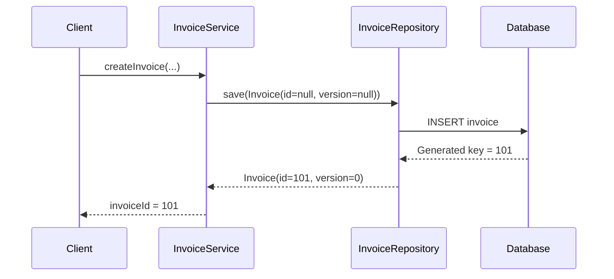
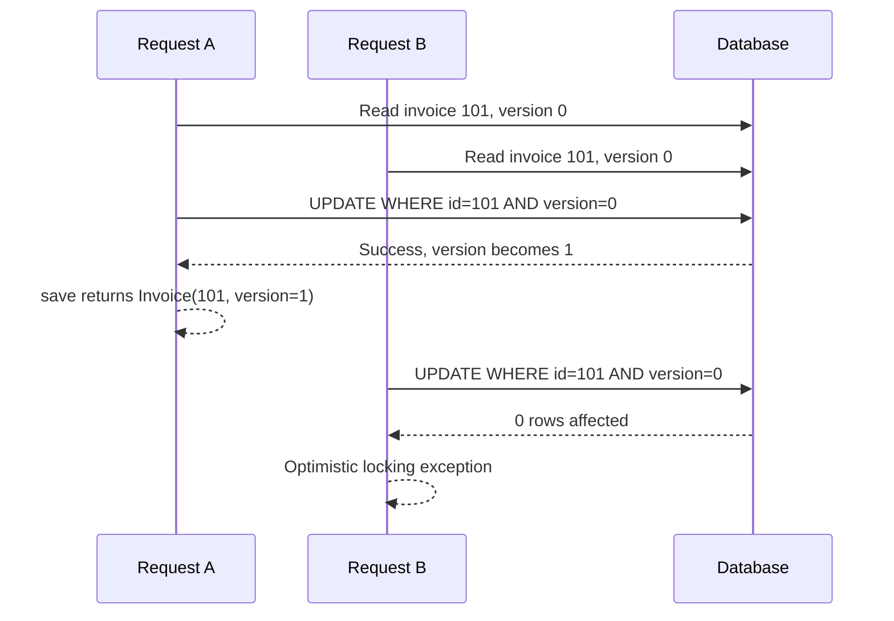

# Receiving Returned ID and Version on the Object Returned After `save`

In **Spring Data JDBC**, `repository.save(entity)` returns an aggregate object after the save operation completes. The returned object may contain a **database-generated ID** and a **new version** managed by Spring Data JDBC. This is essential data for the application to continue working with the record, return the ID from an API, or perform the next update.

The key rule to remember is to **use the return value from `save`**. For immutable entities such as a Java `record`, Spring Data JDBC cannot mutate fields on the input object; the framework creates an instance with the updated ID/version. For mutable entities, the input object may be updated through property access mechanisms, yet you should not depend on whether the two references point to the exact same instance.

This lesson distinguishes two types of values commonly returned:

- **ID (`@Id`)** identifies the record/aggregate. An ID may be generated by the database on `INSERT`, or assigned by the application using a custom strategy.
- **Version (`@Version`)** is a version number used to detect concurrent updates (optimistic locking). Spring Data JDBC initializes the version on insert and increments it on successful update.

## 1. End-to-End Example: Saving a New Invoice

Suppose the application has an `invoices` table:

```sql
CREATE TABLE invoices (
    id BIGINT GENERATED BY DEFAULT AS IDENTITY PRIMARY KEY,
    version BIGINT NOT NULL,
    invoice_number VARCHAR(40) NOT NULL,
    amount DECIMAL(18, 2) NOT NULL
);
```

`id` is automatically assigned by the database; `version` is the column for optimistic locking. The `GENERATED BY DEFAULT AS IDENTITY` syntax works on engines such as H2 and PostgreSQL, though DDL must be adjusted for your actual database.

Entity:

```java
import java.math.BigDecimal;
import org.springframework.data.annotation.Id;
import org.springframework.data.annotation.Version;
import org.springframework.data.relational.core.mapping.Table;

@Table("invoices")
public record Invoice(
        @Id Long id,
        @Version Long version,
        String invoiceNumber,
        BigDecimal amount
) {}
```

Repository:

```java
import org.springframework.data.repository.CrudRepository;

public interface InvoiceRepository extends CrudRepository<Invoice, Long> {
}
```

Both annotations come from Spring Data:

- `org.springframework.data.annotation.Id` marks the aggregate root's ID.
- `org.springframework.data.annotation.Version` marks the version property so Spring Data JDBC applies optimistic locking.

Do not mistakenly use JPA's `jakarta.persistence.Id` or `jakarta.persistence.Version` in this Spring Data JDBC example.

## 2. Receiving the Database-Generated ID After the First `INSERT`

When creating a new invoice, there is no ID yet:

```java
Invoice draft = new Invoice(
        null,
        null,
        "INV-2026-001",
        new BigDecimal("1250000.00")
);

Invoice saved = invoiceRepository.save(draft);

System.out.println(saved.id());      // Database-assigned ID, e.g. 101
System.out.println(saved.version()); // Initial version, e.g. 0
```

Under the default newness detection strategy, `id == null` indicates the aggregate has not yet been persisted. Spring Data JDBC performs an `INSERT`, omits the absent ID from the column list to write, then retrieves the **generated key** via JDBC and places that value into the returned aggregate.

The SQL below illustrates the intent of the insert; exact syntax and generated-key retrieval may differ by dialect/driver:

```sql
INSERT INTO invoices (version, invoice_number, amount)
VALUES (?, ?, ?);
```

The database creates `id`, say `101`. Spring Data JDBC combines the returned ID with the aggregate data and returns a result equivalent to:

```text
draft:
  id      = null
  version = null
  invoiceNumber = "INV-2026-001"

saved:
  id      = 101
  version = 0
  invoiceNumber = "INV-2026-001"
```

**Do not keep using `draft.id()` to retrieve the newly generated ID.** Use `saved.id()` because that is the object returned after the save operation.

### Why Is the Initial Version 0?

When an entity has `@Version`, Spring Data JDBC manages the version value. For a new entity, version is initialized at its starting level (typically `0`). On successful update, version is incremented. Thus, immediately after insert, the returned object already carries the version needed for the next update.

In the example using `Long version`, `null` on a new object indicates no version yet; the object returned from insert has the initialized version value. For primitive integer types, default value `0` is also evaluated by Spring Data under entity newness detection rules. Using wrapper `Long` clearly expresses the unpopulated state prior to the first save.

## 3. Using the Returned Object When the ID Is Needed for the Next Step

The generated ID often needs to be returned to a client or linked to another operation. Example application service:

```java
import java.math.BigDecimal;
import org.springframework.stereotype.Service;
import org.springframework.transaction.annotation.Transactional;

@Service
public class InvoiceService {
    private final InvoiceRepository invoices;

    public InvoiceService(InvoiceRepository invoices) {
        this.invoices = invoices;
    }

    @Transactional
    public Long createInvoice(String invoiceNumber, BigDecimal amount) {
        Invoice draft = new Invoice(null, null, invoiceNumber, amount);
        Invoice saved = invoices.save(draft);
        return saved.id();
    }
}
```

Data flow:



In the example, the service returns the ID taken from `saved`, rather than guessing the ID by counting rows or querying back by invoice number. The database is responsible for issuing IDs via the configured identity/sequence.

If you also want to return the version in the response, return a DTO instead of the persistence entity directly:

```java
public record InvoiceCreatedResponse(Long id, Long version) {}

@Transactional
public InvoiceCreatedResponse create(String number, BigDecimal amount) {
    Invoice saved = invoices.save(new Invoice(null, null, number, amount));
    return new InvoiceCreatedResponse(saved.id(), saved.version());
}
```

Using a DTO exposes exactly the needed API fields while avoiding coupling clients to the entire entity structure.

## 4. Immutable Entities: Why Must You Capture the Returned Object?

A Java `record` is immutable: once instantiated, its components cannot be reassigned. With:

```java
Invoice draft = new Invoice(null, null, "INV-2026-002", new BigDecimal("99.00"));
Invoice saved = invoiceRepository.save(draft);
```

Spring Data JDBC must create an instance containing the newly received ID and version. The two objects have identical business data yet different persistence state:

```text
draft  = Invoice(null, null, "INV-2026-002", 99.00)
saved  = Invoice(102, 0, "INV-2026-002", 99.00)
```

Therefore, the following snippet misuses the save result:

```java
Invoice draft = new Invoice(null, null, "INV-2026-002", amount);
invoiceRepository.save(draft);

// draft.id() is still null; the save return value was ignored.
return draft.id();
```

Correct snippet:

```java
Invoice draft = new Invoice(null, null, "INV-2026-002", amount);
Invoice saved = invoiceRepository.save(draft);
return saved.id();
```

With mutable classes, Spring Data may update ID/version via property accessors or field access. Nevertheless, the consistent and safe habit is to **always assign the return value of `save` to a variable and use that variable for subsequent steps**. This also prevents bugs if you later convert a mutable class into a record or adopt constructor-based mapping.

## 5. `@Version` After Update: Receiving the New Version

After insert, `saved` has `id = 101` and `version = 0`. When updating, build an object based on the current ID and version:

```java
Invoice changed = new Invoice(
        saved.id(),
        saved.version(),
        saved.invoiceNumber(),
        new BigDecimal("1300000.00")
);

Invoice updated = invoiceRepository.save(changed);

System.out.println(updated.id());      // 101
System.out.println(updated.version()); // 1
```

The ID remains unchanged because it is still the same invoice. The version increments from `0` to `1` because this is the next successful update.

The equivalent SQL semantics:

```sql
UPDATE invoices
SET invoice_number = ?,
    amount = ?,
    version = ?
WHERE id = ?
  AND version = ?;
```

Here the `WHERE` clause uses the ID and old version; the written value is the new version. Exact SQL phrasing may vary, yet the principle is **update only if the record is still at the version the caller read**.

`@Version` is not a business descriptive field like `revisionName`, `approvalNumber`, or `updatedBy`. It is a technical token for write concurrency control.

## 6. Optimistic Locking: Detecting a Stale Write Overwriting Newer Data

Suppose two requests concurrently read invoice `101` at version `0`:

```text
Request A reads Invoice(101, version=0)
Request B reads Invoice(101, version=0)
```

Request A updates successfully. The database updates version to `1`, and `save` returns `Invoice(101, version=1)`. Afterward, request B still attempts to save its old object with version `0`. B's update predicate no longer matches:

```sql
UPDATE invoices
SET amount = ?, version = 1
WHERE id = 101 AND version = 0;
```

Zero rows are updated. Spring Data JDBC detects the conflict and throws an optimistic locking failure, typically in the `OptimisticLockingFailureException` hierarchy.



This prevents a stale request from silently overwriting recent changes. Without `@Version`, a later update could overwrite data changed by another request, depending on operations and transactions.

### Handling Conflicts

The application can:

- Inform the user that the data was changed by someone else and prompt them to reload.
- Re-read the latest aggregate, reapply business intent if the operation is still valid, and retry saving.
- Return HTTP `409 Conflict` if the API exposes a resource edit conflict.

Do not retry blindly for every use case. If a use case triggers side effects such as charging payments, sending emails, or publishing messages, retrying can duplicate side effects. Retry only when safe to do so, typically requiring idempotency and re-evaluating all business rules against the fresh state.

## 7. Version Must Have a Matching Column in DDL

When adding `@Version`, the schema must include the version column. Example:

```sql
ALTER TABLE invoices
ADD COLUMN version BIGINT DEFAULT 0 NOT NULL;
```

For a new table, declare it directly:

```sql
version BIGINT NOT NULL
```

Spring Data JDBC manages the version value on insert/update; do not annotate an entity with `@Version` while omitting the column from the database. Conversely, having a column named `version` in DDL without `@Version` on the entity does not make Spring Data JDBC automatically treat it as an optimistic locking token.

When adding a version column to a table that already has data, the migration must assign a valid initial value to existing rows. `DEFAULT 0 NOT NULL` is one option in the example, though database syntax and current data state must be checked. Do not assume changing Java code alone is enough.

### When Is Version Incremented?

| Operation | Typical Version Outcome |
|---|---|
| Create new entity and insert succeeds | Initialized to `0` |
| Update entity at version `0` succeeds | Returns `1` |
| Update entity at version `1` succeeds | Returns `2` |
| Update with stale version no longer matching | No successful result object; optimistic locking exception raised |
| Mutate object in memory only, without calling `save` | Database unchanged, database version does not increment |

Version does not increment just because the application reads an entity. It is tied to write operations successfully executed by Spring Data JDBC.

## 8. Generated IDs vs. Application-Assigned IDs

Not every model uses database-generated identities. Cases split into two categories:

| Strategy | Before Save | After Save | Notes |
|---|---|---|---|
| Database identity/sequence | `id = null` | Receives database-assigned ID | DDL and JDBC driver must support generated key retrieval |
| Application-assigned UUID/ID | Already has ID | ID typically unchanged | Must configure newness detection properly; a pre-populated ID does not inherently prove the record already exists |

Example application-generated ID:

```java
import java.util.UUID;

UUID id = UUID.randomUUID();
// Create aggregate with pre-assigned ID before calling save.
```

With default ID-based newness detection when no version property exists, a non-null ID causes the entity to be treated as existing and routed to update. If an ID is pre-assigned to a new entity, use an appropriate newness strategy—such as implementing `Persistable<ID>` and managing `isNew()` accurately, or using a version property per Spring Data rules.

Do not simply change `id` from `null` to a UUID and expect `save` to always insert. If the framework treats the object as an existing entity, the operation may execute `UPDATE` and find zero rows.

## 9. How Spring Data Determines Whether an Entity Is New or Existing

Choosing `INSERT` vs. `UPDATE` directly affects returned ID/version values. Default rules to understand in practice:

- If the entity has a `@Version` property, Spring Data prioritizes version state: an unset version (`null` for wrapper types; default `0` for primitives) indicates a new entity.
- If there is no version property, the ID is used for detection: a `null` ID indicates a new entity; a non-null ID is normally treated as an existing entity.
- If the entity implements `Persistable`, `isNew()` lets the model supply its own new/existing status.

This explains why an entity with a pre-assigned ID can still be inserted with an appropriate `isNew` strategy, and why you should not arbitrarily set version before the first insert.

With `Persistable`, the application must manage `isNew` state accurately across the lifecycle. After a successful insert, the entity must no longer be considered new; if it always returns `true`, subsequent saves can keep taking the insert branch and hit duplicate-key errors.

## 10. When Does `save` Return Relative to Transaction Commit?

Another critical point: **having an ID/version on the returned object does not mean the outer transaction has committed yet**.

Example:

```java
@Transactional
public Invoice createAndContinue() {
    Invoice saved = invoices.save(
            new Invoice(null, null, "INV-2026-003", new BigDecimal("50.00"))
    );

    // At this point saved.id() and saved.version() may already be known.
    // However, the surrounding transaction does not commit until the method completes normally.
    return saved;
}
```

Inside a transaction, Spring Data JDBC executes the SQL statement and retrieves the generated key/version. The transaction manager commits only after the transaction boundary completes successfully. If a failure occurs after `save` causing the transaction to roll back, the in-memory object may still hold the received ID/version, yet the row is not committed as durable data.

Therefore:

- Using the returned ID to continue work **within the same transaction** is appropriate.
- Do not publish notifications claiming data is durably saved before the transaction commits if consumers will act on them.
- If events must be emitted post-commit, use an appropriate after-commit mechanism or transactional outbox so events align with committed data changes.
- If the transaction rolls back, do not reuse an object holding an ID/version as proof that the record still exists.

Beyond service-declared transactions, CRUD repositories often have default transaction behavior depending on Spring Data configuration. Still, when a use case spans multiple operations that must be atomic, placing `@Transactional` at the application service boundary clarifies commit/rollback scope.

## 11. Aggregates with Child Elements: Root ID Used to Save Collections

In Spring Data JDBC, a single `save(root)` call can emit multiple SQL statements if the aggregate has a collection mapped with `@MappedCollection`. The root is inserted/updated and child elements are saved within the ownership boundary.

Example:

```java
@Table("purchase_orders")
public record PurchaseOrder(
        @Id Long id,
        @Version Long version,
        String orderNumber,
        @MappedCollection(idColumn = "order_id", keyColumn = "line_no")
        List<OrderLine> lines
) {}
```

When inserting a new order, the generated root ID can be used as `order_id` for child lines. The returned aggregate object contains the new root ID and version; use the returned aggregate for subsequent steps, especially with immutable types.

Illustrative SQL semantics:

```sql
INSERT INTO purchase_orders (version, order_number) VALUES (?, ?);
-- retrieve generated order id
INSERT INTO order_lines (order_id, line_no, sku, quantity) VALUES (?, ?, ?, ?);
```

Do not assume one `save` call executes only a single SQL statement. Also do not split child entities into a separate repository just to obtain an ID if the child belongs to the root's lifecycle. Saving an aggregate can involve multiple operations and requires an appropriate transaction.

## 12. When Must You Write Custom SQL and Manage Version Manually?

With `repository.save(entity)`, Spring Data JDBC knows the metadata and applies version handling for aggregate operations. However, if you use a custom update SQL statement directly:

```java
@Modifying
@Query("UPDATE invoices SET amount = :amount WHERE id = :id")
int updateAmount(@Param("id") Long id, @Param("amount") BigDecimal amount);
```

do not assume the entity's `@Version` will be appended automatically to this SQL statement. Custom SQL must be explicitly written to enforce optimistic locking if the use case requires it:

```sql
UPDATE invoices
SET amount = :amount,
    version = version + 1
WHERE id = :id
  AND version = :expectedVersion;
```

Then inspect the affected row count:

- `1` row: update succeeded; the new version is old version plus one.
- `0` rows: record not found or version no longer matches; the application must distinguish as needed and handle the conflict.

This illustrates the principle, not a default replacement for `save`. With custom SQL, the developer is responsible for enforcing ID/version predicates, incrementing version, and interpreting affected row counts.

## 13. Common Errors When Receiving ID and Version

| Symptom | Possible Cause | Resolution |
|---|---|---|
| `saved.id()` stays `null` | ID not generated by database; DDL lacks identity/sequence; driver does not return generated keys; wrong mapping | Check `@Id`, DDL, dialect, and generated-key support |
| `draft.id()` stays `null` after `save` | Reading immutable input object instead of returned result | Assign and use `Invoice saved = repository.save(draft)` |
| First save runs `UPDATE` instead of `INSERT` | ID already set or `isNew` indicates existing entity | Check ID, version, and `Persistable.isNew()` |
| Insert fails due to missing `version` column | Entity has `@Version` but DDL lacks the column | Create migration adding the version column |
| Version does not increment as expected | `save` not called, entity lacks `@Version`, or custom SQL skips updating version | Check the actual write path and SQL |
| `OptimisticLockingFailureException` | Object being saved carries an outdated version | Reload data, handle conflict, or retry safely |
| Object has ID yet invisible to other transactions | Outer transaction rolled back or not yet committed | Check transaction boundary and commit outcome |
| Saving child fails with foreign-key error | Root ID not generated/propagated properly or wrong `idColumn` mapping | Check aggregate save order and child DDL |
| Pre-assigned ID skips insert | Default detection treats non-null ID as existing entity | Use `Persistable` or an appropriate version strategy |

When debugging, log four values at the moment `save` is called: **input ID, input version, executed SQL, and output ID/version**. If a transaction is involved, also record commit/rollback status. Those four pieces of information are usually enough to distinguish entity detection errors, generated-key errors, optimistic locking errors, and transaction errors.

## 14. Hands-On Exercise Observing ID and Version

Using H2 in-memory and the `invoices` table from the beginning, try in sequence:

1. Create `Invoice(null, null, ...)`, call `save`, and print both `draft` and `saved`. Observe the missing input ID, assigned returned ID, and initial version.
2. Create a new object based on `saved.id()` and `saved.version()`, change `amount`, and call `save` again. Observe the unchanged ID and incremented version.
3. Keep an older object snapshot carrying the previous version. After saving a newer version, attempt to save the older snapshot; observe the optimistic locking exception.
4. Ignore the return value of the insert, then print `draft.id()`. Observe why immutable code lacks the generated ID.
5. Temporarily drop the `version` column from the schema while keeping `@Version`, spin up a clean test database, and observe the mapping/SQL error. Restore the DDL afterward.
6. Introduce an exception after `save` inside a `@Transactional` method so the transaction rolls back; inspect the database and the in-memory object. Observe that an ID on the object alone does not prove the row committed.

Do not run schema-breaking experiments against databases holding real data. At each step, record the SQL, bound values, before/after object state, and database outcome to understand the lifecycle accurately.

## 15. Summary When Using the Result of `save`

```text
New entity
    id = null, version = null
          |
          v
repository.save(entity)
          |
          v
INSERT + database generated key
          |
          v
Returned object: id = generated ID, version = 0
          |
          v
Build update from latest ID/version
          |
          v
repository.save(changed)
          |
          v
UPDATE WHERE id = ? AND version = oldVersion
          |
          v
Returned object: same ID, incremented version
```

`save` returns an aggregate processed by Spring Data JDBC according to its current state. **ID tells which aggregate was saved; version tells which revision was successfully read/written.** Using the returned object itself lets application code continue with the latest ID and version, especially when using immutable entities. Combining that with `@Version`, matching DDL, and clear transaction boundaries keeps write operations safer against concurrent writes and rollback pitfalls.
